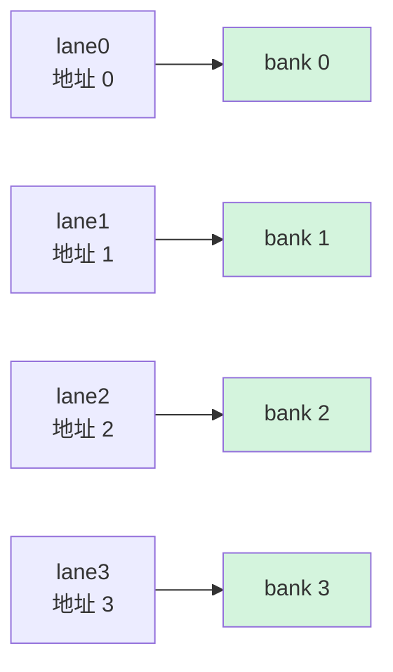
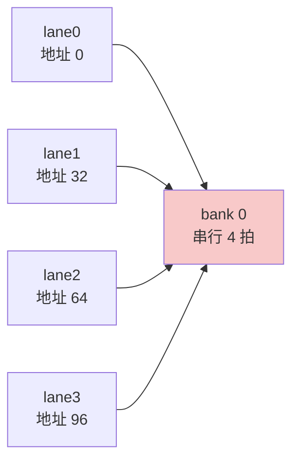
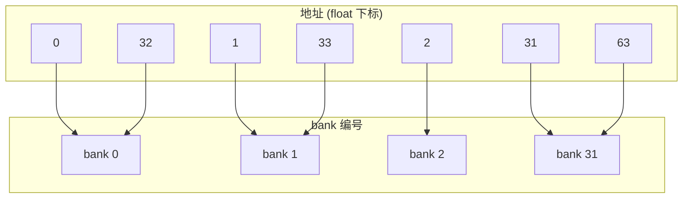
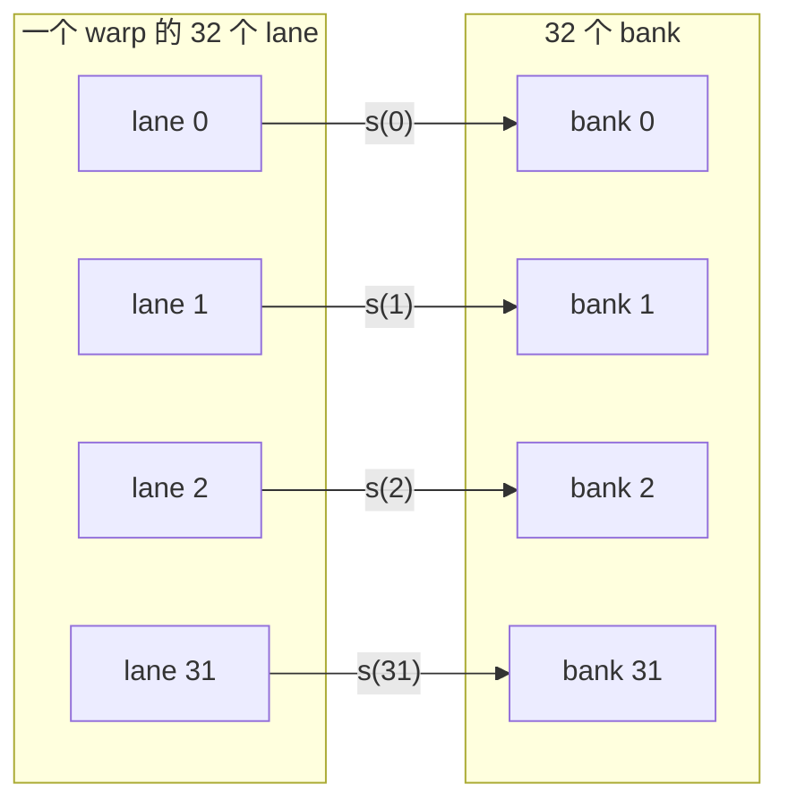
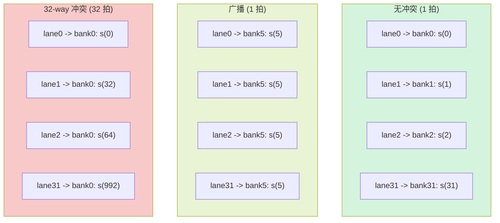
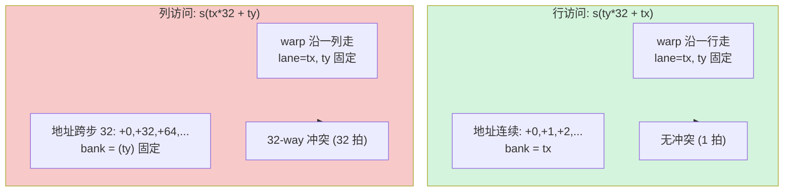
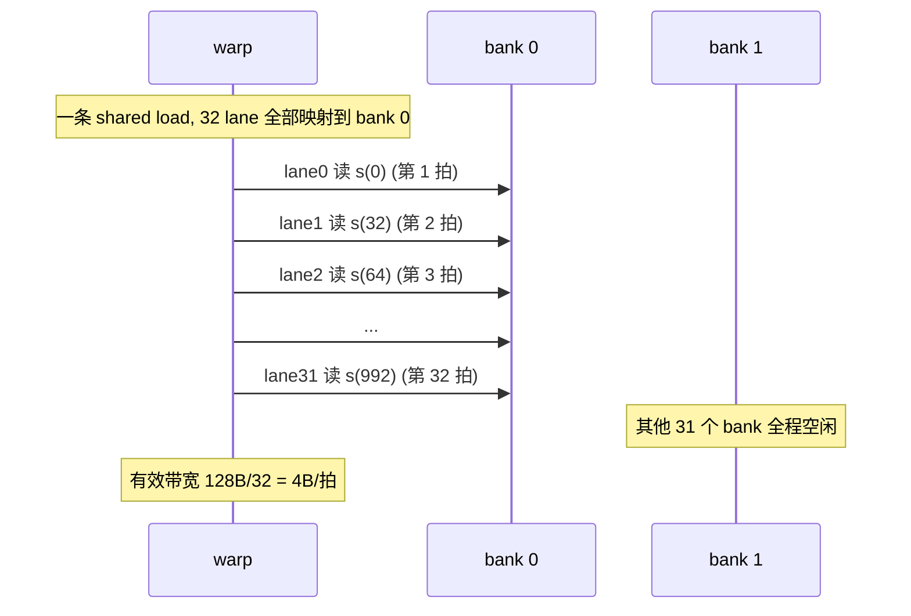
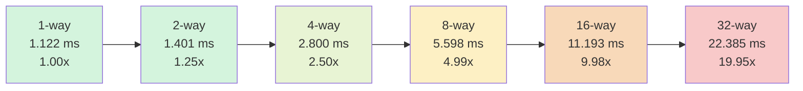
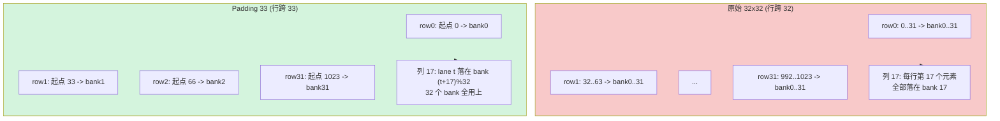
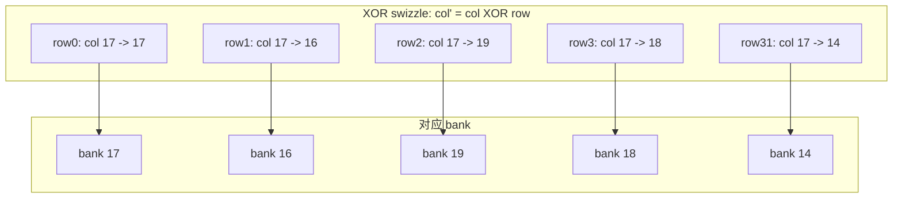

# H20 共享存储器 Bank 冲突详解

> **实测平台**：NVIDIA H20-3e（Hopper，compute capability 9.0，78 个 SM，CUDA 13.0）
>
> **关联内容**：本书第 4 章 4.1.1「便笺式存储器与 L1 数据缓存」，以及第 3 章 3.3「操作数收集器 / 寄存器 bank」。
>
> **本文目标**：把"bank 冲突"从一个名词变成可计算、可测量、可解决的工程问题。所有数字都来自本机 H20 实测，所有代码都可直接编译运行。

---

## 0. 一页速览

| 问题 | 结论（H20） |
|---|---|
| 共享存储器多大？ | 每 SM **228 KB**，每 block 最多 opt-in **227 KB** |
| 多少个 bank？ | **32 个 bank**，每个 **4 字节**宽 |
| 一个 warp 一次能读多少？ | 32 lane × 4B = **128 B**，正好填满 32 个 bank |
| bank 号怎么算？ | `bank = 地址 % 32`（地址按 4B 字编号） |
| 什么算冲突？ | 同一 warp 的**同一条指令**中，多个 lane 访问**同一 bank 的不同 4B 字** |
| 什么不算冲突？ | 多个 lane 访问**同一地址** → **广播**，1 拍完成 |
| 最坏冲突？ | 32 个 lane 全落在同一 bank → 串行 32 拍 |
| H20 实测最坏惩罚？ | 32-way 比无冲突慢 **19.95×**（22.385 ms vs 1.122 ms） |
| 常用解法？ | **Padding（+1）**、**XOR swizzle**、**广播**、**warp shuffle** |

### 0.1 Bank 布局：一张表就够

| 行 \ bank | bank 0 | bank 1 | bank 2 | bank 3 | … | bank 30 | bank 31 |
|---|---|---|---|---|---|---|---|
| **行 0**（地址 0..31） | 0 | 1 | 2 | 3 | … | 30 | 31 |
| **行 1**（地址 32..63） | 32 | 33 | 34 | 35 | … | 62 | 63 |
| **行 2**（地址 64..95） | 64 | 65 | 66 | 67 | … | 94 | 95 |
| **…** | … | … | … | … | … | … | … |
| **行 1823**（最后一行） | 58336 | 58337 | 58338 | 58339 | … | 58366 | 58367 |

**读表方法**：

- **横着看**：一行 = 32 个连续地址 = 128 B，正好覆盖 32 个 bank；
- **竖着看**：一列 = 同一个 bank，列内地址相差 **32**；
- 公式：`bank = 地址 % 32`，`行 = 地址 / 32`；
- H20 容量：228 KB = 58,368 个 4B 字 = **1824 行 × 32 列**。

### 0.2 什么是 bank 冲突

一个 warp 的 32 个 lane 执行**同一条** load：

- 32 个 lane 落在 **32 个不同 bank** → **无冲突，1 拍**；
- 多个 lane 落在**同一 bank、不同地址** → **n-way 冲突，串行 n 拍**；
- 多个 lane 落在**同一 bank、同一地址** → **广播，1 拍，不算冲突**。

**无冲突**（4 个 lane 示例）：



**冲突**（4 个 lane 全挤到 bank 0）：



> 记忆：**不同 bank = 并行；同 bank 不同地址 = 排队；同地址 = 广播。**

---

## 1. H20 的共享存储器参数

### 1.1 硬件参数（实测）

用 `cudaGetDeviceProperties` 读取：

```c
cudaDeviceProp p;
cudaGetDeviceProperties(&p, 0);
printf("SMs=%d\n", p.multiProcessorCount);                 // 78
printf("sharedMemPerSM=%zu\n", p.sharedMemPerMultiprocessor); // 233472 B = 228 KB
printf("sharedMemPerBlockOptin=%zu\n", p.sharedMemPerBlockOptin); // 232448 B = 227 KB
```

| 参数 | H20-3e 实测值 | 说明 |
|---|---:|---|
| SM 数 | 78 | 每个 SM 有独立的 32-bank 共享存储器 |
| 每 SM 共享存储器 | 233,472 B（228 KB） | 与 L1 共享同一块物理 SRAM，可配置 carveout |
| 每 block 最大动态共享内存 | 232,448 B（227 KB） | 需 `cudaFuncSetAttribute` opt-in |
| 默认静态共享内存上限 | 48 KB | 超过需动态分配 + opt-in |
| bank 数 | 32 | 与 warp 大小一致 |
| bank 宽度 | 4 B（32 bit） | 一个 bank 一拍提供一个 4B 字 |
| 一拍总带宽 | 32 × 4 B = **128 B** | 恰好是一个 warp 的 32 个 4B 字 |
| warp 大小 | 32 | bank 数与 lane 数的"一对一"是设计关键 |

> **为什么是 32 个 bank、每个 4B？** 这不是巧合。warp 有 32 个 lane，最常见的访问是每个 lane 读一个 32 位浮点/整数。把 bank 数做成 32、宽度做成 4B，就能让"32 个 lane 访问 32 个连续 4B 字"在一拍内完成。这是 GPU 把"宽 SIMD"落到 SRAM 上的最小成本方案。

### 1.2 容量换算成"bank 行"

- 每个 bank 一拍输出 4B；
- 32 个 bank 一拍输出 128B；
- 228 KB / 128 B = **1824 行**（可以理解为"每个 bank 有 1824 个 4B 槽位"）。

一个 32×32 的 float 矩阵正好是 4 KB，占 32 行；这也是为什么 32×32 的 tile 是共享存储器最经典的形状。

---

## 2. Bank 的组织：地址如何映射到 bank

### 2.1 映射公式

对于 4 字节字访问：

$$
\text{bank} = \left\lfloor \frac{\text{byte\_address}}{4} \right\rfloor \bmod 32
$$

等价地，如果数组是 `float s[]`，下标为 `i`：

$$
\text{bank}(i) = i \bmod 32
$$

每 32 个连续的 `float` 刚好覆盖 32 个 bank 一次。



**要点**：`i` 和 `i+32` 落在同一个 bank。所以"跨步 32"的访问天然会把所有 lane 压到同一个 bank。

### 2.2 一个 warp 的"理想访问"



- 地址 `s[0..31]` 连续；
- 每个 bank 只被一个 lane 访问；
- **1 拍完成**，有效带宽 128 B/拍。

这就是 `s[threadIdx.x]` 模式的威力。

---

## 3. Bank 冲突的精确定义

### 3.1 三种情况

同一条 shared memory 指令、同一个 warp 内，32 个 lane 的地址分布有三种：

| 情况 | 地址特征 | 硬件行为 | 拍数 |
|---|---|---|---|
| **无冲突（no conflict）** | 32 个 lane 落在 32 个不同 bank | 并行读出 | 1 |
| **广播（broadcast）** | 多个 lane 访问**同一个 4B 字** | 硬件复制一份给所有请求者 | 1 |
| **n-way 冲突** | 多个 lane 落在同一 bank，但**地址不同** | 串行读出，每拍服务一个 | n |

**关键区别**：广播是"同 bank 同地址"，冲突是"同 bank 不同地址"。前者免费，后者要命。



### 3.2 冲突度数（conflict degree）

对一条 shared 指令，定义：

$$
D = \max_{b \in \{0..31\}} \left| \{ l \mid \text{bank}(addr_l)=b,\ addr_l \text{ 互不相同} \} \right|
$$

- \(D=1\)：无冲突；
- \(D=2\)：2-way；
- \(D=32\)：最坏。

**完成这条指令所需拍数 ≈ D**（忽略流水线开销）。有效带宽从 128 B/拍降到 \(128/D\) B/拍。

> 注意：如果同一 bank 内多个 lane 访问的是**同一个地址**，它们合并为一次广播，不计入 D 的"不同地址"集合。

### 3.3 冲突只发生在"同一 warp、同一条指令、同一时刻"

这一点非常重要，初学者常混淆：

- **不同 warp 之间不会 bank 冲突**。每个 warp 的指令独立发射，warp A 和 warp B 的访问由调度器分时，不构成"同一拍的 bank 争用"（它们争的是 shared memory 的**吞吐**，不是经典的 bank 冲突）。
- **同一 warp 的不同指令不会 bank 冲突**。冲突是"一条指令内 32 个 lane"的地址分布问题。
- **同一线程的多次访问不会 bank 冲突**。它们是串行的指令。

所以，bank 冲突本质是：**一条 SIMD 指令的 32 个 lane 同时向 SRAM 提出的地址需求，超出了 bank 的并行服务能力。**

---

## 4. 图形化理解：从"行"到"列"

### 4.1 行访问 vs 列访问

假设有一个 32×32 的 `float` 矩阵，按行优先存放：`s[row*32 + col]`。



**为什么列访问会 32-way？**

- lane \(t\) 访问 `s[t*32 + c]`；
- bank = \((t \times 32 + c) \bmod 32 = c\)；
- c 对所有 lane 相同 → 32 个 lane 全部落在 bank c；
- 地址 `t*32+c` 各不相同 → 冲突度 32。

这正是矩阵转置、按列扫描、直方图等代码最容易踩的坑。

### 4.2 冲突的"串行化时间线"



**最讽刺的地方**：硬件有 32 个 bank，但这条指令只用了 1 个，其余 31 个在"看戏"。冲突不是"bank 不够"，而是"地址分布把 bank 用歪了"。

---

## 5. H20 实测

### 5.1 测量方法

- 内核：每个线程对同一个 shared 地址重复读 20,000 次；
- 用 `volatile` 防止编译器把读提到循环外；
- 用 `cudaEvent` 计时，100 次取平均；
- 启动 78×8 = 624 个 block、每 block 256 线程，确保每个 SM 有足够 warp 饱和；
- 每个 warp 的 lane 固定为 0..31。

> 完整代码：`cuda_examples/bank_conflict_demo.cu`（见第 6 节）。

### 5.2 冲突度数扫描

访问模式：`idx = (lane * STRIDE) & 1023`。

| STRIDE | 冲突度数 | 时间 | 相对 1-way |
|---:|---:|---:|---:|
| 1 | 1-way | 1.122 ms | 1.00× |
| 2 | 2-way | 1.401 ms | 1.25× |
| 4 | 4-way | 2.800 ms | 2.50× |
| 8 | 8-way | 5.598 ms | 4.99× |
| 16 | 16-way | 11.193 ms | 9.98× |
| 32 | 32-way | **22.385 ms** | **19.95×** |



**怎么读**：

- 从 4-way 起几乎**线性增长**：4-way 2.50×、8-way 4.99×、16-way 9.98×、32-way 19.95×。这说明每增加一倍冲突，时间几乎翻倍——bank 被串行复用的直接证据。
- 2-way 只有 1.25×，低于理论 2×。原因是：H20 有大量 warp 可以重叠、shared 流水线有 latency hiding，2-way 的第二个 phase 部分被其他 warp 填掉。冲突越重，越难隐藏。
- 32-way 是 19.95× 而不是 32×，同理：仍有其他 warp 在空隙中发射，且循环/依赖本身有开销。**但 20 倍的性能差距已经足以毁掉一个内核。**

### 5.3 32×32 矩阵列访问：冲突、padding、swizzle

访问模式：lane `t` 读第 `t` 行、第 17 列。

| 版本 | 地址 | bank | 时间 | 相对冲突版 |
|---|---|---|---:|---:|
| **无 padding（冲突）** | `t*32 + 17` | 恒为 17 | 22.385 ms | 1.00× |
| **padding 33** | `t*33 + 17` | `(t+17)%32`，各不相同 | **1.122 ms** | **19.95× 更快** |
| **XOR swizzle** | `t*32 + (17^t)` | `(17^t)%32`，各不相同 | **1.143 ms** | **19.59× 更快** |



### 5.4 广播：同地址是免费的

| 模式 | 地址 | 时间 | 相对 |
|---|---|---|---:|
| `s[lane]` 无冲突 | 32 个不同 bank | 1.122 ms | 1.00× |
| `s[0]` **广播** | 32 lane 同一地址 | **1.090 ms** | **1.03×** |
| `s[lane*32]` 32-way | 同 bank 不同地址 | 22.385 ms | 0.05×（慢 20×） |

**结论**：广播不仅不慢，甚至略快（少了地址生成/仲裁开销）。所以"所有线程读同一个常量/权重"是安全的，不要为了"避免冲突"把它拆成 32 份。

### 5.5 带宽核算：数字对得上吗？

- 无冲突版：3.19×10⁹ 次 4B 读 / 1.122 ms = **11.4 TB/s**（全 GPU）。
- 理论峰值：78 SM × 32 bank × 4 B × 1.98 GHz = **19.8 TB/s**。
- 实测约为理论峰值的 **58%**，差额来自指令发射、地址计算、循环依赖、latency hiding 不完美等。
- 32-way 版：约 **0.57 TB/s**，正好约 1/20。

这组数字说明：**bank 冲突不是"缓存未命中"那种概率事件，而是确定性的吞吐率除法**。冲突度 32，带宽就除以 32（近似）。

---

## 6. CUDA 编程例子

### 6.1 例子一：复现 bank 冲突（最小可运行）

```cuda
#include <cstdio>
#include <cuda_runtime.h>

template<int STRIDE>
__global__ void bank_kernel(float* out, int reps) {
    __shared__ volatile float s[1024];
    int t = threadIdx.x & 31;                 // warp 内 lane 0..31
    for (int i = threadIdx.x; i < 1024; i += blockDim.x)
        s[i] = i * 0.5f;
    __syncthreads();

    float acc = 0.f;
    int idx = (t * STRIDE) & 1023;            // 关键: lane 的地址跨步
    #pragma unroll 1
    for (int r = 0; r < reps; ++r)
        acc += s[idx];                        // 每个 lane 读自己的地址
    out[blockIdx.x * blockDim.x + threadIdx.x] = acc;
}

template<int STRIDE>
float bench_stride(float* d, int nb, int reps, int iters = 100) {
    cudaEvent_t a, b;
    cudaEventCreate(&a); cudaEventCreate(&b);
    bank_kernel<STRIDE><<<nb, 256>>>(d, reps);
    cudaDeviceSynchronize();
    cudaEventRecord(a);
    for (int i = 0; i < iters; ++i)
        bank_kernel<STRIDE><<<nb, 256>>>(d, reps);
    cudaEventRecord(b);
    cudaEventSynchronize(b);
    float ms; cudaEventElapsedTime(&ms, a, b);
    cudaEventDestroy(a); cudaEventDestroy(b);
    return ms / iters;
}

int main() {
    const int NB = 78 * 8, REPS = 20000;
    float* d;
    cudaMalloc(&d, (size_t)NB * 256 * 4);

    float t1  = bench_stride<1>(d, NB, REPS);
    float t32 = bench_stride<32>(d, NB, REPS);
    printf("1-way  : %.3f ms\n", t1);
    printf("32-way : %.3f ms  (%.2fx)\n", t32, t32 / t1);

    cudaFree(d);
    return 0;
}
```

**关键点**：

- `t = threadIdx.x & 31`：确保每个 warp 的 lane 是 0..31；
- `idx = t*STRIDE`：制造"同 bank 不同地址"；
- `volatile`：防止编译器把 shared 读优化掉；
- `#pragma unroll 1`：避免展开后编译器做地址合并。

### 6.2 例子二：矩阵转置（最经典的冲突现场）

#### 朴素版本（会冲突）

```cuda
#define TILE 32

__global__ void transpose_naive(float* out, const float* in, int N) {
    __shared__ float tile[TILE][TILE];

    int x = blockIdx.x * TILE + threadIdx.x;
    int y = blockIdx.y * TILE + threadIdx.y;

    // 读: 合并访问 (x 连续)
    tile[threadIdx.y][threadIdx.x] = in[y * N + x];
    __syncthreads();

    // 写: 转置后坐标交换
    x = blockIdx.y * TILE + threadIdx.x;
    y = blockIdx.x * TILE + threadIdx.y;

    // 读 shared: 访问 tile[threadIdx.x][threadIdx.y] —— 列访问!
    out[y * N + x] = tile[threadIdx.x][threadIdx.y];
}
```

**冲突分析**：

- 写回阶段，warp 内 `threadIdx.x` 变化、`threadIdx.y` 固定；
- 访问 `tile[tx][ty]`，地址 = `tx*32 + ty`；
- bank = `(tx*32 + ty) % 32 = ty`，对 32 个 lane 恒定；
- 32-way 冲突。

#### 版本 A：Padding（+1）

```cuda
__global__ void transpose_pad(float* out, const float* in, int N) {
    __shared__ float tile[TILE][TILE + 1];   // 行跨 33

    int x = blockIdx.x * TILE + threadIdx.x;
    int y = blockIdx.y * TILE + threadIdx.y;

    tile[threadIdx.y][threadIdx.x] = in[y * N + x];
    __syncthreads();

    x = blockIdx.y * TILE + threadIdx.x;
    y = blockIdx.x * TILE + threadIdx.y;
    out[y * N + x] = tile[threadIdx.x][threadIdx.y];
}
```

- 地址 = `tx*33 + ty`；
- bank = `(tx*33 + ty) % 32 = (tx + ty) % 32`；
- lane `tx` 变化 → bank 各不相同；
- 无冲突。
- 代价：shared 用量从 4 KB 增到 4.125 KB（+3.1%），几乎不影响 occupancy。


#### 版本 B：XOR swizzle（不增加内存）

```cuda
__device__ __forceinline__ int swz(int row, int col) {
    return row * 32 + (col ^ (row & 31));
}

__global__ void transpose_swizzle(float* out, const float* in, int N) {
    __shared__ float tile[TILE * TILE];       // 仍是 4 KB

    int x = blockIdx.x * TILE + threadIdx.x;
    int y = blockIdx.y * TILE + threadIdx.y;

    // 写: 原坐标 (ty, tx)
    tile[swz(threadIdx.y, threadIdx.x)] = in[y * N + x];
    __syncthreads();

    x = blockIdx.y * TILE + threadIdx.x;
    y = blockIdx.x * TILE + threadIdx.y;

    // 读: 转置坐标 (tx, ty)
    out[y * N + x] = tile[swz(threadIdx.x, threadIdx.y)];
}
```

**为什么无冲突？**

- 读阶段 lane = `tx`，`ty` 固定；
- 地址内偏移 = `ty ^ tx`；
- bank = `(ty ^ tx) % 32`；
- 当 `tx` 遍历 0..31 时，`ty ^ tx` 也遍历 0..31（异或是一一映射）；
- 32 个 lane 落在 32 个不同 bank。



> **XOR swizzle 的代价**：每次访问都要多一次异或和位运算；写入和读出必须使用同一套映射。它不增加存储，适合对 shared 容量敏感的场景。这也是 CUTLASS / Tensor Core 的 shared memory 布局常用技巧。

### 6.3 例子三：广播（正确利用"同地址免费"）

```cuda
// 所有线程使用同一个权重/常量: 广播, 不冲突
__global__ void scale_broadcast(float* out, const float* in, float w) {
    __shared__ float sw;
    if (threadIdx.x == 0) sw = w;    // 只写一次
    __syncthreads();

    int i = blockIdx.x * blockDim.x + threadIdx.x;
    out[i] = in[i] * sw;             // 32 lane 读同一地址 -> 广播
}
```

> 不要为了"分散 bank"而把 `sw` 复制成 `sw[32]` 并让每个 lane 读不同副本——那是**不必要的**，广播本身已经是 1 拍。复制反而浪费 shared 容量和初始化带宽。

---

## 7. 常用解决方案

### 7.1 方案一：Padding（填充）

**做法**：把内层维度加 1（或加一个与 32 互质的数），破坏"行跨 = bank 数"的整除关系。

```cuda
__shared__ float tile[32][33];   // 33 与 32 互质
```

**适用**：二维 tile、按列访问、矩阵转置、卷积的 im2col tile。

**优点**：改动最小，一行代码；**缺点**：多占 1/32 的 shared 容量，且地址计算多一次乘法（通常可忽略）。

**选择 padding 值的原则**：

- 加 1（33）最简单，且 33 与 32 互质，列访问 bank = `(t + c) % 32`，必然分散；
- 如果 tile 宽度不是 32，可加 1 或加到一个与 32 互质的值；
- 不要加 32 的倍数（无效）。

### 7.2 方案二：XOR swizzle（异或重排）

**做法**：用 `col ^ row` 重排列，使同一列在不同行落到不同 bank。

```cuda
__device__ __forceinline__ int swz(int row, int col, int width) {
    return row * width + (col ^ (row & (width - 1)));
}
```

**适用**：宽度为 2 的幂（如 32、64）的 tile；对容量敏感、不能 padding 的场景。

**优点**：零额外存储；**缺点**：读写都要变换，增加少量 ALU；布局对程序员不直观。

**变体**：

- `col ^ (row & 31)`：最常用；
- `col ^ ((row >> k) & 31)`：按块异或；
- 更复杂的 `swizzle<3,3,3>`（CUTLASS 风格）：用位域拼接实现大 tile 的无冲突布局。

### 7.3 方案三：改变访问顺序 / Tiling

很多时候冲突来自"一次访问一整列"。可以改成**分块 + 转置读写**：


**核心思想**：把"全局的非合并访问"转成"shared 内的冲突访问"，再用 padding/swizzle 消除冲突；这样全局访存是合并的，shared 访存也是无冲突的，两头都优化。

### 7.4 方案四：广播

如果 32 个 lane 读的是**同一个地址**（常量、权重、共享参数），直接读，硬件广播。

```cuda
float w = s_weight[0];   // 所有 lane 相同 -> 广播, 1 拍
```

**判断**：地址是否与 lane 无关？是 → 广播；否 → 检查 bank 分布。

### 7.5 方案五：用 warp shuffle 替代 shared memory

如果数据交换只发生在**同一个 warp 内**，用 `__shfl_sync` 等 warp 原语，完全绕过 shared memory 和 bank 冲突。

```cuda
// 例: 把 lane i 的值传给 lane i+1
float v = ...;
float left = __shfl_up_sync(0xffffffff, v, 1);
```

**优点**：无 bank 冲突、延迟低；**缺点**：只能 warp 内，跨 warp 仍需 shared memory。

### 7.6 方案六：向量化与对齐

- 用 `float4` 一次读 16B，可以减少指令数、提高访存效率；
- 但 **16B 会跨越 4 个 bank**，一个 warp 的 32 个 `float4` 覆盖 128 个 bank 字，需要 4 个 phase；
- 如果每个 lane 的 `float4` 起始地址不连续或未对齐，可能在同一 phase 内产生冲突；
- 原则：**让 lane 的向量地址连续且 16B 对齐**，并接受"宽访问天然多 phase"的事实。

```cuda
__shared__ __align__(16) float4 s4[1024];
float4 v = s4[threadIdx.x];   // 连续、对齐: 4 个 phase, 无额外冲突
```

> 具体宽访问的 bank 行为与架构实现有关；**以实测为准**，不要只凭"32 bank × 4B"推导所有细节。

### 7.7 方案七：动态共享内存 + 运行时 padding

当 tile 宽度是运行时参数时，用动态 shared memory，并在主机端计算 padded stride：

```cuda
extern __shared__ float smem[];
int stride = width + 1;                 // padding
smem[row * stride + col] = ...;
```

启动时：

```cuda
size_t bytes = (size_t)height * (width + 1) * sizeof(float);
kernel<<<grid, block, bytes>>>(...);
```

H20 上超过 48 KB 需要 opt-in：

```cuda
cudaFuncSetAttribute(kernel,
    cudaFuncAttributeMaxDynamicSharedMemorySize, bytes);
```

### 7.8 方案八：避免 shared memory（寄存器 / shuffle / 分布式）

- 小规模、warp 内：用寄存器 + shuffle；
- 只读常量：用 `__constant__` 或 kernel 参数（常量缓存会广播）；
- 跨 SM：Hopper 的 DSMEM 可以访问其他 SM 的 shared，但**远程访问延迟更高**，且目标 SM 的 bank 冲突仍然存在，不应把 DSMEM 当成"无限 bank"。

---

## 8. 方案对比

| 方案 | 消除冲突 | 额外存储 | 额外指令 | 适用场景 | H20 实测效果 |
|---|---|---|---|---|---|
| **Padding +1** | 是 | +3.1%（33/32） | 少量地址计算 | 2D tile、转置、卷积 | 22.385 → 1.122 ms（**19.95×**） |
| **XOR swizzle** | 是 | 0 | 异或 + 位运算 | 2 的幂宽度、容量敏感 | 22.385 → 1.143 ms（**19.59×**） |
| **改变访问顺序 / tiling** | 是（配合前两者） | 0 | 重排循环 | 矩阵乘、转置、stencil | 取决于实现 |
| **广播** | 不适用（本就免费） | 0 | 0 | 常量/权重/共享参数 | 1.090 ms（与无冲突相当） |
| **Warp shuffle** | 绕过 shared | 0 | shuffle 指令 | warp 内交换/归约 | 无 bank 冲突 |
| **向量化** | 减少指令，不消除相位 | 0 | 向量指令 | 连续对齐访问 | 需实测 |
| **动态 shared + padding** | 是 | 运行时决定 | 运行时 stride | 宽度可变 tile | 同 padding |

---

## 9. 测量 bank 冲突时的陷阱

这一节来自本次实测踩过的坑，非常重要。

### 9.1 编译器会把你的 shared 读优化掉

如果 `s` 不是 `volatile`，且地址在循环中不变，编译器可能只读一次、把值放寄存器：

```cuda
float acc = 0;
for (int r = 0; r < reps; ++r)
    acc += s[idx];     // 非 volatile + idx 不变 -> 可能只读一次
```

**现象**：四种 stride 测出来都是 0.65 ms，看起来"没有冲突"。

**解决**：`__shared__ volatile float s[...]`，或让地址随循环变化，或检查 SASS 确认有 `LDS` 指令。

### 9.2 越界访问 shared memory

```cuda
__shared__ float s[32*33];
int t = threadIdx.x;          // 0..255
s[t*32] = ...;                // t=255 -> 8160, 越界!
```

**现象**：内核直接失败或返回 0 ms，计时毫无意义。

**解决**：`int t = threadIdx.x & 31;`，或按 blockDim 正确分配；每次 launch 后检查 `cudaGetLastError()`。

### 9.3 启动配置不足

- block 太少 → 无法填满 SM，延迟藏不住，冲突差异被掩盖；
- block 太多 → 资源竞争，计时噪声大。

**建议**：至少 `SM 数 × 4` 个 block，每 block 128–256 线程；先做 warmup，再计时。

### 9.4 只测"平均"，不看分布

bank 冲突可能只在某些 warp/某些迭代发生。用 `clock64()` 或 Nsight Compute 的 `shared_ld_bank_conflict` 指标可以看到分布：

```bash
ncu --metrics l1tex__data_bank_conflicts_pipe_lsu_mem_shared_op_ld.sum ./a.out
```

> 指标名随架构版本可能变化；NVIDIA Nsight Compute 的 "Memory Workload Analysis" 页面会直接给出 bank conflict 次数。

### 9.5 把"广播"误判为"冲突"

同一地址的 32 个 lane 不是冲突。写测试时要把"同地址"和"同 bank 不同地址"分开。

---

## 10. 性能模型

### 10.1 单条指令的拍数

$$
\text{cycles} \approx \max_{b} \left| \{ l \mid \text{bank}(addr_l)=b,\ addr_l \text{ distinct} \} \right|
$$

### 10.2 有效带宽

$$
\text{BW}_{\text{eff}} = \frac{128\ \text{B}}{\text{cycles}} \times f_{\text{SM}} \times N_{\text{SM}}
$$

H20：\(f_{\text{SM}} \approx 1.98\ \text{GHz}\)，\(N_{\text{SM}}=78\)。

- 无冲突：\(128 \times 1.98\text{G} \times 78 \approx 19.8\ \text{TB/s}\)（理论上限）；
- 32-way：约 \(0.62\ \text{TB/s}\)；
- 实测无冲突 11.4 TB/s（约 58% 上限），32-way 0.57 TB/s。

### 10.3 对 occupancy 的影响

shared memory 是 occupancy 的三大限制之一（另两个是寄存器和线程数）：

$$
\text{blocks/SM} \le \frac{228\ \text{KB}}{\text{shared per block}}
$$

例如 32×33 tile（4.125 KB）+ 每 block 1024 线程：

- shared 允许 \(228/4.125 \approx 55\) 个 block；
- 但每 SM 最多 2048 线程 → 只能 2 个 block；
- 所以此例中 **shared 不是瓶颈，线程数才是**。

padding 的 +3.1% 通常不会改变 occupancy，除非你正好卡在容量边界。

---

## 11. H20 特别注意事项

### 11.1 L1 / shared 的 carveout

Hopper 的 L1 与 shared memory 共享同一块物理 SRAM。H20 上：

- 每 SM shared 最大 228 KB；
- 每 block 动态 shared 最大 227 KB（opt-in）；
- 剩余部分作为 L1 缓存。

`cudaFuncAttributePreferredSharedMemoryCarveout` 可以给内核一个"偏好比例"：

```cuda
cudaFuncSetAttribute(kernel,
    cudaFuncAttributePreferredSharedMemoryCarveout, 100); // 100% shared
```

**权衡**：shared 给多了，L1 就少了；如果你的内核主要靠 L1 缓存全局数据，不要盲目拉满 shared。

### 11.2 occupancy 与 bank 冲突的交互

- 冲突会降低 shared 吞吐，但**更多 warp** 可以用其他 warp 的空隙掩盖一部分冲突延迟；
- 这就是为什么 2-way 实测只有 1.25×，而 32-way 是 19.95×：冲突越重，越难靠 TLP 掩盖；
- 但不要用"堆 warp"来治冲突——32-way 时即使 64 个 warp 也只能做到约 1/20 带宽。

### 11.3 Hopper DSMEM（分布式共享内存）

Hopper 的线程块簇（Thread Block Cluster）允许一个 SM 访问同簇其他 SM 的 shared memory：

```cuda
namespace cg = cooperative_groups;
cg::cluster_group cluster = cg::this_cluster();
float* remote = cluster.map_shared_rank(smem, target_rank);
```

**与 bank 冲突的关系**：

- 远程访问最终仍在**目标 SM 的 32 个 bank** 上服务，bank 冲突规则不变；
- 远程访问多了一层 SM-to-SM 网络延迟，通常比本地 shared 慢；
- 设计原则：**尽量本地化**，不要把 DSMEM 当成"更多 bank"；跨 SM 的数据布局仍要避免同一目标 bank 的热点。

### 11.4 与其他存储层次的对比

| 存储 | 典型延迟 | 带宽来源 | bank 冲突 |
|---|---|---|---|
| 寄存器 | 1 拍 | 寄存器堆 bank | 有（第 3 章操作数收集器处理） |
| shared / L1 | ~20–30 拍 | 32 bank × 4B | **本文主题** |
| L2 | ~200 拍 | 片上网络 + slice | 无经典 bank 冲突，有 set 冲突/排队 |
| DRAM | ~400–800 拍 | HBM 通道 | 无 bank 冲突，有 row-buffer/银行组 |

> shared 的 bank 冲突是**确定性**的；DRAM 的 bank 是"行缓冲"概念，二者不是一回事。

---

## 12. 检查清单与练习

### 12.1 写 kernel 时的 8 条检查

1. **先问地址是否与 lane 有关**：与 lane 无关 → 广播，安全。
2. **算出 `bank = (index) % 32`**：对 warp 内 32 个 lane 各算一次，看是否有重复。
3. **二维 tile 优先考虑 `[32][33]`**：一行改动，通常解决 90% 的列访问冲突。
4. **不能 padding 就用 XOR swizzle**：宽度是 2 的幂时最自然。
5. **warp 内交换优先用 `__shfl_sync`**：绕过 shared。
6. **向量访问要连续、对齐**：接受多 phase，避免 phase 内冲突。
7. **用 `volatile` 或 SASS 确认负载没有被优化掉**。
8. **用 Nsight Compute 的 bank conflict 指标验证**，不要只靠推理。

### 12.2 练习

1. 对 `float s[1024]`，lane \(t\) 访问 `s[t*3]`，冲突度是多少？为什么？
   <details><summary>提示</summary>3 与 32 互质，`3t mod 32` 遍历所有 bank → 无冲突。</details>

2. 对 `float s[32][32]`，lane \(t\) 访问 `s[t][t]`（对角线），冲突度是多少？
   <details><summary>提示</summary>bank = `(t*32+t)%32 = t` → 无冲突；对角线是"天然 swizzle"。</details>

3. 对 `float s[32][32]`，lane \(t\) 访问 `s[t][0]`，冲突度是多少？如何用 padding 修复？
   <details><summary>提示</summary>bank 恒为 0 → 32-way；改成 `s[32][33]` 后 bank = `t` → 无冲突。</details>

4. 为什么 `s[0]` 被 32 个 lane 同时读不是冲突，而 `s[t*32]` 是？
   <details><summary>提示</summary>前者同一地址 → 广播；后者同 bank 不同地址 → 串行。</details>

5. 在 H20 上，一个 32×32 的 float tile 用 padding 33 后占多少 shared？对 occupancy 有影响吗？
   <details><summary>提示</summary>32×33×4 = 4224 B = 4.125 KB；相比 4 KB 增加 3.1%，通常不影响。</details>

6. 把 32×32 转置的写回改成 XOR swizzle，写出读写两行关键代码。
   <details><summary>提示</summary>`tile[swz(ty,tx)] = in[...]`；`out[...] = tile[swz(tx,ty)]`。</details>

7. 为什么"增加更多 warp"不能真正解决 32-way 冲突？
   <details><summary>提示</summary>冲突把 shared 吞吐降为 1/20，warp 再多也只能争用这 1/20 的带宽。</details>

8. 设计一个实验，区分"广播"和"2-way 冲突"。
   <details><summary>提示</summary>固定地址 vs `t*2` 地址，用 volatile 重复读，比较时间。</details>

---

## 13. 一句话总结

> **Bank 冲突不是"缓存没命中"，而是"32 个 lane 的地址把 32 个 bank 用歪了"。**
> 在 H20 上，32-way 冲突会让 shared 带宽掉到约 1/20；修复它通常只需要**一行 padding** 或**一次异或**。
> 先算 `bank = index % 32`，再决定 padding、swizzle、广播还是 shuffle——这就是解决 bank 冲突的全部方法论。

---

## 附：本文实测程序

完整可运行代码：`cuda_examples/bank_conflict_demo.cu`

```bash
cd cuda_examples
nvcc -O3 -arch=sm_90 --extended-lambda bank_conflict_demo.cu -o bank_conflict_demo
./bank_conflict_demo
```

实测输出（H20-3e）：

```text
GPU: NVIDIA H20-3e  SMs=78  sharedMemPerSM=233472 B  sharedMemPerBlockOptin=232448 B

== 1) 冲突度数扫描 (idx = lane*STRIDE, 20000 次读/线程) ==
  1-way :    1.122 ms   1.00x
  2-way :    1.401 ms   1.25x
  4-way :    2.800 ms   2.50x
  8-way :    5.598 ms   4.99x
 16-way :   11.193 ms   9.98x
 32-way :   22.385 ms  19.95x

== 2) 32x32 矩阵列读 (col=17) ==
 stride32 冲突   :   22.385 ms  1.00x
 stride33 padding:    1.122 ms  19.95x
 XOR swizzle     :    1.143 ms  19.59x

== 3) 广播 vs 无冲突 vs 冲突 ==
 s[lane] 无冲突  :    1.122 ms  1.00x
 s[0]    广播    :    1.090 ms  1.03x
 s[lane*32] 冲突 :   22.385 ms  0.05x
```

> 数字会随 GPU 型号、时钟、驱动和编译器版本变化，但"1-way ≈ 广播 ≪ n-way，且 n-way 近似按 n 增长"的规律不变。
