# CUDA 编程指南

**CUDA Programming Guide**

版本 Release 13.5

NVIDIA 公司

2026 年 10 月 31 日

---

> 版权声明：原文 *CUDA Programming Guide*，Release 13.5，Copyright © NVIDIA Corporation。本文件是为个人学习与研究需要而制作的中文参考译本，仅供个人阅读使用，不得用于任何商业用途或再分发。原文的一切权利归原作者与出版者所有；如需引用或转载，请以 NVIDIA 官方英文原版为准。

---

## 译者说明

### 关于这个译本

本文件是 NVIDIA *CUDA Programming Guide*（Release 13.5）的中文参考译本，按原文章节顺序译出正文，供个人学习与研究参考。原书共 6 大部分：CUDA 入门、在 CUDA 中编程 GPU、高级 CUDA、CUDA 特性、技术附录以及法律声明。

### 术语与文体

- **术语**：关键术语在首次出现时以“中文（English）”形式给出，之后主要使用中文；产品名、API 名、指令集专名（CUDA、PTX、SASS、NVCC、NVRTC、SM、warp、GPC 等）保留英文原文。
- **代码清单**：C/C++、CUDA、Python、PTX 等代码保持原样，仅翻译其中的英文注释，便于读者对照真实工具链的输出。
- **图表编号**：沿用原文编号（图 1 即原书 Figure 1），便于与原文交叉查阅。图题已译为中文，图内文字（硬件框图、坐标轴标签等）保留原文。
- **章节编号**：正文中的交叉引用（如“第 3.2.2.1.1 节”）沿用原文编号。

### 关于译文的完整性说明

原文篇幅很大（770 页），其中第 4 章后半与第 5 章包含大量 API 参考表格、环境变量与语言特性清单。为保证可读性，这些参考性附录采用“保留全部小节标题与核心结论、对冗长代码与逐行表格作概括”的译法；正文第 1–4 章的概念、机制与主要示例均逐节译出。译文中的图按原书编号（图 1 即原书 Figure 1）插入到 figures/ 目录，个别原书未编号的示图（如 nvcc 编译流程、性能分析截图）以主题命名。

### 关于原文的说明

原文为英文排版，部分公式、符号与特殊字符（如上下标、数学符号）在从 PDF 转写为文本时可能略有损失；凡影响理解之处，译文均按上下文做了还原。原文中的外部链接以文字形式保留，具体内容请以 NVIDIA 官方在线文档为准。

### 引用建议

学术写作或工程文档中引用本指南内容时，请以 NVIDIA 官方英文原版为准：

> NVIDIA Corporation. *CUDA Programming Guide*, Release 13.5. 2026.

---

## 目录

  - [译者说明](#译者说明)
    - [关于这个译本](#关于这个译本)
    - [术语与文体](#术语与文体)
    - [关于原文的说明](#关于原文的说明)
    - [引用建议](#引用建议)
- [第 1 章　CUDA 入门](#第-1-章-CUDA-入门)
  - [1.1 引言](#11-引言)
    - [1.1.1 图形处理器](#111-图形处理器)
    - [1.1.2 使用 GPU 的优势](#112-使用-GPU-的优势)
    - [1.1.3 快速上手](#113-快速上手)
  - [1.2 编程模型](#12-编程模型)
    - [1.2.1 异构系统](#121-异构系统)
    - [1.2.2 GPU 硬件模型](#122-GPU-硬件模型)
    - [1.2.3 GPU 内存](#123-GPU-内存)
  - [1.3 CUDA 平台](#13-CUDA-平台)
    - [1.3.1 计算能力与流式多处理器版本](#131-计算能力与流式多处理器版本)
    - [1.3.2 CUDA 工具包与 NVIDIA 驱动](#132-CUDA-工具包与-NVIDIA-驱动)
    - [1.3.3 并行线程执行（PTX）](#133-并行线程执行PTX)
    - [1.3.4 cubin 与 fatbin](#134-cubin-与-fatbin)
- [第 2 章　在 CUDA 中编程 GPU](#第-2-章-在-CUDA-中编程-GPU)
  - [2.1 CUDA C++ 入门](#21-CUDA-C-入门)
    - [2.1.1 使用 NVCC 编译](#211-使用-NVCC-编译)
    - [2.1.2 内核](#212-内核)
    - [2.1.3 GPU 计算中的内存](#213-GPU-计算中的内存)
    - [2.1.4 同步 CPU 与 GPU](#214-同步-CPU-与-GPU)
    - [2.1.5 综合示例](#215-综合示例)
    - [2.1.6 运行时初始化](#216-运行时初始化)
    - [2.1.7 CUDA 中的错误检查](#217-CUDA-中的错误检查)
    - [2.1.8 设备函数与主机函数](#218-设备函数与主机函数)
    - [2.1.9 变量说明符](#219-变量说明符)
    - [2.1.10 线程块集群](#2110-线程块集群)
  - [2.2 CUDA Python 入门](#22-CUDA-Python-入门)
    - [2.2.1 CUDA Python 生态](#221-CUDA-Python-生态)
    - [2.2.2 Python 中的 SIMT 内核](#222-Python-中的-SIMT-内核)
  - [启动内核](#启动内核)
  - [启动内核](#启动内核-2)
- [C = A + B 向量加法](#C--A--B-向量加法)
    - [2.2.3 GPU 计算中的内存](#223-GPU-计算中的内存)
  - [在 GPU 上创建一个零矩阵](#在-GPU-上创建一个零矩阵)
  - [未指定数据类型时，默认使用 float32](#未指定数据类型时默认使用-float32)
  - [在 GPU 上创建包含 2^20 个随机双精度数的数组](#在-GPU-上创建包含-220-个随机双精度数的数组)
  - [创建与现有数组具有相同形状和数据类型的零数组](#创建与现有数组具有相同形状和数据类型的零数组)
  - [在主机内存中创建数组](#在主机内存中创建数组)
  - [将数组复制到 GPU](#将数组复制到-GPU)
  - [在 GPU 内存中创建数组](#在-GPU-内存中创建数组)
  - [将数组复制回主机内存](#将数组复制回主机内存)
    - [2.2.4 同步 CPU 与 GPU](#224-同步-CPU-与-GPU)
  - [在主机线程上等待所有待处理的 GPU 工作完成](#在主机线程上等待所有待处理的-GPU-工作完成)
  - [这里使用 cupy 提供的接口](#这里使用-cupy-提供的接口)
  - [在主机线程上等待所有待处理的 GPU 工作完成](#在主机线程上等待所有待处理的-GPU-工作完成-2)
  - [这里使用 numba.cuda 提供的接口](#这里使用-numbacuda-提供的接口)
    - [2.2.5 综合示例](#225-综合示例)
  - [定义一个 CUDA 内核，执行 C = A + B 向量加法](#定义一个-CUDA-内核执行-C--A--B-向量加法)
- [注意，向量大小既不是 2 的幂，也不是下面定义的 block_size 的整数倍](#注意向量大小既不是-2-的幂也不是下面定义的-block_size-的整数倍)
  - [创建由均匀随机 float32 值组成的设备输入数组，以及一个零数组作为结果向量](#创建由均匀随机-float32-值组成的设备输入数组以及一个零数组作为结果向量)
  - [同步 CPU 线程与 GPU，以确保内核已完成](#同步-CPU-线程与-GPU以确保内核已完成)
  - [这里包含这一步是为了演示良好实践，尽管下面的复制会隐式等待内核完成](#这里包含这一步是为了演示良好实践尽管下面的复制会隐式等待内核完成)
  - [将全部 3 个数组作为 ndarray 复制到 CPU](#将全部-3-个数组作为-ndarray-复制到-CPU)
  - [在 CPU 上执行复制以验证答案](#在-CPU-上执行复制以验证答案)
  - [测试答案在浮点 epsilon 范围内是否正确](#测试答案在浮点-epsilon-范围内是否正确)
  - [断言失败会打印诊断信息并中止，因此下面只在断言通过时打印](#断言失败会打印诊断信息并中止因此下面只在断言通过时打印)
    - [2.2.6 CUDA Python 中的错误检查](#226-CUDA-Python-中的错误检查)
  - [定义一个 CUDA 内核，执行 C = A + B 向量加法](#定义一个-CUDA-内核执行-C--A--B-向量加法-2)
- [（接上：main 函数体的错误处理与验证部分）](#接上main-函数体的错误处理与验证部分)
  - [2.3 编写 SIMT 内核](#23-编写-SIMT-内核)
    - [2.3.1 SIMT 基础](#231-SIMT-基础)
    - [2.3.2 线程层次结构](#232-线程层次结构)
    - [2.3.3 GPU 设备内存空间](#233-GPU-设备内存空间)
  - [shape=0 表示该数组将由内核启动的执行配置动态确定大小](#shape0-表示该数组将由内核启动的执行配置动态确定大小)
  - [用其他数据填充 host_array](#用其他数据填充-host_array)
    - [2.3.4 内存性能](#234-内存性能)
  - [定义一个 CUDA 内核，执行 C = A + B 向量加法](#定义一个-CUDA-内核执行-C--A--B-向量加法-3)
  - [矩阵转置内核，每个矩阵元素一个线程，使用二维线程块在二维网格上启动以匹配矩阵大小](#矩阵转置内核每个矩阵元素一个线程使用二维线程块在二维网格上启动以匹配矩阵大小)
  - [矩阵转置内核，每个矩阵元素一个线程，使用二维线程块在二维网格上启动以匹配矩阵大小](#矩阵转置内核每个矩阵元素一个线程使用二维线程块在二维网格上启动以匹配矩阵大小-2)
  - [将输入暂存到共享内存](#将输入暂存到共享内存)
    - [2.3.5 原子操作](#235-原子操作)
    - [2.3.6 协作组](#236-协作组)
    - [2.3.7 内核启动与占用率](#237-内核启动与占用率)
  - [2.4 编写 tile 内核](#24-编写-tile-内核)
    - [2.4.1 内核与函数声明](#241-内核与函数声明)
- [tile 内核入口点。不能直接调用；必须被启动。](#tile-内核入口点不能直接调用必须被启动)
- [tile 函数。可从 tile 内核与 tile 函数调用。](#tile-函数可从-tile-内核与-tile-函数调用)
- [@ct.function 是可选的，任何从 tile 代码调用的函数](#ctfunction-是可选的任何从-tile-代码调用的函数)
- [都会自动编译为 tile 代码。](#都会自动编译为-tile-代码)
    - [2.4.2 启动内核](#242-启动内核)
    - [2.4.3 查询块的位置](#243-查询块的位置)
    - [2.4.4 创建 tile](#244-创建-tile)
    - [2.4.5 编译时常量](#245-编译时常量)
    - [2.4.6 加载与存储 tile](#246-加载与存储-tile)
    - [2.4.7 控制流](#247-控制流)
    - [2.4.8 逐元素算术与广播](#248-逐元素算术与广播)
    - [2.4.9 tile 原语](#249-tile-原语)
- [s == [6, 22];  s_k == [[6], [22]]](#s--6-22-s_k--6-22)
    - [2.4.10 原子内存操作](#2410-原子内存操作)
    - [2.4.11 优化提示](#2411-优化提示)
- [自动调优：在不编辑源码的情况下产生一个覆盖了提示的新内核。](#自动调优在不编辑源码的情况下产生一个覆盖了提示的新内核)
- [新内核拥有自己的 JIT 缓存。](#新内核拥有自己的-JIT-缓存)
    - [2.4.12 C++ 性能提示](#2412-C-性能提示)
  - [2.5 异步执行](#25-异步执行)
    - [2.5.1 什么是异步并发执行？](#251-什么是异步并发执行)
    - [2.5.2 CUDA 流](#252-CUDA-流)
    - [2.5.3 CUDA 事件](#253-CUDA-事件)
    - [2.5.4 来自流的回调函数](#254-来自流的回调函数)
    - [2.5.5 CUDA 流顺序](#255-CUDA-流顺序)
    - [2.5.6 阻塞与非阻塞流以及默认流](#256-阻塞与非阻塞流以及默认流)
    - [2.5.7 显式同步](#257-显式同步)
    - [2.5.8 隐式同步](#258-隐式同步)
    - [2.5.9 杂项与高级主题](#259-杂项与高级主题)
    - [2.5.10 异步执行小结](#2510-异步执行小结)
  - [2.6 统一内存与系统内存](#26-统一内存与系统内存)
    - [2.6.1 统一虚拟地址空间](#261-统一虚拟地址空间)
    - [2.6.2 统一内存](#262-统一内存)
    - [2.6.3 页锁定主机内存](#263-页锁定主机内存)
    - [2.6.4 小结](#264-小结)
  - [2.7 NVCC：NVIDIA CUDA 编译器](#27-NVCCNVIDIA-CUDA-编译器)
    - [2.7.1 CUDA 源文件与头文件](#271-CUDA-源文件与头文件)
    - [2.7.2 NVCC 编译工作流](#272-NVCC-编译工作流)
    - [2.7.3 NVCC 基本用法](#273-NVCC-基本用法)
- [为虚拟架构 compute_80 生成 PTX，并将其编译为真实架构 sm_86 的 Cubin，保留 compute_80 PTX](#为虚拟架构-compute_80-生成-PTX并将其编译为真实架构-sm_86-的-Cubin保留-compute_80-PTX)
- [为虚拟架构 compute_80 生成 PTX，并将其编译为真实架构 sm_86、sm_89 的 Cubin](#为虚拟架构-compute_80-生成-PTX并将其编译为真实架构-sm_86sm_89-的-Cubin)
- [(1) 为虚拟架构 compute_80 生成 PTX，并编译为真实架构 sm_86、sm_89 的 Cubin](#1-为虚拟架构-compute_80-生成-PTX并编译为真实架构-sm_86sm_89-的-Cubin)
- [(2) 为虚拟架构 compute_90 生成 PTX，并编译为真实架构 sm_90 的 Cubin](#2-为虚拟架构-compute_90-生成-PTX并编译为真实架构-sm_90-的-Cubin)
    - [2.7.4 常用编译器选项](#274-常用编译器选项)
- [第 3 章　高级 CUDA](#第-3-章-高级-CUDA)
  - [3.1 高级 CUDA API 与特性](#31-高级-CUDA-API-与特性)
    - [3.1.1 cudaLaunchKernelEx](#311-cudaLaunchKernelEx)
    - [3.1.2 启动集群](#312-启动集群)
    - [3.1.3 关于流与事件的更多内容](#313-关于流与事件的更多内容)
    - [3.1.4 程序化依赖内核启动](#314-程序化依赖内核启动)
    - [3.1.5 批量内存传输](#315-批量内存传输)
    - [3.1.6 环境变量](#316-环境变量)
  - [3.2 高级内核编程](#32-高级内核编程)
    - [3.2.1 使用 PTX](#321-使用-PTX)
    - [3.2.2 硬件实现](#322-硬件实现)
    - [3.2.3 线程作用域](#323-线程作用域)
    - [3.2.4 高级同步原语](#324-高级同步原语)
    - [3.2.5 异步数据复制](#325-异步数据复制)
    - [3.2.6 配置 L1/共享内存平衡](#326-配置-L1共享内存平衡)
  - [3.3 CUDA 驱动 API](#33-CUDA-驱动-API)
    - [3.3.1 上下文](#331-上下文)
    - [3.3.2 模块](#332-模块)
    - [3.3.3 内核执行](#333-内核执行)
    - [3.3.4 运行时 API 与驱动 API 的互操作](#334-运行时-API-与驱动-API-的互操作)
  - [3.4 多 GPU 系统编程](#34-多-GPU-系统编程)
    - [3.4.1 多设备上下文与执行管理](#341-多设备上下文与执行管理)
    - [3.4.2 多设备点对点传输与内存访问](#342-多设备点对点传输与内存访问)
  - [3.5 CUDA 特性导览](#35-CUDA-特性导览)
    - [3.5.1 提升内核性能](#351-提升内核性能)
    - [3.5.2 改善延迟](#352-改善延迟)
    - [3.5.3 功能特性](#353-功能特性)
    - [3.5.4 CUDA 互操作](#354-CUDA-互操作)
    - [3.5.5 细粒度控制](#355-细粒度控制)
- [第 4 章　CUDA 特性](#第-4-章-CUDA-特性)
  - [4.1 统一内存](#41-统一内存)
    - [4.1.1 具有完整 CUDA 统一内存支持的设备上的统一内存](#411-具有完整-CUDA-统一内存支持的设备上的统一内存)
    - [4.1.2 仅支持 CUDA 受管理内存的设备上的统一内存](#412-仅支持-CUDA-受管理内存的设备上的统一内存)
    - [4.1.3 Windows、WSL 与 Tegra 上的统一内存](#413-WindowsWSL-与-Tegra-上的统一内存)
    - [4.1.4 性能提示](#414-性能提示)
  - [4.2 CUDA 图](#42-CUDA-图)
    - [4.2.1 图结构](#421-图结构)
    - [4.2.2 构建与运行图](#422-构建与运行图)
    - [4.2.3 更新已实例化的图](#423-更新已实例化的图)
    - [4.2.4 条件图节点](#424-条件图节点)
    - [4.2.5 图内存节点](#425-图内存节点)
    - [4.2.7 使用图 API](#427-使用图-API)
    - [4.2.8 CUDA 用户对象](#428-CUDA-用户对象)
  - [4.3 流序内存分配器](#43-流序内存分配器)
    - [4.3.1 引言](#431-引言)
    - [4.3.2 内存管理](#432-内存管理)
    - [4.3.3 内存池](#433-内存池)
    - [4.3.4 最佳实践与调优](#434-最佳实践与调优)
    - [4.3.5 附录](#435-附录)
  - [4.4 协作组](#44-协作组)
    - [4.4.1 引言](#441-引言)
    - [4.4.2 协作组句柄与成员函数](#442-协作组句柄与成员函数)
    - [4.4.3 默认行为 / 无组执行](#443-默认行为--无组执行)
    - [4.4.4 创建协作组](#444-创建协作组)
    - [4.4.5 同步](#445-同步)
    - [4.4.6 集合操作](#446-集合操作)
    - [4.4.7 异步数据移动](#447-异步数据移动)
    - [4.4.8 大规模组](#448-大规模组)
    - [4.4.8.1 何时使用 cudaLaunchCooperativeKernel](#4481-何时使用-cudaLaunchCooperativeKernel)
  - [4.5 程序化依赖启动与同步](#45-程序化依赖启动与同步)
    - [4.5.1 背景](#451-背景)
    - [4.5.2 API 描述](#452-API-描述)
    - [4.5.3 在 CUDA 图中的使用](#453-在-CUDA-图中的使用)
  - [4.6 细粒度同步](#46-细粒度同步)
    - [4.6.1 定义](#461-定义)
    - [4.6.2 背景](#462-背景)
    - [4.6.3 TMA 数据有效性报告](#463-TMA-数据有效性报告)
    - [4.6.4 协议](#464-协议)
    - [4.6.5 生产者与消费者并发](#465-生产者与消费者并发)
    - [4.6.6 示例](#466-示例)
    - [4.6.7 小结](#467-小结)
    - [4.6.8 指南](#468-指南)
  - [4.7 绿色上下文](#47-绿色上下文)
    - [4.7.1 动机 / 何时使用](#471-动机--何时使用)
    - [4.7.2 绿色上下文：易用性](#472-绿色上下文易用性)
    - [4.7.3 绿色上下文：设备资源与资源描述符](#473-绿色上下文设备资源与资源描述符)
    - [4.7.4 绿色上下文创建示例](#474-绿色上下文创建示例)
    - [4.7.5 绿色上下文——启动工作](#475-绿色上下文启动工作)
    - [4.7.6 其他执行上下文 API](#476-其他执行上下文-API)
    - [4.7.7 绿色上下文示例](#477-绿色上下文示例)
  - [4.8 局部性域](#48-局部性域)
    - [4.8.1 发现局部性域](#481-发现局部性域)
    - [4.8.2 本地化计算资源](#482-本地化计算资源)
    - [4.8.3 分配本地化设备内存](#483-分配本地化设备内存)
    - [4.8.4 查询内存放置](#484-查询内存放置)
    - [4.8.5 编程指导](#485-编程指导)
  - [4.9 延迟加载](#49-延迟加载)
    - [4.9.1 引言](#491-引言)
    - [4.9.2 变更历史](#492-变更历史)
    - [4.9.3 延迟加载的要求](#493-延迟加载的要求)
    - [4.9.4 用法](#494-用法)
    - [4.9.5 潜在风险](#495-潜在风险)
  - [4.10 错误日志管理](#410-错误日志管理)
    - [4.10.1 背景](#4101-背景)
    - [4.10.2 激活](#4102-激活)
    - [4.10.3 输出](#4103-输出)
    - [4.10.4 API 描述](#4104-API-描述)
    - [4.10.5 限制与已知问题](#4105-限制与已知问题)
  - [4.11 异步屏障](#411-异步屏障)
    - [4.11.1 初始化](#4111-初始化)
    - [4.11.2 屏障的阶段：到达、倒计数、完成与重置](#4112-屏障的阶段到达倒计数完成与重置)
    - [4.11.3 显式阶段跟踪](#4113-显式阶段跟踪)
    - [4.11.4 提前退出](#4114-提前退出)
    - [4.11.5 完成函数](#4115-完成函数)
    - [4.11.6 跟踪异步内存操作](#4116-跟踪异步内存操作)
    - [4.11.7 使用屏障的生产者-消费者模式](#4117-使用屏障的生产者-消费者模式)
  - [4.12 管道](#412-管道)
    - [4.12.1 初始化](#4121-初始化)
    - [4.12.2 提交工作](#4122-提交工作)
    - [4.12.3 消费工作](#4123-消费工作)
    - [4.12.4 Warp 纠缠](#4124-Warp-纠缠)
    - [4.12.5 提前退出](#4125-提前退出)
    - [4.12.6 跟踪异步内存操作](#4126-跟踪异步内存操作)
    - [4.12.7 使用管道的生产者-消费者模式](#4127-使用管道的生产者-消费者模式)
  - [4.13 异步数据复制](#413-异步数据复制)
    - [4.13.1 使用 LDGSTS](#4131-使用-LDGSTS)
    - [4.13.2 使用张量内存加速器（TMA）](#4132-使用张量内存加速器TMA)
    - [4.13.3 使用 STAS](#4133-使用-STAS)
  - [4.14 使用集群启动控制的工作窃取](#414-使用集群启动控制的工作窃取)
    - [4.14.1 API 详情](#4141-API-详情)
    - [4.14.2 示例：向量-标量乘法](#4142-示例向量-标量乘法)
  - [4.15 L2 缓存控制](#415-L2-缓存控制)
    - [4.15.1 为持久访问预留 L2 缓存](#4151-为持久访问预留-L2-缓存)
    - [4.15.2 持久访问的 L2 策略](#4152-持久访问的-L2-策略)
    - [4.15.3 L2 访问属性](#4153-L2-访问属性)
    - [4.15.4 L2 持久性示例](#4154-L2-持久性示例)
    - [4.15.5 将 L2 访问重置为正常](#4155-将-L2-访问重置为正常)
    - [4.15.6 管理 L2 预留缓存的使用](#4156-管理-L2-预留缓存的使用)
    - [4.15.7 查询 L2 缓存属性](#4157-查询-L2-缓存属性)
    - [4.15.8 控制持久内存访问的 L2 缓存预留大小](#4158-控制持久内存访问的-L2-缓存预留大小)
  - [4.16 内存同步域](#416-内存同步域)
    - [4.16.1 内存栅栏干扰](#4161-内存栅栏干扰)
    - [4.16.2 用域隔离流量](#4162-用域隔离流量)
    - [4.16.3 在 CUDA 中使用域](#4163-在-CUDA-中使用域)
  - [4.17 进程间通信](#417-进程间通信)
  - [4.18 虚拟内存管理](#418-虚拟内存管理)
    - [4.18.1 预备知识](#4181-预备知识)
    - [4.18.2 API 概览](#4182-API-概览)
    - [4.18.3 单播内存共享](#4183-单播内存共享)
    - [4.18.4 多播内存共享](#4184-多播内存共享)
    - [4.18.5 高级配置](#4185-高级配置)
  - [4.19 计算结构传输](#419-计算结构传输)
    - [4.19.1 前提条件与范围](#4191-前提条件与范围)
    - [4.19.2 预备知识](#4192-预备知识)
    - [4.19.3 API 概览](#4193-API-概览)
    - [4.19.4 验证簇成员资格](#4194-验证簇成员资格)
    - [4.19.5 创建端点](#4195-创建端点)
    - [4.19.6 逻辑端点 ID](#4196-逻辑端点-ID)
    - [4.19.7 共享端点](#4197-共享端点)
    - [4.19.8 绑定内存](#4198-绑定内存)
    - [4.19.9 Fabric 操作](#4199-Fabric-操作)
    - [4.19.10 完成状态与错误报告](#41910-完成状态与错误报告)
  - [4.20 扩展 GPU 内存](#420-扩展-GPU-内存)
    - [4.20.1 预备知识](#4201-预备知识)
    - [4.20.2 使用 EGM 接口](#4202-使用-EGM-接口)
  - [4.21 CUDA 动态并行](#421-CUDA-动态并行)
    - [4.21.1 引言](#4211-引言)
    - [4.21.2 执行环境](#4212-执行环境)
    - [4.21.3 内存一致性与连贯性](#4213-内存一致性与连贯性)
    - [4.21.4 编程接口](#4214-编程接口)
    - [4.21.5 编程指南](#4215-编程指南)
    - [4.21.6 从 PTX 进行设备端启动](#4216-从-PTX-进行设备端启动)
  - [4.22 CUDA 与 API 的互操作](#422-CUDA-与-API-的互操作)
    - [4.22.1 图形互操作](#4221-图形互操作)
    - [4.22.2 外部资源互操作](#4222-外部资源互操作)
  - [4.23 驱动入口点访问](#423-驱动入口点访问)
    - [4.23.1 引言](#4231-引言)
    - [4.23.2 驱动函数 Typedef](#4232-驱动函数-Typedef)
    - [4.23.3 CUDA 运行时 API（cudaGetDriverEntryPoint）](#4233-CUDA-运行时-APIcudaGetDriverEntryPoint)
    - [4.23.3.3 检索每线程默认流版本](#42333-检索每线程默认流版本)
- [第 5 章　技术附录](#第-5-章-技术附录)
  - [5.1 计算能力](#51-计算能力)
    - [5.1.1 获取 GPU 计算能力](#511-获取-GPU-计算能力)
    - [5.1.2 特性可用性](#512-特性可用性)
    - [5.1.3 特性与技术规格](#513-特性与技术规格)
  - [5.2 CUDA 环境变量](#52-CUDA-环境变量)
    - [5.2.1 设备枚举与属性](#521-设备枚举与属性)
    - [5.2.2 JIT 编译](#522-JIT-编译)
    - [5.2.3 执行](#523-执行)
    - [5.2.4 模块加载](#524-模块加载)
    - [5.2.5 CUDA 错误日志管理](#525-CUDA-错误日志管理)
  - [5.3 C++ 语言支持](#53-C-语言支持)
    - [5.3.1 C++11 语言特性](#531-C11-语言特性)
    - [5.3.2 C++14 语言特性](#532-C14-语言特性)
    - [5.3.3 C++17 语言特性](#533-C17-语言特性)
    - [5.3.4 C++20 语言特性](#534-C20-语言特性)
    - [5.3.5 C++23 语言特性](#535-C23-语言特性)
    - [5.3.6 CUDA C++ 标准库](#536-CUDA-C-标准库)
    - [5.3.7 C 标准库函数](#537-C-标准库函数)
    - [5.3.8 Lambda 表达式](#538-Lambda-表达式)
    - [5.3.9 多态函数包装器](#539-多态函数包装器)
    - [5.3.10 C/C++ 语言限制](#5310-CC-语言限制)
  - [5.4 C/C++ 语言扩展](#54-CC-语言扩展)
    - [5.4.1 函数与变量注解](#541-函数与变量注解)
    - [5.4.2 内建类型与变量](#542-内建类型与变量)
    - [5.4.3 内核配置](#543-内核配置)
    - [5.4.4 同步原语](#544-同步原语)
    - [5.4.5 原子函数](#545-原子函数)
    - [5.4.6 Warp 函数](#546-Warp-函数)
    - [5.4.7 CUDA 特定宏](#547-CUDA-特定宏)
    - [5.4.8 CUDA 特定函数](#548-CUDA-特定函数)
    - [5.4.9 编译器优化提示](#549-编译器优化提示)
    - [5.4.10 调试与诊断](#5410-调试与诊断)
    - [5.4.11 Warp 矩阵函数](#5411-Warp-矩阵函数)
  - [5.5 改善 CUDA 编译时间](#55-改善-CUDA-编译时间)
    - [5.5.1 引言](#551-引言)
    - [5.5.2 测量](#552-测量)
    - [5.5.3 改善编译时间的编译器标志](#553-改善编译时间的编译器标志)
    - [5.5.4 用户代码与工作流变更](#554-用户代码与工作流变更)
  - [5.6 浮点计算](#56-浮点计算)
    - [5.6.1 浮点引言](#561-浮点引言)
    - [5.6.2 浮点数据类型](#562-浮点数据类型)
    - [5.6.3 CUDA 与 IEEE-754 合规性](#563-CUDA-与-IEEE-754-合规性)
    - [5.6.4 CUDA 与 C/C++ 合规性](#564-CUDA-与-CC-合规性)
    - [5.6.5 浮点功能暴露](#565-浮点功能暴露)
    - [5.6.6 内建算术运算符](#566-内建算术运算符)
    - [5.6.7 CUDA C++ 数学标准库函数](#567-CUDA-C-数学标准库函数)
    - [5.6.8 非标准 CUDA 数学函数](#568-非标准-CUDA-数学函数)
    - [5.6.9 内建函数](#569-内建函数)
    - [5.6.10 参考文献](#5610-参考文献)
  - [5.7 可设备调用 API 与内建函数](#57-可设备调用-API-与内建函数)
    - [5.7.1 内存屏障原语接口](#571-内存屏障原语接口)
    - [5.7.2 管道原语接口](#572-管道原语接口)
    - [5.7.3 协作组 API](#573-协作组-API)
    - [5.7.4 CUDA 设备运行时](#574-CUDA-设备运行时)
  - [5.8 CUDA C++ 内存模型](#58-CUDA-C-内存模型)
    - [5.8.1 线程作用域](#581-线程作用域)
    - [5.8.2 同步原语](#582-同步原语)
    - [5.8.3 原子性](#583-原子性)
    - [5.8.4 数据竞争](#584-数据竞争)
    - [5.8.5 示例：消息传递](#585-示例消息传递)
  - [5.9 CUDA C++ 执行模型](#59-CUDA-C-执行模型)
    - [5.9.1 主机线程](#591-主机线程)
    - [5.9.2 设备线程](#592-设备线程)
    - [5.9.3 CUDA API](#593-CUDA-API)
- [法律声明（Notices）](#法律声明Notices)
  - [声明](#声明)
  - [OpenCL](#OpenCL)
  - [商标](#商标)

# 第 1 章　CUDA 入门

## 1.1 引言

### 1.1.1 图形处理器

图形处理器（Graphics Processing Unit，GPU）最初是作为面向 3D 图形的专用处理器而诞生的，起初是一类固定功能硬件，用于加速实时 3D 渲染中的并行操作。经过一代又一代的发展，GPU 变得越来越可编程。到 2003 年，图形流水线的某些阶段已完全可编程，能够为 3D 场景或图像的每个分量并行运行定制代码。

2006 年，NVIDIA 推出了统一计算设备架构（Compute Unified Device Architecture，CUDA），使得任何计算负载都能在不依赖图形 API 的情况下利用 GPU 的吞吐能力。

自那以后，CUDA 与 GPU 计算被用于加速几乎所有类型的计算负载，从流体动力学、能量输运等科学仿真，到数据库、分析等商业应用。此外，GPU 的能力与可编程性已成为从图像分类到扩散模型、大语言模型等生成式人工智能等新算法与新技术发展的基础。

### 1.1.2 使用 GPU 的优势

在相近的价格与功耗范围内，GPU 能提供比 CPU 高得多的指令吞吐量与存储带宽。许多应用利用这些能力，在 GPU 上的运行速度显著快于 CPU（参见 GPU Applications）。其他计算设备（如 FPGA）同样具有很高的能效，但编程灵活性远不如 GPU。

GPU 与 CPU 的设计目标不同。CPU 旨在尽可能快地执行串行操作序列（称为线程），并能并行执行数十个这样的线程；而 GPU 旨在并行执行成千上万个线程，通过牺牲较低的单线程性能来获得高得多的总吞吐量。

GPU 专门面向高度并行的计算，将更多晶体管用于数据处理单元；而 CPU 则将更多晶体管用于数据缓存与流控制。图 1 给出了 CPU 与 GPU 芯片资源分布的一个示例。

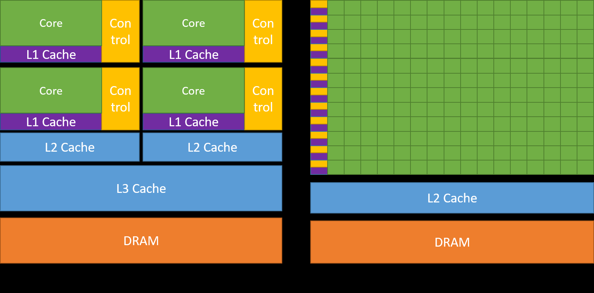

**图 1：GPU 将更多晶体管用于数据处理。**

### 1.1.3 快速上手

利用 GPU 算力的方式有很多。本指南介绍的是使用 C++ 等高级语言为 CUDA GPU 平台编程。不过，对于那些不需要直接编写 GPU 代码的应用，也有许多使用 GPU 的方式。

来自各个领域、数量不断增长的算法与例程可以通过专门的库获得。当某个库已经实现（尤其是 NVIDIA 提供的库）时，使用它通常比从头重新实现算法更具生产力、性能也更好。cuBLAS、cuFFT、cuDNN 与 CUTLASS 等库只是帮助开发者避免重新实现成熟算法的少数示例。这些库还有一个额外好处：它们针对每种 GPU 架构都做了优化，从而在生产力、性能与可移植性之间提供了理想的组合。

此外还有一些框架，尤其是用于人工智能的框架，提供了 GPU 加速的构建模块。其中许多框架正是通过利用上述 GPU 加速库来实现加速的。

另外，诸如 NVIDIA 的 Warp 或 OpenAI 的 Triton 等领域专用语言（Domain-Specific Language，DSL）会编译并直接运行在 CUDA 平台上。这提供了一种比本指南所介绍的高级语言更高层的 GPU 编程方式。

NVIDIA 加速计算中心（NVIDIA Accelerated Computing Hub）提供了用于学习 GPU 与 CUDA 计算的资源、示例与教程。

## 1.2 编程模型

本章从较高层面介绍 CUDA 编程模型，并且与任何具体语言无关。这里引入的术语与概念适用于任何语言中的 CUDA。

### 1.2.1 异构系统

CUDA 编程模型假定采用异构计算系统，即同时包含 GPU 与 CPU 的系统。直接与 CPU 相连的内存称为主机内存（host memory），CPU 与其内存一起称为主机（host）。直接与 GPU 相连的内存称为设备内存（device memory），GPU 与其内存一起称为设备（device）。在一些片上系统（System-on-Chip，SoC）中，这些部件可能位于同一个封装内。在更大的系统中，可能存在多个 CPU 或多个 GPU。

CUDA 应用会将部分代码放到 GPU 上执行，但应用总是从 CPU 开始执行。主机代码（即在 CPU 上运行的代码）可以使用 CUDA API 在主机内存与设备内存之间复制数据、启动 GPU 上的代码执行，以及等待数据复制或 GPU 代码完成。CPU 与 GPU 可以同时执行代码，通常通过最大化 CPU 与 GPU 的利用率来获得最佳性能。

应用在 GPU 上执行的代码称为设备代码（device code）；为了在 GPU 上执行而被调用的函数，出于历史原因被称为内核（kernel）。启动内核运行的动作称为启动内核（launching the kernel）。一次内核启动可以看作是在 GPU 上并行启动许多个执行该内核代码的线程。GPU 线程的运行方式与 CPU 线程类似，不过存在一些差异，这些差异对正确性与性能都很重要，将在后续小节中讨论（参见第 3.2.2.1.1 节）。

### 1.2.2 GPU 硬件模型

与任何编程模型一样，CUDA 依赖于底层硬件的概念模型。就 CUDA 编程而言，GPU 可以看作是一组流式多处理器（Streaming Multiprocessor，SM）的集合，这些 SM 被组织成……（原文此处为图形处理集群的进一步说明）。

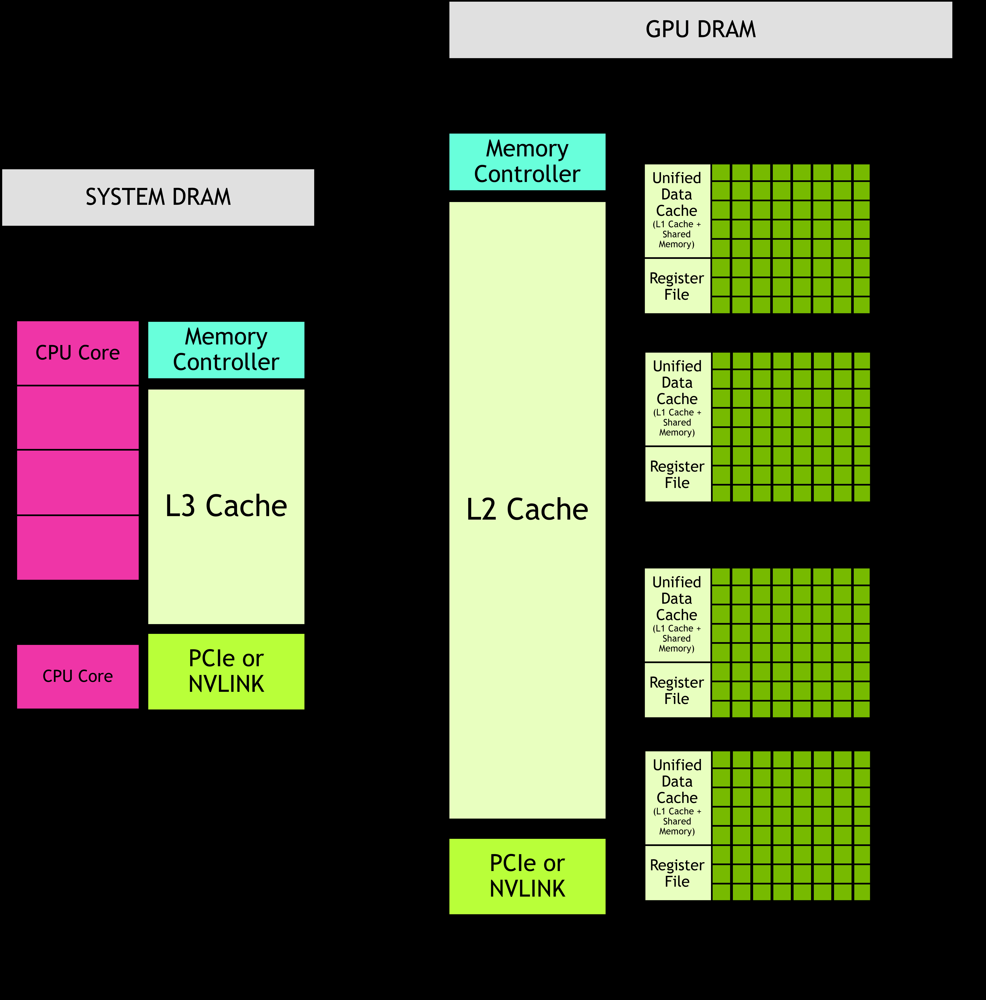

**图 2：GPU 包含许多流式多处理器（SM），每个 SM 又包含许多功能单元。图形处理集群（GPC）是 SM 的集合。一个 GPU 是一组连接到 GPU 内存的 GPC。CPU 通常包含若干核心以及一个连接到系统内存的内存控制器。CPU 与 GPU 通过 PCIe 或 NVLINK 等互连相连。**

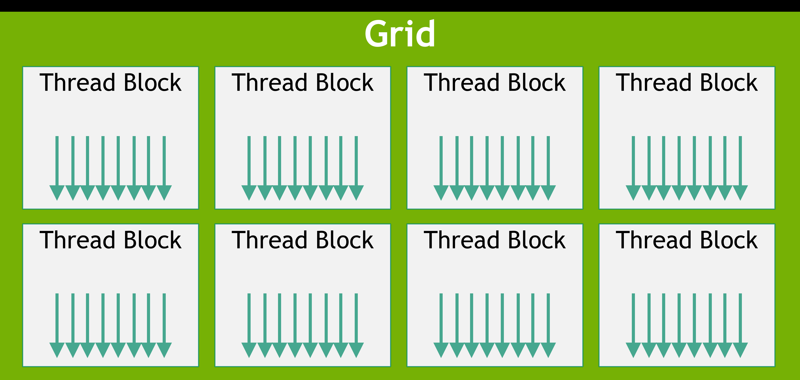

**图 3：线程块网格。每个箭头代表一个线程（箭头的数量并不代表实际线程数）。**

#### 1.2.2.1 线程块与网格

内核启动时，会指定一个网格（grid），网格由一个或多个线程块（thread block）组成。一个线程块包含一组线程，这些线程可以协作。线程块内的线程可以通过内置变量确定线程块与网格的维度，从而确定该内核启动时所用的线程块维度和网格维度。这为每个线程在所有运行该内核的线程中赋予了唯一的身份。这个身份常用于确定某个线程负责哪些数据或操作。

一个线程块中的所有线程都在同一个 SM 上执行。这使得线程块内的线程能够高效地相互通信与同步。线程块内的所有线程都可以访问片上共享内存（shared memory），可用于在线程块内的线程之间交换信息。

一个网格可能由数百万个线程块组成，而执行该网格的 GPU 可能只有数十或数百个 SM。一个线程块的所有线程都由单个 SM 执行，并且在大多数情况下<sup>1</sup>在该 SM 上一直运行到完成。线程块之间的调度没有保证，因此一个线程块不能依赖其他线程块的结果，因为那些线程块可能直到该线程块完成后才能被调度。图 4 给出了网格中的线程块如何分配给 SM 的一个示例。

CUDA 编程模型使得任意大的网格都能在任意规模的 GPU 上运行，无论该 GPU 只有一个 SM 还是有数千个 SM。为实现这一点，CUDA 编程模型（除少数例外）要求不同线程块中的线程之间不存在数据依赖。也就是说，一个线程不应依赖同一网格中不同线程块的线程结果，也不应与之同步。线程块内的所有线程同时运行在同一个 SM 上。网格中不同的线程块会在可用的 SM 之间调度，并可能以任意顺序执行。简而言之，CUDA 编程模型要求线程块能够以任意顺序、并行或串行地执行。

> <sup>1</sup> 在使用 CUDA 动态并行等特性的某些情况下，线程块可能被挂起到内存中。这意味着 SM 的状态被保存到 GPU 内存中由系统管理的区域，SM 被释放以执行其他线程块。这类似于 CPU 上的上下文切换。这种情况并不常见。

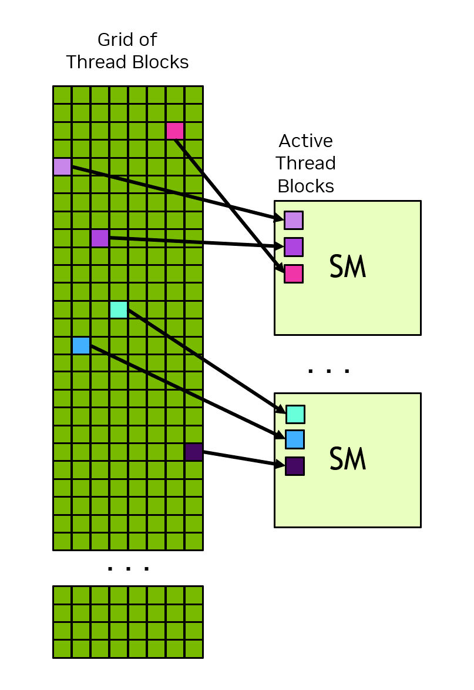

**图 4：每个 SM 有一个或多个活动线程块。在此示例中，每个 SM 同时调度了三个线程块。网格中的线程块分配给 SM 的顺序没有任何保证。**

##### 1.2.2.1.1 线程块集群

除线程块之外，计算能力 9.0 及以上的 GPU 还具有一种可选的分组层级，称为集群（cluster）。集群是一组线程块，与线程块和网格一样，可以按 1、2 或 3 个维度布局。图 5 展示了一个同时被组织成集群的线程块网格。指定集群不会改变网格的维度，也不会改变线程块在网格中的索引。

指定集群会将相邻的线程块分组为集群，并在集群层面提供一些额外的同步与通信机会。具体来说，集群中的所有线程块都在单个 GPC 中执行。图 6 展示了指定集群时线程块如何调度到 GPC 中的 SM。由于这些线程块是在单个 GPC 内同时调度的，因此同一集群中不同线程块里的线程可以使用协作组（Cooperative Groups）提供的软件接口相互通信与同步。集群中的线程可以访问集群中所有线程块的共享内存，这被称为分布式共享内存（distributed shared memory）。集群的最大规模取决于硬件，并因设备而异。

图 6 说明了集群内的线程块如何在单个 GPC 内的 SM 上同时调度。集群内的线程块在网格中总是彼此相邻的。

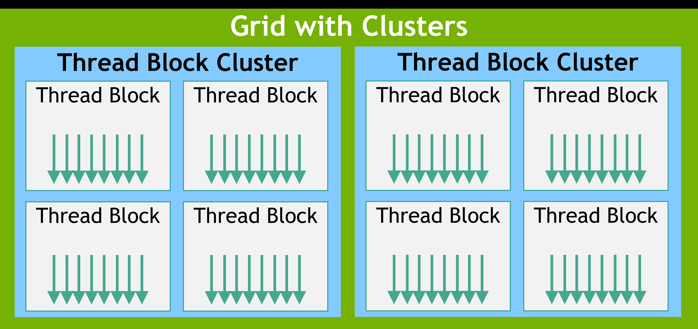

**图 5：指定集群时，线程块在网格中的位置相同，但还拥有一个在所属集群内的位置。**

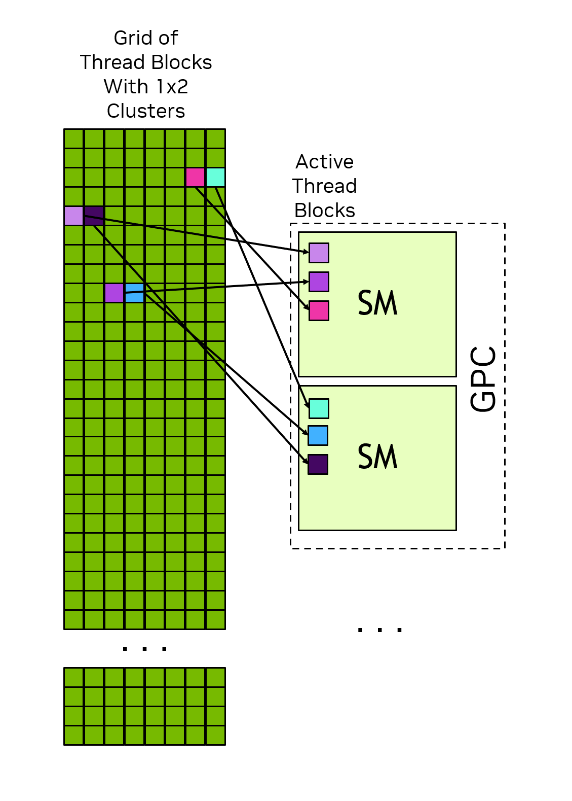

**图 6：指定集群时，集群内的线程块按集群形状在网格中排列。集群的线程块在单个 GPC 的 SM 上同时调度。**

#### 1.2.2.2 warp 与 SIMT

在线程块内部，线程被组织成每 32 个线程一组，称为 warp（线程束）。一个 warp 以单指令多线程（Single-Instruction Multiple-Threads，SIMT）范式执行内核代码。在 SIMT 中，warp 内的所有线程执行相同的内核代码，但每个线程可能沿代码中的不同分支执行。也就是说，尽管程序的所有线程执行相同的代码，线程并不需要遵循相同的执行路径。

当线程由 warp 执行时，会被分配一个 warp 通道（warp lane）。warp 通道编号为 0 到 31，线程块中的线程会以可预测的方式分配给 warp，详见“硬件多线程”一节。

warp 内的所有线程同时执行同一条指令。如果 warp 内某些线程在执行中走了某个控制流分支，而另一些线程没有，那么不沿该分支执行的线程会在执行该分支的线程运行期间被屏蔽（masked off）。例如，如果某个条件对 warp 中一半的线程为真，那么在活动线程执行这些指令时，warp 的另一半会被屏蔽。图 7 说明了这种情况。当 warp 中的不同线程走不同的代码路径时，有时称为 warp 发散（warp divergence）。由此可见，当 warp 内的线程遵循相同的控制流路径时，GPU 的利用率最高。

在 SIMT 模型中，warp 内的所有线程以锁步（lock step）方式推进内核。硬件执行方式可能有所不同。关于这种区别在何处重要，请参见“独立线程执行”相关小节。不鼓励利用“warp 执行实际上如何映射到真实硬件”的知识。CUDA 编程模型与 SIMT 认为 warp 中的所有线程一起在代码中推进。只要遵循编程模型，硬件就可以以对程序透明的方式优化被屏蔽的通道。如果程序违反该模型，可能导致未定义行为，且不同 GPU 硬件上的表现可能不同。

虽然在编写 CUDA 代码时不必考虑 warp，但理解 warp 执行模型有助于理解全局内存合并（global memory coalescing）与共享内存 bank 访问模式等概念。一些高级编程技术会利用线程块内 warp 的专门化来限制线程发散并最大化利用率。这类优化利用了“线程在执行时按 warp 分组”这一知识。

warp 执行的一个推论是：最好将线程块的线程总数指定为 32 的倍数。使用任意数量的线程都是合法的，但当总数不是 32 的倍数时，线程块的最后一个 warp 会有一些通道在整个执行过程中都未被使用。这很可能导致该 warp 的功能单元利用率与内存访问次优。

SIMT 常被拿来与单指令多数据（Single Instruction Multiple Data，SIMD）并行相比较，但两者存在一些重要差异。在 SIMD 中，执行遵循单一控制流路径；而在 SIMT 中，每个线程都可以遵循自己的控制流路径。因此，SIMT 不像 SIMD 那样具有固定的数据宽度。关于 SIMT 的更详细讨论可参见“SIMT 执行模型”一节。

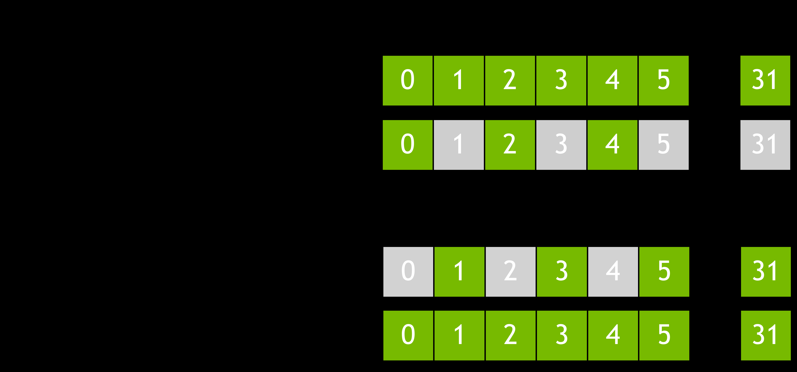

**图 7：在此示例中，只有线程索引为偶数的线程执行 if 语句的主体，其他线程在执行该主体期间被屏蔽。**

#### 1.2.2.3 CUDA 中的 tile 编程

除前几节介绍的 SIMT 模型之外，CUDA 还支持一种 tile 编程模型。在 tile 编程中，程序员以整个线程块为粒度编写代码，描述对称为 tile（数据块）的多维数据集合的操作。编译器则将这些操作映射到线程块的各个线程上。

tile 内核在由块组成的网格上启动，如“线程块与网格”一节所述。每个块执行该 tile 内核，并可以查询自己在网格中的位置，以确定自己负责数据的哪一部分。程序员只需指定网格维度；每个线程块中的线程数由编译器根据内核中的 tile 操作决定（图 8）。

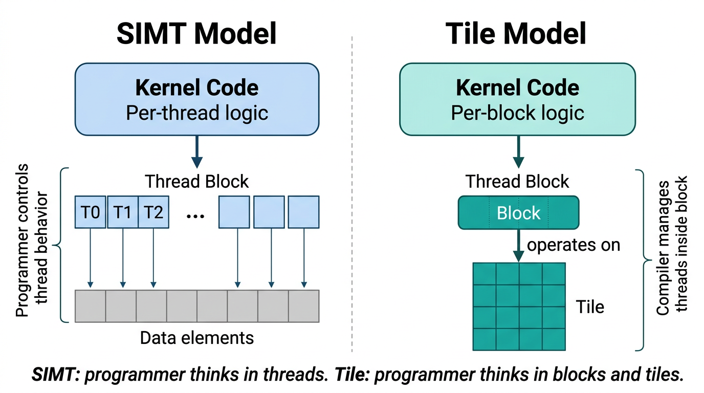

**图 8：SIMT 与 tile 编程模型中程序员的视角。在 SIMT 中，程序员编写按线程的代码，并控制每个线程如何访问数据。在 tile 编程中，程序员编写按块操作 tile 的代码，编译器将操作映射到块的各个线程上。**

在 tile 内核内部，块执行单一控制流。程序员指定对 tile 的操作，编译器将工作分配给块的各个线程。条件与循环等标准控制流结构都受支持，但由于块遵循单一控制流，因此不存在 warp 发散的概念。标量操作（如计算索引或循环边界）由块中的单个线程执行。tile 操作（如逐元素相加两个 tile）则由块中的所有线程共同并行执行。

要注意不要将块（执行单元）与 tile（数据单元）混淆。单个块可以创建并操作许多形状和数据类型各不相同的 tile。

##### 1.2.2.3.1 数组与 tile

tile 内核处理两种类型的数据：数组（array）与 tile。数组（或全局数组）是存储在设备内存中的元素多维容器。数组是可变的：其内容可以在内核中通过存储操作修改。数组具有形状（shape）与数据类型。

tile 是仅存在于 tile 代码中、且对单个块局部的值多维集合。tile 是不可变的：对 tile 的每个操作都会产生一个新的 tile，而不是修改现有 tile。与数组不同，tile 不一定在内存中有表示——编译器决定 tile 数据如何存储，可能使用寄存器、共享内存或 SM 的其他资源。

tile 的每个维度都必须是 2 的幂，并且必须在编译时已知（即其值必须能在内核执行之前确定，而不是在执行期间计算得出）。tile 不能作为内核参数传递；它们完全在 tile 代码内部创建与使用。

##### 1.2.2.3.2 tile 空间与数据移动

数据通过加载（load）与存储（store）操作在数组与 tile 之间移动。这些操作使用一个称为 tile 空间（tile space）的概念，它是将数组按概念划分为大小相等、互不重叠的 tile 的结果。例如，考虑一个形状为 (M, N) 的二维数组。如果一次加载操作指定的 tile 形状为 (tm, tn)，则该数组在概念上被划分为 ⌈M/tm⌉ 行、⌈N/tn⌉ 列的 tile。这个 tile 空间中的索引（如 (i, j)）标识要加载哪个 tile。加载返回一个形状为 (tm, tn) 的 tile，其中包含数组中对应位置的元素。当 tile 超出数组边界时——例如当数组维度不是 tile 维度的整数倍、tile 位于边缘时——加载操作会指定如何处理越界元素，例如用零填充（图 9）。

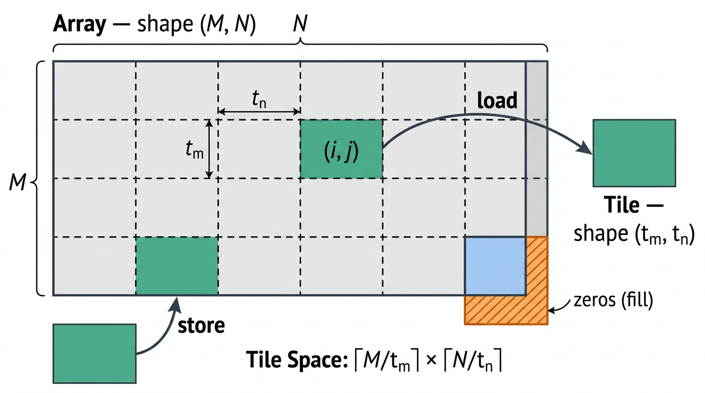

**图 9：tile 空间与数据移动。形状为 (M, N) 的二维数组在概念上被划分为形状为 (tm, tn) 的 tile 网格。在 tile 空间索引 (i, j) 处的加载会返回对应的 tile。在数组边界处，落在数组之外的元素可以用零填充。存储在给定的 tile 空间索引处将一个 tile 写回数组。**

存储操作执行相反的过程：给定一个 tile 和一个 tile 空间索引，它将 tile 的元素写入数组的对应区域。任何落在数组边界之外的写入都会被静默丢弃。tile 程序还支持收集（gather）与散射（scatter）操作，它们分别从数组的任意位置加载或存储到数组的任意位置。

##### 1.2.2.3.3 对 tile 的操作

tile 程序提供了一组作用于 tile 的内置操作，包括逐元素算术、矩阵乘法、沿一个或多个轴的归约（如求和与求最大值）、形状操作（如重塑与转置）以及类型转换。当两个形状不同的 tile 在某个操作中组合时，较小的 tile 会先被自动扩展以匹配较大的 tile，然后再应用该操作。

##### 1.2.2.3.4 与 SIMT 编程的关系

tile 编程与 SIMT 编程在 CUDA 中共存。一个应用可以同时包含 SIMT 内核与 tile 内核，两类内核都可以操作设备内存中的同一份数据。选择哪种编程模型是按内核分别决定的。tile 编程并不取代 SIMT 编程。SIMT 提供了对单个线程的细粒度控制，这对某些算法与优化技术仍然是必需的。tile 编程提供了一种更高层的抽象，可以简化内核开发。由于线程级决策交由编译器完成，同一个 tile 内核无需修改源码即可在不同的 GPU 架构上运行。两种模型都构建在前几节所述的相同底层硬件——SM、线程块与网格——之上。两种模型也都使用相同的设备内存空间，这些内存空间将在下一节介绍。

### 1.2.3 GPU 内存

在现代计算系统中，高效利用内存与最大化利用执行计算的功能单元同样重要。异构系统具有多个内存空间，并且 GPU 除了缓存之外还包含各种类型的可编程片上内存。以下小节将更详细地介绍这些内存空间。

#### 1.2.3.1 异构系统中的 DRAM 内存

GPU 与 CPU 都直接连接着 DRAM 芯片。在具有多个 GPU 的系统中，每个 GPU 都有自己独立的内存。从设备代码的角度看，连接在 GPU 上的 DRAM 称为全局内存（global memory），因为 GPU 中的所有 SM 都能访问它。这一术语并不意味着它在系统内处处都可访问。连接在 CPU 上的 DRAM 称为系统内存（system memory）或主机内存（host memory）。

与 CPU 一样，GPU 使用虚拟内存寻址。在所有当前受支持的系统中，CPU 与 GPU 使用单一的统一直拟内存空间。这意味着系统中每个 GPU 的虚拟内存地址范围都是唯一的，并且与 CPU 以及系统中其他每个 GPU 的地址范围都不相同。对于给定的虚拟内存地址，可以判断该地址位于 GPU 内存还是系统内存中；在具有多个 GPU 的系统中，还可以判断它位于哪个 GPU 的内存中。

CUDA 提供了用于分配 GPU 内存、分配 CPU 内存，以及在 CPU 与 GPU 之间、GPU 内部或多 GPU 系统内不同 GPU 之间进行复制的 API。需要时可以显式控制数据的局部性。下文讨论的统一内存（Unified Memory）则允许由 CUDA 运行时或系统硬件自动处理内存的放置。

#### 1.2.3.2 局部性域

局部性域（locality domain）是 GPU 内存与流式多处理器（SM）的一个子集。所有 GPU 都至少有一个局部性域。较大的 GPU 可能有多个局部性域。在具有多个局部性域的 GPU 上，使用本地化（localized）的内存与计算可以提升某些内核的性能。本地化内存是指完全包含在单个局部性域内的内存分配。使用这种内存的内核可以被调度到同一局部性域内的 SM 上。当内存与计算在多个局部性域之间划分，并且可以并行地向每个局部性域下发工作时，应用就能从本地化中获益。

在不指定局部性域的情况下分配的 GPU 内存称为非本地化（unlocalized）内存。非本地化内存分配会跨越多个局部性域，但对于非常小的分配是例外。在只有一个局部性域的 GPU 上，所有 GPU SM 与内存都属于那唯一的局部性域。第 4.8 节给出了在特定局部性域内本地化 GPU 内存与计算的机制。局部性域是一种性能特性：即使 CUDA 代码不本地化内存或计算，也仍然能正确执行。

#### 1.2.3.3 GPU 中的片上内存

除了全局内存之外，每个 GPU 还有一些片上内存。每个 SM 都有自己的寄存器堆（register file）与共享内存（shared memory）。这些内存是 SM 的一部分，SM 内执行的线程可以极快地访问它们。

寄存器堆存储线程的局部变量，通常由编译器分配。共享内存可由线程块或集群内的所有线程访问。共享内存可用于在线程块或集群的线程之间交换数据。

SM 中的寄存器堆与统一数据缓存（unified data cache）大小有限。SM 寄存器堆的大小、统一数据缓存的大小，以及统一数据缓存如何配置以平衡 L1 与共享内存，可参见“各计算能力的内存信息”一节。寄存器堆、共享内存空间与 L1 缓存由线程块中的所有线程共享。

要将某个线程块调度到某个 SM，每个线程所需的寄存器总数乘以线程块中的线程数所得的积，必须小于或等于该 SM 中可用的寄存器数量。如果某个线程块所需的寄存器数量超过寄存器堆的大小，则该内核无法启动，必须减少该线程块中的线程数才能使其可启动。

共享内存的分配以线程块为单位进行。也就是说，与按线程分配的寄存器不同，共享内存的分配对整个线程块是公共的。

##### 1.2.3.3.1 缓存

除可编程内存之外，GPU 还同时具有 L1 与 L2 缓存。每个 SM 都有一个 L1 缓存，它是统一数据缓存的一部分。一个更大的 L2 缓存由 GPU 中的所有 SM 共享。这可以在图 2 的 GPU 框图中看到。每个 SM 还有一个独立的常量缓存（constant cache），用于缓存全局内存中被声明为在内核整个生命周期内保持常量的值。编译器也可能将内核参数放入常量内存。通过允许内核参数与 L1 数据缓存分开缓存于 SM 中，这可以提升内核性能。

#### 1.2.3.4 统一内存

当应用在 GPU 或 CPU 上显式分配内存时，该内存只能由运行在该设备上的代码访问。也就是说，CPU 内存只能由 CPU 代码访问，GPU 内存只能由在 GPU 上运行的内核访问<sup>2</sup>。用于在 CPU 与 GPU 之间复制内存的 CUDA API 被用来在恰当的时间将数据显式复制到正确的内存。

CUDA 的一项称为统一内存（unified memory）的特性允许应用进行可从 CPU 或 GPU 访问的内存分配。CUDA 运行时或底层硬件会在需要时启用访问，或将数据迁移到正确的位置。即使使用统一内存，也要通过尽量减少内存迁移、尽可能由直接连接到数据所在内存的处理器访问数据，才能获得最佳性能。

系统的硬件特性决定了内存空间之间的访问与数据交换如何实现。“统一内存”一节介绍了不同类型的统一内存系统。“统一内存”一节还包含关于统一内存在各种情况下的使用与行为的更多细节。

## 1.3 CUDA 平台

NVIDIA CUDA 平台由许多软件与硬件部件，以及许多为实现异构系统上的计算而开发的重要技术组成。本章旨在介绍 CUDA 平台的一些基本概念与组成部分，这些对应用开发者理解 CUDA 很重要。本章与“编程模型”一样，不针对任何特定编程语言，而是适用于所有使用 CUDA 平台的内容。

### 1.3.1 计算能力与流式多处理器版本

每个 NVIDIA GPU 都有一个计算能力（Compute Capability，CC）编号，用于表示该 GPU 支持哪些特性，并规定该 GPU 的一些硬件参数。这些规格记录在第 5.1 节附录中。所有 NVIDIA GPU 及其计算能力的列表维护在 CUDA GPU 计算能力页面上。

计算能力以主版本号与次版本号表示，格式为 X.Y，其中 X 是主版本号，Y 是次版本号。例如，CC 12.0 的主版本号为 12，次版本号为 0。计算能力与 SM 的版本号直接对应。例如，计算能力为 CC 12.0 的 GPU 中的 SM 版本为 sm_120。该版本号用于标记二进制文件。

第 5.1.1 节介绍了如何查询与确定系统中 GPU 的计算能力。

### 1.3.2 CUDA 工具包与 NVIDIA 驱动

NVIDIA 驱动（NVIDIA Driver）可以看作是 GPU 的操作系统。NVIDIA 驱动是一个必须安装在主机操作系统上的软件组件，是所有 GPU 用途（包括显示与图形功能）所必需的。NVIDIA 驱动是 CUDA 平台的基础。除 CUDA 之外，NVIDIA 驱动还提供了使用 GPU 的其他所有方式，例如 Vulkan 与 Direct3D。NVIDIA 驱动具有诸如 r580 之类的版本号。

CUDA 工具包（CUDA Toolkit）是一组用于编写、构建与分析利用 GPU 计算的软件的库、头文件与工具。CUDA 工具包是与 NVIDIA 驱动分开的软件产品。

CUDA 运行时（CUDA runtime）是 CUDA 工具包所提供的库中的一个特例。CUDA 运行时同时提供 API 与一些语言扩展，用于处理分配内存、在 GPU 与其他 GPU 或 CPU 之间复制数据、启动内核等常见任务。CUDA 运行时的 API 部分称为 CUDA 运行时 API（CUDA runtime API）。

CUDA 兼容性文档（CUDA Compatibility）详细说明了不同 GPU、NVIDIA 驱动与 CUDA 工具包版本之间的兼容性。

#### 1.3.2.1 CUDA 运行时 API 与 CUDA 驱动 API

CUDA 运行时 API 构建在称为 CUDA 驱动 API（CUDA driver API）的更低层 API 之上，后者是 NVIDIA 驱动所暴露的 API。本指南侧重于 CUDA 运行时 API 所暴露的 API。如果需要，仅使用驱动 API 也能实现全部相同的功能。有些特性只能通过驱动 API 使用。应用可以使用其中任意一种 API，也可以互操作地同时使用两者。“CUDA 驱动 API”一节介绍了运行时 API 与驱动 API 之间的互操作。

CUDA 运行时 API 函数的完整 API 参考可参见 CUDA Runtime API Documentation。

CUDA 驱动 API 的完整 API 参考可参见 CUDA Driver API Documentation。

### 1.3.3 并行线程执行（PTX）

CUDA 平台的一个基础性但有时不可见的层次是并行线程执行（Parallel Thread Execution，PTX）虚拟指令集架构（Instruction Set Architecture，ISA）。PTX 是面向 NVIDIA GPU 的一种高级汇编语言。PTX 在真实 GPU 硬件的物理 ISA 之上提供了一个抽象层。与其他平台一样，应用可以直接用这种汇编语言编写，尽管这样做会给软件开发增加不必要的复杂性与难度。

领域专用语言以及高级语言的编译器可以生成 PTX 代码作为中间表示（Intermediate Representation，IR），然后使用 NVIDIA 的离线或即时（Just-in-Time，JIT）编译工具生成可执行的二进制 GPU 代码。这使得 CUDA 平台不仅可以通过 NVIDIA 提供的工具（如 NVCC：NVIDIA CUDA 编译器）所支持的语言进行编程，还可以通过其他语言进行编程。

由于 GPU 能力会随时间变化与增长，PTX 虚拟 ISA 规范是有版本的。PTX 版本与 SM 版本一样，都对应某个计算能力。例如，支持计算能力 8.0 全部特性的 PTX 称为 compute_80。

关于 PTX 的完整文档可参见 PTX ISA。

### 1.3.4 cubin 与 fatbin

CUDA 应用与库通常用 C++ 等高级语言编写。该高级语言被编译为 PTX，然后 PTX 再被编译为面向物理 GPU 的真实二进制，称为 CUDA 二进制，简称 cubin。cubin 针对特定的 SM 版本（如 sm_120）具有特定的二进制格式。

使用 GPU 计算的可执行文件与库二进制同时包含 CPU 代码与 GPU 代码。GPU 代码存储在称为 fatbin 的容器中。fatbin 可以包含面向多个不同目标的 cubin 与 PTX。例如，一个应用可以针对多种不同 GPU 架构（即不同 SM 版本）构建二进制。当应用运行时，其 GPU 代码会被加载到某个具体的 GPU 上，并使用 fatbin 中适合该 GPU 的最佳二进制。

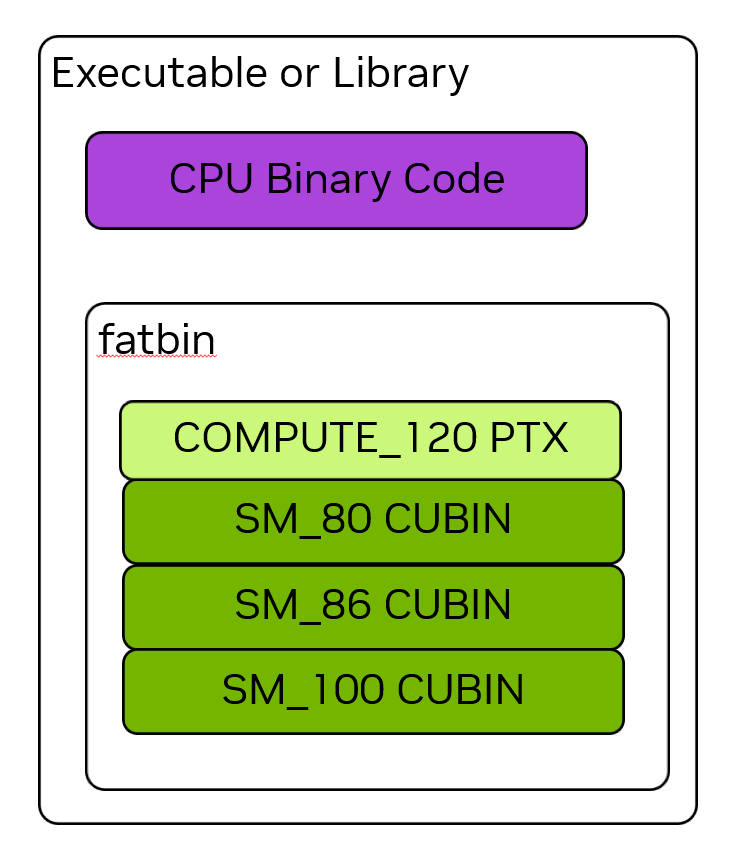

**图 10：可执行文件或库的二进制同时包含 CPU 二进制代码与用于 GPU 代码的 fatbin 容器。fatbin 可以同时包含 cubin GPU 二进制代码与 PTX 虚拟 ISA 代码。PTX 代码可以针对未来的目标进行 JIT 编译。**

fatbin 还可以包含一个或多个版本的 PTX 形式的 GPU 代码，其用途在“PTX 兼容性”一节中描述。图 10 展示了一个应用或库二进制的示例，其中既包含多个 cubin 版本的 GPU 代码，也包含一个版本的 PTX 代码。

#### 1.3.4.1 二进制兼容性

NVIDIA GPU 在特定情况下保证二进制兼容性。具体来说，在某个计算能力的主版本内，次版本号大于或等于 cubin 目标版本的 GPU 可以加载并执行该 cubin。例如，如果一个应用包含为计算能力 8.6 编译的 cubin 代码，那么该 cubin 可以在计算能力为 8.6 或 8.9 的 GPU 上加载并执行。但是，它不能在计算能力为 8.0 的 GPU 上加载，因为 GPU 的 CC 次版本号（0）低于代码的次版本号（6）。

NVIDIA GPU 在不同计算能力主版本之间不保证二进制兼容。也就是说，为计算能力 8.6 编译的 cubin 代码无法在计算能力 9.0 的 GPU 上加载。

在讨论二进制代码时，常以版本号（如上述示例中的 sm_86）来指代该二进制。这与说“该二进制是为计算能力 8.6 构建的”含义相同。之所以常用这种简写，是因为开发者正是以这种方式向 NVIDIA CUDA 编译器 nvcc 指定该二进制构建目标的。

> **注意**
>
> 二进制兼容性仅对由 nvcc 等 NVIDIA 工具创建的二进制作出承诺。不支持手动编辑或生成面向 NVIDIA GPU 的二进制代码。如果二进制以任何方式被修改，兼容性承诺即失效。

#### 1.3.4.2 PTX 兼容性

GPU 代码可以以二进制或 PTX 形式存储在可执行文件中，这一点已在“cubin 与 fatbin”一节中介绍。当应用存储的是 PTX 形式的 GPU 代码时，该 PTX 可以在应用运行时针对任何等于或高于该 PTX 代码计算能力的计算能力进行 JIT 编译。例如，如果一个应用包含面向 compute_80 的 PTX，那么该 PTX 代码可以在应用运行时被 JIT 编译到更新的 SM 版本，如 sm_120。这使得无需重新构建应用或库即可向前兼容未来的 GPU。

#### 1.3.4.3 即时编译

应用在运行时加载的 PTX 代码由设备驱动编译为二进制代码。这称为即时（JIT）编译。即时编译会增加应用的加载时间，但允许应用受益于每个新设备驱动所带来的任何新编译器改进。它还使应用能够运行在应用编译时尚不存在的设备上。

当设备驱动为某个应用即时编译 PTX 代码时，它会自动缓存生成的二进制代码副本，以避免在后续调用该应用时重复编译。该缓存称为计算缓存（compute cache），在设备驱动升级时会自动失效，以便应用能够受益于设备驱动内置的新即时编译器所带来的改进。

自 CUDA 最早的版本以来，PTX 在运行时如何以及何时被 JIT 编译已有所放宽，为何时以及是否对部分或全部内核进行 JIT 编译提供了更大的灵活性。“延迟加载”（Lazy Loading）一节介绍了可用的选项以及如何控制 JIT 行为。还有一些环境变量可以控制即时编译行为，如“CUDA 环境变量”一节所述。

作为使用 nvcc 编译 CUDA C++ 设备代码的替代方案，可以使用 NVRTC 在运行时将 CUDA C++ 设备代码编译为 PTX。NVRTC 是一个面向 CUDA C++ 的运行时编译库；更多信息可参见 NVRTC 用户指南。

#### 1.3.4.4 二进制最终化

从计算能力 10.0 开始，同族内的二进制兼容性由 NVIDIA 驱动以软件方式管理。面向 CC 10.0 及更高架构的 cubin 使用一种扩展了二进制表示的格式，以提供同族内的二进制兼容性。为某个特定目标架构生成（最终化）的二进制，可以直接在目标架构上执行，也可以在运行时重新最终化到任何保证具有二进制兼容性的 GPU 上。面向计算能力 9.x 及更早版本的 cubin 不具备运行时重新最终化的资格。

当为某个目标架构生成、面向 CC 10.0 或更高版本的 cubin 被加载到同一 GPU 家族中另一个不同但兼容的架构上时，驱动会执行即时最终化，将该 cubin 绑定到目标 GPU 的架构。这一过程称为离靶最终化（off-target finalization）。离靶最终化使离靶执行（off-target execution）成为可能：为某个架构最终化的 cubin 可以在同一 GPU 家族中另一个兼容的架构上运行。当 cubin 被加载到其生成时所针对的架构上时，执行被视为在靶（on-target）。在靶执行无需进一步的最终化。

离靶执行的即时最终化不应与 PTX 即时编译相混淆。PTX JIT 编译将 PTX 代码编译为已经针对目标架构最终化的 GPU 二进制代码。cubin 的离靶最终化则是将现有 cubin 重新最终化到另一个兼容架构。离靶最终化的开销显著低于 PTX JIT 编译，但相对于在靶执行，它仍可能增加模块加载时间。

离靶最终化的开销取决于正在最终化的代码量、模块加载期间可用的主机 CPU 资源，以及源架构与目标架构之间的关系。加载大型模块或许多模块的应用，在 cubin 进行离靶最终化时可能观察到启动时间增加。

与 PTX JIT 编译一样，NVIDIA 驱动可以缓存 cubin 离靶最终化的结果，以避免在后续调用该应用时重复进行最终化工作。该缓存由第 5.2.2 节所述的相同 CUDA 缓存环境变量控制。

##### 1.3.4.4.1 延迟函数最终化

延迟函数最终化（Lazy Function Finalization，LFF）在离靶最终化中默认启用。在 LFF 下，驱动不会在 cubin 加载时对其整体进行最终化，而是等到某个内核被启动时，再对该内核及其可能调用的任何设备函数进行最终化。

当应用加载一个大型模块但只使用其中一小部分内核时，LFF 可以缩短加载时间。例如，应用可能链接到一个大型库，但只启动其中少数几个内核。

当应用使用模块中的大部分函数时，LFF 可能没有好处。急切最终化（eager finalization）可以使用多个 CPU 线程，并且其结果可以存储在计算缓存中。当 LFF 生效时，并行最终化与缓存均被禁用。要将 LFF 与并行急切最终化进行比较，可使用：

```bash
CUDA_DISABLE_FUNCTION_LAZY_FINALIZATION=1
CUDA_BINARY_LOADER_THREAD_COUNT=<N>
```

设置线程数对应的驱动 API 选项是 `CU_JIT_BINARY_LOADER_THREAD_COUNT`。更多控制项可参见“CUDA 环境变量”一节。

---

# 第 2 章　在 CUDA 中编程 GPU

## 2.1 CUDA C++ 入门

本章通过展示 CUDA 编程模型在 C++ 中如何呈现，介绍其中的一些基本概念。

本编程指南侧重于 CUDA 运行时 API。CUDA 运行时 API 是在 C++ 中使用 CUDA 最常用的方式，构建在更低层的 CUDA 驱动 API 之上。“CUDA 运行时 API 与 CUDA 驱动 API”一节讨论了这些 API 之间的区别，“CUDA 驱动 API”一节讨论了混合使用这些 API 编写代码的方法。

本指南假定已安装 CUDA 工具包与 NVIDIA 驱动，并且系统中存在受支持的 NVIDIA GPU。关于安装所需 CUDA 组件的说明，请参见 CUDA 快速入门指南（The CUDA Quickstart Guide）。

### 2.1.1 使用 NVCC 编译

用 C++ 编写的 GPU 代码使用 NVIDIA CUDA 编译器 nvcc 进行编译。nvcc 是一个编译器驱动程序，它简化了编译 C++ 或 PTX 代码的过程：它提供简单而熟悉的命令行选项，并通过调用实现各个编译阶段的工具集合来执行这些选项。

本指南展示的 nvcc 命令行可用于任何安装了 CUDA 工具包的 Linux 系统、Windows 命令行或 PowerShell，也可用于安装了 CUDA 工具包的 Windows Subsystem for Linux。本指南的 nvcc 章节介绍了 nvcc 的常见用例，完整文档由 nvcc 用户手册提供。

### 2.1.2 内核

正如 CUDA 编程模型引言中所述，在 GPU 上执行、并可从主机调用的函数称为内核（kernel）。内核被编写为由许多并行线程同时运行。

#### 2.1.2.1 指定内核

内核的代码使用 `__global__` 声明说明符来指定。这向编译器表明，该函数将被编译为面向 GPU 的代码，并允许通过内核启动来调用它。内核启动（kernel launch）是一种启动内核运行的操作，通常从 CPU 发起。内核是返回类型为 `void` 的函数。

```cpp
// 内核定义
__global__ void vecAdd(float* A, float* B, float* C)
{
}
```

#### 2.1.2.2 启动内核

并行执行该内核的线程数作为内核启动的一部分来指定。这称为执行配置（execution configuration）。同一内核的不同调用可以使用不同的执行配置，例如不同的线程数或线程块数。

从 CPU 代码启动内核有两种方式：三重尖括号表示法（triple chevron notation）与 `cudaLaunchKernelEx`。这里介绍最常用的内核启动方式——三重尖括号表示法。使用 `cudaLaunchKernelEx` 启动内核的示例将在第 3.1.1 节中详细展示与讨论。

##### 2.1.2.2.1 三重尖括号表示法

三重尖括号表示法是 CUDA C++ 语言扩展，用于启动内核。它之所以被称为三重尖括号，是因为它使用三个尖括号字符来封装内核启动的执行配置，即 `<<< >>>`。执行配置参数以逗号分隔的列表形式写在尖括号内，类似于函数调用的参数。下面展示了启动 `vecAdd` 内核的语法。

```cpp
__global__ void vecAdd(float* A, float* B, float* C)
{
}
int main()
{
    ...
    // 内核调用
    vecAdd<<<1, 256>>>(A, B, C);
    ...
}
```

三重尖括号表示法的前两个参数分别是网格维度与线程块维度。当使用一维线程块或网格时，可以使用整数来指定维度。

上述代码启动一个包含 256 个线程的线程块。每个线程将执行完全相同的内核代码。在“线程与网格索引内建函数”一节中，我们将展示每个线程如何利用其在线程块与网格中的索引来改变它所操作的数据。

每个线程块的线程数有一个限制，因为一个块的所有线程都驻留在同一个流式多处理器（SM）上，并且必须共享该 SM 的资源。在当前的 GPU 上，一个线程块最多可包含 1024 个线程。如果资源允许，一个 SM 上可以同时调度多个线程块。

内核启动相对于主机线程是异步的。也就是说，内核会被设置为在 GPU 上执行，但主机代码不会等待内核在 GPU 上完成（甚至开始）执行就继续往下走。必须使用某种形式的 GPU 与 CPU 之间的同步来确定内核已经完成。最基本的方式——完全同步整个 GPU——在“同步 CPU 与 GPU”一节中展示。更复杂的同步方法在“异步执行”一章中介绍。

当使用二维或三维网格或线程块时，使用 CUDA 类型 `dim3` 作为网格与线程块维度参数。下面的代码片段展示了使用 16×16 的线程块网格、每个线程块为 8×8 来启动 `MatAdd` 内核。

```cpp
int main()
{
    ...
    dim3 grid(16,16);
    dim3 block(8,8);
    MatAdd<<<grid, block>>>(A, B, C);
    ...
}
```

#### 2.1.2.3 线程与网格索引内建函数

在内核代码中，CUDA 提供了一些内建函数（intrinsic），用于访问执行配置的参数以及线程或块的索引。

- `threadIdx`：给出某个线程在其线程块内的索引。线程块内的每个线程都有不同的索引。
- `blockDim`：给出线程块的维度，该维度在内核启动的执行配置中指定。
- `blockIdx`：给出某个线程块在网格内的索引。每个线程块都有不同的索引。
- `gridDim`：给出网格的维度，该维度在内核启动时的执行配置中指定。

这些内建函数中的每一个都是一个包含 `.x`、`.y` 与 `.z` 成员的三分量向量。启动配置未指定的维度默认为 1。`threadIdx` 与 `blockIdx` 的索引从 0 开始。也就是说，`threadIdx.x` 的取值范围是从 0 到 `blockDim.x-1`（含）。`.y` 与 `.z` 在各自维度上的行为相同。

类似地，`blockIdx.x` 的取值范围是从 0 到 `gridDim.x-1`（含），`.y` 与 `.z` 维度分别同理。

这些内建函数使单个线程能够确定自己应当执行什么工作。回到 `vecAdd` 内核，该内核接收三个参数，每个参数都是一个 float 向量。内核执行 A 与 B 的逐元素相加，并将结果存入 C。内核的并行方式是每个线程执行一次加法。它计算哪个元素由它的线程索引与网格索引决定。

```cpp
__global__ void vecAdd(float* A, float* B, float* C)
{
    // 计算该线程负责计算哪个元素
    int workIndex = threadIdx.x + blockDim.x * blockIdx.x;
    // 执行计算
    C[workIndex] = A[workIndex] + B[workIndex];
}
int main()
{
    ...
    // A、B、C 均为包含 1024 个元素的向量
    vecAdd<<<4, 256>>>(A, B, C);
    ...
}
```

在此示例中，使用 4 个各含 256 个线程的线程块来相加一个 1024 元素的向量。在第一个线程块中，`blockIdx.x` 为 0，因此每个线程的 `workIndex` 就是其 `threadIdx.x`。在第二个线程块中，`blockIdx.x` 为 1，因此 `blockDim.x * blockIdx.x` 等于 `blockDim.x`（此例中为 256）。第二个线程块中每个线程的 `workIndex` 将为其 `threadIdx.x + 256`。在第三个线程块中，`workIndex` 为 `threadIdx.x + 512`。

这种 `workIndex` 的计算方式在一维并行化中非常常见。扩展到二维或三维时，通常在每个维度上遵循相同的模式。

##### 2.1.2.3.1 边界检查

上面给出的示例假设向量长度是线程块大小（此例中为 256 个线程）的整数倍。为使内核能处理任意向量长度，我们可以添加检查，确保内存访问不超出数组边界，如下所示，然后启动一个包含一些非活动线程的线程块。

```cpp
__global__ void vecAdd(float* A, float* B, float* C, int vectorLength)
{
    // 计算该线程负责计算哪个元素
    int workIndex = threadIdx.x + blockDim.x * blockIdx.x;
    if(workIndex < vectorLength)
    {
        // 执行计算
        C[workIndex] = A[workIndex] + B[workIndex];
    }
}
```

使用上述内核代码，可以启动比实际需要更多的线程，而不会导致对数组的越界访问。当 `workIndex` 超过 `vectorLength` 时，线程退出并且不执行任何工作。启动一个其中线程不执行任何工作的线程块，不会带来很大的额外开销；但是，应避免启动其中没有任何线程执行工作的线程块。现在该内核可以处理不是块大小整数倍的向量长度。

所需的线程块数量可以计算为所需线程数（此例中为向量长度）除以每个线程块的线程数后向上取整。也就是说，将所需线程数除以每个线程块的线程数做整数除法，然后向上取整。下面给出了一种将其表达为单次整数除法的常见方式。在整数除法之前加上 `threads - 1`，就相当于向上取整函数，只有当向量长度不能被每个线程块的线程数整除时才会多增加一个线程块。

```cpp
// vectorLength 是存储向量元素个数的整数
int threads = 256;
int blocks = (vectorLength + threads-1)/threads;
vecAdd<<<blocks, threads>>>(devA, devB, devC, vectorLength);
```

CUDA 核心计算库（CUDA Core Compute Library，CCCL）提供了一个便捷工具 `cuda::ceil_div`，用于执行这种向上取整除法，以计算内核启动所需的块数。包含头文件 `<cuda/cmath>` 即可使用该工具。

```cpp
// vectorLength 是存储向量元素个数的整数
int threads = 256;
int blocks = cuda::ceil_div(vectorLength, threads);
vecAdd<<<blocks, threads>>>(devA, devB, devC, vectorLength);
```

这里选择每个线程块 256 个线程是任意的，不过这通常是很好的起始值。

### 2.1.3 GPU 计算中的内存

为了使用上面展示的 `vecAdd` 内核，数组 A、B 与 C 必须位于 GPU 可访问的内存中。有几种不同的方法可以做到这一点，这里将说明其中两种。其他方法将在后面关于统一内存的小节中介绍。GPU 上运行的代码可用的内存空间已在“GPU 内存”一节中介绍，并在“GPU 设备内存空间”一节中更详细地讨论。

#### 2.1.3.1 统一内存

统一内存（unified memory）是 CUDA 运行时的一项特性，它让 NVIDIA 驱动管理主机与设备之间的数据移动。使用 `cudaMallocManaged` API 分配内存，或通过 `__managed__` 说明符声明变量。NVIDIA 驱动会确保当 GPU 或 CPU 任一者尝试访问该内存时，该内存都可被访问。

下面的代码展示了一个启动 `vecAdd` 内核的完整函数，该内核为将在 GPU 上使用的输入与输出向量使用统一内存。`cudaMallocManaged` 分配可从 CPU 或 GPU 访问的缓冲区。这些缓冲区使用 `cudaFree` 释放。

```cpp
void unifiedMemExample(int vectorLength)
{
    // 指向内存向量的指针
    float* A = nullptr;
    float* B = nullptr;
    float* C = nullptr;
    float* comparisonResult = (float*)malloc(vectorLength*sizeof(float));

    // 使用统一内存分配缓冲区
    cudaMallocManaged(&A, vectorLength*sizeof(float));
    cudaMallocManaged(&B, vectorLength*sizeof(float));
    cudaMallocManaged(&C, vectorLength*sizeof(float));

    // 在主机上初始化向量
    initArray(A, vectorLength);
    initArray(B, vectorLength);

    // 启动内核。统一内存会确保 A、B、C 对 GPU 可访问
    int threads = 256;
    int blocks = cuda::ceil_div(vectorLength, threads);
    vecAdd<<<blocks, threads>>>(A, B, C, vectorLength);

    // 等待内核执行完成
    cudaDeviceSynchronize();

    // 在 CPU 上串行执行计算以便比较
    serialVecAdd(A, B, comparisonResult, vectorLength);

    // 确认 CPU 与 GPU 得到相同结果
    if(vectorApproximatelyEqual(C, comparisonResult, vectorLength))
    {
        printf("Unified Memory: CPU and GPU answers match\n");
    }
    else
    {
        printf("Unified Memory: Error - CPU and GPU answers do not match\n");
    }

    // 清理
    cudaFree(A);
    cudaFree(B);
    cudaFree(C);
    free(comparisonResult);
}
```

统一内存在 CUDA 支持的所有操作系统与 GPU 上都受支持，不过底层机制与性能可能因系统架构而异。“统一内存”一节提供了更多细节。在某些 Linux 系统上（例如具有地址转换服务或异构内存管理的系统），所有系统内存都自动成为统一内存，无需使用 `cudaMallocManaged` 或 `__managed__` 说明符。

#### 2.1.3.2 显式内存管理

显式管理内存分配与内存空间之间的数据迁移有助于提升应用性能，尽管这会使代码更冗长。下面的代码使用 `cudaMalloc` 在 GPU 上显式分配内存。GPU 上的内存使用与上一示例中统一内存相同的 `cudaFree` API 释放。

```cpp
void explicitMemExample(int vectorLength)
{
    // 主机内存指针
    float* A = nullptr;
    float* B = nullptr;
    float* C = nullptr;
    float* comparisonResult = (float*)malloc(vectorLength*sizeof(float));

    // 设备内存指针
    float* devA = nullptr;
    float* devB = nullptr;
    float* devC = nullptr;

    // 使用 cudaMallocHost API 分配主机内存。当缓冲区用于
    // CPU 与 GPU 内存之间的复制时，这是最佳实践
    cudaMallocHost(&A, vectorLength*sizeof(float));
    cudaMallocHost(&B, vectorLength*sizeof(float));
    cudaMallocHost(&C, vectorLength*sizeof(float));

    // 在主机上初始化向量
    initArray(A, vectorLength);
    initArray(B, vectorLength);

    // 在 GPU 上分配内存
    cudaMalloc(&devA, vectorLength*sizeof(float));
    cudaMalloc(&devB, vectorLength*sizeof(float));
    cudaMalloc(&devC, vectorLength*sizeof(float));

    // 将数据复制到 GPU
    cudaMemcpy(devA, A, vectorLength*sizeof(float), cudaMemcpyDefault);
    cudaMemcpy(devB, B, vectorLength*sizeof(float), cudaMemcpyDefault);
    cudaMemset(devC, 0, vectorLength*sizeof(float));

    // 启动内核
    int threads = 256;
    int blocks = cuda::ceil_div(vectorLength, threads);
    vecAdd<<<blocks, threads>>>(devA, devB, devC, vectorLength);

    // 等待内核执行完成
    cudaDeviceSynchronize();

    // 将结果复制回主机
    cudaMemcpy(C, devC, vectorLength*sizeof(float), cudaMemcpyDefault);

    // 在 CPU 上串行执行计算以便比较
    serialVecAdd(A, B, comparisonResult, vectorLength);

    // 确认 CPU 与 GPU 得到相同结果
    if(vectorApproximatelyEqual(C, comparisonResult, vectorLength))
    {
        printf("Explicit Memory: CPU and GPU answers match\n");
    }
    else
    {
        printf("Explicit Memory: Error - CPU and GPU answers do not match\n");
    }

    // 清理
    cudaFree(devA);
    cudaFree(devB);
    cudaFree(devC);
    cudaFreeHost(A);
    cudaFreeHost(B);
    cudaFreeHost(C);
    free(comparisonResult);
}
```

CUDA API `cudaMemcpy` 用于将数据从位于 CPU 上的缓冲区复制到位于 GPU 上的缓冲区。除了目标指针、源指针与以字节为单位的大小之外，`cudaMemcpy` 的最后一个参数是一个 `cudaMemcpyKind_t`。它可以取如下值：

- `cudaMemcpyHostToDevice`：从 CPU 复制到 GPU
- `cudaMemcpyDeviceToHost`：从 GPU 复制到 CPU
- `cudaMemcpyDeviceToDevice`：在 GPU 内或 GPU 之间复制

在此示例中，`cudaMemcpyDefault` 作为最后一个参数传给 `cudaMemcpy`。这会令 CUDA 使用源指针与目标指针的值来确定要执行的复制类型。

`cudaMemcpy` API 是同步的。也就是说，它在复制完成之前不会返回。异步复制将在“在 CUDA 流中启动内存传输”一节中介绍。

该代码使用 `cudaMallocHost` 在 CPU 上分配内存。这会在主机上分配页锁定（page-locked）内存，它可以提升复制性能，并且是异步内存传输所必需的。一般来说，对于将要用于与 GPU 之间数据传输的 CPU 缓冲区，使用页锁定内存是良好实践。在某些系统上，如果过多的主机内存被页锁定，性能可能会下降。最佳实践是仅对将要用于向 GPU 发送数据或从 GPU 接收数据的缓冲区进行页锁定。

#### 2.1.3.3 内存管理与应用性能

从上面的示例可以看出，显式内存管理更为冗长，需要程序员指定主机与设备之间的复制。这既是显式内存管理的优点，也是其缺点：它提供了对何时在主机与设备之间复制数据、内存驻留在何处，以及具体在哪里分配什么内存的更多控制。显式内存管理可以通过控制内存传输并将其与其他计算重叠来提供性能机会。

使用统一内存时，有一些 CUDA API（将在“内存建议与预取”一节中介绍）可以向管理内存的 NVIDIA 驱动提供提示，从而在使用统一内存时获得显式内存管理带来的一些性能优势。

### 2.1.4 同步 CPU 与 GPU

正如“启动内核”一节所述，内核启动相对于调用它的 CPU 线程是异步的。这意味着该 CPU 线程的控制流会在内核完成之前继续执行，甚至可能在内核启动之前就继续。为了确保内核在执行完成后再继续执行主机代码，需要某种同步机制。

同步 GPU 与主机线程最简单的方式是使用 `cudaDeviceSynchronize`，它会阻塞主机线程，直到 GPU 上先前发出的所有工作都已完成。在本章的示例中，这已经足够，因为 GPU 上只执行单个操作。在较大的应用中，可能有多个流在 GPU 上执行工作，`cudaDeviceSynchronize` 会等待所有流中的工作完成。在这些应用中，建议使用流同步 API 仅与特定流同步，或使用 CUDA 事件。这些内容将在“异步执行”一章中详细介绍。

### 2.1.5 综合示例

下面的清单展示了本章介绍的简单向量加法内核的完整代码，以及所有主机代码和用于验证所得到结果是否正确 的工具函数。这些示例默认使用 1024 的向量长度，但也可以接受不同的向量长度作为可执行文件的命令行参数。

#### 统一内存

```cpp
#include <cuda_runtime_api.h>
#include <memory.h>
#include <cstdlib>
#include <ctime>
#include <stdio.h>
#include <cuda/cmath>

__global__ void vecAdd(float* A, float* B, float* C, int vectorLength)
{
    int workIndex = threadIdx.x + blockIdx.x*blockDim.x;
    if(workIndex < vectorLength)
    {
        C[workIndex] = A[workIndex] + B[workIndex];
    }
}

void initArray(float* A, int length)
{
    std::srand(std::time({}));
    for(int i=0; i<length; i++)
    {
        A[i] = rand()/(float)RAND_MAX;
    }
}

void serialVecAdd(float* A, float* B, float* C,
                  int length)
{
    for(int i=0; i<length; i++)
    {
        C[i] = A[i] + B[i];
    }
}

bool vectorApproximatelyEqual(float* A, float* B, int length, float epsilon=0.00001)
{
    for(int i=0; i<length; i++)
    {
        if(fabs(A[i] -B[i]) > epsilon)
        {
            printf("Index %d mismatch: %f != %f", i, A[i], B[i]);
            return false;
        }
    }
    return true;
}

void unifiedMemExample(int vectorLength)
{
    // 指向内存向量的指针
    float* A = nullptr;
    float* B = nullptr;
    float* C = nullptr;
    float* comparisonResult = (float*)malloc(vectorLength*sizeof(float));

    // 使用统一内存分配缓冲区
    cudaMallocManaged(&A, vectorLength*sizeof(float));
    cudaMallocManaged(&B, vectorLength*sizeof(float));
    cudaMallocManaged(&C, vectorLength*sizeof(float));

    // 在主机上初始化向量
    initArray(A, vectorLength);
    initArray(B, vectorLength);

    // 启动内核。统一内存会确保 A、B、C 对 GPU 可访问
    int threads = 256;
    int blocks = cuda::ceil_div(vectorLength, threads);
    vecAdd<<<blocks, threads>>>(A, B, C, vectorLength);

    // 等待内核执行完成
    cudaDeviceSynchronize();

    // 在 CPU 上串行执行计算以便比较
    serialVecAdd(A, B, comparisonResult, vectorLength);

    // 确认 CPU 与 GPU 得到相同结果
    if(vectorApproximatelyEqual(C, comparisonResult, vectorLength))
    {
        printf("Unified Memory: CPU and GPU answers match\n");
    }
    else
    {
        printf("Unified Memory: Error - CPU and GPU answers do not match\n");
    }

    // 清理
    cudaFree(A);
    cudaFree(B);
    cudaFree(C);
    free(comparisonResult);
}

int main(int argc, char** argv)
{
    int vectorLength = 1024;
    if(argc >=2)
    {
        vectorLength = std::atoi(argv[1]);
    }
    unifiedMemExample(vectorLength);
    return 0;
}
```

#### 显式内存管理

```cpp
#include <cuda_runtime_api.h>
#include <memory.h>
#include <cstdlib>
#include <ctime>
#include <stdio.h>
#include <cuda/cmath>

__global__ void vecAdd(float* A, float* B, float* C, int vectorLength)
{
    int workIndex = threadIdx.x + blockIdx.x*blockDim.x;
    if(workIndex < vectorLength)
    {
        C[workIndex] = A[workIndex] + B[workIndex];
    }
}

void initArray(float* A, int length)
{
    std::srand(std::time({}));
    for(int i=0; i<length; i++)
    {
        A[i] = rand()/(float)RAND_MAX;
    }
}

void serialVecAdd(float* A, float* B, float* C,
                  int length)
{
    for(int i=0; i<length; i++)
    {
        C[i] = A[i] + B[i];
    }
}

bool vectorApproximatelyEqual(float* A, float* B, int length, float epsilon=0.00001)
{
    for(int i=0; i<length; i++)
    {
        if(fabs(A[i] -B[i]) > epsilon)
        {
            printf("Index %d mismatch: %f != %f", i, A[i], B[i]);
            return false;
        }
    }
    return true;
}

void explicitMemExample(int vectorLength)
{
    // 主机内存指针
    float* A = nullptr;
    float* B = nullptr;
    float* C = nullptr;
    float* comparisonResult = (float*)malloc(vectorLength*sizeof(float));

    // 设备内存指针
    float* devA = nullptr;
    float* devB = nullptr;
    float* devC = nullptr;

    // 使用 cudaMallocHost API 分配主机内存。当缓冲区用于
    // CPU 与 GPU 内存之间的复制时，这是最佳实践
    cudaMallocHost(&A, vectorLength*sizeof(float));
    cudaMallocHost(&B, vectorLength*sizeof(float));
    cudaMallocHost(&C, vectorLength*sizeof(float));

    // 在主机上初始化向量
    initArray(A, vectorLength);
    initArray(B, vectorLength);

    // 在 GPU 上分配内存
    cudaMalloc(&devA, vectorLength*sizeof(float));
    cudaMalloc(&devB, vectorLength*sizeof(float));
    cudaMalloc(&devC, vectorLength*sizeof(float));

    // 将数据复制到 GPU
    cudaMemcpy(devA, A, vectorLength*sizeof(float), cudaMemcpyDefault);
    cudaMemcpy(devB, B, vectorLength*sizeof(float), cudaMemcpyDefault);
    cudaMemset(devC, 0, vectorLength*sizeof(float));

    // 启动内核
    int threads = 256;
    int blocks = cuda::ceil_div(vectorLength, threads);
    vecAdd<<<blocks, threads>>>(devA, devB, devC, vectorLength);

    // 等待内核执行完成
    cudaDeviceSynchronize();

    // 将结果复制回主机
    cudaMemcpy(C, devC, vectorLength*sizeof(float), cudaMemcpyDefault);

    // 在 CPU 上串行执行计算以便比较
    serialVecAdd(A, B, comparisonResult, vectorLength);

    // 确认 CPU 与 GPU 得到相同结果
    if(vectorApproximatelyEqual(C, comparisonResult, vectorLength))
    {
        printf("Explicit Memory: CPU and GPU answers match\n");
    }
    else
    {
        printf("Explicit Memory: Error - CPU and GPU answers do not match\n");
    }

    // 清理
    cudaFree(devA);
    cudaFree(devB);
    cudaFree(devC);
    cudaFreeHost(A);
    cudaFreeHost(B);
    cudaFreeHost(C);
    free(comparisonResult);
}

int main(int argc, char** argv)
{
    int vectorLength = 1024;
    if(argc >=2)
    {
        vectorLength = std::atoi(argv[1]);
    }
    explicitMemExample(vectorLength);
    return 0;
}
```

可以使用 nvcc 按如下方式构建并运行这些代码：

```console
$ nvcc vecAdd_unifiedMemory.cu -o vecAdd_unifiedMemory
$ ./vecAdd_unifiedMemory
Unified Memory: CPU and GPU answers match
$ ./vecAdd_unifiedMemory 4096
Unified Memory: CPU and GPU answers match
$ nvcc vecAdd_explicitMemory.cu -o vecAdd_explicitMemory
$ ./vecAdd_explicitMemory
Explicit Memory: CPU and GPU answers match
$ ./vecAdd_explicitMemory 4096
Explicit Memory: CPU and GPU answers match
```

在这些示例中，所有线程都执行独立的工作，不需要相互协调或同步。但线程经常需要与其他线程协作与通信才能完成工作。块内的线程可以通过共享内存共享数据，并进行同步以协调内存访问。

块级同步最基本的机制是 `__syncthreads()` 内建函数，它相当于一个屏障，块中的所有线程都必须在该屏障处等待，之后任何线程才被允许继续执行。“共享内存”一节给出了使用共享内存的示例。

为实现高效协作，共享内存应当是靠近每个处理器核心的低延迟内存（很像 L1 缓存），并且 `__syncthreads()` 应当是轻量级的。`__syncthreads()` 只同步单个线程块内的线程。

块之间的同步仅在特定情况下受支持。例如，线程块集群允许集群内的块进行同步，协作组 API 提供了创建跨块同步域的机制。

当同步保持在单个线程块内时，通常可以获得最佳性能。线程块仍然可以使用原子内存函数（将在后续章节中介绍）来共同处理结果。第 3.2.4 节介绍了为最大化性能与资源利用率提供非常细粒度控制的 CUDA 同步原语。

### 2.1.6 运行时初始化

CUDA 运行时会为系统中的每个设备创建一个 CUDA 上下文（context）。该上下文是该设备的主上下文（primary context），并在第一次需要在该设备上激活上下文的运行时函数调用时初始化。该上下文在应用的所有主机线程之间共享。作为上下文创建的一部分，设备代码会在必要时进行即时编译并加载到设备内存中。这一切都是透明发生的。CUDA 运行时创建的主上下文可以从驱动 API 访问以实现互操作，如“运行时与驱动 API 的互操作”一节所述。

从 CUDA 12.0 开始，`cudaInitDevice` 与 `cudaSetDevice` 调用会初始化运行时以及与指定设备关联的主上下文。如果这些调用发生在运行时 API 请求之前，运行时会隐式使用设备 0 并按需自行初始化以处理这些请求。这在计时运行时函数调用以及解释对运行时的第一次调用所返回的错误码时很重要。在 CUDA 12.0 之前，`cudaSetDevice` 不会初始化运行时。

`cudaDeviceReset` 销毁当前设备的主上下文。如果在主上下文被销毁之后调用 CUDA 运行时 API，则会为该设备创建一个新的主上下文。

> **注意**
>
> CUDA 接口使用全局状态，该状态在主机程序启动期间初始化，并在主机程序终止期间销毁。在程序启动期间或 `main` 之后的终止期间（隐式或显式地）使用这些接口中的任何一个，都将导致未定义行为。

从 CUDA 12.0 开始，`cudaSetDevice` 在为该主机线程更改当前设备之后，如果运行时尚未初始化，则会显式初始化它。较早版本的 CUDA 会将新设备上的运行时初始化推迟到 `cudaSetDevice` 之后的第一次运行时调用。因此，检查 `cudaSetDevice` 的返回值以发现初始化错误非常重要。

参考手册中错误处理与版本管理两节中的运行时函数不会初始化运行时。

### 2.1.7 CUDA 中的错误检查

每个 CUDA API 都返回一个枚举类型 `cudaError_t` 的值。在示例代码中，这些错误常常不被检查。在生产应用中，最佳实践是始终检查并管理每个 CUDA API 调用的返回值。当没有错误时，返回的值为 `cudaSuccess`。许多应用选择实现一个如下的实用宏：

```cpp
#define CUDA_CHECK(expr_to_check) do { \
    cudaError_t result = expr_to_check; \
    if(result != cudaSuccess) \
    { \
        fprintf(stderr, \
                "CUDA Runtime Error: %s:%i:%d = %s\n", \
                __FILE__, \
                __LINE__, \
                result, \
                cudaGetErrorString(result)); \
    } \
} while(0)
```

该宏使用了 `cudaGetErrorString` API，它返回一个人类可读的字符串，描述某个特定 `cudaError_t` 值的含义。使用上述宏，应用会在 `CUDA_CHECK(expression)` 宏内调用 CUDA 运行时 API，如下所示：

```cpp
CUDA_CHECK(cudaMalloc(&devA, vectorLength*sizeof(float)));
CUDA_CHECK(cudaMalloc(&devB, vectorLength*sizeof(float)));
CUDA_CHECK(cudaMalloc(&devC, vectorLength*sizeof(float)));
```

如果这些调用中的任何一个检测到错误，就会使用该宏将其打印到 stderr。该宏在较小的项目中很常见，但可以改编为大型应用中的日志系统或其他错误处理机制。

> **注意**
>
> 需要注意的是，任何 CUDA API 调用返回的错误状态也可能指示先前发出的异步操作所导致的错误。第“异步错误处理”一节对此有更详细的介绍。

#### 2.1.7.1 错误状态

CUDA 运行时为每个主机线程维护一个 `cudaError_t` 状态。该值默认为 `cudaSuccess`，并在发生错误时被覆盖。`cudaGetLastError` 返回当前错误状态，然后将其重置为 `cudaSuccess`。另一种方式是，`cudaPeekAtLastError` 返回错误状态但不重置它。

使用三重尖括号表示法的内核启动不返回 `cudaError_t`。良好实践是在内核启动后立即检查错误状态，以检测内核启动中的即时错误，或检测内核启动之前的异步错误。在内核启动后立即检查错误状态时得到 `cudaSuccess`，并不意味着内核已成功执行，甚至不意味着它已经开始执行。它只验证了传给运行时的内核启动参数与执行配置没有触发任何错误，并且错误状态不是内核启动之前遗留的前一个错误或异步错误。

#### 2.1.7.2 异步错误

CUDA 内核启动与许多运行时 API 都是异步的。异步 CUDA 运行时 API 将在“异步执行”一章中详细讨论。CUDA 错误状态在发生错误时被设置并覆盖。这意味着在异步操作执行期间发生的错误，只有在下次检查错误状态时才会被报告。如前所述，这可能是一次对 `cudaGetLastError`、`cudaPeekAtLastError` 的调用，也可能是任何返回 `cudaError_t` 的 CUDA API。

当 CUDA 运行时 API 函数返回错误时，错误状态不会被清除。这意味着来自异步错误（例如内核的无效内存访问）的错误码，会在错误状态被调用 `cudaGetLastError` 清除之前，被每个 CUDA 运行时 API 返回。

```cpp
vecAdd<<<blocks, threads>>>(devA, devB, devC);

// 在内核启动后检查错误状态
CUDA_CHECK(cudaGetLastError());

// 等待内核执行完成
// CUDA_CHECK 将报告内核执行期间发生的错误
CUDA_CHECK(cudaDeviceSynchronize());
```

> **注意**
>
> `cudaError_t` 值 `cudaErrorNotReady`（可能由 `cudaStreamQuery` 与 `cudaEventQuery` 返回）不被视为错误，并且不会被 `cudaPeekAtLastError` 或 `cudaGetLastError` 报告。

#### 2.1.7.3 CUDA_LOG_FILE

识别 CUDA 错误的另一种好方法是使用 `CUDA_LOG_FILE` 环境变量。当设置了该环境变量时，CUDA 驱动会将遇到的错误消息写入该环境变量所指定路径的文件中。例如，以下错误的 CUDA 代码尝试启动一个大于任何架构所支持最大值的线程块。

```cpp
__global__ void k()
{ }

int main()
{
    k<<<8192, 4096>>>();  // 无效的块大小
    CUDA_CHECK(cudaGetLastError());
    return 0;
}
```

构建并运行此代码，内核启动后的检查会使用第 2.1.7 节所示的宏检测并报告错误。

```console
$ nvcc errorLogIllustration.cu -o errlog
$ ./errlog
CUDA Runtime Error: /home/cuda/intro-cpp/errorLogIllustration.cu:24:1 = invalid argument
```

然而，当应用在设置了 `CUDA_LOG_FILE` 指向某个文本文件的情况下运行时，该文件会包含关于该错误的更多信息。

```console
$ env CUDA_LOG_FILE=cudaLog.txt ./errlog
CUDA Runtime Error: /home/cuda/intro-cpp/errorLogIllustration.cu:24:1 = invalid argument
$ cat cudaLog.txt
[12:46:23.854][137216133754880][CUDA][E] One or more of block dimensions of (4096,1,1) exceeds corresponding maximum value of (1024,1024,64)
[12:46:23.854][137216133754880][CUDA][E] Returning 1 (CUDA_ERROR_INVALID_VALUE) from cuLaunchKernel
```

将 `CUDA_LOG_FILE` 设为 `stdout` 或 `stderr` 会分别打印到标准输出与标准错误。使用 `CUDA_LOG_FILE` 环境变量，即使应用没有对 CUDA 返回值实施适当的错误检查，也可以捕获并识别 CUDA 错误。这种方法对调试非常强大，但仅靠该环境变量并不能让应用在运行时处理并恢复 CUDA 错误。CUDA 的错误日志管理特性还允许向驱动注册一个回调函数，每当检测到错误时就调用它。这可用于在运行时捕获与处理错误，也可用于将 CUDA 错误日志无缝集成到应用现有的日志系统中。

第 4.10 节展示了 CUDA 错误日志管理特性的更多示例。错误日志管理与 `CUDA_LOG_FILE` 在 NVIDIA 驱动版本 r570 及更高版本中可用。

### 2.1.8 设备函数与主机函数

`__global__` 说明符用于指示内核的入口点。也就是说，该函数将被调用以在 GPU 上并行执行。大多数情况下，内核从主机启动，但也可以使用动态并行从另一个内核内部启动内核。

说明符 `__device__` 表示某个函数应当为 GPU 编译，并可从其他 `__device__` 或 `__global__` 函数调用。一个函数（包括类成员函数、函数对象与 lambda）可以同时指定为 `__device__` 与 `__host__`，如下例所示。

### 2.1.9 变量说明符

CUDA 说明符可用于静态变量声明，以控制其存放位置。

- `__device__`：表示变量存储在全局内存中
- `__constant__`：表示变量存储在常量内存中
- `__managed__`：表示变量作为统一内存存储
- `__shared__`：表示变量存储在共享内存中

当在 `__device__` 或 `__global__` 函数内声明变量而未使用任何说明符时，该变量在可能时被分配到寄存器，在必要时被分配到局部内存。任何在 `__device__` 或 `__global__` 函数之外声明而未使用说明符的变量将被分配在系统内存中。

#### 2.1.9.1 检测设备编译

当函数使用 `__host__ __device__` 指定时，编译器被指示为该函数同时生成 GPU 代码与 CPU 代码。在此类函数中，可能希望使用预处理器仅为函数的 GPU 副本或 CPU 副本指定代码。检查是否定义了 `__CUDA_ARCH__` 是最常见的做法，如下例所示。

### 2.1.10 线程块集群

从计算能力 9.0 开始，CUDA 编程模型包含一个可选的层级，称为线程块集群（thread block cluster），它由线程块组成。与线程块中的线程保证在流式多处理器上协同调度类似，集群中的线程块也保证在 GPU 中的 GPU 处理集群（GPC）上协同调度。

与线程块类似，集群也被组织成一维、二维或三维的线程块集群网格，如图 5 所示。

集群中的线程块数量可由用户定义，在 CUDA 中，一个集群最多支持 8 个线程块作为可移植的集群大小。请注意，在 GPU 硬件或 MIG 配置过小、无法支持 8 个多处理器的情况下，最大集群大小会相应地减小。识别这些较小的配置，以及识别支持超过 8 个线程块集群大小的较大配置，是与架构相关的，可以使用 `cudaOccupancyMaxPotentialClusterSize` API 查询。

集群中的所有线程块都保证在单个 GPU 处理集群（GPC）上同时协同调度执行，并允许集群中的线程块使用协作组 API `cluster.sync()` 执行硬件支持的同步。集群组（cluster group）还提供成员函数，分别使用 `num_threads()` 与 `num_blocks()` API 以线程数或块数查询集群组大小。线程或块在集群组中的秩（rank）可以分别使用 `dim_threads()` 与 `dim_blocks()` API 查询。

属于某个集群的线程块可以访问分布式共享内存（distributed shared memory），即集群中所有线程块的共享内存之和。集群中的线程块能够对分布式共享内存中的任何地址进行读取、写入与原子操作。“分布式共享内存”一节给出了在分布式共享内存中执行直方图的示例。

> **注意**
>
> 在使用集群支持启动的内核中，出于兼容性目的，`gridDim` 变量仍然表示以线程块数量计的网格大小。块在集群中的秩可以使用协作组 API 查找。

#### 2.1.10.1 使用三重尖括号表示法启动集群

可以在内核中使用编译期内核属性 `__cluster_dims__(X,Y,Z)` 或使用 CUDA 内核启动 API `cudaLaunchKernelEx` 来启用线程块集群。下面的示例展示了如何使用编译期内核属性启动集群。使用内核属性设置的集群大小在编译时固定，之后可以使用经典的 `<<< >>>` 启动该内核。如果内核使用编译期集群大小，则在启动内核时无法修改集群大小。

```cpp
// 内核定义
// 编译期集群大小：X 维度为 2，Y 与 Z 维度为 1
__global__ void __cluster_dims__(2, 1, 1) cluster_kernel(float *input, float* output)
{
}

int main()
{
    float *input, *output;

    // 使用编译期集群大小调用内核
    dim3 threadsPerBlock(16, 16);
    dim3 numBlocks(N/threadsPerBlock.x, N/threadsPerBlock.y);

    // 网格维度不受集群启动影响，仍然使用块数来枚举。
    // 网格维度必须是集群大小的整数倍。
    cluster_kernel<<<numBlocks, threadsPerBlock>>>(input, output);
}
```

## 2.2 CUDA Python 入门

本章介绍如何用 Python 进行 CUDA 内核编程。CUDA Python 生态封装了一个庞大且持续演进的工具与库生态。本章将先介绍其中的一些组件，然后使用其中几个组件来说明在 Python 中编写与执行 GPU 代码的方法。

在 Python 中利用 GPU 计算的方式非常之多，其中许多并不需要显式编写 GPU 内核。CUDA Python 生态的某些组件提供了在 GPU 上执行其操作的函数，开发者无需进行任何特定的 GPU 控制或编程。NVIDIA 加速计算中心（NVIDIA Accelerated Computing Hub）提供了一份“加速 Python 用户指南”（Accelerated Python User’s Guide），介绍并讨论了在 Python 中实现 GPU 加速计算的许多不同库与工具。对于希望尽可能快速、轻松地在 Python 中使用 GPU、而不必直接编写 GPU 代码的用户，这份资料是很好的起点。

而本章则侧重于直接控制 GPU，以及编写在 GPU 上执行的 Python 内核。本章聚焦于 Python 中的 CUDA 单指令多线程（SIMT）编程。

### 2.2.1 CUDA Python 生态

CUDA Python 是一个用于在 Python 中实现 GPU 计算的工具与库生态。下面的列表介绍了 CUDA Python 的主要组成部分，其中并非所有部分都是本章内容所必需的。该列表改编自 CUDA Python GitHub 仓库中的完整列表。

**主要组件——用于控制 GPU 以及运行库提供的 GPU 代码**

- `cuda.core`：面向 CUDA 控制的 Python 风格接口，例如内存与设备管理。它为 Python 提供了 CUDA 运行时为 CUDA C++ 提供的能力。
- `cuda.compute`：一个 Python 模块，提供 CUDA 核心计算库（CCCL）所提供的 GPU 加速函数。
- CuPy：一个 Python 库，提供 NumPy 例程的 GPU 加速版本，以及 `ndarray` 数据容器的 GPU 加速版本。

**内核编写组件**

- `cuda.lang`：一种 Python 领域专用语言（DSL），用于使用 Python 语言的一个子集，以 SIMT 编程模型编写 CUDA 内核与设备函数。
- `cuda.coop`：一个 Python 模块，提供 CUDA 核心计算库（CCCL）中可被设备调用的（使用 `cuda.lang`）原语。
- `cuda.tile`：一种 Python 领域专用语言（DSL），用于以 tile 编程模型编写 CUDA 内核与设备函数。

**其他组件**

- `cuda.pathfinder`：用于定位 Python 环境中已安装的 CUDA 组件的工具。
- `cuda.bindings`：CUDA 库与工具的底层 Python 绑定，包括 CUDA 驱动 API、CUDA 运行时 API、NVRTC、NVVM 等。`cuda.bindings` 通过 CUDA 驱动与 CUDA 运行时组件提供了与 `cuda.core` 相同的功能。不过，`cuda.bindings` 将其作为 C 语言 API 的 Python 封装提供，而不是原生的 Python 风格接口。

#### 2.2.1.1 在 Python 中使用 CUDA 库

CUDA C++ 拥有丰富的库生态，无需直接编写内核或 GPU 代码即可实现 GPU 加速。2006 年 CUDA C++ 刚推出时，库很少，开发者基本上只能自己编写 GPU 内核代码。自那以后，大量库被开发出来，使开发者几乎不需要编写 GPU 代码（如果需要的话）即可在 C++ 中利用 GPU 计算。

CUDA Python 生态则是从另一个方向演进而来的：在能够直接使用 Python 语法与语义编写自定义内核的能力出现之前，CuPy 等 Python 库就已经为 Python 开发者提供了计算与算法的 GPU 加速实现。其中许多库为以 CUDA C++ 实现的 GPU 代码提供了 Python 绑定。

在现代 CUDA 中，只要 GPU 加速库能提供满足需求所需的表达能力，几乎总是建议使用它们。许多库提供了由 GPU 计算专家调优的实现。当库不可用或不够用时，也像 C++ 一样可以在 Python 中直接编写 GPU 内核与设备函数。

#### 2.2.1.2 本章范围

虽然开发者应尽可能优先使用库，但本章余下部分将介绍在需要用 Python 编写自定义 GPU 代码时应当如何着手。本章介绍如何在 GPU 上编写与运行自定义 Python 代码，其方式与 2.1 节针对 C++ 的介绍相同：先说明如何指定 GPU 内核，然后说明如何使用 cuPy 提供的 GPU 加速 `ndarray` 在 GPU 上分配内存，并在 CPU 与 GPU 之间进行通信。

#### 2.2.1.3 环境准备

一般来说，CUDA Python 生态的大多数组件都可以在 PyPI 上获得，并可使用 pip 命令或任何常用的 Python 包管理器安装。所有包都要求在系统上安装最新的 NVIDIA 驱动。编写或运行 CUDA Python 应用通常不需要 CUDA 工具包。

关于针对不同平台安装与配置 CUDA Python 的信息，请参见 NVIDIA 开发者专区中的“CUDA Python”页面。

#### 2.2.1.4 运行 CUDA Python 应用

CUDA Python 应用（无论是使用 CUDA 加速库还是包含用户编写的 GPU 代码）的运行方式与常规 Python 应用相同。本节中的示例始终在命令行中通过调用 `python3` 来运行，如下所示执行一个名为 `cuda-python-app.py` 的程序。

```console
$ python3 cuda-python-app.py
```

### 2.2.2 Python 中的 SIMT 内核

正如 CUDA 编程模型引言中所述，在 GPU 上执行、并可从主机调用的函数称为内核。CUDA 提供两种不同的模型：单指令多线程（SIMT）与 CUDA tile。SIMT 内核被编写为由许多并行线程同时运行。这一概念在 CUDA Python 与 CUDA C++ 中是相同的。本章使用 SIMT 内核介绍 CUDA Python。

#### 2.2.2.1 指定内核

在 CUDA Python 中指定内核之前，必须导入 `numba.cuda` 包。通常如下所示。

```python
from numba import cuda
```

这会导入 `numba.cuda` 包，并允许我们使用该包提供的 `cuda` 命名空间中的组件。

要在 CUDA Python 中将某个函数指定为内核，请在函数定义上一行放置装饰器 `@cuda.jit`，如下所示。

```python
from numba import cuda

@cuda.jit
def function(input_array, output_array):
    ...
```

这会使得该内核在首次启动时针对当前活动 GPU 进行 JIT 编译。未指定其他 GPU 时使用默认 CUDA 设备，本节所示示例即属此情况。

#### 2.2.2.2 启动内核

执行某个内核的线程数作为内核启动的一部分指定。这称为执行配置。对内核的每次调用都可以有唯一的执行配置，例如不同的块大小或线程块数量。

##### 2.2.2.2.1 内核启动

要启动内核，执行配置放在内核名之后、函数参数之前的方括号 `[ ]` 中。参数顺序与 2.1.2.2.1 节介绍的 C++ 三重尖括号表示法相同，具体为：

```python
kernel_name[number_of_thread_blocks, threads_per_block](arguments, ...)
```

下面的代码片段展示了在 Python 源文件中如何定义并调用内核。

```python
from numba import cuda

@cuda.jit
def my_kernel(input, output):
    ...

## 启动内核
my_kernel[num_thread_blocks, threads_per_block](in_array, out_array)
```

每个线程块的线程数有一个限制，因为一个块的所有线程都驻留在同一个流式多处理器（SM）上，并且必须共享该 SM 的资源。在当前的 GPU 上，一个线程块最多可包含 1024 个线程。如果资源允许，一个 SM 上可以同时调度多个线程块。

##### 2.2.2.2.2 多维网格与线程块

在 CUDA 中，线程块以及线程块网格可以是 1、2 或 3 维的。当网格或线程块是一维时，在指定内核启动的执行配置时可以使用整数。当线程块或网格是 2 维或 3 维时，使用二维或三维元组，如下所示为一个二维网格与线程块的启动，其中 `gridX` 与 `gridY` 是网格的 x、y 维度，`blockX` 与 `blockY` 是网格内每个线程块的 x、y 维度。

```python
from numba import cuda

@cuda.jit
def function(input, output):
    ...

## 启动内核
function[(gridX, gridY), (blockX, blockY)](in_array, out_array)
```

#### 2.2.2.3 线程与网格索引内建函数

1.2.2.1 节介绍了线程与网格，2.2.2.2 节展示了如何为内核启动指定网格与线程块大小。在内核内部，每个线程可以访问执行配置的参数，以及线程索引与线程块在网格中的索引。

在内核函数内部可以访问以下变量，以确定线程的身份：

- `cuda.threadIdx.[xyz]`：给出某个线程在其线程块内的索引。线程块内的每个线程都有不同的索引。
- `cuda.blockDim.[xyz]`：给出线程块的维度，该维度在内核启动的执行配置中指定。
- `cuda.blockIdx.[xyz]`：给出某个线程块在网格内的索引。每个线程块都有不同的索引。
- `cuda.gridDim.[xyz]`：给出网格的维度，该维度在内核启动时的执行配置中指定。

这些变量中的每一个都是一个包含 `.x`、`.y` 与 `.z` 成员的三分量向量。如果内核启动时执行配置未指定某个维度，则维度默认为 1，索引默认为 0。

`cuda.threadIdx` 与 `cuda.blockIdx` 的索引从 0 开始。也就是说，`cuda.threadIdx.x` 的取值范围是从 0 到 `cuda.blockDim.x - 1`（含）。`.y` 与 `.z` 在各自维度上的行为相同。

一个简单向量加法内核的代码（逐元素相加两个向量）如下所示。该函数接收三个数组 A、B、C，实现逐元素向量加法 C = A + B。

```python
# C = A + B 向量加法
@cuda.jit
def vecadd(A, B, C):
    idx = cuda.threadIdx.x + cuda.blockIdx.x * cuda.blockDim.x
    C[idx] = A[idx] + B[idx]
```

该内核首先计算线程在网格中的唯一索引。该内核假设它以 1 维线程块、在 1 维网格中启动。变量 `idx` 是从 0 到 N-1 的唯一索引，其中 N 是网格中的线程总数，即 N = `cuda.gridDim.x * cuda.blockDim.x`。

如上代码块所示计算线程索引的模式非常常见，Numba 为此提供了简写语法：`cuda.grid(n)`，其中 n 是维度数。在上例中，代码行

```python
idx = cuda.threadIdx.x + cuda.blockIdx.x * cuda.blockDim.x
```

可以替换为简单得多的

```python
idx = cuda.grid(1)
```

该内核的一个显著特点是，它不检查对 A、B、C 的越界访问。在本章中，我们假设它们是由 cuPy 创建的 ndarray，稍后将在 2.2.3.3 节中介绍。使用 cuPy ndarray 时，边界检查由数组类型隐式实现。

### 2.2.3 GPU 计算中的内存

> **注意**
>
> cuPy 等 Python 包通过直接使用 CUDA C++ API（如 2.1.3.2 节所述的那些）来执行 GPU 内存管理。多个 Python 包提供了用于控制 GPU 内存分配的封装与工具。本指南只介绍 cuPy。大多数包的概念类似，除特别说明外，其行为与对应的 C++ 版本相似。

正如 1.2.3 节所介绍的，GPU 有一块附带的 DRAM。将在内核中使用的数据数组，通常需要在被内核访问之前位于 GPU 的 DRAM 中。在 Python 中，控制数据在内存中的位置（即在 CPU 与 GPU 之间移动数据）是程序员的责任。这与 2.1.3.2 节介绍的 C++ 显式内存管理情况相同。

#### 2.2.3.1 在 GPU 上实例化数组

CuPy 提供了在 GPU 上创建指定类型与维度 ndarray 对象的函数，以及在 CPU 与 GPU 之间复制数据的函数。cuPy 中的许多函数具有与 NumPy 中创建 ndarray 的函数相似的函数签名。下面展示如何使用 CuPy 在 GPU 内存中创建并填充数组的几个示例。

```python
import cupy as cp
import numpy as np

## 在 GPU 上创建一个零矩阵
## 未指定数据类型时，默认使用 float32
A_device = cp.zeros((1024, 1024))

## 在 GPU 上创建包含 2^20 个随机双精度数的数组
B_device = cp.random.random((2**20), dtype=np.double)

## 创建与现有数组具有相同形状和数据类型的零数组
C_device = cp.zeros_like(A_device)
```

#### 2.2.3.2 在主机与 GPU 内存之间复制数组

CuPy 还可用于将位于 CPU 内存中的 NumPy ndarray 数据复制到位于 GPU 内存中的 CuPy 数组。

```python
import cupy as cp
import numpy as np

## 在主机内存中创建数组
A_host = np.zeros((1024, 1024))

## 将数组复制到 GPU
A_device = cp.array(A_host)

## 在 GPU 内存中创建数组
B_device = cp.random.random((1024, 1024))

## 将数组复制回主机内存
B_host = cp.asnumpy(B_device)
```

#### 2.2.3.3 ndarray 对象类型

上一节展示的 ndarray 对象要么存在于主机内存中，要么存在于 GPU 内存中，而不是同时存在于两者中。将驻留在主机上的数组作为参数传给内核会导致错误。将驻留在 GPU 内存中的数组传给普通 Python 函数（即非内核）同样会导致错误。CuPy 不会隐式执行 CPU 与 GPU 之间的复制，因为这种复制可能开销很大，而且过多地复制数据会损害性能。因此，CuPy 要求程序员有意识地决定何时在 CPU 与 GPU 之间复制数据。

在内核中使用 ndarray 类型的一个好处是，数组自带其各维度的范围（extent）。如 2.2.2.3 节所示，边界检查是自动完成的，当所需线程总数略小于执行块或网格的总大小时，内核代码无需检查越界访问。

### 2.2.4 同步 CPU 与 GPU

与 C++ 一样，CUDA Python 中的内核启动相对于主机线程是异步的。也就是说，内核启动后，主机代码会在 CPU 上继续执行，而不保证内核已完成甚至已开始执行。为了确保 GPU 内核已执行完成，主机线程必须与 GPU 进行某种形式的同步。

最简单的同步形式是同步整个 GPU。这种设备范围的同步是 CUDA 驱动提供的一项操作，cuPy 与 `numba.cuda` 都以 `synchronize()` 方法将其暴露给 Python。

```python
import cupy as cp
from numba import cuda
..

## 在主机线程上等待所有待处理的 GPU 工作完成
## 这里使用 cupy 提供的接口
cp.synchronize()

## 在主机线程上等待所有待处理的 GPU 工作完成
## 这里使用 numba.cuda 提供的接口
cuda.synchronize()
```

设备范围的同步会阻塞主机线程，直到 GPU 上先前发出的所有工作都已完成。如 2.5 节所述，使用 CUDA 流可以进行更细粒度的同步。在 Python 中，当使用流时，建议使用 `cuda.core` 创建 CUDA 流，并仅按需与特定流进行同步。

### 2.2.5 综合示例

那个无处不在的、用于并行向量加法的首个 GPU 内核，其 Python 形式如下面的源码清单所示。

```python
import numpy as np
from numba import cuda
import cupy as cp

## 定义一个 CUDA 内核，执行 C = A + B 向量加法
@cuda.jit
def vecadd(A, B, C):
    work_index = cuda.grid(1)
    C[work_index] = A[work_index] + B[work_index]

# 注意，向量大小既不是 2 的幂，也不是下面定义的 block_size 的整数倍
vector_size = 2**24 + 11
device = cp.cuda.Device()

## 创建由均匀随机 float32 值组成的设备输入数组，以及一个零数组作为结果向量
a = cp.random.uniform(-1, 1, vector_size)
b = cp.random.uniform(-1, 1, vector_size)
c = cp.zeros_like(a)

block_size = 256
grid_size = int(np.ceil(vector_size/block_size))
vecadd[grid_size, block_size](a, b, c)

## 同步 CPU 线程与 GPU，以确保内核已完成
## 这里包含这一步是为了演示良好实践，尽管下面的复制会隐式等待内核完成
device.synchronize()

## 将全部 3 个数组作为 ndarray 复制到 CPU
a_np = cp.asnumpy(a)
b_np = cp.asnumpy(b)
c_np = cp.asnumpy(c)

## 在 CPU 上执行复制以验证答案
expected = a_np + b_np

## 测试答案在浮点 epsilon 范围内是否正确
np.testing.assert_array_almost_equal(c_np, expected)

## 断言失败会打印诊断信息并中止，因此下面只在断言通过时打印
print("Test succeeded")
```

在此示例中，输入数组 A 与 B 由 CuPy 在 GPU 上创建并初始化为随机值。它们只在代码末尾被复制到 CPU，以便 CPU 也执行向量加法并验证 CPU 与 GPU 的答案是否一致。

### 2.2.6 CUDA Python 中的错误检查

任何影响 GPU 的操作，从内存分配与复制到内核启动，都可能引发错误状态。正如 2.1.7 节针对 C++ 所示，确保在与 GPU 交互过程中没有发生错误是最佳实践。

在 Python 中，CUDA 错误会抛出异常；如果不捕获，异常将终止程序。可以使用常规的 Python 语法捕获异常。下面的示例展示了与上面相同的向量加法，但故意添加了一个错误：每个线程块的线程数 2048 大于任何当前 GPU 所能运行的数量。这会导致内核启动失败并抛出异常，而本代码会捕获它。

```python
import numpy as np
from numba import cuda
import cupy as cp

## 定义一个 CUDA 内核，执行 C = A + B 向量加法
@cuda.jit
def vecadd(A, B, C):
    work_index = cuda.grid(1)
    C[work_index] = A[work_index] + B[work_index]
```

```python
# （接上：main 函数体的错误处理与验证部分）
try:
    vector_size = 2**24 + 11
    device = cp.cuda.Device()

    a = cp.random.uniform(-1, 1, vector_size)
    b = cp.random.uniform(-1, 1, vector_size)
    c = cp.zeros_like(a)

    ## 这个块大小对当前任何 GPU 都过大
    block_size = 2048
    grid_size = int(np.ceil(vector_size/block_size))

    # 错误：使用无效的块大小启动内核
    vecadd[grid_size, block_size](a, b, c)

    device.synchronize()
    print("Test did not encounter any errors")
except Exception as e:
    print(f"Exception occurred: {e}")
```

运行这段代码会导致错误被捕获并显示，如下所示：

```console
$ python3 vecadd_error.py
Exception occurred: CUDA_ERROR_INVALID_VALUE: This indicates that one or more of the parameters passed to the API call is not within an acceptable range of values.
```

程序在捕获异常后正常退出。如果这段代码在没有 `try:` 与 `except:` 的情况下运行，它会异常退出，并向控制台转储回溯信息，其中应显示相同的错误。

## 2.3 编写 SIMT 内核

CUDA 内核在很大程度上可以按照针对某一问题编写传统 CPU 代码的方式来编写。不过，GPU 有一些可用于提升性能的独特特性。此外，了解 GPU 上的线程如何被调度、如何访问内存以及执行如何推进，可以帮助开发者编写最大化利用可用计算资源的内核。

本章将介绍更多关于使用 SIMT 编程模型在 C++ 与 Python 中编写内核的细节。

### 2.3.1 SIMT 基础

从开发者的角度看，CUDA 线程是并行的基本单元。1.2.2.2 节描述了 GPU 执行的基本 SIMT 模型，“SIMT 执行模型”一节提供了 SIMT 模型的更多细节。SIMT 模型允许每个线程维护自己的状态与控制流。从功能角度看，每个线程可以执行单独的代码路径。然而，通过注意让内核代码尽量减少同一 warp 中的线程走发散代码路径的情形，可以实现显著的性能提升。

### 2.3.2 线程层次结构

线程被组织成线程块，线程块又被组织成网格。网格可以是 1、2 或 3 维的，网格大小可以在内核内部使用内建变量 `gridDim` 查询。线程块也可以是 1、2 或 3 维的。线程块大小可以在内核内部使用内建变量 `blockDim` 查询。线程块的索引可以使用内建变量 `blockIdx` 查询。在线程块内，线程的索引使用内建变量 `threadIdx` 获得。这些内建变量用于为每个线程计算唯一的全局线程索引，从而使每个线程能够从全局内存加载/存储特定数据，并在需要时执行唯一的代码路径。

**C++**

- `gridDim.[x|y|z]`：网格在 x、y、z 维度上的大小。这些值对所有线程都相同，并且是内核启动时设置执行配置的一部分。
- `blockDim.[x|y|z]`：块在 x、y、z 维度上的大小。这些值对所有线程都相同，并且是内核启动时设置执行配置的一部分。
- `blockIdx.[x|y|z]`：块在 x、y、z 维度上的索引。这些值因线程而异，用于指示当前执行的是哪个线程块。
- `threadIdx.[x|y|z]`：线程在 x、y、z 维度上的索引。这些值因线程而异，用于指示当前执行的是哪个线程。

**Python**

- `cuda.gridDim.[xyz]`：网格在 x、y、z 维度上的大小。这些值对所有线程都相同，并且是内核启动时设置执行配置的一部分。
- `cuda.blockDim.[xyz]`：块在 x、y、z 维度上的大小。这些值对所有线程都相同，并且是内核启动时设置执行配置的一部分。
- `cuda.blockIdx.[xyz]`：块在 x、y、z 维度上的索引。这些值因线程而异，用于指示当前执行的是哪个线程块。
- `cuda.threadIdx.[xyz]`：线程在 x、y、z 维度上的索引。这些值因线程而异，用于指示当前执行的是哪个线程。

使用多维线程块与网格只是为了方便，并不影响性能。块中的线程以一种可预测的方式线性化：第一个索引 x 变化最快，其次是 y，然后是 z。这意味着在线程索引的线性化中，连续的 `threadIdx.x` 值表示连续的线程，`threadIdx.y` 的步长为 `blockDim.x`，`threadIdx.z` 的步长为 `blockDim.x * blockDim.y`。这会影响线程如何分配给 warp，详见“硬件多线程”一节。

图 11 展示了一个二维网格、一维线程块的简单示例。


**图 11：线程块网格。**

#### 2.3.2.1 线程块同步

在前面展示的示例中，不需要同步线程块内的线程。当线程块内的线程协作或访问相同的内存地址（尤其是下面描述的共享内存）时，同步是必要的，以避免竞态条件与内存冒险。

块内同步最基本的形式称为 `__syncthreads`（Python 中为 `cuda.syncthreads()`），它是一个执行屏障，块中的所有线程都必须在任何线程被允许继续之前到达它。（其用法详见 2.3.3.2 节关于共享内存的示例。）

### 2.3.3 GPU 设备内存空间

CUDA 设备有多个内存空间，内核中的 CUDA 线程可以访问它们。表 1 汇总了常见的内存类型、它们的线程作用域与生命周期。以下小节将更详细地解释这些内存类型。

**表 1：内存类型、作用域与生命周期**

| 内存类型 | 作用域 | 生命周期 | 位置 |
|---|---|---|---|
| 全局（Global） | 网格 | 应用 | 设备 |
| 常量（Constant） | 网格 | 应用 | 设备 |
| 共享（Shared） | 块 | 内核 | SM |
| 局部（Local） | 线程 | 内核 | 设备 |
| 寄存器（Register） | 线程 | 内核 | SM |

#### 2.3.3.1 全局内存

全局内存（也称为设备内存）是用于存储内核中所有线程均可访问的数据的主要内存空间。它类似于 CPU 系统中的 RAM。在 GPU 上运行的内核可以直接访问全局内存，正如在 CPU 上运行的代码可以访问系统内存一样。

全局内存是持久的。也就是说，在全局内存中进行的分配以及其中存储的数据会一直存在，直到该分配被释放或应用终止。`cudaDeviceReset` 也会释放所有分配。

全局内存使用 `cudaMalloc` 与 `cudaMallocManaged` 等 CUDA API 调用分配。可以使用 `cudaMemcpy` 等 CUDA 运行时 API 调用将数据从 CPU 内存复制到全局内存。使用 CUDA API 进行的全局内存分配通过 `cudaFree` 释放。

在内核启动之前，全局内存由 CUDA API 调用分配并初始化。在内核执行期间，CUDA 线程可以读取全局内存中的数据，CUDA 线程执行操作的结果可以写回全局内存。内核完成执行后，它写入全局内存的结果可以复制回主机，或供 GPU 上的其他内核使用。

由于全局内存可被网格中的所有线程访问，因此必须小心避免线程之间的数据竞争。由于从主机启动的 CUDA 内核返回类型为 `void`，内核计算出的数值结果返回主机的唯一方式就是将这些结果写入全局内存。

一个说明全局内存使用的简单示例是下面展示的内核，其中三个数组 A、B、C 位于全局内存中，并由该向量加法内核访问。

**C++**

```cpp
__global__ void vecAdd(float* A, float* B, float* C, int vectorLength)
{
    int workIndex = threadIdx.x + blockIdx.x*blockDim.x;
    if(workIndex < vectorLength)
    {
        C[workIndex] = A[workIndex] + B[workIndex];
    }
}
```

**Python**

```python
@cuda.jit
def vecadd(A, B, C):
    work_index = cuda.grid(1)
    C[work_index] = A[work_index] + B[work_index]
```

#### 2.3.3.2 共享内存

共享内存是一种可被线程块中所有线程访问的内存空间。它在物理上位于每个 SM 上，并与 L1 缓存（统一数据缓存）使用相同的物理资源。共享内存中的数据在整个内核执行期间持续存在。共享内存可以看作是内核执行期间使用的、由用户管理的便笺式存储器（scratchpad）。虽然与全局内存相比容量较小，但由于共享内存位于每个 SM 上，其带宽高于、延迟低于访问全局内存。

由于共享内存可被线程块中的所有线程访问，因此必须小心避免同一线程块内线程之间的数据竞争。C++ 中同一线程块内线程之间的同步可以使用 `__syncthreads()` 函数实现。在 Python 中，同样的线程块同步使用 `cuda.syncthreads()` 实现。该函数会阻塞线程块中的所有线程，直到所有线程都到达对 `__syncthreads()` 或 `cuda.syncthreads()` 的调用。

**C++**

```cpp
// 假设 blockDim.x 为 128
__global__ void example_syncthreads(int* input_data, int* output_data)
{
    __shared__ int shared_data[128];
    shared_data[threadIdx.x] = input_data[blockDim.x*blockIdx.x + threadIdx.x];

    // 所有线程同步，保证对 'shared_data' 的所有写入
    // 在任何线程从 '__syncthreads()' 解除阻塞之前完成排序：
    __syncthreads();

    // 单个线程安全地读取 'shared_data'：
    if (threadIdx.x == 0) {
        float sum = 0;
        for (int i = 0; i < blockDim.x; ++i) {
            sum += shared_data[i];
        }
        output_data[blockIdx.x] = sum;
    }
}
```

**Python**

```python
import numpy as np
from numba import cuda
import cupy as cp

@cuda.jit
def example_syncthreads(input_data, output_data):
    shared_data = cuda.shared.array(shape=128, dtype=np.int32)
    shared_data[cuda.threadIdx.x] = input_data[cuda.blockIdx.x*cuda.blockDim.x + cuda.threadIdx.x]

    cuda.syncthreads()

    if cuda.threadIdx.x == 0:
        sum = 0.0
        for x in shared_data:
            sum = sum + x
        output_data[cuda.blockIdx.x] = sum
```

共享内存的大小因所使用的 GPU 架构而异。由于共享内存与 L1 缓存共享相同的物理空间，使用共享内存会减少内核可用的 L1 缓存大小。此外，如果内核不使用共享内存，整个物理空间都将被 L1 缓存利用。CUDA 运行时 API 提供了按 SM 与按线程块查询共享内存大小的函数，可使用 `cudaGetDeviceProperties` 函数并查看 `cudaDeviceProp.sharedMemPerMultiprocessor` 与 `cudaDeviceProp.sharedMemPerBlock` 设备属性。

CUDA 运行时 API 提供了 `cudaFuncSetCacheConfig` 函数，用于告诉运行时是为共享内存分配更多空间，还是为 L1 缓存分配更多空间。该函数向运行时指定一种偏好，但并不保证会被采纳。运行时可自由根据可用资源与内核需求做出决定。

共享内存既可以静态分配，也可以动态分配。

##### 2.3.3.2.1 共享内存的静态分配

要静态分配共享内存，程序员必须在 C++ 中于内核内部使用 `__shared__` 说明符声明变量，或在 Python 中使用 `cuda.shared.array()` 声明变量。该数组将被分配在共享内存中，并在内核执行期间持续存在。以这种方式声明的共享内存大小必须在编译时指定。例如，下面位于内核函数体中的代码片段声明了一个包含 1024 个元素的 float 类型共享内存数组。

**C++**

```cpp
__shared__ float sharedArray[1024];
```

**Python**

```python
from numba import cuda
import numpy as np

shared_array = cuda.shared.array(shape=1024, dtype=np.float32)
```

在此声明之后，线程块中的所有线程都将可以访问这个共享内存数组。

##### 2.3.3.2.2 共享内存的动态分配

要在 C++ 中动态分配共享内存，程序员可以在三重尖括号表示法的内核启动中将每个线程块所需的共享内存量（以字节为单位）指定为第三个（可选）参数，如下所示：`functionName<<<grid, block, sharedMemoryBytes>>>()`。未指定该参数时，其默认为 0。

在 Python 中，必须使用 `cuda.core.launch()` 启动内核。`LaunchConfig` 参数接受一个 `cuda.core.LaunchConfig` 对象，该对象有一个名为 `shmem_size` 的字段，其作用与 C++ 三重尖括号表示法中的第三个参数相同。

在内核内部，C++ 程序员可以使用带空 `[]` 的 `extern __shared__` 说明符来声明一个将在内核启动时动态分配的变量。在 Python 中，使用与静态分配共享内存相同的 `cuda.shared.array` 方法，并将 `shape` 参数设为 0。

**C++**

```cpp
extern __shared__ float sharedArray[];
```

**Python**

```python
from numba import cuda
import numpy as np

## shape=0 表示该数组将由内核启动的执行配置动态确定大小
shared_array = cuda.shared.array(shape=0, type=np.float32)
```

一个需要注意的是，一个内核只能有一个动态分配的共享数组。如果需要多个动态分配的共享内存数组，则必须分配一个足够大、能容纳所有所需数组的单一动态分配共享内存数组，并手动对其进行划分。例如在 C++ 中，如果需要以下内容的等价物：

**C++**

```cpp
short array0[128];
float array1[64];
int   array2[256];
```

在动态分配的共享内存中，可以按如下方式声明并初始化这些数组：

**C++**

```cpp
extern __shared__ float array[];
short* array0 = (short*)array;
float* array1 = (float*)&array0[128];
int*   array2 = (int*)&array1[64];
```

注意，指针需要按其指向的类型对齐，因此例如下面的代码无法工作，因为 `array1` 没有按 4 字节对齐。

**C++**

```cpp
extern __shared__ float array[];
short* array0 = (short*)array;
float* array1 = (float*)&array0[127];
```

在 Python 中，由于没有指针，这种形式的类型双关（type punning）不可用。

#### 2.3.3.3 寄存器

寄存器位于 SM 上，具有线程局部作用域。寄存器的使用由编译器管理，寄存器在内核执行期间用于线程局部存储。每个 SM 的寄存器数量与每个线程块的寄存器数量可以使用 GPU 的 `regsPerMultiprocessor` 与 `regsPerBlock` 设备属性查询。

在编译 C++ 代码时，NVCC 允许开发者通过 `-maxrregcount` 选项指定内核可使用的最大寄存器数量。使用该选项减少内核可使用的寄存器数量，可能使更多线程块同时调度到 SM 上，但也可能导致更多的寄存器溢出（register spilling）。寄存器溢出意味着当前存储在片上寄存器中的值必须写出到全局内存，之后再读回，以便为其他值腾出空间。

#### 2.3.3.4 局部内存

局部内存是类似于寄存器的线程局部存储，由 NVCC 管理，但局部内存在物理上位于全局内存空间。其“局部”标签指的是逻辑作用域，而非物理位置。局部内存在内核执行期间用于线程局部存储。编译器可能将其放入局部内存的自动变量有：

- 编译器无法确定其以常量数量索引的数组；
- 会消耗过多寄存器空间的大型结构体或数组；
- 如果内核使用的寄存器多于可用寄存器（即寄存器溢出），则任何变量都可能被放入局部内存。

由于局部内存空间位于设备内存中，局部内存访问的延迟与带宽与全局内存访问相同，并且与“合并全局内存访问”一节所述一样，受相同的访存合并要求约束。不过，局部内存的组织方式是连续线程 ID 访问连续的 32 位字。因此，只要 warp 中的所有线程访问相同的相对地址（例如数组变量中的相同索引或结构体变量中的相同成员），访问就是完全合并的。

#### 2.3.3.5 常量内存

常量内存具有网格作用域，并在应用的整个生命周期内可访问。常量内存驻留在设备上，对内核是只读的。

在 C++ 中，变量或数组在任何内核或函数之外使用 `__constant__` 说明符声明。在 Python 中，在内核代码内使用 `const_array = numba.cuda.const.array_like(ary)` 方法来创建常量内存数组，其中包含主机数组 `ary` 中存储的数据。

常量内存意味着一个变量：

- 驻留在常量内存空间中；
- 在每个设备上有一个独立的对象；
- 可由网格内的所有线程访问，在 C++ 中还可由主机通过运行时库（`cudaGetSymbolAddress()` / `cudaGetSymbolSize()` / `cudaMemcpyToSymbol()` / `cudaMemcpyFromSymbol()`）访问。

在 C++ 中，常量内存具有其创建时所在上下文的生命周期。在 Python 中，常量内存具有其声明时所在内核的生命周期。

常量内存总量可以使用 `totalConstMem` 设备属性元素查询。

常量内存适用于每个线程以只读方式使用的小量数据。相对于其他内存，常量内存较小，通常每设备为 64KB。

下面是一个声明与使用常量内存的示例片段。

**C++**

```cpp
// 在你的 .cu 文件中
__constant__ float coeffs[4];

__global__ void compute(float *out) {
    int idx = threadIdx.x;
    out[idx] = coeffs[0] * idx + coeffs[1];
}

// 在你的主机代码中
float h_coeffs[4] = {1.0f, 2.0f, 3.0f, 4.0f};
cudaMemcpyToSymbol(coeffs, h_coeffs, sizeof(h_coeffs));
compute<<<1, 10>>>(device_out);
```

**Python**

```python
from numba import cuda
import numpy as np

host_array = np.zeros(128, dtype=np.float32)
## 用其他数据填充 host_array

@cuda.jit
def kernel(args):
    ...
    const_array = cuda.const.array_like(a)
    # 此访问现在通过常量内存进行
    a = const_array[cuda.threadIdx.x]
```

#### 2.3.3.6 缓存

GPU 设备具有多级缓存结构，包括 L2 与 L1 缓存。

L2 缓存位于设备上，由所有 SM 共享。L2 缓存的大小可以使用 `cudaGetDeviceProperties` 函数中的 `l2CacheSize` 设备属性元素查询。

如上文“共享内存”所述，L1 缓存在物理上位于每个 SM 上，并且与共享内存使用相同的物理空间。如果内核不使用共享内存，整个物理空间都将被 L1 缓存利用。

L2 与 L1 缓存可以通过一些函数进行控制，这些函数允许开发者指定各种缓存行为。这些函数的细节可参见“配置 L1/共享内存平衡”“L2 缓存控制”与“底层加载与存储函数”几节。如果不使用这些提示，编译器与运行时会尽力高效地利用缓存。

#### 2.3.3.7 纹理内存与表面内存

> **注意**
>
> 一些较早的 CUDA 代码可能使用纹理内存，因为在较早的 NVIDIA GPU 上，这样做在某些场景下能带来性能优势。在所有当前受支持的 GPU 上，这些场景可以使用直接的加载与存储指令来处理，对于非纹理加载，使用纹理内存与表面内存指令不再带来任何性能优势。

GPU 可能具有专门的指令，用于从图像中加载数据以用作 3D 渲染中的纹理。CUDA 在纹理对象 API 与表面对象 API 中暴露了这些指令以及使用它们的机制。

在任何当前受支持的 NVIDIA GPU 上，纹理内存与表面内存对 CUDA 中的非图形应用都不提供任何性能优势。当为渲染而读取纹理或表面数据时（例如为 NVIDIA OptiX 编写命中着色器，OptiX 使用 CUDA 作为其着色语言），这些 API 仍然有用。

对于仍在为进行非纹理加载而使用这些 API 的现有代码库的开发者，这些 API 的说明仍然可以在旧版 CUDA C++ Programming Guide 中找到。

#### 2.3.3.8 分布式共享内存

> **注意**
>
> 分布式共享内存是使用线程块集群时可用的一项特性。线程块集群使用 `cooperative_groups` API，该 API 目前仅在 C++ 中可用。

线程块集群（在计算能力 9.0 中引入，并由协作组提供支持）使线程块集群中的线程能够访问该集群中所有参与线程块的共享内存。这种划分的共享内存称为分布式共享内存（Distributed Shared Memory），相应的地址空间称为分布式共享内存地址空间。对线程块集群的支持由 `cuda::arch_traits` 的 `cluster_supported` 字段报告。属于线程块集群的线程可以读取、写入或对分布式地址空间执行原子操作，无论该地址属于本地线程块还是远程线程块。

无论内核是否使用分布式共享内存，共享内存大小的规格（静态或动态）仍然以每个线程块为单位。分布式共享内存的大小就是每个集群的线程块数乘以每个线程块的共享内存大小。

访问分布式共享内存中的数据要求所有线程块都已存在。用户可以使用 `cluster_group` 类的 `cluster.sync()` 保证所有线程块都已开始执行。用户还需要确保所有分布式共享内存操作都在线程块退出之前完成，例如，如果某个远程线程块试图读取给定线程块的共享内存，程序需要确保在它能退出之前，远程线程块对该共享内存的读取已经完成。

让我们看一个简单的直方图计算，以及如何使用线程块集群在 GPU 上对其进行优化。计算直方图的一种标准方式是在每个线程块的共享内存中执行计算，然后执行全局内存原子操作。这种方法的一个限制是共享内存容量。一旦直方图的 bin 不再能放入共享内存，用户就需要直接在全局内存中计算直方图并执行原子操作。借助分布式共享内存，CUDA 提供了一个中间步骤：根据直方图 bin 的大小，直方图可以在共享内存、分布式共享内存或直接在全局内存中计算。

下面的 CUDA 内核示例展示了如何根据直方图 bin 的数量，在共享内存或分布式共享内存中计算直方图。

**C++**

```cpp
#include <cooperative_groups.h>

// 分布式共享内存直方图内核
__global__ void clusterHist_kernel(int *bins, const int nbins, const int bins_per_block,
                                   const int *__restrict__ input, size_t array_size)
{
    extern __shared__ int smem[];
    namespace cg = cooperative_groups;

    int tid = cg::this_grid().thread_rank();

    // 集群初始化、大小计算以及本地 bin 偏移量计算。
    cg::cluster_group cluster = cg::this_cluster();
    unsigned int clusterBlockRank = cluster.block_rank();
    int cluster_size = cluster.dim_blocks().x;

    for (int i = threadIdx.x; i < bins_per_block; i += blockDim.x)
    {
        smem[i] = 0;  // 将共享内存直方图初始化为零
    }

    // 集群同步确保集群中所有线程块的共享内存都初始化为零。
    // 它还确保所有线程块都已开始执行并且同时存在。
    cluster.sync();

    for (int i = tid; i < array_size; i += blockDim.x * gridDim.x)
    {
        int ldata = input[i];

        // 找到正确的直方图 bin。
        int binid = ldata;
        if (ldata < 0)
            binid = 0;
        else if (ldata >= nbins)
            binid = nbins - 1;

        // 找到用于计算分布式共享内存直方图的目标块秩与偏移量
        int dst_block_rank = (int)(binid / bins_per_block);
        int dst_offset = binid % bins_per_block;

        // 指向目标块共享内存的指针
        int *dst_smem = cluster.map_shared_rank(smem, dst_block_rank);

        // 对直方图 bin 执行原子更新
        atomicAdd(dst_smem + dst_offset, 1);
    }

    // 需要集群同步以确保所有分布式共享内存操作都已完成，
    // 并且没有线程块在其他线程块仍在访问分布式共享内存时退出
    cluster.sync();

    // 使用本地分布式内存直方图执行全局内存直方图
    int *lbins = bins + cluster.block_rank() * bins_per_block;
    for (int i = threadIdx.x; i < bins_per_block; i += blockDim.x)
    {
        atomicAdd(&lbins[i], smem[i]);
    }
}
```

上述内核可以在运行时根据所需的分布式共享内存量，以不同的集群大小启动。如果直方图小到足以放入单个块的共享内存，用户可以以集群大小 1 启动该内核。下面的代码片段展示了如何根据共享内存需求动态启动集群内核。

第二个标签页使用 CUDA C++ 标准库中的 `cuda::arch_traits`（参见“检索特性与技术规格”）来验证架构是否支持线程块集群（`cluster_supported`），以及每个块所需的共享内存是否受支持（`max_shared_memory_per_block_optin`）。它使用 `cudaFuncSetAttribute` 选择启用超过 48 KB 的动态共享内存分配，并使用 `cudaLaunchKernelEx` 以集群维度属性启动内核。

**C++**

```cpp
// 通过可扩展启动方式启动
{
    cudaLaunchConfig_t config = {0};
    config.gridDim = array_size / threads_per_block;
    config.blockDim = threads_per_block;

    // cluster_size 取决于直方图大小。
    // ( cluster_size == 1 ) 意味着没有分布式共享内存，只有线程块本地共享内存
    int cluster_size = 2;  // 这里以大小 2 为例
    int nbins_per_block = nbins / cluster_size;

    // 动态共享内存大小以每个块为单位。
    // 分布式共享内存大小 = cluster_size * nbins_per_block * sizeof(int)
    config.dynamicSmemBytes = nbins_per_block * sizeof(int);

    CUDA_CHECK(::cudaFuncSetAttribute((void *)clusterHist_kernel,
                                      cudaFuncAttributeMaxDynamicSharedMemorySize,
                                      config.dynamicSmemBytes));

    cudaLaunchAttribute attribute[1];
    attribute[0].id = cudaLaunchAttributeClusterDimension;
    attribute[0].val.clusterDim.x = cluster_size;
    attribute[0].val.clusterDim.y = 1;
    attribute[0].val.clusterDim.z = 1;

    config.numAttrs = 1;
    config.attrs = attribute;

    cudaLaunchKernelEx(&config, clusterHist_kernel, bins, nbins, nbins_per_block, input, array_size);
}
```

**使用架构特性的 CUDA 运行时 API**

```cpp
#include <cuda/devices>
#include <cuda_runtime.h>

// 在检查架构特性后，通过 CUDA 运行时 API 启动。
cudaError_t launch_cluster_histogram(int* bins, int nbins, const int* input,
                                     size_t array_size, int threads_per_block)
{
    int device_id;
    cudaError_t status = cudaGetDevice(&device_id);
    if (status != cudaSuccess) {
        return status;
    }

    auto compute_capability = cuda::device_attributes::compute_capability(device_id);
    auto traits = cuda::arch_traits_for(compute_capability);

    if (!traits.cluster_supported) {
        return cudaErrorNotSupported;
    }

    // cluster_size 取决于直方图大小。
    // ( cluster_size == 1 ) 意味着没有分布式共享内存，只有线程块本地共享内存
    int cluster_size = 2;  // 这里以大小 2 为例
    int nbins_per_block = nbins / cluster_size;

    cudaLaunchConfig_t config = {};
    // 网格维度是块的数量，为 cluster_size 的整数倍。
    config.gridDim = array_size / threads_per_block;
    config.blockDim = threads_per_block;

    // 动态共享内存大小以每个块为单位。
    config.dynamicSmemBytes = nbins_per_block * sizeof(int);
    if (config.dynamicSmemBytes > traits.max_shared_memory_per_block_optin) {
        return cudaErrorInvalidValue;
    }

    // 显式选择启用每个块超过 48 KB 的动态共享内存。
    status = cudaFuncSetAttribute(clusterHist_kernel,
                                  cudaFuncAttributeMaxDynamicSharedMemorySize,
                                  static_cast<int>(config.dynamicSmemBytes));
    if (status != cudaSuccess) {
        return status;
    }

    cudaLaunchAttribute attribute = {};
    attribute.id = cudaLaunchAttributeClusterDimension;
    attribute.val.clusterDim.x = cluster_size;
    attribute.val.clusterDim.y = 1;
    attribute.val.clusterDim.z = 1;

    config.numAttrs = 1;
    config.attrs = &attribute;

    return cudaLaunchKernelEx(&config, clusterHist_kernel, bins, nbins, nbins_per_block,
                              input, array_size);
}
```

### 2.3.4 内存性能

确保正确的内存使用是 CUDA 内核获得高性能的关键。本节讨论在 CUDA 内核中从全局内存与共享内存获得高内存吞吐量的一些通用原则与示例。全局内存性能是大多数内核的首要性能考虑因素。当线程操作的数据并非由它们显式加载或创建时，通常会使用共享内存，因此理解共享内存与性能相关的特性也很重要。

以下小节将通过逐步改进一个示例矩阵转置内核中对全局内存与共享内存的访问，来说明内存访问的重要方面。

#### 2.3.4.1 合并的全局内存访问

全局内存通过 32 字节的内存事务（memory transaction）进行访问。当一个 CUDA 线程请求全局内存中的一个字时，相关 warp 会根据每个线程所访问字的大小以及内存地址在线程之间的分布，将该 warp 中所有线程的内存请求合并为满足该请求所需的若干内存事务。例如，如果一个线程请求一个 4 字节的字，该 warp 向全局内存生成的实际内存事务总量将是 32 字节。为最有效地利用内存系统，warp 应当使用单次内存事务中取回的全部内存。也就是说，如果一个线程从全局内存请求一个 4 字节的字，而事务大小为 32 字节，如果该 warp 中的其他线程能够使用该 32 字节请求中的其他 4 字节数据，就能最有效地利用内存系统。

举一个简单的例子，如果 warp 中的连续线程请求内存中连续的 4 字节字，那么该 warp 总共将请求 128 字节的内存，而这所需的 128 字节将通过四次 32 字节的内存事务取回。这使得 warp 中的线程对内存事务的利用率为 100%。图 12 说明了这个完全合并内存访问的示例。

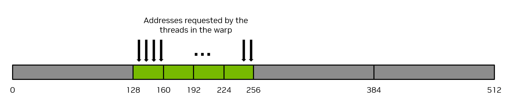

**图 12：合并的内存访问。**

相反，最糟糕的病态情形是连续线程访问的内存数据元素彼此相隔 32 字节或更多。在这种情况下，warp 将被迫为每个线程发出一次 32 字节的内存事务，总内存流量字节数将是 32 字节 × 32 线程/warp = 1024 字节。然而，实际使用的内存量只有 128 字节（warp 中每个线程 4 字节），因此内存利用率只有 128 / 1024 = 12.5%。这是对内存系统非常低效的使用。图 13 说明了这个未合并内存访问的示例。

实现合并内存访问最直接的方式是让连续线程访问内存中连续的元素。例如，对于以一维线程块启动的内核，前面展示的向量加法内核将实现合并内存访问。请注意线程如何访问这三个数组：连续线程（由 `workIndex` 的连续值指示）访问数组中连续的元素。


**图 13：未合并的内存访问。**

**C++**

```cpp
__global__ void vecAdd(float* A, float* B, float* C, int vectorLength)
{
    int workIndex = threadIdx.x + blockIdx.x*blockDim.x;
    if(workIndex < vectorLength)
    {
        C[workIndex] = A[workIndex] + B[workIndex];
    }
}
```

**Python**

```python
## 定义一个 CUDA 内核，执行 C = A + B 向量加法
@cuda.jit
def vecadd(A, B, C):
    work_index = cuda.grid(1)
    C[work_index] = A[work_index] + B[work_index]
```

并非要求连续线程访问连续的内存元素才能实现合并内存访问，这只不过是实现合并的典型方式。只要 warp 中的不同线程以某种线性或置换方式访问内存中同一 32 字节段内的元素，就会发生合并内存访问。换句话说，实现合并内存访问的最佳方式是最大化“使用的字节数与传输的字节数之比”。

理解全局内存合并的另一种等价方式是：考虑满足来自单个 warp 的单条加载指令所请求的 32 个地址需要多少次全局内存事务。在最好的情况下，只需一次全局内存事务即可满足所有加载。对于 4 字节数据元素的完美合并访问，将需要 4 次全局内存事务。在最坏的情况下，可能需要 32 次全局内存事务才能满足来自单个 warp 的单条加载指令所请求的地址。一般来说，满足一次加载所需的全局内存事务数越少，性能越好。

> **注意**
>
> 确保全局内存访问的正确合并是编写高性能 CUDA 内核最重要的性能考虑因素之一。应用必须尽可能高效地使用内存系统。

##### 2.3.4.1.1 使用全局内存的矩阵转置示例

举一个简单的例子，考虑一个非原地（out-of-place）矩阵转置内核，它将一个 N×N 的 32 位 float 方阵从矩阵 a 转置到矩阵 c。此示例使用二维网格，并假设启动 32×32 线程的二维线程块，即 `blockDim.x = 32`、`blockDim.y = 32`，因此每个二维线程块将操作矩阵的一个 32×32 tile。每个线程操作矩阵的一个唯一元素，因此不需要显式同步线程。图 14 说明了这个矩阵转置操作。内核源码在图后给出。

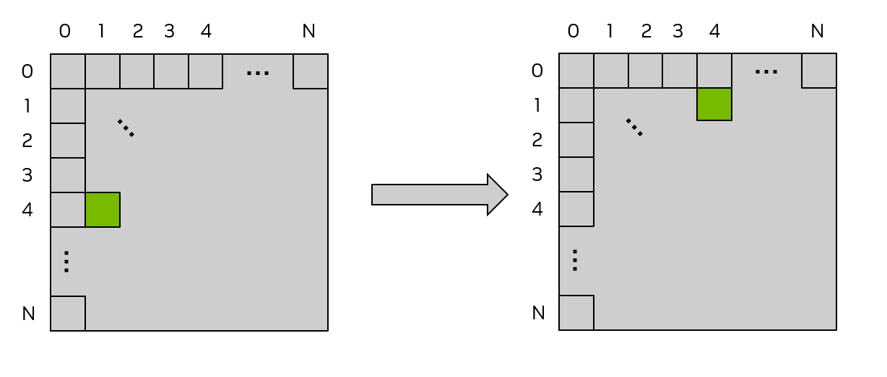

**图 14：使用全局内存的矩阵转置。**

每个矩阵顶部与左侧的标签是二维线程块的索引，也可以视为 tile 索引，其中每个小方格表示矩阵中一个将由某个二维线程块操作的 tile。在此示例中，tile 大小为 32×32 个元素，因此每个小方格代表矩阵的一个 32×32 tile。绿色阴影方格显示了转置操作前后某个示例 tile 的位置。

**C++**

```cpp
/* 用二维索引以行主序索引一维内存数组的宏 */
/* ld 是主维度（leading dimension），即矩阵的列数 */
#define INDX( row, col, ld ) ( ( (row) * (ld) ) + (col) )

/* 矩阵转置的 CUDA 内核 */
__global__ void cuda_transpose(int m, float *a, float *c )
{
    int myCol = blockDim.x * blockIdx.x + threadIdx.x;
    int myRow = blockDim.y * blockIdx.y + threadIdx.y;

    if( myRow < m && myCol < m )
    {
        c[INDX( myCol, myRow, m )] = a[INDX( myRow, myCol, m )];
    } /* end if */
    return;
} /* end cuda_transpose */
```

**Python**

```python
import numpy as np
from numba import cuda
import cupy as cp

## 矩阵转置内核，每个矩阵元素一个线程，使用二维线程块在二维网格上启动以匹配矩阵大小
@cuda.jit
def transpose(a, c):
    col = cuda.blockDim.x * cuda.blockIdx.x + cuda.threadIdx.x
    row = cuda.blockDim.y * cuda.blockIdx.y + cuda.threadIdx.y
    c[(col,row)] = a[(row,col)]
```

要判断该内核是否实现了合并内存访问，需要判断连续线程是否访问连续的内存元素。在二维线程块中，x 索引变化最快，因此连续的 `threadIdx.x` 值应当访问连续的内存元素。`threadIdx.x` 出现在 `myCol` 中，可以观察到当 `myCol` 作为 `INDX` 宏的第二个参数时，连续线程读取的是 a 的连续值，因此对 a 的读取是完全合并的。

然而，对 c 的写入并未合并，因为连续的 `threadIdx.x` 值（同样考察 `myCol`）写入 c 的元素彼此相隔 `ld`（主维度）个元素。可以观察到这一点，是因为此时 `myCol` 是 `INDX` 宏的第一个参数，而当 `INDX` 的第一个参数递增 1 时，内存位置变化 `ld`。当 `ld` 大于 32 时（只要矩阵尺寸大于 32 就会出现这种情况），这等价于图 13 所示的病态情形。

为缓解这些未合并的写入，可以采用共享内存，这将在下一节描述。

#### 2.3.4.2 共享内存访问模式

共享内存有 32 个 bank，其组织方式使得连续的 32 位字映射到连续的 bank。每个 bank 的带宽为每个时钟周期 32 位。

当同一 warp 中的多个线程尝试访问同一 bank 中的不同元素时，就会发生 bank 冲突（bank conflict）。在这种情况下，对该 bank 中数据的访问将被串行化，直到请求该数据的线程都获得该数据。这种访问串行化会导致性能损失。

这种情况的两个例外是：同一 warp 中的多个线程访问（读或写）同一共享内存位置。对于读访问，该字会被广播给发出请求的线程。对于写访问，每个共享内存地址只由其中一个线程写入（由哪个线程执行写入是未定义的）。

图 15 展示了跨步访问（strided access）的一些示例。bank 内的红色方框表示共享内存中的一个唯一位置。

图 16 展示了涉及广播机制的一些内存读访问示例。bank 内的红色方框表示共享内存中的一个唯一位置。如果多个箭头指向同一位置，则数据被广播给所有请求它的线程。

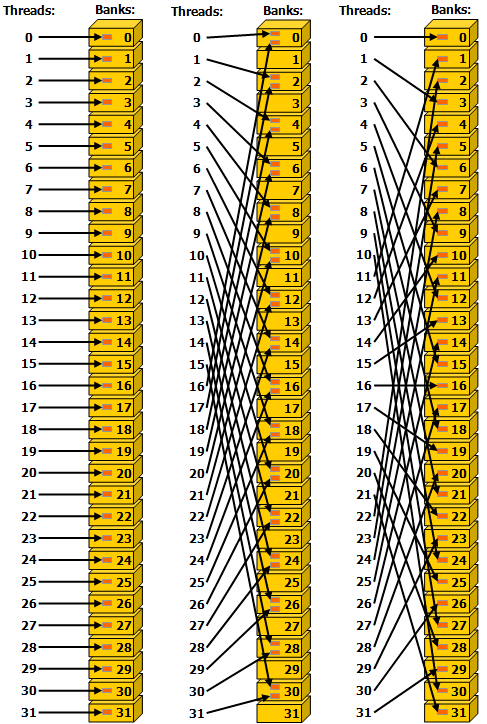

**图 15：32 位 bank 大小模式下的跨步共享内存访问。**
**左**：步长为一个 32 位字的线性寻址（无 bank 冲突）。
**中**：步长为两个 32 位字的线性寻址（二路 bank 冲突）。
**右**：步长为三个 32 位字的线性寻址（无 bank 冲突）。

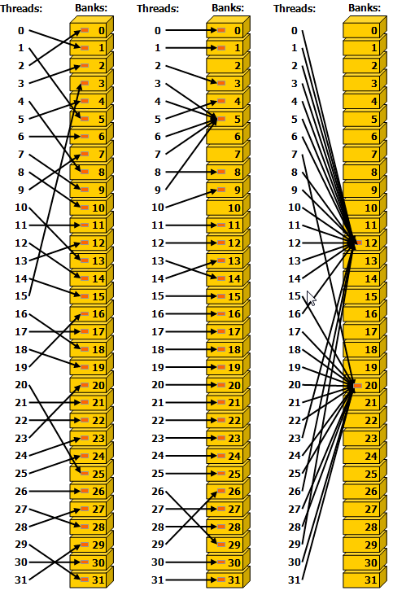

**图 16：不规则的共享内存访问。**
**左**：通过随机置换实现无冲突访问。
**中**：由于线程 3、4、6、7 与 9 访问 bank 5 中的同一个字，所以无冲突。
**右**：无冲突的广播访问（线程访问同一 bank 中的同一个字）。

> **注意**
>
> 对于编写使用共享内存的高性能 CUDA 内核，避免 bank 冲突是一项重要的性能考虑因素。

##### 2.3.4.2.1 使用共享内存的矩阵转置示例

在前面的“使用全局内存的矩阵转置示例”中，说明了一个矩阵转置的实现，它在功能上是正确的，但未针对高效的全局内存使用进行优化，因为对 c 矩阵的写入没有正确合并。在本例中，共享内存将被当作由用户管理的缓存，用来暂存来自全局内存的加载与存储，从而使读与写都实现合并的全局内存访问。

**C++**

```cpp
#define THREADS_PER_BLOCK_X 32
#define THREADS_PER_BLOCK_Y 32

/* 用二维索引以列主序索引一维内存数组的宏 */
/* ld 是主维度，即矩阵的行数 */
#define INDX( row, col, ld ) ( ( (col) * (ld) ) + (row) )

/* 使用共享内存的矩阵转置 CUDA 内核 */
__global__ void smem_transpose(int m,
                               float *a,
                               float *c )
{
    /* 声明一个静态分配的共享内存数组 */
    __shared__ float smemArray[THREADS_PER_BLOCK_X][THREADS_PER_BLOCK_Y];

    /* 确定我的行、列索引，供错误检查代码使用 */
    const int myRow = blockDim.x * blockIdx.x + threadIdx.x;
    const int myCol = blockDim.y * blockIdx.y + threadIdx.y;

    /* 确定我的行 tile 与列 tile 索引 */
    const int tileX = blockDim.x * blockIdx.x;
    const int tileY = blockDim.y * blockIdx.y;

    if( myRow < m && myCol < m )
    {
        /* 从全局内存读入共享内存数组 */
        smemArray[threadIdx.x][threadIdx.y] = a[INDX( tileX + threadIdx.x, tileY + threadIdx.y, m )];
    } /* end if */

    /* 同步线程块中的线程 */
    __syncthreads();

    if( myRow < m && myCol < m )
    {
        /* 将结果从共享内存写入全局内存 */
        c[INDX( tileY + threadIdx.x, tileX + threadIdx.y, m )] = smemArray[threadIdx.y][threadIdx.x];
    } /* end if */
    return;
}
```

**Python**

```python
import numpy as np
from numba import cuda
import cupy as cp

## 矩阵转置内核，每个矩阵元素一个线程，使用二维线程块在二维网格上启动以匹配矩阵大小
## 将输入暂存到共享内存
@cuda.jit
def smem_transpose(a, c):
    smemArray = cuda.shared.array(shape=(32, 32), dtype=np.float32)

    tile_col = cuda.blockDim.x * cuda.blockIdx.x
    tile_row = cuda.blockDim.y * cuda.blockIdx.y

    smemArray[(cuda.threadIdx.x, cuda.threadIdx.y)] = a[(tile_row + cuda.threadIdx.y, tile_col + cuda.threadIdx.x)]
    cuda.syncthreads()
    c[(tile_col + cuda.threadIdx.y, tile_row + cuda.threadIdx.x)] = smemArray[(cuda.threadIdx.y, cuda.threadIdx.x)]
```

此示例说明的根本性能优化，是确保在访问全局内存时内存访问被正确合并。在复制执行之前，每个线程计算其 `tileRow` 与 `tileCol` 索引。这些是将要操作的具体 tile 的索引，而这些 tile 索引基于当前执行的是哪个线程块。同一线程块中的每个线程具有相同的 `tileRow` 与 `tileCol` 值，因此可以将其视为该特定线程块将要操作的 tile 的起始位置。

然后，内核继续让每个线程块用下面的语句将矩阵的一个 32×32 tile 从全局内存复制到共享内存。由于一个 warp 的大小为 32 个线程，该复制操作将由 32 个 warp 执行，warp 之间没有保证的顺序。

**C++**

```cpp
smemArray[threadIdx.x][threadIdx.y] = a[INDX( tileRow + threadIdx.y, tileCol + threadIdx.x, m )];
```

**Python**

```python
smemArray[(cuda.threadIdx.x, cuda.threadIdx.y)] = a[(tile_row + cuda.threadIdx.y, tile_col + cuda.threadIdx.x)]
```

注意，由于 `threadIdx.x` 出现在 `INDX` 的第二个参数中，连续线程访问内存中连续的元素，对 a 的读取是完全合并的。在 Python 中，将 `cuda.threadIdx.x` 用作元组的最后一个索引具有相同的效果：对 a 的访问是完全合并的。

内核的下一步是调用 `__syncthreads()` / `cuda.syncthreads()`。这确保线程块中的所有线程在继续之前都已完成前一段代码的执行，从而在下一步之前完成将 a 写入共享内存。这一点至关重要，因为下一步将涉及线程从共享内存读取。如果没有 `__syncthreads()` / `cuda.syncthreads()` 调用，就无法保证线程块中的所有 warp 都已完成把 a 读入共享内存，然后某些 warp 才推进到从共享内存中的数组读取。当一个线程处理或存储并非由它加载的数据时，同步是必要的，以确保该元素的加载操作在访问它之前已经完成。

此时在内核中，对于每个线程块，共享内存数组中都有一个矩阵的 32×32 tile，其排列顺序与原始矩阵相同。为确保 tile 内的元素被正确转置，线程在从 `smemArray` 读取时交换 `threadIdx.x` 与 `threadIdx.y`。为确保整个 tile 被放到 c 中正确的位置，线程在写入 c 时也交换 `tileRow` 与 `tileCol` 索引。为确保正确合并，`threadIdx.x` 被用作 `INDX` 的第二个参数，如下面语句所示。在 Python 中，这同样通过在矩阵索引元组的最后一个索引中使用 `cuda.threadIdx.x` 来实现。

**C++**

```cpp
c[INDX( tileCol + threadIdx.y, tileRow + threadIdx.x, m )] = smemArray[threadIdx.y][threadIdx.x];
```

**Python**

```python
c[(tile_col + cuda.threadIdx.y, tile_row + cuda.threadIdx.x)] = smemArray[(cuda.threadIdx.y, cuda.threadIdx.x)]
```

该内核说明了共享内存的两种常见用途。

- 共享内存用于暂存来自全局内存的数据，以确保对全局内存的读与写都正确合并。
- 共享内存用于让同一线程块中的线程彼此共享数据。

##### 2.3.4.2.2 共享内存 bank 冲突

2.3.4.2 节描述了共享内存的 bank 结构。在前面的矩阵转置示例中，实现了对全局内存的适当合并访问，但未考虑是否存在共享内存 bank 冲突。考虑下面的二维共享内存声明：

**C++**

```cpp
__shared__ float smemArray[32][32];
```

**Python**

```python
from numba import cuda
import numpy as np

smemArray = cuda.shared.array(shape=(32,32), dtype=np.float32)
```

假设内核预期以 32×32 线程的二维线程块启动。由于一个 warp 是 32 个线程，特定 warp 中的每个线程将具有固定的 `threadIdx.y` 值，并且 `0 <= threadIdx.x < 32`。

图 17 的左图说明了 warp 中的线程访问 `smemArray` 某一列数据时的情况。Warp 0 访问内存位置 `smemArray[0][0]` 到 `smemArray[31][0]`（Python 中为 `smemArray[(0,0)]` 到 `smemArray[(31,0)]`）。在 C++ 与 Python 中，多维数组排序都是最后一个索引变化最快，因此 warp 0 中的连续线程访问的内存位置彼此相隔 32 个元素。如图所示，颜色表示不同的 bank，warp 0 沿整列的这次访问导致了 32 路 bank 冲突。

图 17 的右图说明了 warp 中的线程访问 `smemArray` 某一行的数据时的情况。Warp 0 访问内存位置 `smemArray[0][0]` 到 `smemArray[0][31]`（Python 中为 `smemArray[(0,0)]` 到 `smemArray[(0,31)]`）。在这种情况下，warp 0 中的连续线程访问的是相邻的内存位置。如图所示，颜色表示不同的 bank，warp 0 沿整行的这次访问没有 bank 冲突。

理想情况是 warp 中的每个线程访问具有不同颜色的共享内存位置。

回到 2.3.4.2.1 节的示例，可以检查共享内存的使用情况以确定是否存在 bank 冲突。第一次使用共享内存是将全局内存中的数据存储到共享内存：

**C++**

```cpp
smemArray[threadIdx.x][threadIdx.y] = a[INDX( tileRow + threadIdx.y, tileCol + threadIdx.x, m )];
```

**Python**

```python
smemArray[(cuda.threadIdx.x, cuda.threadIdx.y)] = a[(tile_row + cuda.threadIdx.y, tile_col + cuda.threadIdx.x)]
```

由于数组以行主序存储，同一 warp 中的连续线程（由连续的 `threadIdx.x` 值指示）将以 32 个元素的步长访问 `smemArray`，因为 `threadIdx.x` 是数组的第一个索引。这导致 32 路 bank 冲突，如图 17 的左图所示。

第二次使用共享内存是将共享内存中的数据写回全局内存：

**C++**

```cpp
c[INDX( tileCol + threadIdx.y, tileRow + threadIdx.x, m )] = smemArray[threadIdx.y][threadIdx.x];
```

**Python**

```python
c[(tile_col + cuda.threadIdx.y, tile_row + cuda.threadIdx.x)] = smemArray[(cuda.threadIdx.y, cuda.threadIdx.x)]
```

在这种情况下，由于 `threadIdx.x` 是 `smemArray` 数组的第二个索引，同一 warp 中的连续线程将以 1 个元素的步长访问 `smemArray`。这没有 bank 冲突，如图 17 的右图所示。

2.3.4.2.1 节所示的矩阵转置内核有一次共享内存访问没有 bank 冲突，另一次则有 32 路 bank 冲突。避免 bank 冲突的一种常见修正方法是对共享内存进行填充（padding），即在数组的列维度上加 1，如下所示：

**C++**

```cpp
__shared__ float smemArray[THREADS_PER_BLOCK_X][THREADS_PER_BLOCK_Y+1];
```

**Python**

```python
smemArray = cuda.shared.array(shape=(32, 32 + 1), dtype=np.float32)
```

对 `smemArray` 声明的这一微小调整将消除 bank 冲突。为说明这一点，考虑图 18，其中共享内存数组被声明为 32×33 的大小。可以观察到，无论同一 warp 中的线程是沿整列还是沿整行访问共享内存数组，bank 冲突都已消除，即同一 warp 中的线程访问的是具有不同颜色的位置。

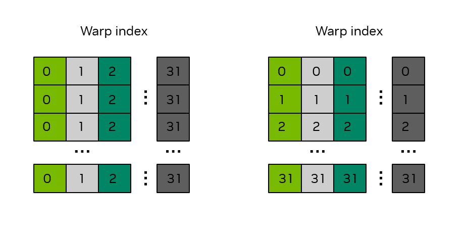

**图 17：32×32 共享内存数组中的 bank 结构。方框中的数字表示 warp 索引。颜色表示该共享内存位置与哪个 bank 关联。**

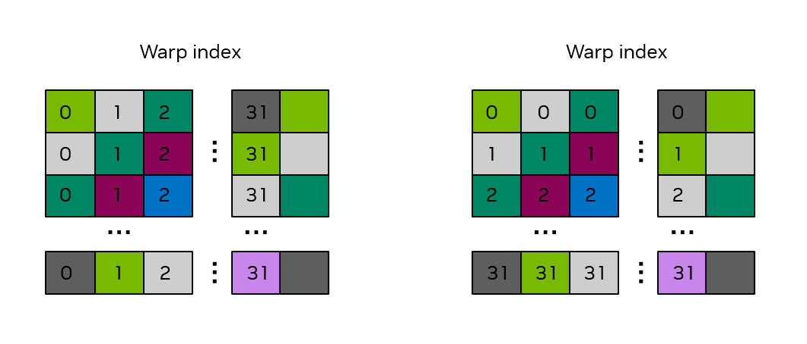

**图 18：32×33 共享内存数组中的 bank 结构。方框中的数字表示 warp 索引。颜色表示该共享内存位置与哪个 bank 关联。**

### 2.3.5 原子操作

高性能的 CUDA 内核依赖于尽可能多地表达算法并行性。GPU 内核执行的异步特性要求线程尽可能独立地运行。线程并不总是能够完全独立，正如我们在“共享内存”一节中所见，同一线程块中的线程存在交换数据与同步的机制。

在整个网格层面，不存在同步网格中所有线程的此类机制。不过，通过使用原子函数（atomic function），存在一种对全局内存位置提供同步访问的机制。原子函数允许线程获得对某个全局内存位置的锁，并对该位置执行读-改-写操作。在锁被持有期间，其他任何线程都无法访问同一位置。

#### 2.3.5.1 C++ 中类似 std::atomic 的原子操作

在 C++ 中，CUDA 提供了与同类命名的 C++ 标准库原子类型 `cuda::std::atomic` 与 `cuda::std::atomic_ref` 相似的语法与行为。CUDA 还提供了扩展的 C++ 原子类型 `cuda::atomic` 与 `cuda::atomic_ref`，允许用户指定原子操作的线程作用域。原子函数的细节在“原子函数”一节中介绍。

下面是一个使用 `cuda::atomic_ref` 执行设备范围原子加法的示例用法，其中 `array` 是一个 float 数组，`result` 是指向全局内存中某个位置的 float 指针，该位置将存储数组之和。

**C++**

```cpp
__global__ void sumReduction(int n, float *array, float *result) {
    ...
    tid = threadIdx.x + blockIdx.x * blockDim.x;
    cuda::atomic_ref<float, cuda::thread_scope_device> result_ref(result);
    result_ref.fetch_add(array[tid]);
    ...
}
```

原子函数应谨慎使用，因为它们会强制线程同步，从而影响性能。

#### 2.3.5.2 Python 中的内存原子操作

在 Python 中，原子内存操作由 `numba.cuda.atomic` 命名空间中可供 GPU 代码使用的函数提供。诸如 `add`、`sub`、`max`、`min` 与 `compare_and_swap` 等典型操作都可用。受支持的原子操作的完整列表可在 Numba CUDA 文档中找到。

下面的代码展示了一个使用原子内存访问来计算数组中所有值之和的内核示例。每个线程块将数组的一个切片加载到共享内存。每个线程块中的单个线程计算局部和，并对结果数组 s 执行一次原子加法。由于数据位于共享内存中，而共享内存靠近 SM 的计算资源，因此由单个线程执行求和通常仍然具有相当不错的性能。

**Python**

```python
import numpy as np
from numba import cuda
import cupy as cp

@cuda.jit
def sum_reduce(a, s):
    ## 创建一个共享数组以支持最多 512 个线程的块大小
    ## 即便本例中我们会使用更少的线程
    shared_staging = cuda.shared.array(shape=512, dtype=np.float32)

    ## 将值加载到共享内存，然后同步以确保所有加载完成
    shared_staging[cuda.threadIdx.x] = a[cuda.blockIdx.x*cuda.blockDim.x + cuda.threadIdx.x]
    cuda.syncthreads()

    ## 每个块中只有线程 0 执行局部加法，随后每个线程块执行一次原子操作
    local_sum = float(0.0)
    if cuda.threadIdx.x == 0:
        for i in range(cuda.blockDim.x):
            local_sum = local_sum + shared_staging[i]
        cuda.atomic.add(s, 0, local_sum)

array_length = 2**18
a = cp.ones(array_length)
s = cp.zeros(1, dtype=np.float32)

block_size = 256
grid_size = int(array_length/block_size)

sum_reduce[grid_size, block_size](a, s)
s_host = cp.asnumpy(s)
print(f"Sum is {int(s_host[0])}, expected {array_length}")
```

在这个简单示例中，输入数组全为 1，因此正确的和与 `array_length` 相同。

如果代码行

```python
cuda.atomic.add(s, 0, local_sum)
```

改为非原子的加法

```python
s[0] = s[0] + local_sum
```

则对 `s[0]` 的访问将不是原子的，`s[0]` 的最终值将小于 `array_length`。此外，该值可能每次运行都不同，在具有不同 SM 数量的 GPU 上运行时也会不同。这说明了在此代码中为保证正确性为何需要原子内存访问。

> **注意**
>
> 此示例虽然可用，但并非意在说明如何在 GPU 上编写峰值性能的归约操作。NVIDIA 的 CUDA 核心计算库（CCCL）为许多操作（包括归约）提供了高性能原语。出于生产力与性能考虑，开发者应尽可能优先使用这些高度调优的实现，而不是重新实现相同的算法。这些原语在 Python 中可通过 `cuda.coop` 包获得。

C++ 中也有类似的原子操作，将在 5.4.5.1 节讨论，但在 CUDA C++ 中推荐使用类似 `std::atomic` 的原子操作，并将其视为最佳实践。

### 2.3.6 协作组

协作组（Cooperative Groups）是 CUDA C++ 中提供的一种软件工具，它允许应用定义可以相互同步的线程组，即使该线程组跨越多个线程块、单个 GPU 上的多个网格，甚至跨越多个 GPU。CUDA 编程模型总体上允许线程块或线程块集群内的线程高效同步，但没有提供指定小于线程块或集群的线程组的机制。同样，CUDA 编程模型也不提供能够实现跨线程块同步的机制或保证。

协作组通过软件提供了这两种能力。协作组允许应用创建跨越线程块与集群边界的线程组，不过这样做会带来一些语义限制与性能影响，详见介绍协作组的特性章节。

### 2.3.7 内核启动与占用率

当启动一个 CUDA 内核时，CUDA 线程根据内核启动时指定的执行配置被分组为线程块与网格。内核启动后，调度器将线程块分配给 SM。哪些线程块调度到哪些 SM 上执行的细节无法由应用控制或查询，调度器也不做任何顺序保证，因此程序不能依赖特定的调度顺序或方案来保证正确执行。

一个 SM 上可以调度的块数取决于给定线程块所需的硬件资源，以及 SM 上可用的硬件资源。内核首次启动时，调度器开始向 SM 分配线程块。只要 SM 具有未被其他线程块占用的足够硬件资源，调度器就会继续向 SM 分配线程块。如果某个时刻没有任何 SM 有能力接受另一个线程块，调度器将等待 SM 完成先前分配的线程块。一旦发生这种情况，SM 就空闲下来可以接受更多工作，调度器便向其分配线程块。此过程持续进行，直到所有线程块都被调度并执行。

`cudaGetDeviceProperties` 函数允许应用通过设备属性查询每个 SM 的限制。请注意，既有每个 SM 的限制，也有每个线程块的限制。

- `maxBlocksPerMultiProcessor`：每个 SM 最多驻留的块数。
- `sharedMemPerMultiprocessor`：每个 SM 可用的共享内存量（字节）。
- `regsPerMultiprocessor`：每个 SM 可用的 32 位寄存器数量。
- `maxThreadsPerMultiProcessor`：每个 SM 最多驻留的线程数。
- `sharedMemPerBlock`：线程块最多可分配的共享内存量（字节）。
- `regsPerBlock`：线程块最多可分配的 32 位寄存器数量。
- `maxThreadsPerBlock`：每个线程块最多可包含的线程数。

GPU 架构的限制也可以在编译时与运行时通过 CUDA C++ 标准库中的 `cuda::arch_traits` 获得（参见“检索特性与技术规格”）。

CUDA 内核的占用率（occupancy）是活动 warp 数量与 SM 所支持的最大活动 warp 数量之比。一般来说，占用率越高越好，这样可以隐藏延迟并提升性能。

要计算占用率，需要知道刚才描述的 SM 资源限制，还需要知道所讨论的 CUDA 内核需要哪些资源。要确定每个内核的资源使用情况，在程序编译期间可以使用 nvcc 的 `--resource-usage` 选项，它会显示该内核所需的寄存器数量与共享内存量。

为说明这一点，考虑一个计算能力为 10.0 的设备，其设备属性列于表 2。

**表 2：SM 资源示例**

| 资源 | 值 |
|---|---|
| maxBlocksPerMultiProcessor | 32 |
| sharedMemPerMultiprocessor | 233472 |
| regsPerMultiprocessor | 65536 |
| maxThreadsPerMultiProcessor | 2048 |
| sharedMemPerBlock | 49152 |
| regsPerBlock | 65536 |
| maxThreadsPerBlock | 1024 |

相同的值在编译时由 `cuda::arch_traits` 提供：

```cpp
#include <cuda/devices>

constexpr auto traits = cuda::arch_traits<cuda::arch_id::sm_100>();
static_assert(traits.max_blocks_per_multiprocessor == 32);
static_assert(traits.max_shared_memory_per_multiprocessor == 233472);
static_assert(traits.max_registers_per_multiprocessor == 65536);
static_assert(traits.max_threads_per_multiprocessor == 2048);
static_assert(traits.max_shared_memory_per_block == 49152);
static_assert(traits.max_registers_per_block == 65536);
static_assert(traits.max_threads_per_block == 1024);
```

如果一个内核以 `testKernel<<<512, 768>>>()` 启动，即每个线程块 768 个线程，那么每个 SM 一次只能执行 2 个线程块。调度器不能向每个 SM 分配超过 2 个线程块，因为 `maxThreadsPerMultiProcessor` 为 2048。因此占用率为 (768 × 2) / 2048，即 75%。

如果一个内核以 `testKernel<<<512, 32>>>()` 启动，即每个线程块 32 个线程，那么每个 SM 不会触及 `maxThreadsPerMultiProcessor` 的限制，但由于 `maxBlocksPerMultiProcessor` 为 32，调度器每个 SM 只能分配 32 个线程块。由于块中线程数为 32，SM 上驻留的线程总数为 32 块 × 32 线程/块，即总共 1024 个线程。由于计算能力 10.0 的 SM 每 SM 最大驻留线程数为 2048，因此此情况下的占用率为 1024 / 2048，即 50%。

也可以用共享内存进行相同的分析。例如，如果一个内核使用 100KB 共享内存，那么调度器每个 SM 只能分配 2 个线程块，因为该 SM 上的第三个线程块将需要另外 100KB 共享内存，合计 300KB，超过了每 SM 可用的 233472 字节。

每个线程块的线程数以及每个线程块的共享内存使用量由程序员显式控制，可以调整以达到所需的占用率。程序员对寄存器使用量的控制有限，因为编译器与运行时会尝试优化寄存器使用。不过，程序员可以通过 nvcc 的 `--maxrregcount` 选项指定每个线程块的最大寄存器数量。如果内核需要的寄存器多于此指定量，内核很可能溢出到局部内存，这会改变内核的性能特征。在某些情况下，即使发生溢出，限制寄存器也能让更多线程块被调度，从而提高占用率，并可能带来性能的净提升。

## 2.4 编写 tile 内核

CUDA Tile 与前几章介绍的单指令多线程（SIMT）模型不同，它提供了另一种编写 GPU 内核代码的方法。tile 编程允许程序员以不同方式表达并行性，并将最低层的并行性交给编译器与内置操作处理。通过这种方式，tile 为使用 NVIDIA GPU 近期的性能特性（如张量内存加速器（Tensor Memory Accelerator，TMA）单元与张量核心）提供了一种更简单的方法。

- CUDA Tile 编程在 Python 中可通过 cuTile Python 包 `cuda.tile` 使用。
- CUDA Tile C++ 从 13.3 版本起在 CUDA 工具包中提供。

tile 内核外围的应用代码——例如分配设备内存、在主机与设备之间传输数据、对内核启动进行排序等任务——与前几章针对 SIMT 内核所描述的内容完全相同。tile 内核操作使用标准 CUDA API 分配的全局内存，其结果也以相同方式复制回主机。唯一变化的是程序员在内核本身内部编写的代码。

在 SIMT 内核中，程序员以单个线程为单位思考：计算全局线程索引、加载该线程的元素、对它们执行操作并存储结果。在 tile 内核中，程序员以整个块为单位思考：加载一个包含许多元素的 tile、对整个 tile 执行操作并存储结果。编译器负责将 tile 操作映射到每个块的硬件线程上，而在 SIMT 中这是程序员显式处理的关注点。

本章专门聚焦于这一差异：如何编写内核入口点以及其中的 tile 操作。每种模式都会用 CuTile Python（`cuda.tile`）与 CUDA Tile C++（`cuda::tiles`）两种形式演示，它们共享一个公共编译器后端（CUDA Tile IR），因此具有相同的执行语义。

按照惯例，tile API 在两种语言中都别名为 `ct`。

- Python 中：`import cuda.tile as ct`
- C++ 中：`namespace ct = cuda::tiles;`

在 Python 中，tile API 位于模块 `cuda.tiles` 中，按上述方式导入。在 C++ 中，tile API 位于 `cuda::tiles` 命名空间中，该命名空间由 `cuda_tile.h` 头文件暴露。

```cpp
#include "cuda_tile.h"
namespace ct = cuda::tiles;
```

下文代码片段中的 `ct.` / `ct::` 前缀指的是你所阅读语言中的 tile API。

### 2.4.1 内核与函数声明

tile 内核是 GPU 入口点，它在启动网格中每个块执行一次。tile 函数可从 tile 内核或另一个 tile 函数调用，但本身不是入口点。与 SIMT 内核一样，tile 内核不能直接从主机代码调用；它们必须被启动。

在 CUDA Tile C++ 中：

- `__tile_global__` 是 `__global__` 的 tile 对应物，用于标记 tile 内核入口点。
- `__tile__` 是 `__device__` 的 tile 对应物，表示某个函数应当为 GPU 编译，并可从其他 `__tile__` 或 `__tile_global__` 函数调用。

数组与标量参数的传递方式与 SIMT 内核相同。tile 代码与 SIMT 代码可以共存：单个 `.cu` 文件可以同时定义 `__tile_global__` 与 `__global__` 内核，单个主机程序可以同时启动两者。

> **注意**
>
> 目前，`__tile__` 函数不能从 `__global__` 或 `__device__` 函数调用。同样，`__device__` 函数也不能从 `__tile_global__` 或 `__tile__` 函数调用。此限制可能会在未来的 CUDA 版本中取消。

在 cuTile Python 中：

- `@ct.kernel` 装饰器将函数标记为 tile 内核入口点。
- `@ct.function` 装饰器将函数标记为可从 tile 内核或另一个 tile 函数调用。

在实践中，任何从内核调用的函数都会自动编译为 tile 代码，因此 `@ct.function` 装饰器是可选的。数组参数接受任何暴露 DLPack 或 CUDA Array Interface 的设备驻留数组，例如 PyTorch 张量与 CuPy 数组。标量参数直接传递。

**C++**

```cpp
#include "cuda_tile.h"

// tile 内核入口点。不能直接调用；必须被启动。
__tile_global__ void my_kernel(float* a, float* b, float* c) {
    ...
}

// tile 函数。可从 tile 内核与 tile 函数调用。
__tile__ float helper(float x, float y) {
    return x + y;
}
```

**Python**

```python
import cuda.tile as ct

# tile 内核入口点。不能直接调用；必须被启动。
@ct.kernel
def my_kernel(a, b, c):
    ...

# tile 函数。可从 tile 内核与 tile 函数调用。
# @ct.function 是可选的，任何从 tile 代码调用的函数
# 都会自动编译为 tile 代码。
@ct.function
def helper(x, y):
    return x + y
```

### 2.4.2 启动内核

tile 内核在由 tile 块组成的网格上启动，正如 SIMT 内核在由线程块组成的网格上启动一样。程序员指定网格形状，最多三个维度。从程序员的角度看，每个 tile 块由单个逻辑线程执行。块内的并行性由编译器管理。

在 C++ 中，tile 内核沿用 SIMT 中熟悉的三重尖括号启动语法。第一个尖括号参数是网格形状（tile 块数量）。第二个是 SIMT 中每块的线程数；对于 tile 内核，线程数由编译器在内部决定，第二个参数必须为 1。tile 内核也是普通的 CUDA 内核，因此可以通过运行时现有的 API `cudaLaunchKernel` 与 `cudaLaunchKernelEx`，以相同的网格、1 配置启动。当把 tile 内核集成到已通过这些 API 驱动启动的代码库中时，这很有用。

在 Python 中，`ct.launch` 接收四个位置参数：一个 CUDA 流、一个指定每个维度 tile 块数量的网格元组、内核对象，以及内核参数的元组。

**C++**

```cpp
my_kernel<<<dim3(num_blocks_x, num_blocks_y), 1>>>(a, b, c);  // 第二个参数必须为 1
```

**Python**

```python
import torch

stream = torch.cuda.current_stream()          # CUDA 流对象
grid = (num_blocks_x, num_blocks_y, 1)        # tile 块网格 (x, y, z)
ct.launch(stream, grid, my_kernel, (a, b, c))
```

#### 2.4.2.1 网格大小计算模式

一种常见的模式是启动足够多的块以覆盖整个数组，包括最后一个在一个或多个维度上可能超出数组大小的块。

**C++**

```cpp
int num_blocks = (N + tile_size - 1) / tile_size;  // 向上取整除法 -> 覆盖部分尾部
kernel<<<num_blocks, 1>>>(in, out, N);
```

**Python**

```python
import math

grid = (math.ceil(N / TILE),)                      # 向上取整除法 -> 覆盖部分尾部
ct.launch(stream, grid, my_kernel, (arr_in, arr_out, TILE))
```

数组大小不能被 tile 大小整除时的处理，将在 2.4.6 节的各小节中讨论。

### 2.4.3 查询块的位置

每个块需要知道自己在网格中的位置，以便确定要处理数据的哪一部分。在 SIMT 中，程序员组合 `blockIdx` 与 `threadIdx` 来计算全局线程索引。在 tile 代码中，只需要块索引。编译器处理块内所有线程级的索引。

在 C++ 中，`ct::bid()` 返回一个 `uint3`，包含全部三个维度上的块索引。`ct::num_blocks()` 返回一个 `dim3`，包含每个维度上的总块数（由内核启动参数决定）。各个分量通过 `.x`、`.y`、`.z` 访问。

在 Python 中，`ct.bid(axis)` 以 int32 标量返回当前块沿给定轴（0、1 或 2）的索引。`ct.num_blocks(axis)` 返回沿该轴的总块数——可用于边界检查与循环计数。

**C++**

```cpp
#include "cuda_tile.h"

__tile_global__ void my_kernel(float* a, float* b, float* c) {
    namespace ct = cuda::tiles;
    int bid_x = ct::bid().x;        // 沿 .x 的块索引
    int bid_y = ct::bid().y;        // 沿 .y 的块索引
    int num_x = ct::num_blocks().x; // 沿 .x 的总块数
}
```

**Python**

```python
@ct.kernel
def my_kernel(a, b, c):
    bid_x = ct.bid(0)        # 沿轴 0 的块索引
    bid_y = ct.bid(1)        # 沿轴 1 的块索引
    num_x = ct.num_blocks(0) # 沿轴 0 的总块数
```

### 2.4.4 创建 tile

在确定了块的身份之后，下一个问题是 tile 内核实际操作的对象。这就是 tile：一个固定大小的多维标量元素数组，其形状与元素类型在编译时已知。tile 的每个维度都必须是 2 的幂。tile 具有值语义。这意味着复制一个 tile 会复制其元素，两个副本完全独立。尽管如此，复制是廉价的，因为编译器控制 tile 在硬件内部如何表示。程序员不需要为 tile 分配或释放内存。

在实践中，tile 要么通过从数组加载数据创建（见“tile 空间的加载与存储”），要么通过使用生成填充指定模式的 tile 的工厂函数创建。

在 C++ 中，tile 类型是显式的：`ct::tile<T, ct::shape<dims...>>`，其中 T 是元素类型，`ct::shape<dims...>` 将维度编码为模板参数（这些整数值是沿每个轴的编译时大小）。例如，`ct::tile<float, ct::shape<8>>` 是一个包含 8 个 float 的一维 tile，`ct::tile<float, ct::shape<4, 4>>` 是一个 4×4 的 float tile。由于形状是类型的一部分，它在编译时总是已知的。

工厂函数将完整的 tile 类型（下文的 `Tile`）作为模板参数：

- `ct::zeros<Tile>()` 与 `ct::ones<Tile>()`——填充为零或一的 tile。
- `ct::full<Tile>(val)`——每个元素值都为 `val` 的 tile。
- `ct::iota<Tile>()`——包含 (0, 1, ..., N-1) 的 tile，其中 N 是 tile 的大小。

本章中的 C++ 示例使用 `using` 别名（例如 `using f32x4x4 = ct::tile<float, ct::shape<4, 4>>`）来保持调用处的 tile 类型易读。

在 Python 中，tile 工厂函数的形状元组与 dtype 参数都是编译时值。Python 字面量（如 `(64, 64)` 与 `ct.float32`）天然满足这一点。它们也可以通过带 `Constant` 注解的内核参数提供，如下文“Python Constant[T]”所示。生成的 tile 暴露 `.shape`、`.dtype` 与 `.ndim` 属性，反映其编译时属性。

工厂函数为：

- `ct.zeros(shape, dtype)` 与 `ct.ones(shape, dtype)`——填充为零或一的 tile。
- `ct.full(shape, fill_value, dtype)`——具有任意常量值的 tile。
- `ct.arange(size, dtype=...)`——包含 [0, 1, ..., size-1] 的一维 tile。

**C++**

```cpp
#include "cuda_tile.h"

__tile__ void factories() {
    namespace ct = cuda::tiles;
    using i32x8   = ct::tile<int,   ct::shape<8>>;     // 一维：8 个 int
    using f32x4x4 = ct::tile<float, ct::shape<4, 4>>;  // 二维：4x4 个 float

    auto z      = ct::zeros<f32x4x4>();      // 全零
    auto o      = ct::ones<f32x4x4>();       // 全一
    auto filled = ct::full<f32x4x4>(3.14f);  // 全 3.14
    auto seq    = ct::iota<i32x8>();         // {0, 1, 2, 3, 4, 5, 6, 7}
}
```

**Python**

```python
import cuda.tile as ct

@ct.function
def factories():
    zeros  = ct.zeros((64, 64), dtype=ct.float32)   # 64x64 的 0.0 tile
    ones   = ct.ones((128,), dtype=ct.float16)      # 128 个 1.0 的 tile
    filled = ct.full((32, 32), 3.14, dtype=ct.float32) # 32x32 的 3.14 tile
    seq    = ct.arange(8, dtype=ct.int32)           # [0, 1, 2, 3, 4, 5, 6, 7]
```

### 2.4.5 编译时常量

tile 编译器会为 tile 形状、数据类型与其他结构参数的每种组合生成专门的机器码。因此，影响生成代码的值必须在编译时已知。也就是说，tile 的形状与数据类型必须在编译时已知。创建 tile 时使用字面量来指定 tile 形状与数据类型：`ct.zeros((64, 64), dtype=ct.float32)` 与 `ct::tile<int, ct::shape<8>>`。

形状也可以通过内核接口作为编译时已知的值传递，如下文各节所示。

#### 2.4.5.1 Python Constant[T]

内核参数上的 `ct.Constant[T]` 类型提示将其标记为常量嵌入（constant-embedded）。这意味着内核内部对该参数的每次使用都表现为字面量值被写在其位置。类型参数是可选的，不带类型参数的 `ct.Constant` 会嵌入任意类型的常量。`ct.Constant` 最常用于整数，即 `ct.Constant[int]`，用于驱动 tile 形状与循环边界的参数。

**Python**

```python
import cuda.tile as ct

@ct.kernel
def my_kernel(TILE: ct.Constant[int]):
    # TILE 是常量嵌入的：无论 TILE 出现在哪里，编译器都看到它的
    # 字面量值（例如 128）并生成专门代码。这里 TILE 驱动
    # 由工厂构建的 tile 的形状。
    zeros = ct.zeros((TILE,), dtype=ct.float32)
```

#### 2.4.5.2 C++ integral_constant 与 _ic 字面量

在 CUDA Tile C++ 中，编译时值通过 `ct::integral_constant` 表达，其数值编码在类型本身中。`ct::literals` 命名空间中的 `_ic` 字面量提供了一种简洁的简写：`0_ic` 产生一个 `ct::integral_constant<0>` 值。

接受编译时值的 API 同时接受非类型模板参数（NTTP）形式与 `_ic` 字面量形式。例如，`ct::cat` 沿给定维度拼接两个 tile，而该维度必须在编译时已知。下面两行以相同的编译时轴调用 `ct::cat`；它们只在编译时值书写的位置上不同：

**C++**

```cpp
#include "cuda_tile.h"

__tile__ void concat_demo() {
    namespace ct = cuda::tiles;
    using namespace ct::literals;
    using T = ct::tile<int, ct::shape<4, 8>>;
    T lhs = ct::full<T>(0);
    T rhs = ct::full<T>(1);

    auto a = ct::cat<0>(lhs, rhs);     // NTTP 形式
    auto b = ct::cat(lhs, rhs, 0_ic);  // _ic 形式
}
```

`_ic` 字面量还常常出现在另一个地方。`ct::extents` 与 `ct::shape` 各自都有一个 NTTP 形式（例如 `ct::extents<std::uint32_t, 4, 8>`）与一个花括号形式。与 NTTP 形式不同，花括号形式接受运行时值，因此当有一个或多个维度只在启动时已知时，就使用这种形式：编译时维度用 `_ic` 字面量，运行时维度用普通变量。诸如 `ct::tensor_span` 与 `ct::partition_view`（在“tile 空间的加载与存储”中介绍）等 tile 空间 API 使用这种形式来包装此类数组：

**C++**

```cpp
auto shape2d = ct::extents{8_ic, length};  // 8 是编译时；length 是运行时
```

当值形式 API 的参数需要编译时值时（例如 `ct::cat` 的维度，或 `extents`/`shape` 的分量），`_ic` 字面量就是统一的简写。

### 2.4.6 加载与存储 tile

正如 1.2.2.3.1 节首次介绍的，CUDA tile 编程模型中有两个关键的内存对象：tile 与数组。数组是全局内存中一个多维元素容器，对 tile 内核的所有块可见。tile 也是一个多维元素容器，但对 CUDA tile 代码的单个块局部。tile 通常是数组中元素的一个子集。本节讨论如何从数组加载到 tile 以便在 tile 内核中使用，以及如何将 tile 存回数组。

后续小节将介绍两种加载与存储 tile 的方法：

- “tile 空间的加载与存储”介绍使用 tile 空间索引的加载与存储，它使用视图对象，规定了数组元素如何映射到 tile 的可预测模式。
- “收集与散射”介绍使用索引或指针 tile 的加载与存储，这些 tile 分别指示加载或存储时作为 tile 元素来源或目标的数组元素。

**性能说明**：在受支持的硬件上，tile 空间的加载可由编译器下沉到张量内存加速器（TMA），这比逐元素收集快得多。（C++ 方面另请参见“C++ 性能提示”。）

程序员必须决定加载时越界元素取什么值。越界写入默认会被静默丢弃：在 Python 中总是如此，在 C++ 中则在使用带掩码的变体时如此。

#### 2.4.6.1 tile 空间的加载与存储

使用 tile 空间加载时，会创建一个视图对象，它规定数组如何被划分为 tile 大小区域的网格。这种映射称为 tile 空间，tile 内核可以使用 tile 空间索引一次加载或存储一个区域。

tile 空间加载的核心是数组的 tiled 视图（tiled view），它规定数组元素如何映射到指定大小的 tile。图 19 所示的 tiled 视图是一个分区视图（partition view），即一种 tile 空间，其 tile 为指定大小、互不重叠且 tile 之间没有间隙。

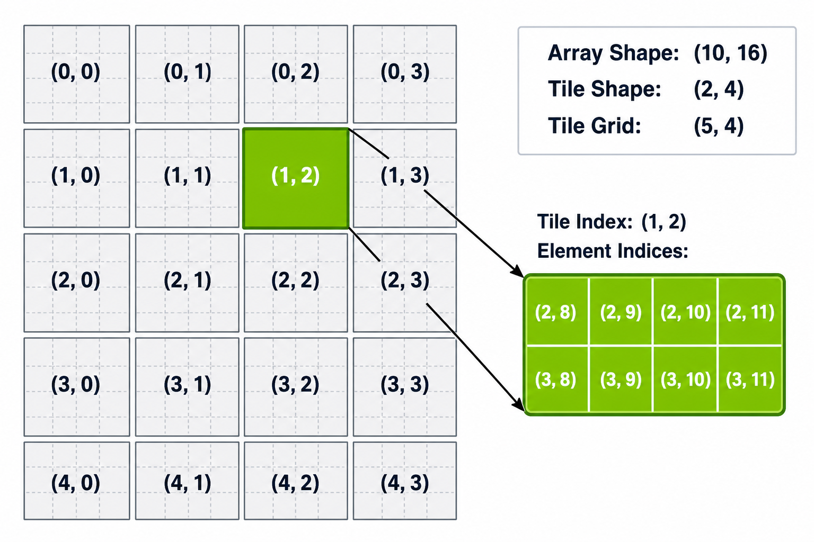

**图 19：分区视图的 tile 空间索引。形状为 (10, 16) 的二维数组被划分为形状为 (2, 4) 的 tile，产生形状为 (5, 4) 的 tile 网格。每个单元格显示其 tile 空间索引 (i, j)。tile 空间索引 (1, 2) 处的高亮区域覆盖元素索引 (2, 8) 至 (3, 11)。**

当数组维度不能完美地被 tile 整除时，在一个或多个维度上跨越数组边界的 tile 将被部分填充。程序员可以指定加载这些 tile 时的行为，这将在 2.4.6.1.3 节中介绍。

分区视图是可在数组上定义的若干 tile 空间之一。两种语言中还有其他两种可用：

- 按步长分隔的固定形状块（chunk），因此块之间可能留有空隙或重叠。C++ 中将其拼写为 `ct::strided_view`；Python 中向 `Array.tiled_view` 传入 `traversal_steps` 参数。
- 沿一个维度由元素索引 tile 选择的块，用于“收集与散射”中介绍的不规则访问模式。C++ 中将其拼写为 `ct::gather_scatter_view`；Python 中使用 `ct.load_advanced_indexing` 与 `ct.store_advanced_indexing`。

分区视图是本章唯一演示的 tile 空间，也是 `Array.tiled_view` 默认产生的 tile 空间。关于其他视图，请参见各语言的 API 参考（CUDA Tile C++ API Reference、cuTile Python tiled views and advanced indexing）。

##### 2.4.6.1.1 分区视图的加载与存储

结构化 tile 空间加载是在全局内存与 tile 之间移动数据的首选方式。内核必须先构建一个定义 tile 空间的视图对象，然后按 tile 空间索引一次加载或存储一个 tile。

在 C++ 中，分区视图分两步构建：

- `ct::tensor_span`——将原始指针与一个 `ct::extents` 配对，赋予指针多维结构。
- `ct::partition_view`——将 span 划分为固定大小 tile 的网格，并暴露在 tile 空间坐标中操作的 `.load(idx...)` / `.store(tile, idx...)` 方法。

在 Python 中，`Array.tiled_view(tile_shape)` 返回一个 `TiledView`，它把数组划分为给定形状的 tile。该视图暴露接收 tile 空间索引的 `.load(index)` / `.store(index, tile)` 方法，直接对应 C++ 的 `partition_view`。

> **注意**
>
> 本章的 C++ 示例代码用 `__restrict__` 注解指针参数，并在内核体顶部附近调用 `ct::assume_aligned(ptr, 16_ic)`。这些是重要的性能注解，将在 2.4.12 节中进一步介绍。数值字面量上的 `_ic` 后缀（例如 `128_ic`、`8_ic`）将其标记为编译时常量，如“编译时常量”中所述。

**C++**

```cpp
__tile_global__ void vec_add(float* __restrict__ a, float* __restrict__ b, float* __restrict__ out) {
    namespace ct = cuda::tiles;
    using namespace ct::literals;

    a   = ct::assume_aligned(a,   16_ic);
    b   = ct::assume_aligned(b,   16_ic);
    out = ct::assume_aligned(out, 16_ic);

    // 第 1 步：为每个原始指针附加形状。128_ic 将 128 标记为编译时常量。
    auto aSpan = ct::tensor_span{a,   ct::extents{128_ic}};
    auto bSpan = ct::tensor_span{b,   ct::extents{128_ic}};
    auto oSpan = ct::tensor_span{out, ct::extents{128_ic}};

    // 第 2 步：将每个 span 划分为由固定 8 元素 tile 组成的 tile 空间。
    auto aView = ct::partition_view{aSpan, ct::shape{8_ic}};
    auto bView = ct::partition_view{bSpan, ct::shape{8_ic}};
    auto oView = ct::partition_view{oSpan, ct::shape{8_ic}};

    int bx = ct::bid().x;               // 此块沿 .x 的 tile 空间索引
    auto aTile = aView.load(bx);        // 取 a 的第 bx 个 tile
    auto bTile = bView.load(bx);
    oView.store(aTile + bTile, bx);     // 将 tile 写回 out 的第 bx 个位置
}
```

**Python**

```python
@ct.kernel
def vec_add(a, b, c, TILE: ct.Constant[int]):
    a_view = a.tiled_view((TILE,))
    b_view = b.tiled_view((TILE,))
    c_view = c.tiled_view((TILE,))

    bid = ct.bid(0)
    a_tile = a_view.load((bid,))
    b_tile = b_view.load((bid,))
    c_view.store((bid,), a_tile + b_tile)
```

##### 2.4.6.1.2 Python 一次性加载与存储

Python 还提供一种一次性调用形式，它在每次加载与存储时内联接收 tile 形状，而无需显式视图对象。`ct.load(array, index, shape)` 在给定 tile 空间索引处读取给定形状的 tile。`ct.store(array, index, tile)` 是对应的写入。

`ct.load`/`ct.store` 与 `Array.tiled_view` 表达相同的 tile 空间访问模式。区别在于 tile 形状存放的位置。使用 `Array.tiled_view` 时，tile 形状一次绑定到视图对象。使用 `ct.load`/`ct.store` 时，tile 形状在每次调用时内联提供。当同一划分在多次加载与存储中复用时，优先使用 `tiled_view`。当单次一次性加载更简洁时，使用 `ct.load`/`ct.store`。

**Python**

```python
@ct.kernel
def vec_add(a, b, c, TILE: ct.Constant[int]):
    bid = ct.bid(0)                                  # 此块沿轴 0 的 tile 空间索引
    a_tile = ct.load(a, index=(bid,), shape=(TILE,)) # (index, shape) = 取 a 的第 bid 个 TILE 大小区域
    b_tile = ct.load(b, index=(bid,), shape=(TILE,))
    ct.store(c, index=(bid,), tile=a_tile + b_tile)  # 将 tile 写回 c 的第 bid 个区域
```

##### 2.4.6.1.3 tile 空间的边界处理

在 C++ 中，`partition_view` 提供不带掩码与带掩码的变体：

- `.load(idx...)` / `.store(tile, idx...)` 假定 tile 完全在边界内。部分越界的访问是未定义行为。
- `.load_masked(idx...)` / `.store_masked(tile, idx...)` 安全地处理部分边缘 tile。
- `.load_masked()` 默认用零填充越界位置；可以选择其他填充模式（例如 float tile 用 NaN）。
- `.store_masked()` 静默丢弃越界写入。

当数组能被 tile 大小完美整除时，优先使用不带掩码的加载与存储变体。当必须处理边界条件时，即使 tile 完全填充，也可以使用带掩码的变体。

这也是本指南中第一个数组维度为运行时值的 C++ 示例。`ct::extents{N}` 接受运行时维度，`ct::extents` 支持编译时（`_ic`）与运行时值的任意混合，因此 span 与分区视图可以包装大小只在启动时才已知的数组。

在 Python 中，`ct.load` 接受一个 `padding_mode` 参数，用于控制越界元素接收什么值。两种常用模式是：

- `PaddingMode.UNDETERMINED`（默认）——越界元素的值交由实现决定。tile 仍会进行边界检查，因此加载永远不会读取数组之外的内存；只有越界 lane 接收的值是未指定的。当越界 lane 永远不会被读取时，这很合适。
- `PaddingMode.ZERO`——越界元素用零填充。

对于存储，`ct.store` 不需要 `padding_mode` 参数：默认情况下它会对 tile 相对数组进行边界检查，并静默丢弃对越界位置的写入。相同规则适用于 `tiled_view`，它在创建视图时固定其 `padding_mode`。

`ct.load` 与 `ct.store` 还接受 `check_bounds`，其默认为 True。`padding_mode` 决定越界 lane 包含什么，而 `check_bounds` 决定是否执行边界测试：当 `check_bounds=False` 时，越过数组的访问是未定义行为，会读取或覆盖相邻内存。它对应上文 C++ 中不带掩码的 `.load()` / `.store()`，并遵循同样的指导。`TiledView.load` 与 `TiledView.store` 接受相同的关键字。

**C++**

```cpp
__tile_global__ void edge_safe(float* __restrict__ in, float* __restrict__ out, int N) {
    namespace ct = cuda::tiles;
    using namespace ct::literals;

    in  = ct::assume_aligned(in,  16_ic);
    out = ct::assume_aligned(out, 16_ic);

    // ct::extents{N} 使用运行时维度；128_ic 保持编译时。
    auto inView  = ct::partition_view{ct::tensor_span{in,  ct::extents{N}}, ct::shape{128_ic}};
    auto outView = ct::partition_view{ct::tensor_span{out, ct::extents{N}}, ct::shape{128_ic}};

    int bx = ct::bid().x;
    auto tile = inView.load_masked(bx);       // 带掩码加载：越界 lane 默认为 0
    outView.store_masked(tile, bx);           // 带掩码存储：越界写入静默丢弃
}
```

**Python**

```python
@ct.kernel
def edge_safe(arr_in, arr_out, TILE: ct.Constant[int]):
    bid = ct.bid(0)
    tile = ct.load(arr_in, index=(bid,), shape=(TILE,),
                   padding_mode=ct.PaddingMode.ZERO)  # 部分边缘 tile 的越界 lane 变为 0
    ct.store(arr_out, index=(bid,), tile=tile)        # 越界写入静默丢弃
```

在 C++ 内核内部，`.load_masked()` 与 `.store_masked()` 处理部分边缘 tile。在 Python 内核内部，加载时的 `PaddingMode.ZERO` 确保部分边缘 tile 被零填充，而 `ct.store` 默认的边界检查会静默丢弃超出数组边界的写入。关于填充模式、掩码选项与填充值的完整集合，请参见各语言的 API 参考（CUDA Tile C++ view padding、cuTile Python padding modes）。

从完全位于数组之外的 tile 加载或向其存储都是未定义的。此处讨论的边界处理仅适用于在一个或多个维度上部分越界的 tile。

#### 2.4.6.2 收集与散射

“tile 空间的加载与存储”中的 tile 空间加载使用了分区视图，它定义了数组规则的、按块对齐的划分。当访问模式不规则或依赖于数据时（例如查找表或置换），收集（gather）与散射（scatter）操作允许从数组的非均匀、非连续元素加载 tile，或存储到这些元素。……按任意索引或地址。

收集与散射操作在 C++ 与 Python 中看起来略有不同：

- Python 使用传递给 `ct.gather()` / `ct.scatter()` 的整数索引 tile，并内置边界检查。
- C++ 使用传递给 `ct::load()` / `ct::store()` 的指针 tile，以及接受布尔掩码 tile 以处理数组边界处 tile 的带掩码变体 `ct::load_masked()` 与 `ct::store_masked()`。

在 C++ 中，收集与散射通过形成一个指针 tile（每个元素一个指针），并将该指针 tile 传给 `ct::load()` 或 `ct::store()` 来实现。标量指针与整数 tile 之间的算术按元素进行，产生一个指针 tile。这是在 C++ 中构造收集/散射索引 tile 的标准惯用方式。

在 Python 中，`ct.gather` 加载索引 tile 中每个索引处的元素。边界检查默认开启：越界索引返回填充值（默认为零，可通过 `padding_value=` 配置），并可用 `check_bounds=False` 禁用。`ct.scatter` 为每个索引存储一个值；越界写入被静默丢弃，`check_bounds=False` 在这里同样适用。

**C++**

```cpp
__tile_global__ void vec_add_gather(int* __restrict__ a, int* __restrict__ b, int* __restrict__ out) {
    namespace ct = cuda::tiles;
    using namespace ct::literals;
    using i32x8 = ct::tile<int, ct::shape<8>>;

    a   = ct::assume_aligned(a,   16_ic);
    b   = ct::assume_aligned(b,   16_ic);
    out = ct::assume_aligned(out, 16_ic);

    int bx = ct::bid().x;
    auto offsets = 8 * bx + ct::iota<i32x8>();   // 元素级偏移，每个 lane 一个

    // 标量指针 + int tile = 指针 tile（每个偏移一个指针）。
    auto aPtrs = a + offsets;
    auto bPtrs = b + offsets;

    auto aTile = ct::load(aPtrs);                // 收集：每个指针一次加载
    auto bTile = ct::load(bPtrs);
    ct::store(out + offsets, aTile + bTile);     // 散射：每个指针一次存储
}
```

**Python**

```python
@ct.kernel
def vec_add_gather(a, b, c, TILE: ct.Constant[int]):
    bid = ct.bid(0)
    indices = bid * TILE + ct.arange(TILE, dtype=ct.int32)  # 每个 lane 一个元素索引

    a_tile = ct.gather(a, indices)                           # 每个 lane 加载 a[indices[i]]
    b_tile = ct.gather(b, indices)
    ct.scatter(c, indices, a_tile + b_tile)                  # 为 c 中每个索引存储一个值
```

##### 2.4.6.2.1 收集与散射的边界处理

“收集与散射”中介绍的收集/散射操作的边界处理遵循不同的规则。

在 Python 中，`ct.gather` 与 `ct.scatter` 默认是边界安全的。越界读取返回填充值（默认为零），越界写入被静默丢弃。当你能证明每个索引都在范围内时，可以禁用边界检查；这样做会使越界访问成为未定义行为。关于可选的掩码与填充值调节项，请参见 API 参考（CUDA Tile C++ load operations、cuTile Python load/store operations）。

在 C++ 中，边界检查不是自动的。程序员构造一个布尔掩码（例如将偏移与数组长度比较），并将其传给 `ct::load_masked` 或 `ct::store_masked`：

**C++**

```cpp
__tile_global__ void gather_safe(int* __restrict__ arr, int* __restrict__ out, int N) {
    namespace ct = cuda::tiles;
    using namespace ct::literals;
    using i32x8 = ct::tile<int, ct::shape<8>>;

    arr = ct::assume_aligned(arr, 16_ic);
    out = ct::assume_aligned(out, 16_ic);

    int bx = ct::bid().x;
    auto offsets = 8 * bx + ct::iota<i32x8>();   // 元素级偏移，每个 lane 一个
    auto mask    = offsets < N;                  // 布尔 tile：偏移在边界内处为 true
    auto ptrs    = arr + offsets;                // 指针 tile，每个偏移一个

    auto tile = ct::load_masked(ptrs, mask, 0);  // 带掩码的 lane 获得填充值 0
    ct::store_masked(out + offsets, tile, mask); // 带掩码的 lane 在存储时被跳过
}
```

### 2.4.7 控制流

从程序员的角度看，tile 内核每个块遵循单一控制流路径。条件与循环边界中的标量值驱动控制流，而循环体中的 tile 操作由编译器分发到硬件线程上。

并非所有控制流结构都受支持。例如，在 tile 代码中不允许从循环内部返回。关于限制的完整列表，请参见各语言的 API 参考（CUDA Tile C++ general principles、cuTile Python control flow）。

#### 2.4.7.1 循环

一种常见模式是遍历数组中的 tile，逐个处理。

在 C++ 中，`ct::irange` 是一个前向范围，表示从下界到（不含）上界、以可选步长分隔的递增整数序列。使用 `ct::irange` 为编译器提供了关于迭代边界 的结构化信息，可用于更好地优化生成的代码。为使该优化生效，循环变量必须通过对 `ct::irange` 的 range-for 表达式绑定。

在 Python 中，内置的 `range()`、`for`、`while` 与嵌套循环在 tile 代码中都受支持。步长参数必须严格为正；不支持负步长范围。

以下单块内核对一维数组的所有 tile 求和：

**C++**

```cpp
__tile_global__ void tile_sum(float* __restrict__ arr, float* __restrict__ out, int num_tiles) {
    namespace ct = cuda::tiles;
    using namespace ct::literals;
    using f32x8 = ct::tile<float, ct::shape<8>>;

    arr = ct::assume_aligned(arr, 16_ic);
    out = ct::assume_aligned(out, 16_ic);

    auto inView  = ct::partition_view{ct::tensor_span{arr, ct::extents{8 * num_tiles}},
                                      ct::shape{8_ic}};
    auto outView = ct::partition_view{ct::tensor_span{out, ct::extents{8_ic}},
                                      ct::shape{8_ic}};

    auto acc = ct::full<f32x8>(0.0f);

    // 对 ct::irange 使用 range-for，为编译器提供结构化迭代边界。
    for (auto k : ct::irange(0, num_tiles)) {
        auto tile = inView.load(k);
        acc = acc + tile;          // 将第 k 个 tile 累加到 acc
    }
    outView.store(acc, 0);         // 将最终结果写为 out 的第 0 个 tile
}
```

**Python**

```python
@ct.kernel
def tile_sum(arr, out, TILE: ct.Constant[int], N_TILES: ct.Constant[int]):
    # 预期网格：(1,) —— 单个块对 arr 的所有 tile 求和。
```

```python
    # （续）
    acc = ct.zeros((TILE,), dtype=ct.float32)
    for k in range(N_TILES):                 # range() 在 tile 代码中可直接使用
        tile = ct.load(arr, index=(k,), shape=(TILE,))
        acc = acc + tile                     # 将第 k 个 tile 累加到 acc
    ct.store(out, index=(0,), tile=acc)      # 将最终结果写为 out 的第 0 个 tile
```

#### 2.4.7.2 条件

标准的 `if`/`else` 条件正常工作。由于每个块遵循单一控制流路径，warp 内分支发散的考虑不适用于 tile 内核。

**C++**

```cpp
__tile_global__ void conditional_load(float* __restrict__ arr, float* __restrict__ out, int N) {
    namespace ct = cuda::tiles;
    using namespace ct::literals;
    using f32x8 = ct::tile<float, ct::shape<8>>;

    arr = ct::assume_aligned(arr, 16_ic);
    out = ct::assume_aligned(out, 16_ic);

    auto inView  = ct::partition_view{ct::tensor_span{arr, ct::extents{N}}, ct::shape{8_ic}};
    auto outView = ct::partition_view{ct::tensor_span{out, ct::extents{N}}, ct::shape{8_ic}};

    int bx   = ct::bid().x;
    int nb_x = ct::num_blocks().x;
    auto tile = ct::full<f32x8>(0.0f);       // 最后一个块分支的默认值

    // 标量条件 -> 每个块一条控制流路径；无需考虑发散。
    if (bx < nb_x - 1) {
        tile = inView.load(bx);              // 除最后一个块外的所有块
    }
    outView.store_masked(tile, bx);          // 带掩码以处理可能不完整的最后一个 tile
}
```

**Python**

```python
@ct.kernel
def conditional_load(arr, out, TILE: ct.Constant[int]):
    bid = ct.bid(0)
    # 标量条件 -> 每个块一条控制流路径；无需考虑发散。
    if bid < ct.num_blocks(0) - 1:
        tile = ct.load(arr, index=(bid,), shape=(TILE,))   # 除最后一个块外的所有块
    else:
        tile = ct.zeros((TILE,), dtype=ct.float32)         # 最后一个块：输出零
    ct.store(out, index=(bid,), tile=tile)
```

### 2.4.8 逐元素算术与广播

tile 支持标准的逐元素算术。当两个操作数具有兼容但不同的形状时，较小的操作数会在执行操作前被广播以匹配。

#### 2.4.8.1 广播

广播遵循 NumPy 语义：标量在整个 tile 中复制，单例维度（长度为 1）被拉伸以匹配另一操作数的对应维度，较低秩的操作数通过将缺失的前导维度视为单例，对齐到较高秩操作数的尾部维度。如果两个对应维度都非单例且不相等，则该操作不合法。

下面的示例在单次加法中同时练习了单例拉伸与秩提升：形状为 8×2 的二维 tile 被秩提升为 1×8×2，然后与形状为 4×1×2 的三维 tile 广播为公共形状 4×8×2。

**C++**

```cpp
auto x = ct::iota<ct::tile<int, ct::shape<8, 2>>>();     // 8x2（秩 2）
auto y = ct::iota<ct::tile<int, ct::shape<4, 1, 2>>>();  // 4x1x2（秩 3）
auto z = x + y;   // x 提升为 1x8x2，然后广播到 4x8x2
```

**Python**

```python
x = ct.full((8, 2),    3, dtype=ct.int32)   # 8x2（秩 2）
y = ct.full((4, 1, 2), 5, dtype=ct.int32)   # 4x1x2（秩 3）
z = x + y                                    # x 提升为 1x8x2，然后广播到 4x8x2
```

#### 2.4.8.2 算术运算符

所有受支持的算术运算符都对 tile 逐元素应用，并产生一个广播形状的新 tile。标量与 tile 结合时，会在每个元素上广播。当操作数类型不同时，优先采用能保留更多信息的类型：

- tile 与 tile 结合：结果 tile 的类型为精度或范围更大的那个。例如：
  - `int + float` 得到 `float`
  - `int16 + int32` 得到 `int32`
- 标量与 tile 结合：当标量的类型能在 tile 的元素类型中精确表示时（例如整数字面量 2 与 int tile 结合，或 `2.0f` 与 float tile 结合），操作在 tile 的元素类型中进行。当标量必须收窄才能适配 tile 的元素类型时（例如字面量 2.5 与 int tile 结合），两种语言有所不同：
  - Python 将结果提升为能同时容纳两者的类型
  - C++ 将该表达式视为不合法而拒绝

下面的代码片段说明了标量-tile 的分歧情况：

**C++**

```cpp
using i32x8 = ct::tile<int, ct::shape<8>>;
i32x8 x = ct::full<i32x8>(3);

x + 2;    // 合法 - int 字面量与 int tile 元素类型匹配
x + 2.5;  // 不合法 - 2.5 会收窄为 int
```

**Python**

```python
x = ct.full((8,), 3, dtype=ct.int32)

x + 2    # int32 - int 字面量与 int32 tile 的 dtype 匹配
x + 2.5  # float32 - 结果被提升以容纳两者
```

在实践中，尽可能以 tile 的元素类型书写标量字面量，并在需要不同精度时显式转换。当操作数是已加载的 tile 时，内核内部也适用相同规则：

**C++**

```cpp
__tile_global__ void elementwise(float* __restrict__ a, float* __restrict__ b, float* __restrict__ out, int N) {
    namespace ct = cuda::tiles;
    using namespace ct::literals;

    a   = ct::assume_aligned(a,   16_ic);
    b   = ct::assume_aligned(b,   16_ic);
    out = ct::assume_aligned(out, 16_ic);

    auto aView = ct::partition_view{ct::tensor_span{a,   ct::extents{N}}, ct::shape{8_ic}};
    auto bView = ct::partition_view{ct::tensor_span{b,   ct::extents{N}}, ct::shape{8_ic}};
    auto cView = ct::partition_view{ct::tensor_span{out, ct::extents{N}}, ct::shape{8_ic}};

    int bx = ct::bid().x;
    auto x = aView.load(bx);
    auto y = bView.load(bx);

    // 2.0f 与 float tile 的元素类型匹配，因此不需要收窄转换。
    // 标量在每个元素上广播；+ 然后逐元素运行。
    auto z = 2.0f * x + y;
    cView.store(z, bx);
}
```

**Python**

```python
@ct.kernel
def elementwise(a, b, c, TILE: ct.Constant[int]):
    bid = ct.bid(0)
    x = ct.load(a, index=(bid,), shape=(TILE,))
    y = ct.load(b, index=(bid,), shape=(TILE,))
    # 2.0 是一个宽松类型的 float 常量；与 float tile 结合时结果保持 float。
    # 标量在 tile 的每个元素上广播，然后 + 逐元素运行。
    z = 2.0 * x + y
    ct.store(c, index=(bid,), tile=z)
```

当你需要显式控制舍入模式或次正规数处理时，CUDA Tile API 提供了显式暴露这些选择的数学函数，既用于逐元素算术（例如 `ct.add`、`ct::add`），也用于超越函数（例如 `exp` 与 `tanh`）。

### 2.4.9 tile 原语

工厂函数（“创建 tile”）、加载与存储（“tile 空间的加载与存储”）以及逐元素算术（“逐元素算术与广播”）都是 tile 原语，即语言的一部分。程序员以 tile 粒度编写它们，编译器将其映射到硬件，包括在可用时映射到张量核心。本节介绍 CUDA tile 中可用的其他原语。

#### 2.4.9.1 矩阵乘法

两个 tile 的矩阵乘法是实现两个数组之间矩阵乘法的基础操作。CUDA Tile 提供两种形式 tile 之间的矩阵乘法：纯矩阵乘法（matmul），`a @ b`，以及矩阵乘累加（mma），`a @ b + acc`。在 mma 中，累加器将部分积从一个 K-tile 携带到下一个。这在 tile 化矩阵乘法的内层循环中很有帮助。matmul 与 mma 都支持二维矩阵乘法与三维批量乘法，以及混合操作数与累加器的数据类型（精度）。秩与元素类型约束记录在各操作的 API 参考中（CUDA Tile C++ matrix multiplication、cuTile Python matmul）。

下面内核中使用的一种常见模式是：无论输入精度如何都以 FP32 累加，并在存储时转换为输出元素类型。在 Python 中这是 `ct.mma(a, b, acc)`，其中 acc 为 FP32 类型。在 C++ 中这是 `ct::mma(a, b, acc)`，并显式指定 FP32 累加器类型。K 循环迭代 `ceil(K/tk)` 次，以覆盖 A 的右边缘与 B 的下边缘；部分 K-tile 在加载时补零（Python 中为 `PaddingMode.ZERO`，C++ 中为 `.load_masked()`），而 C 侧部分 M/N 边缘 tile 通过存储侧丢弃越界（Python 中为 `ct.store`，C++ 中为 `.store_masked()`）来处理。

**C++**

```cpp
__tile_global__ void gemm(const __half* __restrict__ A, const __half* __restrict__ B, float* __restrict__ C,
                          std::size_t M, std::size_t K, std::size_t N) {
    namespace ct = cuda::tiles;
    using namespace ct::literals;
    using f32_acc = ct::tile<float, ct::shape<32, 32>>;

    A = ct::assume_aligned(A, 16_ic);
    B = ct::assume_aligned(B, 16_ic);
    C = ct::assume_aligned(C, 16_ic);

    constexpr auto tm = 32_ic;
    constexpr auto tn = 32_ic;
    constexpr auto tk = 16_ic;

    auto aView = ct::partition_view{ct::tensor_span{A, ct::extents{M, K}}, ct::shape{tm, tk}};
    auto bView = ct::partition_view{ct::tensor_span{B, ct::extents{K, N}}, ct::shape{tk, tn}};
    auto cView = ct::partition_view{ct::tensor_span{C, ct::extents{M, N}}, ct::shape{tm, tn}};

    auto [bx, by, bz] = ct::bid();
    auto acc = ct::full<f32_acc>(0.0f);          // FP32 累加器

    std::size_t num_k = (K + tk - 1) / tk;
    for (auto k : ct::irange(std::size_t{0}, num_k)) {
        acc = ct::mma(aView.load_masked(bx, k),  // 部分 K-tile 补零
                      bView.load_masked(k, by),
                      acc);                       // acc += a @ b
    }
    cView.store_masked(acc, bx, by);              // 丢弃越界边缘 lane
}
```

**Python**

```python
@ct.kernel
def gemm(A, B, C,
         tm: ct.Constant[int], tn: ct.Constant[int], tk: ct.Constant[int]):
    bx, by = ct.bid(0), ct.bid(1)
    num_k  = ct.num_tiles(A, axis=1, shape=(tm, tk))   # K-tile 数量
    acc = ct.full((tm, tn), 0, dtype=ct.float32)       # FP32 累加器
    for k in range(num_k):
        a = ct.load(A, index=(bx, k), shape=(tm, tk),
                    padding_mode=ct.PaddingMode.ZERO)   # 部分 K-tile 补零
        b = ct.load(B, index=(k, by), shape=(tk, tn),
                    padding_mode=ct.PaddingMode.ZERO)
        acc = ct.mma(a, b, acc)                         # acc += a @ b
    ct.store(C, index=(bx, by), tile=acc.astype(C.dtype)) # 转换 + 存储
```

#### 2.4.9.2 归约与扫描

归约是将 tile 折叠为标量或一行标量的工具。计算 softmax 的分母、层归一化的均值与方差，或注意力打分中的最大值，都涉及归约操作。

需要事先内化的一个关键点是结果的形状。Python 默认丢弃被归约的轴（传入 `keepdims=True` 可将其保留为长度 1）；C++ 总是保留它，从而保持 tile 的秩。下面两个片段都沿轴 1 归约一个 2×4 的 tile；输出形状是可见的差异。

**C++**

```cpp
using namespace ct::literals;
using i32x2x4 = ct::tile<int, ct::shape<2, 4>>;
auto x = ct::iota<i32x2x4>();          // [[0,1,2,3],[4,5,6,7]]
auto row_sums = ct::sum(x, 1_ic);      // 形状 (2, 1) - 保留轴
// row_sums == [[6], [22]]
```

**Python**

```python
x   = ct.arange(8, dtype=ct.int32).reshape((2, 4))   # [[0,1,2,3],[4,5,6,7]]
s   = ct.sum(x, axis=1)                              # 形状 (2,) - 丢弃轴
s_k = ct.sum(x, axis=1, keepdims=True)               # 形状 (2, 1) - 保留轴
# s == [6, 22];  s_k == [[6], [22]]
```

扫描是运行中的对应物，沿某个轴产生累积结果。例如，前缀和（cumsum）产生一个与输入维度相同的输出，其中给定索引处的值是沿指定轴到该索引（含）为止所有元素之和。关于各语言中可用的完整集合，请参见 API 参考（CUDA Tile C++ reductions and scans、cuTile Python reductions and scans）。

#### 2.4.9.3 转置与置换

两个相关原语在不触碰数据的情况下重排 tile 的轴：transpose 交换前两个轴，permute 执行任意重排。它们出现在 tile 逻辑布局必须在操作之间改变的任何地方，例如具体化 matmul 操作数的转置、在注意力块中交换行与列，或在广播前对齐轴。

在 Python 中，对秩为 2 的 tile 调用 `ct.transpose(x)` 会交换其两个轴；对更高秩的 tile，它接受显式的 `axis0` / `axis1` 参数。`ct.permute(x, axes)` 接受一个轴索引元组。在 C++ 中，`ct::transpose(x)` 交换前两个维度（尾随维度保留），`ct::permute(x, map)` 接受一个描述新顺序的 `ct::dimension_map`。

**C++**

```cpp
using namespace ct::literals;
using t2d = ct::tile<int, ct::shape<2, 4>>;
using t3d = ct::tile<int, ct::shape<2, 2, 2>>;

auto tx = ct::iota<t2d>();
auto ty = ct::transpose(tx);                                   // 形状 (4, 2)

auto tz = ct::iota<t3d>();
auto tw = ct::permute(tz, ct::dimension_map{2_ic, 0_ic, 1_ic}); // 轴 (0,1,2) -> (2,0,1)
```

**Python**

```python
tx = ct.arange(8, dtype=ct.int32).reshape((2, 4))
ty = ct.transpose(tx)                     # 形状 (4, 2)

tz = ct.arange(8, dtype=ct.int32).reshape((2, 2, 2))
tw = ct.permute(tz, (2, 0, 1))            # 轴 (0,1,2) -> (2,0,1)
```

#### 2.4.9.4 逐元素选择

逐元素选择是条件表达式的 tile 形式：给定一个布尔 tile 与两个操作数 tile，每个输出元素根据对应的布尔值从其中一个操作数中选取。条件会广播到操作数形状；操作数类型必须兼容（各语言的精确规则请参见 API 参考：CUDA Tile C++ select、cuTile Python selection）。Python 中拼写为 `ct.where(cond, x, y)`；C++ 中拼写为 `ct::select(cond, lhs, rhs)`。

**C++**

```cpp
using namespace ct::literals;
auto cond = ct::iota<ct::tile<int, ct::shape<4>>>() < 2;   // {T, T, F, F}
auto t    = ct::full<ct::tile<float, ct::shape<4>>>( 1.0f);
auto f    = ct::full<ct::tile<float, ct::shape<4>>>(-1.0f);
auto r    = ct::select(cond, t, f);                        // {1, 1, -1, -1}
```

**Python**

```python
cond    = ct.arange(4, dtype=ct.int32) < 2       # [T, T, F, F]
x_true  = ct.full((4,),  1.0, dtype=ct.float32)
x_false = ct.full((4,), -1.0, dtype=ct.float32)
result  = ct.where(cond, x_true, x_false)         # [1, 1, -1, -1]
```

#### 2.4.9.5 数学函数

常见的逐元素数学运算在 tile 代码中作为 `ct` 命名空间中的函数提供：

- `add`、`sub`、`mul`
- `truediv`、`floordiv`、`cdiv`
- `mod`
- `pow`
- `exp`、`exp2`、`log`、`log2`
- `sqrt`、`rsqrt`
- `sin`、`cos`、`tan`
- `sinh`、`cosh`、`tanh`
- `minimum`、`maximum`
- `negative`
- `floor`、`ceil`

每个函数对输入 tile 逐元素应用其操作，并返回相同形状的 tile。这些操作在 tile 代码中也适用于标量。

关于受支持的逐元素操作的精确细节与完整列表，请参考 API 文档：

- cuTile Python Math Operations。
- CUDA Tile C++ Math Operations。

### 2.4.10 原子内存操作

在 tile 代码中，有两种情况需要使用内存原子操作：

- 跨块争用（cross-block contention）中，每个块产生一个部分结果，并使用原子操作将其与其他块在某个全局内存位置的部分结果合并。
- 块内争用（intra-block contention）中，tile 的多个元素被写入内存中的同一位置。

对 tile 的原子操作对 tile 的每个元素执行一次原子更新。逐元素操作是原子的，但整个调用不是。逐元素原子操作的顺序是未指定的。

在 Python 中，原子操作通过数组索引来寻址目标，使用与 `ct.gather` 和 `ct.scatter` 相同的约定。可选参数控制边界检查、内存序与线程作用域。默认值（边界检查开启、ACQ_REL、设备作用域）使普通调用只需传入数组、索引与更新值。`TiledView` 还以实例方法的形式暴露归约风格 的原子操作，名称以 `atomic_store_` 为前缀（例如 `TiledView.atomic_store_add(index, update)`）；它们通过 tile 空间索引寻址目标，不返回值，并下沉为 PTX 中的原子归约。当不需要先前值时，优先使用 `TiledView` 形式以获得更好的性能。

在 C++ 中，原子操作接收一个指针与对应的值：单个位置用原始指针与标量，或用指针 tile 与值 tile。内存序是调用处的编译时类型标签，例如 `ct::memory_order_relaxed_t{}`。线程作用域是同样形式的类型标签，省略时默认为系统范围可见性。`ct::partition_view` 与 `ct::strided_view` 还以成员函数的形式暴露归约原子操作（`atomic_add`、`atomic_sub`、`atomic_and`、`atomic_or`、`atomic_xor`、`atomic_max` 与 `atomic_min`）。它们通过 tile 空间索引而非指针寻址目标，并且与 `.store()` 一样，值 tile 在前、索引在后。与返回内存中原有值的自由函数不同，它们不返回任何值。与 Python 一样，当不需要先前值时优先使用它们：成员形式下沉为硬件归约，而指针 tile 则下沉为每个元素一次原子操作。`ct::gather_scatter_view` 不提供这些方法。

#### 2.4.10.1 跨块争用

在下面的代码示例中，跨块争用之所以发生，是因为不同的块写入同一内存位置 out。如果没有原子操作，并行运行的块将导致错误答案。在此示例中，使用设备线程作用域（C++ 中为 `ct::thread_scope_device_t{}`，Python 中线程作用域默认为设备范围），因为内存操作的结果必须对设备上运行的所有块可见。Python 内核使用 `TiledView.atomic_store_add`，因为每个块的部分和被累加到 `out[0]` 中并立即丢弃。

**C++**

```cpp
__tile_global__ void block_sum(int* __restrict__ arr, int* __restrict__ out, std::size_t N) {
    namespace ct = cuda::tiles;
    using namespace ct::literals;
    constexpr auto TILE = 16_ic;

    arr = ct::assume_aligned(arr, 16_ic);
    out = ct::assume_aligned(out, 16_ic);

    auto aView = ct::partition_view{ct::tensor_span{arr, ct::extents{N}}, ct::shape{TILE}};
    int bid = ct::bid().x;
    auto tile = aView.load_masked(bid);            // 部分最后的 tile -> 越界 lane 默认为 0
    auto partial = ct::sum(tile, 0_ic);            // 归约为单元素 tile

    ct::atomic_add(out, (int)partial,              // 将标量累加到 out[0]
                   ct::memory_order_relaxed_t{},   // 单位置累加器 -> relaxed 已足够
                   ct::thread_scope_device_t{});   // 在整个设备可见
}
```

**Python**

```python
@ct.kernel
def block_sum(arr, out, TILE: ct.Constant[int]):
    bid = ct.bid(0)
    # 部分最后的 tile -> 越界 lane 默认为 0
    tile = ct.load(arr, index=(bid,), shape=(TILE,),
                   padding_mode=ct.PaddingMode.ZERO)
    partial = ct.sum(tile)                                 # 归约为标量
    out.tiled_view((1,)).atomic_store_add((0,), partial)   # 原子地累加到 out[0]
```

#### 2.4.10.2 块内争用

在下面的代码片段中，块内争用之所以发生，是因为 tile 的所有值被原子地加到一个内存位置上。在此示例中，`ptrs` tile 中的每个元素都指向内存中的同一位置 `slot`。由 `ct::iota<i32x16>()` 创建的 tile 的每个元素被原子地加到该内存位置存储的值上。从 tile 到单个内存地址的多个原子操作的执行顺序是未指定的。这里使用块线程作用域 `ct::thread_scope_block_t{}`，以指定原子操作的结果只需在该线程块内可见。

**C++**

```cpp
using i32x16 = ct::tile<int, ct::shape<16>>;
int* slot = /* 指向争用位置的指针 */;

// 16 个 lane 都指向同一地址。加法是可交换的，因此未指定的顺序
// 不影响此求和；由于争用只在一个块内，块作用域已足够。
auto ptrs = ct::full<ct::tile<int*, ct::shape<16>>>(slot);
ct::atomic_add(ptrs, ct::iota<i32x16>(),
               ct::memory_order_relaxed_t{},
               ct::thread_scope_block_t{});
```

> **注意**
>
> 这里仅出于说明目的。要在块内将 tile 求和为标量，2.4.9.2 节所示的 tile 归约操作是首选方法。

#### 2.4.10.3 受支持的原子操作

tile 代码支持多种原子内存操作，它们的区别在于被写入的值如何与内存中已存在的值结合：

- `atomic_and`——在传入值与内存中的值之间逐元素执行原子按位与。
- `atomic_or`——在传入值与内存中的值之间逐元素执行原子按位或。
- `atomic_xor`——在传入值与内存中的值之间逐元素执行原子按位异或。
- `atomic_max`——在传入值与内存中的值之间逐元素比较，并将较大的值存入内存。
- `atomic_min`——在传入值与内存中的值之间逐元素比较，并将较小的值存入内存。
- `atomic_add`——将传入值加到内存中的值上，并将结果存入内存。
- `atomic_sub`（仅 C++）——从内存中的值中减去传入值，并将结果存入内存。
- `atomic_xchg`——将传入值写入内存，并返回写入前内存中的值。
- `atomic_cas`（C++ 中为 `atomic_compare_exchange`）——在内存中的值与作为参数传入的期望值之间逐元素比较。如果匹配，则用期望值替换内存中的值。

关于所有受支持的原子内存操作的完整文档，请参见 CUDA Tile C++ API Reference 或 cuTile Python API Reference 的内存操作章节。

### 2.4.11 优化提示

优化提示（optimization hint）是附加在源构造（tile 内核函数、加载/存储调用点等）上的元数据，用于指导编译器的代码生成。提示不改变程序的语义：无论是否使用提示，内核都以相同方式编译与运行，因此可以自由添加、删除或调整提示而不影响正确性。编译器也可能忽略任何提示。

提示共享两个通用属性：

- 提示是按构造的。提示适用于它所附加的具体内核函数或具体调用表达式，而不是周围的代码。
- 提示可以按架构指定。每个提示可以为不同的 GPU 架构设置不同的值，或设置为适用于每个目标的单一值。

两种语言以不同方式暴露提示：

- C++ 使用 C++ 属性，放置在相关声明或语句上。
- Python 使用内核装饰器以及各个内存操作调用点上的关键字参数。

提示种类集合以及每个提示实际控制什么，在两种语言之间是共享的，记录在“提示种类”中。

#### 2.4.11.1 C++——cutile::hint 属性

在 C++ 中，提示用 C++ 属性 `cutile::hint` 表达：

```cpp
[[ cutile::hint(arch, kind1=value1, kind2=value2, ...) ]]
```

第一个参数是目标架构，使用与 `__CUDA_ARCH__` 宏相同的约定编码为整数（例如 sm_90 为 900，sm_100 为 1000）。特殊值 0 表示适用于每个目标架构的与架构无关的提示。其余每个参数都是一个 `kind=value` 对，用于指定提示种类及其值。

`cutile::hint` 属性适用于它所修饰的构造：

- 对于 tile 内核函数，将属性放在函数声明上。
- 对于 `ct::load`、`ct::store` 与 `ct::partition_view` 的加载/存储等内存操作，将其放在包含该调用的表达式语句上。

其他放置位置有限制；完整规则请参见 CUDA Tile C++ 提示规范。

下面的内核说明了两种放置方式：一个内核级提示，为 sm_90 与 sm_100 分别设置不同的 `num_cta_in_cga`；以及一个表达式语句提示，将某次特定加载标记为带宽密集。

**C++**

```cpp
[[ cutile::hint(900,  num_cta_in_cga=4),          // sm_90：每集群优先 4 个 CTA
   cutile::hint(1000, num_cta_in_cga=8) ]]         // sm_100：每集群优先 8 个 CTA
__tile_global__ void optimization_hints(float* __restrict__ in, float* __restrict__ out) {
    namespace ct = cuda::tiles;
    using namespace ct::literals;

    in  = ct::assume_aligned(in,  16_ic);
    out = ct::assume_aligned(out, 16_ic);

    auto inSpan  = ct::tensor_span{in,  ct::extents{128_ic}};
    auto outSpan = ct::tensor_span{out, ct::extents{128_ic}};

    auto inView  = ct::partition_view{inSpan,  ct::shape{8_ic}};
    auto outView = ct::partition_view{outSpan, ct::shape{8_ic}};

    int bx = ct::bid().x;

    // 表达式语句提示：将这次特定加载标记为带宽密集。
    ct::tile<float, ct::shape<8>> tile;
    [[ cutile::hint(0, latency=8) ]]
    tile = inView.load(bx);
    outView.store(tile, bx);
}
```

当同一构造上有多个同种提示生效时，架构特定的提示会覆盖与架构无关的提示。

#### 2.4.11.2 Python——装饰器参数与调用点关键字

Python 以两种方式暴露提示：

- 内核级提示是 `@ct.kernel(...)` 装饰器的关键字参数。已编译的内核对象还有一个 `.replace_hints(**hints)` 方法，返回一个覆盖了提示的新内核；新内核拥有自己的 JIT 缓存，这使 `replace_hints` 成为自动调优循环的自然构建块。
- 每次调用的提示是内存操作调用点上的关键字参数：`ct.load` / `ct.store`、`TiledView.load` / `TiledView.store` 以及 `ct.gather` / `ct.scatter`。

对于按架构的值，将值包装在 `cuda.tile.ByTarget(*, default=..., sm_XXX=..., sm_YYY=...)` 中。架构键必须是形如 `"sm_<major><minor>"` 的字符串（例如 `"sm_100"` 或 `"sm_120"`）。普通（非 `ByTarget`）值适用于每个目标——它相当于 C++ 中 arch=0 的与架构无关的提示。

下面的内核是上述 C++ 示例的直接 Python 对应物：`ByTarget` 承载内核级提示，`latency=8` 关键字承载每次调用的提示，`replace_hints` 在不编辑源码的情况下产生一个重新调优的内核。

**Python**

```python
@ct.kernel(num_ctas=ByTarget(sm_90=4, sm_100=8))
def optimization_hints(in_, out, TILE: ct.Constant[int]):
    bid = ct.bid(0)
    # 每次调用的提示：这次特定加载是带宽密集的。
    tile = ct.load(in_, index=(bid,), shape=(TILE,), latency=8)
    ct.store(out, index=(bid,), tile=tile)

# 自动调优：在不编辑源码的情况下产生一个覆盖了提示的新内核。
# 新内核拥有自己的 JIT 缓存。
tuned_kernel = optimization_hints.replace_hints(num_ctas=8)
```

#### 2.4.11.3 提示种类

以下提示在两种语言之间共享。在每个提示中，C++ 名称与 Python 名称条目是同一底层提示的不同拼写；其余内容相同：提示适用于何处、其取值、其含义。

##### 2.4.11.3.1 每集群 CTA 数

- C++ 名称：`num_cta_in_cga`（内核属性）。
- Python 名称：`num_ctas`（`@ct.kernel` 装饰器参数）。
- 允许值：1、2、4、8、16。在 sm_80 上仅 1 适用。
- 含义：启动内核时编译器每个协作组数组（CGA）应优先使用的协作线程数组（CTA）数量。

##### 2.4.11.3.2 占用率

- C++ 名称：`occupancy`（内核属性）。
- Python 名称：`occupancy`（`@ct.kernel` 装饰器参数）。
- 允许值：闭区间 [1, 32] 内的任意整数。
- 含义：每个流式多处理器（SM）目标活动 CTA 数量。编译器将该值视为建议，并会在代码生成期间尝试遵循。

##### 2.4.11.3.3 内存访问延迟

- C++ 名称：`latency`（包含该调用的表达式语句上的属性）。
- Python 名称：`latency`（调用点上的关键字参数）。
- 适用于：tile 空间加载与存储（C++ 中为 `ct::partition_view`；Python 中为 `Array.tiled_view` 与 `ct.load` / `ct.store`）以及收集/散射（C++ 中为使用指针 tile 的 `ct::load` / `ct::store`；Python 中为 `ct.gather` / `ct.scatter`）。
- 允许值：闭区间 [1, 10] 内的任意整数，其中 1 表示较轻的 DRAM 流量，10 表示较重流量。较大的值通常使编译器调度更大的预取深度。

##### 2.4.11.3.4 允许 TMA

- C++ 名称：`allow_tma`（包含该调用的表达式语句上的属性）。
- Python 名称：`allow_tma`（调用点上的关键字参数）。
- 适用于：仅 tile 空间加载与存储（C++ 中为 `ct::partition_view`；Python 中为 `Array.tiled_view` 与 `ct.load` / `ct.store`）。收集与散射操作不接受此提示。
- 允许值：`true` / `false`（C++）或 `True` / `False`（Python）。TMA 默认允许；将提示设为 `false`/`False` 会指示编译器在支持它的硬件上不要将这次特定加载或存储下沉到 TMA。

### 2.4.12 C++ 性能提示

本指南中的 C++ 内核都使用相同的一小批注解与惯用法。本节解释它们的作用与重要性。

#### 2.4.12.1 对内存中的数组使用 __restrict__ 指针

`__restrict__` 关键字告诉编译器，通过某个指针访问的内存区域在该指针的生命周期内只会通过该指针访问。参见 5.4.1.4 节。

在 tile C++ 中，使用符合这些条件的内存数组，并用 `__restrict__` 关键字标记指向它们的指针，对于良好的内存操作性能至关重要。

为理解原因，考虑一个逐元素复制，其使用的数组指针不是 `__restrict__`：

**C++**

```cpp
__tile_global__ void tile_elementwise_copy(float* out, float const* in) {
    namespace ct = cuda::tiles;
    using f32x64 = ct::tile<float, ct::shape<64>>;
    using i32x64 = ct::tile<int,   ct::shape<64>>;

    auto inPtrs  = in  + 64 * ct::bid().x + ct::iota<i32x64>();
    auto outPtrs = out + 64 * ct::bid().x + ct::iota<i32x64>();

    auto data = ct::load(inPtrs);          // (1)
    ct::store(outPtrs, data);              // (2)
}
```

在 CUDA Tile 程序中，通常可以忽略编译器如何并行化 tile 操作。不过，我们在这里考虑一下，以理解为何使用不重叠的数组能让编译器生成性能更好的代码。

考虑编译器将如何并行化加载与存储 tile 操作。如果输入与输出数组不重叠，加载可以并行化为一组独立的读内存操作。类似地，存储可以并行化为多个写内存操作，每个写操作只依赖于它所写入数据元素的加载操作。

然而，如果输入与输出数组可能重叠，那么编译器必须确保整个 tile 的所有内存加载操作在发出任何内存存储操作之前都已完成，以确保正确的程序语义。否则，某个存储操作可能在某个元素被加载操作读取之前执行并覆盖它，导致程序执行错误。这限制了编译器交错读与写的能力，因为所有读必须在任何写发出之前完成。

简而言之，当编译器无法保证数组不重叠时，它必须生成更保守的代码。这就是为什么使用不重叠的数组，并用指针上的 `__restrict__` 关键字告知编译器这一点，有助于获得最佳性能。

当内存区域可被另一个指针访问时，用 `__restrict__` 标记某个指针将导致未定义行为。

#### 2.4.12.2 将数组指针标记为 16 字节对齐

使用 `ct::assume_aligned` 将数组指针标记为 16 字节对齐：

```cpp
__tile_global__ void foo(float* __restrict__ in) {
    namespace ct = cuda::tiles;
    using namespace ct::literals;
    in = ct::assume_aligned(in, 16_ic);
    ct::tensor_span t{in, ct::extents{256_ic, 256_ic}};
    ct::partition_view{t, ct::shape{4_ic, 4_ic}};
    //...
}
```

这种对齐保证是 `ct::partition_view` 使用张量内存加速器（TMA）所必需的。使用此技术时，你必须在运行时提供 16 字节对齐的指针，否则行为未定义。

`cudaMalloc` 等 CUDA 内存分配器返回的指针保证至少 16 字节对齐。

#### 2.4.12.3 优先使用 ct::partition_view 进行内存访问

对于结构化内存访问，优先使用 `ct::partition_view`，而不是收集与散射形式 `ct::load` 与 `ct::store`。在受支持的硬件上，基于视图的形式可下沉到张量内存加速器（TMA），这比逐元素收集快得多。收集/散射的上下文请参见“收集与散射”。

#### 2.4.12.4 对有界循环使用 ct::irange

在遍历固定范围时，使用 `ct::irange` 而不是普通 for 循环。这种结构化形式让编译器能够应用流水线与向量化等优化，而当循环边界与步长是不透明的整数表达式时这些优化不可用（参见“控制流”）：

```cpp
for (auto idx : ct::irange(lowerBound, upperBound, step)) {
    //...
}
```

## 2.5 异步执行

### 2.5.1 什么是异步并发执行？

CUDA 允许多个任务并发（或重叠）执行，具体包括：

- 主机上的计算
- 设备上的计算
- 从主机到设备的内存传输
- 从设备到主机的内存传输
- 给定设备内存内部的内存传输
- 设备之间的内存传输

这种并发性通过异步接口表达：派发函数调用或内核启动会立即返回。异步调用通常在派发的操作完成之前就返回，甚至可能在异步操作开始之前就返回。随后应用可以自由地在最初派发的操作执行的同时执行其他任务。当需要最初派发操作的最终结果时，应用必须执行某种形式的同步，以确保该操作已经完成。一个典型的并发执行模式示例，是将主机与设备内存传输与计算重叠，从而减少或消除其开销。


**图 20：使用 CUDA 流的异步并发执行。**

一般来说，异步接口通常提供三种与派发操作同步的主要方式：

- 阻塞方式：应用调用一个会阻塞或等待直到操作完成的函数。
- 非阻塞方式，或称轮询方式：应用调用一个立即返回并提供操作状态信息的函数。
- 回调方式：在操作完成时执行一个预先注册的函数。

尽管编程接口是异步的，实际并发执行各种操作的能力将取决于 CUDA 版本与所用硬件的计算能力——这些细节将在本指南后面的章节中介绍（参见“计算能力”）。

在“同步 CPU 与 GPU”一节中介绍了 CUDA 运行时函数 `cudaDeviceSynchronize()`，它是一个阻塞调用，等待先前发出的所有工作完成。之所以需要 `cudaDeviceSynchronize()` 调用，是因为内核启动是异步的并且立即返回。CUDA 为阻塞与非阻塞两种同步方式都提供了 API，甚至支持使用主机端回调函数。

CUDA 中用于异步执行的核心 API 组件是 CUDA 流（CUDA Streams）与 CUDA 事件（CUDA Events）。在本节余下部分，我们将解释如何使用这些元素来表达 CUDA 中的异步执行。

一个相关的主题是 CUDA 图（CUDA Graphs），它允许预先定义一个异步操作图，然后以最小开销反复执行。我们将在 2.5.9.2 节“使用流捕获的 CUDA 图入门”中以非常入门的方式介绍 CUDA 图，更全面的讨论在 4.2 节“CUDA 图”中提供。

### 2.5.2 CUDA 流

在最基本的层面上，CUDA 流是一种抽象，允许程序员表达一系列操作。流的作用类似于一个工作队列，程序可以向其中添加要按顺序执行的操作，例如内存复制或内核启动。给定流队列前端的操作被执行，然后出队，使下一个排队操作来到前端并被考虑执行。流中操作的执行顺序是顺序的，操作按照它们入队到流中的顺序执行。

一个应用可以同时使用多个流。在这种情况下，运行时会根据 GPU 资源的状态，从有可用工作的流中选择一个任务执行。流可以被分配优先级，作为影响调度的提示，但不保证特定的执行顺序。

在流中操作的 API 函数调用与内核启动相对于主机线程是异步的。应用可以通过等待流中没有任务来与流同步，也可以在设备层面同步。

CUDA 有一个默认流，未指定流 的操作与内核启动会排队到这个默认流。未指定流的代码示例会隐式使用这个默认流。默认流有一些特定语义，将在“阻塞与非阻塞流以及默认流”小节中讨论。

#### 2.5.2.1 创建与销毁 CUDA 流

CUDA 流可以使用 `cudaStreamCreate()` 函数创建。该函数调用初始化流句柄，后续函数调用可用它来标识该流。

```cpp
cudaStream_t stream;              // 流句柄
cudaStreamCreate(&stream);        // 创建一个新流

// 基于流的操作 ...

cudaStreamDestroy(stream);        // 销毁该流
```

如果在应用调用 `cudaStreamDestroy()` 时设备仍在流 `stream` 中执行工作，该流会在被销毁之前完成其中的所有工作。

#### 2.5.2.2 在 CUDA 流中启动内核

启动内核常用的三重尖括号语法也可用于将内核启动到特定流中。流作为内核启动的额外参数指定。在下面的示例中，名为 `kernel` 的内核被启动到句柄为 `stream`（类型为 `cudaStream_t`，假定此前已创建）的流中：

```cpp
kernel<<<grid, block, shared_mem_size, stream>>>(...);
```

内核启动是异步的，函数调用立即返回。假设内核启动成功，内核将在流 `stream` 中执行，应用可以在内核执行期间自由地在 CPU 上或其他 GPU 流中执行其他任务。

#### 2.5.2.3 在 CUDA 流中启动内存传输

要将内存传输启动到流中，我们可以使用 `cudaMemcpyAsync()` 函数。该函数类似于 `cudaMemcpy()`，但它接受一个额外参数，指定用于该内存传输的流。下面代码块中的函数调用在流 `stream` 中将 `size` 字节从 `src` 指向的主机内存复制到 `dst` 指向的设备内存。

```cpp
// 在流 `stream` 中将 `size` 字节从 `src` 复制到 `dst`
cudaMemcpyAsync(dst, src, size, cudaMemcpyHostToDevice, stream);
```

与其他异步函数调用一样，此函数调用立即返回，而 `cudaMemcpy()` 函数会阻塞直到内存传输完成。为了安全地访问传输结果，应用必须使用某种形式的同步确定该操作已完成。

其他 CUDA 内存传输函数（如 `cudaMemcpy2D()`）也有异步变体。

> **注意**
>
> 为了使涉及 CPU 内存的内存复制异步执行，主机缓冲区必须是固定的（pinned）且页锁定（page-locked）的。如果使用未固定、未页锁定的主机内存，`cudaMemcpyAsync()` 仍能正确工作，但会退回到同步行为，不会与其他工作重叠。这会抑制使用异步内存传输的性能优势。建议程序使用 `cudaMallocHost()` 分配将用于向 GPU 发送数据或从 GPU 接收数据的缓冲区。

#### 2.5.2.4 流同步

与流同步最简单的方式是等待流中没有任务。这可以通过两种方式完成：使用 `cudaStreamSynchronize()` 函数或 `cudaStreamQuery()` 函数。

`cudaStreamSynchronize()` 函数会阻塞，直到流中的所有工作都已完成。

```cpp
// 等待流中没有任务
cudaStreamSynchronize(stream);
// 此时流已完成，我们可以安全地访问流操作的结果
```

如果我们不想阻塞，只需要快速检查流是否为空，可以使用 `cudaStreamQuery()` 函数。

```cpp
// 窥视该流
// 如果流为空则返回 cudaSuccess
// 如果流不为空则返回 cudaErrorNotReady
cudaError_t status = cudaStreamQuery(stream);
switch (status) {
case cudaSuccess:
    // 流为空
    std::cout << "The stream is empty" << std::endl;
    break;
case cudaErrorNotReady:
    // 流不为空
    std::cout << "The stream is not empty" << std::endl;
    break;
default:
    // 发生错误 - 我们应当处理它
    break;
};
```

### 2.5.3 CUDA 事件

CUDA 事件是一种向 CUDA 流中插入标记的机制。它们本质上就像示踪粒子，可用于跟踪流中任务的进度。设想向一个流中启动两个内核。如果没有这类跟踪事件，我们只能判断该流是否为空。如果第三个操作（无论是在 CPU 上还是在另一个流中）依赖于第一个内核的输出，那么在知道该流为空之前，我们无法安全地开始该操作。当流为空时，两个内核都已完成。

使用 CUDA 事件我们可以做得更好。通过在第一个内核之后、第二个内核之前直接向流中入队一个事件，我们可以让某个 CPU 线程或另一个流等待该事件来到流的前端。这样，我们就能在知道第一个内核已完成、但第二个内核尚未开始的情况下，安全地开始依赖操作。以这种方式使用 CUDA 事件可以构建操作与流之间的依赖图。这种图类比直接对应到后面关于 CUDA 图的讨论。

CUDA 事件还保存时间信息，可用于计时内核启动与内存传输。

#### 2.5.3.1 创建与销毁 CUDA 事件

CUDA 事件可以使用 `cudaEventCreate()` 与 `cudaEventDestroy()` 函数创建与销毁。

```cpp
cudaEvent_t event;
// 创建事件
cudaEventCreate(&event);
// 执行一些涉及该事件的工作
// 一旦工作完成且不再需要该事件，我们便可销毁它
cudaEventDestroy(event);
```

应用负责在不再需要事件时销毁它们。

#### 2.5.3.2 向 CUDA 流中插入事件

CUDA 事件可以使用 `cudaEventRecord()` 函数插入到流中。

```cpp
cudaEvent_t event;
cudaStream_t stream;
// 创建事件
cudaEventCreate(&event);
// 将事件插入到流中
cudaEventRecord(event, stream);
```

#### 2.5.3.3 在 CUDA 流中计时操作

CUDA 事件可用于计时各种流操作的执行，包括内核。当一个事件到达流的前端时，它会记录一个时间戳。通过在流中用一个内核前后各一个事件将其包围，我们可以准确计时内核执行的持续时间，如下面的代码片段所示：

```cpp
cudaStream_t stream;
cudaStreamCreate(&stream);

cudaEvent_t start;
cudaEvent_t stop;
// 创建事件
cudaEventCreate(&start);
cudaEventCreate(&stop);

// 记录开始事件
cudaEventRecord(start, stream);
// 启动内核
kernel<<<grid, block, 0, stream>>>(...);
// 记录停止事件
cudaEventRecord(stop, stream);

// 等待流完成，两个事件都将已被触发
cudaStreamSynchronize(stream);

// 获取计时
float elapsedTime;
cudaEventElapsedTime(&elapsedTime, start, stop);
std::cout << "Kernel execution time: " << elapsedTime << " ms" << std::endl;

// 清理
cudaEventDestroy(start);
cudaEventDestroy(stop);
cudaStreamDestroy(stream);
```

#### 2.5.3.4 检查 CUDA 事件的状态

与检查流状态类似，我们可以用阻塞或非阻塞方式检查事件的状态。

`cudaEventSynchronize()` 函数会阻塞直到事件完成。在下面的代码片段中，我们向一个流中启动一个内核，随后是一个事件，然后第二个内核。我们可以使用 `cudaEventSynchronize()` 函数等待第一个内核之后的事件完成，从而原则上可以立即启动依赖任务，甚至可能在 kernel2 完成之前。

```cpp
cudaEvent_t event;
cudaStream_t stream;
// 创建流
cudaStreamCreate(&stream);
// 创建事件
cudaEventCreate(&event);

// 向流中启动一个内核
kernel<<<grid, block, 0, stream>>>(...);
// 记录事件
cudaEventRecord(event, stream);
// 向流中启动一个内核
kernel2<<<grid, block, 0, stream>>>(...);

// 等待事件完成
// 内核 1 保证已完成，我们可以启动依赖任务。
cudaEventSynchronize(event);
dependentCPUtask();

// 等待流为空
// 内核 2 保证已完成
cudaStreamSynchronize(stream);

// 销毁事件
cudaEventDestroy(event);
// 销毁流
cudaStreamDestroy(stream);
```

CUDA 事件可以使用 `cudaEventQuery()` 函数以非阻塞方式检查是否完成。在下面的示例中，我们向一个流中启动 2 个内核。第一个内核 `kernel1` 生成一些我们想复制到主机的数据，但我们还有一些 CPU 侧工作要做。在下面的代码中，我们将 `kernel1`、随后一个事件（`event`）、然后 `kernel2` 入队到流 `stream1` 中。然后我们进入一个 CPU 工作循环，但偶尔窥视事件是否已完成，以指示 `kernel1` 已完成。如果完成，我们就向流 `stream2` 中启动一次设备到主机的复制。这种方法允许 CPU 工作与 GPU 内核执行以及设备到主机复制重叠。

```cpp
cudaEvent_t event;
cudaStream_t stream1;
cudaStream_t stream2;
size_t size = LARGE_NUMBER;
float* d_data;
float* h_data;

// 创建一些数据
cudaMalloc(&d_data, size);
cudaMallocHost(&h_data, size);

// 创建流
cudaStreamCreate(&stream1);   // 处理流
cudaStreamCreate(&stream2);   // 复制流

bool copyStarted = false;

// 创建事件
cudaEventCreate(&event);

// 向流中启动 kernel1
kernel1<<<grid, block, 0, stream1>>>(d_data, size);
// 在 kernel1 之后入队一个事件
cudaEventRecord(event, stream1);
// 向流中启动 kernel2
kernel2<<<grid, block, 0, stream1>>>();

// 在内核运行期间在 CPU 上做一些工作，
// 但检查 kernel1 是否已完成，因为完成后我们将
// 在 stream2 中启动一次设备到主机复制
while ( not allCPUWorkDone() || not copyStarted ) {
    doNextChunkOfCPUWork();

    // 窥视 kernel1 是否已完成
    // 如果已完成，则向 stream2 入队一次非阻塞复制
    if ( not copyStarted ) {
        if( cudaEventQuery(event) == cudaSuccess ) {
            cudaMemcpyAsync(h_data, d_data, size, cudaMemcpyDeviceToHost, stream2);
            copyStarted = true;
        }
    }
}

// 等待两个流都完成
cudaStreamSynchronize(stream1);
cudaStreamSynchronize(stream2);

// 销毁事件
cudaEventDestroy(event);
// 销毁流并释放数据
cudaStreamDestroy(stream1);
cudaStreamDestroy(stream2);
cudaFree(d_data);
free(h_data);
```

### 2.5.4 来自流的回调函数

CUDA 提供了一种在流内从主机启动函数的机制。目前有两种函数可用于此目的：`cudaLaunchHostFunc()` 与 `cudaAddCallback()`。不过，`cudaAddCallback()` 计划弃用，因此应用应使用 `cudaLaunchHostFunc()`。

#### 使用 cudaLaunchHostFunc()

`cudaLaunchHostFunc()` 函数的签名如下：

```cpp
cudaError_t cudaLaunchHostFunc(cudaStream_t stream, void (*func)(void *), void *data);
```

其中：

- `stream`：要向其启动回调函数的流。
- `func`：要启动的回调函数。
- `data`：要传给回调函数的数据指针。

主机函数本身是一个简单的 C 函数，签名为：

```cpp
void hostFunction(void *data);
```

其中 `data` 参数指向一个用户定义的数据结构，函数可对其解释。

使用这样的回调函数时，需要记住一些注意事项。特别是，主机函数不得调用任何 CUDA API。

为了与统一内存配合使用，提供了以下执行保证：

- 在函数执行期间，流被视为空闲。因此，例如该函数始终可以使用附加到其入队所在流的 内存。
- 函数执行的开始等同于同步一个在该函数之前紧接着记录在同一流中的事件。因此，它会同步那些在该函数之前已“汇合”的流。
- 向任何流添加设备工作都不会使该流变为活动状态，直到所有先前的主机函数与流回调都执行完毕。因此，例如即使工作已被添加到另一个流，只要该工作经由事件排在函数调用之后，函数仍可以使用全局附加内存。
- 函数完成不会使流变为活动状态，除非如上所述。如果函数之后没有设备工作，流将保持空闲，并且在连续的主机函数或流回调之间没有设备工作时也保持空闲。因此，例如可以通过在流末尾从主机函数发出信号来进行流同步。

#### 2.5.4.1 使用 cudaStreamAddCallback()

> **注意**
>
> `cudaStreamAddCallback()` 函数计划弃用并移除，这里讨论它是为了完整性，并且因为它可能仍出现在现有代码中。应用应使用或改用 `cudaLaunchHostFunc()`。

`cudaStreamAddCallback()` 函数的签名如下：

```cpp
cudaError_t cudaStreamAddCallback(cudaStream_t stream, cudaStreamCallback_t callback, void* userData, unsigned int flags);
```

其中：

- `stream`：要向其启动回调函数的流。
- `callback`：要启动的回调函数。
- `userData`：要传给回调函数的数据指针。
- `flags`：目前，为了向前兼容，此参数必须为 0。

回调函数的签名与我们使用 `cudaLaunchHostFunc()` 函数时略有不同。在这种情况下，回调函数是一个 C 函数，签名为：

```cpp
void callbackFunction(cudaStream_t stream, cudaError_t status, void *userData);
```

其中传给函数的是：

- `stream`：启动回调函数所在的流句柄。
- `status`：触发回调的流操作的状态。
- `userData`：传给回调函数的数据指针。

特别地，`status` 参数将包含流的当前错误状态，该状态可能由先前操作设置。与 `cudaLaunchHostFunc()` 函数的情况类似，在主机函数完成之前，流不会变为活动并推进到任务，并且回调函数内部不得调用任何 CUDA 函数。

#### 2.5.4.2 异步错误处理

在 CUDA 流中，错误可能源自流中的任何操作，包括内核启动与内存传输。这些错误在运行时可能不会传回用户，直到流被同步为止，例如通过等待事件或调用 `cudaStreamSynchronize()`。

有两种方式可以了解流中可能发生的错误：

- 使用 `cudaGetLastError()` 函数——该函数返回并清除当前上下文中任何流最近遇到的错误。如果没有其他错误在这两次调用之间发生，紧接着第二次调用 `cudaGetLastError()` 将返回 `cudaSuccess`。
- 使用 `cudaPeekAtLastError()` 函数——该函数返回当前上下文中的最近错误，但不清除它。

这两个函数都以 `cudaError_t` 类型的值返回错误。可使用 `cudaGetErrorName()` 与 `cudaGetErrorString()` 函数生成错误的可打印名称。下面展示了使用这些函数的一个示例：

**清单 1：使用 cudaGetLastError() 与 cudaPeekAtLastError() 的示例**

```cpp
// 流中发生了一些工作。
cudaStreamSynchronize(stream);

// 查看最近错误但不清除它
cudaError_t err = cudaPeekAtLastError();
if (err != cudaSuccess) {
    printf("Error with name: %s\n", cudaGetErrorName(err));
    printf("Error description: %s\n", cudaGetErrorString(err));
}

// 查看最近错误并清除它
cudaError_t err2 = cudaGetLastError();
if (err2 != cudaSuccess) {
    printf("Error with name: %s\n", cudaGetErrorName(err2));
    printf("Error description: %s\n", cudaGetErrorString(err2));
}

if (err2 != err) {
    printf("As expected, cudaPeekAtLastError() did not clear the error\n");
}

// 再次检查
cudaError_t err3 = cudaGetLastError();
if (err3 == cudaSuccess) {
    printf("As expected, cudaGetLastError() cleared the error\n");
}
```

> **提示**
>
> 当错误在同步时出现，尤其是在操作很多的流中，往往很难精确定位错误在流中的位置。调试这种情况的一个有用技巧是设置环境变量 `CUDA_LAUNCH_BLOCKING=1`，然后运行应用。该环境变量的作用是在每次内核启动后同步。这有助于追踪是哪个内核或传输导致了错误。同步可能开销很大；设置该环境变量后，应用可能明显变慢。

### 2.5.5 CUDA 流顺序

既然我们已经讨论了流、事件与回调函数的基本机制，现在重要的是考虑流中异步操作的顺序语义。这些语义是为了让应用程序员能够以安全的方式思考流中操作的顺序。有一些特殊情况，为了性能优化这些语义可能会放宽，例如在程序化依赖内核启动的情况下，它允许通过特殊属性与内核启动机制重叠两个内核；或者在使用异步批量内存复制函数进行批量内存传输时，运行时可以并发执行不重叠的批量复制。

最重要的是，CUDA 流是所谓的入序流（in-order stream）。这意味着流中操作的执行顺序与这些操作入队的顺序相同。流中的一个操作不能越过其他操作。内存操作（如复制）由运行时跟踪，并且总是在下一个操作之前完成，以便依赖内核能够安全地访问正在传输的数据。

### 2.5.6 阻塞与非阻塞流以及默认流

在 CUDA 中有两种类型的流：阻塞流与非阻塞流。这个名称可能略有误导，因为阻塞与非阻塞语义仅涉及流如何与默认流同步。默认情况下，使用 `cudaStreamCreate()` 创建的流是阻塞流。要创建非阻塞流，必须使用 `cudaStreamCreateWithFlags()` 函数并传入 `cudaStreamNonBlocking` 标志：

```cpp
cudaStream_t stream;
cudaStreamCreateWithFlags(&stream, cudaStreamNonBlocking);
```

非阻塞流可以按通常方式使用 `cudaStreamDestroy()` 销毁。

#### 2.5.6.1 传统默认流

阻塞流与非阻塞流的关键区别在于它们如何与默认流同步。CUDA 提供一个传统默认流（legacy default stream，也称为 NULL 流或流 ID 为 0 的流），当内核启动或阻塞式 `cudaMemcpy()` 调用中未指定流时就会使用它。这个默认流由所有主机线程共享，是一个阻塞流。当向该默认流启动一个操作时，它会与所有其他阻塞流同步，换句话说，它会等待所有其他阻塞流完成之后才能执行。

```cpp
cudaStream_t stream1, stream2;
cudaStreamCreate(&stream1);
cudaStreamCreate(&stream2);

kernel1<<<grid, block, 0, stream1>>>(...);
kernel2<<<grid, block>>>(...);
kernel3<<<grid, block, 0, stream2>>>(...);

cudaDeviceSynchronize();
```

默认流的行为意味着，在上述代码片段中，`kernel2` 将等待 `kernel1` 完成，`kernel3` 将等待 `kernel2` 完成，即使原则上三个内核都可以并发执行。通过创建非阻塞流，我们可以避免这种同步行为。

在下面的代码片段中，我们创建两个非阻塞流。默认流将不再与这些流同步，原则上三个内核都可以并发执行。因此我们不能假设内核的任何执行顺序，应当执行显式同步（例如使用相当笨重的 `cudaDeviceSynchronize()` 调用）以确保内核已完成。

```cpp
cudaStream_t stream1, stream2;
cudaStreamCreateWithFlags(&stream1, cudaStreamNonBlocking);
cudaStreamCreateWithFlags(&stream2, cudaStreamNonBlocking);

kernel1<<<grid, block, 0, stream1>>>(...);
kernel2<<<grid, block>>>(...);
kernel3<<<grid, block, 0, stream2>>>(...);

cudaDeviceSynchronize();
```

#### 2.5.6.2 每线程默认流

从 CUDA 7 开始，CUDA 允许每个主机线程拥有自己独立的默认流，而不是共享的传统默认流。要启用此行为，必须使用 nvcc 编译器选项 `--default-stream per-thread`，或定义 `CUDA_API_PER_THREAD_DEFAULT_STREAM` 预处理器宏。启用此行为后，每个主机线程将拥有自己独立的默认流，它不会像传统默认流那样与其他流同步。在这种情况下，传统默认流的示例现在将表现出与非阻塞流示例相同的同步行为。

### 2.5.7 显式同步

有多种方式可以显式地将流相互同步。

- `cudaDeviceSynchronize()`：等待所有主机线程的所有流中先前的所有命令完成。
- `cudaStreamSynchronize()`：接受一个流作为参数，等待给定流中先前的所有命令完成。它可用于将主机与特定流同步，让其他流继续在设备上执行。
- `cudaStreamWaitEvent()`：接受一个流与一个事件作为参数（事件的描述见“CUDA 事件”），使在调用 `cudaStreamWaitEvent()` 之后添加到给定流的所有命令延迟执行，直到给定事件完成。
- `cudaStreamQuery()`：为应用提供一种方式，了解流中先前的所有命令是否已完成。

### 2.5.8 隐式同步

如果它们之间有提交到 NULL 流上的任何 CUDA 操作，则来自不同流的两个操作不能并发运行，除非这些流是非阻塞流（使用 `cudaStreamNonBlocking` 标志创建）。

应用应遵循以下指导，以提高并发内核执行的可能性：

- 所有独立操作应在依赖操作之前发出；
- 任何形式的同步都应尽可能延迟。

### 2.5.9 杂项与高级主题

#### 2.5.9.1 流优先级

如前所述，开发者可以为 CUDA 流分配优先级。带优先级的流需要使用 `cudaStreamCreateWithPriority()` 函数创建。该函数接收两个参数：流句柄与优先级级别。一般方案是数字越小优先级越高。给定设备与给定的优先级范围可以使用 `cudaDeviceGetStreamPriorityRange()` 函数查询。流的默认优先级为 0。

```cpp
int minPriority, maxPriority;
// 查询该设备的优先级范围
cudaDeviceGetStreamPriorityRange(&minPriority, &maxPriority);

// 创建两个具有不同优先级的流
// cudaStreamDefault 表示流应以默认标志创建，
// 换句话说，相对于传统默认流它们是阻塞流。
// 也可以在此使用选项 `cudaStreamNonBlocking` 来创建非阻塞流。

cudaStream_t stream1, stream2;
cudaStreamCreateWithPriority(&stream1, cudaStreamDefault, minPriority);  // 最低优先级
cudaStreamCreateWithPriority(&stream2, cudaStreamDefault, maxPriority);  // 最高优先级
```

我们应当注意，流的优先级只是对运行时的提示，通常主要适用于内核启动，对内存传输可能不被遵守。流优先级不会抢占已在执行的工作，也不保证任何特定的执行顺序。

#### 2.5.9.2 使用流捕获的 CUDA 图入门

CUDA 流允许程序按顺序指定一系列操作、内核或内存复制。使用多个流以及通过 `cudaStreamWaitEvent` 的跨流依赖，应用可以指定操作的完整有向无环图（DAG）。有些应用可能有一个需要在整个执行过程中运行多次的操作序列或 DAG。

对于这种情况，CUDA 提供了一项称为 CUDA 图（CUDA Graphs）的特性。本节介绍 CUDA 图以及创建它们的一种机制，称为流捕获（stream capture）。CUDA 图的更详细讨论在“CUDA 图”一节中给出。捕获或创建图有助于减少从主机线程反复调用同一链 API 的延迟与 CPU 开销。相反，指定图操作的 API 可以只调用一次，然后多次执行生成的图。

CUDA 图按以下方式工作：

i) 应用捕获图。此步骤在图首次执行时完成一次。也可以使用 CUDA 图 API 手动组合图。
ii) 图被实例化。此步骤在图被捕获之后完成一次。此步骤可以设置执行图所需的所有各种运行时结构，以便尽可能快速地启动其各组件。
iii) 在余下步骤中，预先实例化的图按需执行任意多次。由于执行图操作所需的所有运行时结构都已就位，图执行的 CPU 开销被最小化。

**清单 2：使用 CUDA 图捕获、实例化与执行一个简单线性图的各阶段（来自 CUDA Developer Technical Blog，A. Gray，2019）**

```cpp
#define N 500000 // 调整为使内核耗时数微秒
// 一个非常轻量的内核
__global__ void shortKernel(float * out_d, float * in_d){
    int idx=blockIdx.x*blockDim.x+threadIdx.x;
    if(idx<N) out_d[idx]=1.23*in_d[idx];
}

bool graphCreated=false;
cudaGraph_t graph;
cudaGraphExec_t instance;

// 图将被执行 NSTEP 次
for(int istep=0; istep<NSTEP; istep++){
    if(!graphCreated){
        // 捕获图
        cudaStreamBeginCapture(stream, cudaStreamCaptureModeGlobal);
        // 启动 NKERNEL 个内核
        for(int ikrnl=0; ikrnl<NKERNEL; ikrnl++){
            shortKernel<<<blocks, threads, 0, stream>>>(out_d, in_d);
        }
        // 结束捕获
        cudaStreamEndCapture(stream, &graph);

        // 实例化图
        cudaGraphInstantiate(&instance, graph, NULL, NULL, 0);
        graphCreated=true;
    }
    // 启动图
    cudaGraphLaunch(instance, stream);
    // 同步流
    cudaStreamSynchronize(stream);
}
```

关于 CUDA 图的更多细节在“CUDA 图”一节中提供。

### 2.5.10 异步执行小结

本节的关键要点是：

- 异步 API 允许我们表达任务的并发执行，提供表达各种操作重叠的方式。实际达到的并发性取决于可用的硬件资源与计算能力。
- CUDA 中用于异步执行的关键抽象是流、事件与回调函数。
- 可以在事件、流与设备层面进行同步。
- 默认流是一个阻塞流，它与所有其他阻塞流同步，但不与非阻塞流同步。
- 可以通过每线程默认流避免默认流行为，方式是使用 `--default-stream per-thread` 编译器选项或 `CUDA_API_PER_THREAD_DEFAULT_STREAM` 预处理器宏。
- 流可以以不同优先级创建，这些优先级是对运行时的提示，对内存传输可能不被遵守。
- CUDA 提供的 API 函数可以减少或重叠内核启动与内存传输的开销，例如 CUDA 图、批量内存传输与程序化依赖内核启动。

## 2.6 统一内存与系统内存

异构系统有多个可存储数据的物理内存。主机 CPU 连接着 DRAM，系统中的每个 GPU 都有自己连接的 DRAM。当数据驻留在访问它的处理器所连接的内存中时，性能最佳。CUDA 提供了显式管理内存放置的 API，但这可能很冗长并使软件设计复杂化。CUDA 提供了一些特性与能力，旨在简化数据在不同物理内存之间的分配、放置与迁移。

本章的目的是介绍并解释这些特性，以及它们对应用开发者在功能与性能方面的意义。统一内存有几种不同的表现形式，取决于操作系统、驱动版本与所使用的 GPU。本章将展示如何确定适用哪种统一内存范式，以及统一内存的特性在每种范式下如何表现。后面关于统一内存的章节会更详细地解释统一内存。

本章将定义并解释以下概念：

- 统一虚拟地址空间（Unified Virtual Address Space）——CPU 内存与每个 GPU 的内存在单一虚拟地址空间内具有不同的范围。
- 统一内存（Unified Memory）——一项 CUDA 特性，启用可在 CPU 与 GPU 之间自动迁移的受管理内存（managed memory）。
- 受限统一内存（Limited Unified Memory）——有一些限制的统一内存范式。
- 完整统一内存（Full Unified Memory）——完全支持统一内存特性。
- 带硬件一致性的完整统一内存（Full Unified Memory with Hardware Coherency）——使用硬件能力完全支持统一内存。
- 统一内存提示（Unified memory hints）——为特定分配指导统一内存行为的 API。
- 页锁定主机内存（Page-locked Host Memory）——不可分页的系统内存，某些 CUDA 操作需要它。
- 映射内存（Mapped memory）——一种（不同于统一内存的）从内核直接访问主机内存的机制。

此外，本章还引入讨论统一内存与系统内存时使用的以下术语：

- 异构受管理内存（Heterogeneous Managed Memory，HMM）——Linux 内核的一项特性，为完整统一内存启用软件一致性。
- 地址转换服务（Address Translation Services，ATS）——当 GPU 通过 NVLink 芯片到芯片（Chip-to-Chip，C2C）互连连接到 CPU 时可用的一项硬件特性，为完整统一内存提供硬件一致性。

### 2.6.1 统一虚拟地址空间

在单个 OS 进程内，系统的所有主机内存与所有 GPU 上的所有全局内存使用单一的虚拟地址空间。主机与所有设备上的所有内存分配都位于这个虚拟地址空间中。无论分配是使用 CUDA API（例如 `cudaMalloc`、`cudaMallocHost`）还是使用系统分配 API（例如 `new`、`malloc`、`mmap`），都是如此。CPU 与每个 GPU 在统一虚拟地址空间中都有一个唯一的范围。

这意味着：

- 任何内存的位置（即它是 CPU 内存还是哪个 GPU 的内存）都可以使用 `cudaPointerGetAttributes()` 从指针的值确定。
- `cudaMemcpy*()` 的 `cudaMemcpyKind` 参数可以设为 `cudaMemcpyDefault`，以根据指针自动确定复制类型。

### 2.6.2 统一内存

统一内存是一项 CUDA 内存特性，它允许称为受管理内存（managed memory）的内存分配从运行在 CPU 或 GPU 上的代码访问。统一内存在 C++ 的 CUDA 入门章节中已有展示。统一内存在 CUDA 支持的所有系统上都可用。

在某些系统上，受管理内存必须显式分配。在 CUDA 中，受管理内存可以通过几种不同方式显式分配：

- CUDA API `cudaMallocManaged`
- CUDA API `cudaMallocFromPoolAsync`，配合以 `allocType` 设为 `cudaMemAllocationTypeManaged` 创建的池
- 使用 `__managed__` 说明符声明的全局变量（参见“内存空间说明符”）

在具有 HMM 或 ATS 的系统上，所有系统内存都隐式地是受管理内存，无论它如何分配。不需要特殊分配。

#### 2.6.2.1 统一内存范式

统一内存的特性与行为因操作系统、Linux 内核版本、GPU 硬件以及 GPU-CPU 互连而异。可用的统一内存形式可以通过使用 `cudaDeviceGetAttribute` 查询几个属性来确定：

- `cudaDevAttrConcurrentManagedAccess`——1 表示完整统一内存支持，0 表示受限支持。
- `cudaDevAttrPageableMemoryAccess`——1 表示所有系统内存都是完全受支持的统一内存，0 表示只有显式分配为受管理内存的内存才是完全受支持的统一内存。
- `cudaDevAttrPageableMemoryAccessUsesHostPageTables`——指示 CPU/GPU 一致性的机制：1 为硬件，0 为软件。

图 21 直观地说明了如何确定统一内存范式，其后是实现相同逻辑的代码示例。

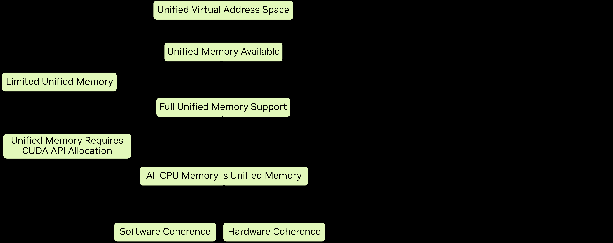

**图 21：所有当前 GPU 都使用统一虚拟地址空间，并可使用统一内存。当 `cudaDevAttrConcurrentManagedAccess` 为 1 时，完整统一内存支持可用，否则只有受限支持可用。当完整支持可用时，如果 `cudaDevAttrPageableMemoryAccess` 也为 1，则所有系统内存都是统一内存。否则，只有使用 CUDA API（如 `cudaMallocManaged`）分配的内存才是统一内存。当所有系统内存都是统一内存时，`cudaDevAttrPageableMemoryAccessUsesHostPageTables` 指示一致性由硬件（值为 1）还是软件（值为 0）提供。**

统一内存操作有四种范式：

- 完整支持显式受管理内存分配
- 完整支持所有分配，采用软件一致性
- 完整支持所有分配，采用硬件一致性
- 受限的统一内存支持

当完整支持可用时，它可能要求显式分配，也可能所有系统内存都隐式地是统一内存。当所有内存都隐式统一时，一致性机制可以是软件或硬件。Windows 与某些 Tegra 设备对统一内存的支持受限。

表 3 以表格形式展示了与图 21 相同的信息，并链接到本章相关章节以及本指南后面更完整的文档。

**表 3：统一内存范式概览**

| 统一内存范式 | 设备属性 | 完整文档 |
|---|---|---|
| 受限的统一内存支持 | `cudaDevAttrConcurrentManagedAccess` 为 0 | Windows、WSL 与 Tegra 上的统一内存；CUDA for Tegra Memory Management；Tegra 上的统一内存 |
| 完整支持显式受管理内存分配 | `cudaDevAttrPageableMemoryAccess` 为 0 且 `cudaDevAttrConcurrentManagedAccess` 为 1 | 仅支持 CUDA 受管理内存的设备上的统一内存 |
| 完整支持所有分配，采用软件一致性 | `cudaDevAttrPageableMemoryAccessUsesHostPageTables` 为 0 且 `cudaDevAttrPageableMemoryAccess` 为 1 且 `cudaDevAttrConcurrentManagedAccess` 为 1 | 完整 CUDA 统一内存支持设备上的统一内存 |
| 完整支持所有分配，采用硬件一致性 | `cudaDevAttrPageableMemoryAccessUsesHostPageTables` 为 1 且 `cudaDevAttrPageableMemoryAccess` 为 1 且 `cudaDevAttrConcurrentManagedAccess` 为 1 | 完整 CUDA 统一内存支持设备上的统一内存 |

##### 2.6.2.1.1 统一内存范式：代码示例

以下代码示例演示了查询设备属性，并按照图 21 的逻辑为系统中的每个 GPU 确定统一内存范式。

```cpp
void queryDevices()
{
    int numDevices = 0;
    cudaGetDeviceCount(&numDevices);
    for(int i=0; i<numDevices; i++)
    {
        cudaSetDevice(i);
        cudaInitDevice(0, 0, 0);
        int deviceId = i;

        int concurrentManagedAccess = -1;
        cudaDeviceGetAttribute (&concurrentManagedAccess, cudaDevAttrConcurrentManagedAccess, deviceId);

        int pageableMemoryAccess = -1;
        cudaDeviceGetAttribute (&pageableMemoryAccess, cudaDevAttrPageableMemoryAccess, deviceId);

        int pageableMemoryAccessUsesHostPageTables = -1;
        cudaDeviceGetAttribute (&pageableMemoryAccessUsesHostPageTables,
                                cudaDevAttrPageableMemoryAccessUsesHostPageTables, deviceId);

        printf("Device %d has ", deviceId);
        if(concurrentManagedAccess){
            if(pageableMemoryAccess){
                printf("full unified memory support");
                if( pageableMemoryAccessUsesHostPageTables)
                { printf(" with hardware coherency\n"); }
                else
                { printf(" with software coherency\n"); }
            }
            else
            { printf("full unified memory support for CUDA-made managed allocations\n"); }
        }
        else
        {
            printf("limited unified memory support: Windows, WSL, or Tegra\n");
        }
    }
}
```

#### 2.6.2.2 完整统一内存特性支持

大多数 Linux 系统具有完整的统一内存支持。如果设备属性 `cudaDevAttrPageableMemoryAccess` 为 1，那么所有系统内存（无论是通过 CUDA API 还是系统 API 分配）都作为统一内存运行并具有完整特性支持。这包括使用 `mmap` 创建的文件支撑内存分配。

如果 `cudaDevAttrPageableMemoryAccess` 为 0，那么只有由 CUDA 分配为受管理内存的内存才作为统一内存运行。使用系统 API 分配的内存不是受管理内存，也不一定能从 GPU 内核访问。

一般来说，对于具有完整支持的统一分配：

- 受管理内存通常分配在首次访问它的处理器所在的内存空间中。
- 当受管理内存被当前驻留处理器以外的处理器使用时，通常会发生迁移。
- 受管理内存以内存页（软件一致性）或缓存行（硬件一致性）为粒度进行迁移或访问。
- 允许超额订阅（oversubscription）：应用可以分配的受管理内存超过 GPU 上物理可用的内存量。

分配与迁移行为可能偏离上述情况。程序员可以使用提示与预取来影响它。关于完整统一内存支持的完整内容可参见“具有完整 CUDA 统一内存支持的设备上的统一内存”。

##### 2.6.2.2.1 带硬件一致性的完整统一内存

在 Grace Hopper 与 Grace Blackwell 等使用 NVIDIA CPU 且 CPU 与 GPU 之间通过 NVLink 芯片到芯片（C2C）互连的硬件上，地址转换服务（ATS）可用。当 ATS 可用时，`cudaDevAttrPageableMemoryAccessUsesHostPageTables` 为 1。

借助 ATS，除了对所有主机分配提供完整统一内存支持之外：

- 驻留在 GPU 上的受管理分配（例如 `cudaMallocManaged`）可以从 CPU 访问而无需迁移（`cudaDevAttrDirectManagedMemAccessFromHost` 将为 1）。
- CPU 与 GPU 之间的链路支持原生原子操作（`cudaDevAttrHostNativeAtomicSupported` 将为 1）。
- 硬件一致性支持相较于软件一致性可以提升性能。

ATS 提供 HMM 的所有能力。当 ATS 可用时，HMM 会被自动禁用。关于硬件一致性与软件一致性的进一步讨论，参见“CPU 与 GPU 页表：硬件一致性与软件一致性”。

> **注意**
>
> 硬件一致性并不能启用从主机访问仅 GPU 的分配，例如使用 `cudaMalloc` 进行的分配。

##### 2.6.2.2.2 HMM——带软件一致性的完整统一内存

异构内存管理（Heterogeneous Memory Management，HMM）是 Linux 操作系统（在适当的内核版本上）可用的一项特性，它启用软件一致性的完整统一内存支持。异构内存管理将 ATS 提供的一些能力与便利带给了通过 PCIe 连接的 GPU。

在至少为 Linux Kernel 6.1.24、6.2.11 或 6.3 及更高版本的 Linux 上，异构内存管理（HMM）可能可用。可以使用以下命令查看寻址模式是否为 HMM。

```console
$ nvidia-smi -q | grep Addressing
Addressing Mode : HMM
```

当 HMM 可用时，完整统一内存受支持，所有系统分配都隐式地是统一内存。如果系统同时具有 ATS，则 HMM 被禁用并使用 ATS，因为 ATS 提供 HMM 的所有能力甚至更多。

#### 2.6.2.3 受限的统一内存支持

在 Windows（包括 Windows Subsystem for Linux，WSL）以及某些 Tegra 系统上，可用统一内存功能的一个受限子集。在这些系统上，受管理内存可用，但 CPU 与 GPU 之间的迁移行为不同。

- 受管理内存在 CPU 的物理内存中首次分配。
- 受管理内存以大于虚拟内存页的粒度迁移。
- 当 GPU 开始执行时，受管理内存迁移到 GPU。
- 当 GPU 处于活动状态时，CPU 不得访问受管理内存。
- 当 GPU 被同步时，受管理内存迁移回 CPU。
- 不允许对 GPU 内存进行超额订阅。
- 只有由 CUDA 显式分配为受管理内存的内存才是统一内存。

这种范式的完整内容可参见“Windows、WSL 与 Tegra 上的统一内存”。

#### 2.6.2.4 内存建议与预取

程序员可以向管理统一内存的 NVIDIA 驱动提供提示，帮助其最大化应用性能。CUDA API `cudaMemAdvise` 允许程序员指定分配的属性，这些属性影响它们被放置的位置，以及当从另一设备访问时该内存是否迁移。

`cudaMemPrefetchAsync` 允许程序员建议启动某个特定分配向不同位置的异步迁移。一种常见用法是在内核启动之前开始传输内核将使用的数据。这使得数据复制可以在其他 GPU 内核执行的同时进行。

关于性能提示的章节介绍了可以传给 `cudaMemAdvise` 的不同提示，并展示了使用 `cudaMemPrefetchAsync` 的示例。

### 2.6.3 页锁定主机内存

在入门代码示例中，`cudaMallocHost` 被用于在 CPU 上分配内存。这会在主机上分配页锁定内存（也称为固定内存，pinned memory）。通过传统分配机制（如 `malloc`、`new` 或 `mmap`）进行的主机分配不是页锁定的，这意味着它们可能被操作系统换出到磁盘或物理重定位。

CPU 与 GPU 之间的异步复制需要页锁定主机内存。页锁定主机内存还能提升同步复制的性能。页锁定内存可以映射到 GPU，以便 GPU 内核直接访问。

CUDA 运行时提供 API 来分配页锁定主机内存或对现有分配进行页锁定：

- `cudaMallocHost` 分配页锁定主机内存。
- `cudaHostAlloc` 默认为与 `cudaMallocHost` 相同的行为，但也接受标志以指定其他内存参数。
- `cudaFreeHost` 释放使用 `cudaMallocHost` 或 `cudaHostAlloc` 分配的内存。
- `cudaHostRegister` 对在 CUDA API 之外分配的现有内存范围（例如使用 `malloc` 或 `mmap`）进行页锁定。

`cudaHostRegister` 使由第三方库或开发者无法控制的其他代码分配的主机内存能够被页锁定，以便可用于异步复制或映射。

> **注意**
>
> 页锁定主机内存可被系统中的所有 GPU 用于异步复制与映射内存。在非 I/O 一致的 Tegra 设备上，页锁定主机内存不会被缓存。此外，在非 I/O 一致的 Tegra 设备上不支持 `cudaHostRegister()`。

#### 2.6.3.1 映射内存

在具有 HMM 或 ATS 的系统上，所有主机内存都可以使用主机指针从 GPU 直接访问。当 ATS 或 HMM 不可用时，可以通过将主机分配映射到 GPU 的内存空间，使其对 GPU 可访问。映射内存始终是页锁定的。

下面的代码示例将演示以下直接操作映射主机内存的数组复制内核。

```cpp
__global__ void copyKernel(float* a, float* b)
{
    int idx = threadIdx.x + blockDim.x * blockIdx.x;
    a[idx] = b[idx];
}
```

虽然映射内存在某些情况下可能有用（例如需要从内核访问某些未复制到 GPU 的数据），但在内核中访问映射内存需要跨越 CPU-GPU 互连（PCIe 或 NVLink C2C）进行事务。与访问设备内存相比，这些操作延迟更高、带宽更低。对于内核的大部分内存需求，不应将映射内存视为统一内存或显式内存管理的高性能替代品。

##### 2.6.3.1.1 cudaMallocHost 与 cudaHostAlloc

使用 `cudaMallocHost` 或 `cudaHostAlloc` 分配的主机内存会自动映射。这些 API 返回的指针可以直接在内核代码中用于访问主机上的内存。主机内存通过 CPU-GPU 互连访问。

**cudaMallocHost**

```cpp
void usingMallocHost() {
    float* a = nullptr;
    float* b = nullptr;

    CUDA_CHECK(cudaMallocHost(&a, vLen*sizeof(float)));
    CUDA_CHECK(cudaMallocHost(&b, vLen*sizeof(float)));

    initVector(b, vLen);
    memset(a, 0, vLen*sizeof(float));

    int threads = 256;
    int blocks = vLen/threads;
    copyKernel<<<blocks, threads>>>(a, b);

    CUDA_CHECK(cudaGetLastError());
    CUDA_CHECK(cudaDeviceSynchronize());

    printf("Using cudaMallocHost: ");
    checkAnswer(a,b);
}
```

**cudaHostAlloc**

```cpp
void usingCudaHostAlloc() {
    float* a = nullptr;
    float* b = nullptr;

    CUDA_CHECK(cudaHostAlloc(&a, vLen*sizeof(float), cudaHostAllocMapped));
    CUDA_CHECK(cudaHostAlloc(&b, vLen*sizeof(float), cudaHostAllocMapped));

    initVector(b, vLen);
    memset(a, 0, vLen*sizeof(float));

    int threads = 256;
    int blocks = vLen/threads;
    copyKernel<<<blocks, threads>>>(a, b);

    CUDA_CHECK(cudaGetLastError());
    CUDA_CHECK(cudaDeviceSynchronize());

    printf("Using cudaHostAlloc: ");
    checkAnswer(a, b);
}
```

##### 2.6.3.1.2 cudaHostRegister

当 ATS 与 HMM 不可用时，由系统分配器进行 的分配仍然可以使用 `cudaHostRegister` 映射，以便从 GPU 内核直接访问。不过，与使用 CUDA API 创建的内存不同，不能使用主机指针从内核访问该内存。必须使用 `cudaHostGetDevicePointer()` 获得设备内存区域中的指针，并且在内核代码中访问时必须使用该指针。

```cpp
void usingRegister() {
    float* a = nullptr;
    float* b = nullptr;
    float* devA = nullptr;
    float* devB = nullptr;

    a = (float*)malloc(vLen*sizeof(float));
    b = (float*)malloc(vLen*sizeof(float));

    CUDA_CHECK(cudaHostRegister(a, vLen*sizeof(float), 0 ));
    CUDA_CHECK(cudaHostRegister(b, vLen*sizeof(float), 0 ));

    CUDA_CHECK(cudaHostGetDevicePointer((void**)&devA, (void*)a, 0));
    CUDA_CHECK(cudaHostGetDevicePointer((void**)&devB, (void*)b, 0));

    initVector(b, vLen);
    memset(a, 0, vLen*sizeof(float));

    int threads = 256;
    int blocks = vLen/threads;
    copyKernel<<<blocks, threads>>>(devA, devB);

    CUDA_CHECK(cudaGetLastError());
    CUDA_CHECK(cudaDeviceSynchronize());

    printf("Using cudaHostRegister: ");
    checkAnswer(a, b);
}
```

##### 2.6.3.1.3 统一内存与映射内存的比较

映射内存使 CPU 内存可从 GPU 访问，但不保证所有类型的访问（例如原子操作）在所有系统上都受支持。统一内存保证所有访问类型都受支持。

映射内存仍驻留在 CPU 内存中，这意味着所有 GPU 访问都必须经过 CPU 与 GPU 之间的连接：PCIe 或 NVLink。通过这些链路进行的访问延迟显著高于访问 GPU 内存，总可用带宽也更低。因此，将所有内核内存访问都使用映射内存，不太可能充分利用 GPU 计算资源。

统一内存通常迁移到访问它的处理器的物理内存。首次迁移之后，内核访问同一内存页或缓存行的重复访问可以利用完整的 GPU 内存带宽。

> **注意**
>
> 映射内存在此前的文档中也曾被称为零拷贝内存（zero-copy memory）。在所有 CUDA 应用使用统一虚拟地址空间之前，需要额外的 API 来启用内存映射（带 `cudaDeviceMapHost` 的 `cudaSetDeviceFlags`）。这些 API 已不再需要。

对映射主机内存进行操作的原子函数（参见“原子函数”）从主机或其他 GPU 的角度看不是原子的。

CUDA 运行时要求，从设备发起、对主机内存的 1 字节、2 字节、4 字节、8 字节与 16 字节自然对齐加载与存储，从主机与其他设备的角度看必须保持为单次访问。在某些平台上，对内存的原子操作可能被硬件拆分为独立的加载与存储操作。这些分量的加载与存储操作对保持自然对齐访问有相同要求。CUDA 运行时不支持 PCI Express 桥拆分 8 字节自然对齐操作的 PCI Express 总线拓扑，NVIDIA 也不知道存在任何拆分 16 字节自然对齐操作的拓扑。

### 2.6.4 小结

- 在具有异构内存管理（HMM）或地址转换服务（ATS）的 Linux 平台上，所有系统分配的内存都是受管理内存。
- 在没有 HMM 或 ATS 的 Linux 平台上、在 Tegra 处理器上以及在所有 Windows 平台上，受管理内存必须使用 CUDA 分配：
  - `cudaMallocManaged`，或
  - `cudaMallocFromPoolAsync`，配合以 `allocType=cudaMemAllocationTypeManaged` 创建的池
  - 使用 `__managed__` 说明符声明的全局变量
- 在 Windows 与 Tegra 处理器上，统一内存有限制。
- 在具有 ATS 的 NVLink C2C 连接系统上，使用 `cudaMallocManaged` 分配的设备内存可以从 CPU 或其他 GPU 直接访问。

## 2.7 NVCC：NVIDIA CUDA 编译器

NVIDIA CUDA 编译器 nvcc 是 NVIDIA 提供的用于编译 CUDA C/C++ 以及 PTX 代码的工具链。该工具链是 CUDA 工具包的一部分，由若干工具组成，包括编译器、链接器以及 PTX 与 Cubin 汇编器。顶层 nvcc 工具协调编译过程，为每个编译阶段调用相应的工具。

nvcc 驱动 CUDA 代码的离线编译，与此相对的是由 CUDA 运行时编译器 nvrtc 驱动的在线或即时（JIT）编译。

本章介绍构建应用所需的最常见的 nvcc 用法与细节。nvcc 的完整内容可参见 nvcc 文档。

### 2.7.1 CUDA 源文件与头文件

使用 nvcc 编译的源文件可能同时包含在 CPU 上执行的主机代码与在 GPU 上执行的设备代码。nvcc 接受常见的 C/C++ 源文件扩展名：`.c`、`.cpp`、`.cc`、`.cxx` 用于仅主机代码，`.cu` 用于包含设备代码或主机/设备混合代码的文件。包含设备代码的头文件通常采用 `.cuh` 扩展名，以区别于仅主机代码头文件 `.h`、`.hpp`、`.hh`、`.hxx` 等。

| 文件扩展名 | 描述 | 内容 |
|---|---|---|
| `.c` | C 源文件 | 仅主机代码 |
| `.cpp`、`.cc`、`.cxx` | C++ 源文件 | 仅主机代码 |
| `.h`、`.hpp`、`.hh`、`.hxx` | C/C++ 头文件 | 设备代码、主机代码、主机/设备混合代码 |
| `.cu` | CUDA 源文件 | 设备代码、主机代码、主机/设备混合代码 |
| `.cuh` | CUDA 头文件 | 设备代码、主机代码、主机/设备混合代码 |

### 2.7.2 NVCC 编译工作流

在初始阶段，nvcc 将设备代码与主机代码分离，并分别将其编译派发给 GPU 编译器与主机编译器。

为编译主机代码，CUDA 编译器 nvcc 需要有一个兼容的主机编译器可用。CUDA 工具包为 Linux 与 Windows 平台定义了主机编译器支持策略。

仅包含主机代码的文件可以使用 nvcc 或直接使用主机编译器构建。生成的目标文件可以在链接时与来自 nvcc 的、包含 GPU 代码的目标文件合并。

GPU 编译器将 C/C++ 设备代码编译为 PTX 汇编代码。GPU 编译器会针对编译命令行中指定的每个虚拟机指令集架构（例如 `compute_90`）运行。

随后，各个 PTX 代码被传给 ptxas 工具，它为目标硬件 ISA 生成 Cubin。硬件 ISA 由其 SM 版本标识。

可以将多个 PTX 与 Cubin 目标嵌入应用或库中的单个二进制 Fatbin 容器，使单个二进制能够支持多个虚拟与目标硬件 ISA。

上述工具的调用与协调由 nvcc 自动完成。`-v` 选项可用于显示完整的编译工作流与工具调用。`-keep` 选项可用于将编译期间生成的中间文件保存到当前目录或 `--keep-dir` 指定的目录。

以下示例说明了 CUDA 源文件 `example.cu` 的编译工作流：

```cpp
// ----- example.cu -----
#include <stdio.h>

__global__ void kernel() {
    printf("Hello from kernel\n");
}

void kernel_launcher() {
    kernel<<<1, 1>>>();
    cudaDeviceSynchronize();
}

int main() {
    kernel_launcher();
    return 0;
}
```

**nvcc 基本编译工作流：**

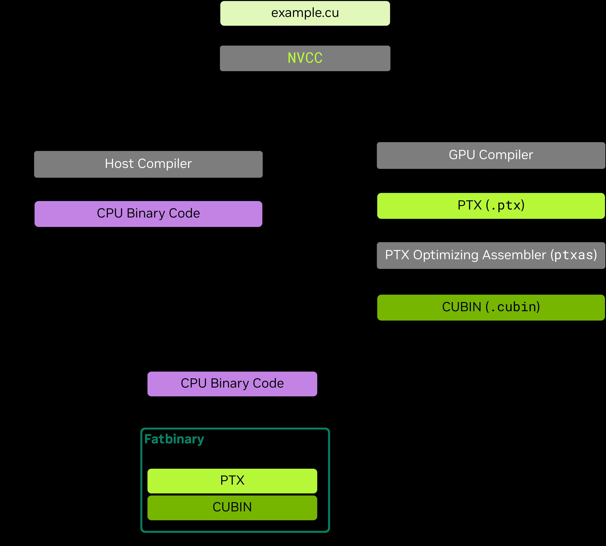

**nvcc 使用多个 PTX 与 Cubin 架构的编译工作流：**


关于 nvcc 编译工作流的更详细描述可参见编译器文档。

### 2.7.3 NVCC 基本用法

使用 nvcc 编译 CUDA 源文件的基本命令是：

```console
nvcc <source_file>.cu -o <output_file>
```

nvcc 接受用于指定包含目录 `-I <path>` 与库路径 `-L <path>`、链接其他库 `-l<library>` 以及定义宏 `-D<macro>=<value>` 的常见编译器标志。

```console
nvcc example.cu -I path_to_include/ -L path_to_library/ -lcublas -o <output_file>
```

#### 2.7.3.1 NVCC 的 PTX 与 Cubin 生成

默认情况下，nvcc 为 CUDA 工具包所支持的最早 GPU 架构（最低的 `compute_XY` 与 `sm_XY` 版本）生成 PTX 与 Cubin，以最大化兼容性。

- `-arch` 选项可用于为特定 GPU 架构生成 PTX 与 Cubin。
- `-gencode` 选项可用于为多个 GPU 架构生成 PTX 与 Cubin。

受支持的虚拟与真实 GPU 架构的完整列表可以分别通过传入 `--list-gpu-code` 与 `--list-gpu-arch` 标志获得，或参考 nvcc 文档中的 Virtual Architecture List 与 GPU Architecture List 章节。

```console
nvcc --list-gpu-code     # 列出所有受支持的真实 GPU 架构
nvcc --list-gpu-arch     # 列出所有受支持的虚拟 GPU 架构

nvcc example.cu -arch=compute_<XY>   # 例如 -arch=compute_80，用于 NVIDIA Ampere GPU 及更新
                                     # 仅 PTX，GPU 向前兼容

nvcc example.cu -arch=sm_<XY>        # 例如 -arch=sm_80，用于 NVIDIA Ampere GPU 及更新
                                     # PTX 与 Cubin，GPU 向前兼容

nvcc example.cu -arch=native         # 自动检测并为当前 GPU 生成 Cubin
                                     # 无 PTX，无 GPU 向前兼容

nvcc example.cu -arch=all            # 为所有受支持的 GPU 架构生成 Cubin
                                     # 还包含最新的 PTX，以实现 GPU 向前兼容

nvcc example.cu -arch=all-major      # 为所有受支持的主要 GPU 架构生成 Cubin，例如 sm_80、sm_90
                                     # 还包含最新的 PTX，以实现 GPU 向前兼容
```

更高级的用法允许分别指定 PTX 与 Cubin 目标：

```console
# 为虚拟架构 compute_80 生成 PTX，并将其编译为真实架构 sm_86 的 Cubin，保留 compute_80 PTX
nvcc example.cu -arch=compute_80 -gpu-code=sm_86,compute_80   # (PTX 与 Cubin)

# 为虚拟架构 compute_80 生成 PTX，并将其编译为真实架构 sm_86、sm_89 的 Cubin
nvcc example.cu -arch=compute_80 -gpu-code=sm_86,sm_89        # (无 PTX)

nvcc example.cu -gencode=arch=compute_80,code=sm_86,sm_89     # 同上

# (1) 为虚拟架构 compute_80 生成 PTX，并编译为真实架构 sm_86、sm_89 的 Cubin
# (2) 为虚拟架构 compute_90 生成 PTX，并编译为真实架构 sm_90 的 Cubin
nvcc example.cu -gencode=arch=compute_80,code=sm_86,sm_89 -gencode=arch=compute_90,code=sm_90
```

用于引导 GPU 代码生成的 nvcc 命令行选项的完整参考可参见 nvcc 文档。

#### 2.7.3.2 主机代码编译说明

不包含设备代码或符号的编译单元（即源文件及其头文件）可以直接使用主机编译器编译。如果任何编译单元使用 CUDA 运行时 API 函数，则应用必须与 CUDA 运行时库链接。CUDA 运行时有静态库与共享库两种形式，分别为 `libcudart_static` 与 `libcudart`。默认情况下，nvcc 链接静态 CUDA 运行时库。要使用共享库版本的 CUDA 运行时，请在编译或链接命令中向 nvcc 传入 `--cudart=shared` 标志。

nvcc 允许通过 `-ccbin <compiler>` 参数指定用于主机函数的主机编译器。也可以定义环境变量 `NVCC_CCBIN` 来指定 nvcc 使用的主机编译器。nvcc 的 `-Xcompiler` 参数将参数透传给主机编译器。例如在下面的示例中，`-O3` 参数由 nvcc 传给主机编译器。

```console
nvcc example.cu -ccbin=clang++
export NVCC_CCBIN='gcc'
nvcc example.cu -Xcompiler=-O3
```

#### 2.7.3.3 GPU 代码的分离编译

nvcc 默认采用全程序编译（whole-program compilation），它期望所有 GPU 代码与符号都出现在使用它们的编译单元中。CUDA 设备函数可以调用其他编译单元中定义的设备函数或访问设备变量，但必须在 nvcc 命令行上指定 `-rdc=true` 或其别名 `-dc` 标志，以启用不同编译单元之间设备代码的链接。链接来自不同编译单元的设备代码与符号的能力称为分离编译（separate compilation）。

分离编译允许更灵活的代码组织，可以改善编译时间，并可能产生更小的二进制。与全程序编译相比，分离编译可能涉及一些构建时复杂性。使用设备代码链接可能影响性能，这也是默认不使用它的原因。链接时优化（Link-Time Optimization，LTO）有助于降低分离编译的性能开销。

分离编译需要以下条件：

- 在一个编译单元中定义的非 const 设备变量必须在其他编译单元中使用 `extern` 关键字引用。
- 所有 const 设备变量都必须使用 `extern` 关键字定义和引用。
- 所有 CUDA 源文件 `.cu` 都必须使用 `-dc` 或 `-rdc=true` 标志编译。

主机函数与设备函数默认具有外部链接，不需要 `extern` 关键字。请注意，从 CUDA 13 开始，`__global__` 函数以及 `__managed__`/`__device__`/`__constant__` 变量默认具有内部链接。

在下面的示例中，`definition.cu` 定义了一个变量与一个函数，而 `example.cu` 引用它们。两个文件分别编译，并链接到最终二进制中。

```cpp
// ----- definition.cu -----
extern __device__ int device_variable = 5;

__device__
int device_function() { return 10; }
```

```cpp
// ----- example.cu -----
extern __device__ int     device_variable;
__device__
int device_function();

__global__ void kernel(int* ptr) {
    device_variable = 0;
    *ptr = device_function();
}
```

```console
nvcc -dc definition.cu -o definition.o
nvcc -dc example.cu    -o example.o
nvcc definition.o example.o -o program
```

### 2.7.4 常用编译器选项

本节介绍可与 nvcc 一起使用的最相关编译器选项，涵盖语言特性、优化、调试、性能分析与构建方面。所有选项的完整描述可参见 nvcc 文档。

#### 2.7.4.1 语言特性

nvcc 支持 C++ 核心语言特性，从 C++03 到 C++23 语言特性。`-std` 标志可用于指定要使用的语言标准：

- `--std={c++03|c++11|c++14|c++17|c++20|c++23}`

此外，nvcc 还支持以下语言扩展：

- `-restrict`：断言所有内核指针参数都是 restrict 指针。
- `-extended-lambda`：允许在 lambda 声明中使用 `__host__`、`__device__` 注解。
- `-expt-relaxed-constexpr`：（实验性标志）允许主机代码调用 `__device__` constexpr 函数，以及设备代码调用 `__host__` constexpr 函数。

关于这些特性的更多细节可参见扩展 lambda 与 constexpr 相关章节。

#### 2.7.4.2 调试选项

nvcc 支持以下选项来生成调试信息：

- `-g`：为主机代码生成调试信息。gdb/lldb 及类似工具依赖此类信息进行主机代码调试。
- `-G`：为设备代码生成调试信息。cuda-gdb 依赖此类信息进行设备代码调试。该标志还会定义 `__CUDACC_DEBUG__` 宏。
- `-lineinfo`：为设备代码生成行号信息。此选项不影响执行性能，与 compute-sanitizer 工具配合使用可追踪内核执行。

nvcc 默认对 GPU 代码使用最高优化级别 `-O3`。调试标志 `-G` 会阻止某些编译器优化，因此调试代码的性能预计低于非调试代码。可以定义 `-DNDEBUG` 标志来禁用运行时断言，因为它们也可能拖慢执行。

#### 2.7.4.3 优化选项

nvcc 提供了许多用于优化性能的选项。本节旨在简要概述开发者可能觉得有用的一些可用选项，并提供进一步信息的链接。完整内容可参见 nvcc 文档。

- `-Xptxas` 将参数传给 PTX 汇编器 ptxas。nvcc 文档提供了 ptxas 的有用参数列表。例如，`-Xptxas=-maxrregcount=N` 指定每个线程使用的最大寄存器数量。
- `-extra-device-vectorization`：启用更激进的设备代码向量化。
- `--apply-controls=/path/to/file` 将高级控制文件（advanced controls file，ACF）传给 nvcc 与 ptxas。该文件改变默认编译行为，使其更有针对性地针对特定工作负载。使用高级控制文件可能导致编译失败或运行时执行不正确。使用风险自负。关于如何生成高级控制文件的更多信息，请参见 CompileIQ GitHub 页面。
- 提供对浮点行为细粒度控制的其他标志在“浮点计算”一节与 nvcc 文档中介绍。

以下标志可获取编译器输出，在更高级的代码优化中可能有用：

- `-res-usage`：编译后打印资源使用报告。其中包括为每个内核函数分配的寄存器、共享内存、常量内存与局部内存数量。
- `-opt-info=inline`：打印关于内联函数的信息。
- `-Xptxas=-warn-lmem-usage`：如果使用局部内存则发出警告。
- `-Xptxas=-warn-spills`：如果寄存器溢出到局部内存则发出警告。

#### 2.7.4.4 链接时优化（LTO）

由于跨文件优化机会有限，分离编译可能导致性能低于全程序编译。链接时优化（LTO）通过在链接时对分别编译的文件执行优化来解决这一问题，代价是增加编译时间。LTO 可以在保持分离编译灵活性的同时，恢复全程序编译的大部分性能。

nvcc 需要 `-dlto` 标志或 `lto_<SM version>` 链接时优化目标来启用 LTO：

```console
nvcc -dc -dlto -arch=sm_100 definition.cu -o definition.o
nvcc -dc -dlto -arch=sm_100 example.cu    -o example.o
nvcc -dlto definition.o example.o -o program

nvcc -dc -arch=lto_100 definition.cu -o definition.o
nvcc -dc -arch=lto_100 example.cu    -o example.o
nvcc -dlto definition.o example.o -o program
```

#### 2.7.4.5 性能分析选项

可以直接使用 Nsight Compute 与 Nsight Systems 工具对 CUDA 应用进行性能分析，编译过程中无需额外标志。不过，nvcc 可以生成的额外信息有助于通过将源文件与生成的代码关联来辅助性能分析：

- `-lineinfo`：为设备代码生成行号信息；这允许在性能分析工具中查看源代码。性能分析工具要求原始源代码在编译代码的同一位置可用。
- `-src-in-ptx`：将原始源代码保留在 PTX 中，避免上述 `-lineinfo` 的限制。需要 `-lineinfo`。

#### 2.7.4.6 Fatbin 压缩

nvcc 默认会压缩存储在应用或库二进制中的 fatbin。可以使用以下选项控制 fatbin 压缩：

- `-no-compress`：禁用 fatbin 压缩。
- `--compress-mode={default|size|speed|balance|none}`：设置压缩模式。`speed` 注重快速解压时间，`size` 旨在减小 fatbin 大小，`balance` 在速度与大小之间提供折中。默认模式为 `speed`。`none` 禁用压缩。

#### 2.7.4.7 编译器性能控制

nvcc 提供选项来分析和加速编译过程本身：

- `-t <N>`：用于并行化单个编译单元针对多个 GPU 架构编译的 CPU 线程数。
- `-split-compile <N>`：用于并行化优化阶段的 CPU 线程数。
- `-split-compile-extended <N>`：更激进的分离编译形式。需要链接时优化。
- `-Ofc <N>`：设备代码编译速度级别。
- `-time <filename>`：生成一个逗号分隔值（CSV）表，记录每个编译阶段所花费的时间。
- `-fdevice-time-trace`：为设备代码编译生成时间跟踪。

5.5 节提供了改善 CUDA 代码编译时间的策略与技术的深入详细指南。

---

# 第 3 章　高级 CUDA

## 3.1 高级 CUDA API 与特性

本节将介绍更高级的 CUDA API 与特性的使用。这些主题涵盖通常不需要修改 CUDA 内核的技术或特性，但仍可从主机侧影响应用层行为，既包括 GPU 工作执行与性能，也包括 CPU 侧性能。

### 3.1.1 cudaLaunchKernelEx

在三重尖括号表示法最初的版本中，内核的内核配置只有四个可编程参数：

- 线程块维度
- 网格维度
- 动态共享内存（可选，未指定时为 0）
- 流（未指定时使用默认流）

某些 CUDA 特性可以从内核启动时提供的额外属性与提示中受益。`cudaLaunchKernelEx` 使程序能够通过 `cudaLaunchConfig_t` 结构设置上述执行配置参数。此外，`cudaLaunchConfig_t` 结构允许程序传入零个或多个 `cudaLaunchAttribute`，以控制或建议内核启动的其他参数。例如，本章后面讨论的 `cudaLaunchAttributePreferredSharedMemoryCarveout`（参见“配置 L1/共享内存平衡”）就是使用 `cudaLaunchKernelEx` 指定的。本章后面讨论的 `cudaLaunchAttributeClusterDimension` 属性用于指定内核启动所需的集群大小。

受支持属性及其含义的完整列表记录在 CUDA Runtime API Reference Documentation 中。

### 3.1.2 启动集群

前面章节介绍的线程块集群，是计算能力 9.0 及更高版本可用的可选线程块组织层级，它使应用能够保证集群中的线程块在单个 GPC 上同时执行。这使得比单个 SM 所能容纳的更大的线程组能够相互交换数据与同步。

2.1.10.1 节展示了如何使用三重尖括号表示法指定并启动使用集群的内核。在该节中，`__cluster_dims__` 注解用于指定启动内核时必须使用的集群维度。使用三重尖括号表示法时，集群大小是隐式确定的。

#### 3.1.2.1 使用 cudaLaunchKernelEx 启动集群

与使用三重尖括号表示法启动带集群的内核不同，线程块集群的大小可以在每次启动时配置。下面的代码示例展示了如何使用 `cudaLaunchKernelEx` 启动集群内核。

```cpp
// 内核定义
// 内核上没有附加编译期属性
__global__ void cluster_kernel(float *input, float* output)
{
}

int main()
{
    float *input, *output;
    dim3 threadsPerBlock(16, 16);
    dim3 numBlocks(N/threadsPerBlock.x, N/threadsPerBlock.y);

    // 使用运行时集群大小调用内核
    {
        cudaLaunchConfig_t config = {0};

        // 网格维度不受集群启动影响，仍然使用块数来枚举。
        // 网格维度应当是集群大小的整数倍。
        config.gridDim = numBlocks;
        config.blockDim = threadsPerBlock;

        cudaLaunchAttribute attribute[1];
        attribute[0].id = cudaLaunchAttributeClusterDimension;
        attribute[0].val.clusterDim.x = 2;  // X 维度的集群大小
        attribute[0].val.clusterDim.y = 1;
        attribute[0].val.clusterDim.z = 1;

        config.attrs = attribute;
        config.numAttrs = 1;

        cudaLaunchKernelEx(&config, cluster_kernel, input, output);
    }
}
```

有两种与线程块集群相关的 `cudaLaunchAttribute` 类型：`cudaLaunchAttributeClusterDimension` 与 `cudaLaunchAttributePreferredClusterDimension`。

属性 id `cudaLaunchAttributeClusterDimension` 指定执行集群所需 的维度。该属性的值 `clusterDim` 是一个三维值。网格的对应维度（x、y、z）必须能被指定集群维度的相应维度整除。设置该属性类似于在编译时在内核定义上使用 `__cluster_dims__` 属性（如“使用三重尖括号表示法启动集群”中所示），但可以在运行时为同一内核的不同启动更改。

在计算能力 10.0 及更高的 GPU 上，另一个属性 id `cudaLaunchAttributePreferredClusterDimension` 允许应用额外指定集群的首选维度。首选维度必须是由内核上的 `__cluster_dims__` 属性或传给 `cudaLaunchKernelEx` 的 `cudaLaunchAttributeClusterDimension` 属性所指定的最小集群维度的整数倍。也就是说，除了首选集群维度之外，还必须指定最小集群维度。网格的对应维度（x、y、z）必须能被指定首选集群维度的相应维度整除。

所有线程块都将以至少最小集群维度的集群执行。在可能的情况下，将使用首选维度的集群，但并非所有集群都保证以首选维度执行。所有线程块都将以最小或首选集群维度执行。使用首选集群维度的内核必须编写为在最小或首选集群维度下都能正确运行。

#### 3.1.2.2 块作为集群

当内核使用 `__cluster_dims__` 注解定义时，网格中的集群数量是隐式的，可以通过将网格大小除以指定集群大小计算得出。

```cpp
__cluster_dims__((2, 2, 2)) __global__ void foo();
// 8x8x8 个集群，每个集群含 2x2x2 个线程块。
foo<<<dim3(16, 16, 16), dim3(1024, 1, 1)>>>();
```

在上面的示例中，内核作为 16×16×16 个线程块的网格启动，这意味着使用 8×8×8 个集群的网格。

内核也可以使用 `__block_size__` 注解，它在定义内核时同时指定所需的块大小与集群大小。使用该注解时，三重尖括号启动中的值变为以集群而非线程块计的网格维度，如下所示。

```cpp
// 每块多少线程、每集群多少块的实现细节作为内核的属性处理。
__block_size__((1024, 1, 1), (2, 2, 2)) __global__ void foo();
// 8x8x8 个集群。
foo<<<dim3(8, 8, 8)>>>();
```

`__block_size__` 需要两个字段，每个字段都是一个含 3 个元素的元组。第一个元组表示块维度，第二个表示集群大小。如果不传第二个元组，则假定为 (1,1,1)。在内核启动时指定动态共享内存大小和/或流时，`<<<>>>` 中的第二个参数必须是占位符 1。任何其他值都会导致未定义行为。

请注意，`__block_size__` 的第二个元组与 `__cluster_dims__` 同时指定是非法的。将 `__block_size__` 与空的 `__cluster_dims__` 一起使用也是非法的。当指定 `__block_size__` 的第二个元组时，意味着启用了“块作为集群”，编译器会将 `<<<>>>` 内的第一个参数识别为集群数量而非线程块数量。

### 3.1.3 关于流与事件的更多内容

“CUDA 流”一节介绍了 CUDA 流的基础知识。默认情况下，提交到给定 CUDA 流上的操作是串行化的：一个操作在前一个操作完成之前无法开始执行。唯一的例外是最近新增的程序化依赖内核启动与同步特性。使用多个 CUDA 流是实现并发执行的一种方式；另一种方式是使用 CUDA 图。两种方法也可以结合使用。

在特定情况下（例如没有事件依赖、没有隐式同步、资源充足等），提交到不同 CUDA 流上的工作可能并发执行。

如果它们之间有提交到 NULL 流上的任何 CUDA 操作，则来自不同 CUDA 流的独立操作不能并发运行，除非这些流是非阻塞 CUDA 流。这些流是使用带 `cudaStreamNonBlocking` 标志的 `cudaStreamCreateWithFlags()` 运行时 API 创建的。为提高并发 GPU 工作执行的可能性，建议用户创建非阻塞 CUDA 流。

还建议用户选择足以解决问题的、最不通用的同步选项。例如，如果需求是让 CPU 等待（阻塞）某个特定 CUDA 流上的所有工作完成，那么对该流使用 `cudaStreamSynchronize()` 会比 `cudaDeviceSynchronize()` 更可取，因为后者会不必要地等待设备所有 CUDA 流上的 GPU 工作完成。如果需求是让 CPU 非阻塞地等待，那么在轮询循环中使用 `cudaStreamQuery()` 并检查其返回值可能更可取。

使用 CUDA 事件（“CUDA 事件”）也可以实现类似的同步效果，例如在该流上记录一个事件，并调用 `cudaEventSynchronize()` 以阻塞方式等待该事件中捕获的工作完成。同样，这比使用 `cudaDeviceSynchronize()` 更可取、更有针对性。在轮询循环中调用 `cudaEventQuery()` 并检查其返回值则是非阻塞的替代方案。

如果此操作发生在应用的关键路径上，显式同步方法的选择尤其重要。表 4 给出了与主机同步的各种选项的高层总结。

**表 4：与主机的显式同步选项总结**

| | 等待特定流 | 等待特定事件 | 等待设备上的一切 |
|---|---|---|---|
| 非阻塞（需要轮询循环） | `cudaStreamQuery()` | `cudaEventQuery()` | 不适用 |
| 阻塞 | `cudaStreamSynchronize()` | `cudaEventSynchronize()` | `cudaDeviceSynchronize()` |

对于 CUDA 流之间的同步（即表达依赖关系），建议使用非计时 CUDA 事件，如“CUDA 事件”中所述。用户可以调用 `cudaStreamWaitEvent()`，强制特定流上未来提交的操作等待先前记录的事件（例如在另一个流上）完成。请注意，对于任何等待或查询事件的 CUDA API，用户有责任确保已经调用了 `cudaEventRecord` API，因为未记录的事件将始终返回成功。

CUDA 事件默认携带时间信息，因为它们可用于 `cudaEventElapsedTime()` API 调用。然而，仅用于表达跨流依赖的 CUDA 事件不需要时间信息。对于这种情况，建议创建禁用时间信息的事件以提升性能。这可以通过带 `cudaEventDisableTiming` 标志的 `cudaEventCreateWithFlags()` API 实现。

#### 3.1.3.1 流优先级

流的相对优先级可以在创建时使用 `cudaStreamCreateWithPriority()` 指定。允许的优先级范围（按 [最高优先级, 最低优先级] 排序）可以使用 `cudaDeviceGetStreamPriorityRange()` 函数获得。在运行时，GPU 调度器利用流优先级确定任务执行顺序，但这些优先级只是提示而非保证。在选择要启动的工作时，较高优先级流中的待处理任务优先于较低优先级流中的任务。较高优先级的任务不会抢占已在运行的较低优先级任务。GPU 在任务执行期间不会重新评估工作队列，提高流的优先级不会中断正在进行的工作。流优先级影响任务执行而不强制执行严格排序，因此用户可以借助流优先级影响任务执行，而不依赖严格的顺序保证。

下面的代码示例获取当前设备允许的优先级范围，并创建两个非阻塞 CUDA 流，分别使用可用的最高与最低优先级。

```cpp
// 获取此设备的流优先级范围
int leastPriority, greatestPriority;
cudaDeviceGetStreamPriorityRange(&leastPriority, &greatestPriority);

// 创建具有最高与最低可用优先级的流
cudaStream_t st_high, st_low;
cudaStreamCreateWithPriority(&st_high, cudaStreamNonBlocking, greatestPriority);
cudaStreamCreateWithPriority(&st_low,  cudaStreamNonBlocking, leastPriority);
```

#### 3.1.3.2 显式同步

如前所述，流可以通过多种方式与其他流同步。下面提供不同粒度级别的常用方法：

- `cudaDeviceSynchronize()`：等待所有主机线程的所有流中先前的所有命令完成。
- `cudaStreamSynchronize()`：接受一个流作为参数，等待给定流中先前的所有命令完成。它可用于将主机与特定流同步，让其他流继续在设备上执行。
- `cudaStreamWaitEvent()`：接受一个流与一个事件作为参数（事件的描述见“CUDA 事件”），使在调用 `cudaStreamWaitEvent()` 之后添加到给定流的所有命令延迟执行，直到给定事件完成。
- `cudaStreamQuery()`：为应用提供一种方式，了解流中先前的所有命令是否已完成。

#### 3.1.3.3 隐式同步

如果主机线程在它们之间发出以下任一操作，则来自不同流的两个命令不能并发运行：

- 一次页锁定主机内存分配
- 一次设备内存分配
- 一次设备内存设置
- 两个地址到同一设备内存之间的内存复制
- 任何到 NULL 流的 CUDA 命令
- 在 L1/共享内存配置之间切换

需要依赖检查的操作包括与被检查启动处于同一流中的任何其他命令，以及对该流的任何 `cudaStreamQuery()` 调用。因此，应用应遵循以下指导，以提高并发内核执行的可能性：

- 所有独立操作应在依赖操作之前发出；
- 任何形式的同步都应尽可能延迟。

### 3.1.4 程序化依赖内核启动

如前所述，CUDA 流的语义使内核按顺序执行。这样，如果我们有两个连续的内核，其中第二个内核依赖第一个内核的结果，程序员就可以放心，到第二个内核开始执行时依赖数据将可用。然而，可能出现这样的情况：第一个内核已经将其后续内核所依赖的数据写入全局内存，但仍有更多工作要做。同样，依赖的第二个内核在需要第一个内核的数据之前可能有一些独立工作。在这种情况下，可以部分重叠两个内核的执行（假设硬件资源可用）。这种重叠也可以重叠第二个内核的启动开销。除了硬件资源的可用性之外，可达到的重叠程度取决于内核的具体结构，例如：

- 第一个内核在其执行中的哪个时刻完成第二个内核所依赖的工作？
- 第二个内核在其执行中的哪个时刻开始处理来自第一个内核的数据？

由于这在很大程度上取决于具体的内核，很难完全自动化，因此 CUDA 提供了一种机制，允许应用开发者指定两个内核之间的同步点。这通过一种称为程序化依赖内核启动（Programmatic Dependent Kernel Launch，PDL）的技术完成。下图描绘了这种情况。

PDL 有三个主要组成部分。

i) 第一个内核（所谓的主内核，primary kernel）需要调用一个特殊函数，表明它已完成后续依赖内核（也称为次内核，secondary kernel）所需的一切。这通过调用函数 `cudaTriggerProgrammaticLaunchCompletion()` 完成。

ii) 反过来，依赖的次内核需要表明它已到达其工作中与主内核无关的部分，并且现在正等待主内核完成它所依赖的工作。这通过函数 `cudaGridDependencySynchronize()` 完成。

iii) 第二个内核需要使用特殊属性 `cudaLaunchAttributeProgrammaticStreamSerialization` 启动，其 `programmaticStreamSerializationAllowed` 字段设为 `1`。

下面的代码片段展示了如何做到这一点的一个示例。

**清单 3：使用两个内核的程序化依赖内核启动示例**

```cpp
__global__ void primary_kernel() {
    // 应在启动次内核之前完成的初始工作

    // 触发次内核
    cudaTriggerProgrammaticLaunchCompletion();

    // 可以与次内核同时进行的工作
}

__global__ void secondary_kernel()
{
    // 初始化、独立工作等

    // 将阻塞，直到次内核所依赖的所有主内核都已完成
    // 并将结果刷新到全局内存
    cudaGridDependencySynchronize();

    // 依赖工作
}

// 使用特殊属性启动次内核
// 设置属性
cudaLaunchAttribute attribute[1];
attribute[0].id = cudaLaunchAttributeProgrammaticStreamSerialization;
attribute[0].val.programmaticStreamSerializationAllowed = 1;

// 在内核启动配置中设置该属性
cudaLaunchConfig_t config = {0};
// 基本启动配置
config.gridDim = grid_dim;
config.blockDim = block_dim;
config.dynamicSmemBytes = 0;
config.stream = stream;

// 为 PDL 添加特殊属性
config.attrs = attribute;
config.numAttrs = 1;

// 启动主内核
primary_kernel<<<grid_dim, block_dim, 0, stream>>>();

// 使用带该属性的配置启动次（依赖）内核
cudaLaunchKernelEx(&config, secondary_kernel);
```

### 3.1.5 批量内存传输

CUDA 开发中一种常见的模式是使用批处理技术。所谓批处理，粗略地说就是将若干（通常较小的）任务组合成一个（通常较大的）操作。批处理的各组成部分不必完全相同，尽管它们通常相同。cuBLAS 提供的批量矩阵乘法操作就是这一思想的一个示例。

一般来说，与 CUDA 图及 PDL 一样，批处理的目的是减少分别派发各个批处理任务所带来的开销。就内存传输而言，启动一次内存传输可能带来一些 CPU 与驱动的开销。此外，现有的 `cudaMemcpyAsync()` 函数并不一定提供足够信息让驱动优化传输，例如关于源与目标的提示。在 Tegra 平台上，可以选择使用 SM 或复制引擎（Copy Engine，CE）来执行传输。目前由驱动中的某种启发式方法指定使用哪一个。这一点可能很重要，因为使用 SM 可能带来更快的传输，但会占用一部分可用算力；而使用 CE 可能导致传输较慢，但整体应用性能更高，因为它让 SM 空闲出来执行其他工作。

这些考虑推动了 `cudaMemcpyBatchAsync()` 函数（及其相关函数 `cudaMemcpyBatch3DAsync()`）的设计。这些函数允许对批量内存传输进行优化。除了源与目标指针列表之外，该 API 还使用内存复制属性来指定对顺序的期望，附带关于源与目标位置的提示，以及是否偏好将传输与计算重叠（目前仅在带 CE 的 Tegra 平台上支持）。

让我们先考虑从固定主机内存到固定设备内存的简单批量传输的最简单情况。

**清单 4：从固定主机内存到固定设备内存的同构批量内存传输示例**

```cpp
std::vector<void *> srcs(batch_size);
std::vector<void *> dsts(batch_size);
std::vector<size_t> sizes(batch_size);

// 分配源与目标缓冲区
// 使用流编号进行初始化
for (size_t i = 0; i < batch_size; i++) {
    cudaMallocHost(&srcs[i], sizes[i]);
    cudaMalloc(&dsts[i], sizes[i]);
    cudaMemsetAsync(srcs[i], sizes[i], stream);
}

// 为这批复制设置属性
cudaMemcpyAttributes attrs = {};
attrs.srcAccessOrder = cudaMemcpySrcAccessOrderStream;

// 批次中的所有复制具有相同的复制属性。
size_t attrsIdxs = 0;   // 属性的索引

// 启动批量内存传输
cudaMemcpyBatchAsync(&dsts[0], &srcs[0], &sizes[0], batch_size,
                      &attrs, &attrsIdxs, 1 /*numAttrs*/, nullptr /*failIdx*/, stream);
```

`cudaMemcpyBatchAsync()` 函数的前几个参数很直接。它们由包含源与目标指针的数组以及传输大小组成。每个数组必须具有 `batch_size` 个元素。新的信息来自属性。该函数需要一个指向属性数组的指针，以及一个对应的属性索引数组。原则上也可以传入一个 `size_t` 大小的数组，并在该数组中记录任何失败传输的索引，不过在此处传入 `nullptr` 是安全的，这种情况下失败索引将不会被记录。

转到属性上，在此实例中传输是同构的。因此我们只使用一个属性，它将应用于所有传输。这由 `attrIndex` 参数控制。原则上它可以是一个数组。数组的第 i 个元素包含属性数组第 i 个元素所适用的第一个传输的索引。在此情况下，`attrIndex` 被当作单元素数组处理，值 `0` 表示 `attribute[0]` 将应用于索引从 0 开始及之后的所有传输，换句话说，应用于所有传输。

最后我们注意到，我们将 `srcAccessOrder` 属性设置为 `cudaMemcpySrcAccessOrderStream`。这意味着源数据将按常规流顺序访问。换句话说，memcpy 将阻塞，直到处理来自这些源与目标指针中任何一个数据的先前内核都已完成。

在下一个示例中，我们将考虑一个更复杂的异构批量传输情况。

**清单 5：使用一些临时主机内存到固定设备内存的异构批量内存传输示例**

```cpp
std::vector<void *> srcs(batch_size);
std::vector<void *> dsts(batch_size);
std::vector<size_t> sizes(batch_size);

// 分配 src 与 dst 缓冲区
for (size_t i = 0; i < batch_size - 10; i++) {
    cudaMallocHost(&srcs[i], sizes[i]);
    cudaMalloc(&dsts[i], sizes[i]);
}

int buffer[10];
for (size_t i = batch_size - 10; i < batch_size; i++) {
    srcs[i] = &buffer[10 - (batch_size - i)];
    cudaMalloc(&dsts[i], sizes[i]);
}

// 为这批复制设置属性
cudaMemcpyAttributes attrs[2] = {};
attrs[0].srcAccessOrder = cudaMemcpySrcAccessOrderStream;
attrs[1].srcAccessOrder = cudaMemcpySrcAccessOrderDuringApiCall;

size_t attrsIdxs[2];
attrsIdxs[0] = 0;
attrsIdxs[1] = batch_size - 10;

// 启动批量内存传输
cudaMemcpyBatchAsync(&dsts[0], &srcs[0], &sizes[0], batch_size,
                      &attrs, &attrsIdxs, 2 /*numAttrs*/, nullptr /*failIdx*/, stream);
```

这里我们有两种传输：`batch_size-10` 次从固定主机内存到固定设备内存的传输，以及 10 次从主机数组到固定设备内存的传输。此外，buffer 数组不仅在主机上，而且仅存在于当前作用域中——它的地址就是所谓的临时指针（ephemeral pointer）。在 API 调用完成之后（它是异步的），该指针可能不再有效。要使用此类临时指针执行复制，必须将属性中的 `srcAccessOrder` 设置为 `cudaMemcpySrcAccessOrderDuringApiCall`。

现在我们有两个属性，第一个应用于索引从 0 开始且小于 `batch_size-10` 的所有传输。第二个应用于索引从 `batch_size-10` 开始且小于 `batch_size` 的所有传输。

如果 buffer 数组不是从栈分配，而是使用 `malloc` 从堆分配，那么数据就不再是临时的。它在指针被显式释放之前都是有效的。在这种情况下，如何暂存复制的最佳选择取决于系统是具有硬件受管理内存，还是具有通过地址转换对主机内存的一致 GPU 访问（这种情况下最好使用流顺序），或者两者都不具备（这种情况下立即暂存传输最合理）。在这种情况下，应当为属性的 `srcAccessOrder` 使用值 `cudaMemcpyAccessOrderAny`。

`cudaMemcpyBatchAsync` 函数还允许程序员提供关于源与目标位置的提示。这通过设置 `cudaMemcpyAttributes` 结构的 `srcLocation` 与 `dstLocation` 字段完成。`srcLocation` 与 `dstLocation` 字段都是 `cudaMemLocation` 类型，该结构包含位置类型与位置 ID。这同一个 `cudaMemLocation` 结构也可以在使用 `cudaMemPrefetchAsync()` 时用于向运行时给出预取提示。我们在下面的代码示例中说明如何为从设备到主机特定 NUMA 节点的传输设置提示：

**清单 6：设置源与目标位置提示的示例**

```cpp
// 分配源与目标缓冲区
std::vector<void *> srcs(batch_size);
std::vector<void *> dsts(batch_size);
std::vector<size_t> sizes(batch_size);

// 我们将用来提供位置提示的 cudaMemLocation 结构
// 设备 device_id
cudaMemLocation srcLoc = {cudaMemLocationTypeDevice, dev_id};
// 具有 numa 节点 numa_id 的主机
cudaMemLocation dstLoc = {cudaMemLocationTypeHostNuma, numa_id};

// 分配 src 与 dst 缓冲区
for (size_t i = 0; i < batch_size; i++) {
    cudaMallocManaged(&srcs[i], sizes[i]);
    cudaMallocManaged(&dsts[i], sizes[i]);
    cudaMemPrefetchAsync(srcs[i], sizes[i], srcLoc, 0, stream);
    cudaMemPrefetchAsync(dsts[i], sizes[i], dstLoc, 0, stream);
    cudaMemsetAsync(srcs[i], sizes[i], stream);
}

// 为这批复制设置属性
cudaMemcpyAttributes attrs = {};
// 这些是受管理内存指针，因此适合用流顺序
attrs.srcAccessOrder = cudaMemcpySrcAccessOrderStream;
// 现在我们可以在此处指定位置提示。
attrs.srcLocHint = srcLoc;
attrs.dstlocHint = dstLoc;

// 批次中的所有复制具有相同的复制属性。
size_t attrsIdxs = 0;

// 启动批量内存传输
cudaMemcpyBatchAsync(&dsts[0], &srcs[0], &sizes[0], batch_size,
                      &attrs, &attrsIdxs, 1 /*numAttrs*/, nullptr /*failIdx*/, stream);
```

最后要介绍的是用于提示我们希望对传输使用 SM 还是 CE 的标志。对应字段是 `cudaMemcpyAttributes.flags::flags`，可能的值为：

- `cudaMemcpyFlagDefault`——默认行为。
- `cudaMemcpyFlagPreferOverlapWithCompute`——提示系统应优先使用 CE 执行传输，使传输与计算重叠。

总之，关于 `cudaMemcpyBatchAsync` 的要点如下：

- `cudaMemcpyBatchAsync` 函数（及其 3D 变体）允许程序员指定一批内存传输，从而摊销传输设置开销。
- 除了源与目标指针以及传输大小之外，该函数还可以接受一个或多个内存复制属性，提供关于所传输内存种类的信息、源指针对应的流顺序行为、关于源与目标位置的提示，以及关于是否偏好将传输与计算重叠（如果可能）或是否使用 SM 执行传输的提示。
- 根据上述信息，运行时可以尝试尽可能最大程度地优化传输。

### 3.1.6 环境变量

CUDA 提供了各种环境变量（参见 5.2 节），它们可以影响执行与性能。如果没有显式设置，CUDA 会为其使用合理的默认值，但可能需要对具体情况进行特殊处理，例如出于调试目的或获得更好的性能。

例如，可能需要增大 `CUDA_DEVICE_MAX_CONNECTIONS` 环境变量的值，以减少来自不同 CUDA 流的独立工作因虚假依赖而被串行化的可能性。当使用相同的底层资源时，可能引入此类虚假依赖。建议先使用默认值，仅在出现性能问题时才探究该环境变量的影响（例如，跨 CUDA 流的独立工作出现无法归因于其他因素（如缺少可用 SM 资源）的意外串行化）。值得一提的是，在 MPS 情况下，该环境变量具有不同的（更低的）默认值。

类似地，对于延迟敏感的应用，将 `CUDA_MODULE_LOADING` 环境变量设为 `EAGER` 可能更可取，以便将所有模块加载开销移到应用初始化阶段、移出其关键阶段之外。当前默认模式是延迟模块加载。在这种默认模式下，可以通过在应用初始化阶段添加各种内核的“预热”调用来实现与急切模块加载类似的效果，以强制更早地进行模块加载。

关于各种 CUDA 环境变量的更多细节，请参见“CUDA 环境变量”。建议在启动应用之前将环境变量设置为新值；在应用内部尝试设置它们可能没有效果。

## 3.2 高级内核编程

本章将首先更深入地探讨 NVIDIA GPU 的硬件模型，然后介绍 CUDA 内核代码中一些旨在提升内核性能的更高级特性。本章将介绍与线程作用域、异步执行以及相关同步原语有关的一些概念。这些概念讨论为内核代码中一些高级性能特性提供了必要基础。

其中一些特性的详细描述包含在本编程指南下一部分专门介绍这些特性的章节中。

- 本章介绍的 高级同步原语 在 4.11 节与 4.12 节中完整介绍。
- 本章介绍的异步数据复制（包括张量内存加速器 TMA）在 4.13 节中完整介绍。

### 3.2.1 使用 PTX

并行线程执行（Parallel Thread Execution，PTX）是 CUDA 用于抽象硬件 ISA 的虚拟机指令集架构（ISA），已在 1.3.3 节中介绍。直接编写 PTX 代码是一种非常高级的优化技术，对大多数开发者来说并不必要，应被视为最后的手段。尽管如此，在某些情况下，直接编写 PTX 所带来的细粒度控制能够为特定应用带来性能提升。这些情况通常位于应用中对性能极其敏感的部分，每提升零点几个百分点的性能都有显著收益。所有可用的 PTX 指令都在 PTX ISA 文档中。

**cuda::ptx 命名空间**

在代码中直接使用 PTX 的一种方式是使用 libcu++ 中的 `cuda::ptx` 命名空间。该命名空间提供的 C++ 函数直接映射到 PTX 指令，简化了它们在 C++ 应用中的使用。更多信息请参见 `cuda::ptx` 命名空间文档。

**内联 PTX**

在代码中包含 PTX 的另一种方式是使用内联 PTX。该方法在相应文档中有详细描述。它与在 CPU 上编写汇编代码非常相似。

### 3.2.2 硬件实现

流式多处理器（SM，参见“GPU 硬件模型”）旨在并发执行数百个线程。为管理如此大量的线程，它采用一种独特的并行计算模型，称为单指令多线程（Single-Instruction, Multiple-Thread，SIMT），在“SIMT 执行模型”中描述。

指令是流水化的，既利用单个线程内的指令级并行，也通过硬件多线程详细描述的同步硬件多线程利用广泛的线程级并行。与 CPU 核心不同，SM 按序发出指令，不进行分支预测或推测执行。

“SIMT 执行模型”与“硬件多线程”两节描述了所有设备共有的 SM 架构特性。“计算能力”一节提供了不同计算能力设备的具体细节。

NVIDIA GPU 架构使用小端（little-endian）表示。

#### 3.2.2.1 SIMT 执行模型

每个 SM 以每 32 个并行线程一组的方式创建、管理、调度与执行线程，这些线程组称为 warp。组成一个 warp 的各个线程从同一程序地址一起开始，但它们有各自的指令地址计数器与寄存器状态，因此可以自由分支并独立执行。warp 一词源于编织（weaving），即最早的并行线程技术。半个 warp（half-warp）是 warp 的前半部分或后半部分。四分之一 warp（quarter-warp）是 warp 的第一、第二、第三或第四季度。

一个 warp 一次执行一条公共指令，因此当 warp 的全部 32 个线程在执行路径上一致时，才能实现完全效率。如果 warp 中的线程通过数据相关的条件分支发散，该 warp 会执行所走的每个分支路径，并禁用不在该路径上的线程。分支发散只发生在 warp 内部；不同的 warp 独立执行，无论它们执行的是相同还是不相交的代码路径。

SIMT 架构类似于 SIMD（单指令多数据）向量组织，因为单条指令控制多个处理单元。一个关键区别是，SIMD 向量组织向软件暴露 SIMD 宽度，而 SIMT 指令指定单个线程的执行与分支行为。与 SIMD 向量机器相比，SIMT 使程序员能够为独立的标量线程编写线程级并行代码，也能为协调的线程编写数据并行代码。就正确性而言，程序员基本上可以忽略 SIMT 行为；然而，通过注意让代码很少要求 warp 中的线程发散，可以实现显著的性能提升。在实践中，这类似于缓存行的作用：在设计正确性时可以安全地忽略缓存行大小，但在设计峰值性能时必须在代码结构中加以考虑。另一方面，向量架构要求软件将加载合并为向量并手动管理发散。

##### 3.2.2.1.1 独立线程调度

在计算能力低于 7.0 的 GPU 上，warp 使用一个由 warp 中全部 32 个线程共享的单一程序计数器，以及一个指定 warp 活动线程的活动掩码。因此，处于发散区域或不同执行状态的同一 warp 中的线程无法相互发信号或交换数据，而且依赖锁或互斥量保护的细粒度数据共享的算法可能导致死锁，具体取决于争用线程来自哪个 warp。

在计算能力 7.0 及更高的 GPU 上，独立线程调度允许线程之间完全并发，而不管 warp。借助独立线程调度，GPU 为每个线程维护执行状态，包括程序计数器与调用栈，并可以按线程粒度让出执行，以便更好地利用执行资源，或允许一个线程等待另一个线程产生的数据。调度优化器决定如何将同一 warp 中的活动线程组合成 SIMT 单元。这保留了此前 NVIDIA GPU 中 SIMT 执行的高吞吐量，但具有更大的灵活性：线程现在可以在子 warp 粒度上发散和重汇聚。

独立线程调度可能破坏依赖此前 GPU 架构隐式 warp 同步行为的代码。warp 同步代码假设同一 warp 中的线程在每条指令上以锁步执行，但线程在子 warp 粒度上发散和重汇聚的能力使此类假设失效。这可能导致参与执行代码的线程集合与预期不同。为 CC 7.0 之前的 GPU 开发的任何 warp 同步代码（例如无同步的 warp 内归约）都应当重新审视以确保兼容性。开发者应使用 `__syncwarp()` 显式同步此类代码，以确保在所有 GPU 世代上行为正确。

> **注意**
>
> warp 中参与当前指令的线程称为活动线程，而不在当前指令上的线程是非活动的（被禁用）。线程可能因多种原因变为非活动，包括比其他 warp 中的线程更早退出、走了与当前 warp 正在执行的分支路径不同的分支路径，或者是线程数不是 warp 大小整数倍的块的最后一些线程。
>
> 如果一个 warp 执行的非原子指令从 warp 的多个线程写入全局或共享内存中的同一位置，则该位置发生的串行写入次数可能因设备的计算能力而异。然而，对于所有计算能力，哪个线程执行最终写入是未定义的。
>
> 如果一个 warp 执行的原子指令对 warp 的多个线程读取、修改并写入全局内存中的同一位置，则对该位置的每次读/修改/写都会发生，且它们全部串行化，但它们发生的顺序是未定义的。

#### 3.2.2.2 硬件多线程

当 SM 被赋予一个或多个线程块执行时，它会将这些线程块划分为 warp，每个 warp 由 warp 调度器调度执行。块划分为 warp 的方式总是相同的；每个 warp 包含具有连续递增线程 ID 的线程，第一个 warp 包含线程 0。“线程层次结构”描述了线程 ID 与块中线程索引的关系。

块中 warp 的总数定义如下：

ceil(T / Wsize, 1)

- T 是每个线程块的线程数，
- `Wsize` 是 warp 大小，等于 32，
- `ceil(x, y)` 等于 x 向上取整到 y 的最近整数倍。

SM 处理的每个 warp 的执行上下文（程序计数器、寄存器等）在该 warp 的整个生命周期内维护在片上。因此，在 warp 之间切换不产生开销。在每个指令发出周期，warp 调度器选择一个线程已准备好执行其下一条指令的 warp（该 warp 的活动线程），并向这些线程发出指令。

每个 SM 有一组 32 位寄存器，它们在各 warp 之间划分；还有一块共享内存，它在线程块之间划分。对于给定内核，可以在 SM 上驻留并并发处理的块数与 warp 数取决于该内核使用的寄存器与共享内存量，以及 SM 上可用的寄存器与共享内存量。每个 SM 还有最大驻留块数与 warp 数。这些限制以及 SM 上可用的寄存器与共享内存量取决于设备的计算能力，并在“计算能力”中规定。如果每个 SM 没有足够资源来处理至少一个块，则内核将无法启动。为一个块分配的寄存器与共享内存总量可以通过“占用率”一节中记载的几种方式确定。

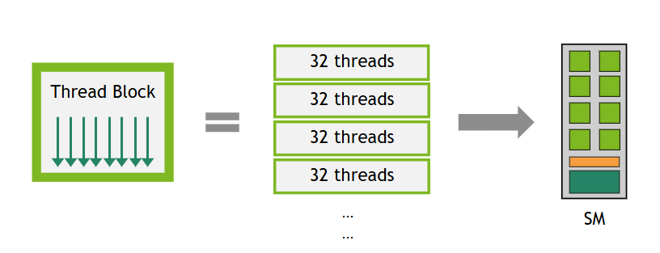

**图 22：线程块被划分为 32 个线程的 warp。**

#### 3.2.2.3 异步执行特性

近几代 NVIDIA GPU 包含了异步执行能力，以允许 GPU 内数据移动、计算与同步更多的重叠。这些能力使从 GPU 代码调用的某些操作与同一线程块中的其他 GPU 代码异步执行。这种异步执行不应与 2.5 节讨论的异步 CUDA API 混淆，后者使 GPU 内核启动或内存操作能够彼此或相对于 CPU 异步运行。

计算能力 8.0（NVIDIA Ampere GPU 架构）引入了从全局到共享内存的硬件加速异步数据复制以及异步屏障（参见 NVIDIA A100 Tensor Core GPU Architecture）。对硬件加速异步数据复制的支持由 `cuda::arch_traits` 的 `cp_async_supported` 字段报告。

计算能力 9.0（NVIDIA Hopper GPU 架构）扩展了异步执行特性，增加了张量内存加速器（TMA）单元，它可以将大块数据与多维张量从全局内存传输到共享内存及反向传输，还增加了异步事务屏障与异步矩阵乘累加操作（详情参见 Hopper Architecture in Depth 博客文章）。对 TMA 的支持由 `cuda::arch_traits` 的 `tma_supported` 字段报告。

CUDA 提供可由设备代码中的线程调用的 API 来使用这些特性。异步编程模型定义了异步操作相对于 CUDA 线程的行为。

异步操作是由 CUDA 线程发起、但像由另一个线程（我们称之为异步线程，async thread）执行那样异步执行的操作。在形式良好的程序中，一个或多个 CUDA 线程与异步操作同步。发起异步操作的 CUDA 线程不必是同步线程之一。异步线程总是与发起该操作的 CUDA 线程关联。

异步操作使用一个同步对象来发出其完成信号，该对象可以是屏障或管道。这些同步对象在“高级同步原语”中详细解释，它们在执行异步内存操作中的作用在“异步数据复制”中演示。

##### 3.2.2.3.1 异步线程与异步代理

异步操作访问内存的方式可能与常规操作不同。为区分这些不同的内存访问方式，CUDA 引入了异步线程、通用代理（generic proxy）与异步代理（async proxy）的概念。常规操作（加载与存储）通过通用代理进行。一些异步指令（如 LDGSTS 与 STAS/REDAS）被建模为在通用代理中运行的异步线程。其他异步指令（如使用 TMA 的批量异步复制以及某些张量核心操作，如 `tcgen05.*`、`wgmma.mma_async.*`）被建模为在异步代理中运行的异步线程。

**在通用代理中运行的异步线程。** 当发起一次异步操作时，它与一个异步线程关联，该异步线程不同于发起该操作的 CUDA 线程。对同一地址的先前的通用代理（常规）加载与存储保证排在异步操作之前。然而，对同一地址的后续常规加载与存储不保证保持其顺序，可能在异步线程完成之前引起竞态条件。

**在异步代理中运行的异步线程。** 当发起一次异步操作时，它与一个异步线程关联，该异步线程不同于发起该操作的 CUDA 线程。对同一地址的先前与后续常规加载与存储都不保证保持其顺序。需要代理栅栏（proxy fence）来在不同代理之间同步它们，以确保正确的内存顺序。“使用张量内存加速器（TMA）”一节演示了使用代理栅栏来确保使用 TMA 进行异步复制时的正确性。

关于这些概念的更多细节，请参见 PTX ISA 文档。

### 3.2.3 线程作用域

CUDA 线程构成线程层次结构，使用这种层次结构对于编写正确且高性能的 CUDA 内核至关重要。在该层次结构中，内存操作的可见性与同步范围可能不同。为应对这种非一致性，CUDA 编程模型引入了线程作用域（thread scope）的概念。线程作用域定义哪些线程可以观察到某个线程的加载与存储，并规定哪些线程可以使用原子操作与屏障等同步原语彼此同步。每个作用域在内存层次结构中都有一个关联的一致性点（point of coherency）。

线程作用域在 CUDA PTX 中暴露，也作为 libcu++ 库中的扩展提供。下表定义了可用的线程作用域：

| CUDA C++ 线程作用域 | CUDA PTX 线程作用域 | 描述 | 内存层次结构中的一致性点 |
|---|---|---|---|
| `cuda::thread_scope_thread` | – | 内存操作仅对本地线程可见。 | – |
| `cuda::thread_scope_block` | `.cta` | 内存操作对同一线程块中的其他线程可见。 | L1 |
| – | `.cluster` | 内存操作对同一线程块集群中的其他线程可见。 | L2 |
| `cuda::thread_scope_device` | `.gpu` | 内存操作对同一 GPU 设备中的其他线程可见。 | L2 |
| `cuda::thread_scope_system` | `.sys` | 内存操作对同一系统（CPU、其他 GPU）中的其他线程可见。 | L2 + 连接的缓存 |

“高级同步原语”与“异步数据复制”两节演示了线程作用域的使用。

### 3.2.4 高级同步原语

本节介绍三族同步原语：

- 带作用域原子操作（Scoped Atomics），它将 C++ 内存序与 CUDA 线程作用域配对，以便在块、集群、设备或系统作用域上安全地在线程之间通信（参见“线程作用域”）。
- 异步屏障（Asynchronous Barriers），它将同步拆分为到达与等待两个阶段，可用于跟踪异步操作的进度。
- 管道（Pipelines），它对工作进行分级，并协调多缓冲区生产者-消费者模式，通常用于将计算与异步数据复制重叠。

#### 3.2.4.1 带作用域原子操作

5.4.5 节概述了 CUDA 中可用的原子函数。在本节中，我们将重点介绍支持 C++ 标准原子内存语义的带作用域原子操作，它们可通过 libcu++ 库或编译器内建函数使用。带作用域原子操作为在 CUDA 线程层次结构的适当级别上进行高效同步提供了工具，从而在复杂并行算法中同时实现正确性与性能。

##### 3.2.4.1.1 线程作用域与内存序

带作用域原子操作结合了两个关键概念：

- 线程作用域：定义哪些线程可以观察到原子操作的效果（参见“线程作用域”）。
- 内存序（Memory Ordering）：定义相对于其他内存操作的顺序约束（参见 C++ 标准原子内存语义）。

**CUDA C++ cuda::atomic**

```cpp
#include <cuda/atomic>

__global__ void block_scoped_counter() {
    // 仅在此块内可见的共享原子计数器
    __shared__ cuda::atomic<int, cuda::thread_scope_block> counter;

    // 初始化计数器（只应由一个线程执行）
    if (threadIdx.x == 0) {
        counter.store(0, cuda::memory_order_relaxed);
    }
    __syncthreads();

    // 块中所有线程原子地递增
    int old_value = counter.fetch_add(1, cuda::memory_order_relaxed);

    // 使用 old_value...
}
```

**内建原子函数**

```cpp
__global__ void block_scoped_counter() {
    // 仅在此块内可见的共享计数器
    __shared__ int counter;

    // 初始化计数器（只应由一个线程执行）
    if (threadIdx.x == 0) {
        __nv_atomic_store_n(&counter, 0,
                            __NV_ATOMIC_RELAXED,
                            __NV_THREAD_SCOPE_BLOCK);
    }
    __syncthreads();

    // 块中所有线程原子地递增
    int old_value = __nv_atomic_fetch_add(&counter, 1,
                                          __NV_ATOMIC_RELAXED,
                                          __NV_THREAD_SCOPE_BLOCK);

    // 使用 old_value...
}
```

此示例实现了一个块作用域原子计数器，演示了带作用域原子操作的基本概念：

- 共享变量：使用 `__shared__` 内存在块中所有线程之间共享单个计数器。
- 原子类型声明：`cuda::atomic<int, cuda::thread_scope_block>` 创建一个具有块级可见性的原子整数。
- 单次初始化：只有线程 0 初始化计数器，以防止设置期间的竞态条件。
- 块同步：`__syncthreads()` 确保所有线程在继续之前看到已初始化的计数器。
- 原子递增：每个线程原子地递增计数器并接收先前的值。

这里选择 `cuda::memory_order_relaxed`，因为我们只需要原子性（不可分割的读-修改-写），而不需要不同内存位置之间的顺序约束。由于这是一个简单的计数操作，递增的顺序对正确性没有影响。

对于生产者-消费者模式，获取-释放（acquire-release）语义确保正确的顺序：

**CUDA C++ cuda::atomic**

```cpp
__global__ void producer_consumer() {
    __shared__ int data;
    __shared__ cuda::atomic<bool, cuda::thread_scope_block> ready;

    if (threadIdx.x == 0) {
        // 生产者：写入数据然后发出就绪信号
        data = 42;
        ready.store(true, cuda::memory_order_release);  // Release 确保数据写入可见
    } else {
        // 消费者：等待就绪信号然后读取数据
        while (!ready.load(cuda::memory_order_acquire)) {  // Acquire 确保数据读取看到写入
            // 自旋等待
        }
        int value = data;
        // 处理 value...
    }
}
```

**内建原子函数**

```cpp
__global__ void producer_consumer() {
    __shared__ int data;
    __shared__ bool ready;   // 只有 ready 标志需要原子操作

    if (threadIdx.x == 0) {
        // 生产者：写入数据然后发出就绪信号
        data = 42;
        __nv_atomic_store_n(&ready, true,
                            __NV_ATOMIC_RELEASE,
                            __NV_THREAD_SCOPE_BLOCK);  // Release 确保数据写入可见
    } else {
        // 消费者：等待就绪信号然后读取数据
        while (!__nv_atomic_load_n(&ready,
                                   __NV_ATOMIC_ACQUIRE,
                                   __NV_THREAD_SCOPE_BLOCK)) {  // Acquire 确保数据读取看到写入
            // 自旋等待
        }
        int value = data;
        // 处理 value...
    }
}
```

##### 3.2.4.1.2 性能考虑

- 使用尽可能窄的作用域：块作用域原子操作比系统作用域原子操作快得多。
- 优先使用较弱的顺序：仅在正确性需要时才使用更强的顺序。
- 考虑内存位置：共享内存原子操作比全局内存原子操作快。

#### 3.2.4.2 异步屏障

异步屏障与典型的单阶段屏障（`__syncthreads()`）的不同之处在于，线程到达屏障的通知（“到达”，arrival）与等待其他线程到达屏障的操作（“等待”，wait）是分离的。这种分离允许线程执行与屏障无关的额外操作，从而更有效地利用等待时间，提高了执行效率。异步屏障可用于以 CUDA 线程实现生产者-消费者模式，或通过让复制操作在完成时向屏障发出信号（“到达屏障”）来在内存层次结构内实现异步数据复制。

异步屏障在计算能力 7.0 或更高的设备上可用。计算能力 8.0 或更高的设备为共享内存中的异步屏障提供硬件加速，并通过允许对块内任意子集的 CUDA 线程进行硬件加速同步，在同步粒度上取得了重大进步。此前的架构仅在整个 warp（`__syncwarp()`）或整个块（`__syncthreads()`）级别加速同步。

CUDA 编程模型通过 `cuda::std::barrier` 提供异步屏障，这是 libcu++ 库中一个符合 ISO C++ 的屏障。除了实现 `std::barrier` 之外，该库还提供 CUDA 特定的扩展，用于选择屏障的线程作用域以提升性能，并暴露一个更底层的 `cuda::ptx` API。`cuda::barrier` 可以与 `cuda::ptx` 互操作，方法是使用友元函数 `cuda::device::barrier_native_handle()` 获取屏障的原生句柄，并将其传给 `cuda::ptx` 函数。CUDA 还为共享内存中线程块作用域的异步屏障提供了原语 API。

下表概述了可用于在不同线程作用域上同步的异步屏障。

| 线程作用域 | 内存位置 | 到达屏障 | 在屏障上等待 | 硬件加速 | CUDA API |
|---|---|---|---|---|---|
| block | 本地共享内存 | 允许 | 允许 | 是（8.0+） | `cuda::barrier`、`cuda::ptx`、primitives |
| cluster | 本地共享内存 | 允许 | 允许 | 是（9.0+） | `cuda::barrier`、`cuda::ptx` |
| cluster | 远程共享内存 | 允许 | 不允许 | 是（9.0+） | `cuda::barrier`、`cuda::ptx` |
| device | 全局内存 | 允许 | 允许 | 否 | `cuda::barrier` |
| system | 全局/统一内存 | 允许 | 允许 | 否 | `cuda::barrier` |

**同步在时间上的拆分**

在没有异步到达-等待屏障的情况下，线程块内的同步使用 `__syncthreads()` 或使用协作组时的 `block.sync()` 实现。

```cpp
#include <cooperative_groups.h>

__global__ void simple_sync(int iteration_count) {
    auto block = cooperative_groups::this_thread_block();

    for (int i = 0; i < iteration_count; ++i) {
        /* 到达之前的代码 */

        // 等待所有线程到达此处。
        block.sync();

        /* 等待之后的代码 */
    }
}
```

线程在同步点（`block.sync()`）处阻塞，直到所有线程都到达同步点。此外，同步点之前发生的 内存更新保证在同步点之后对块中所有线程可见。

这种模式有三个阶段：

- 同步之前的代码执行将在同步之后读取的内存更新。
- 同步点。
- 同步之后的代码，可以看到同步之前发生的内存更新。

使用异步屏障时，时间上拆分的同步模式如下。

**CUDA C++ cuda::barrier**

```cpp
#include <cuda/barrier>
#include <cooperative_groups.h>

__device__ void compute(float *data, int iteration);

__global__ void split_arrive_wait(int iteration_count, float *data)
{
    using barrier_t = cuda::barrier<cuda::thread_scope_block>;
    __shared__ barrier_t bar;
    auto block = cooperative_groups::this_thread_block();

    if (block.thread_rank() == 0)
    {
        // 使用预期的到达计数初始化屏障。
        init(&bar, block.size());
    }
    block.sync();

    for (int i = 0; i < iteration_count; ++i)
    {
        /* 到达之前的代码 */

        // 此线程到达。到达不会阻塞线程。
        barrier_t::arrival_token token = bar.arrive();

        compute(data, i);

        // 等待参与屏障的所有线程完成 bar.arrive()。
        bar.wait(std::move(token));

        /* 等待之后的代码 */
    }
}
```

**CUDA C++ cuda::ptx**

```cpp
#include <cuda/ptx>
#include <cooperative_groups.h>

__device__ void compute(float *data, int iteration);

__global__ void split_arrive_wait(int iteration_count, float *data)
{
    __shared__ uint64_t bar;
    auto block = cooperative_groups::this_thread_block();

    if (block.thread_rank() == 0)
    {
        // 使用预期的到达计数初始化屏障。
        cuda::ptx::mbarrier_init(&bar, block.size());
    }
    block.sync();

    for (int i = 0; i < iteration_count; ++i)
    {
        /* 到达之前的代码 */

        // 此线程到达。到达不会阻塞线程。
        uint64_t token = cuda::ptx::mbarrier_arrive(&bar);

        compute(data, i);

        // 等待参与屏障的所有线程完成 mbarrier_arrive()。
        while(!cuda::ptx::mbarrier_try_wait(&bar, token)) {}

        /* 等待之后的代码 */
    }
}
```

**CUDA C 原语**

```cpp
#include <cuda_awbarrier_primitives.h>
#include <cooperative_groups.h>

__device__ void compute(float *data, int iteration);

__global__ void split_arrive_wait(int iteration_count, float *data)
{
    __shared__ __mbarrier_t bar;
    auto block = cooperative_groups::this_thread_block();

    if (block.thread_rank() == 0)
    {
        // 使用预期的到达计数初始化屏障。
        __mbarrier_init(&bar, block.size());
    }
    block.sync();

    for (int i = 0; i < iteration_count; ++i)
    {
        /* 到达之前的代码 */

        // 此线程到达。到达不会阻塞线程。
        __mbarrier_token_t token = __mbarrier_arrive(&bar);

        compute(data, i);

        // 等待参与屏障的所有线程完成 __mbarrier_arrive()。
        while(!__mbarrier_try_wait(&bar, token, 1000)) {}

        /* 等待之后的代码 */
    }
}
```

在这种模式中，同步点被拆分为到达点（`bar.arrive()`）与等待点（`bar.wait(std::move(token))`）。线程通过第一次调用 `bar.arrive()` 开始参与 `cuda::barrier`。当线程调用 `bar.wait(std::move(token))` 时，它将被阻塞，直到参与线程完成了预期次数的 `bar.arrive()`，该预期次数是传给 `init()` 的预期到达计数参数。参与线程调用 `bar.arrive()` 之前发生的 内存更新，保证在其调用 `bar.wait(std::move(token))` 之后对参与线程可见。请注意，调用 `bar.arrive()` 不会阻塞线程，它可以继续执行不依赖于其他参与线程调用 `bar.arrive()` 之前内存更新的其他工作。

到达与等待模式有五个阶段：

- 到达之前的代码执行将在等待之后读取的内存更新。
- 带隐式内存栅栏的到达点（即等价于 `cuda::atomic_thread_fence(cuda::memory_order_..., cuda::thread_scope_block)`）。
- 到达与等待之间的代码。
- 等待点。
- 等待之后的代码，可以看到到达之前执行的更新。

关于如何使用异步屏障的全面指南，请参见“异步屏障”。

#### 3.2.4.3 管道

CUDA 编程模型提供管道（pipeline）同步对象作为一种协调机制，将异步内存复制按多个阶段排序，便于实现双缓冲或多缓冲的生产者-消费者模式。管道是一个带有头与尾的双端队列，按先进先出（FIFO）顺序处理工作。生产者线程将工作提交到管道的头，消费者线程从管道的尾拉取工作。

管道通过 libcu++ 库中的 `cuda::pipeline` API 以及一个原语 API 暴露。下表描述了这两个 API 的主要功能。

| `cuda::pipeline` API | 描述 |
|---|---|
| `producer_acquire` | 获取管道内部队列中一个可用的阶段。 |
| `producer_commit` | 提交在 `producer_acquire` 调用之后、于管道当前获取的阶段上发出的异步操作。 |
| `consumer_wait` | 等待管道最旧阶段中异步操作的完成。 |
| `consumer_release` | 将管道最旧的阶段释放回管道对象以供复用。被释放的阶段随后可被生产者获取。 |

| 原语 API | 描述 |
|---|---|
| `__pipeline_memcpy_async` | 请求一次从全局到共享内存的内存复制，提交以进行异步求值。 |
| `__pipeline_commit` | 提交在调用之前于管道当前阶段上发出的异步操作。 |
| `__pipeline_wait_prior(N)` | 等待除最后 N 次提交之外，管道中所有异步操作的完成。 |

`cuda::pipeline` API 具有更丰富的接口、限制更少，而原语 API 仅支持跟踪从全局内存到共享内存的异步复制，且有特定的大小与对齐要求。原语 API 提供与具有 `cuda::thread_scope_thread` 的 `cuda::pipeline` 对象等价的功能。

关于详细的用法模式与示例，请参见“管道”。

### 3.2.5 异步数据复制

内存层次结构中高效的数据移动是实现 GPU 计算高性能的基础。传统的同步内存操作迫使线程在数据传输期间空闲等待。GPU 通过并行性固有地隐藏内存延迟。也就是说，在内存操作完成期间，SM 切换到执行另一个 warp。即使通过并行性隐藏延迟，内存延迟仍可能成为内存带宽利用率与计算资源效率的瓶颈。为解决这些瓶颈，现代 GPU 架构提供硬件加速的异步数据复制机制，允许内存传输独立进行，而线程继续执行其他工作。

异步数据复制通过将内存传输的发起与等待其完成解耦，实现计算与数据移动的重叠。这样，线程可以在内存延迟期间执行有用工作，从而提高整体吞吐量与资源利用率。

> **注意**
>
> 虽然本节所依据的概念与原则与前面关于异步执行的章节中讨论的类似，但该章涵盖的是内核与内存传输（例如由 `cudaMemcpyAsync` 发起的那些）的异步执行。那可以看作应用不同组件的异步性。
>
> 本节描述的异步性是指在不阻塞 GPU 线程的情况下，实现 GPU 的 DRAM（即全局内存）与 SM 上的内存（如共享内存或张量内存）之间的数据传输。这是单次内核启动执行内部的异步性。

为理解异步复制如何提升性能，考察一种常见的 GPU 计算模式是有帮助的。CUDA 应用通常采用复制与计算模式，它：

- 从全局内存获取数据，
- 将数据存储到共享内存，
- 对共享内存数据执行计算，并可能将结果写回全局内存。

这种模式的复制阶段通常表达为 `shared[local_idx] = global[global_idx]`。这个从全局到共享内存的复制由编译器展开为先从全局内存读入寄存器，然后从寄存器写入共享内存。

当这种模式出现在迭代算法中时，每个线程块需要在 `shared[local_idx] = global[global_idx]` 赋值之后同步，以确保在计算阶段开始之前所有对共享内存的写入都已完成。线程块还需要在计算阶段之后再次同步，以防止在所有线程完成计算之前覆盖共享内存。下面的代码片段说明了这种模式。

```cpp
#include <cooperative_groups.h>

__device__ void compute(int* global_out, int const* shared_in) {
    // 使用共享内存中当前批次的所有值进行计算。
    // 将此线程的结果存回全局内存。
}

__global__ void without_async_copy(int* global_out, int const* global_in, size_t size, size_t batch_sz) {
    auto grid = cooperative_groups::this_grid();
    auto block = cooperative_groups::this_thread_block();
    assert(size == batch_sz * grid.size());  // 说明：输入大小等于 batch_sz * grid_size

    extern __shared__ int shared[];          // block.size() * sizeof(int) 字节
    size_t local_idx = block.thread_rank();

    for (size_t batch = 0; batch < batch_sz; ++batch) {
        // 计算此块在全局内存中当前批次的索引。
        size_t block_batch_idx = block.group_index().x * block.size() + grid.size() * batch;
        size_t global_idx = block_batch_idx + threadIdx.x;

        shared[local_idx] = global_in[global_idx];

        // 等待所有复制完成。
        block.sync();

        // 计算并将结果写入全局内存。
        compute(global_out + block_batch_idx, shared);

        // 等待使用共享内存的计算完成。
        block.sync();
    }
}
```

借助异步数据复制，从全局内存到共享内存的数据移动可以异步进行，从而在等待数据到达时更有效地利用 SM。

```cpp
#include <cooperative_groups.h>
#include <cooperative_groups/memcpy_async.h>

__device__ void compute(int* global_out, int const* shared_in) {
    // 使用共享内存中当前批次的所有值进行计算。
    // 将此线程的结果存回全局内存。
}

__global__ void with_async_copy(int* global_out, int const* global_in, size_t size, size_t batch_sz) {
    auto grid = cooperative_groups::this_grid();
    auto block = cooperative_groups::this_thread_block();
    assert(size == batch_sz * grid.size());  // 说明：输入大小等于 batch_sz * grid_size

    extern __shared__ int shared[];          // block.size() * sizeof(int) 字节
    size_t local_idx = block.thread_rank();

    for (size_t batch = 0; batch < batch_sz; ++batch) {
        // 计算此块在全局内存中当前批次的索引。
        size_t block_batch_idx = block.group_index().x * block.size() + grid.size() * batch;

        // 整个线程组协作地将整个批次复制到共享内存。
        cooperative_groups::memcpy_async(block, shared, global_in + block_batch_idx, block.size());

        // 在等待时对不同的数据执行计算。

        // 等待所有复制完成。
        cooperative_groups::wait(block);

        // 计算并将结果写入全局内存。
        compute(global_out + block_batch_idx, shared);

        // 等待使用共享内存的计算完成。
        block.sync();
    }
}
```

`cooperative_groups::memcpy_async` 函数从全局内存复制 `block.size()` 个元素到共享数据。此操作就像由另一个线程执行一样发生，该线程在复制完成后与当前线程对 `cooperative_groups::wait` 的调用同步。在复制操作完成之前，修改全局数据或读取/写入共享数据会引入数据竞争。

此示例说明了所有异步复制操作背后的基本概念：它们将内存传输的发起与完成解耦，允许线程在数据于后台移动时执行其他工作。CUDA 编程模型提供了多种 API 来访问这些能力，包括协作组与 libcu++ 库中可用的 `memcpy_async` 函数，以及更底层的 `cuda::ptx` 与原语 API。这些 API 共享相似的语义：它们将对象从源复制到目标，就像由另一个线程执行一样，该线程在复制完成时可使用不同的完成机制进行同步。

现代 GPU 架构提供多种硬件机制用于异步数据移动。

- LDGSTS（计算能力 8.0+）允许从全局到共享内存的高效小规模异步传输。
- 张量内存加速器（TMA，计算能力 9.0+）扩展了这些能力，提供针对大型多维数据传输优化的批量异步复制操作。
- STAS 指令（计算能力 9.0+）允许集群内从寄存器到分布式共享内存的小规模异步传输。

LDGSTS 与 TMA 的可用性由 `cuda::arch_traits` 的 `cp_async_supported` 与 `tma_supported` 字段报告。主机代码可以在启动内核之前用 `cuda::arch_traits_for()` 检查这些字段，设备代码可以在编译时用 `if constexpr (cuda::device::current_arch_traits().tma_supported)` 选择代码路径。

这些机制支持不同的数据路径、传输大小与对齐要求，允许开发者为其特定的数据访问模式选择最合适的方法。下表概述了 GPU 内异步复制支持的数据路径。

**表 5：异步复制可能 的源与目标内存空间。空白单元格表示不支持该源-目标对。**

| 方向 | 复制机制 | 源 | 目标 |
|---|---|---|---|
| 异步复制 | 批量异步复制 | global | global |
| 异步复制 | 批量异步复制 | shared::cta | global（支持，TMA，9.0+） |
| 异步复制 | 批量异步复制 | global | shared::cta（支持，LDGSTS，8.0+；支持，TMA，9.0+） |
| 异步复制 | 批量异步复制 | global | shared::cluster（支持，TMA，9.0+） |
| 异步复制 | 批量异步复制 | shared::cluster | shared::cta（支持，TMA，9.0+） |
| 异步复制 | 批量异步复制 | shared::cta | shared::cta |
| 异步复制 | 批量异步复制 | registers | shared::cluster（支持，STAS，9.0+） |

“使用 LDGSTS”“使用张量内存加速器（TMA）”与“使用 STAS”各节将更详细介绍每种机制。

### 3.2.6 配置 L1/共享内存平衡

正如“L1 数据缓存”中所述，SM 上的 L1 与共享内存使用相同的物理资源，称为统一数据缓存。在大多数架构上，如果内核使用很少或不使用共享内存，则可以将统一数据缓存配置为提供该架构所允许的最大 L1 缓存量。

为共享内存保留的统一数据缓存可按内核配置。应用可以在启动内核之前调用 `cudaFuncSetAttribute` 函数来设置划分比例（carveout），即首选的共享内存容量。

```cpp
cudaFuncSetAttribute(kernel_name, cudaFuncAttributePreferredSharedMemoryCarveout, carveout);
```

应用可以将划分比例设置为该架构最大受支持共享内存容量的整数百分比。除了整数百分比之外，还提供了三个便捷枚举作为划分比例值。

- `cudaSharedmemCarveoutDefault`
- `cudaSharedmemCarveoutMaxL1`
- `cudaSharedmemCarveoutMaxShared`

最大受支持共享内存与受支持的划分比例大小因架构而异；详情参见“各计算能力的共享内存容量”。

当所选的整数百分比划分比例不能精确映射到受支持的共享内存容量时，将使用下一个更大的容量。例如，对于计算能力 12.0 的设备（其最大共享内存容量为 100KB），将划分比例设为 50% 将得到 64KB 共享内存，而不是 50KB，因为计算能力 12.0 的设备支持 0、8、16、32、64 与 100 的共享内存大小。

传给 `cudaFuncSetAttribute` 的函数必须使用 `__global__` 说明符声明。`cudaFuncSetAttribute` 被驱动解释为提示，如果需要执行该内核，驱动可以选择不同的划分比例大小。

> **注意**
>
> 另一个 CUDA API `cudaFuncSetCacheConfig` 也允许应用调整内核的 L1 与共享内存之间的平衡。然而，该 API 对内核启动的共享/L1 平衡设置了硬性要求。结果，交错使用不同共享内存配置的内核会不必要地在共享内存重配置之后串行化启动。优先使用 `cudaFuncSetAttribute`，因为驱动可以在需要执行函数或避免抖动时选择不同的配置。

依赖每个块超过 48 KB 共享内存分配的内核是与架构相关的。因此，它们必须使用动态共享内存而非静态大小的数组，并且需要使用 `cudaFuncSetAttribute` 显式选择启用，如下所示。

第二个标签页使用 `cuda::device_attributes` 查询当前设备的计算能力，并使用 `cuda::arch_traits_for()` 在选择启用之前检查架构的共享内存限制（参见“检索特性与技术规格”）。两个示例都使用 CUDA 运行时 API 选择启用并启动内核。

**CUDA 运行时 API**

```cpp
// 设备代码
__global__ void MyKernel(...)
{
    extern __shared__ float buffer[];
    ...
}

// 主机代码
int maxbytes = 98304;  // 96 KB
cudaFuncSetAttribute(MyKernel, cudaFuncAttributeMaxDynamicSharedMemorySize, maxbytes);
MyKernel <<<gridDim, blockDim, maxbytes>>>(...);
```

**使用架构特性的 CUDA 运行时 API**

```cpp
#include <cuda/devices>
#include <cuda_runtime.h>
#include <cstdio>
#include <cstdlib>
#include <exception>

// 设备代码
__global__ void MyKernel(float* output, int n)
{
    extern __shared__ float buffer[];
    for (int i = threadIdx.x; i < n; i += blockDim.x) {
        buffer[i] = static_cast<float>(i);
    }
    __syncthreads();
    if (threadIdx.x == 0) {
        output[blockIdx.x] = buffer[n - 1];
    }
}

// 主机代码
cudaError_t launch_my_kernel(float* output, int num_blocks)
{
    int device_id;
    cudaError_t status = cudaGetDevice(&device_id);
    if (status != cudaSuccess) {
        return status;
    }

    auto compute_capability = cuda::device_attributes::compute_capability(device_id);
    auto traits = cuda::arch_traits_for(compute_capability);

    int maxbytes = 98304;  // 96 KB
    // 架构必须支持所请求的大小。
    if (maxbytes > traits.max_shared_memory_per_block_optin) {
        return cudaErrorInvalidValue;
    }

    // 显式选择启用每个块超过 48 KB 的动态共享内存。
    status = cudaFuncSetAttribute(MyKernel, cudaFuncAttributeMaxDynamicSharedMemorySize, maxbytes);
    if (status != cudaSuccess) {
        return status;
    }

    int n = maxbytes / sizeof(float);
    MyKernel<<<num_blocks, 256, maxbytes>>>(output, n);

    return cudaGetLastError();
}
```

## 3.3 CUDA 驱动 API

本指南前面的章节介绍了 CUDA 运行时。正如“CUDA 运行时 API 与 CUDA 驱动 API”中所述，CUDA 运行时构建在更低层的 CUDA 驱动 API 之上。本节介绍 CUDA 运行时与驱动 API 之间的一些差异，以及如何混合使用它们。大多数应用可以在完全不与 CUDA 驱动 API 交互的情况下以完整性能运行。然而，新接口有时会先出现在驱动 API 中，然后再出现在运行时 API 中，而且某些高级接口（如虚拟内存管理）仅在驱动 API 中暴露。

驱动 API 实现在 CUDA 动态库（`cuda.dll` 或 `cuda.so`）中，该库在设备驱动安装期间被复制到系统中。它的所有入口点都以 `cu` 为前缀。

它是一个基于句柄的命令式 API：大多数对象通过不透明句柄引用，这些句柄可以指定给函数以操作对象。

驱动 API 中可用的对象汇总于表 6。

**表 6：CUDA 驱动 API 中可用的对象**

| 对象 | 句柄 | 描述 |
|---|---|---|
| 设备（Device） | `CUdevice` | 支持 CUDA 的设备 |
| 上下文（Context） | `CUcontext` | 大致相当于一个 CPU 进程 |
| 模块（Module） | `CUmodule` | 大致相当于一个动态库 |
| 函数（Function） | `CUfunction` | 内核 |
| 堆内存（Heap memory） | `CUdeviceptr` | 指向设备内存的指针 |
| CUDA 数组（CUDA array） | `CUarray` | 设备上一维或二维数据的不透明容器，可通过纹理或表面引用读取 |
| 纹理对象（Texture object） | `CUtexref` | 描述如何解释纹理内存数据的对象 |
| 表面引用（Surface reference） | `CUsurfref` | 描述如何读写 CUDA 数组的对象 |
| 流（Stream） | `CUstream` | 描述 CUDA 流的对象 |
| 事件（Event） | `CUevent` | 描述 CUDA 事件的对象 |

在调用驱动 API 的任何函数之前，必须使用 `cuInit()` 初始化驱动 API。然后必须创建一个 CUDA 上下文，它附加到特定设备并对调用主机线程成为当前上下文，详见“上下文”。

在 CUDA 上下文中，内核由主机代码显式加载为 PTX 或二进制对象，如“模块”中所述。因此，用 C++ 编写的内核必须单独编译为 PTX 或二进制对象。内核使用 API 入口点启动，如“内核执行”中所述。

任何希望在未来设备架构上运行的应用都必须加载 PTX，而不是二进制代码。这是因为二进制代码是架构相关的，因此与未来架构不兼容，而 PTX 代码在加载时由设备驱动编译为二进制代码。

下面是使用驱动 API 编写的“内核”示例的主机代码：

```cpp
int main()
{
    int N = ...;
    size_t size = N * sizeof(float);

    // 在主机内存中分配输入向量 h_A 与 h_B
    float* h_A = (float*)malloc(size);
    float* h_B = (float*)malloc(size);

    // 初始化输入向量
    ...

    // 初始化
    cuInit(0);

    // 获取支持 CUDA 的设备数量
    int deviceCount = 0;
    cuDeviceGetCount(&deviceCount);

    if (deviceCount == 0) {
        printf("There is no device supporting CUDA.\n");
        exit (0);
    }

    // 获取设备 0 的句柄
    CUdevice cuDevice;
    cuDeviceGet(&cuDevice, 0);

    // 创建上下文
    CUcontext cuContext;
    cuCtxCreate(&cuContext, 0, cuDevice);

    // 从二进制文件创建模块
    CUmodule cuModule;
    cuModuleLoad(&cuModule, "VecAdd.ptx");

    // 在设备内存中分配向量
    CUdeviceptr d_A;
    cuMemAlloc(&d_A, size);
    CUdeviceptr d_B;
    cuMemAlloc(&d_B, size);
    CUdeviceptr d_C;
    cuMemAlloc(&d_C, size);

    // 将向量从主机内存复制到设备内存
    cuMemcpyHtoD(d_A, h_A, size);
    cuMemcpyHtoD(d_B, h_B, size);

    // 从模块获取函数句柄
    CUfunction vecAdd;
    cuModuleGetFunction(&vecAdd, cuModule, "VecAdd");

    // 调用内核
    int threadsPerBlock = 256;
    int blocksPerGrid = (N + threadsPerBlock - 1) / threadsPerBlock;
    void* args[] = { &d_A, &d_B, &d_C, &N };
    cuLaunchKernel(vecAdd,
                   blocksPerGrid, 1, 1, threadsPerBlock, 1, 1,
                   0, 0, args, 0);
    ...
}
```

完整代码可在 vectorAddDrv CUDA 示例中找到。

### 3.3.1 上下文

CUDA 上下文类似于一个 CPU 进程。在驱动 API 中执行的所有资源与操作都封装在 CUDA 上下文中，当上下文被销毁时系统会自动清理这些资源。除了模块与纹理或表面引用等对象之外，每个上下文都有自己独立的地址空间。因此，来自不同上下文的 `CUdeviceptr` 值引用不同的内存位置。

一个主机线程一次只能有一个当前设备上下文。当使用 `cuCtxCreate()` 创建上下文时，它会对调用主机线程成为当前上下文。在上下文中操作的 CUDA 函数（大多数不涉及设备枚举或上下文管理的函数）如果当前线程没有有效的当前上下文，将返回 `CUDA_ERROR_INVALID_CONTEXT`。

每个主机线程都有一个当前上下文的栈。`cuCtxCreate()` 将新上下文压入栈顶。可以调用 `cuCtxPopCurrent()` 将上下文从主机线程分离。随后该上下文是“浮动”的，可以作为任何主机线程的当前上下文被压入。`cuCtxPopCurrent()` 还会恢复先前的当前上下文（如果有）。

每个上下文还维护一个使用计数。`cuCtxCreate()` 创建使用计数为 1 的上下文。`cuCtxAttach()` 递增使用计数，`cuCtxDetach()` 递减它。当调用 `cuCtxDetach()` 或 `cuCtxDestroy()` 使使用计数降为 0 时，上下文被销毁。

驱动 API 可与运行时互操作，可以通过 `cuDevicePrimaryCtxRetain()` 从驱动 API 访问由运行时管理的主上下文（参见“运行时初始化”）。

使用计数便于在同一上下文中操作的第三方编写代码之间互操作。例如，如果加载三个库以使用同一上下文，每个库都会调用 `cuCtxAttach()` 递增使用计数，并在库用完上下文时调用 `cuCtxDetach()` 递减使用计数。对于大多数库，预期应用会在加载或初始化库之前创建上下文；这样应用可以使用自己的启发式方法创建上下文，库只是在其被交给的上下文上操作。希望创建自己上下文的库（其 API 客户端可能已创建也可能未创建自己的上下文，库对此并不知情）将使用 `cuCtxPushCurrent()` 与 `cuCtxPopCurrent()`，如下图所示。

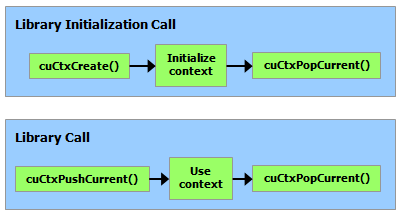

**图 23：库的上下文管理。**

### 3.3.2 模块

模块是可动态加载的设备代码与数据包，类似于 Windows 中的 DLL，由 nvcc 输出（参见“使用 NVCC 编译”）。所有符号（包括函数、全局变量以及纹理或表面引用）的名称都维护在模块作用域，以便独立第三方编写的模块可以在同一 CUDA 上下文中互操作。

下面的代码示例加载一个模块并获取某个内核的句柄：

```cpp
CUmodule cuModule;
cuModuleLoad(&cuModule, "myModule.ptx");
CUfunction myKernel;
cuModuleGetFunction(&myKernel, cuModule, "MyKernel");
```

下面的代码示例从 PTX 代码编译并加载一个新模块，并解析编译错误：

```cpp
#define BUFFER_SIZE 8192

CUmodule cuModule;
CUjit_option options[3];
void* values[3];
char* PTXCode = "some PTX code";
char error_log[BUFFER_SIZE];
int err;

options[0] = CU_JIT_ERROR_LOG_BUFFER;
values[0]  = (void*)error_log;
options[1] = CU_JIT_ERROR_LOG_BUFFER_SIZE_BYTES;
values[1]  = (void*)BUFFER_SIZE;
options[2] = CU_JIT_TARGET_FROM_CUCONTEXT;
values[2]  = 0;

err = cuModuleLoadDataEx(&cuModule, PTXCode, 3, options, values);

if (err != CUDA_SUCCESS)
    printf("Link error:\n%s\n", error_log);
```

下面的代码示例从多个 PTX 代码编译、链接并加载一个新模块，并解析链接与编译错误：

```cpp
#define BUFFER_SIZE 8192

CUmodule cuModule;
CUjit_option options[6];
void* values[6];
float walltime;
char error_log[BUFFER_SIZE], info_log[BUFFER_SIZE];
char* PTXCode0 = "some PTX code";
char* PTXCode1 = "some other PTX code";
CUlinkState linkState;
int err;
void* cubin;
size_t cubinSize;

options[0] = CU_JIT_WALL_TIME;
values[0] = (void*)&walltime;
options[1] = CU_JIT_INFO_LOG_BUFFER;
values[1] = (void*)info_log;
options[2] = CU_JIT_INFO_LOG_BUFFER_SIZE_BYTES;
values[2] = (void*)BUFFER_SIZE;
options[3] = CU_JIT_ERROR_LOG_BUFFER;
values[3] = (void*)error_log;
options[4] = CU_JIT_ERROR_LOG_BUFFER_SIZE_BYTES;
values[4] = (void*)BUFFER_SIZE;
options[5] = CU_JIT_LOG_VERBOSE;
values[5] = (void*)1;

cuLinkCreate(6, options, values, &linkState);

err = cuLinkAddData(linkState, CU_JIT_INPUT_PTX,
                    (void*)PTXCode0, strlen(PTXCode0) + 1, 0, 0, 0, 0);
if (err != CUDA_SUCCESS)
    printf("Link error:\n%s\n", error_log);

err = cuLinkAddData(linkState, CU_JIT_INPUT_PTX,
                    (void*)PTXCode1, strlen(PTXCode1) + 1, 0, 0, 0, 0);
if (err != CUDA_SUCCESS)
    printf("Link error:\n%s\n", error_log);

cuLinkComplete(linkState, &cubin, &cubinSize);
printf("Link completed in %fms. Linker Output:\n%s\n", walltime, info_log);

cuModuleLoadData(cuModule, cubin);
cuLinkDestroy(linkState);
```

可以使用多个线程来加速模块链接/加载过程的某些部分，包括加载 cubin 时。下面的代码示例使用 `CU_JIT_BINARY_LOADER_THREAD_COUNT` 来加速模块加载。

```cpp
#define BUFFER_SIZE 8192

CUmodule cuModule;
CUjit_option options[3];
void* values[3];
char* cubinCode = "some cubin code";
char error_log[BUFFER_SIZE];
int err;

options[0] = CU_JIT_ERROR_LOG_BUFFER;
values[0]  = (void*)error_log;
options[1] = CU_JIT_ERROR_LOG_BUFFER_SIZE_BYTES;
values[1]  = (void*)BUFFER_SIZE;
options[2] = CU_JIT_BINARY_LOADER_THREAD_COUNT;
values[2]  = 0;  // 使用与机器 CPU 数量相同的线程数

err = cuModuleLoadDataEx(&cuModule, cubinCode, 3, options, values);

if (err != CUDA_SUCCESS)
    printf("Link error:\n%s\n", error_log);
```

完整代码可在 ptxjit CUDA 示例中找到。

### 3.3.3 内核执行

`cuLaunchKernel()` 以给定的执行配置启动内核。

参数既可以作为指针数组传递（`cuLaunchKernel()` 的倒数第二个参数），其中第 n 个指针对应第 n 个参数，并指向从中复制参数的内存区域；也可以作为额外选项之一传递（`cuLaunchKernel()` 的最后一个参数）。

当参数作为额外选项传递（`CU_LAUNCH_PARAM_BUFFER_POINTER` 选项）时，它们作为指向单个缓冲区的指针传递，其中假定参数之间通过匹配设备代码中每种参数类型的对齐要求而正确偏移。

设备代码中内建向量类型的对齐要求列于表 49。对于所有其他基本类型，设备代码中的对齐要求与主机代码中的对齐要求一致，因此可以使用 `__alignof()` 获得。唯一的例外是主机编译器将 `double` 与 `long long`（以及 64 位系统上的 `long`）按单字边界而非双字边界对齐时（例如使用 gcc 的编译标志 `-mno-align-double`），因为设备代码中这些类型总是按双字边界对齐。

`CUdeviceptr` 是一个整数，但表示一个指针，因此其对齐要求为 `__alignof(void*)`。

下面的代码示例使用宏 `ALIGN_UP()` 调整每个参数的偏移以满足其对齐要求，并使用另一个宏 `ADD_TO_PARAM_BUFFER()` 将每个参数添加到传给 `CU_LAUNCH_PARAM_BUFFER_POINTER` 选项的参数缓冲区。

```cpp
#define ALIGN_UP(offset, alignment) \
    (offset) = ((offset) + (alignment) - 1) & ~((alignment) - 1)

char paramBuffer[1024];
size_t paramBufferSize = 0;

#define ADD_TO_PARAM_BUFFER(value, alignment)                    \
    do {                                                         \
        paramBufferSize = ALIGN_UP(paramBufferSize, alignment);  \
        memcpy(paramBuffer + paramBufferSize,                    \
               &(value), sizeof(value));                         \
        paramBufferSize += sizeof(value);                        \
    } while (0)

int i;
ADD_TO_PARAM_BUFFER(i, __alignof(i));
float4 f4;
ADD_TO_PARAM_BUFFER(f4, 16);  // float4 的对齐为 16
char c;
ADD_TO_PARAM_BUFFER(c, __alignof(c));
float f;
ADD_TO_PARAM_BUFFER(f, __alignof(f));
CUdeviceptr devPtr;
ADD_TO_PARAM_BUFFER(devPtr, __alignof(devPtr));
float2 f2;
ADD_TO_PARAM_BUFFER(f2, 8);   // float2 的对齐为 8

void* extra[] = {
    CU_LAUNCH_PARAM_BUFFER_POINTER, paramBuffer,
    CU_LAUNCH_PARAM_BUFFER_SIZE,    &paramBufferSize,
    CU_LAUNCH_PARAM_END
};
cuLaunchKernel(cuFunction,
               blockWidth, blockHeight, blockDepth,
               gridWidth, gridHeight, gridDepth,
               0, 0, 0, extra);
```

结构的对齐要求等于其各字段对齐要求的最大值。因此，包含内建向量类型、`CUdeviceptr` 或未对齐的 `double` 与 `long long` 的结构，其对齐要求可能在设备代码与主机代码之间不同。这样的结构也可能以不同方式填充。例如，下面的结构在主机代码中完全未填充，但在设备代码中在字段 f 之后填充了 12 字节，因为字段 f4 的对齐要求为 16。

```cpp
typedef struct {
    float  f;
    float4 f4;
} myStruct;
```

### 3.3.4 运行时 API 与驱动 API 的互操作

应用可以将运行时 API 代码与驱动 API 代码混合使用。

如果通过驱动 API 创建了上下文并使其成为当前上下文，后续运行时调用将使用该上下文，而不是创建新上下文。

如果运行时已初始化，可以使用 `cuCtxGetCurrent()` 检索初始化期间创建的上下文。该上下文可供后续驱动 API 调用使用。

运行时隐式创建的上下文称为主上下文（参见“运行时初始化”）。可以通过主上下文管理函数从驱动 API 管理它。

设备内存可以使用任一 API 分配与释放。`CUdeviceptr` 可以转换为常规指针，反之亦然：

```cpp
CUdeviceptr devPtr;
float* d_data;

// 使用驱动 API 分配
cuMemAlloc(&devPtr, size);
d_data = (float*)devPtr;

// 使用运行时 API 分配
cudaMalloc(&d_data, size);
devPtr = (CUdeviceptr)d_data;
```

特别地，这意味着使用驱动 API 编写的应用可以调用使用运行时 API 编写的库（如 cuFFT、cuBLAS 等）。

参考手册中设备与版本管理两节的所有函数都可以互换使用。

## 3.4 多 GPU 系统编程

多 GPU 编程允许应用通过利用多 GPU 系统所提供的更大聚合算术性能、内存容量与内存带宽，来处理超出单 GPU 所能应对的问题规模并达到更高的性能水平。

CUDA 通过主机 API、驱动基础设施以及支持的 GPU 硬件技术来实现多 GPU 编程：

- 主机线程的 CUDA 上下文管理
- 系统中所有处理器的统一内存寻址
- GPU 之间的点对点批量内存传输
- 细粒度的点对点 GPU 加载/存储内存访问
- 更高层抽象与支持性系统软件，例如 CUDA 进程间通信、使用 NCCL 的并行归约，以及使用 NVLink 和/或 GPU-Direct RDMA、借助 NVSHMEM 与 MPI 等 API 的通信

在最基本的层面上，多 GPU 编程要求应用并发管理多个活动的 CUDA 上下文，将数据分发到各 GPU，在各 GPU 上启动内核完成其工作，并通信或收集结果以便应用对其采取行动。具体如何做的细节取决于应用算法、可用并行性以及现有代码结构到合适多 GPU 编程方法的最有效映射。一些最常见的多 GPU 编程方法包括：

- 单个主机线程驱动多个 GPU
- 多个主机线程，每个驱动自己的 GPU
- 多个单线程主机进程，每个驱动自己的 GPU
- 多个包含多个线程的主机进程，每个驱动自己的 GPU
- 多节点 NVLink 连接的集群，GPU 由跨集群节点多个操作系统实例中运行的线程与进程驱动

GPU 可以通过设备内存之间的内存传输与点对点访问相互通信，覆盖上述每种多设备工作分发方法。通过查询并启用点对点 GPU 内存访问，以及利用 NVLink 在设备之间实现高带宽传输与更细粒度的加载/存储操作，可支持高性能、低延迟的 GPU 通信。

CUDA 统一虚拟寻址允许同一主机进程内的多个 GPU 之间通信，只需最少的额外步骤即可查询并启用高性能点对点内存访问与传输（例如通过 NVLink）。

由不同主机进程管理的多个 GPU 之间的通信，可通过使用进程间通信（IPC）与虚拟内存管理（VMM）API 来支持。关于高层 IPC 概念与节点内 CUDA IPC API 的介绍在“进程间通信”一节中讨论。高级虚拟内存管理（VMM）API 同时支持节点内与多节点 IPC，可在 Linux 与 Windows 操作系统上使用，并允许对内存缓冲区的 IPC 共享进行按分配粒度的控制，如“虚拟内存管理”中所述。

计算结构传输（Compute Fabric Transport）对 NVLink 结构上的 GPU 采取不同方法：它不是像上述方法那样通过映射的虚拟地址到达对等方的内存，而是使用逻辑端点 ID 命名一组资源、通过偏移命名该组中的特定资源，并以显式的异步结构操作访问该资源。参见下文“计算结构传输”。

CUDA 本身提供了在一组 GPU（可能包括主机）内实现集合操作所需的 API，但它本身不提供高层多 GPU 集合 API。多 GPU 集合操作由更高抽象的 CUDA 通信库提供，如 NCCL 与 NVSHMEM。

### 3.4.1 多设备上下文与执行管理

应用使用多个 GPU 所需的第一步是枚举可用的 GPU 设备，根据其硬件属性、CPU 亲和性以及与对等方的连通性在可用设备中适当选择，并为应用将使用的每个设备创建 CUDA 上下文。

#### 3.4.1.1 设备枚举

下面的代码示例展示了如何查询支持 CUDA 的设备数量、枚举每个设备并查询其属性。

```cpp
int deviceCount;
cudaGetDeviceCount(&deviceCount);

int device;
for (device = 0; device < deviceCount; ++device) {
    cudaDeviceProp deviceProp;
    cudaGetDeviceProperties(&deviceProp, device);
    printf("Device %d has compute capability %d.%d.\n",
           device, deviceProp.major, deviceProp.minor);
}
```

#### 3.4.1.2 设备选择

主机线程可以随时通过调用 `cudaSetDevice()` 设置它当前操作的设备。设备内存分配与内核启动在当前设备上进行；流与事件是与当前设置的设备关联创建的。在主机线程调用 `cudaSetDevice()` 之前，当前设备默认为设备 0。

下面的代码示例说明了设置当前设备如何影响后续内存分配与内核执行操作。

```cpp
size_t size = 1024 * sizeof(float);

cudaSetDevice(0);               // 将设备 0 设为当前
float* p0;
cudaMalloc(&p0, size);          // 在设备 0 上分配内存
MyKernel<<<1000, 128>>>(p0);    // 在设备 0 上启动内核

cudaSetDevice(1);               // 将设备 1 设为当前
float* p1;
cudaMalloc(&p1, size);          // 在设备 1 上分配内存
MyKernel<<<1000, 128>>>(p1);    // 在设备 1 上启动内核
```

#### 3.4.1.3 多设备流、事件与内存复制行为

如果内核启动被发出到未与当前设备关联的流，则它会失败，如下面的代码示例所示。

```cpp
cudaSetDevice(0);               // 将设备 0 设为当前
cudaStream_t s0;
cudaStreamCreate(&s0);          // 在设备 0 上创建流 s0
MyKernel<<<100, 64, 0, s0>>>(); // 在设备 0 的 s0 中启动内核

cudaSetDevice(1);               // 将设备 1 设为当前
cudaStream_t s1;
cudaStreamCreate(&s1);          // 在设备 1 上创建流 s1
MyKernel<<<100, 64, 0, s1>>>(); // 在设备 1 的 s1 中启动内核

// 此内核启动将失败，因为流 s0 未与设备 1 关联：
MyKernel<<<100, 64, 0, s0>>>(); // 在设备 1 的 s0 中启动内核
```

即使内存复制被发出到未与当前设备关联的流，它也会成功。

如果输入事件与输入流关联到不同设备，`cudaEventRecord()` 将失败。如果两个输入事件关联到不同设备，`cudaEventElapsedTime()` 将失败。即使输入事件关联到与当前设备不同的设备，`cudaEventSynchronize()` 与 `cudaEventQuery()` 也会成功。

即使输入流与输入事件关联到不同设备，`cudaStreamWaitEvent()` 也会成功。因此，`cudaStreamWaitEvent()` 可用于将多个设备相互同步。

每个设备都有自己的默认流，因此发出到某个设备默认流的命令，相对于发出到任何其他设备默认流的命令，可能乱序或并发执行。

### 3.4.2 多设备点对点传输与内存访问

#### 3.4.2.1 点对点内存传输

CUDA 可以在设备之间执行内存传输，并在点对点内存访问可行时利用专用复制引擎与 NVLink 硬件来最大化性能。`cudaMemcpy` 可以与复制类型 `cudaMemcpyDeviceToDevice` 或 `cudaMemcpyDefault` 一起使用。否则，复制必须使用 `cudaMemcpyPeer()`、`cudaMemcpyPeerAsync()`、`cudaMemcpy3DPeer()` 或 `cudaMemcpy3DPeerAsync()`，如下面的代码示例所示。

```cpp
cudaSetDevice(0);               // 将设备 0 设为当前
float* p0;
size_t size = 1024 * sizeof(float);
cudaMalloc(&p0, size);          // 在设备 0 上分配内存

cudaSetDevice(1);               // 将设备 1 设为当前
float* p1;
cudaMalloc(&p1, size);          // 在设备 1 上分配内存

cudaSetDevice(0);               // 将设备 0 设为当前
MyKernel<<<1000, 128>>>(p0);    // 在设备 0 上启动内核

cudaSetDevice(1);               // 将设备 1 设为当前
cudaMemcpyPeer(p1, 1, p0, 0, size); // 将 p0 复制到 p1
MyKernel<<<1000, 128>>>(p1);    // 在设备 1 上启动内核
```

两个不同设备内存之间的复制（在隐式 NULL 流中）：

- 在先前发出到任一设备的所有命令都已完成之前不会开始，并且
- 在复制之后发出到任一设备的任何命令（参见“异步执行”）可以开始之前运行至完成。

与流的常规行为一致，两个设备内存之间的异步复制可能与另一流中的复制或内核重叠。

如果在两个设备之间启用了点对点访问（例如如“点对点内存访问”中所述），则这两个设备之间的点对点内存复制不再需要经主机暂存，因此更快。

#### 3.4.2.2 点对点内存访问

取决于系统属性（特别是 PCIe 和/或 NVLink 拓扑），设备能够寻址彼此的内存（即在一个设备上执行的内核可以解引用指向另一设备内存的指针）。如果对指定的设备 `cudaDeviceCanAccessPeer()` 返回 true，则支持两个设备之间的点对点内存访问。

必须通过调用 `cudaDeviceEnablePeerAccess()` 在两个设备之间启用点对点内存访问，如下面的代码示例所示。在未启用 NVSwitch 的系统上，每个设备最多可支持整个系统范围内八个点对点连接。

两个设备使用统一虚拟地址空间（参见“统一虚拟地址空间”），因此同一个指针可用于从两个设备寻址内存，如下面的代码示例所示。

```cpp
cudaSetDevice(0);               // 将设备 0 设为当前
float* p0;
size_t size = 1024 * sizeof(float);
cudaMalloc(&p0, size);          // 在设备 0 上分配内存
MyKernel<<<1000, 128>>>(p0);    // 在设备 0 上启动内核

cudaSetDevice(1);               // 将设备 1 设为当前
cudaDeviceEnablePeerAccess(0, 0); // 启用与设备 0 的点对点访问

// 在设备 1 上启动内核
// 此内核启动可以访问设备 0 上地址 p0 处的内存
MyKernel<<<1000, 128>>>(p0);
```

> **注意**
>
> 使用 `cudaDeviceEnablePeerAccess()` 启用对等内存访问会对对等设备上所有先前与后续的 GPU 内存分配全局生效。通过 `cudaDeviceEnablePeerAccess()` 启用对某个设备的对等访问会为该对等设备上的设备内存分配操作增加运行时开销，因为需要使分配立即可被当前设备以及同样具有访问权限的其他对等方访问，这增加了随对等设备数量成倍增长的开销。
>
> 一种更具可扩展性的替代方法是使用 CUDA 虚拟内存管理 API，在分配时仅按需显式分配对等可访问的内存区域。通过在内存分配期间显式请求对等可访问性，不可被对等方访问的分配不会受到内存分配运行时开销的影响，而对等可访问的数据结构被正确地限定作用域，从而改善软件调试与可靠性（参见虚拟内存管理）。

#### 3.4.2.3 点对点内存一致性

必须使用同步操作来强制分布在多个设备上的网格中并发执行的线程对内存访问的顺序与正确性。跨设备同步的线程在线程作用域 `thread_scope_system` 上操作。类似地，内存操作属于 `thread_scope_system` 内存同步域。

当只有单个 GPU 访问对等设备内存中的对象时，CUDA 原子函数可以对该对象执行读-改-写操作。对等原子性的要求与限制在 CUDA 内存模型原子性要求的讨论中描述。

#### 3.4.2.4 多设备受管理内存

受管理内存可在具有点对点支持的多 GPU 系统上使用。并发多设备受管理内存访问的详细要求，以及用于 GPU 独占访问受管理内存的 API，在“多 GPU”中描述。

#### 3.4.2.5 主机 IOMMU 硬件、PCI 访问控制服务与虚拟机

具体在 Linux 上，CUDA 与显示驱动不支持启用 IOMMU 的裸机 PCIe 点对点内存传输。然而，CUDA 与显示驱动通过虚拟机直通支持 IOMMU。在裸机系统上运行 Linux 时必须禁用 IOMMU，以防止静默的设备内存损坏。相反，应为虚拟机的 PCIe 直通启用 IOMMU 并使用 VFIO 驱动。

在 Windows 上不存在上述 IOMMU 限制。

另请参见“在 64 位平台上分配 DMA 缓冲区”。

此外，在支持 IOMMU 的系统上可以启用 PCI 访问控制服务（Access Control Services，ACS）。PCI ACS 特性将所有 PCI 点对点流量重定向通过 CPU 根复合体，这由于整体二分带宽的减少而导致显著的性能损失。

#### 3.4.2.6 计算结构传输

点对点内存访问通过发起进程已保留并映射的虚拟地址到达对等分配。计算结构传输为大型 NVLink 结构提供了一种替代方案，它通过逻辑端点 ID 命名对等方、通过偏移访问资源，而不是映射地址。它面向通信库与高级应用，在“计算结构传输”中描述。

## 3.5 CUDA 特性导览

本编程指南的第 1-3 章介绍了 CUDA 与 GPU 编程，从概念上以及通过简单代码示例涵盖基础主题。本指南第 4 部分描述具体 CUDA 特性的章节，假定读者已了解本指南第 1-3 章涵盖的概念。

CUDA 有许多适用于不同问题的特性。并非所有特性都适用于每种用例。本章旨在介绍这些特性中的每一个，并描述其预期用途以及它可能帮助解决的问题。特性按其所要解决问题的类型粗略分类。有些特性（如 CUDA 图）可能属于多个类别。第 4 部分将更完整地详细介绍这些 CUDA 特性。

### 3.5.1 提升内核性能

本节概述的特性都旨在帮助内核开发者最大化其内核的性能。

#### 3.5.1.1 异步屏障

异步屏障在 3.2.4.2 节中介绍，允许对线程之间的同步进行更细致的控制。异步屏障将屏障的到达与等待分离。这允许应用在等待其他线程到达时执行不依赖该屏障的工作。异步屏障可以为不同的线程作用域指定。异步屏障的完整细节见 4.11 节。

#### 3.5.1.2 异步数据复制与张量内存加速器（TMA）

CUDA 内核代码上下文中的异步数据复制，是指在仍执行计算的同时在共享内存与 GPU DRAM 之间移动数据的能力。这不应与 CPU 与 GPU 之间的异步内存复制混淆。该特性利用异步屏障。4.13 节详细介绍异步复制的使用。

#### 3.5.1.3 管道

管道是一种对工作分级并协调多缓冲区生产者-消费者模式的机制，通常用于将计算与异步数据复制重叠。4.12 节有在 CUDA 中使用管道的细节与示例。

#### 3.5.1.4 使用集群启动控制的工作窃取

工作窃取（work stealing）是一种在负载不均衡时保持利用率的技术，已完成工作的 worker 可以从其他 worker “窃取”任务。集群启动控制（cluster launch control）是计算能力 10.0（Blackwell）引入的一项特性，使内核能够直接控制进行中的块调度，以便实时适应不均衡负载。一个线程块可以取消另一个尚未开始的线程块或集群的启动，声明其索引，并立即开始执行被窃取的工作。这种工作窃取流程使 SM 保持忙碌，并在不规则数据或运行时变化下减少空闲时间——在不单纯依赖硬件调度器的情况下提供更细粒度的负载均衡。4.14 节提供如何使用该特性的细节。

### 3.5.2 改善延迟

本节概述的特性有一个共同主题，即旨在减少某种类型的延迟，尽管所处理的延迟类型在不同特性之间有所不同。总的来说，它们聚焦于内核启动级别或更高级别的延迟。内核内的 GPU 内存访问延迟不在本文考虑的延迟之列。

#### 3.5.2.1 绿色上下文

绿色上下文（Green Context，也称为执行上下文，execution context）是 CUDA 的一项特性，它使程序能够创建仅在 GPU 的 SM 子集上执行工作的 CUDA 上下文。默认情况下，内核启动的线程块被派发到 GPU 内任何能够满足内核资源要求的 SM。有大量因素会影响哪些 SM 可以执行某个线程块，包括但不限于：共享内存使用、寄存器使用、集群使用以及线程块中的线程总数。

执行上下文允许内核启动到专门创建的上下文中，该上下文进一步限制可用于执行该内核的 SM 数量。重要的是，当程序创建一个使用某些 SM 集合的绿色上下文时，GPU 上的其他上下文不会将线程块调度到分配给该绿色上下文的 SM 上。这包括主上下文，即 CUDA 运行时使用的默认上下文。这允许将这些 SM 保留给高优先级或延迟敏感的工作负载。

4.7 节给出绿色上下文使用的完整细节。

#### 3.5.2.2 局部性域

局部性域（locality domain）是 GPU 内存与 SM 的一个子集。在具有多个局部性域的 GPU 上，在特定局部性域内分配内存，然后在仅包含同一局部性域中 SM 的绿色上下文中执行使用该内存的内核，可能是有益的。

局部性域是一项性能特性：不本地化内存或计算的 CUDA 代码仍能正确执行。

1.2.3.2 节介绍了局部性域背后的概念，4.8 节提供关于如何确定 GPU 有多少局部性域、如何将内存分配到特定局部性域，以及如何创建仅包含同一局部性域中 SM 的绿色上下文的更多信息。

#### 3.5.2.3 流序内存分配

流序内存分配器（stream-ordered memory allocator）允许程序将 GPU 内存的分配与释放排序到 CUDA 流中。与立即执行的 `cudaMalloc` 和 `cudaFree` 不同，`cudaMallocAsync` 和 `cudaFreeAsync` 将内存分配或释放操作插入到 CUDA 流中。4.3 节涵盖这些 API 的所有细节。

#### 3.5.2.4 CUDA 图

CUDA 图使应用能够指定一系列 CUDA 操作（如内核启动或内存复制）以及这些操作之间的依赖关系，以便它们能在 GPU 上高效执行。使用 CUDA 流也可以达到类似行为，事实上创建图的一种机制称为流捕获，它使流上的操作被记录到 CUDA 图中。也可以使用 CUDA 图 API 创建图。

图创建之后可以实例化并多次执行。这对于指定将重复执行的工作负载很有用。图在减少调用 CUDA 操作相关的 CPU 启动开销方面提供了一些性能优势，并且只有在整个工作负载预先指定时才可用的优化也能启用。

4.2 节描述并演示如何使用 CUDA 图。

#### 3.5.2.5 程序化依赖启动

程序化依赖启动（Programmatic dependent launch）是一项 CUDA 特性，它允许依赖内核（即依赖先前内核输出的内核）在其所依赖的主内核完成之前开始执行。依赖内核可以执行设置代码与无关工作，直到它需要主内核的数据并在此处阻塞。主内核可以在依赖内核所需数据就绪时发出信号，这将释放依赖内核继续执行。这使得内核之间产生一些重叠，有助于保持 GPU 高利用率，同时最小化关键数据路径的延迟。4.5 节涵盖程序化依赖启动。

#### 3.5.2.6 细粒度同步

细粒度同步让消费者内核通过检查数据本身是否含有生产者从不写入的哨兵值（sentinel value），来确定生产者内核的数据已就绪。在计算能力 10.7 的设备上，从全局到共享内存的批量异步复制可以在复制数据的同时执行此检查。该复制通过以 `layout::v1` 格式初始化的共享内存屏障报告结果，该屏障的条件阶段只有未发现哨兵值时才会完成。4.6 节描述该协议及其使用 TMA 数据有效性报告的实现。

承载数据的缓冲区首先填充哨兵值，数据的每一部分一旦不再持有哨兵值就已就绪。因此，每个消费者线程块可以在其输入写入后立即使用它们，无需标志，也无需等待生产者网格完成。作为交换，每次使用前必须用哨兵值初始化缓冲区，生产者必须遵循一小组规则。收益取决于两个内核同时运行，例如通过程序化依赖启动。使用程序化依赖启动时，消费者仍会调用 `cudaGridDependencySynchronize()`，但它可以在使用完输入之后再调用。

#### 3.5.2.7 延迟加载

延迟加载（Lazy loading）是一项允许控制 JIT 编译器在应用启动时如何工作的特性。有许多内核需要从 PTX JIT 编译为 cubin 的应用，如果所有内核都作为应用启动的一部分进行 JIT 编译，可能会经历较长的启动时间。默认行为是模块在被需要之前不编译。可以通过使用环境变量更改此行为，详见 4.9 节。

### 3.5.3 功能特性

这里描述的特性有一个共同点，即它们旨在启用额外的能力或功能。

#### 3.5.3.1 扩展 GPU 内存

扩展 GPU 内存（Extended GPU memory，EGM）是 NVLink-C2C 连接系统中可用的一项特性，它使 GPU 内部能够高效访问系统中的所有内存。EGM 在 4.20 节中详细介绍。

#### 3.5.3.2 动态并行

CUDA 应用最常从 CPU 上运行的代码启动内核。也可以从 GPU 上运行的内核创建新的内核调用。这项特性称为 CUDA 动态并行（CUDA dynamic parallelism）。4.21 节涵盖从 GPU 上运行的代码创建新 GPU 内核启动的细节。

### 3.5.4 CUDA 互操作

#### 3.5.4.1 CUDA 与其他 API 的互操作

除了 CUDA 之外，还有其他在 GPU 上运行代码的机制。GPU 最初是为加速计算机图形而构建的，该类应用使用自己的一套 API，如 Direct3D 与 Vulkan。应用可能希望使用某个图形 API 进行 3D 渲染，同时在 CUDA 中执行计算。CUDA 提供了在 CUDA 上下文与 3D API 使用的 GPU 上下文之间交换存储在 GPU 上数据的机制。例如，应用可以使用 CUDA 执行仿真，然后使用 3D API 创建结果的可视化。这通过使某些缓冲区可从 CUDA 与图形 API 两者读和/或写来实现。

允许与图形 API 共享缓冲区的同一机制，也用于与通信机制共享缓冲区，从而在多节点环境中实现快速、直接的 GPU 到 GPU 通信。

4.22 节描述 CUDA 如何与其他 GPU API 互操作，以及如何在 CUDA 与其他 API 之间共享数据，并为多种不同 API 提供具体示例。

#### 3.5.4.2 进程间通信

对于非常大的计算，通常会一起使用多个 GPU，以利用更多内存与更多协同工作的计算资源。在单个系统（集群计算术语中的节点）内，可以在单个主机进程中使用多个 GPU。这在 3.4 节中描述。

使用跨越单个计算机或多个计算机的独立主机进程也很常见。当多个进程协同工作时，它们之间的通信称为进程间通信。CUDA 进程间通信（CUDA IPC）提供在不同进程之间共享 GPU 缓冲区的机制。4.17 节解释并演示如何使用 CUDA IPC 在不同主机进程之间协调与通信。

### 3.5.5 细粒度控制

#### 3.5.5.1 虚拟内存管理

正如 2.6.1 节所述，系统中的所有 GPU 以及 CPU 内存共享单一的统一直拟地址空间。大多数应用可以使用 CUDA 提供的默认内存管理，而无需更改其行为。然而，CUDA 驱动 API 为需要者提供了对该虚拟内存空间布局的高级且详细的控制。这主要适用于在多个系统内与跨多个系统共享缓冲区时控制缓冲区的行为。

4.18 节涵盖 CUDA 驱动 API 提供的控制、它们如何工作，以及开发者何时可能发现它们有优势。

#### 3.5.5.2 计算结构传输

4.19 节描述一种以资源为中心的 GPU 发起数据移动模型，用于通过 NVLink 结构进行的数据移动，其中对等方通过逻辑端点 ID 与偏移命名，而不是通过映射的虚拟地址。该特性面向编写通信原语的开发者，当 NCCL Device API 或 NVSHMEM 与其通信模式匹配时，应用应优先使用它们。

#### 3.5.5.3 驱动入口点访问

驱动入口点访问（Driver entry point access）指的是从 CUDA 11.3 开始能够检索 CUDA 驱动与 CUDA 运行时 API 的函数指针。它还允许开发者检索驱动函数的特定变体的函数指针，并从比 CUDA 工具包中提供的驱动更新的驱动访问驱动函数。4.23 节涵盖驱动入口点访问。

#### 3.5.5.4 错误日志管理

错误日志管理提供用于处理与记录 CUDA API 错误的工具。设置单个环境变量 `CUDA_LOG_FILE` 即可将 CUDA 错误直接捕获到 stderr、stdout 或文件。错误日志管理还使应用能够注册一个回调，在 CUDA 遇到错误时触发。4.10 节提供关于错误日志管理的更多细节。

---

# 第 4 章　CUDA 特性

## 4.1 统一内存

本节解释各种可用统一内存范式的详细行为与用法。前面关于统一内存的一节展示了如何确定适用哪种统一内存范式，并简要介绍了每一种。

如前所述，统一内存编程有四种范式：

- 完整支持显式受管理内存分配
- 完整支持所有分配，采用软件一致性
- 完整支持所有分配，采用硬件一致性
- 受限的统一内存支持

前三种涉及完整统一内存支持的范式行为与编程模型非常相似，将在“具有完整 CUDA 统一内存支持的设备上的统一内存”中介绍，并突出任何差异。

最后一种统一内存支持受限的范式，在“Windows、WSL 与 Tegra 上的统一内存”中详细讨论。

### 4.1.1 具有完整 CUDA 统一内存支持的设备上的统一内存

这些系统包括硬件一致的内存系统，例如 NVIDIA Grace Hopper，以及启用了异构内存管理（HMM）的现代 Linux 系统。HMM 是一种基于软件的内存管理系统，提供与硬件一致内存系统相同的编程模型。

Linux HMM 要求 Linux 内核版本 6.1.24+、6.2.11+ 或 6.3+，计算能力 7.5 或更高的设备，以及随 Open Kernel Modules 安装的 CUDA 驱动版本 535+。

> **注意**
>
> 我们将 CPU 与 GPU 共享合并页表的系统称为硬件一致系统。CPU 与 GPU 拥有独立页表的系统称为软件一致系统。NVIDIA Grace Hopper 等硬件一致系统为 CPU 与 GPU 提供逻辑合并的页表，参见“CPU 与 GPU 页表：硬件一致性与软件一致性”。以下小节仅适用于硬件一致系统：
>
> - 访问计数器迁移

#### 4.1.1.1 统一内存：深入示例

具有完整 CUDA 统一内存支持的系统（参见表“统一内存范式概览”）允许设备访问与设备交互的主机进程所拥有的任何内存。本节展示几个高级用例，使用一个简单内核将输入字符数组的前 8 个字符打印到标准输出流：

```cpp
__global__ void kernel(const char* type, const char* data) {
    static const int n_char = 8;
    printf("%s - first %d characters: '", type, n_char);
    for (int i = 0; i < n_char; ++i) printf("%c", data[i]);
    printf("'\n");
}
```

以下各方框展示了使用系统分配内存调用此内核的各种方式：

**Malloc**

```cpp
void test_malloc() {
    const char test_string[] = "Hello World";
    char* heap_data = (char*)malloc(sizeof(test_string));
    strncpy(heap_data, test_string, sizeof(test_string));
    kernel<<<1, 1>>>("malloc", heap_data);
    ASSERT(cudaDeviceSynchronize() == cudaSuccess,
           "CUDA failed with '%s'", cudaGetErrorString(cudaGetLastError()));
    free(heap_data);
}
```

**Managed（受管理内存）**

```cpp
void test_managed() {
    const char test_string[] = "Hello World";
    char* data;
    cudaMallocManaged(&data, sizeof(test_string));
    strncpy(data, test_string, sizeof(test_string));
    kernel<<<1, 1>>>("managed", data);
    ASSERT(cudaDeviceSynchronize() == cudaSuccess,
           "CUDA failed with '%s'", cudaGetErrorString(cudaGetLastError()));
    cudaFree(data);
}
```

**栈变量**

```cpp
void test_stack() {
    const char test_string[] = "Hello World";
    kernel<<<1, 1>>>("stack", test_string);
    ASSERT(cudaDeviceSynchronize() == cudaSuccess,
           "CUDA failed with '%s'", cudaGetErrorString(cudaGetLastError()));
}
```

**文件作用域静态变量**

```cpp
void test_static() {
    static const char test_string[] = "Hello World";
    kernel<<<1, 1>>>("static", test_string);
    ASSERT(cudaDeviceSynchronize() == cudaSuccess,
           "CUDA failed with '%s'", cudaGetErrorString(cudaGetLastError()));
}
```

**全局作用域变量**

```cpp
const char global_string[] = "Hello World";
void test_global() {
    kernel<<<1, 1>>>("global", global_string);
    ASSERT(cudaDeviceSynchronize() == cudaSuccess,
           "CUDA failed with '%s'", cudaGetErrorString(cudaGetLastError()));
}
```

**全局作用域 extern 变量**

```cpp
// 在单独文件中声明，见下
extern char* ext_data;
void test_extern() {
    kernel<<<1, 1>>>("extern", ext_data);
    ASSERT(cudaDeviceSynchronize() == cudaSuccess,
           "CUDA failed with '%s'", cudaGetErrorString(cudaGetLastError()));
}
```

```cpp
/** 这可能是一个非 CUDA 文件 */
char* ext_data;
static const char global_string[] = "Hello World";

void __attribute__ ((constructor)) setup(void) {
    ext_data = (char*)malloc(sizeof(global_string));
    strncpy(ext_data, global_string, sizeof(global_string));
}

void __attribute__ ((destructor)) tear_down(void) {
    free(ext_data);
}
```

注意对于 extern 变量，它可以由完全不与 CUDA 交互的第三方库声明并拥有、管理其内存。

还要注意栈变量以及文件作用域与全局作用域变量只能通过指针由 GPU 访问。在这个特定示例中这很方便，因为字符数组已经声明为指针：`const char*`。然而，考虑以下全局作用域整数的示例：

```cpp
// 此变量在全局作用域声明
int global_variable;

__global__ void kernel_uncompilable() {
    // 这会导致编译错误：global（__host__）变量不得从
    // __device__/__global__ 代码访问
    printf("%d\n", global_variable);
}

// 在 pageableMemoryAccess 设为 1 的系统上，我们可以访问全局变量的
// 地址。下面的内核将该地址作为参数
__global__ void kernel(int* global_variable_addr) {
    printf("%d\n", *global_variable_addr);
}

int main() {
    kernel<<<1, 1>>>(&global_variable);
    ...
    return 0;
}
```

在上面的示例中，我们需要确保向内核传递指向全局变量的指针，而不是在内核中直接访问该全局变量。这是因为没有 `__managed__` 说明符的全局变量默认声明为仅 `__host__`，因此目前大多数编译器不允许在设备代码中直接使用这些变量。

##### 4.1.1.1.1 文件支撑的统一内存

由于具有完整 CUDA 统一内存支持的系统允许设备访问主机进程拥有的任何内存，它们可以直接访问文件支撑的内存。

这里我们展示上一节初始示例的一个修改版本，使用文件支撑内存从 GPU 打印字符串，直接从输入文件读取。在下面的示例中，内存由物理文件支撑，但该示例也适用于内存支撑的文件。

```cpp
__global__ void kernel(const char* type, const char* data) {
    static const int n_char = 8;
    printf("%s - first %d characters: '", type, n_char);
    for (int i = 0; i < n_char; ++i) printf("%c", data[i]);
    printf("'\n");
}

void test_file_backed() {
    int fd = open(INPUT_FILE_NAME, O_RDONLY);
    ASSERT(fd >= 0, "Invalid file handle");
    struct stat file_stat;
    int status = fstat(fd, &file_stat);
    ASSERT(status >= 0, "Invalid file stats");
    char* mapped = (char*)mmap(0, file_stat.st_size, PROT_READ, MAP_PRIVATE, fd, 0);
    ASSERT(mapped != MAP_FAILED, "Cannot map file into memory");
    kernel<<<1, 1>>>("file-backed", mapped);
    ASSERT(cudaDeviceSynchronize() == cudaSuccess,
           "CUDA failed with '%s'", cudaGetErrorString(cudaGetLastError()));
    ASSERT(munmap(mapped, file_stat.st_size) == 0, "Cannot unmap file");
    ASSERT(close(fd) == 0, "Cannot close file");
}
```

注意在没有 `hostNativeAtomicSupported` 属性（参见“主机原生原子操作”）的系统上，包括启用了 Linux HMM 的系统，不支持对文件支撑内存的原子访问。

##### 4.1.1.1.2 使用统一内存的进程间通信（IPC）

> **注意**
>
> 截至目前，使用统一内存的 IPC 可能有显著的性能影响。

许多应用倾向于每个进程管理一个 GPU，但仍需要统一内存（例如用于超额订阅），并从多个 GPU 访问它。

CUDA IPC（参见“进程间通信”）不支持受管理内存：此类内存的句柄不能通过本节讨论的任何机制共享。在具有完整 CUDA 统一内存支持的系统上，系统分配的内存支持 IPC。一旦与其他进程共享了对系统分配内存的访问，就适用相同的编程模型，类似于文件支撑统一内存。

关于在 Linux 下创建支持 IPC 的系统分配内存的各种方式的更多信息，请参见以下参考：

- 带 `MAP_SHARED` 的 `mmap`
- POSIX IPC API
- Linux `memfd_create`

注意，使用此技术无法在不同主机及其设备之间共享内存。

#### 4.1.1.2 性能调优

为在统一内存下获得良好性能，重要的是：

- 理解你的系统上分页如何工作，以及如何避免不必要的缺页。
- 理解使你能够保持数据访问处理器本地化的各种机制。
- 考虑针对系统的内存传输粒度调优应用。

一般建议是，性能提示（参见“性能提示”）可能提供更好的性能，但不正确地使用它们可能比默认行为更降低性能。还要注意，任何提示在主机上都有相关的性能开销，因此有用的提示至少必须改善性能到足以抵消此开销。

##### 4.1.1.2.1 内存分页与页大小

为更好地理解统一内存的性能影响，理解虚拟寻址、内存页与页大小很重要。本小节尝试定义所有必要术语，并解释为什么分页对性能很重要。

所有当前受支持的统一内存系统都使用虚拟地址空间：这意味着应用使用的内存地址表示一个虚拟位置，它可能被映射到内存实际驻留的物理位置。

所有当前受支持的处理器（包括 CPU 与 GPU）还使用内存分页。由于所有系统都使用虚拟地址空间，有两种类型的内存页：

- 虚拟页（Virtual pages）：表示由操作系统跟踪的每进程固定大小连续虚拟内存块，可映射到物理内存。注意虚拟页与映射相关：例如，单个虚拟地址可能使用不同页大小映射到物理内存。
- 物理页（Physical pages）：表示处理器主内存管理单元（MMU）支持的固定大小连续内存块，虚拟页可映射到其中。

目前，所有 x86_64 CPU 使用 4KiB 的默认物理页大小。Arm CPU 支持多种物理页大小——4KiB、16KiB、32KiB 与 64KiB——取决于具体 CPU。最后，NVIDIA GPU 支持多种物理页大小，但偏好 2MiB 或更大的物理页。注意这些大小在未来的硬件中可能会变化。

虚拟页的默认页大小通常对应物理页大小，但只要操作系统与硬件支持，应用可以使用不同的页大小。通常，受支持的虚拟页大小必须是 2 的幂，并且是物理页大小的整数倍。

跟踪虚拟页到物理页映射的逻辑实体称为页表，给定虚拟大小的虚拟页到物理页的每次映射称为页表项（Page Table Entry，PTE）。所有受支持的处理器都为页表提供特定的缓存以加速虚拟地址到物理地址的转换。这些缓存称为转换后备缓冲区（Translation Lookaside Buffer，TLB）。

应用性能调优有两个重要方面：

- 虚拟页大小的选择，
- 系统是否提供 CPU 与 GPU 共同使用的合并页表，还是为每个 CPU 与 GPU 分别提供独立页表。

###### 4.1.1.2.1.1 选择合适的页大小

一般来说，较小的页大小导致较少（虚拟）内存碎片，但更多 TLB 未命中；较大的页大小导致更多内存碎片，但更少 TLB 未命中。此外，由于我们通常迁移完整内存页，较大页大小的内存迁移通常比小页大小更昂贵。这可能在使用大页大小的应用中导致更大的延迟尖峰。关于缺页的更多细节，另请参见下一节。

性能调优的一个重要方面是，GPU 上的 TLB 未命中通常比 CPU 上显著更昂贵。这意味着如果 GPU 线程频繁访问使用足够小页大小映射的统一内存的随机位置，它可能比使用足够大页大小映射的统一内存的相同访问显著更慢。虽然对于 CPU 线程随机访问使用小页大小映射的大片内存也可能出现类似效果，但减速不那么明显，这意味着应用可能希望在这种减速与较少内存碎片之间进行权衡。

注意，一般来说，应用不应针对给定处理器的物理页大小调优性能，因为物理页大小可能随硬件而变化。上述建议仅适用于虚拟页大小。

###### 4.1.1.2.1.2 CPU 与 GPU 页表：硬件一致性与软件一致性

NVIDIA Grace Hopper 等硬件一致系统为 CPU 与 GPU 提供逻辑合并的页表。这很重要，因为为了从 GPU 访问系统分配的内存，GPU 使用 CPU 为所请求内存创建的页表项。如果该页表项使用 CPU 默认的 4KiB 或 64KiB 页大小，对大型虚拟内存区域的访问将导致显著的 TLB 未命中，从而显著减速。

另一方面，在 CPU 与 GPU 各自拥有独立逻辑页表的软件一致系统上，应考虑不同的性能调优方面：为保证一致性，这些系统通常在处理器访问映射到另一处理器物理内存的内存地址时使用缺页。这种缺页意味着：

- 需要确保当前拥有该页的处理器（物理页当前所在处）不能再访问该页，可以通过删除页表项或更新它来实现。
- 需要确保请求访问的处理器可以访问该页，可以通过创建新页表项或更新现有项使其变为有效/活动来实现。
- 支撑该虚拟页的物理页必须移动/迁移到请求访问的处理器：这可能是昂贵操作，工作量与页大小成正比。

总体而言，在 CPU 与 GPU 线程频繁并发访问同一内存页的情况下，硬件一致系统相比软件一致系统提供显著的性能优势：

- 更少缺页：这些系统不需要使用缺页来模拟一致性或迁移内存。
- 更少争用：这些系统在缓存行粒度而非页大小粒度上保持一致，也就是说，当来自多个处理器在某个缓存行内的争用时，只交换该缓存行，它比最小页大小小得多；而当不同处理器访问某页内的不同缓存行时，则没有争用。

这影响以下场景的性能：

- 来自 CPU 与 GPU 同时对同一地址的原子更新。
- 从 CPU 线程向 GPU 线程发信号，或反之。

###### 4.1.1.2.1.3 混合硬件与软件一致性

NVIDIA DGX Station 等某些具有硬件一致性的系统还支持安装独立的非一致 GPU 硬件。来自硬件一致 GPU 的访问将继续使用“CPU 与 GPU 页表：硬件一致性与软件一致性”中描述的基于硬件的一致性，而来自独立 GPU 的访问将使用基于软件的一致性。

两类 GPU 之间允许共享统一地址空间。这导致基于访问 GPU 的不同性能与迁移行为。特别是来自软件一致 GPU 的访问将有更多缺页与内存迁移，而来自硬件一致 GPU 的访问缺页更少，并尽可能在远端映射。

为获得最佳性能，应限制在两个 GPU 之间共享数据，或通过显式复制来完成。或者应采取诸如调用 `cudaMemAdviseSetPreferredLocation` 之类的步骤，以确保频繁共享的数据保持物理驻留在 CPU 或一致 GPU 内存中，因为默认情况下访问软件一致内存需要缺页与数据迁移。

在混合一致性系统上，`cudaHostRegister` 与其他主机内存访问 API 的行为对软件一致 GPU 也会改变。混合一致性系统上的软件一致 GPU 不使用固定映射，而是使用 CPU 页表的软件镜像。这意味着某些 GPU 访问可能发生缺页，而在非混合一致性系统上不会，尽管此类缺页很少，且只应在内存压力下发生。

##### 4.1.1.2.2 从主机直接访问统一内存

某些设备具有硬件支持，可从主机对 GPU 驻留的统一内存进行一致读、写与原子访问。这些设备的 `cudaDevAttrDirectManagedMemAccessFromHost` 属性设为 1。注意，所有硬件一致系统对于 NVLink 连接的设备都设置此属性。在这些系统上，主机可以直接访问 GPU 驻留内存，无需缺页与数据迁移。注意对于 CUDA 受管理内存，需要位置类型为 `cudaMemLocationTypeHost` 的 `cudaMemAdviseSetAccessedBy` 提示才能启用这种无缺页的直接访问，参见下面的示例。

**系统分配器**

```cpp
__global__ void write(int *ret, int a, int b) {
    ret[threadIdx.x] = a + b + threadIdx.x;
}

__global__ void append(int *ret, int a, int b) {
    ret[threadIdx.x] += a + b + threadIdx.x;
}

void test_malloc() {
    int *ret = (int*)malloc(1000 * sizeof(int));
    // 对于共享页表系统，以下提示不是必需的
    cudaMemLocation location = {.type = cudaMemLocationTypeHost};
    cudaMemAdvise(ret, 1000 * sizeof(int), cudaMemAdviseSetAccessedBy, location);

    write<<< 1, 1000 >>>(ret, 10, 100);   // 页填充在 GPU 内存中
    cudaDeviceSynchronize();

    for(int i = 0; i < 1000; i++)
        printf("%d: A+B = %d\n", i, ret[i]);
    // directManagedMemAccessFromHost=1：CPU 直接访问 GPU 内存，无需迁移
    // directManagedMemAccessFromHost=0：CPU 缺页并触发设备到主机迁移

    append<<< 1, 1000 >>>(ret, 10, 100);
    // directManagedMemAccessFromHost=1：GPU 访问 GPU 内存，无需迁移
    cudaDeviceSynchronize();
    // directManagedMemAccessFromHost=0：GPU 缺页并触发主机到设备迁移

    free(ret);
}
```

**受管理内存**

```cpp
void test_managed() {
    int *ret;
    cudaMallocManaged(&ret, 1000 * sizeof(int));
    cudaMemLocation location = {.type = cudaMemLocationTypeHost};
    cudaMemAdvise(ret, 1000 * sizeof(int), cudaMemAdviseSetAccessedBy, location);  // 设置直接访问提示

    write<<< 1, 1000 >>>(ret, 10, 100);   // 页填充在 GPU 内存中
    cudaDeviceSynchronize();

    for(int i = 0; i < 1000; i++)
        printf("%d: A+B = %d\n", i, ret[i]);

    append<<< 1, 1000 >>>(ret, 10, 100);
    cudaDeviceSynchronize();

    cudaFree(ret);
}
```

在 `write` 内核完成之后，`ret` 将在 GPU 内存中创建并初始化。接下来，CPU 将访问 `ret`，随后 `append` 内核再次使用同一 `ret` 内存。此代码将根据系统架构与硬件一致性支持显示不同行为：

- 在 `directManagedMemAccessFromHost=1` 的设备上：CPU 对受管理缓冲区的访问不会触发任何迁移；数据将保持驻留在 GPU 内存中，任何后续 GPU 内核都可以继续直接访问它，而不会造成缺页或迁移。
- 在 `directManagedMemAccessFromHost=0` 的设备上：CPU 对受管理缓冲区的访问将发生缺页并启动数据迁移；任何尝试首次访问相同数据的 GPU 内核将发生缺页并将页迁移回 GPU 内存。

##### 4.1.1.2.3 主机原生原子操作

某些设备（包括硬件一致系统的 NVLink 连接设备）支持对 CPU 驻留内存的硬件加速原子访问。这意味着对主机内存的原子访问不必通过缺页来模拟。对于这些设备，属性 `cudaDevAttrHostNativeAtomicSupported` 设为 1。

##### 4.1.1.2.4 原子访问与同步原语

CUDA 统一内存支持主机与设备线程可用的所有原子操作，使所有线程能够通过并发访问同一共享内存位置进行协作。libcu++ 库提供许多为宿主与设备线程之间并发使用而调优的异构同步原语，包括 `cuda::atomic`、`cuda::atomic_ref`、`cuda::barrier`、`cuda::semaphore` 等。

在软件一致系统上，不支持从设备对文件支撑主机内存的原子访问。下面的示例代码在硬件一致系统上有效，但在其他系统上表现出未定义行为：

```cpp
#include <cuda/atomic>
#include <cstdio>
#include <fcntl.h>
#include <sys/mman.h>

#define ERR(msg, ...) { fprintf(stderr, msg, ##__VA_ARGS__); return EXIT_FAILURE; }

__global__ void kernel(int* ptr) {
    cuda::atomic_ref{*ptr}.store(2);
}

int main() {
    // 默认情况下退出时该文件将被关闭/删除
    FILE* tmp_file = tmpfile64();
    // 需要在文件中分配空间，这里使用 posix_fallocate
    int status = posix_fallocate(fileno(tmp_file), 0, 4096);
    if (status != 0) ERR("Failed to allocate space in temp file\n");
    int* ptr = (int*)mmap(NULL, 4096, PROT_READ | PROT_WRITE, MAP_PRIVATE, fileno(tmp_file), 0);
    if (ptr == MAP_FAILED) ERR("Failed to map temp file\n");

    // 初始化文件支撑内存中的值
    *ptr = 1;
    printf("Atom value: %d\n", *ptr);

    // 设备与主机线程使用 cuda::atomic_ref 并发访问 ptr
    kernel<<<1, 1>>>(ptr);
    while (cuda::atomic_ref{*ptr}.load() != 2);
    // 这将始终为 2
    printf("Atom value: %d\n", *ptr);

    return EXIT_SUCCESS;
}
```

在软件一致系统上，对统一内存的原子访问可能产生缺页，从而可能导致显著延迟。注意，这些系统上并非所有对 CPU 内存的 GPU 原子操作都如此：`nvidia-smi -q | grep "Atomic Caps Outbound"` 列出的操作可能避免缺页。

在硬件一致系统上，主机与设备之间的原子操作不需要缺页，但由于其他原因仍可能缺页，这些原因可能导致任何内存访问缺页。

##### 4.1.1.2.5 统一内存下的 Memcpy()/Memset() 行为

`cudaMemcpy*()` 与 `cudaMemset*()` 接受任何统一内存指针作为参数。

对于 `cudaMemcpy*()`，指定为 `cudaMemcpyKind` 的方向是一个性能提示，如果任一参数是统一内存指针，它可能对性能有更大的影响。因此，建议遵循以下性能建议：

- 当统一内存的物理位置已知时，使用准确的 `cudaMemcpyKind` 提示。
- 优先使用 `cudaMemcpyDefault`，而不是不准确的 `cudaMemcpyKind` 提示。
- 始终使用已填充（已初始化）的缓冲区：避免使用这些 API 初始化内存。
- 如果两个指针都指向系统分配的内存，避免使用 `cudaMemcpy*()`：改为启动内核或使用 CPU 内存复制算法（如 `std::memcpy`）。

##### 4.1.1.2.6 统一内存的内存分配器概览

对于具有完整 CUDA 统一内存支持的系统，可使用各种不同的分配器来分配统一内存。下表概述了部分分配器及其各自特性。注意本节中的所有信息在未来的 CUDA 版本中可能会变化。

**表 7：不同分配器的统一内存支持概览**

| API | 放置策略 | 可访问自 | 基于访问迁移 | 页大小 |
|---|---|---|---|---|
| `malloc`、`new`、`mmap` | 首次访问/提示¹ | CPU、GPU | 是³ | 系统页或大页大小⁶ |
| `cudaMallocManaged` | 首次访问/提示 | CPU、GPU | 是 | CPU 驻留：系统页大小；GPU 驻留：2MB |
| `cudaMalloc` | GPU | GPU | 否 | GPU 页大小：2MB |
| `cudaMallocHost`、`cudaHostAlloc`、`cudaHostRegister` | CPU | CPU、GPU | 否 | CPU 映射：系统页大小；GPU 映射：2MB |
| 内存池，位置类型 host：`cuMemCreate`、`cudaMemPoolCreate` | CPU | CPU、GPU | 否 | CPU 映射：系统页大小；GPU 映射：2MB |
| 内存池，位置类型 device：`cuMemCreate`、`cudaMemPoolCreate`、`cudaMallocAsync` | GPU | GPU | 否 | 2MB |

脚注：² 此特性可通过 `cudaMemAdvise` 覆盖。即使禁用了基于访问的迁移，如果后备内存空间已满，内存仍可能迁移。⁴ 大多数系统默认系统页大小为 4KiB 或 64KiB，除非显式指定了大页大小（例如使用 `mmap` 的 `MAP_HUGETLB`/`MAP_HUGE_SHIFT`）。在这种情况下，支持系统上配置的任何大页大小。⁵ GPU 驻留内存的页大小可能在未来的 CUDA 版本中演进。¹ 对于 `mmap`，文件支撑内存默认放置在 CPU 上，除非通过 `cudaMemAdviseSetPreferredLocation`（或 `mbind`，见下文要点）另行指定。³ 文件支撑内存不会基于访问进行迁移。⁶ 目前，在将内存迁移到 GPU 或通过 GPU 上的首次访问放置内存时，大页大小可能不会被保留。

表“不同分配器的统一内存支持概览”展示了几个分配器语义的差异，这些分配器可能被认为用于分配可同时被多个处理器（包括主机与设备）访问的数据。关于 `cudaMemPoolCreate` 的额外细节，参见“内存池”一节；关于 `cuMemCreate` 的额外细节，参见“虚拟内存管理”一节。

在将设备内存作为 NUMA 域暴露给系统的硬件一致系统上，可以使用 `numa_alloc_on_node` 等特殊分配器将内存固定到给定 NUMA 节点（主机或设备）。此内存可从主机与设备访问，且不会迁移。类似地，`mbind` 可用于将内存固定到给定 NUMA 节点，并可使文件支撑内存在首次访问之前被放置在给定 NUMA 节点上。

以下规则适用于共享内存的分配器：

- `mmap` 等系统分配器允许使用 `MAP_SHARED` 标志在进程之间共享内存。这在 CUDA 中受支持，可用于在连接到同一主机的不同设备之间共享内存。然而，目前不支持在多个主机以及多个设备之间共享内存。详情参见“使用统一内存的进程间通信（IPC）”。
- 若要通过网络在多个主机上访问统一内存或其他 CUDA 内存，请查阅所用通信库的文档，例如 NCCL、NVSHMEM、OpenMPI、UCX 等。

##### 4.1.1.2.7 局部性域与统一内存

不支持将受管理内存分配本地化。局部性域不是统一内存迁移目的地；`cudaMemAllocationTypeManaged` 不能与本地化分配组合。需要局部性域放置的应用应改用本地化的固定内存池或本地化 VMM 分配。整体编程模型请参见“局部性域”。

##### 4.1.1.2.8 访问计数器迁移

在硬件一致系统上，访问计数器（access counter）特性跟踪 GPU 对位于其他处理器上的内存的访问频率。这是确保内存页被移动到最频繁访问这些页的处理器物理内存所必需的。它可以指导 CPU 与 GPU 之间以及对等 GPU 之间的迁移，这一过程称为访问计数器迁移。

从 CUDA 12.4 开始，访问计数器支持系统分配的内存。注意文件支撑内存不会基于访问进行迁移。对于系统分配的内存，可通过向具有相应设备 ID 的设备使用 `cudaMemAdviseSetAccessedBy` 提示来开启访问计数器迁移。如果访问计数器开启，可以使用设为 host 的 `cudaMemAdviseSetPreferredLocation` 来阻止迁移。默认情况下，`cudaMallocManaged` 基于缺页并迁移的机制进行迁移。⁷

驱动还可能使用访问计数器以实现更高效的抖动缓解或内存超额订阅场景。

##### 4.1.1.2.9 避免 CPU 频繁写入 GPU 驻留内存

如果主机访问统一内存，缓存未命中可能引入比预期更多的宿主与设备之间的流量。许多 CPU 架构要求所有内存操作都经过缓存层次结构，包括写入。如果系统内存驻留在 GPU 上，这意味着 CPU 对此内存的频繁写入可能导致缓存未命中，从而先将数据从 GPU 传输到 CPU，然后再将实际值写入所请求的内存范围。在软件一致系统上，这可能引入额外的缺页；在硬件一致系统上，可能导致 CPU 操作之间更高的延迟。因此，为了与设备共享主机产生的数据，考虑写入 CPU 驻留内存并直接从设备读取值。下面的代码展示了如何使用统一内存实现这一点。

**系统分配器**

```cpp
size_t data_size = sizeof(int);
int* data = (int*)malloc(data_size);

// 确保数据留在主机本地并避免缺页
cudaMemLocation location = {.type = cudaMemLocationTypeHost};
cudaMemAdvise(data, data_size, cudaMemAdviseSetPreferredLocation, location);
cudaMemAdvise(data, data_size, cudaMemAdviseSetAccessedBy, location);

// 频繁交换小数据：如果 CPU 写入 CPU 驻留内存，而 GPU 直接访问该数据，
// 我们可以避免 CPU 缓存在两次写入之间重新加载已被逐出的数据
for (int i = 0; i < 10; ++i) {
    *data = 42 + i;
    kernel<<<1, 1>>>(data);
    cudaDeviceSynchronize();
    // 此处 CPU 缓存可能逐出数据
}

free(data);
```

**受管理内存**

```cpp
int* data;
size_t data_size = sizeof(int);
cudaMallocManaged(&data, data_size);

// 确保数据留在主机本地并避免缺页
cudaMemLocation location = {.type = cudaMemLocationTypeHost};
cudaMemAdvise(data, data_size, cudaMemAdviseSetPreferredLocation, location);
cudaMemAdvise(data, data_size, cudaMemAdviseSetAccessedBy, location);

for (int i = 0; i < 10; ++i) {
    *data = 42 + i;
    kernel<<<1, 1>>>(data);
    cudaDeviceSynchronize();
}

cudaFree(data);
```

##### 4.1.1.2.10 利用对系统内存的异步访问

如果应用需要将设备上工作的结果与主机共享，有几种可能的选择：

1. 设备将其结果写入 GPU 驻留内存，使用 `cudaMemcpy*` 传输结果，主机读取传输的数据。
2. 设备将其结果直接写入 CPU 驻留内存，主机读取该数据。
3. 设备写入 GPU 驻留内存，主机直接访问该数据。

如果在结果被主机传输/访问期间可以在设备上调度独立工作，则优先选择选项 1 或 3。如果设备在主机访问结果之前处于饥饿状态，则可能优先选择选项 2。这是因为设备通常可以以比主机读取更高的带宽写入，除非使用许多主机线程读取数据。

1. **显式复制**

```cpp
void exchange_explicit_copy(cudaStream_t stream) {
    int* data, *host_data;
    size_t n_bytes = sizeof(int) * 16;
    // 分配接收缓冲区
    host_data = (int*)malloc(n_bytes);
    // 分配；由于我们首先在设备上访问，将驻留在 GPU 上
    cudaMallocManaged(&data, n_bytes);
    kernel<<<1, 16, 0, stream>>>(data);
    // 在设备上启动独立工作
    // other_kernel<<<1024, 256, 0, stream>>>(other_data, ...);
    // 传输到主机
    cudaMemcpyAsync(host_data, data, n_bytes, cudaMemcpyDeviceToHost, stream);
    // 同步流以确保数据已传输
    cudaStreamSynchronize(stream);
    // 读取传输的数据
    printf("Got values %d - %d from GPU\n", host_data[0], host_data[15]);
    cudaFree(data);
    free(host_data);
}
```

2. **设备直接写入**

```cpp
void exchange_device_direct_write(cudaStream_t stream) {
    int* data;
    size_t n_bytes = sizeof(int) * 16;
    // 分配接收缓冲区
    cudaMallocManaged(&data, n_bytes);
    // 确保数据映射并驻留在主机上
    cudaMemLocation location = {.type = cudaMemLocationTypeHost};
    cudaMemAdvise(data, n_bytes, cudaMemAdviseSetPreferredLocation, location);
    cudaMemAdvise(data, n_bytes, cudaMemAdviseSetAccessedBy, location);
    kernel<<<1, 16, 0, stream>>>(data);
    cudaStreamSynchronize(stream);
    printf("Got values %d - %d from GPU\n", data[0], data[15]);
    cudaFree(data);
}
```

3. **主机直接读取**

```cpp
void exchange_host_direct_read(cudaStream_t stream) {
    int* data;
    size_t n_bytes = sizeof(int) * 16;
    // 分配接收缓冲区
    cudaMallocManaged(&data, n_bytes);
    // 确保数据映射并驻留在设备上
    cudaMemLocation device_loc = {};
    cudaGetDevice(&device_loc.id);
    device_loc.type = cudaMemLocationTypeDevice;
    cudaMemAdvise(data, n_bytes, cudaMemAdviseSetPreferredLocation, device_loc);
    cudaMemAdvise(data, n_bytes, cudaMemAdviseSetAccessedBy, device_loc);
    kernel<<<1, 16, 0, stream>>>(data);
    // 在 GPU 上启动独立工作
    // other_kernel<<<1024, 256, 0, stream>>>(other_data, ...);
    cudaStreamSynchronize(stream);
    // 直接从主机读取
    printf("Got values %d - %d from GPU\n", data[0], data[15]);
    cudaFree(data);
}
```

最后，在上面的显式复制示例中，可以使用主机或设备内核显式执行此传输，而不是使用 `cudaMemcpy*`。对于连续数据，优先使用 CUDA 复制引擎，因为复制引擎执行的操作可以与主机与设备上的工作重叠。复制引擎可能在 `cudaMemcpy*` 与 `cudaMemPrefetchAsync` API 中使用，但不能保证 `cudaMemcpy*` API 调用会使用复制引擎。出于同样的原因，对于足够大的数据，显式复制优先于直接主机读取：如果主机与设备都执行不会饱和其各自内存系统的工作，传输可以由复制引擎与主机和设备执行的工作并发进行。

复制引擎通常用于主机与设备之间以及 NVLink 连接系统内对等设备之间的传输。由于复制引擎总数有限，某些系统的 `cudaMemcpy*` 带宽可能低于使用设备显式执行传输。在这种情况下，如果传输在应用的关键路径上，可能更倾向于使用基于设备的显式传输。

### 4.1.2 仅支持 CUDA 受管理内存的设备上的统一内存

对于计算能力 6.x 或更高但无分页内存访问的设备（参见表“统一内存范式概览”），CUDA 受管理内存完全受支持且一致，但 GPU 无法访问系统分配的内存。统一内存的编程模型与性能调优与“具有完整 CUDA 统一内存支持的设备上的统一内存”一节所述模型基本相似，但有一个显著例外：系统分配器不能用于分配内存。因此，以下小节不适用：

- 统一内存：深入示例
- CPU 与 GPU 页表：硬件一致性与软件一致性
- 原子访问与同步原语
- 访问计数器迁移
- 避免 CPU 频繁写入 GPU 驻留内存
- 利用对系统内存的异步访问

### 4.1.3 Windows、WSL 与 Tegra 上的统一内存

> **注意**
>
> 本节仅关注计算能力低于 6.0 的设备或 Windows 平台，即 `concurrentManagedAccess` 属性设为 0 的设备。

计算能力低于 6.0 的设备或 Windows 平台（`concurrentManagedAccess` 属性设为 0，参见“统一内存范式概览”）支持 CUDA 受管理内存，但有以下限制：

- 数据迁移与一致性：不支持按需将受管理数据细粒度移动到 GPU。每当启动 GPU 内核时，通常必须将所有受管理内存传输到 GPU 内存，以避免内存访问缺页。仅支持来自 CPU 侧的缺页。
- GPU 内存超额订阅：不能分配超过 GPU 内存物理大小的受管理内存。
- 一致性与并发：不可能同时访问受管理内存，因为如果 CPU 在 GPU 内核活动时访问统一内存分配，由于缺少 GPU 缺页机制，无法保证一致性。

#### 4.1.3.1 多 GPU

在设备计算能力低于 6.0 的系统或 Windows 平台上，通过 GPU 的点对点能力，受管理分配自动对系统中的所有 GPU 可见。受管理内存分配的行为类似于使用 `cudaMalloc()` 分配的未受管理内存：当前活动设备是物理分配的归属，但系统中的其他 GPU 将通过 PCIe 总线以降低的带宽访问该内存。

在 Linux 上，只要程序主动使用的所有 GPU 都具有点对点支持，受管理内存就分配在 GPU 内存中。如果应用在某个时刻开始使用一个与任何其他持有受管理分配 的 GPU 之间没有点对点支持的 GPU，则驱动会将所有受管理分配迁移到系统内存。在这种情况下，所有 GPU 都会经历 PCIe 带宽限制。

在 Windows 上，如果对等映射不可用（例如不同架构的 GPU 之间），系统将自动回退到使用映射内存，无论两个 GPU 是否实际被程序使用。如果实际只打算使用一个 GPU，则有必要在启动程序之前设置 `CUDA_VISIBLE_DEVICES` 环境变量。这会限制哪些 GPU 可见，并允许在 GPU 内存中分配受管理内存。

另一种方式是，在 Windows 上用户还可以将 `CUDA_MANAGED_FORCE_DEVICE_ALLOC` 设为非零值，以强制驱动始终使用设备内存进行物理存储。当该环境变量设为非零值时，该进程中使用的所有支持受管理内存的设备必须彼此点对点兼容。如果使用了支持受管理内存的设备，而它与该进程中先前使用过的任何其他支持受管理内存的设备不点对点兼容，则会返回错误 `::cudaErrorInvalidDevice`，即使已对那些设备调用过 `::cudaDeviceReset`。这些环境变量在“CUDA 环境变量”中描述。

#### 4.1.3.2 一致性与并发

为确保一致性，统一内存编程模型在 CPU 与 GPU 同时执行时对数据访问施加约束。实际上，当任何内核操作执行时，GPU 对所有受管理数据有独占访问权，CPU 不允许访问它，无论该特定内核是否主动使用该数据。并发的 CPU/GPU 访问（即使是对不同的受管理内存分配）将导致段错误，因为该页被认为对 CPU 不可访问。

例如，下面的代码在计算能力 6.x 的设备上成功运行，因为 GPU 缺页能力解除了对同时访问的所有限制，但在 6.x 之前的架构与 Windows 平台上失败，因为当 CPU 访问 y 时 GPU 程序内核仍然活动：

```cpp
__device__ __managed__ int x, y=2;
__global__
void kernel() {
    x = 10;
}
int main() {
    kernel<<< 1, 1 >>>();
    y = 20;        // 在不支持并发访问的 GPU 上出错
    cudaDeviceSynchronize();
    return 0;
}
```

程序必须在访问 y 之前与 GPU 显式同步（无论 GPU 内核是否实际访问 y（或任何受管理数据））：

```cpp
int main() {
    kernel<<< 1, 1 >>>();
    cudaDeviceSynchronize();
    y = 20;        // 在不支持并发访问的 GPU 上成功
    return 0;
}
```

注意，任何逻辑上保证 GPU 完成其工作的函数调用都可以用于确保逻辑上 GPU 工作已完成，参见“显式同步”。

注意，如果在 GPU 活动时使用 `cudaMallocManaged()` 或 `cuMemAllocManaged()` 动态分配内存，则在该内存被额外启动的工作或 GPU 同步之前，其行为未指定。在此期间尝试在 CPU 上访问该内存可能会也可能不会导致段错误。这不适用于使用 `cudaMemAttachHost` 或 `CU_MEM_ATTACH_HOST` 标志分配的内存。

#### 4.1.3.3 流关联的统一内存

CUDA 编程模型提供流作为程序指示内核启动之间依赖与独立性的机制。启动到同一流中的内核保证连续执行，而启动到不同流中的内核允许并发执行。参见“CUDA 流”一节。

##### 4.1.3.3.1 流回调

CPU 从流回调内部访问受管理数据是合法的，前提是 GPU 上没有其他可能访问受管理数据的流处于活动状态。此外，后面没有任何设备工作的回调可用于同步：例如，从回调内部向条件变量发信号；否则，CPU 访问仅在回调期间有效。

有几个重要点需要注意：

1. 当 GPU 活动时，始终允许 CPU 访问非受管理的映射内存数据。
2. 当 GPU 运行任何内核时，它被视为活动，即使该内核未使用受管理数据。如果内核可能使用数据，则禁止访问。
3. 除了适用于非受管理内存多 GPU 访问的那些约束之外，对受管理内存的并发 GPU 间访问没有约束。
4. 对访问受管理数据的并发 GPU 内核没有约束。

注意最后一点允许 GPU 内核之间的竞态，正如目前非受管理 GPU 内存的情况。从 GPU 的角度看，受管理内存函数与非受管理内存完全相同。下面的代码示例说明了这些要点：

```cpp
int main() {
    cudaStream_t stream1, stream2;
    cudaStreamCreate(&stream1);
    cudaStreamCreate(&stream2);
    int *non_managed, *managed, *also_managed;
    cudaMallocHost(&non_managed, 4);   // 非受管理、CPU 可访问内存
    cudaMallocManaged(&managed, 4);
    cudaMallocManaged(&also_managed, 4);

    // 要点 1：CPU 可以访问非受管理数据。
    kernel<<< 1, 1, 0, stream1 >>>(managed);
    *non_managed = 1;

    // 要点 2：GPU 忙碌时 CPU 不能访问任何受管理数据，
    // 除非 concurrentManagedAccess = 1
    // 注意我们尚未同步，所以 "kernel" 仍活动。
    *also_managed = 2;                 // 将导致段错误

    // 要点 3：并发 GPU 内核可以访问相同数据。
    kernel<<< 1, 1, 0, stream2 >>>(managed);

    // 要点 4：也允许多 GPU 并发访问。
    cudaSetDevice(1);
    kernel<<< 1, 1 >>>(managed);
    return 0;
}
```

##### 4.1.3.3.2 与流关联的受管理内存允许更细粒度的控制

统一内存建立在流独立性模型之上，允许 CUDA 程序将受管理分配显式关联到 CUDA 流。这样，程序员根据内核是否启动到指定流中来指示对数据的使用。这为基于程序特定数据访问模式的并发提供了机会。控制此行为的函数是：

```cpp
cudaError_t cudaStreamAttachMemAsync(cudaStream_t stream,
                                      void *ptr,
                                      size_t length=0,
                                      unsigned int flags=0);
```

`cudaStreamAttachMemAsync()` 函数将从 `ptr` 开始的 `length` 字节内存关联到指定流。只要流中的所有操作都已完成，就允许 CPU 访问该内存区域，无论其他流是否活动。实际上，这将活动 GPU 对受管理内存区域的独占所有权约束为按流活动，而不是整个 GPU 活动。最重要的是，如果分配未与特定流关联，则无论其流如何，它对所有运行中的内核可见。这是 `cudaMallocManaged()` 分配或 `__managed__` 变量的默认可见性；因此有简单情况规则：任何内核运行时 CPU 不得触碰数据。

> **注意**
>
> 通过将分配关联到特定流，程序保证只有启动到该流中的内核才会触碰该数据。统一内存系统不执行任何错误检查。

> **注意**
>
> 除了允许更大的并发性之外，使用 `cudaStreamAttachMemAsync()` 还可以启用统一内存系统内的数据传输优化，这可能影响延迟与其他开销。

下面的示例展示如何显式将 y 与主机可访问性关联，从而使 CPU 随时可访问。（注意内核调用后没有 `cudaDeviceSynchronize()`。）GPU 运行的内核对 y 的访问现在将产生未定义结果。

```cpp
__device__ __managed__ int x, y=2;
__global__
void kernel() {
    x = 10;
}
int main() {
    cudaStream_t stream1;
    cudaStreamCreate(&stream1);
    cudaStreamAttachMemAsync(stream1, &y, 0, cudaMemAttachHost);
    cudaDeviceSynchronize();           // 等待主机关联发生。
    kernel<<< 1, 1, 0, stream1 >>>();  // 注意：启动到 stream1 中。
    y = 20;                            // 成功——内核正在运行，但 "y"
                                       // 已被关联到没有流。
    return 0;
}
```

##### 4.1.3.3.3 关于多线程主机程序的更详细示例

`cudaStreamAttachMemAsync()` 的主要用途是使用 CPU 线程实现独立的任务并行。通常在此类程序中，CPU 线程为它生成的所有工作创建自己的流，因为使用 CUDA 的 NULL 流会导致线程之间的依赖。受管理数据对任何 GPU 流的默认全局可见性可能使多线程程序中难以避免 CPU 线程之间的交互。因此，函数 `cudaStreamAttachMemAsync()` 用于将线程的受管理分配关联到该线程自己的流，而且这种关联通常在线程的整个生命周期内不改变。这样的程序只需添加一次对 `cudaStreamAttachMemAsync()` 的调用，即可为其数据访问使用统一内存：

```cpp
// 此函数在其自己的私有流中执行某些任务，并且可以并行运行
void run_task(int *in, int *out, int length) {
    // 创建一个供我们使用的流。
    cudaStream_t stream;
    cudaStreamCreate(&stream);

    // 分配一些受管理数据并关联到我们的流。
    // 注意对 cudaMallocManaged() 使用 host-attach 标志；
    // 然后我们将该分配关联到我们的流，以便我们的 GPU 内核启动可以访问它。
    int *data;
    cudaMallocManaged((void **)&data, length, cudaMemAttachHost);
    cudaStreamAttachMemAsync(stream, data);
    cudaStreamSynchronize(stream);

    // 以某种方式迭代处理数据，同时使用 Host 与 Device。
    for(int i=0; i<N; i++) {
        transform<<< 100, 256, 0, stream >>>(in, data, length);
        cudaStreamSynchronize(stream);
        host_process(data, length);   // CPU 使用受管理数据。
        convert<<< 100, 256, 0, stream >>>(out, data, length);
    }

    cudaStreamSynchronize(stream);
    cudaStreamDestroy(stream);
    cudaFree(data);
}
```

在此示例中，分配-流关联只建立一次，然后数据被主机与设备反复使用。结果代码比在主机与设备之间显式复制数据的代码简单得多，尽管结果相同。

函数 `cudaMallocManaged()` 指定 `cudaMemAttachHost` 标志，这会创建一个初始对设备侧执行不可见的分配。（默认分配对所有流上的所有 GPU 内核可见。）这确保在数据分配与为特定流获取数据之间的间隔内，不会意外与另一个线程的执行交互。

如果没有此标志，如果另一个线程启动的内核碰巧正在运行，新分配将被视为在 GPU 上使用中。这可能影响该线程在能够显式将其关联到私有流之前从 CPU 访问新分配数据的能力。因此，为实现线程之间的安全独立性，进行分配时应指定此标志。

另一种方式是在分配已关联到流之后，在所有线程之间放置一个进程范围的屏障。这将确保所有线程在任何内核启动之前完成其数据/流关联，避免该危险。在流被销毁之前还需要第二个屏障，因为流销毁会使分配合恢复到其默认可见性。`cudaMemAttachHost` 标志的存在既是为了简化此过程，也是因为并不总是能够在需要的地方插入全局屏障。

##### 4.1.3.3.4 流关联统一内存的数据移动

在未设置 `concurrentManagedAccess` 的设备上，带流关联统一内存的 `Memcpy()`/`Memset()` 行为不同，适用以下规则：

如果指定了 `cudaMemcpyHostTo*` 且源数据是统一内存，那么在复制流中如果它可从主机一致访问（1），则将从主机访问它；否则将从设备访问它。当指定 `cudaMemcpy*ToHost` 且目标是统一内存时，目标适用类似规则。

如果指定了 `cudaMemcpyDeviceTo*` 且源数据是统一内存，则将从设备访问它。源必须在复制流中可从设备一致访问（2）；否则返回错误。当指定 `cudaMemcpy*ToDevice` 且目标是统一内存时，目标适用类似规则。

如果指定了 `cudaMemcpyDefault`，那么如果统一内存无法在复制流中从设备一致访问（2），或者数据的首选位置是 `cudaCpuDeviceId` 且它可在复制流中从主机一致访问（1），则将从主机访问；否则将从设备访问。

当将 `cudaMemset*()` 与统一内存一起使用时，数据必须能在用于 `cudaMemset()` 操作的流中从设备一致访问（2）；否则返回错误。

当数据通过 `cudaMemcpy*` 或 `cudaMemset*` 从设备访问时，操作流被视为在 GPU 上活动。在此期间，如果 GPU 的设备属性 `concurrentManagedAccess` 为零，则任何 CPU 对与该流关联的数据或具有全局可见性的数据的访问将导致段错误。程序必须适当同步，以确保在从 CPU 访问任何关联数据之前操作已完成。

1. 在给定流中可从主机一致访问意味着该内存既没有全局可见性，也不与该给定流关联。
2. 在给定流中可从设备一致访问意味着该内存具有全局可见性，或与该给定流关联。

### 4.1.4 性能提示

性能提示允许程序员向 CUDA 提供关于统一内存使用的更多信息。CUDA 使用性能提示更高效地管理内存并改善应用性能。性能提示从不影响应用的正确性。性能提示只影响性能。

> **注意**
>
> 应用只有在性能提示能改善性能时才应使用它们。性能提示可用于任何统一内存分配，包括 CUDA 受管理内存。在具有完整 CUDA 统一内存支持的系统上，性能提示可应用于所有系统分配的内存。

#### 4.1.4.1 数据预取

`cudaMemPrefetchAsync` API 是一个异步流序 API，可将数据迁移到更靠近指定处理器的位置。数据在预取期间可以被访问。迁移在所有先前流操作完成之前不会开始，并在流中任何后续操作之前完成。

```cpp
cudaError_t cudaMemPrefetchAsync(const void *devPtr,
                                 size_t count,
                                 struct cudaMemLocation location,
                                 unsigned int flags,
                                 cudaStream_t stream=0);
```

当预取任务在给定流中执行时，如果 `location.type` 为 `cudaMemLocationTypeDevice`，则包含 [devPtr, devPtr + count) 的内存区域可迁移到目标设备 `location.id`；如果 `location.type` 为 `cudaMemLocationTypeHost`，则迁移到 CPU。关于 flags 的细节，参见当前的 CUDA Runtime API 文档。

考虑下面简单的代码示例：

**系统分配器**

```cpp
void test_prefetch_sam(const cudaStream_t& s) {
    // 在 CPU 上初始化数据
    char *data = (char*)malloc(dataSizeBytes);
    init_data(data, dataSizeBytes);

    cudaMemLocation location = {.type = cudaMemLocationTypeDevice, .id = myGpuId};
    // 促使数据在使用前移动到 GPU
    const unsigned int flags = 0;
    cudaMemPrefetchAsync(data, dataSizeBytes, location, flags, s);

    // 在 GPU 上使用数据
    const unsigned num_blocks = (dataSizeBytes + threadsPerBlock - 1) / threadsPerBlock;
    mykernel<<<num_blocks, threadsPerBlock, 0, s>>>(data, dataSizeBytes);

    // 促使数据移回 CPU
    location = {.type = cudaMemLocationTypeHost};
    cudaMemPrefetchAsync(data, dataSizeBytes, location, flags, s);
    cudaStreamSynchronize(s);

    // 在 CPU 上使用数据
    use_data(data, dataSizeBytes);
    free(data);
}
```

**受管理内存**

```cpp
void test_prefetch_managed(const cudaStream_t& s) {
    char *data;
    cudaMallocManaged(&data, dataSizeBytes);
    init_data(data, dataSizeBytes);

    cudaMemLocation location = {.type = cudaMemLocationTypeDevice, .id = myGpuId};
    const unsigned int flags = 0;
    cudaMemPrefetchAsync(data, dataSizeBytes, location, flags, s);

    const unsigned num_blocks = (dataSizeBytes + threadsPerBlock - 1) / threadsPerBlock;
    mykernel<<<num_blocks, threadsPerBlock, 0, s>>>(data, dataSizeBytes);

    location = {.type = cudaMemLocationTypeHost};
    cudaMemPrefetchAsync(data, dataSizeBytes, location, flags, s);
    cudaStreamSynchronize(s);

    use_data(data, dataSizeBytes);
    cudaFree(data);
}
```

#### 4.1.4.2 数据使用提示

当多个处理器同时访问相同数据时，可使用 `cudaMemAdvise` 提示 [devPtr, devPtr + count) 处的数据将如何被访问：

```cpp
cudaError_t cudaMemAdvise(const void *devPtr,
                          size_t count,
                          enum cudaMemoryAdvise advice,
                          struct cudaMemLocation location);
```

其中 advice 可以取以下值：

- `cudaMemAdviseSetReadMostly`：这意味着数据大部分将被读取，只是偶尔写入。一般来说，它允许在该区域上以读带宽换取写带宽。
- `cudaMemAdviseSetPreferredLocation`：此提示将数据的首选位置设为指定设备的物理内存。此提示促使系统将数据保持在首选位置，但不保证。为 `location.type` 传入 `cudaMemLocationTypeHost` 会将首选位置设为 CPU 内存。其他提示（如 `cudaMemPrefetchAsync`）可能覆盖此提示并允许内存从首选位置迁移走。
- `cudaMemAdviseSetAccessedBy`：在某些系统上，在从给定处理器访问数据之前建立到内存的映射可能对性能有益。此提示告诉系统，当 `location.type` 为 `cudaMemLocationTypeDevice` 时，数据将被 `location.id` 频繁访问，使系统能够假定创建这些映射是值得的。此提示不暗示数据应驻留在何处，但可以与 `cudaMemAdviseSetPreferredLocation` 结合以指定。在硬件一致系统上，此提示会开启访问计数器迁移，参见“访问计数器迁移”。

每条建议也可以通过以下值之一取消设置：`cudaMemAdviseUnsetReadMostly`、`cudaMemAdviseUnsetPreferredLocation` 与 `cudaMemAdviseUnsetAccessedBy`。

下面的示例展示如何使用 `cudaMemAdvise`：

**系统分配器**

```cpp
void test_advise_sam(cudaStream_t stream) {
    char *dataPtr;
    size_t dataSize = 64 * threadsPerBlock;   // 16 KiB
    // 使用 malloc 或 cudaMallocManaged 分配内存
    dataPtr = (char*)malloc(dataSize);

    // 在该内存区域上设置建议
    cudaMemLocation loc = {.type = cudaMemLocationTypeDevice, .id = myGpuId};
    cudaMemAdvise(dataPtr, dataSize, cudaMemAdviseSetReadMostly, loc);

    int outerLoopIter = 0;
    while (outerLoopIter < maxOuterLoopIter) {
        // 每个外层循环迭代中数据由 CPU 写入
        init_data(dataPtr, dataSize);

        // 通过预取使数据对所有 GPU 可用。
        // 此处预取导致数据的读复制而不是数据迁移
        cudaMemLocation location;
        location.type = cudaMemLocationTypeDevice;
        for (int device = 0; device < maxDevices; device++) {
            location.id = device;
            const unsigned int flags = 0;
            cudaMemPrefetchAsync(dataPtr, dataSize, location, flags, stream);
        }

        // 内核在内层循环中只读取此数据
        int innerLoopIter = 0;
        while (innerLoopIter < maxInnerLoopIter) {
            mykernel<<<32, threadsPerBlock, 0, stream>>>((const char *)dataPtr, dataSize);
            innerLoopIter++;
        }
        outerLoopIter++;
    }
    free(dataPtr);
}
```

**受管理内存**

```cpp
void test_advise_managed(cudaStream_t stream) {
    char *dataPtr;
    size_t dataSize = 64 * threadsPerBlock;   // 16 KiB
    // 使用 cudaMallocManaged 分配内存
    //（在具有完整 CUDA 统一内存支持的系统上可以使用 malloc）
    cudaMallocManaged(&dataPtr, dataSize);

    cudaMemLocation loc = {.type = cudaMemLocationTypeDevice, .id = myGpuId};
    cudaMemAdvise(dataPtr, dataSize, cudaMemAdviseSetReadMostly, loc);

    int outerLoopIter = 0;
    while (outerLoopIter < maxOuterLoopIter) {
        init_data(dataPtr, dataSize);

        cudaMemLocation location;
        location.type = cudaMemLocationTypeDevice;
        for (int device = 0; device < maxDevices; device++) {
            location.id = device;
            const unsigned int flags = 0;
            cudaMemPrefetchAsync(dataPtr, dataSize, location, flags, stream);
        }

        int innerLoopIter = 0;
        while (innerLoopIter < maxInnerLoopIter) {
            mykernel<<<32, threadsPerBlock, 0, stream>>>((const char *)dataPtr, dataSize);
            innerLoopIter++;
        }
        outerLoopIter++;
    }
    cudaFree(dataPtr);
}
```

#### 4.1.4.3 内存丢弃

`cudaMemDiscardBatchAsync` API 允许应用通知 CUDA 运行时，指定内存范围的内容不再有用。统一内存驱动由于基于缺页的迁移或内存逐出而执行自动内存传输，以支持设备内存超额订阅。这些自动内存传输有时可能是多余的，从而严重降低性能。将地址范围标记为“丢弃”（discard）将通知统一内存驱动，应用已消耗该范围内的内容，无需在预取或页逐出时迁移此数据以腾出空间给其他分配。在后续写入访问或预取之前读取被丢弃的页将得到不确定值。而丢弃操作之后的任何新写入保证能被后续读访问看到。对被丢弃地址范围的并发访问或预取将导致未定义行为。

```cpp
cudaError_t cudaMemDiscardBatchAsync(void **dptrs,
                                     size_t *sizes,
                                     size_t count,
                                     unsigned long long flags,
                                     cudaStream_t stream);
```

该函数对 `dptrs` 与 `sizes` 数组中指定的地址范围执行一批内存丢弃。两个数组的长度必须如 `count` 所指定那样相同。每个内存范围必须引用通过 `cudaMallocManaged` 分配或通过 `__managed__` 变量声明的受管理内存。

`cudaMemDiscardAndPrefetchBatchAsync` API 结合了丢弃与预取操作。调用 `cudaMemDiscardAndPrefetchBatchAsync` 在语义上等价于先调用 `cudaMemDiscardBatchAsync` 再调用 `cudaMemPrefetchBatchAsync`，但更优。当应用需要内存位于目标位置但不需要内存内容时，这很有用。

```cpp
cudaError_t cudaMemDiscardAndPrefetchBatchAsync(void **dptrs,
                                                size_t *sizes,
                                                size_t count,
                                                struct cudaMemLocation *prefetchLocs,
                                                size_t *prefetchLocIdxs,
                                                size_t numPrefetchLocs,
                                                unsigned long long flags,
                                                cudaStream_t stream);
```

`prefetchLocs` 数组指定预取的目标，而 `prefetchLocIdxs` 指示每个预取位置应用于哪些操作。例如，如果一批有 10 个操作，前 6 个应预取到一个位置，其余 4 个到另一个位置，则 `numPrefetchLocs` 为 2，`prefetchLocIdxs` 为 `{0, 6}`，`prefetchLocs` 包含两个目标位置。

重要考虑事项：

- 从被丢弃范围读取而后续没有写入或预取将返回不确定值。
- 丢弃操作可以通过写入该范围或通过 `cudaMemPrefetchAsync` 预取它来撤销。
- 与丢弃操作同时发生的任何读、写或预取都会导致未定义行为。
- 所有设备的 `cudaDevAttrConcurrentManagedAccess` 必须为非零值。

#### 4.1.4.4 查询受管理内存上的数据使用属性

程序可以使用以下 API 查询通过 `cudaMemAdvise` 或 `cudaMemPrefetchAsync` 在 CUDA 受管理内存上分配的内存范围属性：

```cpp
cudaMemRangeGetAttribute(void *data,
                         size_t dataSize,
                         enum cudaMemRangeAttribute attribute,
                         const void *devPtr,
                         size_t count);
```

此函数查询从 `devPtr` 开始、大小为 `count` 字节的内存范围的一个属性。该内存范围必须引用通过 `cudaMallocManaged` 分配或通过 `__managed__` 变量声明的受管理内存。可以查询以下属性：

- `cudaMemRangeAttributeReadMostly`：如果整个内存范围设置了 `cudaMemAdviseSetReadMostly` 属性则返回 1，否则返回 0。
- `cudaMemRangeAttributePreferredLocation`：如果整个内存范围以对应处理器为首选位置，则返回 GPU 设备 ID 或 `cudaCpuDeviceId`，否则返回 `cudaInvalidDeviceId`。应用可以使用此查询 API，根据受管理指针的首选位置属性来决定通过 CPU 还是 GPU 暂存数据。注意查询时内存范围的实际位置可能与首选位置不同。
- `cudaMemRangeAttributeAccessedBy`：返回对该内存范围设置了该建议的设备列表。
- `cudaMemRangeAttributeLastPrefetchLocation`：返回内存范围通过 `cudaMemPrefetchAsync` 显式预取到的最后位置。注意这仅返回应用请求将内存范围预取到的最后位置，并不指示到该位置的预取操作是否已完成甚至已开始。
- `cudaMemRangeAttributePreferredLocationType`：返回首选位置的位置类型，取值如下：
  - `cudaMemLocationTypeDevice`：如果内存范围中所有页的首选位置都是同一个 GPU，
  - `cudaMemLocationTypeHost`：如果内存范围中所有页的首选位置都是 CPU，
  - `cudaMemLocationTypeHostNuma`：如果内存范围中所有页的首选位置都是同一个主机 NUMA 节点 ID，
  - `cudaMemLocationTypeInvalid`：如果并非所有页具有相同的首选位置，或某些页根本没有首选位置。
- `cudaMemRangeAttributePreferredLocationId`：如果对同一地址范围的 `cudaMemRangeAttributePreferredLocationType` 查询返回 `cudaMemLocationTypeDevice`，则返回设备序号。如果首选位置类型是主机 NUMA 节点，则返回主机 NUMA 节点 ID。否则应忽略该 ID。
- `cudaMemRangeAttributeLastPrefetchLocationType`：返回内存范围中所有页通过 `cudaMemPrefetchAsync` 显式预取到的最后位置类型。返回以下值：
  - `cudaMemLocationTypeDevice`：如果内存范围中所有页都被预取到同一 GPU，
  - `cudaMemLocationTypeHost`：如果内存范围中所有页都被预取到 CPU，
  - `cudaMemLocationTypeHostNuma`：如果内存范围中所有页都被预取到同一主机 NUMA 节点 ID，
  - `cudaMemLocationTypeInvalid`：如果并非所有页都被预取到同一位置，或某些页从未被预取。
- `cudaMemRangeAttributeLastPrefetchLocationId`：如果对同一地址范围的 `cudaMemRangeAttributeLastPrefetchLocationType` 查询返回 `cudaMemLocationTypeDevice`，则它是一个有效的设备序号；如果返回 `cudaMemLocationTypeHostNuma`，则它是一个有效的主机 NUMA 节点 ID。否则应忽略该 ID。

#### 4.1.4.5 GPU 内存超额订阅

统一内存使应用能够超额订阅任何单个处理器的内存：换句话说，它们可以分配与共享大于系统中任何单个处理器内存容量的数组，从而使不适合单个 GPU 的数据集能够进行外存处理等，而不会给编程模型增加显著复杂性。

此外，可以使用相应的 `cudaMemRangeGetAttributes` 函数查询多个属性。

## 4.2 CUDA 图

CUDA 图提出了 CUDA 中另一种工作提交模型。图是一系列由依赖关系连接的操作，例如内核启动、数据移动等。图的定义与其执行分离。这允许图定义一次然后重复启动。将图的定义与其执行分离可实现多种优化：首先，与流相比减少了 CPU 启动开销，因为许多设置已提前完成；其次，将整个工作流呈现给 CUDA 可实现使用流的分段工作提交机制可能无法实现的优化。

为理解图可带来的优化，考虑流中发生的情况：当你将内核放入流中时，主机驱动执行一系列操作为内核在 GPU 上执行做准备。这些为设置与启动内核所必需的操作是一种开销成本，每发出一个内核都必须支付。对于执行时间较短的 GPU 内核，这种开销可能占整体端到端执行时间的显著部分。通过创建一个包含将被多次启动工作流的 CUDA 图，这些开销可以在实例化期间为整个图支付一次，然后图本身可以以极小的开销重复启动。

### 4.2.1 图结构

一个操作构成图中的一个节点。操作之间的依赖关系是边。这些依赖关系约束操作的执行顺序。

一旦某个操作所依赖的节点完成，该操作就可以在任何时候被调度。调度由 CUDA 系统负责。

#### 4.2.1.1 节点类型

图节点可以是以下之一：

- 内核
- CPU 函数调用
- 内存复制
- memset
- 空节点
- 等待 CUDA 事件
- 记录 CUDA 事件
- 向外部信号量发信号
- 等待外部信号量
- 条件节点
- 内存节点
- 子图：执行一个单独的嵌套图，如下图所示。

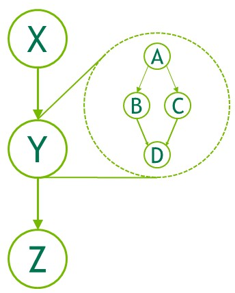

**图 24：子图示例。**

#### 4.2.1.2 边数据

CUDA 12.3 引入了 CUDA 图上的边数据。目前，非默认边数据的唯一用途是启用程序化依赖启动。

一般来说，边数据修改由边指定的依赖关系，由三部分组成：出端口、入端口与类型。出端口指定关联边何时被触发。入端口指定节点的哪一部分依赖于关联边。类型修改端点之间的关系。

端口值特定于节点类型与方向，边类型可能限于特定节点类型。在所有情况下，零初始化的边数据表示默认行为。出端口 0 等待整个任务，入端口 0 阻塞整个任务，边类型 0 关联完全依赖与内存同步行为。

边数据在各种图 API 中通过与被关联节点平行的数组可选地指定。如果作为输入参数省略，则使用零初始化数据。如果作为输出（查询）参数省略，若被忽略的边数据全部为零初始化，则 API 接受；如果调用会丢弃信息，则返回 `cudaErrorLossyQuery`。

边数据在某些流捕获 API 中也可用：`cudaStreamBeginCaptureToGraph()`、`cudaStreamGetCaptureInfo()` 与 `cudaStreamUpdateCaptureDependencies()`。在这些情况下，尚无下游节点。数据与一条悬空边（半边）关联，该边要么连接到未来捕获的节点，要么在流捕获终止时被丢弃。

注意某些边类型不等待上游节点的完全完成。在考虑流捕获是否已完全重新汇合到源流时，这些边会被忽略，并且不能在捕获结束时丢弃。参见“流捕获”。

没有节点类型定义额外的入端口，只有内核节点定义额外的出端口。有一种非默认依赖类型 `cudaGraphDependencyTypeProgrammatic`，用于在两个内核节点之间启用程序化依赖启动。

### 4.2.2 构建与运行图

使用图提交工作分为三个不同阶段：定义、实例化与执行。

- 在定义或创建阶段，程序创建图中操作的描述以及它们之间的依赖关系。
- 实例化对图模板进行快照、验证它，并执行大部分设置与工作初始化，目的是最小化启动时需要做的事情。生成的实例称为可执行图。
- 可执行图可以像任何其他 CUDA 工作一样启动到流中。它可以启动任意多次而无需重复实例化。

#### 4.2.2.1 图创建

图可以通过两种机制创建：使用显式图 API 以及通过流捕获。

##### 4.2.2.1.1 图 API

以下是创建下图的一个示例（省略声明与其他样板代码）。注意使用 `cudaGraphCreate()` 创建图，使用 `cudaGraphAddNode()` 添加内核节点及其依赖关系。CUDA Runtime API 文档列出了所有可用于添加节点与依赖关系的函数。

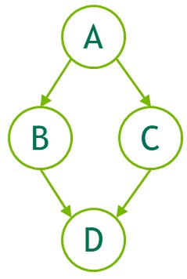

**图 25：使用图 API 创建图的示例。**

```cpp
// 创建图——它一开始是空的
cudaGraphCreate(&graph, 0);

// 创建节点及其依赖关系
cudaGraphNode_t nodes[4];
cudaGraphNodeParams kParams = { cudaGraphNodeTypeKernel };
kParams.kernel.func = (void *)kernelName;
kParams.kernel.gridDim.x = kParams.kernel.gridDim.y = kParams.kernel.gridDim.z = 1;
kParams.kernel.blockDim.x = kParams.kernel.blockDim.y = kParams.kernel.blockDim.z = 1;
cudaGraphAddNode(&nodes[0], graph, NULL, NULL, 0, &kParams);
cudaGraphAddNode(&nodes[1], graph, &nodes[0], NULL, 1, &kParams);
cudaGraphAddNode(&nodes[2], graph, &nodes[0], NULL, 1, &kParams);
cudaGraphAddNode(&nodes[3], graph, &nodes[1], NULL, 2, &kParams);
```

上面的示例展示了四个内核节点及其之间的依赖关系，以说明创建一个非常简单的图。典型应用还会包含为内存操作添加的节点，例如 memcpy 与 memset。关于添加节点的所有图 API 函数的完整参考，参见 CUDA Runtime API 文档。

> **注意**
>
> CUDA 图 API 最初为添加每种不同类型的节点分别提供 API 函数。例如 `cudaGraphAddKernelNode()` 或 `cudaGraphAddMemcpyNode()`。这些 API 已被单个多态的 `cudaGraphAddNode()` 取代，它使用节点参数的 `.type` 字段来确定正在添加的节点类型。非多态 API 将在未来弃用。`cudaGraphAddNode()` 是使用 CUDA 图 API 向图添加节点的推荐方式。

##### 4.2.2.1.2 流捕获

流捕获提供了一种从现有基于流的 API 创建图的机制。一段将工作启动到流中的代码（包括现有代码）可以用对 `cudaStreamBeginCapture()` 与 `cudaStreamEndCapture()` 的调用来包围。如下所示。

```cpp
cudaGraph_t graph;
cudaStreamBeginCapture(stream);
kernel_A<<< ..., stream >>>(...);
kernel_B<<< ..., stream >>>(...);
libraryCall(stream);
kernel_C<<< ..., stream >>>(...);
cudaStreamEndCapture(stream, &graph);
```

对 `cudaStreamBeginCapture()` 的调用将流置于捕获模式。当流正在被捕获时，启动到流中的工作不会入队执行，而是追加到一个逐步构建的内部图。然后通过调用 `cudaStreamEndCapture()` 返回该图，它同时结束该流的捕获模式。正在通过流捕获主动构建的图称为捕获图（capture graph）。

流捕获可用于除 `cudaStreamLegacy`（“NULL 流”）之外的任何 CUDA 流。注意它可用于 `cudaStreamPerThread`。如果程序正在使用传统流，可能可以在不改变功能的情况下将流 0 重新定义为每线程流。参见“阻塞与非阻塞流以及默认流”。

可以使用 `cudaStreamIsCapturing()` 查询流是否正在被捕获。

可以使用 `cudaStreamBeginCaptureToGraph()` 将工作捕获到现有图。工作不是捕获到内部图，而是捕获到用户提供的图。

###### 4.2.2.1.2.1 跨流依赖与事件

流捕获可以处理用 `cudaEventRecord()` 与 `cudaStreamWaitEvent()` 表达的跨流依赖，前提是所等待的事件被记录到同一捕获图中。

当在处于捕获模式的流中记录事件时，会产生一个捕获事件。捕获事件表示捕获图中的一组节点。

当流等待一个捕获事件时，如果该流尚未处于捕获模式，则将其置于捕获模式，并且流中的下一个项将额外依赖于捕获事件中的节点。然后两个流都被捕获到同一捕获图中。

当流捕获中存在跨流依赖时，仍必须在调用 `cudaStreamBeginCapture()` 的同一流（即源流）中调用 `cudaStreamEndCapture()`。由于基于事件的依赖关系而正在被捕获到同一捕获图中的任何其他流，也必须重新汇合到源流。如下所示。所有被捕获到同一捕获图中的流在 `cudaStreamEndCapture()` 时都会退出捕获模式。未能重新汇合到源流将导致整个捕获操作失败。

```cpp
// stream1 是源流
cudaStreamBeginCapture(stream1);
kernel_A<<< ..., stream1 >>>(...);

// 分叉到 stream2
cudaEventRecord(event1, stream1);
cudaStreamWaitEvent(stream2, event1);

kernel_B<<< ..., stream1 >>>(...);
kernel_C<<< ..., stream2 >>>(...);

// 将 stream2 汇合回源流（stream1）
cudaEventRecord(event2, stream2);
cudaStreamWaitEvent(stream1, event2);

kernel_D<<< ..., stream1 >>>(...);

// 在源流中结束捕获
cudaStreamEndCapture(stream1, &graph);
// stream1 与 stream2 不再处于捕获模式
```

上述代码返回的图如图 25 所示。

> **注意**
>
> 当流退出捕获模式时，流中的下一个非捕获项（如果有）仍将依赖于最近的先前非捕获项，尽管中间项已被移除。

###### 4.2.2.1.2.2 禁止与未处理的操作

同步或查询正在被捕获的流或捕获事件的执行状态是无效的，因为它们不代表计划执行的项目。查询或同步涵盖活动流捕获的更广泛句柄也是无效的，例如当任何关联流处于捕获模式时查询设备或上下文句柄。

当同一上下文中的任何流正在被捕获，且它不是用 `cudaStreamNonBlocking` 创建时，任何尝试使用传统流都是无效的。这是因为传统流句柄始终涵盖这些其他流；入队到传统流会创建对正在被捕获流的依赖，而查询或同步它会查询或同步正在被捕获的流。

因此，在这种情况下调用同步 API 也是无效的。同步 API 的一个示例是 `cudaMemcpy()`，它将工作入队到传统流并在返回前同步它。

> **注意**
>
> 作为一般规则，当依赖关系会将已捕获的内容与未捕获而是入队执行的内容连接起来时，CUDA 更倾向于返回错误而不是忽略依赖关系。将流置于或退出捕获模式是例外；这会切断在模式转换前后立即添加到流中的项之间的依赖关系。

通过等待来自正在被捕获且与事件关联的捕获图不同的流中的捕获事件来合并两个单独的捕获图是无效的。在不指定 `cudaEventWaitExternal` 标志的情况下，等待来自正在被捕获的流中的非捕获事件是无效的。

少数将异步操作入队到流中的 API 目前在图 中不受支持，如果使用正在被捕获的流调用将返回错误，例如 `cudaStreamAttachMemAsync()`。

###### 4.2.2.1.2.3 失效

当在流捕获期间尝试无效操作时，任何关联的捕获图都会失效。当捕获图失效时，对任何正在被捕获的流或与该图关联的捕获事件的进一步使用都是无效的，并将返回错误，直到流捕获通过 `cudaStreamEndCapture()` 结束。该调用将使关联流退出捕获模式，但也会返回错误值与 NULL 图。

###### 4.2.2.1.2.4 捕获内省

可以使用 `cudaStreamGetCaptureInfo()` 检查活动的流捕获操作。这允许用户获得捕获的状态、捕获的唯一（每进程）ID、底层图对象，以及流中下一个要捕获节点的依赖关系/边数据。此依赖信息可用于获得流中最后捕获节点的句柄。

##### 4.2.2.1.3 综合示例

图 25 中的示例是一个简化示例，旨在从概念上展示一个小图。在使用 CUDA 图的应用中，使用图 API 或流捕获都有更多复杂性。下面的代码片段并排比较了使用图 API 与流捕获创建 CUDA 图以执行一个简单的两阶段归约算法。

图 26 是该 CUDA 图的图示，它使用 `cudaGraphDebugDotPrint` 函数应用于下面的代码生成（为可读性做了小幅调整），然后使用 Graphviz 渲染。

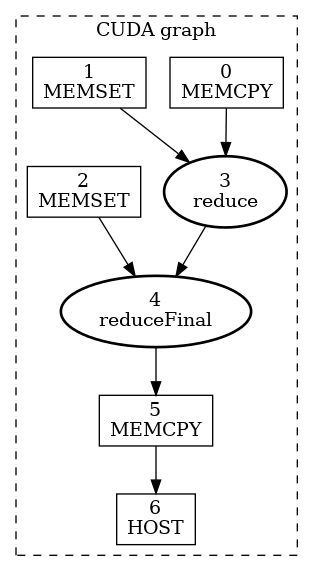

**图 26：使用两阶段归约内核的 CUDA 图示例。**

**图 API**

```cpp
void cudaGraphsManual(float   *inputVec_h,
                      float   *inputVec_d,
                      double  *outputVec_d,
                      double  *result_d,
                      size_t   inputSize,
                      size_t   numOfBlocks)
{
    cudaStream_t streamForGraph;
    cudaGraph_t  graph;
    std::vector<cudaGraphNode_t> nodeDependencies;
    cudaGraphNode_t memcpyNode, kernelNode;
    double result_h = 0.0;
    cudaStreamCreate(&streamForGraph);

    // cudaGraphAddNode 是统一的节点创建 API：每种节点类型一次调用，
    // 由 cudaGraphNodeParams 结构驱动（一个 .type 标签 + 按类型参数的联合体）。
    // 它取代了此前使用的 cudaGraphAddMemcpyNode/cudaGraphAddKernelNode 调用。
    // 该结构有必须为零的保留字段，因此下面每个节点之前都通过 "= {}" 重新置零。
    cudaGraphNodeParams nodeParams = {};

    cudaMemcpy3DParms memcpyParams = {0};
    memcpyParams.srcArray = NULL;
    memcpyParams.srcPos   = make_cudaPos(0, 0, 0);
    memcpyParams.srcPtr   = make_cudaPitchedPtr(inputVec_h, sizeof(float) * inputSize, inputSize, 1);
    memcpyParams.dstArray = NULL;
    memcpyParams.dstPos   = make_cudaPos(0, 0, 0);
    memcpyParams.dstPtr   = make_cudaPitchedPtr(inputVec_d, sizeof(float) * inputSize, inputSize, 1);
    memcpyParams.extent   = make_cudaExtent(sizeof(float) * inputSize, 1, 1);
    memcpyParams.kind     = cudaMemcpyHostToDevice;

    // 创建一个空图；节点与边将在下面添加。
    cudaGraphCreate(&graph, 0);

    // 节点 1：H2D memcpy——没有依赖（NULL, 0），因此可以立即开始。
    // 对于 memcpy 节点，cudaMemcpy3DParms 放入 nodeParams.memcpy.copyParams
    //（.memcpy 联合成员是一个包装结构，因此复制描述符嵌套更深一层）。
    nodeParams = {};
    nodeParams.type = cudaGraphNodeTypeMemcpy;
    nodeParams.memcpy.copyParams = memcpyParams;
    cudaGraphAddNode(&memcpyNode, graph, NULL /*dependencyData=*/, NULL, 0, &nodeParams);

    // 使下一个节点等待此 memcpy 完成后再开始。
    nodeDependencies.push_back(memcpyNode);

    void *kernelArgs[4] = {(void *)&inputVec_d, (void *)&outputVec_d, &inputSize, &numOfBlocks};

    // 节点 2：第一个归约内核——依赖于 H2D memcpy 完成。
    // 内核参数直接设置在 .kernel 联合成员上。
    nodeParams = {};
    nodeParams.type = cudaGraphNodeTypeKernel;
    nodeParams.kernel.func = (void *)reduce;
    nodeParams.kernel.gridDim  = dim3(numOfBlocks, 1, 1);
    nodeParams.kernel.blockDim = dim3(THREADS_PER_BLOCK, 1, 1);
    nodeParams.kernel.sharedMemBytes = 0;
    nodeParams.kernel.kernelParams   = (void **)kernelArgs;
    nodeParams.kernel.extra = NULL;
    cudaGraphAddNode(&kernelNode, graph, nodeDependencies.data(),
                     NULL /*dependencyData=*/, nodeDependencies.size(), &nodeParams);

    // 向前移动依赖：下一个节点等待此内核。
    nodeDependencies.clear();
    nodeDependencies.push_back(kernelNode);

    void *kernelArgs2[3] = {(void *)&outputVec_d, (void *)&result_d, &numOfBlocks};

    // 节点 3：最终归约内核——依赖于节点 2。
    nodeParams = {};
    nodeParams.type = cudaGraphNodeTypeKernel;
    nodeParams.kernel.func = (void *)reduceFinal;
    nodeParams.kernel.gridDim  = dim3(1, 1, 1);
    nodeParams.kernel.blockDim = dim3(THREADS_PER_BLOCK, 1, 1);
    nodeParams.kernel.sharedMemBytes = 0;
    nodeParams.kernel.kernelParams   = kernelArgs2;
    nodeParams.kernel.extra = NULL;
    cudaGraphAddNode(&kernelNode, graph, nodeDependencies.data(),
                     NULL /*dependencyData=*/, nodeDependencies.size(), &nodeParams);

    nodeDependencies.clear();
    nodeDependencies.push_back(kernelNode);

    memset(&memcpyParams, 0, sizeof(memcpyParams));
    memcpyParams.srcArray = NULL;
    memcpyParams.srcPos   = make_cudaPos(0, 0, 0);
    memcpyParams.srcPtr   = make_cudaPitchedPtr(result_d, sizeof(double), 1, 1);
    memcpyParams.dstArray = NULL;
    memcpyParams.dstPos   = make_cudaPos(0, 0, 0);
    memcpyParams.dstPtr   = make_cudaPitchedPtr(&result_h, sizeof(double), 1, 1);
    memcpyParams.extent   = make_cudaExtent(sizeof(double), 1, 1);
    memcpyParams.kind     = cudaMemcpyDeviceToHost;

    // 节点 4：D2H memcpy——将标量结果复制回主机。
    // 复制描述符同样嵌套在 nodeParams.memcpy.copyParams 中。
    nodeParams = {};
    nodeParams.type = cudaGraphNodeTypeMemcpy;
    nodeParams.memcpy.copyParams = memcpyParams;
    cudaGraphAddNode(&memcpyNode, graph, nodeDependencies.data(),
                     NULL /*dependencyData=*/, nodeDependencies.size(), &nodeParams);
    nodeDependencies.clear();
    nodeDependencies.push_back(memcpyNode);

    cudaGraphNode_t hostNode;
    callBackData_t hostFnData;
    hostFnData.data    = &result_h;
    hostFnData.fn_name = "cudaGraphsManual";

    // 节点 5：主机回调——在 D2H 复制完成后于 CPU 上运行。
    // .host 成员是 cudaHostNodeParamsV2（fn + userData，外加一个 syncMode 字段，
    // 由上面的零初始化保持为 0）。
    nodeParams = {};
    nodeParams.type = cudaGraphNodeTypeHost;
    nodeParams.host.fn       = myHostNodeCallback;
    nodeParams.host.userData = &hostFnData;
    cudaGraphAddNode(&hostNode, graph, nodeDependencies.data(),
                     NULL /*dependencyData=*/, nodeDependencies.size(), &nodeParams);

    size_t numNodes = 0;
    cudaGraphGetNodes(graph, NULL, &numNodes);
    printf("Graph node count: %zu\n", numNodes);

    // 实例化：将图编译为可执行形式（一次性开销）。
    // CUDA 在此优化调度；重复启动复用这一结果。
    cudaGraphExec_t graphExec;
    cudaGraphInstantiate(&graphExec, graph, NULL, NULL, 0);

    // 演示 cudaGraphCloned——在实践中，当多个 CPU 线程需要并发启动
    // 同一个图、各自拥有独立 graphExec 时，克隆很有用。
    cudaGraph_t clonedGraph;
    cudaGraphExec_t clonedGraphExec;
    cudaGraphClone(&clonedGraph, graph);
    cudaGraphInstantiate(&clonedGraphExec, clonedGraph, NULL, NULL, 0);

    // 每次启动前重新填充主机输入，使图的 H2D 复制每次处理新数据
    //——一个已实例化的图被复用于不同数据。
    // 每次迭代后的同步确保复制在我们覆盖缓冲区之前完成。
    for (int i = 0; i < GRAPH_LAUNCH_ITERATIONS; i++) {
        init_input(inputVec_h, inputSize);
        cudaGraphLaunch(graphExec, streamForGraph);
        cudaStreamSynchronize(streamForGraph);
    }

    printf("\nCloned graph:\n");
    for (int i = 0; i < GRAPH_LAUNCH_ITERATIONS; i++) {
        init_input(inputVec_h, inputSize);
        cudaGraphLaunch(clonedGraphExec, streamForGraph);
        cudaStreamSynchronize(streamForGraph);
    }

    cudaGraphExecDestroy(graphExec);
    cudaGraphExecDestroy(clonedGraphExec);
    cudaGraphDestroy(graph);
    cudaGraphDestroy(clonedGraph);
    cudaStreamDestroy(streamForGraph);
}
```

**流捕获**

```cpp
void cudaGraphsUsingStreamCapture(float   *inputVec_h,
                                  float   *inputVec_d,
                                  double  *outputVec_d,
                                  double  *result_d,
                                  size_t   inputSize,
                                  size_t   numOfBlocks)
{
    cudaStream_t stream1, streamForGraph;
    cudaGraph_t  graph;
    double result_h = 0.0;
    cudaStreamCreate(&stream1);
    cudaStreamCreate(&streamForGraph);

    // 开始捕获：发出到 stream1 的操作被记录，而不执行。
    cudaStreamBeginCapture(stream1, cudaStreamCaptureModeGlobal);

    cudaMemcpyAsync(inputVec_d, inputVec_h, sizeof(float) * inputSize, cudaMemcpyDefault, stream1);
    reduce<<<numOfBlocks, THREADS_PER_BLOCK, 0, stream1>>>(inputVec_d, outputVec_d, inputSize, numOfBlocks);
    reduceFinal<<<1, THREADS_PER_BLOCK, 0, stream1>>>(outputVec_d, result_d, numOfBlocks);
    cudaMemcpyAsync(&result_h, result_d, sizeof(double), cudaMemcpyDefault, stream1);

    callBackData_t hostFnData = {0};
    hostFnData.data    = &result_h;
    hostFnData.fn_name = "cudaGraphsUsingStreamCapture";
    cudaLaunchHostFunc(stream1, myHostNodeCallback, &hostFnData);

    // 结束捕获：运行时根据上面记录的所有内容构建图。
    // 生成的图在结构上与手动构建的图完全相同。
    cudaStreamEndCapture(stream1, &graph);

    size_t numNodes = 0;
    cudaGraphGetNodes(graph, NULL, &numNodes);
    printf("Graph node count: %zu\n", numNodes);

    // 将捕获的图实例化为可执行形式。
    cudaGraphExec_t graphExec;
    cudaGraphInstantiate(&graphExec, graph, NULL, NULL, 0);

    // 演示 cudaGraphClone。
    cudaGraph_t clonedGraph;
    cudaGraphExec_t clonedGraphExec;
    cudaGraphClone(&clonedGraph, graph);
    cudaGraphInstantiate(&clonedGraphExec, clonedGraph, NULL, NULL, 0);

    for (int i = 0; i < GRAPH_LAUNCH_ITERATIONS; i++) {
        init_input(inputVec_h, inputSize);
        cudaGraphLaunch(graphExec, streamForGraph);
        cudaStreamSynchronize(streamForGraph);
    }

    printf("\nCloned graph:\n");
    for (int i = 0; i < GRAPH_LAUNCH_ITERATIONS; i++) {
        init_input(inputVec_h, inputSize);
        cudaGraphLaunch(clonedGraphExec, streamForGraph);
        cudaStreamSynchronize(streamForGraph);
    }

    cudaGraphExecDestroy(graphExec);
    cudaGraphExecDestroy(clonedGraphExec);
    cudaGraphDestroy(graph);
    cudaGraphDestroy(clonedGraph);
    cudaStreamDestroy(stream1);
    cudaStreamDestroy(streamForGraph);
}
```

#### 4.2.2.2 图实例化

图创建之后（无论通过图 API 还是流捕获），必须实例化以创建可执行图，然后才能启动。假设 `cudaGraph_t graph` 已成功创建，以下代码将实例化图并创建可执行图 `cudaGraphExec_t graphExec`：

```cpp
cudaGraphExec_t graphExec;
cudaGraphInstantiate(&graphExec, graph, 0);
```

#### 4.2.2.3 图执行

图创建并实例化为可执行图之后，就可以启动。假设 `cudaGraphExec_t graphExec` 已成功创建，以下代码片段将图启动到指定流：

```cpp
cudaGraphLaunch(graphExec, stream);
```

综合起来，使用 4.2.2.1.2 节的流捕获示例，以下代码片段将创建图、实例化它并启动它：

```cpp
cudaGraph_t graph;
cudaStreamBeginCapture(stream);
kernel_A<<< ..., stream >>>(...);
kernel_B<<< ..., stream >>>(...);
libraryCall(stream);
kernel_C<<< ..., stream >>>(...);
cudaStreamEndCapture(stream, &graph);

cudaGraphExec_t graphExec;
cudaGraphInstantiate(&graphExec, graph, 0);
cudaGraphLaunch(graphExec, stream);
```

### 4.2.3 更新已实例化的图

当工作流改变时，图会过时，必须修改。图结构的重大变化（例如拓扑或节点类型）需要重新实例化，因为必须重新应用与拓扑相关的优化。然而，常见情况是只有节点参数（例如内核参数与内存地址）改变，而图拓扑保持不变。对于这种情况，CUDA 提供一种轻量级的“图更新”（Graph Update）机制，允许就地修改某些节点参数而无需重建整个图，这比重新实例化高效得多。

更新在下次启动图时生效，因此它们不影响先前的图启动，即使更新时这些启动正在运行。图可以反复更新与重新启动，因此可以在流上排队多个更新/启动。

CUDA 提供两种更新已实例化图参数的机制：整图更新与单节点更新。整图更新允许用户提供一个拓扑相同的 `cudaGraph_t` 对象，其节点包含更新后的参数。单节点更新允许用户显式更新各个节点的参数。当大量节点被更新，或调用者不知道图拓扑时（即图来自库调用的流捕获），使用更新后的 `cudaGraph_t` 更方便。当更改数量少且用户拥有需要更新的节点的句柄时，优先使用单节点更新。单节点更新跳过拓扑检查与未更改节点的比较，因此在许多情况下更高效。

CUDA 还提供一种启用与禁用各个节点而不影响其当前参数的机制。

以下各节更详细地解释每种方法。

#### 4.2.3.1 整图更新

`cudaGraphExecUpdate()` 允许使用拓扑相同图（“更新”图）的参数更新已实例化的图（“原始”图）。更新图的拓扑必须与用于实例化 `cudaGraphExec_t` 的原始图完全相同。此外，指定依赖关系的顺序必须匹配。最后，CUDA 需要一致地排序汇节点（没有依赖的节点）。CUDA 依赖特定 API 调用的顺序来实现一致的汇节点排序。

更明确地说，遵循以下规则将使 `cudaGraphExecUpdate()` 确定性地配对原始图与更新图中的节点：

1. 对于任何捕获流，在该流上操作的 API 调用必须以相同顺序进行，包括事件等待以及不直接对应节点创建的其他 API 调用。
2. 直接操作给定图节点入边的 API 调用（包括捕获流 API、节点添加 API 以及边添加/移除 API）必须以相同顺序进行。此外，当在这些 API 的数组中指定依赖关系时，这些数组内依赖关系的指定顺序必须匹配。
3. 汇节点必须一致排序。汇节点是在调用 `cudaGraphExecUpdate()` 时最终图中没有依赖节点/出边的节点。以下操作影响汇节点排序（如果存在），并且必须（作为组合集合）以相同顺序进行：
   - 产生汇节点的节点添加 API。
   - 使节点成为汇节点的边移除。
   - `cudaStreamUpdateCaptureDependencies()`，如果它从捕获流的依赖集合中移除汇节点。
   - `cudaStreamEndCapture()`。

下面的示例展示了如何使用该 API 更新已实例化的图：

```cpp
cudaGraphExec_t graphExec = NULL;

for (int i = 0; i < 10; i++) {
    cudaGraph_t graph;
    cudaGraphExecUpdateResult updateResult;
    cudaGraphNode_t errorNode;

    // 在此示例中我们使用流捕获创建图。
    // 你也可以使用图 API 生成图。
    cudaStreamBeginCapture(stream, cudaStreamCaptureModeGlobal);

    // 调用用户定义的、基于流的工作负载，例如
    do_cuda_work(stream);

    cudaStreamEndCapture(stream, &graph);

    // 如果我们已经实例化了图，尝试直接更新它并避免实例化开销
    if (graphExec != NULL) {
        // 如果图更新失败，errorNode 将被设为导致失败的节点，
        // 而 updateResult 将被设为原因码。
        cudaGraphExecUpdate(graphExec, graph, &errorNode, &updateResult);
    }

    // 在第一次迭代期间或每当更新因任何原因失败时进行实例化
    if (graphExec == NULL || updateResult != cudaGraphExecUpdateSuccess) {
        // 如果先前的更新失败，在重新实例化之前销毁 cudaGraphExec_t
        if (graphExec != NULL) {
            cudaGraphExecDestroy(graphExec);
        }
        // 从 graph 实例化 graphExec。此处未使用错误节点与错误消息参数。
        cudaGraphInstantiate(&graphExec, graph, 0);
    }

    cudaGraphDestroy(graph);
    cudaGraphLaunch(graphExec, stream);
    cudaStreamSynchronize(stream);
}
```

典型工作流是使用流捕获或图 API 创建初始 `cudaGraph_t`，然后正常实例化并启动它。首次启动后，使用与初始图相同的方法创建新的 `cudaGraph_t`，并调用 `cudaGraphExecUpdate()`。如果图更新成功（由上面示例中的 `updateResult` 参数指示），则启动更新后的 `cudaGraphExec_t`。如果更新因任何原因失败，则调用 `cudaGraphExecDestroy()` 与 `cudaGraphInstantiate()` 销毁原始 `cudaGraphExec_t` 并实例化新的。

也可以直接更新 `cudaGraph_t` 节点（即使用 `cudaGraphKernelNodeSetParams()`），随后更新 `cudaGraphExec_t`，但使用下一节介绍的显式节点更新 API 更高效。

条件句柄标志与默认值作为图更新的一部分被更新。

关于用法与当前限制的更多信息，请参见图 API。

#### 4.2.3.2 单节点更新

已实例化图的节点参数可以直接更新。这消除了实例化的开销以及创建新 `cudaGraph_t` 的开销。如果相对于图中节点总数而言需要更新的节点数量较少，则最好单独更新节点。以下方法可用于更新 `cudaGraphExec_t` 节点：

**表 8：单节点更新 API**

| API | 节点类型 |
|---|---|
| `cudaGraphExecKernelNodeSetParams()` | 内核节点 |
| `cudaGraphExecMemcpyNodeSetParams()` | 内存复制节点 |
| `cudaGraphExecMemsetNodeSetParams()` | 内存设置节点 |
| `cudaGraphExecHostNodeSetParams()` | 主机节点 |
| `cudaGraphExecChildGraphNodeSetParams()` | 子图节点 |
| `cudaGraphExecEventRecordNodeSetEvent()` | 事件记录节点 |
| `cudaGraphExecEventWaitNodeSetEvent()` | 事件等待节点 |
| `cudaGraphExecExternalSemaphoresSignalNodeSetParams()` | 外部信号量信号节点 |
| `cudaGraphExecExternalSemaphoresWaitNodeSetParams()` | 外部信号量等待节点 |

关于用法与当前限制的更多信息，请参见图 API。

#### 4.2.3.3 单节点启用

已实例化图中的内核、memset 与 memcpy 节点可以使用 `cudaGraphNodeSetEnabled()` API 启用或禁用。这允许创建一个包含所需功能超集的图，并可为每次启动进行定制。节点的启用状态可以使用 `cudaGraphNodeGetEnabled()` API 查询。

被禁用的节点在重新启用之前功能上等同于空节点。节点参数不受启用/禁用节点影响。启用状态不受单节点更新或使用 `cudaGraphExecUpdate()` 的整图更新影响。节点被禁用期间的参数更新将在节点重新启用时生效。

关于用法与当前限制的更多信息，请参见图 API。

#### 4.2.3.4 图更新限制

内核节点：

- 函数的所属上下文不能改变。
- 其函数最初不使用 CUDA 动态并行的节点不能更新为使用 CUDA 动态并行的函数。

`cudaMemset` 与 `cudaMemcpy` 节点：

- 操作数所分配/映射到的 CUDA 设备不能改变。
- 源/目标内存必须从与原始源/目标内存相同的上下文分配。
- 只能更改一维 `cudaMemset`/`cudaMemcpy` 节点。

额外的 memcpy 节点限制：

- 不支持更改源或目标内存类型（即 `cudaPitchedPtr`、`cudaArray_t` 等），或传输类型（即 `cudaMemcpyKind`）。

外部信号量等待节点与记录节点：

- 不支持更改信号量数量。

条件节点：

- 句柄创建与赋值的顺序必须在图之间匹配。
- 不支持更改节点参数（即条件中的图数量、节点上下文等）。
- 更改条件体图内节点的参数受上述规则约束。

内存节点：

- 如果 `cudaGraph_t` 当前被实例化为不同的 `cudaGraphExec_t`，则不能用该 `cudaGraph_t` 更新某个 `cudaGraphExec_t`。

对主机节点、事件记录节点或事件等待节点的更新没有限制。

### 4.2.4 条件图节点

条件节点允许对条件节点内包含的图进行条件执行与循环。这使动态与迭代工作流能够完全在图内表示，并释放主机 CPU 以并行执行其他工作。

条件值的求值在条件节点的依赖关系满足时在设备上执行。条件节点可以是以下类型之一：

- 条件 IF 节点：当节点执行时条件值非零，则执行其体图一次。可以提供可选的第二个体图，当节点执行时条件值为零时执行一次。
- 条件 WHILE 节点：当节点执行时条件值非零，则执行其体图，并将继续执行其体图直到条件值为零。
- 条件 SWITCH 节点：当条件值等于 n 时，执行从零开始索引的第 n 个体图一次。如果条件值不对应任何体图，则不启动任何体图。

条件值通过条件句柄（conditional handle）访问，该句柄必须在节点之前创建。条件值可以由设备代码使用 `cudaGraphSetConditional()` 设置。在创建句柄时还可以指定一个默认值，在每个图启动时应用。

创建条件节点时，会创建一个空图，并将句柄返回给用户，以便填充该图。此条件体图可以使用图 API 或 `cudaStreamBeginCaptureToGraph()` 填充。

条件节点可以嵌套。

#### 4.2.4.1 条件句柄

条件值由 `cudaGraphConditionalHandle` 表示，由 `cudaGraphConditionalHandleCreate()` 创建。

句柄必须与单个条件节点关联。句柄不能被销毁，因此无需跟踪它们。

如果在创建句柄时指定了 `cudaGraphCondAssignDefault`，则条件值将在每次图执行开始时初始化为指定的默认值。如果未提供此标志，则条件值在每次图执行开始时未定义，代码不应假定条件值在多次执行之间保持不变。

句柄关联的默认值与标志将在整图更新期间被更新。

#### 4.2.4.2 条件节点体图要求

一般要求：

- 图的节点必须全部位于单个设备上。
- 图只能包含内核节点、空节点、memcpy 节点、memset 节点、子图节点与条件节点。

内核节点：

- 不允许图中的内核使用 CUDA 动态并行或设备图启动。
- 只要不使用 MPS，允许协作启动。

Memcpy/Memset 节点：

- 只允许涉及设备内存和/或固定设备映射主机内存的复制/内存设置。
- 不允许涉及 CUDA 数组的复制/内存设置。
- 在实例化时两个操作数都必须可从当前设备访问。注意复制操作将从图所在的设备执行，即使它针对另一设备上的内存。

#### 4.2.4.3 条件 IF 节点

当节点执行时条件非零，IF 节点的体图将执行一次。下图描绘了一个 3 节点图，其中中间节点 B 是条件节点：

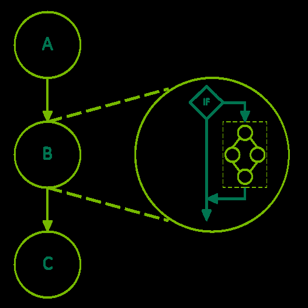

**图 27：条件 IF 节点。**

以下代码说明创建包含 IF 条件节点的图。条件的默认值使用上游内核设置。条件体使用图 API 填充。

```cpp
__global__ void setHandle(cudaGraphConditionalHandle handle, int value)
{
    ...
    // 将条件值设为传给内核的值
    cudaGraphSetConditional(handle, value);
    ...
}

void graphSetup() {
    cudaGraph_t graph;
    cudaGraphExec_t graphExec;
    cudaGraphNode_t node;
    void *kernelArgs[2];
    int value = 1;

    // 创建图
    cudaGraphCreate(&graph, 0);

    // 创建条件句柄；由于未提供默认值，条件值在每次图执行开始时未定义
    cudaGraphConditionalHandle handle;
    cudaGraphConditionalHandleCreate(&handle, graph);

    // 使用条件上游的内核设置句柄值
    cudaGraphNodeParams params = { cudaGraphNodeTypeKernel };
    params.kernel.func = (void *)setHandle;
    params.kernel.gridDim.x = params.kernel.gridDim.y = params.kernel.gridDim.z = 1;
    params.kernel.blockDim.x = params.kernel.blockDim.y = params.kernel.blockDim.z = 1;
    params.kernel.kernelParams = kernelArgs;
    kernelArgs[0] = &handle;
    kernelArgs[1] = &value;
    cudaGraphAddNode(&node, graph, nullptr, nullptr, 0, &params);

    // 创建并添加条件节点
    cudaGraphNodeParams cParams = { cudaGraphNodeTypeConditional };
    cParams.conditional.handle = handle;
    cParams.conditional.type   = cudaGraphCondTypeIf;
    cParams.conditional.size   = 1;   // 只有一个 "if" 体图
    cudaGraphAddNode(&node, graph, &node, nullptr, 1, &cParams);

    // 获取条件节点的体图
    cudaGraph_t bodyGraph = cParams.conditional.phGraph_out[0];

    // 填充 IF 条件节点的体图
    ...
    cudaGraphAddNode(&node, bodyGraph, nullptr, nullptr, 0, &params);

    // 实例化并启动图
    cudaGraphInstantiate(&graphExec, graph, 0);
    cudaGraphLaunch(graphExec, 0);
    cudaDeviceSynchronize();

    // 清理
    cudaGraphExecDestroy(graphExec);
    cudaGraphDestroy(graph);
}
```

IF 节点还可以有可选的第二个体图，当节点执行时条件值为零时执行一次。

```cpp
void graphSetup() {
    cudaGraph_t graph;
    cudaGraphExec_t graphExec;
    cudaGraphNode_t node;
    void *kernelArgs[2];
    int value = 1;

    cudaGraphCreate(&graph, 0);

    cudaGraphConditionalHandle handle;
    cudaGraphConditionalHandleCreate(&handle, graph);

    cudaGraphNodeParams params = { cudaGraphNodeTypeKernel };
    params.kernel.func = (void *)setHandle;
    params.kernel.gridDim.x = params.kernel.gridDim.y = params.kernel.gridDim.z = 1;
    params.kernel.blockDim.x = params.kernel.blockDim.y = params.kernel.blockDim.z = 1;
    params.kernel.kernelParams = kernelArgs;
    kernelArgs[0] = &handle;
    kernelArgs[1] = &value;
    cudaGraphAddNode(&node, graph, nullptr, nullptr, 0, &params);

    // 创建并添加 IF 条件节点
    cudaGraphNodeParams cParams = { cudaGraphNodeTypeConditional };
    cParams.conditional.handle = handle;
    cParams.conditional.type   = cudaGraphCondTypeIf;
    cParams.conditional.size   = 2;   // 同时有 "if" 与 "else" 体图
    cudaGraphAddNode(&node, graph, &node, nullptr, 1, &cParams);

    // 获取条件节点的体图
    cudaGraph_t ifBodyGraph   = cParams.conditional.phGraph_out[0];
    cudaGraph_t elseBodyGraph = cParams.conditional.phGraph_out[1];

    // 填充 IF 条件节点的体图
    ...
    cudaGraphAddNode(&node, ifBodyGraph, nullptr, nullptr, 0, &params);
    ...
    cudaGraphAddNode(&node, elseBodyGraph, nullptr, nullptr, 0, &params);

    // 实例化并启动图
    cudaGraphInstantiate(&graphExec, graph, 0);
    cudaGraphLaunch(graphExec, 0);
    cudaDeviceSynchronize();
}
```

#### 4.2.4.4 条件 WHILE 节点

只要条件非零，WHILE 节点的体图就会执行。条件在节点执行时以及体图完成后求值。下图描绘了一个 3 节点图，其中中间节点 B 是条件节点：

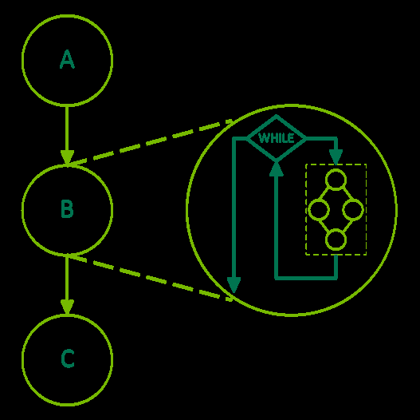

**图 28：条件 WHILE 节点。**

以下代码说明创建包含 WHILE 条件节点的图。句柄使用 `cudaGraphCondAssignDefault` 创建，以避免需要上游内核。条件体使用图 API 填充。

```cpp
__global__ void loopKernel(cudaGraphConditionalHandle handle, char *dPtr)
{
    // 递减 dPtr 的值，并在 dPtr 为 0 时将条件值设为 0
    if (--(*dPtr) == 0) {
        cudaGraphSetConditional(handle, 0);
    }
}

void graphSetup() {
    cudaGraph_t graph;
    cudaGraphExec_t graphExec;
    cudaGraphNode_t node;
    void *kernelArgs[2];
    // 分配一字节设备内存用作输入
    char *dPtr;
    cudaMalloc((void **)&dPtr, 1);

    cudaGraphCreate(&graph, 0);

    // 创建默认值为 1 的条件句柄
    cudaGraphConditionalHandle handle;
    cudaGraphConditionalHandleCreate(&handle, graph, 1, cudaGraphCondAssignDefault);

    // 创建并添加 WHILE 条件节点
    cudaGraphNodeParams cParams = { cudaGraphNodeTypeConditional };
    cParams.conditional.handle = handle;
    cParams.conditional.type   = cudaGraphCondTypeWhile;
    cParams.conditional.size   = 1;
    cudaGraphAddNode(&node, graph, nullptr, nullptr, 0, &cParams);

    // 获取条件节点的体图
    cudaGraph_t bodyGraph = cParams.conditional.phGraph_out[0];

    // 填充条件节点的体图
    cudaGraphNodeParams params = { cudaGraphNodeTypeKernel };
    params.kernel.func = (void *)loopKernel;
    params.kernel.gridDim.x = params.kernel.gridDim.y = params.kernel.gridDim.z = 1;
    params.kernel.blockDim.x = params.kernel.blockDim.y = params.kernel.blockDim.z = 1;
    params.kernel.kernelParams = kernelArgs;
    kernelArgs[0] = &handle;
    kernelArgs[1] = &dPtr;
    cudaGraphAddNode(&node, bodyGraph, nullptr, nullptr, 0, &params);

    // 初始化设备内存、实例化并启动图
    cudaMemset(dPtr, 10, 1);   // 将 dPtr 设为 10；循环将运行直到 dPtr 为 0
    cudaGraphInstantiate(&graphExec, graph, 0);
    cudaGraphLaunch(graphExec, 0);
    cudaDeviceSynchronize();

    // 清理
    cudaGraphExecDestroy(graphExec);
    cudaGraphDestroy(graph);
    cudaFree(dPtr);
}
```

#### 4.2.4.5 条件 SWITCH 节点

当节点执行时条件等于 n，SWITCH 节点的从零开始索引的第 n 个体图将执行一次。下图描绘了一个 3 节点图，其中中间节点 B 是条件节点：

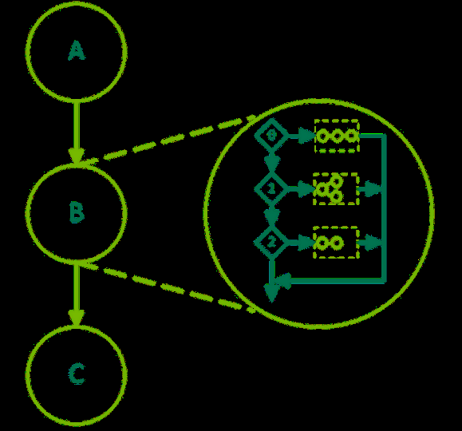

**图 29：条件 SWITCH 节点。**

以下代码说明创建包含 SWITCH 条件节点的图。条件值使用上游内核设置。条件体使用图 API 填充。

```cpp
__global__ void setHandle(cudaGraphConditionalHandle handle, int value)
{
    ...
    // 将条件值设为传给内核的值
    cudaGraphSetConditional(handle, value);
    ...
}

void graphSetup() {
    cudaGraph_t graph;
    cudaGraphExec_t graphExec;
    cudaGraphNode_t node;
    void *kernelArgs[2];
    int value = 1;

    cudaGraphCreate(&graph, 0);

    cudaGraphConditionalHandle handle;
    cudaGraphConditionalHandleCreate(&handle, graph);

    cudaGraphNodeParams params = { cudaGraphNodeTypeKernel };
    params.kernel.func = (void *)setHandle;
    params.kernel.gridDim.x = params.kernel.gridDim.y = params.kernel.gridDim.z = 1;
    params.kernel.blockDim.x = params.kernel.blockDim.y = params.kernel.blockDim.z = 1;
    params.kernel.kernelParams = kernelArgs;
    kernelArgs[0] = &handle;
    kernelArgs[1] = &value;
    cudaGraphAddNode(&node, graph, nullptr, nullptr, 0, &params);

    // 创建并添加条件 SWITCH 节点
    cudaGraphNodeParams cParams = { cudaGraphNodeTypeConditional };
    cParams.conditional.handle = handle;
    cParams.conditional.type   = cudaGraphCondTypeSwitch;
    cParams.conditional.size   = 5;
    cudaGraphAddNode(&node, graph, &node, nullptr, 1, &cParams);

    // 获取条件节点的体图
    cudaGraph_t *bodyGraphs = cParams.conditional.phGraph_out;

    // 填充 SWITCH 条件节点的体图
    ...
    cudaGraphAddNode(&node, bodyGraphs[0], nullptr, nullptr, 0, &params);
    ...
    cudaGraphAddNode(&node, bodyGraphs[4], NULL, 0, &params);

    // 实例化并启动图
    cudaGraphInstantiate(&graphExec, graph, 0);
    cudaGraphLaunch(graphExec, 0);
    cudaDeviceSynchronize();

    // 清理
    cudaGraphExecDestroy(graphExec);
    cudaGraphDestroy(graph);
}
```

### 4.2.5 图内存节点

#### 4.2.5.1 引言

图内存节点允许图创建并拥有内存分配。图内存节点具有 GPU 有序的生命周期语义，它决定了何时允许在设备上访问内存。这些 GPU 有序生命周期语义支持驱动管理的内存复用，并与流序分配 API `cudaMallocAsync` 和 `cudaFreeAsync` 的语义相匹配，这些 API 在创建图时可能被捕获。

图分配在图的生命周期内（包括重复实例化与启动）具有固定地址。这允许内存被图内的其他操作直接引用而无需图更新，即使 CUDA 更改了底层物理内存。在图内，图有序生命周期不重叠的分配可以使用相同的底层物理内存。

CUDA 可以跨多个图复用相同的物理内存用于分配，根据 GPU 有序生命周期语义对虚拟地址映射进行别名。例如，当不同的图被启动到同一流中时，CUDA 可以虚拟别名相同的物理内存，以满足具有单图生命周期的分配需求。

#### 4.2.5.2 API 基础

图内存节点是表示内存分配或释放操作的图节点。为简便起见，分配内存的节点称为分配节点（allocation node）。同样，释放内存的节点称为释放节点（free node）。由分配节点创建的分配称为图分配（graph allocation）。CUDA 在节点创建时为图分配分配虚拟地址。虽然这些虚拟地址在分配节点的生命周期内固定，但分配内容在释放操作之后不持久，可能被引用不同分配的访问覆盖。

每次图运行时，图分配被视为重新创建。图分配的生命周期（不同于节点的生命周期）在 GPU 执行到达分配图节点时开始，并在发生以下情况之一时结束：

- GPU 执行到达释放图节点
- GPU 执行到达释放 `cudaFreeAsync()` 流调用
- `cudaFree()` 释放调用立即发生

> **注意**
>
> 图销毁不会自动释放任何活动的图分配内存，尽管它结束了分配节点的生命周期。分配必须随后在另一个图中释放，或使用 `cudaFreeAsync()`/`cudaFree()` 释放。

与其他图结构一样，图内存节点在图内通过依赖边排序。程序必须保证访问图内存的操作：

- 排在分配节点之后
- 排在释放内存的操作之前

图分配生命周期根据 GPU 执行（而非 API 调用）开始并通常结束。GPU 顺序是工作在 GPU 上运行的顺序，而不是工作入队或描述的顺序。因此，图分配被视为“GPU 有序”。

##### 4.2.5.2.1 图节点 API

图内存节点可以使用节点创建 API `cudaGraphAddNode` 显式创建。添加 `cudaGraphNodeTypeMemAlloc` 节点时分配的地址，在传入的 `cudaGraphNodeParams` 结构的 `alloc::dptr` 字段中返回给用户。分配图内使用图分配的所有操作必须排在分配节点之后。类似地，任何释放节点必须排在图内对该分配的所有使用之后。释放节点使用 `cudaGraphAddNode` 以及节点类型 `cudaGraphNodeTypeMemFree` 创建。

在下图中，有一个包含分配节点与释放节点的示例图。内核节点 a、b 与 c 排在分配节点之后、释放节点之前，因此这些内核可以访问该分配。内核节点 e 未排在分配节点之后，因此不能安全访问该内存。内核节点 d 未排在释放节点之前，因此不能安全访问该内存。

以下代码片段建立了该图中的图：

```cpp
// 创建图——它一开始是空的
cudaGraphCreate(&graph, 0);

// 基本分配的参数
cudaGraphNodeParams params = { cudaGraphNodeTypeMemAlloc };
params.alloc.poolProps.allocType = cudaMemAllocationTypePinned;
params.alloc.poolProps.location.type = cudaMemLocationTypeDevice;
// 指定设备 0 为驻留设备
params.alloc.poolProps.location.id = 0;
params.alloc.bytesize = size;
cudaGraphAddNode(&allocNode, graph, NULL, NULL, 0, &params);

// 创建一个使用该图分配的内核节点
cudaGraphNodeParams nodeParams = { cudaGraphNodeTypeKernel };
nodeParams.kernel.kernelParams[0] = params.alloc.dptr;
// ...设置其他内核节点参数...

// 将内核节点添加到图
cudaGraphAddNode(&a, graph, &allocNode, NULL, 1, &nodeParams);
cudaGraphAddNode(&b, graph, &a, NULL, 1, &nodeParams);
cudaGraphAddNode(&c, graph, &a, NULL, 1, &nodeParams);

cudaGraphNode_t dependencies[2];
// 内核节点 b 与 c 正在使用该图分配，因此释放节点必须依赖它们。
// 由于节点 b 对节点 a 的依赖建立了间接依赖，释放节点无需显式依赖节点 a。
dependencies[0] = b;
dependencies[1] = c;
cudaGraphNodeParams freeNodeParams = { cudaGraphNodeTypeMemFree };
freeNodeParams.free.dptr = params.alloc.dptr;
cudaGraphAddNode(&freeNode, graph, dependencies, NULL, 2, freeNodeParams);

// 释放节点不依赖内核节点 d，因此 d 不得访问被释放的图分配。
cudaGraphAddNode(&d, graph, &c, NULL, 1, &nodeParams);

// 节点 e 不依赖分配节点，因此不得访问该分配。
// 即使 freeNode 依赖内核节点 e，这也是成立的。
cudaGraphAddNode(&e, graph, NULL, NULL, 0, &nodeParams);
```

##### 4.2.5.2.2 流捕获

图内存节点可以通过捕获相应的流序分配与释放调用 `cudaMallocAsync` 与 `cudaFreeAsync` 来创建。在这种情况下，被捕获分配 API 返回的虚拟地址可供图内的其他操作使用。由于流序依赖将被捕获到图中，流序分配 API 的排序要求保证图内存节点相对于被捕获的流操作被正确排序（对于正确编写的流代码）。

为清晰起见，忽略内核节点 d 与 e，以下代码片段展示如何使用流捕获从上一张图创建图：

```cpp
cudaMallocAsync(&dptr, size, stream1);
kernel_A<<< ..., stream1 >>>(dptr, ...);

// 分叉到 stream2
cudaEventRecord(event1, stream1);
cudaStreamWaitEvent(stream2, event1);

kernel_B<<< ..., stream1 >>>(dptr, ...);
// 事件依赖被转换为图依赖，因此捕获 kernel C 创建的内核节点
// 将依赖捕获 cudaMallocAsync 调用创建的分配节点。
kernel_C<<< ..., stream2 >>>(dptr, ...);

// 将 stream2 汇合回源流（stream1）
cudaEventRecord(event2, stream2);
cudaStreamWaitEvent(stream1, event2);

// 释放依赖所有访问该内存的工作。
cudaFreeAsync(dptr, stream1);

// 在源流中结束捕获
cudaStreamEndCapture(stream1, &graph);
```

##### 4.2.5.2.3 在分配图之外访问与释放图内存

图分配不必由分配图释放。当图不释放某个分配时，该分配在图执行之后持久存在，可被后续 CUDA 操作访问。这些分配可以在另一个图中访问，或直接使用流操作访问，只要访问操作通过 CUDA 事件与其他流排序机制排在分配之后。分配随后可以通过常规 `cudaFree`、`cudaFreeAsync` 调用，或通过启动带有相应释放节点的另一个图，或通过后续启动分配图（如果它以 `cudaGraphInstantiateFlagAutoFreeOnLaunch` 标志实例化）来释放。在内存被释放后访问它是非法的——释放操作必须使用图依赖、CUDA 事件与其他流排序机制，排在所有访问该内存的操作之后。

> **注意**
>
> 由于图分配可能共享底层物理内存，释放操作必须排在所有设备操作完成之后。带外同步（例如计算内核内基于内存的同步）不足以在内存写入与释放操作之间排序。更多信息参见与一致性和连贯性相关的虚拟别名支持规则。

以下三个代码片段演示了通过以下方式在分配图之外访问图分配并正确建立排序：使用单个流、使用流之间的事件，以及使用烘焙到分配与释放图中的事件。

首先，使用单个流建立排序：

```cpp
// 分配图的内容
void *dptr;
cudaGraphNodeParams params = { cudaGraphNodeTypeMemAlloc };
params.alloc.poolProps.allocType = cudaMemAllocationTypePinned;
params.alloc.poolProps.location.type = cudaMemLocationTypeDevice;
params.alloc.bytesize = size;
cudaGraphAddNode(&allocNode, allocGraph, NULL, NULL, 0, &params);
dptr = params.alloc.dptr;
cudaGraphInstantiate(&allocGraphExec, allocGraph, 0);
cudaGraphLaunch(allocGraphExec, stream);
kernel<<< ..., stream >>>(dptr, ...);
cudaFreeAsync(dptr, stream);
```

其次，通过记录并等待 CUDA 事件建立排序：

```cpp
// 分配图的内容
void *dptr;
cudaGraphAddNode(&allocNode, allocGraph, NULL, NULL, 0, &allocNodeParams);
dptr = allocNodeParams.alloc.dptr;

// 消费/释放图的内容
kernelNodeParams.kernel.kernelParams[0] = allocNodeParams.alloc.dptr;
cudaGraphAddNode(&freeNode, freeGraph, NULL, NULL, 1, dptr);

cudaGraphInstantiate(&allocGraphExec, allocGraph, 0);
cudaGraphInstantiate(&freeGraphExec, freeGraph, 0);
cudaGraphLaunch(allocGraphExec, allocStream);

// 建立 stream2 对分配节点的依赖
// 注意：依赖也可以通过流同步操作建立
cudaEventRecord(allocEvent, allocStream);
cudaStreamWaitEvent(stream2, allocEvent);
kernel<<< ..., stream2 >>> (dptr, ...);

// 建立 stream 3 与分配使用之间的依赖
cudaStreamRecordEvent(streamUseDoneEvent, stream2);
cudaStreamWaitEvent(stream3, streamUseDoneEvent);

// 现在可以安全地启动释放图，它也可能访问该内存
cudaGraphLaunch(freeGraphExec, stream3);
```

第三，通过使用图外部事件节点建立排序（片段较长，略去重复的样板；核心是用 `cudaGraphNodeTypeEventRecord` 与 `cudaGraphNodeTypeEventWait` 节点在分配图与消费/释放图之间传递事件）。

##### 4.2.5.2.4 cudaGraphInstantiateFlagAutoFreeOnLaunch

通常情况下，如果图有未释放的内存分配，CUDA 将阻止图重新启动，因为同一地址的多个分配会泄漏内存。使用 `cudaGraphInstantiateFlagAutoFreeOnLaunch` 标志实例化图，允许图在仍有未释放分配时重新启动。在这种情况下，启动会自动插入对未释放分配的异步释放。

启动时自动释放对于单生产者多消费者算法很有用。在每次迭代中，生产者图创建若干分配，并且根据运行时条件，一组不同的消费者访问这些分配。这种可变执行序列意味着消费者无法释放分配，因为后续消费者可能需要访问。启动时自动释放意味着启动循环无需跟踪生产者的分配——相反，该信息保持隔离在生产者的创建与销毁逻辑中。一般来说，启动时自动释放简化了原本需要在每次重新启动之前释放图所拥有的所有分配的算法。

> **注意**
>
> `cudaGraphInstantiateFlagAutoFreeOnLaunch` 标志不改变图销毁的行为。应用必须显式释放未释放的内存以避免内存泄漏，即使对于使用该标志实例化的图也是如此。

以下代码展示使用 `cudaGraphInstantiateFlagAutoFreeOnLaunch` 简化单生产者/多消费者算法：

```cpp
// 创建生产者图，分配内存并填充数据
cudaStreamBeginCapture(cudaStreamPerThread, cudaStreamCaptureModeGlobal);
cudaMallocAsync(&data1, blocks * threads, cudaStreamPerThread);
cudaMallocAsync(&data2, blocks * threads, cudaStreamPerThread);
produce<<<blocks, threads, 0, cudaStreamPerThread>>>(data1, data2);
...
cudaStreamEndCapture(cudaStreamPerThread, &graph);
cudaGraphInstantiateWithFlags(&producer, graph, cudaGraphInstantiateFlagAutoFreeOnLaunch);
cudaGraphDestroy(graph);

// 通过捕获异步库调用创建第一个消费者图
cudaStreamBeginCapture(cudaStreamPerThread, cudaStreamCaptureModeGlobal);
consumerFromLibrary(data1, cudaStreamPerThread);
cudaStreamEndCapture(cudaStreamPerThread, &graph);
cudaGraphInstantiateWithFlags(&consumer1, graph, 0);   // 常规实例化
cudaGraphDestroy(graph);

// 创建第二个消费者图
cudaStreamBeginCapture(cudaStreamPerThread, cudaStreamCaptureModeGlobal);
consume2<<<blocks, threads, 0, cudaStreamPerThread>>>(data2);
...
cudaStreamEndCapture(cudaStreamPerThread, &graph);
cudaGraphInstantiateWithFlags(&consumer2, graph, 0);
cudaGraphDestroy(graph);

// 循环启动
bool launchConsumer2 = false;
do {
    cudaGraphLaunch(producer, myStream);
    cudaGraphLaunch(consumer1, myStream);
    if (launchConsumer2) {
        cudaGraphLaunch(consumer2, myStream);
    }
} while (determineAction(&launchConsumer2));

cudaFreeAsync(data1, myStream);
cudaFreeAsync(data2, myStream);

cudaGraphExecDestroy(producer);
cudaGraphExecDestroy(consumer1);
cudaGraphExecDestroy(consumer2);
```

##### 4.2.5.2.5 子图中的内存节点

CUDA 12.9 引入了将子图所有权移动到父图的能力。被移动到父图的子图允许包含内存分配与释放节点。这允许在将包含分配或释放节点的子图添加到父图之前独立构建它。

子图被移动后适用以下限制：

- 不能独立实例化或销毁。
- 不能作为单独父图的子图添加。
- 不能用作 `cuGraphExecUpdate` 的参数。
- 不能添加额外的内存分配或释放节点。

```cpp
// 创建子图
cudaGraphCreate(&child, 0);

// 基本分配的参数
cudaGraphNodeParams allocNodeParams = { cudaGraphNodeTypeMemAlloc };
allocNodeParams.alloc.poolProps.allocType = cudaMemAllocationTypePinned;
allocNodeParams.alloc.poolProps.location.type = cudaMemLocationTypeDevice;
// 指定设备 0 为驻留设备
allocNodeParams.alloc.poolProps.location.id = 0;
allocNodeParams.alloc.bytesize = size;
cudaGraphAddNode(&allocNode, child, NULL, NULL, 0, &allocNodeParams);

// 使用该分配的额外节点可以在此添加

cudaGraphNodeParams freeNodeParams = { cudaGraphNodeTypeMemFree };
freeNodeParams.free.dptr = allocNodeParams.alloc.dptr;
cudaGraphAddNode(&freeNode, child, &allocNode, NULL, 1, freeNodeParams);

// 创建父图
cudaGraphCreate(&parent, 0);

// 将子图移动到父图
cudaGraphNodeParams childNodeParams = { cudaGraphNodeTypeGraph };
childNodeParams.graph.graph = child;
childNodeParams.graph.ownership = cudaGraphChildGraphOwnershipMove;
cudaGraphAddNode(&parentNode, parent, NULL, NULL, 0, &childNodeParams);
```

#### 4.2.5.3 优化的内存复用

CUDA 以两种方式复用内存：

- 图内的虚拟与物理内存复用基于虚拟地址分配，就像在流序分配器中一样。
- 图之间的物理内存复用通过虚拟别名完成：不同的图可以将同一物理内存映射到其唯一的虚拟地址。

##### 4.2.5.3.1 图内的地址复用

CUDA 可以通过将相同的虚拟地址范围分配给生命周期不重叠的不同分配，来在图内复用内存。由于虚拟地址可能被复用，指向生命周期不相交的不同分配的指针不保证唯一。

下面的图展示了添加一个新的分配节点 (2)，它可以复用由依赖节点 (1) 释放的地址。

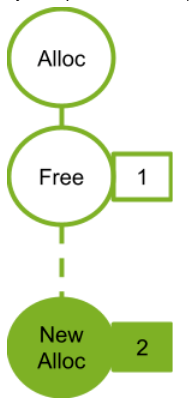

**图 31：添加新的分配节点 2。**

下面的图展示了添加一个新的分配节点 (4)。新分配节点不依赖释放节点 (2)，因此不能复用关联分配节点 (2) 的地址。如果分配节点 (2) 使用了释放节点 (1) 释放的地址，则新的分配节点 3 将需要新地址。

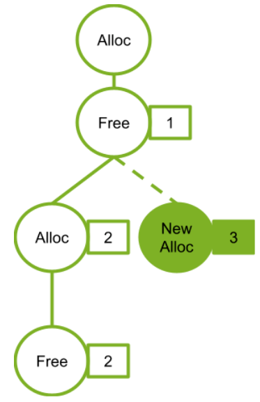

**图 32：添加新的分配节点 3。**

##### 4.2.5.3.2 物理内存管理与共享

CUDA 负责在按 GPU 顺序到达分配节点之前将物理内存映射到虚拟地址。作为对内存占用与映射开销的优化，如果多个图不会同时运行，它们可以为不同分配使用同一物理内存；然而，如果物理页同时绑定到多个正在执行的图，或绑定到未释放的图分配，则不能复用。

CUDA 可以在图实例化、启动或执行期间的任何时刻更新物理内存映射。CUDA 还可能在未来图启动之间引入同步，以防止活动图分配引用同一物理内存。与任何分配-释放-分配模式一样，如果程序在分配生命周期之外访问指针，错误访问可能静默读取或写入属于另一分配的活动数据（即使该分配的虚拟地址唯一）。使用计算 sanitizer 工具可以捕获此错误。

下面的图展示了在同一流中顺序启动的图。在此示例中，每个图释放它分配的所有内存。由于同一流中的图从不并发运行，CUDA 可以且应该使用同一物理内存来满足所有分配。

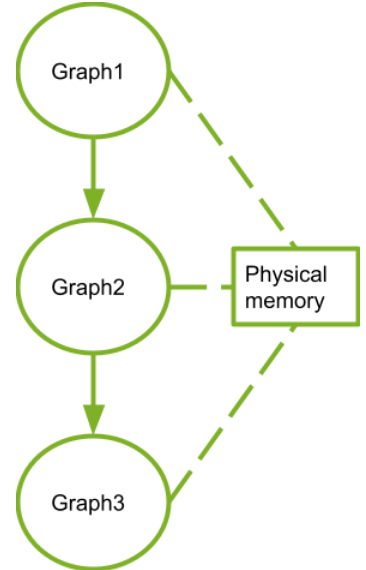

**图 33：顺序启动的图。**

#### 4.2.5.4 性能考虑

当多个图被启动到同一流中时，CUDA 尝试为它们分配相同的物理内存，因为这些图的执行不能重叠。图的物理映射在启动之间保留，作为避免重新映射开销的优化。如果稍后其中一个图以可能与其他图执行重叠的方式启动（例如启动到不同的流中），则 CUDA 必须执行一些重新映射，因为并发图需要不同的内存以避免数据损坏。

一般来说，CUDA 中图内存的重新映射可能由以下操作引起：

- 更改图启动到的流
- 对图内存池的 trim 操作，显式释放未使用的内存（在“物理内存占用”中讨论）
- 当来自另一个图的未释放分配映射到相同内存时重新启动图，将导致在重新启动之前重新映射内存

重新映射必须按执行顺序发生，但要在该图任何先前执行完成之后（否则可能取消映射仍在使用的内存）。由于这种排序依赖，以及映射操作是 OS 调用，映射操作可能相对昂贵。应用可以通过将包含分配内存节点的图一致地启动到同一流中来避免此开销。

##### 4.2.5.4.1 首次启动 / cudaGraphUpload

在图实例化期间不能分配或映射物理内存，因为图将执行的流未知。映射改为在图启动期间完成。调用 `cudaGraphUpload` 可以通过立即执行该图的所有映射并将图与上传流关联，将分配开销从启动中分离出来。如果图随后启动到同一流中，它将启动而无需任何额外的重新映射。

为图上传与图启动使用不同的流，其行为类似于切换流，很可能导致重新映射操作。此外，无关的内存池管理可能从空闲流中拉取内存，这可能抵消上传的影响。

#### 4.2.5.5 物理内存占用

异步分配的池管理行为意味着销毁包含内存节点的图（即使其分配已释放）不会立即将物理内存返还给 OS 供其他进程使用。为显式将内存归还给 OS，应用应使用 `cudaDeviceGraphMemTrim` API。

`cudaDeviceGraphMemTrim` 将取消映射并释放图内存节点保留的、未在活动使用的任何物理内存。未释放的分配以及已调度或正在运行的图被视为正在活动使用物理内存，不会受到影响。使用 trim API 将使物理内存可供其他分配 API 以及其他应用或进程使用，但会使 CUDA 在下次启动被 trim 的图时重新分配并重新映射内存。注意 `cudaDeviceGraphMemTrim` 操作的池与 `cudaMemPoolTrimTo()` 不同。图内存池不暴露给流序内存分配器。CUDA 允许应用通过 `cudaDeviceGetGraphMemAttribute` API 查询其图内存占用。查询属性 `cudaGraphMemAttrReservedMemCurrent` 返回驱动在当前进程中为图分配保留的物理内存量。查询 `cudaGraphMemAttrUsedMemCurrent` 返回当前至少被一个图映射的物理内存量。这两个属性中的任何一个都可用于跟踪 CUDA 何时为分配图获取新物理内存。这两个属性都可用于检查共享机制节省了多少内存。

#### 4.2.5.6 对等访问

图分配可以配置为可从多个 GPU 访问，在这种情况下 CUDA 将按需将分配映射到对等 GPU 上。CUDA 允许需要不同映射的图分配复用同一虚拟地址。发生这种情况时，地址范围被映射到不同分配所需的所有 GPU 上。这意味着某个分配有时可能允许比其创建时请求的更多对等访问；然而，依赖这些额外映射仍然是错误的。

##### 4.2.5.6.1 使用图节点 API 的对等访问

`cudaGraphAddNode` API 在分配节点参数结构的 `accessDescs` 数组字段中接受映射请求。嵌入的 `poolProps.location` 结构指定分配的驻留设备。假定需要来自分配 GPU 的访问，因此应用无需在 `accessDescs` 数组中为驻留设备指定条目。

```cpp
cudaGraphNodeParams allocNodeParams = { cudaGraphNodeTypeMemAlloc };
allocNodeParams.alloc.poolProps.allocType = cudaMemAllocationTypePinned;
allocNodeParams.alloc.poolProps.location.type = cudaMemLocationTypeDevice;
// 指定设备 1 为驻留设备
allocNodeParams.alloc.poolProps.location.id = 1;
allocNodeParams.alloc.bytesize = size;
// 分配一个驻留在设备 1 上、可从设备 1 访问的分配
cudaGraphAddNode(&allocNode, graph, NULL, NULL, 0, &allocNodeParams);

cudaMemAccessDesc accessDescs[2];
// 访问描述符的样板（add node API 仅支持 ReadWrite 与 Device 访问）
accessDescs[0].flags = cudaMemAccessFlagsProtReadWrite;
accessDescs[0].location.type = cudaMemLocationTypeDevice;
accessDescs[1].flags = cudaMemAccessFlagsProtReadWrite;
accessDescs[1].location.type = cudaMemLocationTypeDevice;
// 请求设备 0 与 2 的访问。设备 1 的访问要求保持隐式。
accessDescs[0].location.id = 0;
accessDescs[1].location.id = 2;

// 访问请求数组有 2 个条目。
allocNodeParams.accessDescCount = 2;
allocNodeParams.accessDescs = accessDescs;
// 分配一个驻留在设备 1 上、可从设备 0、1 与 2 访问的分配。
//（0 与 2 来自描述符，1 来自其作为驻留设备）。
cudaGraphAddNode(&allocNode, graph, NULL, NULL, 0, &allocNodeParams);
```

##### 4.2.5.6.2 使用流捕获的对等访问

对于流捕获，分配节点在捕获时记录分配池的对等可访问性。在捕获 `cudaMallocFromPoolAsync` 调用之后更改分配池的对等可访问性，不会影响图将为该分配进行的映射。

#### 4.2.6 设备图启动

有许多工作流需要在运行时根据数据做出决策，并据此执行不同的操作。用户可能更愿意在设备上执行这一决策过程，而不是将其卸载到主机（这可能需要从设备往返一次）。为此，CUDA 提供了一种从设备启动图的机制。

设备图启动提供了一种从设备执行动态控制流的便捷方式，无论是简单的循环还是复杂的设备端工作调度器。

可从设备启动的图此后称为设备图（device graph），不能从设备启动的图称为主机图（host graph）。设备图既可以从主机启动也可以从设备启动，而主机图只能从主机启动。与主机启动不同，在先前一次图启动正在运行时从设备启动设备图将导致错误，返回 `cudaErrorInvalidValue`；因此，设备图不能同时从设备启动两次。同时从主机与设备启动设备图将导致未定义行为。

##### 4.2.6.1 设备图创建

为使图能从设备启动，必须显式将其实例化为设备启动。这通过向 `cudaGraphInstantiate()` 调用传入 `cudaGraphInstantiateFlagDeviceLaunch` 标志来实现。与主机图一样，设备图结构在实例化时固定，不重新实例化就无法更新，并且实例化只能在主机上执行。为使图能够被实例化为设备启动，它必须遵守各种要求。

###### 4.2.6.1.1 设备图要求

一般要求：

- 图的节点必须全部位于单个设备上。
- 图只能包含内核节点、memcpy 节点、memset 节点与子图节点。

内核节点：

- 不允许图中的内核使用 CUDA 动态并行。
- 只要不使用 MPS，允许协作启动。

Memcpy 节点：

- 只允许涉及设备内存和/或固定设备映射主机内存的复制。
- 不允许涉及 CUDA 数组的复制。
- 在实例化时两个操作数都必须可从当前设备访问。注意复制操作将从图所在的设备执行，即使它针对另一设备上的内存。

###### 4.2.6.1.2 设备图上传

为在设备上启动图，必须先将其上传到设备以填充必要的设备资源。这可以通过两种方式之一实现。

首先，可以显式上传图，通过 `cudaGraphUpload()` 或通过在实例化时通过 `cudaGraphInstantiateWithParams()` 请求上传。

或者，可以先从主机启动图，作为启动的一部分隐式执行此上传步骤。三种方法的示例如下：

```cpp
// 实例化后显式上传
cudaGraphInstantiate(&deviceGraphExec1, deviceGraph1, cudaGraphInstantiateFlagDeviceLaunch);
cudaGraphUpload(deviceGraphExec1, stream);

// 作为实例化的一部分显式上传
cudaGraphInstantiateParams instantiateParams = {0};
instantiateParams.flags = cudaGraphInstantiateFlagDeviceLaunch | cudaGraphInstantiateFlagUpload;
instantiateParams.uploadStream = stream;
cudaGraphInstantiateWithParams(&deviceGraphExec2, deviceGraph2, &instantiateParams);

// 通过主机启动隐式上传
cudaGraphInstantiate(&deviceGraphExec3, deviceGraph3, cudaGraphInstantiateFlagDeviceLaunch);
cudaGraphLaunch(deviceGraphExec3, stream);
```

###### 4.2.6.1.3 设备图更新

设备图只能从主机更新，并且可执行图更新后必须重新上传到设备才能使更改生效。这可以使用“设备图上传”一节中列出的相同方法来实现。与主机图不同，在应用更新时从设备启动设备图将导致未定义行为。

##### 4.2.6.2 设备启动

设备图可以通过 `cudaGraphLaunch()` 从主机与设备启动，该函数在设备上的签名与主机上相同。设备图在主机与设备上通过相同的句柄启动。设备图从设备启动时必须从另一个图启动。

设备侧图启动是按线程的，可能同时从不同线程发生多次启动，因此用户需要选择一个线程来启动给定图。

与主机启动不同，设备图不能启动到常规 CUDA 流中，只能启动到不同的命名流中，每个命名流表示一种特定的启动模式。下表列出了可用的启动模式。

**表 9：仅设备图启动流**

| 流 | 启动模式 |
|---|---|
| `cudaStreamGraphFireAndForget` | 即发即忘启动 |
| `cudaStreamGraphTailLaunch` | 尾部启动 |
| `cudaStreamGraphFireAndForgetAsSibling` | 同级启动 |

###### 4.2.6.2.1 即发即忘启动

顾名思义，即发即忘（fire and forget）启动立即提交到 GPU，并独立于启动它的图运行。在即发即忘场景中，启动图是父图，被启动图是子图。

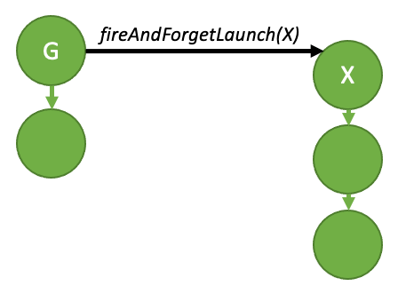

**图 34：即发即忘启动。**

上图可以由下面的示例代码生成：

```cpp
__global__ void launchFireAndForgetGraph(cudaGraphExec_t graph) {
    cudaGraphLaunch(graph, cudaStreamGraphFireAndForget);
}

void graphSetup() {
    cudaGraphExec_t gExec1, gExec2;
    cudaGraph_t g1, g2;

    // 创建设备图、实例化并上传。
    create_graph(&g2);
    cudaGraphInstantiate(&gExec2, g2, cudaGraphInstantiateFlagDeviceLaunch);
    cudaGraphUpload(gExec2, stream);

    // 创建并实例化启动图。
    cudaStreamBeginCapture(stream, cudaStreamCaptureModeGlobal);
    launchFireAndForgetGraph<<<1, 1, 0, stream>>>(gExec2);
    cudaStreamEndCapture(stream, &g1);
    cudaGraphInstantiate(&gExec1, g1, 0);

    // 启动主机图，它将进而启动设备图。
    cudaGraphLaunch(gExec1, stream);
}
```

一个图在其执行过程中最多可以有 120 个即发即忘图。该总数在同一父图的启动之间重置。

###### 4.2.6.2.1.1 图执行环境

为完全理解设备侧同步模型，首先有必要理解执行环境（execution environment）的概念。

当图从设备启动时，它被启动到自己的执行环境中。给定图的执行环境封装了图中的所有工作以及所有生成的即发即忘工作。当图已完成执行且所有生成的子工作都已完成时，该图可视为完成。

下图展示了上一节即发即忘示例代码将生成的 环境封装。

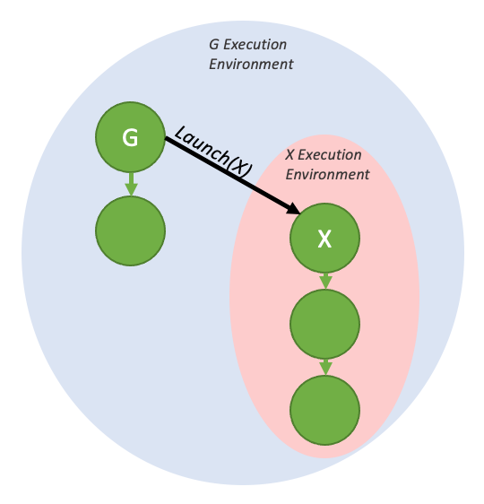

**图 35：即发即忘启动及其执行环境。**

这些环境也是分层的，因此一个图环境可以包含来自即发即忘启动的多层子环境。

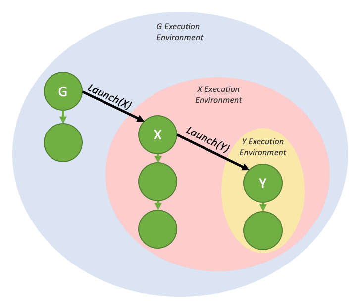

**图 36：嵌套的即发即忘环境。**

当图从主机启动时，存在一个流环境，它是被启动图执行环境的父环境。流环境封装了作为整体启动一部分生成的所有工作。当整体流环境被标记为完成时，流启动完成（即下游依赖工作现在可以运行）。

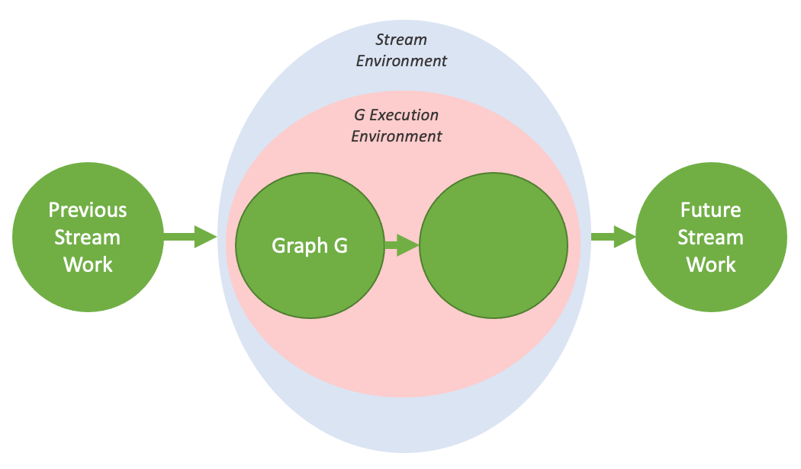

**图 37：流环境可视化。**

###### 4.2.6.2.2 尾部启动

与主机不同，无法通过 `cudaDeviceSynchronize()` 或 `cudaStreamSynchronize()` 等传统方法从 GPU 与设备图同步。相反，为启用串行工作依赖，提供了另一种启动模式——尾部启动（tail launch）——以提供类似功能。

当图的环境被视为完成时（即该图及其所有子图完成时），尾部启动执行。当一个图完成时，尾部启动列表中下一个图的环境将替换已完成的 环境，成为父环境的子环境。与即发即忘启动一样，一个图可以排队多个图进行尾部启动。

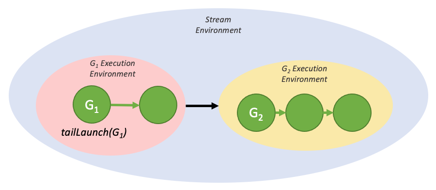

**图 38：简单的尾部启动。**

上述执行流可以由下面的代码生成：

```cpp
__global__ void launchTailGraph(cudaGraphExec_t graph) {
    cudaGraphLaunch(graph, cudaStreamGraphTailLaunch);
}

void graphSetup() {
    cudaGraphExec_t gExec1, gExec2;
    cudaGraph_t g1, g2;

    create_graph(&g2);
    cudaGraphInstantiate(&gExec2, g2, cudaGraphInstantiateFlagDeviceLaunch);
    cudaGraphUpload(gExec2, stream);

    cudaStreamBeginCapture(stream, cudaStreamCaptureModeGlobal);
    launchTailGraph<<<1, 1, 0, stream>>>(gExec2);
    cudaStreamEndCapture(stream, &g1);
    cudaGraphInstantiate(&gExec1, g1, 0);

    cudaGraphLaunch(gExec1, stream);
}
```

给定图排队的尾部启动将一次执行一个，按入队顺序执行。因此第一个入队的图将先运行，然后第二个，依此类推。

由尾部图排队的尾部启动将在尾部启动列表中先前图排队的尾部启动之前执行。这些新的尾部启动将按其入队顺序执行。一个图最多可以有 255 个待处理的尾部启动。

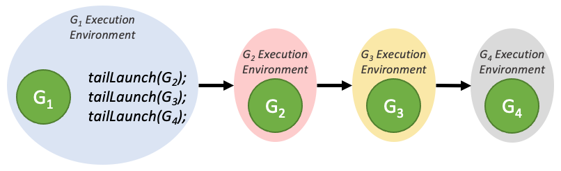

**图 39：尾部启动排序。**

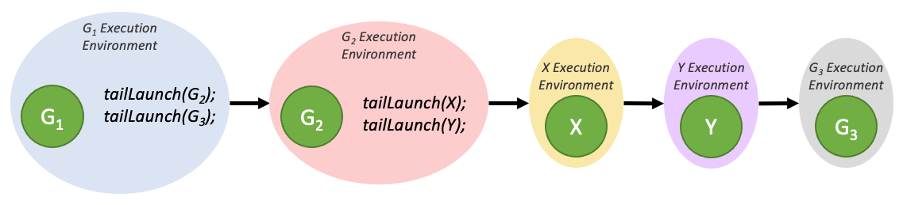

**图 40：从多个图入队时的尾部启动排序。**

###### 4.2.6.2.2.1 尾部自启动

设备图可以排入自身进行尾部启动，尽管给定图一次只能排队一个自启动。为查询当前运行的设备图以便重新启动它，新增了一个设备侧函数：

```cpp
cudaGraphExec_t cudaGetCurrentGraphExec();
```

如果当前运行的图是设备图，此函数返回其句柄。如果当前执行的内核不是设备图中的节点，此函数将返回 NULL。

下面是展示该函数用于重新启动循环的示例代码：

```cpp
__device__ int relaunchCount = 0;

__global__ void relaunchSelf() {
    int relaunchMax = 100;
    if (threadIdx.x == 0) {
        if (relaunchCount < relaunchMax) {
            cudaGraphLaunch(cudaGetCurrentGraphExec(), cudaStreamGraphTailLaunch);
        }
        relaunchCount++;
    }
}
```

###### 4.2.6.2.3 同级启动

同级启动（sibling launch）是即发即忘启动的一种变体，其中图不是作为启动图执行环境的子图启动，而是作为启动图父环境的子图启动。同级启动等价于从启动图的父环境进行即发即忘启动。

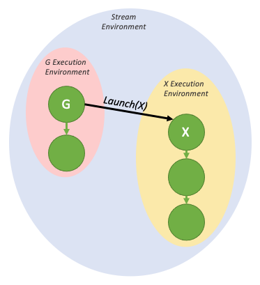

**图 41：简单的同级启动。**

上图可以由下面的示例代码生成：

```cpp
__global__ void launchSiblingGraph(cudaGraphExec_t graph) {
    cudaGraphLaunch(graph, cudaStreamGraphFireAndForgetAsSibling);
}

void graphSetup() {
    cudaGraphExec_t gExec1, gExec2;
    cudaGraph_t g1, g2;

    create_graph(&g2);
    cudaGraphInstantiate(&gExec2, g2, cudaGraphInstantiateFlagDeviceLaunch);
    cudaGraphUpload(gExec2, stream);

    cudaStreamBeginCapture(stream, cudaStreamCaptureModeGlobal);
    launchSiblingGraph<<<1, 1, 0, stream>>>(gExec2);
    cudaStreamEndCapture(stream, &g1);
    cudaGraphInstantiate(&gExec1, g1, 0);

    cudaGraphLaunch(gExec1, stream);
}
```

由于同级启动不是启动到启动图的执行环境中，它们不会门控启动图排队的尾部启动。

### 4.2.7 使用图 API

`cudaGraph_t` 对象不是线程安全的。用户有责任确保多个线程不会并发访问同一个 `cudaGraph_t`。

`cudaGraphExec_t` 不能与自身并发运行。对 `cudaGraphExec_t` 的启动将排在同一可执行图的先前启动之后。

图执行在流中完成，以便与其他异步工作排序。然而，流仅用于排序；它不约束图的内部并行性，也不影响图节点执行的位置。

参见图 API。

### 4.2.8 CUDA 用户对象

CUDA 用户对象（CUDA User Objects）可用于帮助管理 CUDA 中异步工作所使用的资源的生命周期。特别是，该特性对 CUDA 图与流捕获很有用。

各种资源管理方案与 CUDA 图不兼容。例如考虑一个基于事件的池，或一个同步创建、异步销毁的方案。

```cpp
// 带池分配的库 API
void libraryWork(cudaStream_t stream) {
    auto &resource = pool.claimTemporaryResource();
    resource.waitOnReadyEventInStream(stream);
    launchWork(stream, resource);
    resource.recordReadyEvent(stream);
}
```

```cpp
// 带异步资源删除的库 API
void libraryWork(cudaStream_t stream) {
    Resource *resource = new Resource(...);
    launchWork(stream, resource);
    cudaLaunchHostFunc(
        stream,
        [](void *resource) {
            delete static_cast<Resource *>(resource);
        },
        resource,
        0);
    // 未展示错误处理考虑事项
}
```

这些方案难以与 CUDA 图配合，因为资源的指针或句柄不固定，需要间接或图更新，并且每次提交工作时都需要同步 CPU 代码。如果这些考虑事项对库的调用者隐藏，并且由于在捕获期间使用了被禁止的 API，它们也无法与流捕获配合。存在各种解决方案，例如将资源暴露给调用者。CUDA 用户对象提出了另一种方法。

CUDA 用户对象将用户指定的析构回调与内部引用计数关联起来，类似于 C++ `shared_ptr`。引用可以由 CPU 上的用户代码以及 CUDA 图拥有。注意，对于用户拥有的引用，与 C++ 智能指针不同，没有表示该引用的对象；用户必须手动跟踪用户拥有的引用。一个典型用例是在创建用户对象后立即将唯一的用户拥有引用移动到 CUDA 图。

当引用与 CUDA 图关联时，CUDA 将自动管理图操作。克隆的 `cudaGraph_t` 保留源 `cudaGraph_t` 所拥有的每个引用的副本，且多重性相同。已实例化的 `cudaGraphExec_t` 保留源 `cudaGraph_t` 中每个引用的副本。当 `cudaGraphExec_t` 在未同步的情况下被销毁时，引用将保留到执行完成。

下面是一个使用示例。

```cpp
cudaGraph_t graph;  // 预先存在的图

Object *object = new Object;  // 具有可能非平凡析构函数的 C++ 对象

cudaUserObject_t cuObject;
cudaUserObjectCreate(
    &cuObject,
    object,
    // 此处我们使用 CUDA 为此 API 提供的模板包装器，
    // 它提供一个删除 C++ 对象指针的回调
    1,                            // 初始引用计数
    cudaUserObjectNoDestructorSync  // 确认无法通过 CUDA 等待该回调
);
cudaGraphRetainUserObject(
    graph,
    cuObject,
    1,                        // 引用数
    cudaGraphUserObjectMove   // 转移调用者拥有的引用（不修改总引用计数）
);
// 此线程不再拥有引用；无需调用释放 API

cudaGraphExec_t graphExec;
cudaGraphInstantiate(&graphExec, graph, 0);  // 将保留一个新引用

cudaGraphDestroy(graph);            // graphExec 仍拥有一个引用
cudaGraphLaunch(graphExec, 0);      // 异步启动可访问用户对象
cudaGraphExecDestroy(graphExec);    // 启动未同步；释放被延迟
```

```cpp
// 如果启动已同步，剩余的引用被释放，析构函数将执行。
// 注意这是异步发生的。
// 如果析构回调已向同步对象发信号，此时等待它是安全的。
cudaStreamSynchronize(0);
```

由子图节点中的图所拥有的引用关联到子图，而不是父图。如果子图被更新或删除，引用会相应改变。如果可执行图或子图通过 `cudaGraphExecUpdate` 或 `cudaGraphExecChildGraphNodeSetParams` 更新，则新源图中的引用被克隆并替换目标图中的引用。在任一情况下，如果先前的启动未同步，任何将被释放的引用都会保留到启动执行完毕。

目前还没有通过 CUDA API 等待用户对象析构函数的机制。用户可以从析构函数代码手动向同步对象发信号。此外，从析构函数调用 CUDA API 是不合法的，类似于对 `cudaLaunchHostFunc` 的限制。这是为了避免阻塞 CUDA 内部共享线程并阻止向前推进。如果依赖是单向的，且执行调用的线程不能阻塞 CUDA 工作的向前推进，则向另一个线程发信号以执行 API 调用是合法的。

用户对象使用 `cudaUserObjectCreate` 创建，它是浏览相关 API 的良好起点。

## 4.3 流序内存分配器

### 4.3.1 引言

使用 `cudaMalloc` 与 `cudaFree` 管理内存分配会导致 GPU 在所有正在执行的 CUDA 流之间同步。流序内存分配器使应用能够将内存分配与释放与其他启动到 CUDA 流中的工作（如内核启动与异步复制）排序。这通过利用流序语义复用内存分配来改善应用内存使用。分配器还允许应用控制分配器的内存缓存行为。当以适当的释放阈值设置时，缓存行为允许分配器在应用表示愿意接受更大内存占用时避免对 OS 的昂贵调用。分配器还支持进程之间轻松且安全的分配共享。

流序内存分配器：

- 减少了对自定义内存管理抽象的需求，并使需要它的应用更容易创建高性能的自定义内存管理。
- 使多个库能够共享由驱动管理的公共内存池。这可以减少过多的内存消耗。
- 允许驱动基于其对分配器与其他流管理 API 的了解执行优化。

> **注意**
>
> 自 CUDA 11.3 起，Nsight Compute 与下一代 CUDA 调试器能够感知分配器。

### 4.3.2 内存管理

`cudaMallocAsync` 与 `cudaFreeAsync` 是启用流序内存管理的 API。`cudaMallocAsync` 返回一个分配，`cudaFreeAsync` 释放一个分配。两个 API 都接受流参数，以定义分配何时变为可用以及何时停止可用。这些函数允许将内存操作绑定到特定的 CUDA 流，使它们能够在不阻塞主机或其他流的情况下发生。通过避免 `cudaMalloc` 与 `cudaFree` 可能昂贵的同步，可以改善应用性能。

这些 API 可以通过内存池用于进一步的性能优化，内存池管理和复用大块内存以实现更高效的分配与释放。内存池有助于减少开销并防止碎片，从而在频繁内存分配操作的场景中改善性能。

#### 4.3.2.1 分配内存

`cudaMallocAsync` 函数触发 GPU 上链接到特定 CUDA 流的异步内存分配。`cudaMallocAsync` 允许内存分配在不阻碍主机或其他流的情况下发生，从而消除昂贵同步的需要。

> **注意**
>
> `cudaMallocAsync` 在确定分配将驻留在何处时忽略当前设备/上下文。相反，`cudaMallocAsync` 根据指定的内存池或提供的流确定适当的设备。

下面的清单说明了一个基本使用模式：分配内存、使用它，然后将其释放回同一流。

```cpp
void *ptr;
size_t size = 512;
cudaMallocAsync(&ptr, size, cudaStreamPerThread);
// 使用该分配进行工作
kernel<<<..., cudaStreamPerThread>>>(ptr, ...);
// 可以在不使 CPU 与 GPU 同步的情况下指定异步释放
cudaFreeAsync(ptr, cudaStreamPerThread);
```

> **注意**
>
> 当从进行分配的流以外的流访问分配时，用户必须保证访问发生在分配操作之后，否则行为未定义。

#### 4.3.2.2 释放内存

`cudaFreeAsync()` 以流序方式异步释放设备内存，意味着内存释放被分配给特定 CUDA 流，并且不阻塞主机或其他流。

用户必须保证释放操作发生在分配操作以及对该分配的任何使用之后。在释放操作开始后对该分配的任何使用都会导致未定义行为。

应使用事件和/或流同步操作来保证在释放操作开始之前，从其他流对该分配的任何访问都已完成，如下例所示。

```cpp
cudaMallocAsync(&ptr, size, stream1);
cudaEventRecord(event1, stream1);
// stream2 必须等待分配就绪后才能访问
cudaStreamWaitEvent(stream2, event1);
kernel<<<..., stream2>>>(ptr, ...);
cudaEventRecord(event2, stream2);
// stream3 必须等待 stream2 完成对分配的访问后才能释放该分配
cudaStreamWaitEvent(stream3, event2);
cudaFreeAsync(ptr, stream3);
```

使用 `cudaMalloc()` 分配的内存可以用 `cudaFreeAsync()` 释放。如上所述，在释放操作开始之前，对该内存的所有访问都必须完成。

```cpp
cudaMalloc(&ptr, size);
kernel<<<..., stream>>>(ptr, ...);
cudaFreeAsync(ptr, stream);
```

同样，使用 `cudaMallocAsync` 分配的内存可以用 `cudaFree()` 释放。当通过 `cudaFree()` API 释放此类分配时，驱动假定对该分配的所有访问都已完成，并且不执行进一步同步。用户可以使用 `cudaStreamQuery` / `cudaStreamSynchronize` / `cudaEventQuery` / `cudaEventSynchronize` / `cudaDeviceSynchronize` 来保证适当的异步工作已完成，并且 GPU 不会尝试访问该分配。

```cpp
cudaMallocAsync(&ptr, size,stream);
kernel<<<..., stream>>>(ptr, ...);
// 需要同步以避免过早释放内存
cudaStreamSynchronize(stream);
cudaFree(ptr);
```

### 4.3.3 内存池

内存池封装根据池属性与属性分配和管理的虚拟地址与物理内存资源。内存池的主要方面是它所管理内存的种类与位置。

所有对 `cudaMallocAsync` 的调用都使用内存池中的资源。如果未指定内存池，`cudaMallocAsync` 使用提供的流所属设备的当前内存池。设备的当前内存池可以通过 `cudaDeviceSetMempool` 设置，通过 `cudaDeviceGetMempool` 查询。每个设备都有一个默认内存池，如果未调用 `cudaDeviceSetMempool`，则它是活动的。

API `cudaMallocFromPoolAsync` 与 `cudaMallocAsync` 的 C++ 重载允许用户指定用于分配的池，而无需将其设为当前池。API `cudaDeviceGetDefaultMempool` 与 `cudaMemPoolCreate` 返回内存池的句柄。`cudaMemPoolSetAttribute` 与 `cudaMemPoolGetAttribute` 控制内存池的属性。

> **注意**
>
> 设备当前的 mempool 将对该设备本地。因此，不指定内存池的分配将始终产生流所属设备本地的分配。

#### 4.3.3.1 默认/隐式池

设备的默认内存池可以通过调用 `cudaDeviceGetDefaultMempool` 检索。来自设备默认内存池的分配是位于该设备上的不可迁移设备分配。这些分配将始终可从该设备访问。默认内存池的可访问性可以通过 `cudaMemPoolSetAccess` 修改，通过 `cudaMemPoolGetAccess` 查询。由于默认池无需显式创建，它们有时被称为隐式池。设备的默认内存池不支持 IPC。

#### 4.3.3.2 显式池

`cudaMemPoolCreate` 创建一个显式池。这允许应用为其分配请求超出默认/隐式池所提供的属性。这些属性包括 IPC 能力、最大池大小、在受支持平台上驻留在特定 CPU NUMA 节点上的分配等。

```cpp
// 创建一个类似于设备 0 上隐式池的池
int device = 0;
cudaMemPoolProps poolProps = { };
poolProps.allocType = cudaMemAllocationTypePinned;
poolProps.location.id = device;
poolProps.location.type = cudaMemLocationTypeDevice;
cudaMemPoolCreate(&memPool, &poolProps));
```

下面的代码片段说明在有效 CPU NUMA 节点上创建支持 IPC 的内存池的示例。

```cpp
// 创建一个驻留在 CPU NUMA 节点上、支持 IPC 共享（通过文件描述符）的池。
int cpu_numa_id = 0;
cudaMemPoolProps poolProps = { };
poolProps.allocType = cudaMemAllocationTypePinned;
poolProps.location.id = cpu_numa_id;
poolProps.location.type = cudaMemLocationTypeHostNuma;
poolProps.handleType = cudaMemHandleTypePosixFileDescriptor;
cudaMemPoolCreate(&ipcMemPool, &poolProps));
```

#### 4.3.3.3 多 GPU 支持的设备可访问性

与通过虚拟内存管理 API 控制的分配可访问性一样，内存池分配可访问性不遵循 `cudaDeviceEnablePeerAccess` 或 `cuCtxEnablePeerAccess`。对于内存池，API `cudaMemPoolSetAccess` 修改哪些设备可以访问池中的分配。默认情况下，分配只能从分配所在的设备访问。此访问不能被撤销。要启用来自其他设备的访问，访问设备必须与内存池的设备点对点兼容。这可以通过 `cudaDeviceCanAccessPeer` 验证。

如果未检查点对点能力，设置访问可能失败并返回 `cudaErrorInvalidDevice`。然而，如果尚未从池中分配任何内存，即使设备不点对点兼容，`cudaMemPoolSetAccess` 调用也可能成功。在这种情况下，下一次从池中分配将失败。

值得注意的是，`cudaMemPoolSetAccess` 影响内存池中的所有分配，而不仅仅是未来的分配。同样，`cudaMemPoolGetAccess` 报告的可访问性适用于池中的所有分配，而不仅仅是未来的分配。不建议频繁更改池对给定 GPU 的可访问性设置。也就是说，一旦池从给定 GPU 可访问，它就应该在池的生命周期内保持从该 GPU 可访问。

```cpp
// 展示 cudaMemPoolSetAccess 用法的片段：
cudaError_t setAccessOnDevice(cudaMemPool_t memPool, int residentDevice,
                              int accessingDevice) {
    cudaMemAccessDesc accessDesc = {};
    accessDesc.location.type = cudaMemLocationTypeDevice;
    accessDesc.location.id = accessingDevice;
    accessDesc.flags = cudaMemAccessFlagsProtReadWrite;

    int canAccess = 0;

    cudaError_t error = cudaDeviceCanAccessPeer(&canAccess, accessingDevice, residentDevice);
    if (error != cudaSuccess) {
        return error;
    } else if (canAccess == 0) {
        return cudaErrorPeerAccessUnsupported;
    }

    // 使该地址可访问
    return cudaMemPoolSetAccess(memPool, &accessDesc, 1);
}
```

#### 4.3.3.4 为 IPC 启用内存池

可以为进程间通信（IPC）启用内存池，以便在进程之间轻松、高效且安全地共享 GPU 内存。CUDA 的 IPC 内存池提供与 CUDA 虚拟内存管理 API 相同的安全优势。

使用内存池在进程之间共享内存有两个步骤：进程首先需要共享对池的访问，然后共享来自该池的特定分配。第一步建立并强制执行安全性。第二步协调每个进程中使用的虚拟地址，以及映射在导入进程中何时需要有效。

##### 4.3.3.4.1 创建与共享 IPC 内存池

共享对池的访问涉及使用 `cudaMemPoolExportToShareableHandle()` 检索池的 OS 原生句柄，使用 OS 原生 IPC 机制将句柄传输到导入进程，然后使用 `cudaMemPoolImportFromShareableHandle()` API 创建导入的内存池。为使 `cudaMemPoolExportToShareableHandle` 成功，内存池必须使用池属性结构中指定的请求句柄类型创建。请参考示例了解在进程之间传输 OS 原生句柄的适当 IPC 机制。过程的其余部分可在以下代码片段中找到。

```cpp
// 在导出进程中
// 在设备 0 上创建一个可导出、支持 IPC 的池
cudaMemPoolProps poolProps = { };
poolProps.allocType = cudaMemAllocationTypePinned;
poolProps.location.id = 0;
poolProps.location.type = cudaMemLocationTypeDevice;
// 将 handleTypes 设为非零值将使池可导出（支持 IPC）
poolProps.handleTypes = CU_MEM_HANDLE_TYPE_POSIX_FILE_DESCRIPTOR;
cudaMemPoolCreate(&memPool, &poolProps));

// 基于 FD 的句柄是整数类型
int fdHandle = 0;
// 检索池的 OS 原生句柄。
// 注意此处传入的是指向句柄内存的指针。
cudaMemPoolExportToShareableHandle(&fdHandle,
                                    memPool,
                                    CU_MEM_HANDLE_TYPE_POSIX_FILE_DESCRIPTOR,
                                    0);
// 必须使用适当的 OS 特定 API 将句柄发送到导入进程。

// 在导入进程中
int fdHandle;
// 需要使用适当的 OS 特定 API 从导出进程获取句柄。

// 从可共享句柄创建导入池。
// 注意此处句柄按值传递。
cudaMemPoolImportFromShareableHandle(&importedMemPool,
                                     (void*)fdHandle,
                                     CU_MEM_HANDLE_TYPE_POSIX_FILE_DESCRIPTOR,
                                     0);
```

##### 4.3.3.4.2 在导入进程中设置访问

导入的内存池最初只能从其驻留设备访问。导入的内存池不继承导出进程设置的任何可访问性。导入进程需要从其计划访问内存的任何 GPU 使用 `cudaMemPoolSetAccess` 启用访问。

如果导入的内存池属于导入进程不可见的设备，则用户必须使用 `cudaMemPoolSetAccess` API 从将使用分配的那些 GPU 启用访问。（参见“多 GPU 支持的设备可访问性”。）

##### 4.3.3.4.3 从导出的池创建与共享分配

池被共享后，导出进程中使用 `cudaMallocAsync()` 从池中进行的分配可以与已导入该池的进程共享。由于池的安全策略在池级别建立并验证，OS 无需额外簿记来为特定池分配提供安全性。换句话说，导入池分配所需的不透明 `cudaMemPoolPtrExportData` 可以通过任何机制发送到导入进程。

虽然分配可以在不以任何方式与分配流同步的情况下导出与导入，但导入进程在访问分配时必须遵循与导出进程相同的规则。具体来说，访问分配必须发生在分配流中分配操作执行之后。以下两个代码片段展示 `cudaMemPoolExportPointer()` 与 `cudaMemPoolImportPointer()` 使用 IPC 事件共享分配，以确保在分配就绪之前导入进程不会访问该分配。

```cpp
// 在导出进程中准备分配
cudaMemPoolPtrExportData exportData;
cudaEvent_t readyIpcEvent;
cudaIpcEventHandle_t readyIpcEventHandle;
// 用于进程之间协调的 ipc 事件
// cudaEventInterprocess 标志使事件成为 ipc 事件
// 出于性能原因设置 cudaEventDisableTiming
cudaEventCreate(&readyIpcEvent, cudaEventDisableTiming | cudaEventInterprocess)

// 从导出 mem pool 分配
cudaMallocAsync(&ptr, size,exportMemPool, stream);
// 用于在分配就绪时共享的事件。
cudaEventRecord(readyIpcEvent, stream);
cudaMemPoolExportPointer(&exportData, ptr);
cudaIpcGetEventHandle(&readyIpcEventHandle, readyIpcEvent);

// 使用任何机制与导入进程共享 IPC 事件与指针导出数据。
// 这里我们将数据复制到共享内存
shmem->ptrData = exportData;
shmem->readyIpcEventHandle = readyIpcEventHandle;
// 向消费者发信号：数据就绪

// 导入分配
cudaMemPoolPtrExportData *importData = &shmem->prtData;
cudaEvent_t readyIpcEvent;
cudaIpcEventHandle_t *readyIpcEventHandle = &shmem->readyIpcEventHandle;

// 需要使用任何机制从导出进程检索 ipc 事件句柄与导出数据。
// 这里我们使用 shmem，只需要同步以确保共享内存已被填充。
cudaIpcOpenEventHandle(&readyIpcEvent, readyIpcEventHandle);

// 导入分配。该操作不会阻塞等待分配就绪。
cudaMemPoolImportPointer(&ptr, importedMemPool, importData);

// 在导入进程中使用分配之前，等待分配流中先前的流操作完成。
cudaStreamWaitEvent(stream, readyIpcEvent);
kernel<<<..., stream>>>(ptr, ...);
```

释放分配时，必须先由导入进程释放，然后才能由导出进程释放。以下代码片段演示使用 CUDA IPC 事件在两个进程中的 `cudaFreeAsync` 操作之间提供所需同步。导入进程对分配的访问显然受导入进程侧释放操作的限制。值得注意的是，`cudaFree` 可用于在两个进程中释放分配，并且可以使用其他流同步 API 代替 CUDA IPC 事件。

```cpp
// 释放必须在导入进程中先于导出进程发生
kernel<<<..., stream>>>(ptr, ...);
// 导入进程中的最后一次访问
cudaFreeAsync(ptr, stream);
// 释放后不允许在导入进程中访问
cudaIpcEventRecord(finishedIpcEvent, stream);

// 导出进程
// 导出进程需要将其释放与导入进程释放的流顺序协调。
cudaStreamWaitEvent(stream, finishedIpcEvent);
kernel<<<..., stream>>>(ptrInExportingProcess, ...);
// 导入进程中的释放不会阻止导出进程使用该分配。
cudFreeAsync(ptrInExportingProcess,stream);
```

##### 4.3.3.4.4 IPC 导出池限制

IPC 池目前不支持将物理块释放回 OS。因此 `cudaMemPoolTrimTo` API 无效，`cudaMemPoolAttrReleaseThreshold` 实际上被忽略。此行为由驱动控制，而非运行时，并可能在未来的驱动更新中改变。

##### 4.3.3.4.5 IPC 导入池限制

不允许从导入池分配；具体来说，导入池不能被设为当前池，也不能在 `cudaMallocFromPoolAsync` API 中使用。因此，分配复用策略属性对这些池没有意义。

与 IPC 导出池一样，IPC 导入池目前不支持将物理块释放回 OS。

资源使用统计属性查询只反映导入到进程中的分配以及相关物理内存。

### 4.3.4 最佳实践与调优

#### 4.3.4.1 查询支持

应用可以通过使用设备属性 `cudaDevAttrMemoryPoolsSupported` 调用 `cudaDeviceGetAttribute()` 来确定设备是否支持流序内存分配器。IPC 内存池支持可以使用 `cudaDevAttrMemoryPoolSupportedHandleTypes` 设备属性查询。此属性在 CUDA 11.3 中添加，较旧的驱动在查询此属性时将返回 `cudaErrorInvalidValue`。

```cpp
int driverVersion = 0;
int deviceSupportsMemoryPools = 0;
int poolSupportedHandleTypes = 0;

cudaDriverGetVersion(&driverVersion);
if (driverVersion >= 11020) {
    cudaDeviceGetAttribute(&deviceSupportsMemoryPools, cudaDevAttrMemoryPoolsSupported, device);
}
if (deviceSupportsMemoryPools != 0) {
    // `device` 支持流序内存分配器
}

if (driverVersion >= 11030) {
    cudaDeviceGetAttribute(&poolSupportedHandleTypes,
                           cudaDevAttrMemoryPoolSupportedHandleTypes, device);
}
if (poolSupportedHandleTypes & cudaMemHandleTypePosixFileDescriptor) {
    // 指定设备上的池可以使用基于 posix 文件描述符的 IPC 创建
}
```

在查询之前执行驱动版本检查，可避免在尚未定义该属性的驱动上遇到 `cudaErrorInvalidValue` 错误。可以使用 `cudaGetLastError` 清除错误，而不是避免它。

#### 4.3.4.2 物理页缓存行为

默认情况下，分配器尽量最小化池所拥有的物理内存。为最小化分配与释放物理内存的 OS 调用，应用必须为每个池配置内存占用。应用可以通过释放阈值属性（`cudaMemPoolAttrReleaseThreshold`）做到这一点。

释放阈值是池在尝试将内存释放回 OS 之前应保留的内存量（字节）。当内存池持有的内存超过释放阈值字节数时，分配器将在下一次调用流、事件或设备同步时尝试将内存释放回 OS。将释放阈值设为 `UINT64_MAX` 将阻止驱动在每次同步后尝试收缩池。

```cpp
Cuuint64_t setVal = UINT64_MAX;
cudaMemPoolSetAttribute(memPool, cudaMemPoolAttrReleaseThreshold, &setVal);
```

设置 `cudaMemPoolAttrReleaseThreshold` 足够高以有效禁用内存池收缩的应用，可能希望显式收缩内存池的内存占用。`cudaMemPoolTrimTo` 允许应用这样做。在修剪内存池占用时，`minBytesToKeep` 参数允许应用保留指定量的内存，例如它预期在执行后续阶段所需的内存量。

```cpp
Cuuint64_t setVal = UINT64_MAX;
cudaMemPoolSetAttribute(memPool, cudaMemPoolAttrReleaseThreshold, &setVal);

// 需要从流序分配器获取大量内存的应用阶段
for (i=0; i<10; i++) {
    for (j=0; j<10; j++) {
        cudaMallocAsync(&ptrs[j],size[j], stream);
    }
    kernel<<<...,stream>>>(ptrs,...);
    for (j=0; j<10; j++) {
        cudaFreeAsync(ptrs[j], stream);
    }
}

// 进程在下个阶段不需要这么多内存。
// 同步以便 trim 操作知道分配已不再使用。
cudaStreamSynchronize(stream);
cudaMemPoolTrimTo(mempool, 0);

// 某些其他进程/分配机制现在可以使用 trim 操作释放的物理内存。
```

#### 4.3.4.3 资源使用统计

查询池的 `cudaMemPoolAttrReservedMemCurrent` 属性报告池当前消耗的物理 GPU 内存总量。查询池的 `cudaMemPoolAttrUsedMemCurrent` 返回从池中分配且不可供复用的所有内存的总大小。

`cudaMemPoolAttr*MemHigh` 属性是水印，记录自上次重置以来相应 `cudaMemPoolAttr*MemCurrent` 属性所达到的最大值。可以使用 `cudaMemPoolSetAttribute` API 将它们重置为当前值。

```cpp
// 用于批量获取使用统计的示例辅助函数
struct usageStatistics {
    cuuint64_t reserved;
    cuuint64_t reservedHigh;
    cuuint64_t used;
    cuuint64_t usedHigh;
};

void getUsageStatistics(cudaMemoryPool_t memPool, struct usageStatistics *statistics)
{
    cudaMemPoolGetAttribute(memPool, cudaMemPoolAttrReservedMemCurrent, &statistics->reserved);
    cudaMemPoolGetAttribute(memPool, cudaMemPoolAttrReservedMemHigh,    &statistics->reservedHigh);
    cudaMemPoolGetAttribute(memPool, cudaMemPoolAttrUsedMemCurrent,    &statistics->used);
    cudaMemPoolGetAttribute(memPool, cudaMemPoolAttrUsedMemHigh,        &statistics->usedHigh);
}

// 重置水印将使它们取当前值。
void resetStatistics(cudaMemoryPool_t memPool)
{
    cuuint64_t value = 0;
    cudaMemPoolSetAttribute(memPool, cudaMemPoolAttrReservedMemHigh, &value);
    cudaMemPoolSetAttribute(memPool, cudaMemPoolAttrUsedMemHigh, &value);
}
```

#### 4.3.4.4 内存复用策略

为满足分配请求，驱动会尝试在从 OS 分配更多内存之前复用先前通过 `cudaFreeAsync()` 释放的内存。例如，在某个流中释放的内存可以在该流上的后续分配请求中立即复用。当流与 CPU 同步时，该流中先前释放的内存可供任何流中的分配复用。复用策略可应用于默认内存池与显式内存池。

流序分配器有几个可控制的分配策略。池属性 `cudaMemPoolReuseFollowEventDependencies`、`cudaMemPoolReuseAllowOpportunistic` 与 `cudaMemPoolReuseAllowInternalDependencies` 控制这些策略，下面详细说明。这些策略可以通过调用 `cudaMemPoolSetAttribute` 启用或禁用。升级到较新的 CUDA 驱动可能会更改、增强、扩充和/或重新排序复用策略的枚举。

##### 4.3.4.4.1 cudaMemPoolReuseFollowEventDependencies

在分配更多物理 GPU 内存之前，分配器检查由 CUDA 事件建立的依赖信息，并尝试从另一个流中释放的内存进行分配。

```cpp
cudaMallocAsync(&ptr, size, originalStream);
kernel<<<..., originalStream>>>(ptr, ...);
cudaFreeAsync(ptr, originalStream);
cudaEventRecord(event,originalStream);

// 等待捕获另一个流中释放的事件，使得分配器可以在另一个流中
// 满足新的分配请求时复用该内存（当 cudaMemPoolReuseFollowEventDependencies 启用时）。
cudaStreamWaitEvent(otherStream, event);
cudaMallocAsync(&ptr2, size, otherStream);
```

##### 4.3.4.4.2 cudaMemPoolReuseAllowOpportunistic

当 `cudaMemPoolReuseAllowOpportunistic` 策略启用时，分配器检查已释放的分配，看是否已满足释放操作的流序语义，例如流已越过释放操作所指示的执行点。当此策略禁用时，分配器仍会复用流与 CPU 同步时变得可用的内存。禁用此策略不会阻止 `cudaMemPoolReuseFollowEventDependencies` 生效。

```cpp
cudaMallocAsync(&ptr, size, originalStream);
kernel<<<..., originalStream>>>(ptr, ...);
cudaFreeAsync(ptr, originalStream);
// 一段时间后，内核完成运行
wait(10);

// 当 cudaMemPoolReuseAllowOpportunistic 启用时，此分配请求
// 可以根据 originalStream 的进度由先前的分配满足。
cudaMallocAsync(&ptr2, size, otherStream);
```

##### 4.3.4.4.3 cudaMemPoolReuseAllowInternalDependencies

无法从 OS 分配并映射更多物理内存时，驱动将查找可用性取决于另一个流待处理进度的内存。如果找到此类内存，驱动将把所需依赖插入分配流并复用该内存。

```cpp
cudaMallocAsync(&ptr, size, originalStream);
kernel<<<..., originalStream>>>(ptr, ...);
cudaFreeAsync(ptr, originalStream);

// 当 cudaMemPoolReuseAllowInternalDependencies 启用且驱动无法分配更多物理内存时，
// 驱动可能有效地在分配流中执行 cudaStreamWaitEvent，以确保 'otherStream'
// 中的未来工作发生在 originalStream 中本来可以访问原始分配的工作之后。
cudaMallocAsync(&ptr2, size, otherStream);
```

##### 4.3.4.4.4 禁用复用策略

虽然可控制的复用策略改善了内存复用，但用户可能希望禁用它们。允许机会复用（如 `cudaMemPoolReuseAllowOpportunistic`）会基于 CPU 与 GPU 执行的交错引入分配模式的运行间差异。当用户宁愿在分配失败时显式同步事件或流时，内部依赖插入（如 `cudaMemPoolReuseAllowInternalDependencies`）可能以意外且可能非确定的方式串行化工作。

#### 4.3.4.5 同步 API 动作

分配器作为 CUDA 驱动一部分所带来的优化之一是与同步 API 的集成。当用户请求 CUDA 驱动同步时，驱动等待异步工作完成。在返回之前，驱动将确定哪些释放保证已完成。无论指定的流或禁用的分配策略如何，这些分配都可供分配。驱动还在此处检查 `cudaMemPoolAttrReleaseThreshold`，并释放它所能释放的任何多余物理内存。

### 4.3.5 附录

#### 4.3.5.1 cudaMemcpyAsync 当前上下文/设备敏感性

在当前 CUDA 驱动中，任何涉及来自 `cudaMallocAsync` 内存的异步 memcpy 都应使用指定流的上下文作为调用线程的当前上下文来完成。这对 `cudaMemcpyPeerAsync` 不是必需的，因为 API 中指定的设备主上下文被引用，而不是当前上下文。

#### 4.3.5.2 cudaPointerGetAttributes 查询

在对其调用 `cudaFreeAsync` 之后，对分配调用 `cudaPointerGetAttributes` 会导致未定义行为。具体来说，无论分配是否仍可从给定流访问都无关紧要：行为仍然未定义。

#### 4.3.5.3 cudaGraphAddMemsetNode

`cudaGraphAddMemsetNode` 不能用于通过流序分配器分配的内存。然而，对这些分配的内存设置操作可以被流捕获。

#### 4.3.5.4 指针属性

`cudaPointerGetAttributes` 查询对流动序分配有效。由于流序分配不与上下文关联，查询 `CU_POINTER_ATTRIBUTE_CONTEXT` 将成功，但在 `*data` 中返回 NULL。属性 `CU_POINTER_ATTRIBUTE_DEVICE_ORDINAL` 可用于确定分配的位置：这在使用 `cudaMemcpyPeerAsync` 进行 p2h2p 复制时选择上下文可能很有用。属性 `CU_POINTER_ATTRIBUTE_MEMPOOL_HANDLE` 在 CUDA 11.3 中添加，可用于调试以及在进行 IPC 之前确认分配来自哪个池。

#### 4.3.5.5 CPU 虚拟内存

使用 CUDA 流序内存分配器 API 时，避免使用“ulimit -v”设置 VRAM 限制，因为这不被支持。

## 4.4 协作组

### 4.4.1 引言

协作组（Cooperative Groups）是 CUDA 编程模型的一项扩展，用于组织协作线程组。协作组允许开发者控制线程协作的粒度，帮助他们表达更丰富、更高效的并行分解。协作组还提供常见并行原语（如扫描与并行归约）的实现。

从历史上看，CUDA 编程模型为同步协作线程提供了单一、简单的构造：跨线程块所有线程的屏障，通过 `__syncthreads()` 内建函数实现。为表达更广泛的并行交互模式，许多面向性能的程序员诉诸于编写自己的临时且不安全原语，用于同步单个 warp 内的线程，或同步单个 GPU 上运行的多组线程块。虽然所获得的性能提升往往很有价值，但这导致了不断增长的脆弱代码集合，这些代码编写、调优与维护成本高昂，并且跨 GPU 世代。协作组提供了一种安全且面向未来的机制来编写高性能代码。

完整的协作组 API 可在协作组 API 中找到。

### 4.4.2 协作组句柄与成员函数

协作组通过协作组句柄（Cooperative Group Handle）管理。协作组句柄允许参与的线程了解它们在组中的位置、组大小以及其他组信息。下表展示了部分组成员函数。

**表 10：部分成员函数**

| 访问器 | 返回 |
|---|---|
| `thread_rank()` | 调用线程的秩。 |
| `num_threads()` | 组中的线程总数。 |
| `thread_index()` | 线程在启动块内的三维索引。 |
| `dim_threads()` | 启动块以线程为单位的三维维度。 |

完整成员函数列表可在协作组 API 中找到。

### 4.4.3 默认行为 / 无组执行

表示网格与线程块的组根据内核启动配置隐式创建。这些“隐式”组提供了一个起点，开发者可以显式将其分解为更细粒度的组。隐式组可以使用以下方法访问：

**表 11：CUDA 运行时隐式创建的协作组**

| 访问器 | 组作用域 |
|---|---|
| `this_thread_block()` | 返回包含当前线程块中所有线程的组的句柄。 |
| `this_grid()` | 返回包含网格中所有线程的组的句柄。 |
| `coalesced_threads()`¹ | 返回 warp 中当前活动线程组的句柄。 |
| `this_cluster()`² | 返回当前集群中线程组的句柄。 |

¹ `coalesced_threads()` 算子返回该时间点的活动线程集合，并不保证返回哪些线程（只要它们是活动的）或它们在整个执行过程中保持合并。

² 当启动非集群网格时，`this_cluster()` 假定为 1×1×1 集群。需要计算能力 9.0 或更高，由 `cuda::arch_traits` 的 `cluster_supported` 字段报告。

#### 4.4.3.1 尽早创建隐式组句柄

为获得最佳性能，建议尽早为隐式组创建句柄（尽可能早，在任何分支发生之前），并在整个内核中使用该句柄。

#### 4.4.3.2 仅按引用传递组句柄

建议在将组句柄传入函数时按引用传递组句柄。组句柄必须在声明时初始化，因为没有默认构造函数。不鼓励对组句柄进行复制构造。

### 4.4.4 创建协作组

组通过将父组划分为子组来创建。当组被划分时，会创建一个组句柄来管理所得子组。开发者可以使用以下划分操作：

**表 12：协作组划分操作**

| 划分类型 | 描述 |
|---|---|
| `tiled_partition` | 将父组划分为一系列固定大小子组，以一维行主序格式排列。 |
| `labeled_partition` | 基于条件标签（可以是任何整数类型）将父组划分为一维子组。 |
| `binary_partition` | 标签只能是“0”或“1”的标记划分的专门形式。 |

下面的示例展示如何创建平铺划分：

```cpp
namespace cg = cooperative_groups;

// 获取当前线程的协作组
cg::thread_block my_group = cg::this_thread_block();

// 将协作组划分为大小为 8 的 tile
cg::thread_block_tile<8> my_subgroup = cg::tiled_partition<8>(my_group);

// 作为 my_subgroup 执行工作
```

使用哪种划分策略最佳取决于上下文。更多信息可在协作组 API 中找到。

#### 4.4.4.1 避免组创建危险

划分组是一个集合操作，组中的所有线程都必须参与。如果组是在并非所有线程都到达的条件分支中创建的，这可能导致死锁或数据损坏。

### 4.4.5 同步

在引入协作组之前，CUDA 编程模型只允许在线程块之间于内核完成边界处同步。协作组允许开发者以不同粒度同步协作线程组。

#### 4.4.5.1 Sync

可以通过调用集合 `sync()` 函数来同步组。与 `__syncthreads()` 一样，`sync()` 函数提供以下保证：

- 组中线程在同步点之前进行的所有内存访问（例如读与写）在同步点之后对组中所有线程可见。
- 组中所有线程在任何线程被允许越过同步点之前都到达同步点。

下面的示例展示一个等价于 `__syncthreads()` 的 `cooperative_groups::sync()`。

```cpp
namespace cg = cooperative_groups;
cg::thread_block my_group = cg::this_thread_block();

// 同步块中的线程
cg::sync(my_group);
```

协作组可用于同步整个网格。截至 CUDA 13，协作组不能再用于多设备同步。详情参见“大规模组”一节。关于同步的更多信息可在协作组 API 中找到。

#### 4.4.5.2 屏障

协作组提供一个类似于 `cuda::barrier` 的屏障 API，可用于更高级的同步。协作组屏障 API 与 `cuda::barrier` 在几个关键方面不同：

- 协作组屏障自动初始化。
- 组中所有线程每个阶段必须在屏障处到达并等待一次。
- `barrier_arrive` 返回一个 `arrival_token` 对象，必须传入对应的 `barrier_wait`，在那里被消耗且不能再次使用。

程序员在使用协作组屏障时必须小心避免危险：

- 在调用 `barrier_arrive` 之后、调用 `barrier_wait` 之前，组不能使用任何集合操作。
- `barrier_wait` 只保证组中所有线程都已调用 `barrier_arrive`。`barrier_wait` 不保证所有线程都已调用 `barrier_wait`。

```cpp
namespace cg = cooperative_groups;
cg::thread_block my_group = this_block();
cg::cluster_group cluster = this_cluster();

auto token = cluster.barrier_arrive();

// 可选：做一些本地处理以隐藏同步延迟
local_processing(my_group);

// 在访问 dsmem 之前确保集群中所有其他块都在运行并初始化了共享数据
cluster.barrier_wait(std::move(token));
```

### 4.4.6 集合操作

协作组包含一组可由线程组执行的集合操作。这些操作需要指定组中所有线程参与才能完成操作。组中所有线程必须为每次集合调用传递对应参数的相同值，除非协作组 API 中明确允许不同的值。否则该调用的行为未定义。

#### 4.4.6.1 归约

`reduce` 函数用于对指定组中每个线程提供的数据执行并行归约。归约类型必须通过提供下表中所示的操作符之一来指定。

**表 13：协作组归约操作符**

| 操作符 | 返回 |
|---|---|
| `plus` | 组中所有值之和 |
| `less` | 最小值 |
| `greater` | 最大值 |
| `bit_and` | 按位与归约 |
| `bit_or` | 按位或归约 |
| `bit_xor` | 按位异或归约 |

归约在可用时使用硬件加速（需要计算能力 8.0 或更高，由 `cuda::arch_traits` 的 `redux_intrinsic` 字段报告）。对于硬件加速不可用的较旧硬件，提供软件回退。只有 4 字节类型由硬件加速。

下面的示例展示如何使用 `cooperative_groups::reduce()` 执行块范围的求和归约。

```cpp
namespace cg = cooperative_groups;
cg::thread_block my_group = cg::this_thread_block();
int val = data[threadIdx.x];
int sum = cg::reduce(my_group, val, cg::plus<int>());

// 存储归约结果
if (my_group.thread_rank() == 0) {
    result[blockIdx.x] = sum;
}
```

#### 4.4.6.2 扫描

协作组包含 `inclusive_scan` 与 `exclusive_scan` 的实现，可用于任意组大小。这些函数对指定组中每个所述线程提供的数据执行扫描操作。程序员可以选择指定一个归约操作符，如上文“归约操作符表”中所列。

```cpp
namespace cg = cooperative_groups;
cg::thread_block my_group = cg::this_thread_block();
int val = data[my_group.thread_rank()];
int exclusive_sum = cg::exclusive_scan(my_group, val, cg::plus<int>());
result[my_group.thread_rank()] = exclusive_sum;
```

关于扫描的更多信息可在协作组扫描 API 中找到。

#### 4.4.6.3 Invoke One

协作组提供一个 `invoke_one` 函数，用于当单个线程必须代表组执行串行部分工作时。

- `invoke_one` 从调用组中选择一个任意单一线程，并使用该线程以提供的参数调用提供的可调用函数。
- `invoke_one_broadcast` 与 `invoke_one` 相同，只是调用结果还会广播给组中所有线程。

线程选择机制不保证确定性。

下面的示例展示基本的 `invoke_one` 用法。

```cpp
namespace cg = cooperative_groups;
cg::thread_block my_group = cg::this_thread_block();

// 确保线程块中只有一个线程打印消息
cg::invoke_one(my_group, []() {
    printf("Hello from one thread in the block!");
});

// 同步以确保所有线程等待直到消息打印
cg::sync(my_group);
```

在可调用函数内部不允许在调用组内通信或同步。允许与调用组之外的线程通信。

### 4.4.7 异步数据移动

CUDA 中的协作组 `memcpy_async` 功能提供了一种在全局内存与共享内存之间执行异步内存复制的方式。`memcpy_async` 对优化内存传输以及将计算与数据传输重叠以改善性能特别有用。

`memcpy_async` 函数用于启动从全局内存到共享内存的异步加载。`memcpy_async` 旨在像“预取”一样使用，即在需要数据之前加载数据。

`wait` 函数强制组中所有线程等待直到异步内存传输完成。在共享内存中可以访问数据之前，组中所有线程必须调用 `wait`。

下面的示例展示如何使用 `memcpy_async` 与 `wait` 预取数据。

```cpp
namespace cg = cooperative_groups;
cg::thread_group my_group = cg::this_thread_block();
__shared__ int shared_data[];

// 执行从全局内存到共享内存的异步复制
cg::memcpy_async(my_group, shared_data + my_group.rank(), input + my_group.rank(), sizeof(int));

// 在此执行工作以隐藏延迟。不能使用 shared_data

// 等待异步复制完成
cg::wait(my_group);
// 预取的数据现在可用
```

更多信息参见协作组 API。

#### 4.4.7.1 Memcpy Async 对齐要求

仅当源是全局内存、目标是共享内存且两者至少 4 字节对齐时，`memcpy_async` 才是异步的。为实现最佳性能：建议共享内存与全局内存都 16 字节对齐。

### 4.4.8 大规模组

协作组允许跨越整个网格的大组。前面描述的所有协作组功能都可用于这些大组，但有一个显著例外：同步整个网格需要使用 `cudaLaunchCooperativeKernel` 运行时启动 API。

> 自 CUDA 13 起，协作组的多设备启动 API 及相关参考已被移除。

### 4.4.8.1 何时使用 cudaLaunchCooperativeKernel

`cudaLaunchCooperativeKernel` 是一个 CUDA 运行时 API 函数，用于启动使用协作组的单设备内核，专门设计用于执行需要块间同步的内核。该函数确保内核中的所有线程能够在整个网格范围内同步与协作，而这对于仅允许在单个线程块内同步的传统 CUDA 内核是不可能的。`cudaLaunchCooperativeKernel` 确保内核启动是原子的，即如果 API 调用成功，则所提供数量的线程块将在指定设备上启动。

良好实践是首先通过查询设备属性 `cudaDevAttrCooperativeLaunch` 确保设备支持协作启动：

```cpp
int dev = 0;
int supportsCoopLaunch = 0;
cudaDeviceGetAttribute(&supportsCoopLaunch, cudaDevAttrCooperativeLaunch, dev);
```

如果设备 0 支持该属性，则将 `supportsCoopLaunch` 设为 1。仅支持计算能力为 6.0 及更高的设备。此外，你需要在以下之一上运行：

- 不带 MPS 的 Linux 平台
- 带 MPS 且设备计算能力为 7.0 或更高的 Linux 平台
- 最新的 Windows 平台

## 4.5 程序化依赖启动与同步

程序化依赖启动机制允许依赖的次内核在同一 CUDA 流中所依赖的主内核执行完毕之前启动。从计算能力 9.0 的设备开始可用，当次内核可以完成不依赖主内核结果的大量工作时，该技术可以提供性能优势。

### 4.5.1 背景

CUDA 应用通过在 GPU 上启动并执行多个内核来利用 GPU。一个典型的 GPU 活动时间线如图 42 所示。这里，`secondary_kernel` 在 `primary_kernel` 执行完毕后启动。串行执行通常是必要的，因为 `secondary_kernel` 依赖 `primary_kernel` 产生的结果数据。如果 `secondary_kernel` 不依赖 `primary_kernel`，则可以使用 CUDA 流并发启动两者。即使 `secondary_kernel` 依赖 `primary_kernel`，也存在一些并发执行的可能。例如，几乎所有内核都有某种前导（preamble）段，在此期间执行诸如清零缓冲区或加载常量值等任务。

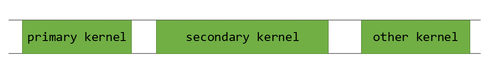

**图 42：GPU 活动时间线。**

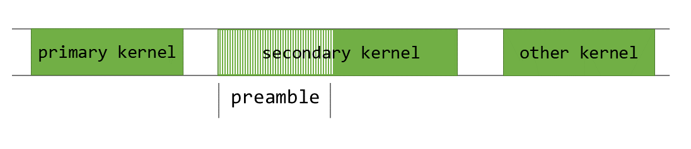

**图 43：secondary_kernel 的前导段。**

图 43 展示了 `secondary_kernel` 中可以并发执行而不影响应用的部分。注意并发启动还允许我们将 `secondary_kernel` 的启动延迟隐藏在 `primary_kernel` 的执行之后。

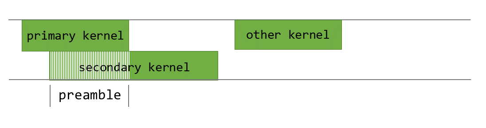

**图 44：primary_kernel 与 secondary_kernel 的并发执行。**

图 44 所示的 `secondary_kernel` 并发启动与执行可以通过程序化依赖启动实现。

程序化依赖启动对 CUDA 内核启动 API 引入了变更，如下一节所述。这些 API 需要至少计算能力 9.0 才能提供重叠执行。

### 4.5.2 API 描述

在程序化依赖启动中，主内核与次内核在同一 CUDA 流中启动。主内核应在准备就绪允许次内核启动时，由所有线程块执行 `cudaTriggerProgrammaticLaunchCompletion`。次内核必须使用如下所示的可扩展启动 API 启动。

```cpp
__global__ void primary_kernel() {
    // 应在启动次内核之前完成的初始工作

    // 触发次内核
    cudaTriggerProgrammaticLaunchCompletion();

    // 可以与次内核同时进行的工作
}

__global__ void secondary_kernel()
{
    // 独立工作

    // 将阻塞，直到次内核所依赖的所有主内核都已完成
    // 并将结果刷新到全局内存
    cudaGridDependencySynchronize();

    // 依赖工作
}

cudaLaunchAttribute attribute[1];
attribute[0].id = cudaLaunchAttributeProgrammaticStreamSerialization;
attribute[0].val.programmaticStreamSerializationAllowed = 1;
configSecondary.attrs = attribute;
configSecondary.numAttrs = 1;

primary_kernel<<<grid_dim, block_dim, 0, stream>>>();
cudaLaunchKernelEx(&configSecondary, secondary_kernel);
```

当使用 `cudaLaunchAttributeProgrammaticStreamSerialization` 属性启动次内核时，CUDA 驱动可以安全地提前启动次内核，而不等待主内核的完成与内存刷新再启动次内核。

CUDA 驱动可以在所有主线程块已启动并执行了 `cudaTriggerProgrammaticLaunchCompletion` 时启动次内核。如果主内核未执行该触发，则它在主内核中所有线程块退出之后隐式发生。

在任一情况下，次线程块可能在主内核所写数据可见之前启动。因此，当次内核配置为程序化依赖启动时，它必须始终使用 `cudaGridDependencySynchronize` 或其他方式验证主内核的结果数据可用。当使用细粒度同步来实现这一点时，次内核仍以程序化依赖启动方式启动，并且仍调用 `cudaGridDependencySynchronize`，但在该调用之前检查所生成数据是否含有哨兵值。因此，它可以在调用 `cudaGridDependencySynchronize` 之前，在数据的每一部分写入后立即消费该部分，而不是等待整个主网格。

请注意，这些方法为主内核与次内核提供了并发执行的机会，但这种行为是机会性的，不保证导致并发内核执行。以这种方式依赖并发执行是不安全的，可能导致死锁。

### 4.5.3 在 CUDA 图中的使用

程序化依赖启动可以通过流捕获或直接通过边数据在 CUDA 图中使用。要使用边数据在 CUDA 图中对此特性进行编程，在连接两个内核节点的边上使用 `cudaGraphDependencyType` 值 `cudaGraphDependencyTypeProgrammatic`。此边类型使上游内核对下游内核中的 `cudaGridDependencySynchronize()` 可见。此类型必须与出端口 `cudaGraphKernelNodePortLaunchCompletion` 或 `cudaGraphKernelNodePortProgrammatic` 一起使用。

流捕获的相应图等价物如下（三个流代码分别映射为：`cudaLaunchAttributeProgrammaticStreamSerialization` → `from_port = cudaGraphKernelNodePortProgrammatic`；`cudaLaunchAttributeProgrammaticEvent` 且 `triggerAtBlockStart = 0` → 同一端口；`triggerAtBlockStart = 1` → `from_port = cudaGraphKernelNodePortLaunchCompletion`）。

## 4.6 细粒度同步

细粒度同步让消费者通过检查数据本身来确定其输入的每个 tile 何时就绪，而不是通过等待标志或等待生产者网格完成。在本章中，tile 是输入数据的一个子集，消费者线程块将其作为单元加载与使用。因此，每个消费者线程块可以在其 tile 就绪后立即使用它，而生产者继续处理其他 tile。这可以减少短依赖内核链中的交接延迟。

该协议用称为哨兵（sentinel）的保留位模式标记尚未写入的数据。缓冲区首先用哨兵初始化。生产者用绝不与哨兵匹配的最终输出值替换它，消费者在加载其输入 tile 时检查哨兵。生产者还必须遵循 4.6.4.3 节的存储规则，以便检查未发现哨兵的 tile 可被视为完成。

本章描述使用 TMA 数据有效性报告的实现，它在计算能力 10.7 的设备上可用。批量异步复制可以在将数据从全局内存传输到共享内存的同时检查哨兵。它通过以 `layout::v1` 格式初始化的共享内存屏障报告结果，该格式将复制完成与数据就绪区分开。如果复制报告哨兵，消费者必须再次发出复制；硬件不会自动重试。

该协议可以协调单独的内核，或融合/持久内核内的线程块，前提是生产者能在消费者等待时继续推进。当生产者使用作用域覆盖两个 GPU 的内存操作写入消费者 GPU 内存中的缓冲区时，它也适用于 GPU 之间（参见 3.2.3 节）。本章涵盖同一 GPU 上的生产者与消费者。本章的示例在一个 GPU 上运行初始化内核、生产者内核与消费者内核，并使用程序化依赖启动让后两者重叠。性能收益取决于该重叠，但正确性不取决于它（参见 4.6.5 节）。

### 4.6.1 定义

本章通篇使用以下术语。

- **Tile**：tile 是输入数据的一个子集，例如矩阵的一个块，消费者线程块将其作为单元加载与使用。此一般含义不同于 CUDA Tile 编程模型中的 tile（参见 1.2.2.3.1 节）。
- **哨兵（Sentinel）**：哨兵是标记生产者尚未写入数据的保留位模式。缓冲区用哨兵初始化，生产者绝不将哨兵作为结果存储。报告机制确定哨兵（参见 4.6.4.1 节）。
- **报告机制（Report Mechanism）**：报告机制确定从全局到共享内存的批量异步复制是否以及如何检查其复制的数据。复制在 PTX 中通过限定符或 `cuda::ptx` 中通过参数指定它。有效性报告机制是除 `.mbarrier::report::disabled` 之外的任何报告机制。它指定哨兵以及复制检查源数据的粒度（参见表 15）。
- **Layout v1**：Layout v1 是 PTX mbarrier 对象的 `layout::v1` 格式。此格式的屏障存储有效载荷报告，并让其主阶段与条件阶段分别推进。使用有效性报告机制的复制必须由 layout v1 屏障跟踪。
- **报告操作（Report-On Operation）**：报告操作在共享内存屏障的有效载荷报告中记录信息。使用有效性报告机制的复制在复制所检查的元素匹配哨兵时，对跟踪它的屏障执行一次报告操作。
- **有效载荷报告（Payload Report）**：有效载荷报告是 layout v1 屏障为每个主阶段存储的信息，由报告谓词与报告值组成。阶段开始时为零，当该阶段跟踪的操作执行报告操作时变为非零。
- **主阶段与条件阶段**：每个 PTX mbarrier 对象无论布局如何都有主阶段与条件阶段。当待处理到达计数与事务计数都达到零时，主阶段推进。在 layout v1 屏障中，只有当有效载荷报告为零时，条件阶段才随之推进（参见 4.6.3.1 节）。
- **报告谓词（Report Predicate）**：报告谓词是有效载荷报告的一部分，由对主阶段的等待返回。仅当等待返回 true 时它才有意义。如果该已完成阶段跟踪的操作执行了报告操作（例如发现哨兵的复制），则为 true。

### 4.6.2 背景

生产者内核将数据（例如张量）写入全局内存，消费者内核读取它。表 14 总结了排序两个内核的方式。

使用普通流排序时，消费者直到生产者完成且其所有写入可见后才被启动。这是最简单也最粗粒度的机制：消费者等待最后一个生产者线程块完成，消费者的启动延迟与设置工作完全暴露。

程序化依赖启动让消费者提前启动，并在生产者仍在执行时运行其设置工作。然而依赖仍在整个网格粒度上解决：消费者中的 `cudaGridDependencySynchronize()` 只有在生产者网格完成且其所有内存操作可见后才返回。

标志协议在两个内核都运行时解决各个线程块之间的依赖。生产者写入一个 tile，执行设备作用域的释放栅栏以便该 tile 在标志之前可见（参见 3.2.3 节），然后写入标志。消费者以获取语义轮询该标志，然后才加载 tile。因此关键路径包含栅栏加上两次依赖的内存往返。

细粒度同步保持标志协议的按 tile 粒度，但移除栅栏与标志。消费者未发现哨兵的加载同时也是交付该数据的加载，因此交接只花费一次内存往返而非两次。作为交换，缓冲区每次使用前必须用哨兵填充，生产者必须遵循一小组规则（参见 4.6.4.3 节）。

**表 14：排序生产者内核与消费者内核的机制**

| 机制 | 消费者等待 | 粒度 | 要求 |
|---|---|---|---|
| 流排序 | 生产者网格完成与内存刷新，然后启动消费者网格 | 网格 | 无 |
| 程序化依赖启动 | 整个生产者网格完成及其写入可见，由消费者中的 `cudaGridDependencySynchronize()` 观察 | 网格 | 消费者以程序化流序化启动 |
| 标志协议 | 生产者在释放栅栏后写入的标志 | Tile | 生产者能在消费者等待时推进；每 tile 一个标志 |
| 细粒度同步 | 数据本身不再持有哨兵 | Tile | 生产者能推进；哨兵初始化缓冲区；生产者遵循 4.6.4.3 节规则 |

### 4.6.3 TMA 数据有效性报告

要使用细粒度同步，消费者使用指定有效性报告机制的从全局到共享内存的批量异步复制来加载每个 tile。复制要么是一维 `cp.async.bulk`，要么是使用张量映射的 `cp.async.bulk.tensor`（参见 4.13.2.2 节）。如果复制所检查的元素匹配哨兵位模式，则对跟踪该复制的共享内存屏障执行报告操作。屏障将其记录在有效载荷报告中，等待的线程可以连同复制完成一起观察。数据仍被写入共享内存；报告只是告诉内核它尚不能被使用。

`.report_mechanism` 限定符仅在从全局到共享内存的复制上受支持。它需要 PTX ISA 9.4 或更高版本，以及计算能力 10.7 的家族特定 `sm_107f` 或架构特定 `sm_107a` 编译目标，或同家族更高目标（参见 5.1.2.2 节）。libcu++ 的 `cuda::ptx` 命名空间通过接收报告机制参数的 `cuda::ptx::cp_async_bulk` 与 `cuda::ptx::cp_async_bulk_tensor` 的额外重载暴露它。表 15 列出了可用的机制。

**表 15：批量异步复制的报告机制**

| PTX 限定符 | cuda::ptx 常量 | 哨兵 | 检查方式 |
|---|---|---|---|
| `.mbarrier::report::disabled`（默认） | `mbarrier_report_disabled`（仅 `cp_async_bulk_tensor`） | 无 | 无 |
| `.mbarrier::report::validity::per_16bytes::80000000` | `mbarrier_report_valid_per_16bytes_80000000` | 0x80000000（32 位 -0.0） | 每个对齐 16 字节一个采样元素 |
| `.mbarrier::report::validity::per_16bytes::8000` | `mbarrier_report_valid_per_16bytes_8000` | 0x8000（16 位 -0.0） | 每个对齐 16 字节一个采样元素 |
| `.mbarrier::report::validity::per_16bytes::80` | `mbarrier_report_valid_per_16bytes_80` | 0x80（8 位 -0.0） | 每个对齐 16 字节一个采样元素 |
| `.mbarrier::report::validity::per_16bytes::8` | `mbarrier_report_valid_per_16bytes_8` | 0x8（4 位 -0.0） | 每个对齐 16 字节一个采样元素 |
| `.mbarrier::report::validity::per_element::ff` | `mbarrier_report_valid_per_element_ff` | 0xFF（8 位 NaN）或 0xF（4 位全一） | 每个元素 |

使用 per-16-byte 机制时，复制将源每个对齐 16 字节块的一个采样元素与模式比较。因此生产者必须将每个块作为一个单元写入（参见 4.6.4.3 节）。`per_element::ff` 机制比较每个元素，因此不依赖于生产者写入完整 16 字节块。

#### 4.6.3.1 屏障布局与阶段

使用有效性报告机制的复制必须由以 PTX mbarrier 对象 `layout::v1` 格式初始化的共享内存屏障跟踪。每个屏障都有主阶段与条件阶段。默认格式 `layout::v0` 跟踪 4.11.6 节所述的待处理到达计数与事务计数，其两个阶段总是一起推进。Layout v1 额外为每个主阶段存储有效载荷报告，并允许两个阶段分别推进：

- 当待处理到达计数与事务计数都达到零时，主阶段推进。对于由屏障跟踪的复制，主完成意味着所有字节都已写入共享内存。
- 只有当完成阶段的有效载荷报告为零（即该阶段跟踪的操作未执行报告操作）时，条件阶段才随主阶段一起推进。如果复制报告了哨兵，主阶段推进但条件阶段不推进。每个主阶段以零有效载荷报告开始。

`mbarrier.test_wait` 与 `mbarrier.try_wait` 指令使用 `.phase_type::primary` 或 `.phase_type::conditional` 限定符选择观察哪个阶段。等待主阶段还会返回一个报告谓词，当有效载荷报告非零时为 true。该谓词仅指示至少有一个由该阶段跟踪的复制匹配其模式；它不识别是哪个复制。因此结果必须区分的复制应由单独的屏障跟踪。

两个阶段直接映射到消费者中的两种角色：

- 负责重新发出复制的线程等待主阶段。如果报告谓词被设置，则数据未就绪。该线程随后以预期字节数再次武装屏障，重新发出复制，并以翻转的奇偶性等待下一个主阶段。
- 对数据进行计算的线程等待条件阶段。当复制报告哨兵时其奇偶性不变，因此这些线程无论复制重新发出多少次都等待相同奇偶性。它们在有复制以有效数据完成时被释放一次。

在 libcu++ 中，屏障使用 `cuda::ptx::mbarrier_init(cuda::ptx::layout_v1, ...)` 创建。包装器 `cuda::ptx::mbarrier_try_wait_parity` 与 `cuda::ptx::mbarrier_test_wait_parity` 接受 `cuda::ptx::mbarrier_phase_primary` 以及接收报告谓词的 `bool&`，或接受不带谓词的 `cuda::ptx::mbarrier_phase_conditional`。`cuda::barrier` 对象使用 layout v0，不能与有效性报告机制一起使用。

> **注意**
>
> layout v1 屏障每阶段最多接受 511（2^9 - 1）次预期到达，而 layout v0 为 2^20 - 1。这与计算结构传输操作用于报告错误的布局和有效载荷报告相同。如果程序将结构操作与使用有效性报告机制的复制组合，则程序行为未定义。

### 4.6.4 协议

本节描述在计算能力 10.7 设备上使用 TMA 数据有效性报告实现的协议。该协议由管理缓冲区的代码、生产者与消费者分五步执行：

1. 选择一个有效数据绝不包含的哨兵值。
2. 在消费者开始加载缓冲区之前，用哨兵初始化缓冲区。
3. 生产数据时绝不写入哨兵，并且每个位置只写一次。使用 per-16-byte 报告机制时，将每个对齐 16 字节块作为单元写入。
4. 在消费者中以报告有效性的批量异步复制加载每个 tile，并在报告哨兵时重新发出复制。
5. 在缓冲区承载下一轮数据之前重新初始化它。

#### 4.6.4.1 哨兵值

报告机制确定哨兵（参见表 15）。对于该表中带符号位的浮点格式，per-16-byte 机制使用负零。负零与正零比较相等，因此生产者可以将其替换为正零，只有检查零符号的操作才能观察到这种替换。`per_element::ff` 机制使用全一模式，即 8 位比例因子格式 ue8m0 与 ue5m3 的 NaN 编码。这些格式没有符号位，因此没有负零。

检查比较原始位模式，与元素类型无关，因此 0x80000000 模式适用于任何 32 位类型，0xFF 模式适用于任何 8 位类型。对于整数数据，哨兵必须是一个可以证明生产者绝不会发出的位模式。使用 `per_element::ff` 机制时，4 位元素的模式为 0xF，每个元素都与它比较。因此 4 位元数据缓冲区用整个 0xFF 字节初始化，使每个字节的两个 4 位元素都持有该模式。表 16 列出了每种元素类型的哨兵。

**表 16：按元素类型的哨兵值**

| 元素类型 | 哨兵值 | 位模式 | 元素宽度 |
|---|---|---|---|
| 32 位浮点（float） | -0.0 | 0x80000000 | 32 位 |
| 16 位浮点（half、bfloat16） | -0.0 | 0x8000 | 16 位 |
| 8 位浮点（e4m3、e5m2） | -0.0 | 0x80 | 8 位 |
| 4 位浮点（e2m1） | -0.0 | 0x8 | 4 位 |
| 无符号位的 8 位比例因子（ue8m0、ue5m3）以及绝不持有 0xFF 的其他 8 位数据 | NaN / 全一 | 0xFF | 8 位 |
| 绝不持有 0xF 的 4 位元数据（例如稀疏性元数据） | 全一 | 0xF（缓冲区以 0xFF 字节初始化） | 4 位 |
| 整数数据 | 生产者绝不发出的值 | 0x80000000、0x8000、0x80 或 0xFF | 32、16 或 8 位 |

#### 4.6.4.2 缓冲区初始化

消费者等待其数据的每个位置必须在生产者写入之前用哨兵初始化。初始化还必须在消费者加载该位置之前对消费者可见。初始化是一组普通存储，随后在初始化代码与消费者之间建立排序。首次初始化通常放在单独的内核或生产者中。

**在单独的内核中。** 同一流中较早的单独内核（或图中较早的节点）写入哨兵，流排序或图依赖保证可见性。这使初始化代码远离生产者与消费者，并让一个内核清除多个缓冲区，但会增加一次启动，并使框架负责调度清除。

**在生产者中。** 生产者在触发依赖启动之前将哨兵写入自己的输出。生产者线程块的线程将哨兵写入该块的输出 tile 并同步。然后一个线程执行释放栅栏，随后执行 `cudaTriggerProgrammaticLaunchCompletion()`：

```cpp
// 块中每个线程将哨兵写入该块的输出 tile。
write_sentinel_to_output_tile();
__syncthreads();
// 块的所有哨兵存储都先于栅栏与触发
if (threadIdx.x == 0) {
    cuda::atomic_thread_fence(cuda::memory_order_release, cuda::thread_scope_device);
    cudaTriggerProgrammaticLaunchCompletion();
}
// 计算并存储结果；它们替换哨兵。
```

在程序顺序中先于 `griddepcontrol.launch_dependents` 的释放栅栏与依赖网格的开始同步。此保证要求两个内核在同一内存同步域中运行且栅栏具有设备作用域，或栅栏具有系统作用域。由于触发在其首次执行时对整个线程块生效，写入哨兵的线程在触发之前同步，以便每个哨兵存储都排在栅栏之前。

哨兵存储、栅栏与触发会延迟消费者的启动。它们也会延迟生产者自身的工作，除非由原本空闲的 warp 执行它们。当一个 warp 写入哨兵，而其他 warp 计算替换它的输出值时，warp 必须同步，以便每个输出存储都排在同一位置的哨兵存储之后。单独初始化内核则让生产者在其开始时触发，如示例所示。

如果用批量异步存储写入哨兵，则发出它们的线程必须在块同步之前用 `cp.async.bulk.commit_group` 提交它们，并用 `cp.async.bulk.wait_group` 等待其完成。该指令的 `.read` 变体只等待源已被读取，这不够。

如果用普通存储写入哨兵，而用批量异步存储写入结果，则两种存储使用不同的代理。然后每个线程还必须在其哨兵存储之后、块同步之前执行代理栅栏（`cuda::ptx::fence_proxy_async`）（参见异步代理）。

持久生产者的每个线程块可以执行多个线程块索引的工作，例如在网格跨步循环中。它首先将哨兵写入所有这些索引的输出 tile，然后同步、执行释放栅栏并触发一次，而不是每个索引触发一次。如果线程块在触发后获得更多索引（例如通过集群启动控制），则它们的输出 tile 必须已持有哨兵，例如来自单独的初始化内核。

#### 4.6.4.3 生产者规则

生产者必须遵循三条规则：绝不写入哨兵、每个位置只写一次，以及在使用 per-16-byte 报告机制时将每个对齐 16 字节块作为单元写入。第一条规则防止消费者无限等待；后两条规则使检查未发现哨兵的 tile 可被视为完成。

**规范化。** 发出哨兵作为合法值 的生产者可能使消费者无限等待，因此结果必须在存储前规范化。以负零作为哨兵时，负零结果被替换为正零。使用 `__fadd_rn()` 加正零可做到这一点，如示例所示，因为在最近舍入模式下负零加正零为正零。与 `0.0f` 进行相等比较随后选择，也会将负零替换为正零，因为该比较对两个零都为真。对于 `sm_107f` 与 `sm_107a` 编译目标，PTX `cvt` 指令接受 `.pzo`（仅正零）限定符。此限定符作为收窄浮点转换（例如从 float 到 half 或 8 位格式）的一部分执行相同替换。

以 NaN 模式作为哨兵时，生产者同样绝不能存储 NaN。使用 `fmaxf` 与 `fminf` 进行钳制可移除 NaN，因为当另一操作数为 NaN 时这些函数返回数值操作数。以整数哨兵时，生产者绝不能存储该值，例如通过饱和结果使其远离该值。

**只写一次。** 每个位置必须用其最终值写一次。先写入部分结果、随后更新 的位置（如使用原子加的 split-K 归约）不适用于此协议。消费者可能接受部分值。

**完整块。** 生产者用单次 128 位存储写入每个对齐 16 字节块，例如示例中包装在小辅助函数中的 PTX `st.relaxed.gpu.global.b128` 指令。带 `.relaxed.gpu` 限定符与 `.b128` 类型的批量异步存储也用单次 128 位操作写入每个对齐块。使用 per-16-byte 报告机制时，将每个块作为单元写入是一项要求。检查可能只检查每块一个元素，因此由多个较窄存储拼装的块可能在仍有一些元素持有哨兵时被报告为有效。

#### 4.6.4.4 消费者检查

消费者使用使用有效性报告机制的批量异步复制加载每个 tile，并在报告谓词被设置时重新发出复制（参见 4.6.3.1 节）。以获取语义等待条件阶段的线程（如示例所示）可以在该阶段完成后立即使用该 tile，无需任何进一步的栅栏。这仅涵盖复制所加载的数据。如果消费者还依赖生产者写入的其他数据，则该数据仍需常规同步，例如 `cudaGridDependencySynchronize()` 或释放-获取对。

#### 4.6.4.5 缓冲区复用

在缓冲区承载下一轮数据之前，必须重新初始化它，并且重新初始化不得与仍在读取上一轮的消费者竞争。在两三个缓冲区之间轮转可使清除远离关键路径，因为一个缓冲区可以在其他缓冲区被写入与读取时被清除。

消费者也可以在其消费完每个 tile 后重新初始化该 tile，例如在持久或迭代内核中。仅当没有其他消费者线程块仍可能读取该 tile 时（例如单个消费者线程块读取每个 tile 时）这才安全。重新初始化还必须排在下一个生产者的写入之前，并在下一个消费者加载该 tile 之前可见，这可能需要代理栅栏（参见异步代理）。

#### 4.6.4.6 部分 tile 与填充

使用有效性报告 的复制所读取的每个元素最终都必须持有非哨兵值，否则消费者可能无限等待。生产者绝不写入的元素（例如最后一个 tile 超出有效数据的部分，或为对齐插入的填充）可以用三种方式处理：

- 这些元素用非哨兵值初始化。
- 生产者用规范值（如正零）写入它们。
- 复制限制为有效数据，例如通过张量映射的边界。

当有效数据结束于对齐 16 字节块内部时（例如张量的某一行不是 16 字节的整数倍），该块的其余部分需要小心处理。即使张量映射边界将其从复制中排除，其超出有效数据的字节也必须最终持有非哨兵值。最简单的方式是生产者将整个块作为单元写入，在有效数据之外使用规范值。使用 per-16-byte 机制时，仅用非哨兵值初始化那些字节可能不够，因为该块可能在其有效数据写入之前被接受。

带 `.ignore_oob` 限定符的一维复制不能使用有效性报告机制（参见 `cp.async.bulk`）。

### 4.6.5 生产者与消费者并发

等待某个 tile 的消费者线程块在生产者写入该 tile 之前无法推进。因此生产者必须能在消费者线程块等待时推进，性能收益仅在两个内核重叠时出现。本章将细粒度同步与程序化依赖启动配对，后者保证生产者的推进并允许两个内核重叠：

- 生产者在其初始化策略允许时尽早调用 `cudaTriggerProgrammaticLaunchCompletion()`（参见 4.6.4.2 节），以便消费者可以在生产者仍在计算时被调度。
- 消费者以 `cudaLaunchAttributeProgrammaticStreamSerialization` 属性启动，或在 CUDA 图中通过来自 `cudaGraphKernelNodePortProgrammatic` 端口的程序化边启动（参见 4.5.3 节）。
- 消费者在调用 `cudaGridDependencySynchronize()` 之前加载所生产的数据。该调用等待整个生产者网格，这是细粒度同步为已加载数据所替代的粗粒度依赖。消费者仍必须进行该调用，例如在其消费完已加载数据之后，此时该调用不在交接关键路径上。

**推进保证。** 在生产者每个线程块都已执行触发或已退出之前，消费者网格不会被启动。因此当第一个消费者线程块开始加载数据时，生产者每个线程块都已驻留或已完成。消费者线程块不能阻止任何生产者线程块被调度。

**分离的流。** 当生产者与消费者位于不同流中时，程序化事件提供相同的推进保证。生产者以 `cudaLaunchAttributeProgrammaticEvent` 属性启动，记录使用 `cudaEventDisableTiming` 创建的事件，消费者的流等待该事件。当两个流被捕获到 CUDA 图中时，此依赖变为两个内核节点之间的程序化边（参见 4.5.3 节）。如果属性的 `triggerAtBlockStart` 字段非零，事件可以在每个生产者线程块都已开始后立即触发。此时哨兵必须在生产者开始之前写入，例如由单独的内核完成。消费者仍在其消费完已加载数据之后调用 `cudaGridDependencySynchronize()`。没有这样的依赖，两个启动无序，先占用 GPU 的消费者可能使生产者饥饿（参见 5.9.3.1 节）。

**重叠。** 两个内核是否实际重叠仍是机会性的，如同一般的程序化依赖启动。没有重叠时协议也是正确的，因为消费者会重新发出其复制直到数据存在。重叠可能发生在生产者最后一波留下的空闲 SM 上，或在有空间容纳两个内核线程块的 SM 上。示例采取两个进一步步骤使重叠更可能：

- 示例在序列启动之前用 `cudaFuncGetAttributes()` 加载全部三个内核，如 4.9.5 节所建议。使用默认启用的延迟加载时，内核否则会在其首次启动时加载，这可能串行化内核执行。
- 示例为生产者与消费者设置相同的 `cudaFuncAttributePreferredSharedMemoryCarveout` 值（参见 3.2.6 节）。SM 的 L1 缓存与共享内存共享一个统一数据缓存，其划分按内核配置，具有不同共享内存配置的内核可能在其重配置之后串行化。驱动将划分比例视为提示。

### 4.6.6 示例

以下示例在一个流中用三个内核实现 float 数据的协议。一个初始化内核用哨兵填充中间缓冲区，一个生产者内核将输入数组加倍写入该缓冲区，一个消费者内核反转结果中每个 1024 元素 tile 的元素。每个生产者线程写入一个 16 字节块，每个消费者线程块使用报告有效性的一维批量异步复制将一个 tile 加载到共享内存。示例定义了哨兵、结果规范化与初始化内核（使用 16 字节存储将缓冲区填充为哨兵），生产者在内核开始时触发依赖启动、随后规范化结果并用单次 relaxed 128 位设备作用域存储写入每个块；消费者由线程 0 初始化 layout v1 屏障、以 32 位负零报告机制发出复制，并在报告谓词指示 tile 未就绪时重新发出，所有线程以奇偶性 0 等待条件阶段后读取 tile，并在写入结果后调用 `cudaGridDependencySynchronize()`。

在主机上，三个内核被预加载，生产者与消费者获得相同的共享内存划分比例（参见 4.6.5 节）。然后三个内核被启动到一个流中。流排序使哨兵在生产者开始前可见，只有消费者以程序化流序化启动，以便它可以在生产者运行时开始。

### 4.6.7 小结

参数与要求：多阶段内核流水线以结果缓冲区由生产者网格写入、消费者网格读取的典型场景为例。其参数为 tile 字节数、tile 数、内核数、生产者输出缓冲区的数目、划分比例以及流/启动配置。所有设备都必须支持计算能力 10.7；内核在流中排队，且只有消费者以程序化流序化启动。

### 4.6.8 指南

以下要点涵盖该技术何时有益以及常见错误来源。

**适用性。** 细粒度同步可以缩短内核之间的交接。它可以使短内核链受益，其消费者线程块可以在生产者最后线程块仍在运行时开始。长的吞吐受限内核收益很小，而且它们仍需支付初始化成本。

**泄漏的哨兵。** 如果复制所依赖的某个位置一直持有哨兵，消费者可能挂起，例如未写入的填充（参见 4.6.4.6 节），或当 NaN 为哨兵时的 NaN 结果（参见 4.6.4.3 节）。调试时，在大量重新发出之后触发陷阱的重试循环可将此类挂起变为主机可观察的错误。

**缺少初始化。** 每次使用前未用哨兵初始化的缓冲区可能导致错误结果而非挂起。复制对陈旧数据不报告任何内容，消费者将其接受为就绪。

## 4.7 绿色上下文

绿色上下文（Green Context，GC）是一种轻量级上下文，从其创建时就与一组特定的 GPU 资源关联。用户可以在创建绿色上下文时对 GPU 资源（目前是流式多处理器 SM 与工作队列 WQ）进行划分，以便针对绿色上下文的 GPU 工作只能使用其配置的 SM 与工作队列。这样做有利于减少或更好地控制因使用公共资源而导致的干扰。一个应用可以有多个绿色上下文。

使用绿色上下文不需要任何 GPU 代码（内核）更改，只需少量主机侧更改（例如创建绿色上下文以及为该绿色上下文创建流）。绿色上下文功能在各种场景中都很有用。例如，它可以帮助确保始终有一些 SM 可供延迟敏感的内核开始执行（假定没有其他约束），或提供一种无需任何内核修改即可快速测试使用更少 SM 效果的方法。

绿色上下文支持最初通过 CUDA 驱动 API 提供。从 CUDA 13.1 开始，上下文通过执行上下文（Execution Context，EC）抽象暴露在 CUDA 运行时中。目前，执行上下文可以对应主上下文（运行时 API 用户一直隐式交互的上下文）或绿色上下文。本节在指代绿色上下文时将交替使用执行上下文与绿色上下文这两个术语。

随着绿色上下文在运行时中的暴露，强烈建议直接使用 CUDA 运行时 API。本节也将仅使用 CUDA 运行时 API。

本节余下部分组织如下：4.7.1 节提供一个动机示例，4.7.2 节强调易用性，4.7.3 节介绍设备资源与资源描述符结构体，4.7.4 节解释如何创建绿色上下文，4.7.5 节说明如何启动针对它的工作，4.7.6 节强调一些额外的绿色上下文 API。最后，4.7.7 节以一个示例收尾。

### 4.7.1 动机 / 何时使用

当启动 CUDA 内核时，用户无法直接控制该内核将在多少个 SM 上执行。只能通过更改内核的启动几何形状或任何可能影响内核每 SM 最大活动线程块数的因素来间接影响它。此外，当多个内核在 GPU 上并行执行时（在不同 CUDA 流上运行或作为 CUDA 图一部分运行的内核），它们也可能争用相同的 SM 资源。

然而，有些用例中用户需要确保始终有 GPU 资源可用于延迟敏感工作，以使其尽快开始并完成。绿色上下文通过划分 SM 资源提供了一种方法，使给定绿色上下文只能使用特定的 SM（其创建时配置的那些）。

图 45 说明了这样一个示例。假设一个应用的两个独立内核 A 与 B 在两个不同的非阻塞 CUDA 流上运行。内核 A 先启动并开始执行，占用所有可用的 SM 资源。当延迟敏感的内核 B 稍后启动时，没有可用的 SM 资源。因此内核 B 只能在内核 A 减速后才能开始执行，即一旦来自内核 A 的线程块完成执行。第一张图说明了这种关键工作 B 被延迟的场景。y 轴显示占用 SM 的百分比，x 轴描绘时间。

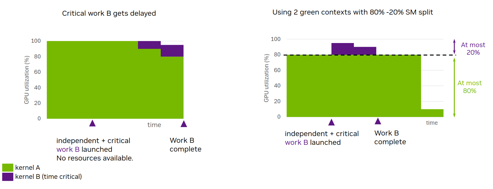

**图 45：动机：GC 的静态资源划分使延迟敏感工作 B 能更早开始并完成。**

使用绿色上下文，可以划分 GPU 的 SM，使内核 A 针对的绿色上下文 A 可访问 GPU 的部分 SM，而内核 B 针对的绿色上下文 B 可访问剩余的 SM。在此设置中，内核 A 只能使用为绿色上下文 A 配置的 SM，无论其启动配置如何。因此，当关键内核 B 启动时，保证有可用的 SM 供其立即开始执行（除非有其他资源约束）。如图 45 的第二张图所示，即使内核 A 的持续时间可能增加，延迟敏感工作 B 也不再因 SM 不可用而被延迟。该图显示绿色上下文 A 配置了相当于 GPU 80% SM 的 SM 数量，仅用于说明。

这种 行为无需对内核 A 与 B 做任何代码修改即可实现。只需确保它们在属于适当绿色上下文的 CUDA 流上启动。每个绿色上下文可访问的 SM 数量应由用户在创建绿色上下文时按具体情况决定。

**工作队列。** 流式多处理器是可以为绿色上下文配置的一种资源类型。另一种资源类型是工作队列。可以将工作队列看作一种黑盒资源抽象，它也可以与其他因素一起影响 GPU 工作执行并发性。如果独立的 GPU 工作任务（例如提交到不同 CUDA 流的内核）映射到同一工作队列，则可能在这些任务之间引入虚假依赖，从而导致它们串行执行。用户可以通过 `CUDA_DEVICE_MAX_CONNECTIONS` 环境变量（参见 5.2 节、3.1 节）影响 GPU 上工作队列的上限。

在上一示例的基础上，假设工作 B 与工作 A 映射到同一工作队列。

在这种情况中，即使 SM 资源可用（绿色上下文情况），工作 B 仍可能需要等待工作 A 完全完成。与 SM 类似，用户无法直接控制底层可能使用的特定工作队列。但绿色上下文允许用户以预期并发流序工作负载数来表达他们期望的最大并发性。驱动随后可以将此值作为提示，尝试防止来自不同执行上下文的工作使用同一工作队列，从而防止执行上下文之间不必要的干扰。

> **注意**
>
> 即使每个绿色上下文配置了不同的 SM 资源与工作队列，也不保证独立 GPU 工作的并发执行。最好将绿色上下文一节中描述的所有技术视为消除可能阻止并发执行的因素（即减少潜在干扰）。

**绿色上下文与 MIG 或 MPS 的对比**

为完整起见，本节简要比较绿色上下文与另外两种资源划分机制：MIG（Multi-Instance GPU）与 MPS（Multi-Process Service）。

MIG 将支持 MIG 的 GPU 静态划分为多个 MIG 实例（“更小的 GPU”）。此划分必须在应用启动之前完成，不同应用可以使用不同的 MIG 实例。对于应用持续欠利用可用 GPU 资源的用户，使用 MIG 可能有益；随着 GPU 变得更大，这个问题更加突出。使用 MIG，用户可以在不同 MIG 实例上运行这些不同应用，从而提高 GPU 利用率。MIG 对云服务提供商（CSP）很有吸引力，不仅因为提高了此类应用的 GPU 利用率，还因为它可以在不同 MIG 实例上运行的客户端之间提供服务质量（QoS）与隔离。更多细节请参见上文链接的 MIG 文档。

但使用 MIG 无法解决前面描述的问题场景，即关键工作 B 因所有 SM 资源被同一应用的其他 GPU 工作占用而延迟。在单个 MIG 实例上运行的应用仍可能存在此问题。为解决它，可以结合 MIG 使用绿色上下文。在这种情况下，可用于划分的 SM 资源将是给定 MIG 实例的资源。

MPS 主要面向不同进程（例如 MPI 程序），允许它们同时运行在 GPU 上而无需时间切片。它要求应用启动之前 MPS 守护进程正在运行。默认情况下，MPS 客户端将争用它们所运行的 GPU 或 MIG 实例的所有可用 SM 资源。在这种多客户端进程设置中，MPS 可以使用活动线程百分比选项支持 SM 资源的动态划分，该选项为 MPS 客户端进程可使用的 SM 百分比设置上限。与绿色上下文不同，活动线程百分比划分在进程级别与 MPS 一起发生，且百分比通常由应用启动之前的环境变量指定。MPS 活动线程百分比意味着给定客户端应用不能使用超过 GPU SM 的 x%，假设为 N 个 SM。然而，这些 SM 可以是 GPU 的任意 N 个 SM，并且可能随时间变化。另一方面，创建时配置了 N 个 SM 的绿色上下文只能使用这些特定 N 个 SM。

从 CUDA 13.1 开始，如果启动 MPS 控制守护进程时显式启用，MPS 还支持静态划分。使用静态划分时，用户必须在应用启动时指定 MPS 客户端进程可以使用的静态分区。此时活动线程百分比的动态共享不再适用。静态划分模式下的 MPS 与绿色上下文之间的关键区别是：MPS 面向不同进程，而绿色上下文也适用于单个进程内。此外，与绿色上下文相反，具有静态划分的 MPS 不允许 SM 资源的超额订阅。

使用 MPS，还可以对通过 `cuCtxCreate` 驱动 API 创建、具有执行亲和性的 CUDA 上下文进行 SM 资源的编程划分。这种编程划分允许来自一个或多个进程的不同客户端 CUDA 上下文各自使用最多指定数量的 SM。与活动线程百分比划分一样，这些 SM 可以是 GPU 的任意 SM，并且可能随时间变化，这与绿色上下文情况不同。即使存在静态 MPS 划分，也可以使用此选项。请注意，与 MPS 上下文相比，创建绿色上下文要轻量得多，因为许多底层结构由主上下文拥有并因此共享。

### 4.7.2 绿色上下文：易用性

为突出绿色上下文使用起来多么容易，假设你有以下代码片段，它创建两个 CUDA 流，然后调用一个通过 `<<<>>>` 在这些 CUDA 流上启动内核的函数。如前所述，除了更改内核的启动几何形状之外，无法影响这些内核可以使用多少个 SM。

```cpp
int gpu_device_index = 0; // GPU 序号
CUDA_CHECK(cudaSetDevice(gpu_device_index));
cudaStream_t strm1, strm2;
CUDA_CHECK(cudaStreamCreateWithFlags(&strm1, cudaStreamNonBlocking));
CUDA_CHECK(cudaStreamCreateWithFlags(&strm2, cudaStreamNonBlocking));
// 无法控制每个流上运行的内核可以使用多少个 SM
code_that_launches_kernels_on_streams(strm1, strm2);
// 清理代码未展示
```

从 CUDA 13.1 开始，可以使用绿色上下文控制给定内核可访问的 SM 数量。下面的代码片段展示了这有多容易。只需少量额外代码，且无需任何内核修改，就可以控制在这些不同流上启动的内核可使用的 SM 资源。

```cpp
int gpu_device_index = 0; // GPU 序号
CUDA_CHECK(cudaSetDevice(gpu_device_index));

/* ------------------ 创建绿色上下文所需的代码 ------------------ */
// 获取所有可用的 GPU SM 资源
cudaDevResource initial_GPU_SM_resources {};
CUDA_CHECK(cudaDeviceGetDevResource(gpu_device_index, &initial_GPU_SM_resources,
                                    cudaDevResourceTypeSm));
// 划分 SM 资源。此示例创建一个 16 个 SM 的组和一个 8 个 SM 的组。
// 假定你的 GPU 至少有 24 个 SM
cudaDevSmResource result[2] {{}, {}};
cudaDevSmResourceGroupParams group_params[2] =
{
    {.smCount=16, .coscheduledSmCount=0, .preferredCoscheduledSmCount=0, .flags=0},
    {.smCount=8,  .coscheduledSmCount=0, .preferredCoscheduledSmCount=0, .flags=0}
};
CUDA_CHECK(cudaDevSmResourceSplit(&result[0], 2, &initial_GPU_SM_resources,
                                  nullptr, 0, &group_params[0]));
// 为每个资源生成资源描述符
cudaDevResourceDesc_t resource_desc1 {};
cudaDevResourceDesc_t resource_desc2 {};
CUDA_CHECK(cudaDevResourceGenerateDesc(&resource_desc1, &result[0], 1));
CUDA_CHECK(cudaDevResourceGenerateDesc(&resource_desc2, &result[1], 1));
// 创建绿色上下文
cudaExecutionContext_t my_green_ctx1 {};
cudaExecutionContext_t my_green_ctx2 {};
CUDA_CHECK(cudaGreenCtxCreate(&my_green_ctx1, resource_desc1, gpu_device_index, 0));
CUDA_CHECK(cudaGreenCtxCreate(&my_green_ctx2, resource_desc2, gpu_device_index, 0));

/* ------------------ 修改后的代码 ------------------ */
// 你只需使用不同的 CUDA API 创建流
cudaStream_t strm1, strm2;
CUDA_CHECK(cudaExecutionCtxStreamCreate(&strm1, my_green_ctx1, cudaStreamDefault, 0));
CUDA_CHECK(cudaExecutionCtxStreamCreate(&strm2, my_green_ctx2, cudaStreamDefault, 0));

/* ------------------ 未更改的代码 ------------------ */
// 无需修改此函数或内核中的任何代码。
// 现在运行在流 strm1 上的内核将最多使用 16 个 SM，
// 而运行在 strm2 上的内核最多使用 8 个 SM。
code_that_launches_kernels_on_streams(strm1, strm2);
// 清理代码未展示
```

各种执行上下文 API（其中一些已在上一示例中展示）接受显式的 `cudaExecutionContext_t` 句柄，因此忽略当前调用线程的上下文。到目前为止，不使用驱动 API 的 CUDA 运行时用户默认只会与通过 `cudaSetDevice()` 隐式设为线程当前上下文的主上下文交互。这种向显式基于上下文编程的转变提供了更易于理解的语义，并且与先前依赖线程局部存储（TLS）的隐式基于上下文编程相比可能带来额外好处。

以下各节将详细解释上一代码片段中展示的所有步骤。

### 4.7.3 绿色上下文：设备资源与资源描述符

绿色上下文的核心是与特定 GPU 设备关联的设备资源（`cudaDevResource`）。资源可以组合并封装到描述符（`cudaDevResourceDesc_t`）中。绿色上下文只能访问用于其创建的描述符中所封装的资源。

目前 `cudaDevResource` 数据结构定义为：

```cpp
struct {
    enum cudaDevResourceType type;
    union {
        struct cudaDevSmResource sm;
        struct cudaDevWorkqueueConfigResource wqConfig;
        struct cudaDevWorkqueueResource wq;
    };
};
```

受支持的有效资源类型为 `cudaDevResourceTypeSm`、`cudaDevResourceTypeWorkqueueConfig` 与 `cudaDevResourceTypeWorkqueue`，而 `cudaDevResourceTypeInvalid` 标识无效资源类型。

有效的设备资源可以与以下之一关联：

- 一组特定的流式多处理器（SM）（资源类型 `cudaDevResourceTypeSm`），
- 特定的工作队列配置（资源类型 `cudaDevResourceTypeWorkqueueConfig`），或
- 预先存在的工作队列资源（资源类型 `cudaDevResourceTypeWorkqueue`）。

可以分别使用 `cudaExecutionCtxGetDevResource` 与 `cudaStreamGetDevResource` API 查询给定执行上下文或 CUDA 流是否与给定类型的 `cudaDevResource` 资源关联。执行上下文也可以与不同类型的设备资源（例如 SM 与工作队列）关联，而流只能与 SM 类型资源关联。

给定 GPU 设备默认拥有全部三种设备资源类型：一个涵盖 GPU 所有 SM 的 SM 类型资源、一个涵盖所有可用工作队列的工作队列配置资源及其对应的工作队列资源。这些资源可以通过 `cudaDeviceGetDevResource` API 检索。

**相关设备资源结构体概览**

不同资源类型结构体的字段由用户显式设置或由相关 CUDA API 调用设置。建议对所有设备资源结构体进行零初始化。

- SM 类型设备资源（`cudaDevSmResource`）有以下相关字段：
  - `unsigned int smCount`：此资源中可用的 SM 数量
  - `unsigned int minSmPartitionSize`：划分此资源所需的最小 SM 数
  - `unsigned int smCoscheduledAlignment`：资源中保证在同一 GPU 处理集群上共同调度的 SM 数，与线程块集群相关。当 `flags` 为零时，`smCount` 是该值的整数倍。
  - `unsigned int flags`：支持的标志为 0（默认）、`cudaDevSmResourceGroupBackfill` 与 `cudaDevSmResourceGroupLocalityDomainId`。
  上述字段将通过用于创建此 SM 类型资源的适当划分 API（`cudaDevSmResourceSplitByCount` 或 `cudaDevSmResourceSplit`）设置，或由检索给定 GPU 设备 SM 资源的 `cudaDeviceGetDevResource` API 填充。这些字段绝不应由用户直接设置。下一节有更多细节。
- 工作队列配置设备资源（`cudaDevWorkqueueConfigResource`）有以下相关字段：
  - `int device`：工作队列资源可用的设备
  - `unsigned int wqConcurrencyLimit`：预期避免虚假依赖的流序工作负载数
  - `enum cudaDevWorkqueueConfigScope sharingScope`：工作队列资源的共享作用域。支持的值为 `cudaDevWorkqueueConfigScopeDeviceCtx`（默认）与 `cudaDevWorkqueueConfigScopeGreenCtxBalanced`。使用默认选项时，所有工作队列资源跨所有上下文共享；使用 balanced 选项时，驱动尝试在绿色上下文之间尽可能使用不重叠的工作队列资源，使用用户指定的 `wqConcurrencyLimit` 作为提示。
  这些字段需要由用户设置。除 `cudaDeviceGetDevResource` API 填充的工作队列配置资源之外，没有类似划分 API 的 CUDA API 生成工作队列配置资源。该 API 可以检索给定 GPU 设备的工作队列配置资源。
- 最后，预先存在的工作队列资源（`cudaDevResourceTypeWorkqueue`）没有可由用户设置的字段。与其他资源类型一样，`cudaDevGetDevResource` 可以检索给定 GPU 设备的预先存在的工作队列资源。

### 4.7.4 绿色上下文创建示例

绿色上下文创建涉及四个主要步骤：

- 步骤 1：从一组初始资源开始，例如获取 GPU 的可用资源
- 步骤 2：将 SM 资源划分为一个或多个分区（使用可用的划分 API 之一）
- 步骤 3：创建资源描述符，必要时组合不同资源
- 步骤 4：从描述符创建绿色上下文，配置其资源

绿色上下文创建后，可以创建属于该绿色上下文的 CUDA 流。随后在此类流上启动的 GPU 工作（例如通过 `<<<>>>` 启动的内核）将只能访问此绿色上下文配置的资源。只要用户向其传递属于绿色上下文的流，库也可以轻松利用绿色上下文。更多细节参见“绿色上下文——启动工作”。

#### 4.7.4.1 步骤 1：获取可用 GPU 资源

绿色上下文创建的第一步是获取可用设备资源并填充 `cudaDevResource` 结构体。目前有三个可能的起点：设备、执行上下文或 CUDA 流。

相关 CUDA 运行时 API 函数签名如下：

- 对于设备：`cudaError_t cudaDeviceGetDevResource(int device, cudaDevResource* resource, cudaDevResourceType type)`
- 对于执行上下文：`cudaError_t cudaExecutionCtxGetDevResource(cudaExecutionContext_t ctx, cudaDevResource* resource, cudaDevResourceType type)`
- 对于流：`cudaError_t cudaStreamGetDevResource(cudaStream_t hStream, cudaDevResource* resource, cudaDevResourceType type)`

所有这些 API 都允许所有有效的 `cudaDevResourceType` 类型，但 `cudaStreamGetDevResource` 例外，它只支持 SM 类型资源。

通常起点将是 GPU 设备。下面的代码片段展示如何获取给定 GPU 设备的可用 SM 资源。成功调用 `cudaDeviceGetDevResource` 后，用户可以查看此资源中可用的 SM 数量。

```cpp
int current_device = 0; // 假设设备序号为 0
CUDA_CHECK(cudaSetDevice(current_device));
cudaDevResource initial_SM_resources = {};
CUDA_CHECK(cudaDeviceGetDevResource(current_device /* GPU 设备 */,
                                    &initial_SM_resources /* 要填充的设备资源 */,
                                    cudaDevResourceTypeSm /* 资源类型 */));
std::cout << "Initial SM resources: " << initial_SM_resources.sm.smCount
          << " SMs" << std::endl; // 可用 SM 数量
// 与划分相关的特殊字段（参见下面步骤 3）
std::cout << "Min. SM partition size: "
          << initial_SM_resources.sm.minSmPartitionSize << " SMs" << std::endl;
std::cout << "SM co-scheduled alignment: "
          << initial_SM_resources.sm.smCoscheduledAlignment << " SMs" << std::endl;
```

也可以获取可用的工作队列配置资源，如下所示。

```cpp
int current_device = 0;
CUDA_CHECK(cudaSetDevice(current_device));
cudaDevResource initial_WQ_config_resources = {};
CUDA_CHECK(cudaDeviceGetDevResource(current_device, &initial_WQ_config_resources,
                                    cudaDevResourceTypeWorkqueueConfig));
std::cout << "Initial WQ config. resources: " << std::endl;
std::cout << "  - WQ concurrency limit: "
          << initial_WQ_config_resources.wqConfig.wqConcurrencyLimit << std::endl;
std::cout << "  - WQ sharing scope: "
          << initial_WQ_config_resources.wqConfig.sharingScope << std::endl;
```

当起点是 GPU 设备时，`wqConcurrencyLimit` 将与 `CUDA_DEVICE_MAX_CONNECTIONS` 环境变量的值或其默认值匹配。

#### 4.7.4.2 步骤 2：划分 SM 资源

第二步是使用 `cudaDevSmResourceSplitByCount()` 或 `cudaDevSmResourceSplit()` API 将可用 `cudaDevResource` SM 资源静态划分为一个或多个分区（可能在剩余分区中留下一些 SM）。`cudaDevSmResourceSplitByCount()` API 只能创建一个或多个同构分区（加上可能的剩余分区），而 `cudaDevSmResourceSplit()` API 还可以创建异构分区（加上可能的剩余分区）。两个 API 都仅适用于 SM 类型设备资源。

**cudaDevSmResourceSplitByCount API**

运行时 API 签名为：

```cpp
cudaError_t cudaDevSmResourceSplitByCount(cudaDevResource* result,
                                          unsigned int* nbGroups,
                                          const cudaDevResource* input,
                                          cudaDevResource* remaining,
                                          unsigned int useFlags,
                                          unsigned int minCount)
```

用户请求将输入 SM 类型设备资源划分为 `*nbGroups` 个同构组，每组 `minCount` 个 SM。然而，最终结果将包含可能更新过的 `*nbGroups` 个同构组，每组 N 个 SM。可能更新过的 `*nbGroups` 将小于或等于最初请求的组数，而 N 将等于或大于 `minCount`。这些调整可能由于某些特定于架构的粒度与对齐要求而发生。

表 33 列出了当前所有受支持计算能力在默认 `useFlags=0` 情况下的最小 SM 分区大小与 SM 共同调度对齐。也可以通过 `cudaDevSmResource` 的 `minSmPartitionSize` 与 `smCoscheduledAlignment` 字段检索这些值，如步骤 1 所示。其中一些要求可以通过不同的 `useFlags` 值降低。表 17 提供了一些相关示例，突出显示请求与实际结果之间的差异及解释。该表以计算能力 9.0（CC 9.0）为重点，如果 `useFlags` 为零，则每个分区的最小 SM 数为 8，且 SM 数必须是 8 的整数倍。

**表 17：划分功能**

| 请求的 *nbGroups | 请求的 minCount | useFlags | 实际（GH200，132 SM）*nbGroups 各含 N 个 SM | 剩余 SM | 原因 |
|---|---|---|---|---|---|
| 2 | 72 | 0 | 1 组 72 SM | 60 | 不能超过 132 SM |
| 6 | 11 | 0 | 6 组 16 SM | 36 | 8 的倍数要求 |
| 6 | 11 | CU_DEV_SM_RESOURCE_SPLIT_IGNORE_SM_COSCHEDULING | 6 组各 12 SM | 60 | 降低为 2 的倍数要求 |
| 2 | 1 | 0 | 2 组各 8 SM | 116 | 最少 8 SM 要求 |

以下代码片段请求将可用 SM 资源划分为五个各含 8 个 SM 的组：

```cpp
cudaDevResource avail_resources = {};
// 填充 avail_resources 的代码未展示
unsigned int min_SM_count = 8;
unsigned int actual_split_groups = 5; // 可能被更新
cudaDevResource actual_split_result[5] = {{}, {}, {}, {}, {}};
cudaDevResource remaining_partition = {};
CUDA_CHECK(cudaDevSmResourceSplitByCount(&actual_split_result[0],
                                          &actual_split_groups,
                                          &avail_resources,
                                          &remaining_partition,
                                          0 /*useFlags*/,
                                          min_SM_count));
std::cout << "Split " << avail_resources.sm.smCount << " SMs into "
          << actual_split_groups << " groups with "
          << actual_split_result[0].sm.smCount << " each and a remaining group with "
          << remaining_partition.sm.smCount << " SMs" << std::endl;
```

请注意：

- 可以使用 `result=nullptr` 查询将创建的组数。
- 如果不在乎剩余分区的 SM，可以将 `remaining` 设为 `nullptr`。
- 剩余（遗留）分区与 `result` 中的同构组不具有相同的功能或性能保证。
- `useFlags` 在默认情况下预期为 0，但也支持 `cudaDevSmResourceSplitIgnoreSmCoscheduling` 与 `cudaDevSmResourceSplitMaxPotentialClusterSize` 值。
- 任何所得的 `cudaDevResource` 在未先从中创建资源描述符与绿色上下文（即下面的步骤 3 与步骤 4）之前，不能重新划分。

更多细节请参见 `cudaDevSmResourceSplitByCount` 运行时 API 参考。

**cudaDevSmResourceSplit API**

如前所述，单次 `cudaDevSmResourceSplitByCount` API 调用只能创建同构分区（即 SM 数相同的分区）加上剩余分区。这对于异构工作负载可能有限，因为不同绿色上下文上运行的工作有不同 SM 数需求。为使用 split-by-count API 实现异构分区，通常需要通过重复步骤 1-4（多次）来重新划分现有资源。或者在某些情况下，可以在步骤 2 中创建每个 SM 数等于所有异构分区最大公约数（GCD）的同构分区，然后在步骤 3 中将所需数量的它们合并在一起。然而并不推荐后一种方法，因为如果最初请求更大的大小，CUDA 驱动可能创建更好的分区。

`cudaDevSmResourceSplit` API 旨在通过允许用户在单次调用中创建不重叠的异构分区来解决这些限制。`cudaDevSmResourceSplit` 运行时 API 签名为：

```cpp
cudaError_t cudaDevSmResourceSplit(cudaDevResource* result,
                                   unsigned int nbGroups,
                                   const cudaDevResource* input,
                                   cudaDevResource* remainder,
                                   unsigned int flags,
                                   cudaDevSmResourceGroupParams* groupParams)
```

此 API 将尝试根据 `groupParams` 数组中为每个资源指定的要求，将输入 SM 类型资源划分为 `nbGroups` 个有效设备资源（组），放入 `result` 数组。还可以创建可选的剩余分区。成功划分时，`result` 中每个资源可以有不同的 SM 数，但绝不为零。

请求异构划分时，需要为 `result` 中每个资源指定 SM 数（相关 `groupParams` 条目的 `smCount` 字段）。此 SM 数应始终是 2 的整数倍。对于上一图中的场景，`groupParams[0].smCount` 将为 X，`groupParams[1].smCount` 为 Y，等等。然而，如果应用使用线程块集群，仅指定 SM 数是不够的。由于集群的所有线程块保证共同调度，用户还需要指定给定资源组应支持的最大受支持集群大小（如果有）。这可以通过相关 `groupParams` 条目的 `coscheduledSmCount` 字段实现。对于计算能力 10.0 及更高（CC 10.0+）的 GPU，集群还可以有首选维度，它是其默认集群维度的倍数。在受支持系统上单次内核启动期间，此更大的首选集群维度尽可能被使用（如果可能），否则使用较小的默认集群维度。用户可以通过相关 `groupParams` 条目的 `preferredCoscheduledSmCount` 字段表达此首选集群维度提示。最后，有些情况下用户可能希望放宽 SM 数要求并将更多可用 SM 拉入给定组；用户可以通过将相关 `groupParams` 条目的 `flags` 字段设置为其非默认标志值来表达此回填选项。

该 API 允许组以某个局部性域为目标。在 `cudaDevSmResourceGroupParams.flags` 字段中设置 `cudaDevSmResourceGroupLocalityDomainId`，并将 `cudaDevSmResourceGroupParams.localityDomainId` 设为该资源的有效局部性域 ID。`cudaDevSmResourceSplit` 随后从该局部性域中选择 SM。如果还设置了 `cudaDevSmResourceGroupBackfill`，CUDA 可能会在首先使用目标域之后从所请求局部性域之外填充该组。

为提供更多灵活性，`cudaDevSmResourceSplit` API 还有一种发现模式，用于一个或多个组的准确 SM 数事先未知时。例如，用户可能想创建拥有尽可能多 SM、同时满足某些共同调度要求（例如允许大小为四的集群）的设备资源。要使用此发现模式，用户可以将相关 `groupParams` 条目的 `smCount` 字段设为零。成功调用 `cudaDevSmResourceSplit` 后，`groupParams` 的 `smCount` 字段将被填充为有效的非零值；我们称之为实际 `smCount` 值。如果 `result` 不为 null（因此这不是试运行），则 `result` 的相关组也将把 `smCount` 设为相同值。`nbGroups` 个 `groupParams` 条目的指定顺序很重要，因为它们从左侧（索引 0）到右侧（索引 nbGroups-1）依次评估。

表 18 提供 `cudaDevSmResourceSplit` API 受支持参数的高层视图。

**表 18：cudaDevSmResourceSplit 划分 API 概览**

| result | nbGroups | input | remainder | flags | smCount | coscheduledSmCount | preferredCoscheduledSmCount | groupParams.flags |
|---|---|---|---|---|---|---|---|---|
| 探索性试运行为 nullptr，否则为非 null 指针 | 要划分成的组数 | 资源 | 如果不需要剩余组则为 nullptr | 0 | 发现模式为 0，或其他有效 smCount | 0（默认）或有效共同调度 SM 数 | 0（默认）或有效首选共同调度 SM 数（提示） | 0（默认）、`cudaDevSmResourceGroupBackfill` 或 `cudaDevSmResourceGroupLocalityDomainId` |

注意：

1. `cudaDevSmResourceSplit` API 的返回值取决于 `result`：
   - `result != nullptr`：只有当划分成功且创建了 `nbGroups` 个满足指定要求的有效 `cudaDevResource` 组时，API 才返回 `cudaSuccess`；否则返回错误。由于不同类型的错误可能返回相同错误码（例如 `cudaErrorInvalidResourceConfiguration`），建议在开发期间使用 `CUDA_LOG_FILE` 环境变量获取更详尽的错误描述。
   - `result == nullptr`：即使某结果的 `smCount` 为零（若 result 非 nullptr 则会返回错误的情况），API 也可能返回 `cudaSuccess`。可以将此模式视为探索受支持内容时的试运行测试，尤其是在发现模式下。
2. 在 `result != nullptr` 的成功调用中，所得 `result[i]` 设备资源（i 在 [0, nbGroups) 内）类型为 `cudaDevResourceTypeSm`，其 `result[i].sm.smCount` 将为非零的用户指定 `groupParams[i].smCount` 值或发现的值。在两种情况下，`result[i].sm.smCount` 都将满足以下所有约束：
   - 是 2 的整数倍，且
   - 在 [2, input.sm.smCount] 范围内，且
   - 当未设置 `cudaDevSmResourceGroupBackfill` 时是 `groupParams[i].coscheduledSmCount` 的整数倍，或在设置回填时大于或等于它。
3. 将 `coscheduledSmCount` 与 `preferredCoscheduledSmCount` 字段中任何一个设为零表示应使用这些字段的默认值；这些值可能因 GPU 而异。这些默认值都等于通过 `cudaDeviceGetDevResource` API 为给定设备（而不是任何 SM 资源）检索的 SM 资源的 `smCoscheduledAlignment`。要查看这些默认值，可以在初始设为 0 的情况下成功调用 `cudaDevSmResourceSplit` 后检查相关 `groupParams` 条目的更新值。
4. 剩余组（如果存在）对其 SM 数或共同调度要求没有任何约束。由用户自行探索。

在提供各种 `cudaDevSmResourceGroupParams` 字段的更多详细信息之前，表 19 展示了这些值在某些示例用例中可能是什么。假设已按上一代码片段填充了 `initial_GPU_SM_resources` 设备资源，并且这是将被划分的资源。表中每一行都将有相同的起点。

**表 19：split API 用例**

| i# | 目标/用例 | nbGroups | remainder | smCount | coscheduledSmCount | preferredCoscheduledSmCount | flags |
|---|---|---|---|---|---|---|---|
| 1 | 16 个 SM 的资源。不在乎剩余 SM。可能使用集群。 | 1 | nullptr | 16 | 0 | 0 | 0 |
| 2a | 一个 16 SM 资源与一个包含其余资源的资源。不使用集群。选项 2a：第 2 个资源是剩余分区。 | 1 | 非 nullptr | 16 | 2 | 2 | 0 |
| 2b | 同上，选项 2b：第 2 个资源在 result 中。 | 2 | nullptr | 16 / 0 | 2 / 2 | 2 / 2 | 0 / `cudaDevSmResourceGroupBackfill` |
| 3 | 两个分别为 28 与 32 SM 的资源。将使用大小为 4 的集群。 | 2 | nullptr | 28 / 32 | 4 / 4 | 4 / 4 | 0 / 1 |
| 4 | 一个拥有尽可能多 SM、可运行大小为 8 的集群的资源，以及一个剩余。 | 1 | 非 nullptr | 0 | 8 | 8 | 0 |
| 5 | 一个拥有尽可能多 SM、可运行大小为 4 的集群的资源，以及一个 8 SM 的资源。（注意：顺序很重要！） | 2 | nullptr | 8 / 0 | 2 / 4 | 2 / 4 | 0 / 1 |

**`cudaDevSmResourceGroupParams` 结构体字段的详细信息**

- `smCount`：控制 `result` 中对应组的 SM 数。值：0（发现模式）或有效非零值（非发现模式）。有效非零 `smCount` 值要求：（2 的整数倍）且在 [2, input->sm.smCount] 内，且（（flags == 0）? 实际 `coscheduledSmCount` 的整数倍 : 大于或等于 `coscheduledSmCount`）。用于在 SM 数未知/不固定时用发现模式探索可能性；或用于请求特定 SM 数。
- `coscheduledSmCount`：控制共同分组（“共同调度”）以支持在计算能力 9.0+ 上启动不同集群的 SM 数。因此它可能影响所得组中的 SM 数及其可支持的集群大小。值：0（当前架构默认）或有效非零值。有效非零值要求：（2 的整数倍）直至最大限制。当默认值使用时，成功划分后实际 `coscheduledSmCount` 也将满足有效非零值要求。如果 `flags` 不为零，所得 `smCount` 将 >= `coscheduledSmCount`。可将 `coscheduledSmCount` 视为为有效结果组提供某些保证的底层“结构”（即该组在最坏情况下至少可以运行单个 `coscheduledSmCount` 大小的集群）。
- `preferredCoscheduledSmCount`：作为提示，让驱动尝试在可能时将实际 `coscheduledSmCount` 个 SM 的组合并为更大的 `preferredCoscheduledSmCount` 组。这样做可以使代码利用计算能力 10.0 及更高设备上可用的首选集群维度特性。值：0（当前架构默认）或有效非零值。有效非零值要求：（实际 `coscheduledSmCount` 的整数倍）。
- `flags`：控制组的所得 SM 数将是实际共同调度 SM 数的整数倍（默认），还是可以将 SM 回填到此组（回填）。在回填情况下，所得 SM 数（`result[i].sm.smCount`）将大于或等于指定的 `groupParams[i].smCount`。值：0（默认）或 `cudaDevSmResourceGroupBackfill`。

#### 4.7.4.3 步骤 2（续）：添加工作队列资源

如果还想指定工作队列资源，则需要显式执行。以下示例展示如何为特定设备创建具有 balanced 共享作用域与并发限制为四的工作队列配置资源。

```cpp
cudaDevResource split_result[2] = {{}, {}};
// 填充 split_result[0] 的代码未展示；使用了 nbGroups=1 的 split API
// 最后一个资源将是工作队列资源。
split_result[1].type = cudaDevResourceTypeWorkqueueConfig;
split_result[1].wqConfig.device = 0; // 假设设备序号为 0
split_result[1].wqConfig.sharingScope = cudaDevWorkqueueConfigScopeGreenCtxBalanced;
split_result[1].wqConfig.wqConcurrencyLimit = 4;
```

工作队列并发限制为四向驱动提示用户预期最多四个并发流序工作负载。驱动将分配工作队列，尽可能尊重此提示。

#### 4.7.4.4 步骤 3：创建资源描述符

资源被划分后的下一步是使用 `cudaDevResourceGenerateDesc` API 为预期可供绿色上下文使用的所有资源生成资源描述符。相关 CUDA 运行时 API 函数签名为：

```cpp
cudaError_t cudaDevResourceGenerateDesc(cudaDevResourceDesc_t *phDesc,
                                        cudaDevResource *resources,
                                        unsigned int nbResources)
```

可以组合多个 `cudaDevResource` 资源。例如，下面的代码片段展示如何生成封装三组资源的资源描述符。只需确保这些资源都在 `resources` 数组中连续分配。

```cpp
cudaDevResource actual_split_result[5] = {};
// 填充 actual_split_result 的代码未展示
// 生成资源描述符以封装 3 个资源：actual_split_result[2] 到 [4]
cudaDevResourceDesc_t resource_desc;
CUDA_CHECK(cudaDevResourceGenerateDesc(&resource_desc, &actual_split_result[2], 3));
```

也支持组合不同类型的资源。例如，可以生成同时包含 SM 与工作队列资源的描述符。

为使 `cudaDevResourceGenerateDesc` 调用成功：

- 所有 `nbResources` 资源应属于同一 GPU 设备。
- 如果组合多个 SM 类型资源，它们应来自同一次划分 API 调用，并具有相同的 `coscheduledSmCount` 值（如果不是剩余部分）。
- 只能存在单个工作队列配置或工作队列类型资源。

#### 4.7.4.5 步骤 4：创建绿色上下文

最后一步是使用 `cudaGreenCtxCreate` API 从资源描述符创建绿色上下文。该绿色上下文将只能访问其创建期间指定的资源描述符中封装的资源（例如 SM、工作队列）。这些资源将在这一步配置。

相关 CUDA 运行时 API 函数签名为：

```cpp
cudaError_t cudaGreenCtxCreate(cudaExecutionContext_t *phCtx,
                               cudaDevResourceDesc_t desc,
                               int device,
                               unsigned int flags)
```

`flags` 参数应设为 0。还建议在创建绿色上下文之前通过 `cudaInitDevice` API 或 `cudaSetDevice` API 显式初始化设备的主上下文，后者还将主上下文设为调用线程的当前上下文。这样做可确保绿色上下文创建期间没有额外的主上下文初始化开销。参见下面的代码片段。

```cpp
int current_device = 0; // 假设单 GPU
CUDA_CHECK(cudaSetDevice(current_device)); // 或 cudaInitDevice
cudaDevResourceDesc_t resource_desc {};
// 生成 resource_desc 的代码未展示
// 在具有 current_device ID 的 GPU 上创建 green_ctx，可访问 resource_desc 中的资源
cudaExecutionContext_t green_ctx {};
CUDA_CHECK(cudaGreenCtxCreate(&green_ctx, resource_desc, current_device, 0));
```

成功创建绿色上下文后，用户可以对该执行上下文针对每种资源类型调用 `cudaExecutionCtxGetDevResource` 来验证其资源。

**创建多个绿色上下文**

一个应用可以有多个绿色上下文，此时应重复上述某些步骤。对于大多数用例，这些绿色上下文将各自拥有一组单独、不重叠的配置 SM。例如，对于五个同构 `cudaDevResource` 组（`actual_split_result` 数组），一个绿色上下文的描述符可能封装 `actual_split_result[2]` 到 [4] 资源，而另一个绿色上下文的描述符可能封装 `actual_split_result[0]` 到 [1]。在这种情况下，特定 SM 只会为应用的两个绿色上下文之一配置。

但 SM 超额订阅也是可能的，并且在某些情况下可能被使用。例如，可以让第二个绿色上下文的描述符封装 `actual_split_result[0]` 到 [2]。在这种情况下，`actual_split_resource[2]` 的 `cudaDevResource` 的所有 SM 将被超额订阅，即为两个绿色上下文都配置；而资源 `actual_split_resource[0]` 到 [1] 与 `actual_split_resource[3]` 到 [4] 只能由两个绿色上下文之一使用。SM 超额订阅应按具体情况谨慎使用。

### 4.7.5 绿色上下文——启动工作

要启动针对使用前述步骤创建的绿色上下文的内核，首先需要使用 `cudaExecutionCtxStreamCreate` API 为该绿色上下文创建流。使用 `<<<>>>` 或 `cudaLaunchKernel` API 在该流上启动内核，将确保该内核只能使用通过其执行上下文可供该流使用的资源（SM、工作队列）。例如：

```cpp
// 为先前创建的 green_ctx 绿色上下文创建 green_ctx_stream CUDA 流
cudaStream_t green_ctx_stream;
int priority = 0;
CUDA_CHECK(cudaExecutionCtxStreamCreate(&green_ctx_stream,
                                        green_ctx,
                                        cudaStreamDefault,
                                        priority));
// 内核 my_kernel 将只使用 green_ctx_stream 执行上下文可用的资源
my_kernel<<<grid_dim, block_dim, 0, green_ctx_stream>>>();
CUDA_CHECK(cudaGetLastError());
```

上面传给流创建 API 的默认流创建标志（在 `green_ctx` 为绿色上下文时）等价于 `cudaStreamNonBlocking`。

**CUDA 图**

对于作为 CUDA 图一部分启动的内核，还有一些更微妙之处。与内核不同，CUDA 图启动所在的 CUDA 流不决定所使用的 SM 资源，因为该流仅用于依赖跟踪。

内核节点（以及其他适用节点类型）将执行的执行上下文在节点创建期间设置。如果 CUDA 图将使用流捕获创建，则捕获中涉及的流的执行上下文将决定相关图节点的执行上下文。如果图将使用图 API 创建，则用户应显式为每个相关节点设置执行上下文。例如，要添加内核节点，用户应使用多态 `cudaGraphAddNode` API，类型为 `cudaGraphNodeTypeKernel`，并在 `.kernel` 下显式指定 `cudaKernelNodeParamsV2` 结构体的 `.ctx` 字段。`cudaGraphAddKernelNode` 不允许用户指定执行上下文，因此应避免使用。请注意，图中的不同图节点可能属于不同执行上下文。

为验证目的，可以使用 Nsight Systems 的节点跟踪模式（`--cuda-graph-trace node`）观察绿色上下文特定的图节点将执行的位置。注意在默认图跟踪模式下，整个图将出现在其启动所在流的绿色上下文下，但如前所述，这不提供关于各个图节点执行上下文的任何信息。

要以编程方式验证，可以使用 CUDA 驱动 API `cuGraphKernelNodeGetParams(graph_node, &node_params)`，并将 `node_params.ctx` 上下文句柄字段与该图节点的预期上下文句柄比较。由于 `CUgraphNode` 与 `cudaGraphNode_t` 可以互换使用，因此可以使用驱动 API，但用户需要包含相关 `cuda.h` 头文件并直接与驱动链接（`-lcuda`）。

**线程块集群**

带有线程块集群的内核（参见 1.2.2.1.1 节）也可以像任何其他内核一样在绿色上下文流上启动，从而使用该绿色上下文配置的资源。4.7.4.2 节展示了在划分设备资源时如何指定需要共同调度的 SM 数量以支持集群。但与任何使用集群的内核一样，用户应利用相关占用率 API 确定内核的最大潜在集群大小（通过 `cudaOccupancyMaxPotentialClusterSize`），以及（如果需要）最大活动集群数（`cudaOccupancyMaxActiveClusters`）。如果用户将绿色上下文流指定为相关 `cudaLaunchConfig` 的 `stream` 字段，则这些占用率 API 将考虑……

下面的代码片段展示如何使用这些 API。

```cpp
// 假设 cudaStream_t gc_stream 已创建，并且存在 __global__ void cluster_kernel。
// 如可能，取消注释以支持非可移植集群大小
// CUDA_CHECK(cudaFuncSetAttribute(cluster_kernel, cudaFuncAttributeNonPortableClusterSizeAllowed, 1))
cudaLaunchConfig_t config = {0};
config.gridDim = grid_dim;   // 必须是集群维度的整数倍。
config.blockDim = block_dim;
config.dynamicSmemBytes = expected_dynamic_shared_mem;
cudaLaunchAttribute attribute[1];
attribute[0].id = cudaLaunchAttributeClusterDimension;
attribute[0].val.clusterDim.x = 1;
attribute[0].val.clusterDim.y = 1;
attribute[0].val.clusterDim.z = 1;
config.attrs = attribute;
config.numAttrs = 1;
config.stream = gc_stream;   // 需要传入将用于该内核的 CUDA 流
int max_potential_cluster_size = 0;
// 下一次调用将忽略启动配置中的集群维度
CUDA_CHECK(cudaOccupancyMaxPotentialClusterSize(&max_potential_cluster_size,
                                                cluster_kernel, &config));
std::cout << "max potential cluster size is " << max_potential_cluster_size
          << " for CUDA stream gc_stream" << std::endl;
// 可以选择用 max_potential_cluster_size 更新启动配置的 clusterDim。
int num_clusters = 0;
CUDA_CHECK(cudaOccupancyMaxActiveClusters(&num_clusters, cluster_kernel, &config));
std::cout << "Potential max. active clusters count is " << num_clusters << std::endl;
```

**验证绿色上下文的使用**

除了经验观察绿色上下文配置对内核执行时间的影响之外，用户还可以利用 Nsight Systems 或 Nsight Compute CUDA 开发者工具在一定程度上验证绿色上下文的正确使用。例如，在属于不同绿色上下文的 CUDA 流上启动的内核将在 Nsight Systems 报告的 CUDA HW 时间线部分下出现在不同的 Green Context 行下。Nsight Compute 在其 Session 页面提供 Green Context Resources 概览，并在 Details 部分的 Launch Statistics 下更新 # SMs。前者提供配置资源的可视位掩码。如果应用使用不同绿色上下文，这特别有用，因为用户可以确认 GC 之间预期的重叠（无重叠，或在 SM 超额订阅时预期非零重叠）。

图 48 描绘了两个绿色上下文分别配置 112 与 16 个 SM、彼此无 SM 重叠的示例资源。所提供的视图可以帮助用户验证每个绿色上下文配置的 SM 资源数。它还有助于确认没有 SM 被超额订阅，因为两个绿色上下文中都没有框被标记为绿色（为该 GC 配置）。


**图 48：Nsight Compute 中的绿色上下文资源部分。**

Launch Statistics 部分还显式列出为此绿色上下文配置的 SM 数，因此该内核可以使用这些 SM。请注意，这些是给定内核在执行期间可以访问的 SM，而不是该内核实际运行的 SM 数。这也适用于前面展示的资源概览。内核实际使用的 SM 数可能取决于各种因素，包括内核本身（启动几何形状等）、同时在 GPU 上运行的其他工作等。

### 4.7.6 其他执行上下文 API

本节涉及一些额外的绿色上下文 API。完整列表请参见相关 CUDA 运行时 API 部分。

对于使用 CUDA 事件的同步，可以利用 `cudaExecutionCtxRecordEvent(cudaExecutionContext_t ctx, cudaEvent_t event)` 与 `cudaExecutionCtxWaitEvent(cudaExecutionContext_t ctx, cudaEvent_t event)` API。`cudaExecutionCtxRecordEvent` 记录一个 CUDA 事件，捕获调用时指定执行上下文的所有工作/活动；而 `cudaExecutionCtxWaitEvent` 使提交到执行上下文的所有未来工作等待指定事件中捕获的工作。

如果执行上下文有多个 CUDA 流，使用 `cudaExecutionCtxRecordEvent` 比 `cudaEventRecord` 更方便。不使用此执行上下文 API 要达到同等行为，需要为每个执行上下文流通过 `cudaEventRecord` 记录单独 CUDA 事件，然后让依赖工作分别等待所有这些事件。类似地，如果需要所有执行上下文流等待某个事件完成，`cudaExecutionCtxWaitEvent` 比 `cudaStreamWaitEvent` 更方便。替代方案是为该执行上下文中的每个流分别使用 `cudaStreamWaitEvent`。

对于 CPU 侧的阻塞同步，可以使用 `cudaExecutionCtxSynchronize(cudaExecutionContext_t ctx)`。此调用将阻塞直到指定执行上下文完成其所有工作。如果指定执行上下文不是通过 `cudaGreenCtxCreate` 创建，而是通过 `cudaDeviceGetExecutionCtx` 获得，因此是设备的主上下文，则调用该函数还会同步同一设备上创建的所有绿色上下文。

要检索给定执行上下文关联的设备，可以使用 `cudaExecutionCtxGetDevice`。要检索给定执行上下文的唯一标识符，可以使用 `cudaExecutionCtxGetId`。

最后，显式创建的执行上下文可以通过 `cudaExecutionCtxDestroy(cudaExecutionContext_t ctx)` API 销毁。

### 4.7.7 绿色上下文示例

本节说明绿色上下文如何使关键工作更早开始并完成。与 4.7.1 节使用的场景类似，应用有两个将在两个不同非阻塞 CUDA 流上运行的内核。从 CPU 侧的时间线如下。一个在全 GPU 上需要多波的长运行内核（`delay_kernel_us`）首先在 CUDA 流 `strm1` 上启动。然后在短暂等待时间（小于内核持续时间）后，一个更短但关键的内核（`critical_kernel`）在流 `strm2` 上启动。测量两个内核的 GPU 持续时间以及从 CPU 启动到完成的时间。

作为长运行内核的代理，使用一个延迟内核，其中每个线程块运行固定数量的微秒，且线程块数超过 GPU 可用 SM。

最初不使用绿色上下文，但关键内核在优先级高于长运行内核的 CUDA 流上启动。由于高优先级流，关键内核可以在长运行内核的某些线程块完成后立即开始执行。然而，它仍需等待一些可能长时间运行的线程块完成，这将延迟其执行开始。

图 49 在 Nsight Systems 报告中展示了此场景。长运行内核在流 13 上启动，而短但关键的内核在优先级更高的流 14 上启动。如图中高亮所示，关键内核在执行开始前等待了 0.9ms（本例中）。如果两个流优先级相同，关键内核将晚得多执行。

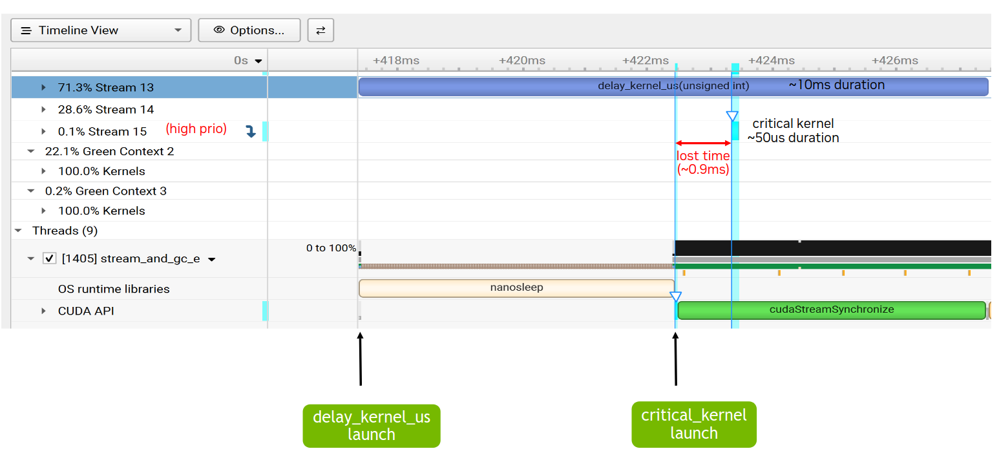

**图 49：不使用绿色上下文的 Nsight Systems 时间线。**

为利用绿色上下文特性，创建两个绿色上下文，每个配置一组单独、不重叠的 SM。对于具有 132 个 SM 的 H100，本例出于说明目的选择的确切 SM 划分为：关键内核（绿色上下文 3）16 个 SM，长运行内核（绿色上下文 2）112 个 SM。如图 50 所示，关键内核现在几乎可以立即开始，因为存在只有绿色上下文 3 可以使用的 SM。

与隔离运行时的持续时间相比，短内核的持续时间可能增加，因为现在其可使用的 SM 数量受到限制。长运行内核也是如此，它不能再使用 GPU 的所有 SM，而是受其绿色上下文配置资源的约束。然而，关键结果是关键内核工作现在可以比以前显著更早开始并完成。这是在没有其他限制的情况下，因为如前所述，并行执行不能保证。

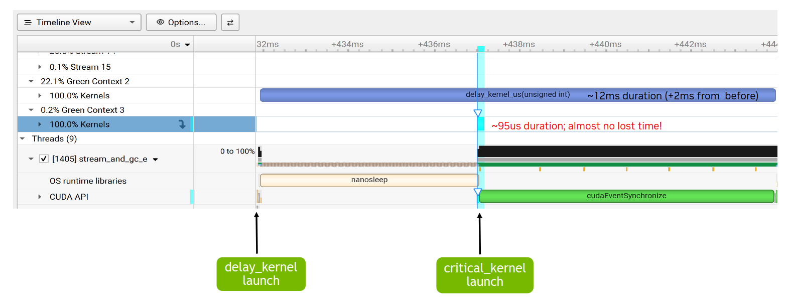

**图 50：使用绿色上下文的 Nsight Systems 时间线。**

在所有情况下，确切的 SM 划分应在实验后按具体情况决定。

## 4.8 局部性域

局部性域（locality domain）是 GPU 中包含流式多处理器（SM）与设备内存的一部分。应用可以在局部性域中分配设备内存，并在同一局部性域中创建具有 SM 资源的绿色上下文。在具有多个局部性域的设备上，将计算与其访问的内存放在一起可以改善性能。计算本地化 API 在“本地化计算资源”中描述，内存本地化在“分配本地化设备内存”中描述。

CUDA 通过从零开始的局部性域 ID 标识设备的局部性域。局部性域 ID 仅与其设备 ID 一起才有意义。本地化 SM 资源与内存时使用相同的 ID，使应用能够为两者请求匹配的放置。

### 4.8.1 发现局部性域

使用 `cudaDeviceGetAttribute` 及以下 `cudaDeviceAttr` 值：

- `cudaDevAttrLocalityDomainCount` 返回设备上的局部性域数量。有效的局部性域 ID 在范围 [0, cudaDevAttrLocalityDomainCount - 1] 内。
- `cudaDevAttrLocalityDomainMultiprocessorCount` 返回每个局部性域中可用的稳定 SM 数。这是设备上每个局部性域保证包含的 SM 数。

应用应查询这些属性，而不是假定特定拓扑。设备上可用的局部性域数量受系统配置影响。同一设备类型在不同场景下可能呈现不同数量的局部性域（4.8.5.3 节）。所有设备（包括只有一个可用局部性域的设备）都可以使用局部性域 API。在只有一个局部性域的设备上，这些 API 与针对整个设备相同。使用设备属性以编程方式查询设备的局部性域属性：

```cpp
int localityDomainCount = 0;
int smsPerLocalityDomain = 0;
cudaDeviceGetAttribute(&localityDomainCount, cudaDevAttrLocalityDomainCount, device);
cudaDeviceGetAttribute(&smsPerLocalityDomain,
                       cudaDevAttrLocalityDomainMultiprocessorCount, device);
```

### 4.8.2 本地化计算资源

要将 SM 资源本地化到特定局部性域，使用 CUDA 绿色上下文 API。SM 放置通过 4.7 节描述的绿色上下文资源 API 表达。构造本地化 SM 分区的主要步骤是：

1. 使用 `cudaDeviceGetDevResource` 获取设备的 `cudaDevResourceTypeSm` 资源。
2. 使用 `cudaDevSmResourceGroupParams` 描述本地化 SM 组。
3. 将组参数传给 `cudaDevSmResourceSplit`。
4. 使用 `cudaDevResourceGenerateDesc` 生成资源描述符，用 `cudaGreenCtxCreate` 创建绿色上下文，最后通过 `cudaExecutionCtxStreamCreate` 创建流。
5. 在流上启动内核。

典型的绿色上下文创建在 4.7.2 节中描述。本地化 SM 资源所需的补充如下：要描述本地化 SM 组，在 `flags` 中设置 `cudaDevSmResourceGroupLocalityDomainId`，并在 `localityDomainId` 中设置 ID。有效 ID 在 0 到 `cudaDevAttrLocalityDomainCount - 1` 之间。

```cpp
cudaDevResource smResource;
cudaDeviceGetDevResource(device, &smResource, cudaDevResourceTypeSm);
{
    cudaDevSmResourceGroupParams params = {};
    // params 中所有字段必须零初始化
    params.flags = cudaDevSmResourceGroupLocalityDomainId;
    params.localityDomainId = localityDomainId;
    cudaDevResource result;
    cudaDevSmResourceSplit(&result, 1, &smResource, nullptr, 0, &params);
}
```

#### 4.8.2.1 发现模式

当满足一组约束的 SM 数事先未知时，使用 `cudaDevSmResourceSplit` 的发现模式。通过将 `smCount` 设为零启用发现模式。API 将发现的计数写入 `params.smCount`。将 `result` 传为 `nullptr` 执行试运行，发现计数而不创建设备资源：

```cpp
cudaDevSmResourceGroupParams params {};
params.flags = cudaDevSmResourceGroupLocalityDomainId;
params.localityDomainId = localityDomainId;
params.smCount = 0;
cudaDevSmResourceSplit(nullptr, 1, &smResource, nullptr, 0, &params);
unsigned int availableSms = params.smCount;
```

如果 `result` 非 null，同一次调用既发现计数又返回包含那么多 SM 的资源。

#### 4.8.2.2 补充 SM

设备可以将额外的补充 SM 与局部性域关联，数量超过 `cudaDevAttrLocalityDomainMultiprocessorCount` 中包含的 SM。局部性域的补充 SM 提供与稳定 SM 相同的内存邻近性优势，但其数量可能因局部性域与设备而异。与局部性域关联的实际 SM 集合是其稳定 SM 与补充 SM 的并集。

要发现与局部性域关联的稳定 SM 与补充 SM 总数，在发现约束中包括 `cudaDevSmResourceGroupLocalityDomainSupplementalSms`：

```cpp
cudaDevSmResourceGroupParams supplementalParams {};
supplementalParams.flags =
    cudaDevSmResourceGroupLocalityDomainId |
    cudaDevSmResourceGroupLocalityDomainSupplementalSms;
supplementalParams.localityDomainId = localityDomainId;
supplementalParams.smCount = 0;
cudaDevSmResourceSplit(nullptr, 1, &smResource, nullptr, 0, &supplementalParams);
unsigned int totalLocalizedSms = supplementalParams.smCount;
unsigned int supplementalSms = totalLocalizedSms - smsPerLocalityDomain;
```

#### 4.8.2.3 SM 划分约束

可以在请求局部性域的同时在 `params` 中组合指定多个约束。例如：将 `smCount` 设为正值以请求那么多 SM，或设为零以使用上述发现模式。在没有补充 SM 或回填的情况下，请求大于 `cudaDevAttrLocalityDomainMultiprocessorCount` 将失败。要包括补充 SM，添加 `cudaDevSmResourceGroupLocalityDomainSupplementalSms` 标志。

当 `coscheduledSmCount` 为 0 时，API 不按共同调度能力限制 SM，最大数量的本地化 SM 可用。分区的集群能力可以在稍后通过 `cudaOccupancyMaxPotentialClusterSize` 动态查询。当 `coscheduledSmCount` 非零时，API 将只选择满足所请求 `coscheduledSmCount` 的本地化 SM。

要从输入资源中的任何局部性域选择 SM，在 `flags` 中保留 `cudaDevSmResourceGroupLocalityDomainId` 的同时将 `localityDomainId` 设为 `cudaDevSmResourceGroupLocalityDomainIdAny`。该值允许划分从每个可用局部性域的并集中抽取，同时排除补充 SM。

```cpp
group.flags = cudaDevSmResourceGroupLocalityDomainId;
group.localityDomainId = cudaDevSmResourceGroupLocalityDomainIdAny;
```

结果中未返回的任何未使用 SM 将在 API 的 `remainder` 参数中返回。

#### 4.8.2.4 回填

`cudaDevSmResourceGroupBackfill` 标志放宽划分约束，使 CUDA 可以填充原本无法达到所请求 `smCount` 的组。按局部性域划分时，回填行为如下：

- 添加 `cudaDevSmResourceGroupBackfill` 以先用所请求局部性域的非补充 SM 填充组，然后用该域的补充 SM，最后用其他局部性域的 SM。如果在所请求局部性域中找不到任何 SM，调用将失败并返回 `cudaErrorInvalidResourceConfiguration`。

#### 4.8.2.5 检查划分结果

结果的 `cudaDevResource.sm.flags` 与 `cudaDevResource.sm.localityDomainId` 报告资源约束。当 `flags` 中存在 `cudaDevSmResourceGroupLocalityDomainId` 时，`localityDomainId` 标识所请求的局部性域，否则其值没有意义。使用回填创建的资源可能包含来自其他局部性域的 SM，因此 `localityDomainId` 只反映最初请求的局部性域，而不是此类资源中存在的每个局部性域。

在一个描述符中组合 SM 资源时，资源必须具有匹配的约束，包括 `flags` 与 `localityDomainId` 值。

#### 4.8.2.6 创建本地化流

以下代码查询局部性域数量，并为每个局部性域构造一个流。

```cpp
std::vector<cudaExecutionContext_t> contexts(localityDomainCount);
std::vector<cudaStream_t> streams(localityDomainCount);
{
    std::vector<cudaDevSmResourceGroupParams> params(localityDomainCount);
    std::vector<cudaDevResource> result(localityDomainCount);
    for (int i = 0; i < localityDomainCount; i++) {
        params[i] = {};
        params[i].flags = cudaDevSmResourceGroupLocalityDomainId;
        params[i].localityDomainId = i;
    }
    // 单次划分会为所有域生成不重叠的资源。
    cudaDevSmResourceSplit(result.data(), localityDomainCount, &smResource,
                           nullptr, 0, params.data());
    for (int i = 0; i < localityDomainCount; i++) {
        cudaDevResourceDesc_t desc;
        cudaDevResourceGenerateDesc(&desc, &result[i], 1);
        cudaGreenCtxCreate(&contexts[i], desc, device, 0);
        cudaExecutionCtxStreamCreate(&streams[i], contexts[i], cudaStreamDefault, 0);
    }
}
```

`streams` 中的每个流都在对应索引的局部性域的 SM 上执行。不再需要时，使用 `cudaStreamDestroy` 销毁流，然后使用 `cudaExecutionCtxDestroy` 销毁其上下文。

### 4.8.3 分配本地化设备内存

CUDA 使用类型为 `cudaMemLocationTypeDeviceLocalityDomain` 的 `cudaMemLocation` 表示本地化内存位置。对于此位置类型，初始化 `cudaMemLocation.localized` 的两个成员：

- `deviceId` 标识 GPU。
- `localityDomainId` 标识该 GPU 上的局部性域。

运行时 API 将此位置与流序内存池一起使用（4.3 节）。驱动 API 还将对应的 `CUmemLocation` 与虚拟内存管理分配一起使用（4.18 节）。

通过其他机制（例如 `cudaMalloc` 或统一内存）创建的分配不能本地化。MLOPart 模式下的 MPS（多进程服务）可用于透明地本地化依赖 `cudaMalloc` 的应用。

#### 4.8.3.1 创建本地化内存池

要创建本地化内存池，在 `cudaMemPoolProps` 中设置位置并调用 `cudaMemPoolCreate`：

```cpp
cudaMemPool_t pool {};
cudaMemPoolProps props {};
props.allocType = cudaMemAllocationTypePinned;
props.location.type = cudaMemLocationTypeDeviceLocalityDomain;
props.location.localized.deviceId = device;
props.location.localized.localityDomainId = localityDomainId;
cudaMemPoolCreate(&pool, &props);
```

使用 `cudaMallocFromPoolAsync` 从此池分配，并用 `cudaFreeAsync` 释放分配。在为该局部性域选择默认或当前固定内存池时，还可以将位置传给 `cudaMemGetDefaultMemPool`、`cudaMemGetMemPool` 与 `cudaMemSetMemPool`。关于一般内存池编程模型，参见“内存池”。

#### 4.8.3.2 创建本地化 VMM 分配

驱动 API 可以将 `cuMemCreate` 创建的物理内存放置在局部性域中。将 `CUmemAllocationProp::location.type` 设为 `CU_MEM_LOCATION_TYPE_DEVICE_LOCALITY_DOMAIN`，并初始化 `location.localized.deviceId` 与 `location.localized.localityDomainId`。所得的物理分配以与其他 VMM 分配相同的方式保留、映射并授予访问权限。通过 `cuMemSetAccess` 设置的访问控制在完整设备粒度上操作，而不是单个局部性域。关于完整分配序列与粒度要求，参见本地化 VMM 分配一节。

受管理内存不能本地化：使用 `cudaMemLocationTypeDeviceLocalityDomain` 请求 `cudaMemAllocationTypeManaged` 将返回 `CUDA_ERROR_NOT_SUPPORTED`。类似地，`cudaMemPrefetchAsync` 与 `cudaMemAdvise` 不接受设备局部性域作为位置，并返回 `CUDA_ERROR_NOT_SUPPORTED`。关于局部性域与统一内存之间的关系，参见“局部性域与统一内存”。

### 4.8.4 查询内存放置

使用 `cudaMemPoolGetAttribute` 与 `cudaMemPoolAttrLocalityDomainId` 查询池。它返回本地化池的局部性域 ID，对于非本地化池返回 -1。

使用 `cudaPointerGetAttributes` 通过其指针查询分配。返回的 `cudaPointerAttributes.localityDomainOrdinal` 字段包含分配的局部性域序号，分配未本地化时为 -1：

```cpp
cudaPointerAttributes attributes {};
cudaPointerGetAttributes(&attributes, ptr);
int localityDomainId = attributes.localityDomainOrdinal;
```

### 4.8.5 编程指导

要本地化工作负载，使用与其内存分配来自同一局部性域的计算资源启动内核。仅本地化计算或仅本地化内存资源通常不能改善性能。如果内核必须使用来自多个局部性域的内存，请测量计算本地化是否有益。

#### 4.8.5.1 使用分叉/汇合模式的本地化内核

分叉/汇合（fork/join）模式使用事件与流等待来表达并行区域。应用使用 `cudaExecutionCtxStreamCreate` 从每个本地化绿色上下文创建一个流。一个单独的主流协调这些本地化流。为主流创建一个分叉事件，并为每个本地化流使用 `cudaEventCreateWithFlags` 创建一个汇合事件；当事件仅用于排序时应禁用计时。

要分叉，在父流上记录一个事件，并让每个本地化流等待该事件。因此先前提交到父流的工作被排在本地化工作之前。将独立工作提交到本地化流，使用来自其对应局部性域的内存。

要汇合，在其工作之后于每个本地化流上记录一个事件，并让父流等待所有这些事件。随后提交到父流的工作因此被排在本地化工作之后。

```cpp
produceInputs<<<grid, block, 0, parentStream>>>(...);
cudaEventRecord(forkEvent, parentStream);
// localizedStreams[i] 属于局部性域 i 的绿色上下文。
for (int i = 0; i < localityDomainCount; i++) {
    cudaStreamWaitEvent(localizedStreams[i], forkEvent);
    processPartition<<<grid, block, 0, localizedStreams[i]>>>(...);
    cudaEventRecord(joinEvents[i], localizedStreams[i]);
}
for (int i = 0; i < localityDomainCount; i++) {
    cudaStreamWaitEvent(parentStream, joinEvents[i]);
}
consumeResults<<<grid, block, 0, parentStream>>>(...);
```

#### 4.8.5.2 CUDA 图

CUDA 图（4.2 节）通过流捕获与手动图构造支持本地化。对于某些应用，CUDA 图可能比基于流的编程提供更好的性能。

##### 4.8.5.2.1 流捕获

分叉/汇合模式可以被捕获到 CUDA 图中。在父流上开始捕获，记录分叉事件，并在每个本地化流中等待分叉事件。等待分叉事件使本地化流加入与父流相同的捕获图。提交到本地化流的操作成为并行图分支。在所有本地化流上启动所有工作后，记录汇合事件并在父流中等待所有汇合事件。这些等待将所有分支重新连接到父流。在调用 `cudaStreamEndCapture` 之前，每个参与的流都必须重新汇合到源流。

```cpp
cudaStreamBeginCapture(parentStream, cudaStreamCaptureModeGlobal);
// 如上面的分叉/汇合示例那样记录 forkEvent、将工作提交到每个本地化流、
// 记录 joinEvents，并让 parentStream 等待。
cudaGraph_t graph;
cudaStreamEndCapture(parentStream, &graph);
```

每个子流的局部性限制由捕获的内核节点保留。即使可执行图在另一个流上启动，图重放也使用原始本地化 SM。图启动流提供排序，但不替换节点中记录的执行资源。

##### 4.8.5.2.2 图构造

可以显式构造相同的图拓扑。为每个局部性域添加一个内核节点，在 `cudaKernelNodeParamsV2.ctx` 中使用对应的本地化执行上下文。

```cpp
cudaGraph_t graph = nullptr;
cudaGraphCreate(&graph, 0);
std::vector<cudaGraphNode_t> localizedNodes(localityDomainCount);
for (int i = 0; i < localityDomainCount; i++) {
    cudaGraphNodeParams params = { CU_GRAPH_NODE_TYPE_KERNEL };
    params.kernel.kern = kernel;
    params.kernel.gridDim = grid;
    params.kernel.blockDim = block;
    params.kernel.kernelParams = kernelArgs[i];
    params.kernel.ctx = localizedContexts[i];
    cudaGraphAddNode(&localizedNodes[i], graph, nullptr, nullptr, 0, &params);
}
```

#### 4.8.5.3 兼容性说明

vGPU、MIG 以及处于 NUMA 模式的设备不支持本地化，将只报告 1 个局部性域。Windows 上的 CUDA 不支持本地化，将只报告 1 个局部性域。CUDA Checkpoint 不保证本地化绿色上下文在不同设备上恢复时保留其本地化属性。恢复后应用可能表现出降低的性能。MLOPart 模式下的 MPS（多进程服务）将每个 MLOPart 设备呈现为具有单个局部性域的 CUDA 设备。MPS 静态划分将完整设备视为单个局部性域。

## 4.9 延迟加载

### 4.9.1 引言

延迟加载（lazy loading）通过将 CUDA 模块的加载推迟到需要时，减少程序初始化时间。对于只使用其包含的一小部分内核的程序（使用库时很常见），延迟加载尤其有效。延迟加载被设计为在遵循 CUDA 编程模型时对用户不可见。“潜在风险”一节详细说明了这一点。自 CUDA 12.3 起，延迟加载在所有平台上默认启用，但可以通过 `CUDA_MODULE_LOADING` 环境变量控制。

### 4.9.2 变更历史

**表 20：按 CUDA 版本选择延迟加载变更**

| CUDA 版本 | 变更 |
|---|---|
| 12.3 | 延迟加载性能改进。现在在 Windows 上默认启用。 |
| 12.2 | 延迟加载在 Linux 上默认启用。 |
| 11.7 | 延迟加载首次引入，默认禁用。 |

### 4.9.3 延迟加载的要求

延迟加载是 CUDA 运行时与驱动的联合特性。只有在满足运行时与驱动版本要求时才可用。

#### 4.9.3.1 CUDA 运行时版本要求

延迟加载从 CUDA 运行时版本 11.7 开始可用。由于 CUDA 运行时通常静态链接到程序与库中，只有来自 CUDA 11.7+ 工具包或使用其编译的程序与库才能受益于延迟加载。使用较旧 CUDA 运行时版本编译的库将急切加载所有模块。

#### 4.9.3.2 CUDA 驱动版本要求

延迟加载需要驱动版本 515 或更高。对于低于 515 的驱动版本，即使使用 CUDA 工具包 11.7 或更高版本，延迟加载也不可用。

#### 4.9.3.3 编译器要求

延迟加载不需要任何编译器支持。使用 11.7 之前编译器编译的 SASS 与 PTX 都可以在启用延迟加载的情况下加载，并将获得该特性的全部好处。然而，如上所述，仍需要 11.7+ CUDA 运行时。

#### 4.9.3.4 内核要求

延迟加载不影响包含受管理变量的模块，这些模块仍将被急切加载。

### 4.9.4 用法

#### 4.9.4.1 启用与禁用

通过将 `CUDA_MODULE_LOADING` 环境变量设为 `LAZY` 启用延迟加载。通过将 `CUDA_MODULE_LOADING` 设为 `EAGER` 禁用延迟加载。自 CUDA 12.3 起，延迟加载在所有平台上默认启用。将 `CUDA_MODULE_LOADING` 设为 `EAGER` 也会禁用延迟函数最终化（LFF），除非 `CUDA_ENABLE_FUNCTION_LAZY_FINALIZATION` 设为 1。

#### 4.9.4.2 运行时检查是否启用了延迟加载

CUDA 驱动 API 中的 `cuModuleGetLoadingMode` API 可用于确定是否启用了延迟加载。注意运行此函数之前必须初始化 CUDA。示例用法如下：

```cpp
#include <cuda.h>
#include <assert.h>
#include <iostream>

int main() {
    CUmoduleLoadingMode mode;
    assert(CUDA_SUCCESS == cuInit(0));
    assert(CUDA_SUCCESS == cuModuleGetLoadingMode(&mode));
    std::cout << "CUDA Module Loading Mode is "
              << ((mode == CU_MODULE_LAZY_LOADING) ? "lazy" : "eager") << std::endl;
    return 0;
}
```

#### 4.9.4.3 运行时强制模块急切加载

内核与变量的加载自动发生，无需显式加载。即使不执行内核，也可以通过以下方式显式加载内核：

- `cuModuleGetFunction()` 函数将导致模块被加载到设备内存。
- `cudaFuncGetAttributes()` 函数将导致内核被加载到设备内存。

> **注意**
>
> `cuModuleLoad()` 不保证模块立即被加载。

### 4.9.5 潜在风险

延迟加载被设计为不应需要修改应用即可使用。话虽如此，仍有一些注意事项，尤其是当应用不完全遵循 CUDA 编程模型时，如下所述。

#### 4.9.5.1 对并发内核执行的影响

一些程序错误地假定并发内核执行是有保证的。如果需要跨内核同步但内核执行已被串行化，则可能发生死锁。为最小化延迟加载对并发内核执行的影响，请执行以下操作：

- 在启动之前预加载你希望并发执行的所有内核，或
- 以 `CUDA_MODULE_LOADING=EAGER` 运行应用以急切加载所有内核与模块数据。

#### 4.9.5.2 大量内存分配

延迟加载将 CUDA 模块的内存分配从程序初始化推迟到更接近执行时间。如果应用在启动时分配整个 VRAM，CUDA 可能在运行时无法为模块分配内存。可能的解决方案：

- 使用 `cudaMallocAsync()` 而不是在启动时分配整个 VRAM 的分配器。
- 添加一些缓冲区以补偿内核的延迟加载。
- 在尝试初始化分配器之前预加载程序中将要使用的所有内核。

#### 4.9.5.3 对性能测量的影响

延迟加载可能通过将 CUDA 模块初始化移入测量执行窗口而使性能测量产生偏差。为避免这一点：

- 在测量之前至少进行一次预热迭代。
- 在启动之前预加载被基准测试的内核。

## 4.10 错误日志管理

错误日志管理允许以通俗英文报告 CUDA API 错误，提供比 API 返回值更多的错误原因信息。

### 4.10.1 背景

传统上，CUDA API 调用失败的唯一指示是非零返回码。许多 CUDA 错误码描述一类失败，而不指明是哪个参数或要求导致的。错误日志管理用描述性消息补充这些返回码，旨在帮助开发者诊断 API 使用错误。

### 4.10.2 激活

将 `CUDA_LOG_FILE` 环境变量设为 `stdout`、`stderr` 或可写文件路径。CUDA 将每条生成的日志消息写入所选目标。CUDA 还在内部缓冲区中存储最近的消息。应用可以使用错误日志管理 API 注册回调或转储此缓冲区，即使应用启动前未设置 `CUDA_LOG_FILE`。无错误的执行可能不生成任何消息。

### 4.10.3 输出

写入 `CUDA_LOG_FILE` 或由转储 API 返回的消息使用以下格式：`[时间][TID][来源][严重级别] 消息`。例如，使用 null 缓冲区调用 `cuLogsDumpToMemory` 可能生成类似以下的消息：

```console
[22:21:32.099][25642][CUDA][E] buffer cannot be NULL
[22:21:32.099][25642][CUDA][E] Returning 1 (CUDA_ERROR_INVALID_VALUE) from cuLogsDumpToMemory
```

没有错误日志管理时，该调用返回 `CUDA_ERROR_INVALID_VALUE`。调用 `cuGetErrorString` 提供一般描述 `invalid argument`，但不说明哪个参数无效。

### 4.10.4 API 描述

错误日志管理通过 CUDA 驱动与运行时 API 都可用。运行时接口操作由运行时与驱动 API 生成的消息；两个接口使用相同的底层日志缓冲区。

#### 4.10.4.1 回调注册

驱动 API 回调类型与注册函数为：

```cpp
typedef void (CUDA_CB *CUlogsCallback)(
    void *data, CUlogLevel logLevel, char *message, size_t length);

CUresult CUDAAPI cuLogsRegisterCallback(
    CUlogsCallback callbackFunc,
    void *userData,
    CUlogsCallbackHandle *callback_out);

CUresult CUDAAPI cuLogsUnregisterCallback(
    CUlogsCallbackHandle callback);
```

相应的运行时 API 回调类型与函数为：

```cpp
typedef void (CUDART_CB *cudaLogsCallback_t)(
    void *data, cudaLogLevel logLevel, char *message, size_t length);

cudaError_t CUDARTAPI cudaLogsRegisterCallback(
    cudaLogsCallback_t callbackFunc,
    void *userData,
    cudaLogsCallbackHandle *callback_out);

cudaError_t CUDARTAPI cudaLogsUnregisterCallback(
    cudaLogsCallbackHandle callback);
```

驱动回调将错误报告为 `CU_LOG_LEVEL_ERROR`，警告报告为 `CU_LOG_LEVEL_WARNING`。对应的运行时值为 `cudaLogLevelError` 与 `cudaLogLevelWarning`。格式化输出分别将这些级别表示为 E 与 W。

CUDA 将 `userData` 原样传给回调。`callback_out` 参数是可选的，但如果应用打算注销回调，必须保留返回的句柄。回调接收消息文本及其显式字节长度。消息不包含添加到格式化文件与转储输出的时间戳、线程 ID、来源或严重级别前缀。应用不应依赖特定的回调线程或调用时机，除非 API 参考明确保证该行为。

#### 4.10.4.2 迭代器与日志转储

日志迭代器（log iterator）标识内部缓冲区中的位置。调用 `cuLogsCurrent` 或 `cudaLogsCurrent` 将迭代器设为缓冲区当前末尾，以便之后使用该迭代器转储时只返回随后生成的消息。

驱动 API 函数为：

```cpp
CUresult CUDAAPI cuLogsCurrent(
    CUlogIterator *iterator_out, unsigned int flags);
CUresult CUDAAPI cuLogsDumpToFile(
    CUlogIterator *iterator, const char *pathToFile, unsigned int flags);
CUresult CUDAAPI cuLogsDumpToMemory(
    CUlogIterator *iterator, char *buffer, size_t *size, unsigned int flags);
```

相应的运行时 API 函数为：

```cpp
cudaError_t CUDARTAPI cudaLogsCurrent(
    cudaLogIterator *iterator_out, unsigned int flags);
cudaError_t CUDARTAPI cudaLogsDumpToFile(
    cudaLogIterator *iterator, const char *pathToFile, unsigned int flags);
cudaError_t CUDARTAPI cudaLogsDumpToMemory(
    cudaLogIterator *iterator, char *buffer, size_t *size, unsigned int flags);
```

所有 current 与 dump 函数的 `flags` 参数保留供将来使用，必须为零。

以下运行时 API 示例标记日志的当前末尾，并在之后仅转储该点之后生成的消息：

```cpp
#include <cstdio>
#include <cuda_runtime_api.h>

cudaError_t printNewCudaLogs()
{
    cudaLogIterator iterator;
    cudaError_t status = cudaLogsCurrent(&iterator, 0);
    if (status != cudaSuccess) {
        return status;
    }

    int deviceCount;
    status = cudaGetDeviceCount(&deviceCount);
    cudaError_t deviceCountStatus = status;

    char buffer[25600];
    size_t size = sizeof(buffer);
    status = cudaLogsDumpToMemory(&iterator, buffer, &size, 0);
    if (status != cudaSuccess) {
        return status;
    }
    if (size != 0) {
        std::fwrite(buffer, 1, size, stderr);
    }
    return deviceCountStatus;
}
```

中间的 CUDA 调用仍需要常规返回码处理。此示例展示了迭代器如何选择日志消息窗口；它不要求故意进行无效的 CUDA 调用。固定大小数组使用文档记载的最大转储容量 25,600 字节。

#### 4.10.4.3 转储行为

如果迭代器为 null，转储请求内部缓冲区当前保留的所有条目。如果提供了迭代器，转储从该位置开始。成功转储后，CUDA 将提供的迭代器推进到日志当前末尾。

内部缓冲区最多保留 100 个条目。如果请求的消息已被覆盖且不再保留，CUDA 会添加一条指示输出被截断的通知，并返回仍然可用的条目。

`cuLogsDumpToMemory` 与 `cudaLogsDumpToMemory` 有以下额外要求：

1. `size` 初始指定 `buffer` 的容量。
2. CUDA 对缓冲区进行 null 终止。各个条目由换行符分隔，而不是 null 字符。
3. 25,600 字节的输出缓冲区足以容纳所有保留的日志数据。
4. 成功时，`size` 包含写入的字节数，不包括终止 null 字符。
5. 如果没有要转储的消息，函数成功并将 `size` 设为零。
6. 如果缓冲区能容纳部分但不是全部请求的消息，CUDA 前置一条截断通知，省略不适合的最旧消息，并保留输出中的最新消息。
7. 如果缓冲区无法容纳任何消息，函数返回 `CUDA_ERROR_INVALID_VALUE` 或 `cudaErrorInvalidValue` 并将 `size` 设为零。

### 4.10.5 限制与已知问题

1. 当达到 100 条目上限时，CUDA 替换最旧的条目。
2. 并非所有 CUDA API 都会生成描述性消息。覆盖范围仍在扩大。
3. CUDA 在生成消息之前不验证 `CUDA_LOG_FILE` 目标。
4. 日志消息不本地化；CUDA 以美式英语提供它们。

## 4.11 异步屏障

异步屏障（在高级同步原语中引入）将 CUDA 同步扩展到 `__syncthreads()` 与 `__syncwarp()` 之外，实现细粒度、非阻塞的协调以及通信与计算的更好重叠。

本节主要介绍如何通过 `cuda::barrier` API 使用异步屏障（在适用处指向 `cuda::ptx` 与原语）。

### 4.11.1 初始化

初始化必须在任何线程开始参与屏障之前发生。

**CUDA C++ cuda::barrier**

```cpp
#include <cuda/barrier>
#include <cooperative_groups.h>

__global__ void init_barrier()
{
    __shared__ cuda::barrier<cuda::thread_scope_block> bar;
    auto block = cooperative_groups::this_thread_block();
    if (block.thread_rank() == 0)
    {
        // 单个线程初始化总预期到达计数。
        init(&bar, block.size());
    }
    block.sync();
}
```

**CUDA C++ cuda::ptx**

```cpp
#include <cuda/ptx>
#include <cooperative_groups.h>

__global__ void init_barrier()
{
    __shared__ uint64_t bar;
    auto block = cooperative_groups::this_thread_block();
    if (block.thread_rank() == 0)
    {
        // 单个线程初始化总预期到达计数。
        cuda::ptx::mbarrier_init(&bar, block.size());
    }
    block.sync();
}
```

**CUDA C 原语**

```cpp
#include <cuda_awbarrier_primitives.h>
#include <cooperative_groups.h>

__global__ void init_barrier()
{
    __shared__ uint64_t bar;
    auto block = cooperative_groups::this_thread_block();
    if (block.thread_rank() == 0)
    {
        __mbarrier_init(&bar, block.size());
    }
    block.sync();
}
```

在任何线程参与屏障之前，必须使用 `cuda::barrier::init()` 友元函数初始化屏障。这必须在任何线程到达屏障之前发生。这带来了引导挑战：线程必须在参与屏障之前同步，但线程正是为了同步才创建屏障。在此示例中，将参与的线程是协作组的一部分，并使用 `block.sync()` 引导初始化。由于整个线程块参与屏障，也可以使用 `__syncthreads()`。`init()` 的第二个参数是预期到达计数，即在参与线程从 `bar.wait(std::move(token))` 调用解除阻塞之前，参与线程将调用 `bar.arrive()` 的次数。

异步屏障在指定线程如何参与（拆分到达/等待）以及哪些线程参与方面很灵活。相比之下，`this_thread_block.sync()` 或 `__syncthreads()` 适用于整个线程块，`__syncwarp(mask)` 适用于 warp 的指定子集。尽管如此，如果用户的意图是同步整个线程块或整个 warp，我们建议分别使用 `__syncthreads()` 与 `__syncwarp()` 以获得更好性能。

### 4.11.2 屏障的阶段：到达、倒计数、完成与重置

当参与线程调用 `bar.arrive()` 时，异步屏障从预期到达计数倒计数到零。当倒计数达到零时，屏障对当前阶段完成。当最后一次 `bar.arrive()` 调用使倒计数达到零时，倒计数被自动且原子地重置。重置将倒计数赋值为预期到达计数，并将屏障移至下一阶段。

从 `token=bar.arrive()` 返回的 `cuda::barrier::arrival_token` 类 token 对象与屏障当前阶段关联。调用 `bar.wait(std::move(token))` 在屏障处于当前阶段时（即 token 关联的阶段与屏障阶段匹配时）阻塞调用线程。如果阶段在调用 `bar.wait(std::move(token))` 之前推进（因为倒计数达到零），则线程不会阻塞；如果线程在 `bar.wait(std::move(token))` 中阻塞时阶段推进，则线程被解除阻塞。

了解重置何时可能或不可能发生至关重要，尤其是在非平凡的到达/等待同步模式中。

- 线程对 `token=bar.arrive()` 与 `bar.wait(std::move(token))` 的调用必须排序，使 `token=bar.arrive()` 在屏障当前阶段发生，而 `bar.wait(std::move(token))` 在同一或下一阶段发生。
- 线程对 `bar.arrive()` 的调用必须在屏障计数器非零时发生。屏障初始化后，如果线程对 `bar.arrive()` 的调用使倒计数达到零，则必须在屏障可复用于后续 `bar.arrive()` 调用之前调用 `bar.wait(std::move(token))`。
- `bar.wait()` 只能使用当前阶段或紧邻前一阶段的 token 对象调用。对于 token 对象的任何其他值，行为未定义。

对于简单的到达/等待同步模式，遵守这些使用规则很直接。

#### 4.11.2.1 Warp 纠缠

warp 发散会影响 arrive-on 操作更新屏障的次数。如果调用 warp 完全收敛，则屏障更新一次。如果调用 warp 完全发散，则对屏障应用 32 次单独更新。

> **注意**
>
> 建议由收敛的线程使用 `arrive-on(bar)` 调用，以最小化对屏障对象的更新。当这些操作之前的代码发散线程时，应通过 `__syncwarp` 在调用 arrive-on 操作之前重新收敛 warp。

### 4.11.3 显式阶段跟踪

异步屏障可以有多个阶段，取决于它被用于同步线程与内存操作的次数。除了使用 token 跟踪屏障阶段翻转之外，我们还可以通过 `cuda::ptx` 与原语 API 中可用的 `mbarrier_try_wait_parity()` 函数族直接跟踪阶段。

在其最简单形式中，`cuda::ptx::mbarrier_try_wait_parity(uint64_t* bar, const uint32_t& phaseParity)` 函数等待具有特定奇偶性的阶段。`phaseParity` 操作数是屏障对象当前阶段或紧邻前一阶段的整数奇偶性。偶数阶段的整数奇偶性为 0，奇数阶段为 1。当我们初始化屏障时，其阶段奇偶性为 0。因此 `phaseParity` 的有效值为 0 与 1。显式阶段跟踪在跟踪异步内存操作时很有用，因为它允许单个线程到达屏障并设置事务计数，而其他线程只等待基于奇偶性的阶段翻转。这比让所有线程到达屏障并使用 token 更高效。此功能仅适用于线程块与集群作用域的共享内存屏障。

上述阶段是 PTX mbarrier 对象的主阶段，它还有条件阶段。对于以 `layout::v1` 格式初始化的屏障，条件阶段并不总是随主阶段一起推进。只有当该阶段跟踪的异步操作未执行报告操作时，它才随主阶段一起推进。这由 TMA 数据有效性报告（4.6.3 节）与计算结构传输操作使用。

以下示例使用显式阶段跟踪实现拆分到达/等待循环（三栏分别对应 `cuda::barrier`、`cuda::ptx` 与 C 原语）：

```cpp
// cuda::ptx 版本
__global__ void split_arrive_wait(int iteration_count, float *data)
{
    __shared__ uint64_t bar;
    int parity = 0;  // 初始阶段奇偶性为 0。
    auto block = cooperative_groups::this_thread_block();
    if (block.thread_rank() == 0)
    {
        cuda::ptx::mbarrier_init(&bar, block.size());
    }
    block.sync();
    for (int i = 0; i < iteration_count; ++i)
    {
        /* 到达之前的代码 */
        (void)cuda::ptx::mbarrier_arrive(&bar);
        compute(data, i);
        // 等待所有参与线程完成 mbarrier_arrive()。
        while (!cuda::ptx::mbarrier_try_wait_parity(&bar, parity)) {}
        parity ^= 1;
        /* 等待之后的代码 */
    }
}
```

### 4.11.4 提前退出

当参与一系列同步的线程必须提前退出该序列时，该线程必须在退出前显式退出参与。其余参与线程可以正常继续后续到达与等待操作。

`bar.arrive_and_drop()` 操作到达屏障以履行参与线程在当前阶段到达的义务，然后递减下一阶段的预期到达计数，使该线程不再被期望到达屏障。原语版本使用 `__mbarrier_arrive_and_drop`。

### 4.11.5 完成函数

`cuda::barrier` API 支持可选的完成函数。`cuda::barrier<Scope, CompletionFunction>` 的 CompletionFunction 每阶段执行一次，在最后一个线程到达之后、任何线程从等待解除阻塞之前。在该阶段到达屏障的线程所执行的内存操作对执行 CompletionFunction 的线程可见，而 CompletionFunction 内执行的所有内存操作在等待线程从等待解除阻塞后对它们可见。

示例 `psum` 使用完成函数在每阶段屏障完成后归约共享内存数据。

### 4.11.6 跟踪异步内存操作

异步屏障可用于跟踪异步内存复制。当异步复制操作绑定到屏障时，该复制操作在发起时自动增加当前屏障阶段的预期计数，并在完成时递减它。此机制确保屏障的 `wait()` 操作将阻塞直到所有关联的异步内存复制完成，为同步多个并发内存操作提供了一种便捷方式。

从计算能力 9.0 开始，线程块或集群作用域的共享内存中的异步屏障可以显式跟踪异步内存操作。我们称这些屏障为异步事务屏障（asynchronous transaction barrier）。除预期到达计数外，屏障对象还可以接受事务计数，用于跟踪异步事务的完成。事务计数以异步内存操作指定的单位（通常为字节）跟踪尚未完成的异步事务数。当前阶段要跟踪的事务计数可以在到达时通过 `cuda::device::barrier_arrive_tx()` 设置，或直接通过 `cuda::device::barrier_expect_tx()` 设置。当屏障使用事务计数时，它会在等待操作处阻塞线程，直到所有生产者线程都已到达且所有事务计数之和达到预期值。

```cpp
// cuda::barrier 版本
__global__ void track_kernel()
{
    __shared__ cuda::barrier<cuda::thread_scope_block> bar;
    auto block = cooperative_groups::this_thread_block();
    if (block.thread_rank() == 0)
    {
        init(&bar, block.size());
    }
    block.sync();

    auto token = cuda::device::barrier_arrive_tx(bar, 1, 0);
    bar.wait(cuda::std::move(token));
}
```

在此示例中，`cuda::device::barrier_arrive_tx()` 操作构造一个与当前阶段同步点关联的到达 token 对象。然后它将到达计数递减 1，并将预期事务计数增加 0。由于事务计数更新为 0，屏障不跟踪任何事务。“使用张量内存加速器（TMA）”一节包含跟踪异步内存操作的示例。

### 4.11.7 使用屏障的生产者-消费者模式

线程块可以在空间上划分，使不同线程执行独立操作。这最常通过将线程块中来自不同 warp 的线程分配给特定任务来完成。此技术称为 warp 专门化（warp specialization）。

本节展示生产者-消费者模式中的空间划分示例，其中一个子集线程生产数据，而另一个（不相交的）子集线程并发消费这些数据。

生产者-消费者空间划分模式需要两个单向同步来管理生产者与消费者之间的数据缓冲区。

| 生产者 | 消费者 |
|---|---|
| 等待缓冲区准备好被填充 | 发出缓冲区准备好被填充的信号 |
| 生产数据并填充缓冲区 | 发出缓冲区已填充的信号 |
| | 等待缓冲区被填充 |
| | 消费已填充缓冲区中的数据 |

生产者线程等待消费者线程发出缓冲区准备好被填充的信号；然而消费者线程不等待此信号。消费者线程等待生产者线程发出缓冲区已填充的信号；然而生产者线程不等待此信号。为获得完整的生产者/消费者并发性，此模式至少需要双缓冲，其中每个缓冲区需要两个屏障。

示例 `producer_consumer_pattern` 将第一个 warp 专门化为生产者，其余 warp 专门化为消费者。所有生产者与消费者线程都参与四个屏障中的每一个（调用 `bar.arrive()` 或 `bar.arrive_and_wait()`），因此预期到达计数等于 `block.size()`。

## 4.12 管道

管道（在高级同步原语中引入）是一种对工作进行分级并协调多缓冲区生产者-消费者模式的机制，通常用于将计算与异步数据复制重叠。

本节主要介绍如何通过 `cuda::pipeline` API 使用管道（在适用处指向原语）。

### 4.12.1 初始化

`cuda::pipeline` 可以在不同线程作用域创建。对于 `cuda::thread_scope_thread` 以外的作用域，需要 `cuda::pipeline_shared_state<scope, count>` 对象来协调参与线程。此状态封装允许管道处理最多 `count` 个并发阶段的有限资源。

```cpp
// 在线程作用域创建管道
constexpr auto scope = cuda::thread_scope_thread;
cuda::pipeline<scope> pipeline = cuda::make_pipeline();

// 在块作用域创建管道
constexpr auto scope = cuda::thread_scope_block;
constexpr auto stages_count = 2;
__shared__ cuda::pipeline_shared_state<scope, stages_count> shared_state;
auto pipeline = cuda::make_pipeline(group, &shared_state);
```

管道可以是统一（unified）或分区（partitioned）的。在统一管道中，所有参与线程既是生产者也是消费者。在分区管道中，每个参与线程要么是生产者要么是消费者，其角色在管道对象生命周期内不能改变。线程局部管道不能分区。要创建分区管道，我们需要向 `cuda::make_pipeline()` 提供生产者数量或线程角色。

```cpp
// 在块作用域创建分区管道，只有线程 0 是生产者
constexpr auto scope = cuda::thread_scope_block;
constexpr auto stages_count = 2;
__shared__ cuda::pipeline_shared_state<scope, stages_count> shared_state;
auto thread_role = (group.thread_rank() == 0) ? cuda::pipeline_role::producer
                                              : cuda::pipeline_role::consumer;
auto pipeline = cuda::make_pipeline(group, &shared_state, thread_role);
```

为支持分区，共享的 `cuda::pipeline` 会带来额外开销，包括每阶段使用一组共享内存屏障进行同步。即使管道是统一的且可以使用 `__syncthreads()`，也会使用这些屏障。因此，尽可能优先使用避免这些开销的线程局部管道。

### 4.12.2 提交工作

向管道阶段提交工作包括：

- 使用 `pipeline.producer_acquire()` 从一组生产者线程集体获取管道头。
- 向管道头提交异步操作，例如 `memcpy_async`。
- 使用 `pipeline.producer_commit()` 集体提交（推进）管道头。

如果所有资源都在使用中，`pipeline.producer_acquire()` 会阻塞生产者线程，直到消费者线程释放下一管道阶段的资源。

### 4.12.3 消费工作

从先前提交的阶段消费工作包括：

- 从一组消费者线程集体等待该阶段完成，例如使用 `pipeline.consumer_wait()` 等待尾部（最旧）阶段。
- 使用 `pipeline.consumer_release()` 集体释放该阶段。

对于 `cuda::pipeline<cuda::thread_scope_thread>`，还可以使用 `cuda::pipeline_consumer_wait_prior<N>()` 友元函数等待除最后 N 个阶段之外的所有阶段完成，类似于原语 API 中的 `__pipeline_wait_prior(N)`。

### 4.12.4 Warp 纠缠

管道机制在同一 warp 中的 CUDA 线程之间共享。这种共享导致提交操作的序列在 warp 内纠缠，在某些情况下可能影响性能。

**提交（Commit）。** 提交操作被合并，使得对于所有调用提交操作的收敛线程，管道的序列只递增一次，且它们的提交操作被批处理在一起。如果 warp 完全收敛，序列递增一，所有提交的操作将被批处理到管道的同一阶段；如果 warp 完全发散，序列递增 32，所有提交的操作将分散到不同阶段。

设 PB 为 warp 共享管道的实际操作序列，TB 为线程感知的序列（就好像序列只被该线程的提交调用递增）。`pipeline::producer_commit()` 返回值来自线程感知的批次序列。线程感知序列中的索引总是对齐到实际 warp 共享序列中相等或更大的索引。只有当所有提交操作都从完全收敛的线程调用时序列才相等：BTn ≡ BPm，其中 n <= m。

例如，当 warp 完全发散时：warp 共享管道的实际序列为 PB = {0, 1, 2, 3, ..., 31}（PL=31）；该 warp 每个线程的感知序列为每个线程 TB = {0}（TL=0）。

**等待（Wait）。** CUDA 线程调用 `pipeline::consumer_wait()` 或 `pipeline_consumer_wait_prior<N>()` 等待感知序列 TB 中的批次完成。注意 `pipeline::consumer_wait()` 等价于 `pipeline_consumer_wait_prior<N>()`，其中 N = PL。wait prior 变体等待实际序列中至少到并包括 PL-N 的批次。由于 TL <= PL，等待到并包括 PL-N 的批次包括等待批次 TL-N。因此当 TL < PL 时，线程将无意中等待额外、更近的批次。在上面完全发散的极端示例中，每个线程可能等待全部 32 个批次。

> **注意**
>
> 建议由收敛的线程调用提交，以避免过度等待，使线程感知的批次序列与实际序列保持对齐。当这些操作之前的代码发散线程时，应通过 `__syncwarp` 在调用提交操作之前重新收敛 warp。

### 4.12.5 提前退出

当参与管道的线程必须提前退出时，该线程必须在退出前使用 `cuda::pipeline::quit()` 显式退出参与。其余参与线程可以正常继续后续操作。

### 4.12.6 跟踪异步内存操作

以下示例演示如何使用管道跟踪复制操作，集体地从全局内存异步复制数据到共享内存。每个线程使用自己的管道独立提交内存复制，然后等待它们完成并消费数据。

```cpp
// cuda::pipeline 版本
__global__ void example_kernel(const float *in)
{
    constexpr int block_size = 128;
    __shared__ __align__(sizeof(float)) float buffer[4 * block_size];

    // 每个线程创建一个统一管道
    cuda::pipeline<cuda::thread_scope_thread> pipeline = cuda::make_pipeline();

    // 第一阶段内存复制
    pipeline.producer_acquire();
    cuda::memcpy_async(buffer, in, sizeof(float), pipeline);
    pipeline.producer_commit();

    // 第二阶段内存复制
    pipeline.producer_acquire();
    cuda::memcpy_async(buffer + block_size, in + block_size, sizeof(float), pipeline);
    cuda::memcpy_async(buffer + 2 * block_size, in + 2 * block_size, sizeof(float), pipeline);
    pipeline.producer_commit();

    // 第三阶段内存复制
    pipeline.producer_acquire();
    cuda::memcpy_async(buffer + 3 * block_size, in + 3 * block_size, sizeof(float), pipeline);
    pipeline.producer_commit();

    // 等待最旧阶段（等待第一阶段）
    pipeline.consumer_wait();
    pipeline.consumer_release();
    // __syncthreads();
    // 使用第一阶段的数据

    // 等待最旧阶段（等待第二阶段）
    pipeline.consumer_wait();
    pipeline.consumer_release();
    // __syncthreads();
    // 使用第二阶段的数据

    // 等待最旧阶段（等待第三阶段）
    pipeline.consumer_wait();
    pipeline.consumer_release();
    // __syncthreads();
    // 使用第三阶段的数据
}
```

原语版本使用 `__pipeline_memcpy_async`、`__pipeline_commit` 与 `__pipeline_wait_prior`，行为相同。

### 4.12.7 使用管道的生产者-消费者模式

在 4.11.7 节中，我们展示了如何在线程块中空间划分以使用异步屏障实现生产者-消费者模式。使用 `cuda::pipeline`，可以通过使用单个分区管道（每个数据缓冲区一个阶段）而不是每个缓冲区两个异步屏障来简化此过程。

示例 `producer_consumer_pattern` 使用线程块中一半线程作为生产者、另一半作为消费者。由于我们希望某些线程是生产者、某些是消费者，需要使用 `cuda::thread_scope_block` 的分区管道。分区管道需要 `cuda::pipeline_shared_state` 来协调参与线程。我们为线程块作用域的 2 阶段管道初始化状态，然后调用 `cuda::make_pipeline()`。接下来生产者线程通过提交从 `in` 到 `buffer` 的异步复制来填充管道。此时所有数据复制都在进行中。最后在主循环中，我们遍历所有数据批次，并根据线程是生产者还是消费者，要么为未来批次提交另一个异步复制，要么消费当前批次。

## 4.13 异步数据复制

在 3.2.5 节的基础上，本节为 GPU 内存层次结构内的异步数据移动提供详细指导与示例。它涵盖用于逐元素复制的 LDGSTS、用于批量（一维与多维）传输的张量内存加速器（TMA），以及用于寄存器到分布式共享内存复制的 STAS，并展示这些机制如何与异步屏障与管道集成。

### 4.13.1 使用 LDGSTS

许多 CUDA 应用需要在全局内存与共享内存之间频繁移动数据。这通常涉及复制较小的数据元素或执行不规则的内存访问模式。LDGSTS（CC 8.0+，参见 PTX 文档）的主要目标是为较小的逐元素数据传输提供从全局内存到共享内存的高效异步数据传输机制，同时通过重叠执行更好地利用计算资源。

- **维度。** LDGSTS 支持复制 4、8 或 16 字节。复制 4 或 8 字节始终发生在所谓的 L1 ACCESS 模式中，此时数据也会缓存到 L1；而复制 16 字节启用 L1 BYPASS 模式，此时不会污染 L1。
- **源与目标。** LDGSTS 异步复制唯一支持的方向是从全局到共享内存。指针需要根据所复制数据的大小对齐到 4、8 或 16 字节。当共享内存与全局内存的对齐均为 128 字节时性能最佳。
- **异步性。** 使用 LDGSTS 的数据传输是异步的，并被建模为异步线程操作（参见异步线程与异步代理）。这允许发起线程在硬件异步复制数据时继续计算。数据传输在实践中是否异步发生取决于硬件实现，未来可能变化。

LDGSTS 在操作完成时必须提供信号。LDGSTS 可以使用共享内存屏障或管道作为提供完成信号的机制。默认情况下，每个线程只等待自己的 LDGSTS 复制。因此，如果使用 LDGSTS 预取将与其他线程共享的数据，则在同步 LDGSTS 完成机制之后需要 `__syncthreads()`。

**表 21：使用 LDGSTS 的异步复制，含可能的源/目标内存空间与完成机制。空白单元格表示不支持该源-目标对。**

| 方向 | 异步复制（LDGSTS，CC 8.0+）源 | 目标 | 完成机制 | API |
|---|---|---|---|---|
| 异步复制 | global | shared::cta | 共享内存屏障、管道 | `cuda::memcpy_async`、`cooperative_groups::memcpy_async`、`__pipeline_memcpy_async` |

以下各节通过示例演示如何使用 LDGSTS，并解释不同 API 之间的差异。

#### 4.13.1.1 在条件代码中批量加载

在此 stencil 示例中，线程块的第一个 warp 负责集体加载所有所需数据，包括中心以及左、右 halo。使用同步复制时，由于代码的条件性质，编译器可能选择生成一系列从全局加载（LDG）到共享存储（STS）的指令，而不是 3 条 LDG 后接 3 条 STS（这是隐藏全局内存延迟的最优加载方式）。

```cpp
__global__ void stencil_kernel(const float *left, const float *center, const float *right)
{
    // 左 halo（8 元素）- 中心（32 元素）- 右 halo（8 元素）
    __shared__ float buffer[8 + 32 + 8];
    const int tid = threadIdx.x;
    if (tid < 8) {
        buffer[tid] = left[tid];        // 左 halo
    } else if (tid >= 32 - 8) {
        buffer[tid + 16] = right[tid];  // 右 halo
    }
    if (tid < 32) {
        buffer[tid + 8] = center[tid];  // 中心
    }
    __syncthreads();
    // 计算 stencil
}
```

为确保以最优方式加载数据，可以将同步内存复制替换为直接从全局内存加载数据到共享内存的异步复制。这不仅通过直接将数据复制到共享内存减少了寄存器使用，还确保所有从全局内存的加载都在进行中。

**cuda::memcpy_async**

```cpp
#include <cooperative_groups.h>
#include <cuda/barrier>

__global__ void stencil_kernel(const float *left, const float *center, const float *right)
{
    auto block = cooperative_groups::this_thread_block();
    auto thread = cooperative_groups::this_thread();
    using barrier_t = cuda::barrier<cuda::thread_scope_block>;
    __shared__ barrier_t barrier;
    __shared__ float buffer[8 + 32 + 8];
    const int tid = threadIdx.x;

    if (block.thread_rank() == 0) {
        init(&barrier, block.size());
    }
    __syncthreads();

    // 版本 1：在单个线程中发出复制。
    if (tid < 8) {
        cuda::memcpy_async(buffer + tid, left + tid,
                           cuda::aligned_size_t<4>(sizeof(float)), barrier); // 左 halo
    } else if (tid >= 32 - 8) {
        cuda::memcpy_async(buffer + tid + 16, right + tid,
                           cuda::aligned_size_t<4>(sizeof(float)), barrier); // 右 halo
    }
    if (tid < 32) {
        cuda::memcpy_async(buffer + tid + 8, center + tid,
                           cuda::aligned_size_t<4>(sizeof(float)), barrier); // 中心
    }

    // 版本 2：跨所有线程协作发出复制。
    // cuda::memcpy_async(block, buffer, left, cuda::aligned_size_t<4>(8 * sizeof(float)), barrier);
    // cuda::memcpy_async(block, buffer + 8, center, cuda::aligned_size_t<4>(32 * sizeof(float)), barrier);
    // cuda::memcpy_async(block, buffer + 40, right, cuda::aligned_size_t<4>(8 * sizeof(float)), barrier);

    // 等待所有复制完成。
    barrier.arrive_and_wait();
    __syncthreads();
    // 计算 stencil
}
```

**cooperative_groups::memcpy_async**

```cpp
#include <cooperative_groups.h>
#include <cooperative_groups/memcpy_async.h>
namespace cg = cooperative_groups;

__global__ void stencil_kernel(const float *left, const float *center, const float *right)
{
    cg::thread_block block = cg::this_thread_block();
    __shared__ float buffer[8 + 32 + 8];

    cg::memcpy_async(block, buffer, left, 8 * sizeof(float));      // 左 halo
    cg::memcpy_async(block, buffer + 8, center, 32 * sizeof(float)); // 中心
    cg::memcpy_async(block, buffer + 40, right, 8 * sizeof(float));  // 右 halo

    cg::wait(block); // 等待所有复制完成。
    __syncthreads();
    // 计算 stencil。
}
```

**CUDA C 原语**

```cpp
#include <cuda_pipeline.h>

__global__ void stencil_kernel(const float *left, const float *center, const float *right)
{
    __shared__ float buffer[8 + 32 + 8];
    const int tid = threadIdx.x;
    if (tid < 8) {
        __pipeline_memcpy_async(buffer + tid, left + tid, sizeof(float));       // 左 halo
    } else if (tid >= 32 - 8) {
        __pipeline_memcpy_async(buffer + tid + 16, right + tid, sizeof(float)); // 右 halo
    }
    if (tid < 32) {
        __pipeline_memcpy_async(buffer + tid + 8, center + tid, sizeof(float)); // 中心
    }
    __pipeline_commit();
    __pipeline_wait_prior(0);
    __syncthreads();
    // 计算 stencil。
}
```

`cuda::barrier` 的 `cuda::memcpy_async` 重载支持使用异步屏障同步异步数据传输。该重载执行的复制操作就像由绑定到屏障的另一个线程执行一样：在创建时增加当前阶段的预期计数，在复制完成时递减它，从而使屏障阶段只有在所有参与屏障的线程都已到达、且绑定到屏障当前阶段的所有 `memcpy_async` 都已完成时才推进。我们使用块范围屏障，块中所有线程都参与，并使用 `arrive_and_wait` 合并到达与等待，因为我们在阶段之间不执行任何工作。

注意可以使用线程级复制（版本 1）或集体复制（版本 2）达到相同结果。在版本 2 中，API 会自动处理底层的复制方式。两个版本都使用 `cuda::aligned_size_t<4>()` 告知编译器数据对齐到 4 字节且大小是 4 的倍数，以启用 LDGSTS。与 `cuda::barrier` 互操作时使用的是 `cuda/barrier` 头文件中的 `cuda::memcpy_async`。

`cooperative_groups::memcpy_async` 实现跨块中所有线程集体协调内存传输，但通过 `cg::wait(block)` 而不是显式屏障操作来同步完成。基于低层原语的实现使用 `__pipeline_memcpy_async()` 发起逐元素内存传输，`__pipeline_commit()` 提交复制批次，`__pipeline_wait_prior(0)` 等待管道中所有操作完成。这提供了最直接的控制，但代码比高层 API 更冗长。它还确保底层使用 LDGSTS，而高层 API 不保证这一点。

> **注意**
>
> `cooperative_groups::memcpy_async` API 比本示例中的其他 API 效率低，因为它在启动时立即自动提交每个复制操作，阻止了其他 API 在单次提交操作之前批处理多个复制的优化。

#### 4.13.1.2 预取数据

在此示例中，我们将演示如何使用异步数据复制将数据从全局内存预取到共享内存。在迭代复制与计算模式中，这允许用当前迭代的计算隐藏未来迭代数据传输的延迟，可能增加在途字节数。

`cuda::memcpy_async` 实现使用 `cuda::pipeline`（参见管道）与 `cuda::memcpy_async` 演示多阶段数据预取。它：

- 初始化一个线程局部管道。
- 通过调度 `num_stages` 个 `memcpy_async` 操作启动管道。
- 遍历所有批次：阻塞所有线程直到当前批次完成，然后对当前批次执行计算，最后如果有下一个则调度下一个 `memcpy_async`。

`cooperative_groups::memcpy_async` 实现使用 `cooperative_groups::memcpy_async` 演示多阶段数据预取。与上一实现的主要区别是我们不使用管道对象，而是依赖 `cooperative_groups::memcpy_async` 在底层分阶段调度内存传输。

CUDA C 原语实现以与第一种非常相似的方式使用低层原语演示多阶段数据预取。

在此示例中，实现高效代码生成的一个重要细节是，即使没有更多批次要获取，也要在管道中保持 `num_stages` 个批次。这是通过即使没有更多批次要获取也向管道提交（`pipeline.producer_commit()` 或 `__pipeline_commit()`）来实现的。注意这在协作组 API 中不可能，因为我们无法访问内部管道。

#### 4.13.1.3 通过 Warp 专门化的生产者-消费者模式

在此示例中，我们将演示如何实现生产者-消费者模式，其中单个 warp 专门化为生产者，执行从全局到共享内存的异步数据复制，而其余 warp 从共享内存消费数据并执行计算。为在生产者与消费者线程之间实现并发，我们在共享内存中使用双缓冲。当消费者 warp 处理一个缓冲区中的数据时，生产者 warp 异步地将下一批数据获取到另一个缓冲区。

实现使用 2 阶段分区管道：第一个 warp 作为生产者，其余 warp 作为消费者。生产者最初填充两个管道阶段。然后在主处理循环中，当消费者处理当前批次时，生产者获取未来批次的数据，保持稳定的工作流。原语实现将 `__pipeline_memcpy_async()` 与共享内存屏障结合作为完成机制；`__pipeline_arrive_on()` 将内存复制与屏障关联，它将屏障到达计数增加一，当排在其之前的所有异步操作完成时，到达计数自动递减一，因此对到达计数的净效果为零。因此我们还需要用 `__mbarrier_arrive()` 显式到达屏障。

### 4.13.2 使用张量内存加速器（TMA）

许多应用需要向全局内存移入移出大量数据。通常，数据在全局内存中以具有非顺序数据访问模式的多维数组布局。为减少全局内存访问，此类数组的子 tile 在使用于计算之前被复制到共享内存。加载与存储涉及可能容易出错且重复的地址计算。为卸载这些计算，计算能力 9.0（Hopper）及更高版本（参见 PTX 文档）具有张量内存加速器（TMA）。TMA 的主要目标是为多维数组提供从全局内存到共享内存的高效数据传输机制。

**命名。** 张量内存加速器（TMA）是用于指代本节所述特性的广义术语。为向前兼容并减少与 PTX ISA 的差异，本节文字根据所使用的具体复制类型，将 TMA 操作称为批量异步复制（bulk-asynchronous copy）或批量张量异步复制（bulk-tensor asynchronous copy）。“批量”一词用于将这些操作与上一节描述的异步内存操作相对比。

**维度。** TMA 支持复制一维与多维数组（最多 5 维）。一维连续数组的批量异步复制编程模型与多维数组的批量张量异步复制编程模型不同。要执行多维数组的批量张量异步复制，硬件需要张量映射（tensor map）。该对象描述多维数组在全局与共享内存中的布局。张量映射通常在主机上使用 `cuTensorMapEncode` API 创建，然后作为带 `__grid_constant__` 注解的 const 内核参数从主机传输到设备（参见 `__grid_constant__` 参数）。张量映射作为带 `__grid_constant__` 注解的 const 内核参数传输，可在设备上用于在共享内存与全局内存之间复制数据 tile。相反，执行连续一维数组的批量异步复制不需要张量映射：它可以在设备上使用指针与大小参数执行。

**源与目标。** TMA 操作的源与目标地址可以位于共享内存或全局内存。这些操作可以从全局内存读数据到共享内存、从共享内存写数据到全局内存，还可以从共享内存复制到同一集群中另一个块的分布式共享内存。此外，在集群中时，批量异步张量操作可以指定为多播（multicast）。在这种情况下，数据可以从全局内存传输到集群中多个块的共享内存。多播特性针对当前设备的全局内存访问进行了优化（即不是通过 NVLink 从对等设备访问），并针对 PTX 多播目标 ISA 说明中记录的某些数据中心 GPU 目标架构。在其他目标上性能可能显著降低。因此，建议仅在访问本地 GPU 的全局内存时、且仅在具有 PTX 多播目标 ISA 说明中推荐计算能力的 GPU 上使用它。

**异步性。** 使用 TMA 的数据传输是异步的，并被建模为异步代理操作（参见异步线程与异步代理）。这允许发起线程在硬件异步复制数据时继续计算。数据传输在实践中是否异步发生取决于硬件实现，未来可能变化。批量异步操作可以使用多种完成机制来发出完成信号。当操作从全局读取到共享内存时，块中任何线程都可以通过等待共享内存屏障来等待数据在共享内存中可读。当批量异步操作从共享内存写数据到全局或分布式共享内存时，只有发起线程可以等待操作完成。这通过基于批量异步组（bulk async-group）的完成机制实现。在计算能力 10.7 的设备上，从全局到共享内存的批量异步复制可以检查所复制数据是否含有哨兵值，并通过共享内存屏障报告结果（参见 4.6.3 节）。

**表 22：使用 TMA 的异步复制，含可能的源/目标内存空间与完成机制。空白单元格表示不支持该源-目标对。**

| 方向 | 异步复制（TMA，CC 9.0+）源 | 目标 | 完成机制 |
|---|---|---|---|
| 异步复制 | global | shared::cta | 共享内存屏障 |
| 异步复制 | shared::cta | global | bulk async-group |
| 异步复制 | global | shared::cluster | 共享内存屏障（多播） |
| 异步复制 | shared::cta | shared::cluster | 共享内存屏障 |
| 异步复制 | shared::cta | shared::cta | — |

#### 4.13.2.1 使用 TMA 传输一维数组

下表总结了批量异步 TMA 可能的源/目标内存空间与完成机制，以及暴露它的 API。

**表 23：使用批量异步 TMA 的异步复制，含可能的源/目标内存空间与完成机制。**

| 方向 | 批量异步复制（TMA，CC9.0+）源 | 目标 | 完成机制 | API |
|---|---|---|---|---|
| 异步复制 | global | shared::cta | 共享内存屏障 | `cuda::memcpy_async`、`cuda::device::memcpy_async_tx`、`cuda::ptx::cp_async_bulk` |
| 异步复制 | global | global | bulk async-group | `cuda::ptx::cp_async_bulk` |
| 异步复制 | global | shared::cluster | 共享内存屏障 | `cuda::ptx::cp_async_bulk` |
| 异步复制 | shared::cta | shared::cluster | 共享内存屏障 | `cuda::ptx::cp_async_bulk` |

某些功能需要内联 PTX，目前通过 CUDA 标准 C++ 库中的 `cuda::ptx` 命名空间提供。可以用以下代码检查这些包装器的可用性：

```cpp
#if defined(__CUDA_MINIMUM_ARCH__) && __CUDA_MINIMUM_ARCH__ < 900
static_assert(false, "Device code is being compiled with older architectures that are incompatible with TMA.");
#endif // __CUDA_MINIMUM_ARCH__
```

注意，如果源与目标地址 16 字节对齐且大小是 16 字节的倍数，`cuda::memcpy_async` 使用 TMA，否则回退到同步复制。另一方面，`cuda::device::memcpy_async_tx` 与 `cuda::ptx::cp_async_bulk` 始终使用 TMA，如果不满足要求将导致未定义行为。

以下示例读-改-写一个一维数组。内核执行以下步骤：

1. 初始化共享内存屏障，作为从全局到共享内存的批量异步复制的完成机制。
2. 发起从全局到共享内存的块内存复制。
3. 在共享内存屏障上到达并等待复制完成。
4. 递增共享内存缓冲区值。
5. 使用代理栅栏确保共享内存写入（通用代理）对后续批量异步复制（异步代理）可见。
6. 发起从共享内存缓冲区到全局内存的批量异步复制。
7. 等待批量异步复制完成读取共享内存。

```cpp
#include <cuda/barrier>
#include <cuda/ptx>

using barrier = cuda::barrier<cuda::thread_scope_block>;
namespace ptx = cuda::ptx;
static constexpr size_t buf_len = 1024;

__device__ inline bool is_elected()
{
    unsigned int tid = threadIdx.x;
    unsigned int warp_id = tid / 32;
    unsigned int uniform_warp_id = __shfl_sync(0xFFFFFFFF, warp_id, 0);
    return (uniform_warp_id == 0 && ptx::elect_sync(0xFFFFFFFF));
}

__global__ void add_one_kernel(int* data, size_t offset)
{
    __shared__ alignas(16) int smem_data[buf_len];

    // 1. 用参与屏障的线程数初始化共享内存屏障。
    #pragma nv_diag_suppress static_var_with_dynamic_init
    __shared__ barrier bar;
    if (threadIdx.x == 0) {
        init(&bar, blockDim.x);
    }
    __syncthreads();

    // 2. 由单个线程发起 TMA 传输，将全局复制到共享内存。
    if (is_elected()) {
        // 版本 1：cuda::memcpy_async（自动设置事务计数）
        cuda::memcpy_async(smem_data, data + offset,
                           cuda::aligned_size_t<16>(sizeof(smem_data)), bar);
        // 版本 2/3：cuda::device::memcpy_async_tx 或 cuda::ptx::cp_async_bulk
        // 之后需要显式 barrier_expect_tx(bar, sizeof(smem_data))
    }

    // 3a. 所有线程在屏障上到达。
    barrier::arrival_token token = bar.arrive();
    // 3b. 等待数据到达。
    bar.wait(std::move(token));

    // 4. 计算并写回共享内存。
    for (int i = threadIdx.x; i < buf_len; i += blockDim.x) {
        smem_data[i] += 1;
    }

    // 5. 等待共享内存写入对 TMA 引擎可见。
    ptx::fence_proxy_async(ptx::space_shared);
    __syncthreads();

    // 6. 发起从共享内存到全局内存的 TMA 传输。
    if (is_elected()) {
        ptx::cp_async_bulk(ptx::space_global, ptx::space_shared,
                           data + offset, smem_data, sizeof(smem_data));
        // 7. 等待 TMA 传输完成读取共享内存。
        ptx::cp_async_bulk_commit_group();
        ptx::cp_async_bulk_wait_group_read(ptx::n32_t<0>());
    }
}
```

要点解释：

- **屏障初始化。** 屏障用参与块的线程数初始化，因此只有在所有线程都已到达该屏障时屏障才会翻转。共享内存屏障在“共享内存屏障”中更详细地描述。
- **TMA 读取。** 批量异步复制指令指示硬件将一大块数据复制到共享内存，并在完成读取后更新共享内存屏障的事务计数。一般来说，发出尽可能少、尺寸尽可能大的批量复制可获得最佳性能。由于复制可以由硬件异步执行，不必将复制拆分为更小的块。发起批量异步复制操作的线程还会告诉屏障预期有多少事务（tx）到达。此处事务以字节计。这由 `cuda::memcpy_async` 自动执行，但 `cuda::device::memcpy_async_tx` 与 `cuda::ptx::cp_async_bulk` 不会，之后我们需要显式调用 `cuda::ptx::mbarrier_expect_tx`。如果多个线程更新事务计数，预期事务计数将是更新之和。屏障只有在所有线程都已到达且所有字节都已到达时才翻转。屏障翻转后，字节可以安全地从共享内存读取，线程与后续批量异步复制均可。关于屏障事务记账的更多信息参见“跟踪异步内存操作”。
- **屏障等待。** 使用 token 通过 `bar.wait()` 等待屏障翻转。使用屏障的显式阶段跟踪（参见“显式阶段跟踪”）可能更高效。
- **SMEM 写入与同步。** 缓冲区值的递增读写共享内存。为使写入对后续批量异步复制可见，使用 `cuda::ptx::fence_proxy_async` 函数。这将共享内存写入排在后续通过异步代理读取的批量异步复制操作之前。因此每个线程首先通过 `cuda::ptx::fence_proxy_async` 在异步代理中排序对共享内存对象的写入，而所有线程的这些操作通过 `__syncthreads()` 排在 thread 0 中执行的异步操作之前。
- **TMA 写入与同步。** 从共享到全局内存的写入同样由单个线程发起。写入的完成不由共享内存屏障跟踪，而是使用线程局部机制。多个写入可以批处理为所谓的批量异步组。之后线程可以等待该组中所有操作完成读取共享内存（如上代码）或完成写入全局内存（使写入对发起线程可见）。更多信息参见 `cp.async.bulk.wait_group` 的 PTX ISA 文档。注意批量异步与非批量异步复制指令具有不同的异步组：同时存在 `cp.async.wait_group` 与 `cp.async.bulk.wait_group` 指令。

> **注意**
>
> 建议由块中单个线程发起 TMA 操作。虽然使用 `if (threadIdx.x == 0)` 似乎足够，但编译器无法验证确实只有一个线程发起复制，可能插入对所有活动线程的剥离循环，导致 warp 串行化并降低性能。为防止这一点，我们定义 `is_elected()` 辅助函数，使用 `cuda::ptx::elect_sync` 从 warp 0（编译器已知）中选择一个线程执行复制，使其能够生成更高效的代码。或者，可以用 `cooperative_groups::invoke_one` 达到相同效果。

批量异步指令对其源与目标地址有特定对齐要求。

**表 24：一维批量异步操作的对齐要求。**

| 地址 / 大小 | 对齐 |
|---|---|
| 全局内存地址 | 必须 16 字节对齐。 |
| 共享内存地址 | 必须 16 字节对齐。 |
| 共享内存屏障地址 | 必须 8 字节对齐（由 `cuda::barrier` 保证）。 |
| 传输大小 | 必须是 16 字节的整数倍。 |

#### 4.13.2.1.1 预取数据

此示例演示如何使用 TMA 将数据从全局内存预取到共享内存。在迭代复制与计算模式中，这允许用当前迭代的计算隐藏未来迭代数据传输的延迟，可能增加在途字节数。

该实现使用 `cuda::device::memcpy_async_tx` 进行 TMA 复制，并使用带显式阶段跟踪的共享内存屏障同步复制：

1. **初始化阶段**：设置共享内存屏障（每阶段一个），并将前 `num_stages` 个批次预加载到不同的共享内存区段。
2. **主处理循环**：
   - **等待**：使用 `mbarrier_try_wait_parity()` 等待当前批次完成复制。
   - **计算**：处理当前批次数据。
   - **预取**：为未来数据调度下一个 `memcpy_async_tx` 操作（保持领先 `num_stages`）。
   - **阶段管理**：使用轮转缓冲区方法循环切换阶段，并跟踪屏障奇偶性。

#### 4.13.2.2 使用 TMA 传输多维数组

本节聚焦多维 TMA 复制。一维与多维情况的主要区别是必须在主机上创建张量映射并将其传给 CUDA 内核。

**表 25：使用批量张量异步 TMA 的异步复制，含可能的源/目标内存空间与完成机制。**

| 方向 | 批量张量异步复制（TMA，CC9.0+）源 | 目标 | 完成机制 | API |
|---|---|---|---|---|
| 异步复制 | global | shared::cta | 共享内存屏障 | `cuda::ptx::cp_async_bulk_tensor` |
| 异步复制 | global | global | bulk async-group | `cuda::ptx::cp_async_bulk_tensor` |
| 异步复制 | global | shared::cluster | 共享内存屏障 | `cuda::ptx::cp_async_bulk_tensor` |
| 异步复制 | shared::cta | shared::cluster | 共享内存屏障 | `cuda::ptx::cp_async_bulk_tensor` |

所有功能都需要内联 PTX，目前通过 CUDA 标准 C++ 库中的 `cuda::ptx` 命名空间提供。以下描述如何使用 CUDA 驱动 API 创建张量映射、如何将其传给设备以及如何在设备上使用它。

**驱动 API。** 张量映射使用 `cuTensorMapEncodeTiled` 驱动 API 创建。可以通过直接链接驱动（`-lcuda`）或使用 `cudaGetDriverEntryPointByVersion` API 访问它。下面展示如何获取指向 `cuTensorMapEncodeTiled` API 的指针。

```cpp
#include <cudaTypedefs.h> // PFN_cuTensorMapEncodeTiled, CUtensorMap

PFN_cuTensorMapEncodeTiled_v12000 get_cuTensorMapEncodeTiled() {
    cudaDriverEntryPointQueryResult driver_status;
    void* cuTensorMapEncodeTiled_ptr = nullptr;
    CUDA_CHECK(cudaGetDriverEntryPointByVersion("cuTensorMapEncodeTiled",
                                                &cuTensorMapEncodeTiled_ptr, 12000,
                                                cudaEnableDefault, &driver_status));
    assert(driver_status == cudaDriverEntryPointSuccess);
    return reinterpret_cast<PFN_cuTensorMapEncodeTiled_v12000>(cuTensorMapEncodeTiled_ptr);
}
```

**创建。** 创建张量映射需要许多参数，包括全局内存中数组的基指针、数组大小（以元素计）、相邻行之间的步长（以字节计）、共享内存缓冲区大小（以元素计）。下面的代码创建描述大小为 `GMEM_HEIGHT x GMEM_WIDTH` 的二维行主序数组的张量映射。注意参数顺序：变化最快的维度在前。

```cpp
CUtensorMap tensor_map{};
constexpr uint32_t rank = 2;
uint64_t size[rank] = {GMEM_WIDTH, GMEM_HEIGHT};
// 步长是从一行第一个元素到下一行的字节数。必须是 16 的倍数。
uint64_t stride[rank - 1] = {GMEM_WIDTH * sizeof(int)};
// box_size 是用作 TMA 传输目标的共享内存缓冲区大小。
uint32_t box_size[rank] = {SMEM_WIDTH, SMEM_HEIGHT};
// 元素之间的距离（以 sizeof(element) 为单位）。
uint32_t elem_stride[rank] = {1, 1};

auto cuTensorMapEncodeTiled = get_cuTensorMapEncodeTiled();
CUresult res = cuTensorMapEncodeTiled(
    &tensor_map,                                         // CUtensorMap *tensorMap
    CUtensorMapDataType::CU_TENSOR_MAP_DATA_TYPE_INT32,
    rank,                                                // cuuint32_t tensorRank
    tensor_ptr,                                          // void *globalAddress
    size,                                                // const cuuint64_t *globalDim
    stride,                                              // const cuuint64_t *globalStrides
    box_size,                                            // const cuuint32_t *boxDim
    elem_stride,                                         // const cuuint32_t *elementStrides
    CUtensorMapInterleave::CU_TENSOR_MAP_INTERLEAVE_NONE,
    CUtensorMapSwizzle::CU_TENSOR_MAP_SWIZZLE_NONE,
    CUtensorMapL2promotion::CU_TENSOR_MAP_L2_PROMOTION_NONE,
    CUtensorMapFloatOOBfill::CU_TENSOR_MAP_FLOAT_OOB_FILL_NONE
);
```

**主机到设备传输。** 有三种方式使张量映射对设备代码可访问。推荐方法是将张量映射作为 const `__grid_constant__` 参数传给内核。其他可能性是使用 `cudaMemcpyToSymbol` 将张量映射复制到设备 `__constant__` 内存，或通过全局内存访问它。当将张量映射作为参数传递时，某些版本的 GCC C++ 编译器会发出警告“the ABI for passing parameters with 64-byte alignment has changed in GCC 4.6”。此警告可以忽略。

```cpp
#include <cuda.h>

__global__ void kernel(const __grid_constant__ CUtensorMap tensor_map)
{
    // 在此使用 tensor_map。
}

int main() {
    CUtensorMap map;
    // [ ..初始化 map.. ]
    kernel<<<1, 1>>>(map);
}
```

作为 `__grid_constant__` 内核参数的替代，可以使用全局 `__constant__` 变量：

```cpp
#include <cuda.h>

__constant__ CUtensorMap global_tensor_map;

__global__ void kernel()
{
    // 在此使用 global_tensor_map。
}

int main() {
    CUtensorMap local_tensor_map;
    // [ ..初始化 map.. ]
    cudaMemcpyToSymbol(global_tensor_map, &local_tensor_map, sizeof(CUtensorMap));
    kernel<<<1, 1>>>();
}
```

最后，可以将张量映射复制到全局内存。使用指向全局设备内存中张量映射的指针时，需要在块中任何线程使用更新后的张量映射之前，在每个线程块中执行栅栏。该线程块后续使用张量映射无需再栅栏，除非张量映射再次被修改。注意此机制可能比上述两种机制慢。

**使用。** 下面的内核从更大的二维数组中加载大小为 `SMEM_HEIGHT x SMEM_WIDTH` 的二维 tile。该 tile 的左上角由索引 `x` 与 `y` 指示。tile 被加载到共享内存，修改后写回全局内存。

```cpp
#include <cuda.h>
#include <cuda/barrier>
using barrier = cuda::barrier<cuda::thread_scope_block>;
namespace ptx = cuda::ptx;

__device__ inline bool is_elected()
{
    unsigned int tid = threadIdx.x;
    unsigned int warp_id = tid / 32;
    unsigned int uniform_warp_id = __shfl_sync(0xFFFFFFFF, warp_id, 0);
    return (uniform_warp_id == 0 && ptx::elect_sync(0xFFFFFFFF));
}

__global__ void kernel(const __grid_constant__ CUtensorMap tensor_map, int x, int y) {
    // 批量张量操作的共享内存目标缓冲区应 128 字节对齐。
    __shared__ alignas(128) int smem_buffer[SMEM_HEIGHT][SMEM_WIDTH];

    #pragma nv_diag_suppress static_var_with_dynamic_init
    __shared__ barrier bar;
    if (threadIdx.x == 0) {
        init(&bar, blockDim.x);
    }
    __syncthreads();

    barrier::arrival_token token;
    if (is_elected()) {
        int32_t tensor_coords[2] = { x, y };
        ptx::cp_async_bulk_tensor(
            ptx::space_shared, ptx::space_global,
            &smem_buffer, &tensor_map, tensor_coords,
            cuda::device::barrier_native_handle(bar));
        token = cuda::device::barrier_arrive_tx(bar, 1, sizeof(smem_buffer));
    } else {
        token = bar.arrive();
    }
    bar.wait(std::move(token));

    smem_buffer[0][threadIdx.x] += threadIdx.x;

    // 等待共享内存写入对 TMA 引擎可见。
    ptx::fence_proxy_async(ptx::space_shared);
    __syncthreads();

    if (is_elected()) {
        int32_t tensor_coords[2] = { x, y };
        ptx::cp_async_bulk_tensor(
            ptx::space_global, ptx::space_shared,
            &tensor_map, tensor_coords, &smem_buffer);
        ptx::cp_async_bulk_commit_group();
        ptx::cp_async_bulk_wait_group_read(ptx::n32_t<0>());
    }

    if (threadIdx.x == 0) {
        (&bar)->~barrier();
    }
}
```

**负索引与越界。** 当从全局读到共享内存的 tile 部分越界时，越界区域对应的共享内存用零填充。tile 左上角索引也可以为负。从共享内存写回全局内存时，tile 的部分可以越界，但左上角不能有负索引。

**大小与步长。** 张量的大小是一个维度上的元素数。所有大小都必须大于一。步长是同一维度元素之间的字节数。例如，一个 4×4 的整数矩阵大小为 4 和 4。由于每个元素 4 字节，步长为 4 和 16 字节。由于对齐要求，一个 4×3 行主序整数矩阵也必须具有 4 和 16 字节的步长。每行用 4 个额外字节填充，以确保下一行开头对齐到 16 字节。

**表 26：多维批量张量异步复制操作的对齐要求。**

| 地址 / 大小 | 对齐 |
|---|---|
| 全局内存地址 | 必须 16 字节对齐。 |
| 全局内存大小 | 必须大于或等于一。不必是 16 字节的倍数。 |
| 全局内存步长 | 必须是 16 字节的倍数。 |
| 共享内存地址 | 必须 128 字节对齐。 |
| 共享内存屏障地址 | 必须 8 字节对齐（由 `cuda::barrier` 保证）。 |
| 传输大小 | 必须是 16 字节的整数倍。 |

##### 4.13.2.2.1 在设备上编码张量映射

前面各节描述了如何在主机上使用 CUDA 驱动 API 创建张量映射。本节解释如何在设备上编码 tiled 类型张量映射。这在典型的张量映射传输方式（使用 const `__grid_constant__` 内核参数）不可取时很有用，例如在单次内核启动中处理一批大小各异的张量时。

推荐模式如下：

1. 在主机上使用驱动 API 创建张量映射“模板” `template_tensor_map`。
2. 在设备内核中复制 `template_tensor_map`，修改副本，存入全局内存，并进行适当栅栏。
3. 在带有适当栅栏的内核中使用该张量映射。

高层代码结构如下：

```cpp
// 初始化设备上下文：
CUDA_CHECK(cudaDeviceSynchronize());
// 使用 cuTensorMapEncodeTiled 驱动函数创建张量映射模板
CUtensorMap template_tensor_map = make_tensormap_template();
// 在全局内存中分配张量映射与张量
CUtensorMap* global_tensor_map;
CUDA_CHECK(cudaMalloc(&global_tensor_map, sizeof(CUtensorMap)));
char* global_buf;
CUDA_CHECK(cudaMalloc(&global_buf, 8 * 256));
fill_global_buf<<<1, 1>>>(global_buf);

tensormap_params p{};
p.global_address = global_buf;
p.rank = 2;
p.box_dim[0] = 128;   // 共享内存中的 box 宽度是完整缓冲区的一半
p.box_dim[1] = 4;
p.global_dim[0] = 256;
p.global_dim[1] = 8;
p.global_stride[0] = 256;
p.element_stride[0] = 1;
p.element_stride[1] = 1;

encode_tensor_map<<<1, 32>>>(template_tensor_map, p, global_tensor_map);
consume_tensor_map<<<1, 1>>>(global_tensor_map);
CUDA_CHECK(cudaDeviceSynchronize());
```

##### 4.13.2.2.2 设备端编码与修改张量映射

在全局内存中编码张量映射的推荐流程如下：

1. 将现有张量映射 `template_tensor_map` 传给内核。与在 `cp.async.bulk.tensor` 指令中使用张量映射的内核不同，这可以通过任何方式完成：全局内存指针、内核参数、`__constant__` 变量等。
2. 用 `template_tensor_map` 值复制初始化共享内存中的张量映射。
3. 使用 `cuda::ptx::tensormap_replace` 函数修改共享内存中的张量映射。这些函数包装 `tensormap.replace` PTX 指令，可用于修改 tiled 类型张量映射的任何字段，包括基地址、大小、步长等。
4. 使用 `cuda::ptx::tensormap_copy_fenceproxy` 函数将修改后的张量映射从共享内存复制到全局内存，并执行任何必要的栅栏。

> **注意**
>
> 张量映射的格式可能随时间变化。因此 `cuda::ptx::tensormap_replace` 函数及对应的 `tensormap.replace.tile` PTX 指令标记为特定于 `sm_90a`。要使用它们，请使用 `nvcc -arch sm_90a` 编译。

> **提示**
>
> 在 `sm_90a` 上，共享内存中零初始化的缓冲区也可以用作初始张量映射值。这使张量映射可以纯粹在设备上编码，而无需使用驱动 API 编码 `template_tensor_map` 值。

> **注意**
>
> 设备端修改仅支持 tiled 类型张量映射；其他张量映射类型不能在设备上修改。

##### 4.13.2.2.3 使用修改后的张量映射

与使用作为 const `__grid_constant__` 内核参数传递的张量映射不同，使用全局内存中的张量映射需要在修改张量映射的线程与使用它的线程之间，在张量映射代理中显式建立释放-获取模式。释放部分由 `cuda::ptx::tensormap.cp_fenceproxy` 函数完成，获取部分由 `cuda::ptx::fence_proxy_tensormap_generic` 函数（包装 `fence.proxy.tensormap::generic.acquire` 指令）完成。如果参与释放-获取模式的两个线程位于同一设备上，`.gpu` 作用域足够；如果位于不同设备上，必须使用 `.sys` 作用域。张量映射被一个线程获取后，块中其他线程在充分同步（例如 `__syncthreads()`）后可以使用它。使用张量映射的线程与执行栅栏的线程必须位于同一块。也就是说，如果线程位于同一集群的两个不同线程块、同一网格或不同内核中，诸如 `cooperative_groups::cluster`、`grid_group::sync()` 或流序同步等同步 API 不足以建立张量映射更新的排序，这些其他线程块中的线程仍需要在正确作用域获取张量映射代理后才能使用更新后的张量映射。如果没有中间修改，则不必在每条 `cp.async.bulk.tensor` 指令之前重复栅栏。

##### 4.13.2.2.4 使用驱动 API 创建模板张量映射值

以下代码创建一个最小的 tiled 类型张量映射，随后可在设备上修改。

```cpp
CUtensorMap make_tensormap_template() {
    CUtensorMap template_tensor_map{};
    auto cuTensorMapEncodeTiled = get_cuTensorMapEncodeTiled();
    uint32_t dims_32 = 16;
    uint64_t dims_strides_64 = 16;
    uint32_t elem_strides = 1;

    CUresult res = cuTensorMapEncodeTiled(
        &template_tensor_map,
        CUtensorMapDataType::CU_TENSOR_MAP_DATA_TYPE_UINT8,
        1,                    // cuuint32_t tensorRank
        nullptr,              // void *globalAddress
        &dims_strides_64,     // const cuuint64_t *globalDim
        &dims_strides_64,     // const cuuint64_t *globalStrides
        &dims_32,             // const cuuint32_t *boxDim
        &elem_strides,        // const cuuint32_t *elementStrides
        CUtensorMapInterleave::CU_TENSOR_MAP_INTERLEAVE_NONE,
        CUtensorMapSwizzle::CU_TENSOR_MAP_SWIZZLE_NONE,
        CUtensorMapL2promotion::CU_TENSOR_MAP_L2_PROMOTION_NONE,
        CUtensorMapFloatOOBfill::CU_TENSOR_MAP_FLOAT_OOB_FILL_NONE);
    CU_CHECK(res);
    return template_tensor_map;
}
```

##### 4.13.2.2.5 共享内存 Bank 混洗

默认情况下，TMA 引擎按数据在全局内存中的布局顺序将其加载到共享内存。然而，这种布局对某些共享内存访问模式可能不是最优的，因为它可能导致共享内存 bank 冲突。为改善性能并减少 bank 冲突，我们可以通过应用“混洗模式”（swizzle pattern）来改变共享内存布局。

共享内存有 32 个 bank，其组织方式使连续的 32 位字映射到连续的 bank。每个 bank 的带宽为每时钟周期 32 位。加载与存储共享内存时，如果同一事务中多次使用同一 bank，就会产生 bank 冲突，导致带宽降低。参见“共享内存访问模式”。

为确保数据以用户代码可以避免共享内存 bank 冲突的方式布局，可以指示 TMA 引擎在将数据存储到共享内存之前对其进行“混洗”，并在将数据从共享内存复制回全局内存时进行“反混洗”。张量映射编码“混洗模式”，指示使用哪种混洗模式。

**示例：矩阵转置。** 一个示例是矩阵转置，其中数据从行优先访问映射为列优先访问。数据在全局内存中按行主序存储，但我们还希望按列访问共享内存中的它，这会导致 bank 冲突。然而，通过使用 128 字节混洗模式与新的共享内存索引，这些冲突被消除。示例演示了 `CU_TENSOR_MAP_SWIZZLE_128B` 布局，它匹配 128 字节行长度，并改变共享内存布局，使按列与按行访问都不需要每事务使用相同 bank。

**考虑事项。** 应用 TMA 混洗模式时，必须遵守特定内存要求：

- **全局内存对齐**：全局内存必须 128 字节对齐。
- **共享内存对齐**：为简单起见，共享内存应按混洗模式重复的字节数对齐。当共享内存缓冲区未按混洗模式重复的字节数对齐时，混洗模式与共享内存之间存在偏移。
- **内部维度**：共享内存块的内部维度必须满足表 28 指定的大小要求。如果不满足，指令被视为无效。此外，如果混洗宽度超过内部维度，请确保共享内存分配足以容纳完整混洗宽度。
- **粒度**：混洗映射的粒度固定为 16 字节。这意味着数据以 16 字节块进行组织与访问，在规划内存布局与访问模式时必须考虑这一点。

**混洗模式指针偏移计算。** 当共享内存缓冲区未按混洗模式重复的字节数对齐时，需要确定混洗模式与共享内存之间的偏移。使用 TMA 时，共享内存要求 128 字节对齐。要找出共享内存缓冲区相对于混洗模式偏移了多少次，请应用相应的偏移公式。

**表 27：混洗模式指针偏移公式与索引关系**

| 混洗模式 | 偏移公式 | 索引关系 |
|---|---|---|
| `CU_TENSOR_MAP_SWIZZLE_128B` | `(reinterpret_cast<uintptr_t>(smem_ptr)/128)%8` | `smem[y][x] <-> smem[y][((y+offset)%8)^x]` |
| `CU_TENSOR_MAP_SWIZZLE_64B` | `(reinterpret_cast<uintptr_t>(smem_ptr)/128)%4` | `smem[y][x] <-> smem[y][((y+offset)%4)^x]` |
| `CU_TENSOR_MAP_SWIZZLE_32B` | `(reinterpret_cast<uintptr_t>(smem_ptr)/128)%2` | `smem[y][x] <-> smem[y][((y+offset)%2)^x]` |

在 `CU_TENSOR_MAP_SWIZZLE_128B` 模式下访问混洗共享内存的片段：

```cpp
data_t* smem_ptr = &smem[0][0];
int offset = (reinterpret_cast<uintptr_t>(smem_ptr)/128)%8;
smem[y][((y+offset)%8)^x] = ...
```

**表 28：计算能力 9 的不同混洗模式的要求与属性。**

| 模式 | 混洗宽度 | 共享 box 内部维度 | 重复字节 | 共享内存对齐 | 全局内存对齐 |
|---|---|---|---|---|---|
| `CU_TENSOR_MAP_SWIZZLE_128B` | 128 字节 | <=128 字节 | 1024 字节 | 128 字节 | 128 字节 |
| `CU_TENSOR_MAP_SWIZZLE_64B` | 64 字节 | <=64 字节 | 512 字节 | 128 字节 | 128 字节 |
| `CU_TENSOR_MAP_SWIZZLE_32B` | 32 字节 | <=32 字节 | 256 字节 | 128 字节 | 128 字节 |
| `CU_TENSOR_MAP_SWIZZLE_NONE`（默认） | 128 字节 | 16 字节 | — | — | — |

### 4.13.3 使用 STAS

使用线程块集群的 CUDA 应用可能需要在集群内的线程块之间移动小数据元素。STAS 指令（CC 9.0+，参见 PTX 文档）支持直接从寄存器到分布式共享内存的异步数据复制。STAS 仅通过 libcu++ 库中可用的较低层 `cuda::ptx::st_async` API 暴露。

- **维度。** STAS 支持复制 4、8 或 16 字节。
- **源与目标。** STAS 异步复制唯一支持的方向是从寄存器到分布式共享内存。目标指针需要根据所复制数据的大小对齐到 4、8 或 16 字节。
- **异步性。** 使用 STAS 的数据传输是异步的，并被建模为异步线程操作。这允许发起线程在硬件异步复制数据时继续计算。STAS 操作可用于发出完成信号的完成机制是共享内存屏障。

以下示例展示如何使用 STAS 在线程块集群内实现生产者-消费者模式。该内核创建一个环形通信管道，其中 8 个线程块排成一个环，每个块同时：

- 为序列中的下一个块生产数据。
- 消费序列中前一个块的数据。

为实现此模式，每个线程块需要 2 个共享内存屏障：一个通知消费者块数据已被复制到共享内存缓冲区（filled），一个通知生产者块消费者上的缓冲区已准备好被填充（ready）。示例 `producer_consumer_kernel` 使用 `__cluster_dims__(8, 1, 1)` 启动，结合 `cuda::ptx::st_async`、`cuda::ptx::mbarrier_arrive_expect_tx` 与环形索引实现该模式。

在 STAS 环形示例中：

- 共享内存屏障由每个块的第一个线程初始化。屏障 `filled` 初始化为 1，屏障 `ready` 初始化为块中线程数。
- 执行集群范围同步，确保所有屏障在任何线程开始通信之前都已初始化。
- 每个线程确定其邻居的秩，并用它们映射远程共享内存屏障与远程共享内存缓冲区以写入数据。
- 每次迭代中：作为生产者，每个线程向右邻居发送数据；作为消费者，线程 0 到达本地 `filled` 屏障并指示预期接收一定字节数；作为消费者，每个线程等待本地 `filled` 屏障以接收左邻居数据；作为消费者，每个线程使用数据；作为消费者，每个线程通知左邻居数据处理完成；作为生产者，每个线程等待本地 `ready` 屏障直到右邻居准备好接收新数据。

注意每个屏障需要使用正确的空间：对于映射的远程屏障，使用 `space_cluster` 空间；对于本地屏障，使用 `space_shared` 空间。

## 4.14 使用集群启动控制的工作窃取

开发 CUDA 应用时，处理可变的数据与计算大小至关重要。传统上，CUDA 开发者使用两种主要方法确定要启动的内核线程块数：每线程块固定工作量与固定线程块数。两种方法各有优缺点。

**每线程块固定工作量**：线程块数由问题大小决定，而每个线程块完成的工作量保持不变。主要优点：

- **SM 之间的负载均衡**：当线程块运行时间存在可变性和/或线程块数量远大于 GPU 可同时执行的数量（导致长尾效应）时，此方法允许 GPU 调度器在某些 SM 上运行更多线程块。
- **抢占**：GPU 调度器可以在低优先级内核已开始执行后，通过在线程块完成时调度高优先级内核的线程块来开始执行它，然后在高优先级内核完成后恢复低优先级内核。

**固定线程块数**：通常实现为块跨步或网格跨步循环，线程块数不依赖问题大小，而每个线程块完成的工作量是问题大小的函数。通常线程块数基于运行内核的 GPU 的 SM 数量与期望占用率。主要优点：

- **减少线程块开销**：不仅减少摊销的线程块启动延迟，还最小化所有线程块之间共享操作相关的计算开销（可能显著高于启动延迟开销）。例如在卷积内核中，计算卷积系数的前导部分（与线程块索引无关）因线程块数固定而计算的次数更少，从而减少冗余计算。

集群启动控制是 NVIDIA Blackwell GPU 架构（计算能力 10.0）引入的一项特性，旨在结合前两种方法的优点。它通过允许开发者取消线程块或线程块集群，提供对线程块调度更多控制。此机制实现工作窃取。工作窃取是并行计算中的一种动态负载均衡技术，空闲处理器主动从忙碌处理器的工作队列中“窃取”任务，而不是等待分配工作。

使用集群启动控制，线程块尝试取消另一个尚未开始执行的线程块的启动。如果取消请求成功，它通过使用该线程块的索引执行任务来“窃取”其工作。如果没有更多线程块索引可用，或由于其他原因（例如更高优先级内核被调度），取消将失败。在后一种情况下，如果线程块在取消失败后退出，调度器可以开始执行更高优先级内核，之后继续调度当前内核剩余线程块执行。

**三种方法对比**

| | 每线程块固定工作量 | 固定线程块数 | 集群启动控制 |
|---|---|---|---|
| 减少开销 | × | √ | √ |
| 抢占 | √ | × | √ |
| 负载均衡 | √ | × | √ |

### 4.14.1 API 详情

通过集群启动控制 API 取消线程块是异步完成的，并使用共享内存屏障同步，遵循与异步数据复制类似的编程模式。通过 libcu++ 提供的 API 包括：

- 一个请求指令，将编码的取消结果写入 `__shared__` 变量。
- 解码指令，提取成功/失败状态与被取消的线程块索引。

注意集群启动控制操作被建模为异步代理操作。

#### 4.14.1.1 线程块取消

使用集群启动控制的首选方式是从单个线程进行，即一次一个请求。取消过程包括五个步骤：

**设置阶段（步骤 1-2）**：声明并初始化取消结果与同步变量。

```cpp
__shared__ uint4 result;     // 请求结果。
__shared__ uint64_t bar;     // 同步屏障。
int phase = 0;               // 同步屏障阶段。

if (cg::thread_block::thread_rank() == 0)
    ptx::mbarrier_init(&bar, 1);
__syncthreads();
```

**工作窃取循环（步骤 3-5）**：重复执行以请求、同步并处理取消结果。

```cpp
if (cg::thread_block::thread_rank() == 0) {
    cg::invoke_one(cg::coalesced_threads(), [&]()
                   {ptx::clusterlaunchcontrol_try_cancel(&result, &bar);});
    ptx::mbarrier_arrive_expect_tx(ptx::sem_relaxed, ptx::scope_cta,
                                   ptx::space_shared, &bar, sizeof(uint4));
}
```

> **注意**
>
> 由于线程块取消是统一指令，建议在 `invoke_one` 线程选择器内提交它。这允许编译器优化掉剥离循环。

同步（完成）异步取消请求：

```cpp
while (!ptx::mbarrier_try_wait_parity(&bar, phase)) {}
phase ^= 1;
```

检索取消状态与被取消的线程块索引：

```cpp
bool success = ptx::clusterlaunchcontrol_query_cancel_is_canceled(result);
if (success) {
    // 1D/2D 线程块不需要全部三个：
    int bx = ptx::clusterlaunchcontrol_query_cancel_get_first_ctaid_x(result);
    int by = ptx::clusterlaunchcontrol_query_cancel_get_first_ctaid_y(result);
    int bz = ptx::clusterlaunchcontrol_query_cancel_get_first_ctaid_z(result);
}
```

确保异步代理与通用代理之间共享内存操作的可见性，并防止工作窃取循环迭代之间的数据竞争。

#### 4.14.1.2 线程块取消的约束

约束与失败的取消请求有关：

- 在观察到先前失败的请求之后提交另一个取消请求是未定义行为。下面两个示例中，假设第一个请求失败，只有第一个示例表现出未定义行为；第二个示例正确，因为取消请求之间没有观察。
- 检索失败取消请求的线程块索引是未定义行为。
- 不建议从多个线程提交取消请求。它会导致取消多个线程块，需要仔细处理：每个提交线程必须提供唯一的 `__shared__` 结果指针以避免数据竞争；如果使用同一屏障同步，则必须相应调整到达与事务计数。

### 4.14.2 示例：向量-标量乘法

以下演示通过集群启动控制实现工作窃取的向量-标量乘法内核，包括线程块与线程块集群两个变体。

**每线程块固定工作量**

```cpp
__global__ void kernel_fixed_work(float* data, int n)
{
    // 前导：
    float alpha = compute_scalar();
    // 计算：
    int i = blockIdx.x * blockDim.x + threadIdx.x;
    if (i < n)
        data[i] *= alpha;
}
// 启动：kernel_fixed_work<<<(n + 1023) / 1024, 1024>>>(data, n);
```

**固定线程块数**

```cpp
__global__ void kernel_fixed_blocks(float* data, int n)
{
    float alpha = compute_scalar();
    int i = blockIdx.x * blockDim.x + threadIdx.x;
    while (i < n) {
        data[i] *= alpha;
        i += gridDim.x * blockDim.x;
    }
}
// 启动：kernel_fixed_blocks<<<SM_COUNT, 1024>>>(data, n);
```

**集群启动控制**

```cpp
#include <cooperative_groups.h>
#include <cuda/ptx>
namespace cg = cooperative_groups;
namespace ptx = cuda::ptx;

__global__ void kernel_cluster_launch_control(float* data, int n)
{
    __shared__ uint4 result;
    __shared__ uint64_t bar;
    int phase = 0;
    if (cg::thread_block::thread_rank() == 0)
        ptx::mbarrier_init(&bar, 1);

    float alpha = compute_scalar();

    int bx = blockIdx.x; // 假设 1D x 轴线程块。
    while (true) {
        // 保护结果不在下一次迭代中被覆盖，也确保第一次迭代时屏障已初始化：
        __syncthreads();

        if (cg::thread_block::thread_rank() == 0) {
            ptx::fence_proxy_async_generic_sync_restrict(ptx::sem_acquire,
                                                         ptx::space_cluster,
                                                         ptx::scope_cluster);
            cg::invoke_one(cg::coalesced_threads(), [&]()
                           {ptx::clusterlaunchcontrol_try_cancel(&result, &bar);});
            ptx::mbarrier_arrive_expect_tx(ptx::sem_relaxed, ptx::scope_cta,
                                           ptx::space_shared, &bar, sizeof(uint4));
        }

        int i = bx * blockDim.x + threadIdx.x;
        if (i < n)
            data[i] *= alpha;

        while (!ptx::mbarrier_try_wait_parity(ptx::sem_acquire,
                                              ptx::scope_cta, &bar, phase)) {}
        phase ^= 1;

        bool success = ptx::clusterlaunchcontrol_query_cancel_is_canceled(result);
        if (!success)
            break;
        bx = ptx::clusterlaunchcontrol_query_cancel_get_first_ctaid_x<int>(result);

        ptx::fence_proxy_async_generic_sync_restrict(ptx::sem_release,
                                                     ptx::space_shared,
                                                     ptx::scope_cluster);
    }
}
// 启动：kernel_cluster_launch_control<<<(n + 1023) / 1024, 1024>>>(data, n);
```

**线程块集群用例** 的取消步骤与非集群设置相同，仅有细微调整：

- 取消由单个集群线程提交。
- 每个集群线程块的共享内存结果将收到相同的（编码）被取消线程块索引值（即结果被多播）。所有线程块收到的结果对应集群内的本地块索引 {0, 0, 0}，因此集群内线程块需要加上本地块索引。
- 同步由每个集群的线程块使用本地 `__shared__` 内存屏障执行，屏障操作必须使用 `ptx::scope_cluster` 作用域。
- 集群情况取消要求所有线程块都已存在。用户可以通过 `cg::cluster_group::sync()` 保证所有线程块都在运行。

## 4.15 L2 缓存控制

当 CUDA 内核反复访问全局内存中的数据区域时，此类数据访问可被视为持久（persisting）。另一方面，如果数据只被访问一次，此类访问可被视为流式（streaming）。计算能力 8.0 及以上的设备能够影响数据在 L2 缓存中的持久性，可能提供更高带宽与更低延迟的全局内存访问。此功能通过两个主要 API 暴露：

- CUDA 运行时 API（从 CUDA 11.0 开始）提供对 L2 缓存持久性的编程控制。
- libcu++ 库中的 `cuda::annotated_ptr` API（从 CUDA 11.5 开始）在内核中为指针标注内存访问属性，以达到类似效果。

以下各节聚焦 CUDA 运行时 API。

### 4.15.1 为持久访问预留 L2 缓存

可以预留一部分 L2 缓存用于对全局内存的持久数据访问。持久访问优先使用 L2 缓存的预留部分，而正常的或流式的全局内存访问只能在该预留部分未被持久访问使用时利用它。预留大小可在限制范围内调整：

```cpp
cudaGetDeviceProperties(&prop, device_id);
size_t size = min(int(prop.l2CacheSize * 0.75), prop.persistingL2CacheMaxSize);
cudaDeviceSetLimit(cudaLimitPersistingL2CacheSize, size); /* 为持久访问预留 3/4 L2 缓存或允许的最大值 */
```

当 GPU 配置为多实例 GPU（MIG）模式时，L2 缓存预留功能被禁用。使用多进程服务（MPS）时，L2 缓存预留大小不能通过 `cudaDeviceSetLimit` 改变，只能通过环境变量 `CUDA_DEVICE_DEFAULT_PERSISTING_L2_CACHE_PERCENTAGE_LIMIT` 在 MPS 服务器启动时指定。

### 4.15.2 持久访问的 L2 策略

访问策略窗口（access policy window）指定一块连续的全局内存区域以及该区域内访问在 L2 缓存中的持久性属性。以下示例展示如何使用 CUDA 流设置 L2 持久访问窗口：

```cpp
cudaStreamAttrValue stream_attribute;
stream_attribute.accessPolicyWindow.base_ptr = reinterpret_cast<void*>(ptr);
stream_attribute.accessPolicyWindow.num_bytes = num_bytes;
stream_attribute.accessPolicyWindow.hitRatio = 0.6;
stream_attribute.accessPolicyWindow.hitProp = cudaAccessPropertyPersisting;
stream_attribute.accessPolicyWindow.missProp = cudaAccessPropertyStreaming;
cudaStreamSetAttribute(stream, cudaStreamAttributeAccessPolicyWindow, &stream_attribute);
```

`num_bytes` 必须小于 `cudaDeviceProp::accessPolicyMaxWindowSize`。当内核随后在该流中执行时，全局内存范围 `[ptr..ptr+num_bytes)` 内的内存访问比其他全局内存位置更可能在 L2 缓存中持久。

L2 持久性也可以为 CUDA 图内核节点设置，使用 `cudaKernelNodeAttrValue` 与 `cudaGraphKernelNodeSetAttribute(node, cudaKernelNodeAttributeAccessPolicyWindow, &node_attribute)`，字段与流示例相同。

`hitRatio` 参数可用来指定获得 `hitProp` 属性的访问比例。在上面的示例中，`[ptr..ptr+num_bytes)` 范围内 60% 的内存访问具有持久属性，40% 具有流式属性。哪些具体内存访问被分类为持久（`hitProp`）是随机的，概率约为 `hitRatio`；概率分布取决于硬件架构与内存范围。

例如，如果 L2 预留缓存大小为 16KB，而 `accessPolicyWindow` 中 `num_bytes` 为 32KB：当 `hitRatio` 为 0.5 时，硬件将随机选择 32KB 窗口中的 16KB 指定为持久并缓存到预留 L2 区域；当 `hitRatio` 为 1.0 时，硬件将尝试将整个 32KB 窗口缓存到预留 L2 区域，由于预留区域小于窗口，缓存行将被逐出以在预留部分保留最近使用的 16KB 数据。因此 `hitRatio` 可用于避免缓存行抖动并总体减少进出 L2 缓存的数据量。

低于 1.0 的 `hitRatio` 可用于手动控制来自并发 CUDA 流的不同 `accessPolicyWindow` 可在 L2 中缓存的数据量。例如 L2 预留缓存为 16KB，两个不同 CUDA 流中的两个并发内核各有一个 16KB 的 `accessPolicyWindow` 且 `hitRatio` 都为 1.0，在竞争共享 L2 资源时可能互相逐出缓存行；但如果两者的 `hitRatio` 都为 0.5，它们就不太可能逐出自己或对方的持久缓存行。

### 4.15.3 L2 访问属性

为不同的全局内存数据访问定义了三种访问属性：

1. `cudaAccessPropertyStreaming`：具有流式属性的内存访问不太可能在 L2 缓存中持久，因为这些访问优先被逐出。
2. `cudaAccessPropertyPersisting`：具有持久属性的内存访问更可能在 L2 缓存中持久，因为这些访问优先保留在 L2 缓存的预留部分。
3. `cudaAccessPropertyNormal`：此访问属性强制将先前应用的持久访问属性重置为正常状态。来自先前 CUDA 内核的持久属性内存访问可能在其预期使用之后很久仍保留在 L2 缓存中。这种使用后持久性减少了可供不使用持久属性的后续内核使用的 L2 缓存量。使用 `cudaAccessPropertyNormal` 重置访问属性窗口会移除先前访问的持久（优先保留）状态，就像先前访问没有访问属性一样。

### 4.15.4 L2 持久性示例

以下示例展示如何为持久访问预留 L2 缓存、通过 CUDA 流在内核中使用预留 L2 缓存，然后重置 L2 缓存：

```cpp
cudaStream_t stream;
cudaStreamCreate(&stream);
cudaDeviceProp prop;
cudaGetDeviceProperties(&prop, device_id);
size_t size = min(int(prop.l2CacheSize * 0.75), prop.persistingL2CacheMaxSize);
cudaDeviceSetLimit(cudaLimitPersistingL2CacheSize, size);

size_t window_size = min(prop.accessPolicyMaxWindowSize, num_bytes);
cudaStreamAttrValue stream_attribute;
stream_attribute.accessPolicyWindow.base_ptr = reinterpret_cast<void*>(data1);
stream_attribute.accessPolicyWindow.num_bytes = window_size;
stream_attribute.accessPolicyWindow.hitRatio = 0.6;
stream_attribute.accessPolicyWindow.hitProp = cudaAccessPropertyPersisting;
stream_attribute.accessPolicyWindow.missProp = cudaAccessPropertyStreaming;
cudaStreamSetAttribute(stream, cudaStreamAttributeAccessPolicyWindow, &stream_attribute);

for (int i = 0; i < 10; i++) {
    cuda_kernelA<<<grid_size,block_size,0,stream>>>(data1); // data1 被内核多次使用
}
cuda_kernelB<<<grid_size,block_size,0,stream>>>(data1);    // 同一流中的不同内核也可受益

stream_attribute.accessPolicyWindow.num_bytes = 0;          // 将窗口大小设为 0 以禁用它
cudaStreamSetAttribute(stream, cudaStreamAttributeAccessPolicyWindow, &stream_attribute);
cudaCtxResetPersistingL2Cache();                            // 移除 L2 中的任何持久行
cuda_kernelC<<<grid_size,block_size,0,stream>>>(data2);     // data2 现在可以在正常模式下受益于完整 L2
```

### 4.15.5 将 L2 访问重置为正常

来自先前 CUDA 内核的持久 L2 缓存行可能在其使用后很久仍保留在 L2 中。因此，将 L2 缓存重置为正常对于流式或正常内存访问以正常优先级利用 L2 缓存很重要。有三种方式将持久访问重置为正常状态：

1. 使用访问属性 `cudaAccessPropertyNormal` 重置先前的持久内存区域。
2. 调用 `cudaCtxResetPersistingL2Cache()` 将所有持久 L2 缓存行重置为正常。
3. 最终未触碰的行会自动重置为正常。强烈不建议依赖自动重置，因为自动重置所需时间不确定。

### 4.15.6 管理 L2 预留缓存的使用

不同 CUDA 流中并发执行的多个内核可能为其流分配不同的访问策略窗口。然而，L2 预留缓存部分由所有这些并发内核共享。因此该预留缓存部分的净利用率是所有并发内核各自使用量之和。当持久访问量超过预留 L2 缓存容量时，将内存访问指定为持久的好处会减弱。为管理预留 L2 缓存部分的使用，应用必须考虑：L2 预留缓存大小、可能并发执行的 CUDA 内核、所有可能并发执行内核的访问策略窗口，以及何时以及如何需要 L2 重置以允许正常或流式访问以同等优先级利用先前预留的 L2 缓存。

### 4.15.7 查询 L2 缓存属性

L2 缓存相关属性是 `cudaDeviceProp` 结构体的一部分，可使用 `cudaGetDeviceProperties` 查询，包括：

- `l2CacheSize`：GPU 上可用的 L2 缓存量。
- `persistingL2CacheMaxSize`：可为持久内存访问预留的最大 L2 缓存量。
- `accessPolicyMaxWindowSize`：访问策略窗口的最大大小。

### 4.15.8 控制持久内存访问的 L2 缓存预留大小

持久内存访问的 L2 预留缓存大小使用 `cudaDeviceGetLimit` 查询，使用 `cudaDeviceSetLimit` 作为 `cudaLimit` 设置。最大值为 `cudaDeviceProp::persistingL2CacheMaxSize`。

```cpp
enum cudaLimit {
    /* 其他字段未展示 */
    cudaLimitPersistingL2CacheSize
};
```

## 4.16 内存同步域

### 4.16.1 内存栅栏干扰

一些 CUDA 应用可能因内存栅栏/刷新操作等待的事务多于 CUDA 内存一致性模型所必需的事务而性能下降。

```cpp
__managed__ int x = 0;
__device__ cuda::atomic<int, cuda::thread_scope_device> a(0);
__managed__ cuda::atomic<int, cuda::thread_scope_system> b(0);

// 线程 1（SM）
x = 1;
a = 1;

// 线程 2（SM）
while (a != 1) ;
assert(x == 1);
b = 1;

// 线程 3（CPU）
while (b != 1) ;
assert(x == 1);
```

考虑上面的示例。CUDA 内存一致性模型保证断言条件为真，因此线程 1 对 x 的写入必须在系统范围排序可见的意义上先于线程 2 对 b 的写入对线程 3 可见。a 的释放与获取提供的排序仅足以使 x 对线程 2 可见，而非线程 3，因为它是设备作用域操作。因此 b 的释放与获取提供的系统作用域排序不仅需要确保线程 2 自身发出的写入对线程 3 可见，还需要确保对线程 2 可见的其他线程写入也可见。这称为累积性（cumulativity）。

由于 GPU 在执行时无法知道哪些写入在源代码级别被保证可见、哪些只是碰巧因时序而可见，它必须为在途内存操作设置保守的宽网。这有时导致干扰：因为 GPU 等待源代码级别并不要求的内存操作，栅栏/刷新可能比必要的时间更长。

### 4.16.2 用域隔离流量

从计算能力 9.0（Hopper 架构）GPU 与 CUDA 12.0 开始，内存同步域特性提供了一种缓解此类干扰的方法。作为显式代码协助的交换，GPU 可以减少栅栏操作所覆盖的净范围。每次内核启动都获得一个域 ID。写入与栅栏都用该 ID 标记，栅栏只排序匹配该栅栏域的写入。

使用域时，代码必须遵守规则：同一 GPU 上不同域之间的排序或同步需要系统作用域栅栏。域内设备作用域栅栏仍然足够。

### 4.16.3 在 CUDA 中使用域

域可通过新的启动属性 `cudaLaunchAttributeMemSyncDomain` 与 `cudaLaunchAttributeMemSyncDomainMap` 访问。前者在逻辑域 `cudaLaunchMemSyncDomainDefault` 与 `cudaLaunchMemSyncDomainRemote` 之间选择，后者提供从逻辑域到物理域的映射。远程域用于执行远程内存访问的内核，以将其内存流量与本地内核隔离。域数量可通过设备属性 `cudaDevAttrMemSyncDomainCount` 查询。计算能力 9.0（Hopper）设备有 4 个域。为便于可移植代码，域功能可在所有设备上使用，CUDA 在计算能力 9.0 之前的设备上报告计数为 1。

```cpp
// 使用远程逻辑域启动内核的示例
cudaLaunchAttribute domainAttr;
domainAttr.id = cudaLaunchAttrMemSyncDomain;
domainAttr.val = cudaLaunchMemSyncDomainRemote;
cudaLaunchConfig_t config;
// 填充其他 config 字段
config.attrs = &domainAttr;
config.numAttrs = 1;
cudaLaunchKernelEx(&config, myKernel, kernelArg1, kernelArg2...);

// 为流设置映射的示例
cudaLaunchAttributeValue mapAttr;
mapAttr.memSyncDomainMap.default_ = 0;
mapAttr.memSyncDomainMap.remote = 1;
cudaStreamSetAttribute(stream, cudaLaunchAttributeMemSyncDomainMap, &mapAttr);
```

与其他启动属性一样，这些属性在 CUDA 流、使用 `cudaLaunchKernelEx` 的单个启动以及 CUDA 图中的内核节点上统一暴露。典型用法是在流级别设置映射，在启动级别（或在流使用段的括号内）设置逻辑域。两个属性都会在流捕获期间复制到图节点。

## 4.17 进程间通信

由不同主机进程管理的多个 GPU 之间的通信，通过使用进程间通信（IPC）API 与可 IPC 共享的内存缓冲区来支持：创建可在进程间移植的句柄，随后用这些句柄获得对等 GPU 上设备内存的进程本地设备指针。

任何由某个主机线程创建的设备内存指针或事件句柄都可以被同一进程中的任何其他线程直接引用。然而，设备指针或事件句柄在创建它们的进程之外无效，因此不能被属于不同进程的线程直接引用。要跨进程访问设备内存与 CUDA 事件，应用必须使用 CUDA 进程间通信（IPC）或虚拟内存管理 API 创建可使用标准主机操作系统 IPC 机制（例如进程间共享内存或文件）与其他进程共享的进程可移植句柄。句柄在进程之间交换后，必须使用 CUDA IPC 或 VMM API 从这些句柄获得进程本地设备指针。随后可以像在单个进程内一样使用进程本地设备指针。

单节点单操作系统实例内用于 IPC 的同一类可移植句柄方法，也用于多节点 NVLink 连接集群中 GPU 之间的点对点通信。在多节点情况下，通信 GPU 由每个集群节点上独立操作系统实例中运行的进程管理，需要额外的抽象。

CUDA 进程间通信的完整编程模型与示例在“使用 CUDA IPC 的进程间通信”中描述。虚拟内存管理（VMM）API 同时支持节点内与多节点 IPC，可在 Linux 与 Windows 上使用，并允许对内存缓冲区的 IPC 共享进行按分配粒度的控制。

## 4.18 虚拟内存管理

CUDA 虚拟内存管理（VMM）API 是一个强大的工具，为开发者提供对 GPU 内存放置与访问的高级细粒度控制，使他们能够使用统一的虚拟地址空间实现最优性能与灵活性。传统 CUDA 内存管理 API（如 `cudaMalloc`）提供的是简单的高级抽象。CUDA VMM API 则直接使用 CUDA 驱动 API，提供对物理内存、虚拟地址以及它们如何映射在一起的细粒度控制。

VMM API 尤其适用于以下场景：

- **可扩展分配大小**：超出单次分配限制、需要组合多个内存分配的应用可以使用 VMM 将多个分配映射到连续虚拟地址空间。
- **动态内存管理**：需要长时间在 GPU 上保持内存的应用可以高效扩展与收缩分配，包括在仍使用时重新映射内存。
- **跨设备共享**：在 GPU 之间共享内存，包括在单个系统内以及跨网络。
- **多播与 NVLink SHARP**：利用 NVLink SHARP 进行广播与归约等加速。
- **安全隔离**：在多用户环境中（如使用 IMEX 通道）安全地共享内存。

> **注意**
>
> 本节描述的 API 系列要求系统支持统一虚拟寻址（UVA）。参见“虚拟内存管理 API”。

### 4.18.1 预备知识

#### 4.18.1.1 定义

- **Fabric 内存**：指可通过高速互连 fabric（如 NVIDIA NVLink 与 NVSwitch）访问的内存。CUDA 12.4 及更高版本具有 VMM 分配句柄类型 `CU_MEM_HANDLE_TYPE_FABRIC`。在支持的平台上且 NVIDIA IMEX 守护进程运行时，此句柄类型支持在节点内以及节点间共享分配。这使得多节点 NVLink 系统中的 GPU 可以映射同一 NVLink fabric 中所有其他 GPU 的内存，即使它们位于不同节点。此处描述的 fabric 内存是地址中心的：对等方的物理内存被映射到本地虚拟地址空间，并使用普通加载与存储访问。计算结构传输在同一 NVLink fabric 上提供互补的资源中心模型，通过对命名逻辑端点而非映射地址执行异步 put、get 与归约操作来移动数据，并报告显式的每操作完成状态。
- **内存句柄**：VMM 中的句柄是表示物理内存分配的不透明标识符，是管理内存的核心。句柄唯一标识一个物理内存分配，作为内存资源的抽象引用而不暴露直接指针，允许跨进程或设备导出与导入，从而促进内存共享与虚拟化。
- **IMEX 通道**：IMEX 代表节点间内存交换（internode memory exchange），是 NVIDIA 跨节点 GPU 到 GPU 通信解决方案的一部分。IMEX 通道是 GPU 驱动特性，在 IMEX 域内的多用户或多节点环境中提供基于用户的内存隔离，充当安全与隔离机制。
- **单播内存访问**：指特定设备或进程对物理内存到唯一虚拟地址范围的受控直接映射与访问。
- **多播内存访问**：指单个物理内存分配或区域通过多播机制同时映射到多个设备虚拟地址空间的能力，允许在多个 GPU 之间以一对多方式高效共享数据。

#### 4.18.1.2 查询支持

应用在尝试使用特性之前应查询其支持情况，因为可用性可能因 GPU 架构、驱动版本与软件库而异。

```cpp
// 查询 VMM 支持
int deviceSupportsVmm;
CUresult result = cuDeviceGetAttribute(&deviceSupportsVmm,
    CU_DEVICE_ATTRIBUTE_VIRTUAL_MEMORY_MANAGEMENT_SUPPORTED, device);

// 查询 Fabric 内存支持
int deviceSupportsFabricMem;
CUresult result = cuDeviceGetAttribute(&deviceSupportsFabricMem,
    CU_DEVICE_ATTRIBUTE_HANDLE_TYPE_FABRIC_SUPPORTED, device);

// 查询多播对象支持
int deviceSupportsMultiCast;
CUresult result = cuDeviceGetAttribute(&deviceSupportsMultiCast,
    CU_DEVICE_ATTRIBUTE_MULTICAST_SUPPORTED, device);
```

IMEX 通道支持：NVIDIA 驱动通过创建字符设备 `nvidia-caps-imex-channels` 实现。使用 fabric 句柄共享时，用户应验证：(1) `/proc/devices` 下存在该设备（主设备号，如 234）；(2) 两个 CUDA 进程（导出方与导入方）都能访问同一个 IMEX 通道文件，如 `/dev/nvidia-caps-imex-channels/channel0`。系统管理员必须创建这些文件，例如使用 `mknod()` 命令：`mknod /dev/nvidia-caps-imex-channels/channelN c <major_number> 0`。默认情况下，如果指定了 `NVreg_CreateImexChannel0` 模块参数，驱动可以创建 channel0。

### 4.18.2 API 概览

VMM API 要求直接使用 CUDA 驱动 API，可用于单节点与多节点环境。要有效使用 VMM，开发者必须掌握操作系统的虚拟内存基础、内存层次结构与硬件特性、进程间通信（IPC）方法以及内存访问权限安全的基本知识。

VMM 工作流涉及内存管理的一系列步骤，重点是不同设备或进程之间的内存共享。最初，开发者必须在源设备上分配物理内存。为促进共享，VMM API 使用句柄向目标设备或进程传递必要信息。用户必须导出用于共享的句柄，可以是 OS 特定句柄或 fabric 特定句柄。OS 特定句柄限于单节点上的进程间通信，而 fabric 特定句柄更通用，可用于单节点与多节点环境（需要启用 IMEX 通道）。

### 4.18.3 单播内存共享

共享 GPU 内存可以发生在单台多 GPU 机器上，也可以跨机器网络。流程如下：

- **分配与导出**：一个 GPU 上的 CUDA 程序分配内存并获得可共享句柄。
- **共享与导入**：句柄通过 IPC、MPI 或 NCCL 等发送到节点上的其他程序。在接收 GPU 上，CUDA 驱动导入句柄并创建必要的内存对象。
- **预留与映射**：驱动创建从程序虚拟地址（VA）到 GPU 物理地址（PA）再到网络 Fabric 地址（FA）的映射。
- **访问权限**：为分配设置访问权限。
- **释放内存**：程序结束时释放所有分配。

#### 4.18.3.1 分配与导出

使用 VMM API 分配内存的第一步是创建物理内存块作为分配的支撑。应用必须使用 `cuMemCreate`。此函数创建的分配没有任何设备或主机映射。参数 `CUmemGenericAllocationHandle` 描述要分配内存的属性，例如分配位置、是否将共享给另一进程（或图形 API）或要分配内存的物理属性。用户必须确保请求的分配大小对齐到适当粒度，可通过 `cuMemGetAllocationGranularity` 查询。

```cpp
CUmemGenericAllocationHandle allocatePhysicalMemory(int device, size_t size) {
    CUmemAllocationHandleType handleType = CU_MEM_HANDLE_TYPE_POSIX_FILE_DESCRIPTOR;
    CUmemAllocationProp prop = {};
    prop.type = CU_MEM_ALLOCATION_TYPE_PINNED;
    prop.location.type = CU_MEM_LOCATION_TYPE_DEVICE;
    prop.location.id = device;
    prop.requestedHandleType = handleType;

    size_t granularity = 0;
    cuMemGetAllocationGranularity(&granularity, &prop,
                                  CU_MEM_ALLOC_GRANULARITY_MINIMUM);
    size_t padded_size = ROUND_UP(size, granularity);

    CUmemGenericAllocationHandle allocHandle;
    cuMemCreate(&allocHandle, padded_size, &prop, 0);
    return allocHandle;
}
```

Fabric 句柄版本只需将 `handleType` 设为 `CU_MEM_HANDLE_TYPE_FABRIC`，其余相同。

> **注意**
>
> `cuMemCreate` 分配的内存由它返回的 `CUmemGenericAllocationHandle` 引用。该引用不是指针，其内存尚不可访问。分配句柄的属性可使用 `cuMemGetAllocationPropertiesFromHandle` 查询。

**在局部性域中分配设备内存**：将 `CUmemAllocationProp::location.type` 设为 `CU_MEM_LOCATION_TYPE_DEVICE_LOCALITY_DOMAIN`，并设置 `location.localized.deviceId` 与 `location.localized.localityDomainId`。分配大小必须是该属性最小粒度的整数倍。返回的句柄用于与其他 VMM 分配相同的预留、映射、访问控制与释放 API。在只有一个局部性域的设备上，请求局部性域 0 等价于使用 `CU_MEM_LOCATION_TYPE_DEVICE` 创建的完整设备分配。

**导出内存句柄**：可导出 OS 特定 IPC 或 fabric 特定 IPC 的句柄。OS 特定 IPC 句柄只能用于单节点设置；fabric 特定句柄可用于单节点或多节点设置。

```cpp
// OS 特定句柄（Linux）
CUmemAllocationHandleType handleType = CU_MEM_HANDLE_TYPE_POSIX_FILE_DESCRIPTOR;
CUmemGenericAllocationHandle handle = allocatePhysicalMemory(0, 1<<21);
int fd;
cuMemExportToShareableHandle(&fd, handle, handleType, 0);

// Fabric 句柄
CUmemAllocationHandleType handleType = CU_MEM_HANDLE_TYPE_FABRIC;
CUmemGenericAllocationHandle handle = allocatePhysicalMemory(0, 1<<21);
CUmemFabricHandle fh;
cuMemExportToShareableHandle(&fh, handle, handleType, 0);
```

#### 4.18.3.2 共享与导入

句柄导出后，必须使用进程间通信协议与接收进程共享。开发者可自由选择任何方法，常见方法包括 OS 特定进程间套接字与分布式消息传递。OS 特定 IPC 提供高性能传输，但限于同一机器上的进程且不可移植；fabric 特定 IPC 更简单、更可移植，但需要系统级支持。下面给出使用套接字编程与 MPI 共享和接收句柄的示例（Linux 使用 `SCM_RIGHTS` 辅助数据，Windows 使用 `DuplicateHandle`/`WriteFile`，fabric 使用 `MPI_Send`/`MPI_Recv` 发送 `CUmemFabricHandle`）。

导入内存句柄：

```cpp
// OS 特定句柄（Linux）
CUmemAllocationHandleType handleType = CU_MEM_HANDLE_TYPE_POSIX_FILE_DESCRIPTOR;
cuMemImportFromShareableHandle(handle, (void*) &fd, handleType);

// Fabric 句柄
CUmemAllocationHandleType handleType = CU_MEM_HANDLE_TYPE_FABRIC;
cuMemImportFromShareableHandle(handle, (void*) &fh, handleType);
```

#### 4.18.3.3 预留与映射

**预留虚拟地址范围。** 由于 VMM 中地址与内存的概念是分离的，应用必须划出一段可以容纳 `cuMemCreate` 分配内存的地址范围。预留的地址范围必须至少与用户计划放入其中的所有物理内存分配大小之和一样大。应用可通过向 `cuMemAddressReserve` 传入适当参数预留虚拟地址范围。获得的地址范围不会关联任何设备或主机物理内存。预留的虚拟地址范围可以映射到属于系统中任何设备的内存块，从而为应用提供由不同设备内存支撑与映射的连续 VA 范围。应用应使用 `cuMemAddressFree` 将虚拟地址范围归还 CUDA。用户在调用 `cuMemAddressFree` 之前必须确保整个 VA 范围已取消映射。这些函数概念上类似于 Linux 的 `mmap`/`munmap` 或 Windows 的 `VirtualAlloc`/`VirtualFree`。

```cpp
CUdeviceptr ptr; // ptr 保存返回的预留虚拟地址范围起始位置
CUresult result = cuMemAddressReserve(&ptr, size, 0, 0, 0); // alignment = 0 表示默认对齐
```

**映射内存。** 分配的物理内存与划出的虚拟地址空间代表 VMM API 引入的内存与地址区分。为使分配的内存可用，用户必须将内存映射到地址空间。通过 `cuMemMap` 将 `cuMemAddressReserve` 获得的地址范围与 `cuMemCreate` 或 `cuMemImportFromShareableHandle` 获得的物理分配关联起来。用户可以将多台设备的分配关联到连续虚拟地址范围，只要划出了足够的地址空间。为将物理分配与地址范围解耦，用户必须使用 `cuMemUnmap` 取消映射。用户可以任意多次将内存映射到同一地址范围并取消映射，只要确保不尝试在已映射的 VA 范围预留上创建映射。

```cpp
CUdeviceptr ptr;                       // 先前由 cuMemAddressReserve 预留的地址范围内地址
CUmemGenericAllocationHandle allocHandle; // 先前由 cuMemCreate 获得的句柄
CUresult result = cuMemMap(ptr, size, 0, allocHandle, 0);
```

#### 4.18.3.4 访问权限

CUDA VMM API 使应用能够使用访问控制机制显式保护其 VA 范围。使用 `cuMemMap` 将分配映射到地址范围区域并不会使地址可访问，如果 CUDA 内核访问将导致程序崩溃。用户必须使用 `cuMemSetAccess` 在源设备与访问设备上专门选择访问控制。这允许或限制特定设备对映射地址范围的访问。

```cpp
void setAccessOnDevice(int device, CUdeviceptr ptr, size_t size) {
    CUmemAccessDesc accessDesc = {};
    accessDesc.location.type = CU_MEM_LOCATION_TYPE_DEVICE;
    accessDesc.location.id = device;
    accessDesc.flags = CU_MEM_ACCESS_FLAGS_PROT_READWRITE;
    cuMemSetAccess(ptr, size, &accessDesc, 1);
}
```

与 `cudaEnablePeerAccess`（强制所有先前与未来 `cudaMalloc` 分配映射到目标对等设备）不同，VMM 在分配粒度上提供访问控制，允许以最小开销实现对等映射。

#### 4.18.3.5 释放内存

要释放分配的内存与地址空间，源与目标进程应按顺序使用 `cuMemUnmap`、`cuMemRelease` 与 `cuMemAddressFree`：

```cpp
cuMemUnmap(ptr, size);
cuMemRelease(handle);
cuMemAddressFree(ptr, size);
```

> **注意**
>
> 在 OS 特定情况下，导出的句柄必须使用 `fclose` 关闭。此步骤不适用于基于 fabric 的情况。

### 4.18.4 多播内存共享

多播对象管理 API 提供创建多播对象的方式，结合上述 VMM API，允许应用在支持 NVSwitch 的 NVLink 连接 GPU 上利用 NVLink SHARP。NVLink SHARP 允许 CUDA 应用利用 fabric 内计算来加速 NVSwitch 连接 GPU 之间的广播与归约等操作。为此，多个 NVLink 连接的 GPU 组成一个多播团队，团队中每个 GPU 用物理内存支撑一个多播对象。因此 N 个 GPU 的多播团队有 N 个多播对象物理副本，每个副本位于一个参与 GPU 本地。使用多播对象映射的 multimem PTX 指令可与多播对象的所有副本一起工作。

使用多播对象的步骤：

- 查询多播支持。
- 使用 `cuMulticastCreate` 创建多播句柄。
- 与所有控制参与多播团队 GPU 的进程共享多播句柄（使用 `cuMemExportToShareableHandle`）。
- 使用 `cuMulticastAddDevice` 添加所有应参与多播团队的 GPU。
- 对每个参与 GPU，将使用 `cuMemCreate` 分配的物理内存绑定到多播句柄。必须在任何设备上绑定内存之前将所有设备添加到多播团队。
- 预留地址范围、映射多播句柄并按常规单播映射所述设置访问权限。
- 与多播映射一起使用 multimem PTX 指令。

```cpp
// 创建多播对象
CUmemGenericAllocationHandle createMCHandle(int numDevices, size_t size) {
    CUmemAllocationProp mcProp = {};
    mcProp.numDevices = numDevices;
    mcProp.handleTypes = CU_MEM_HANDLE_TYPE_FABRIC;
    size_t granularity = 0;
    cuMulticastGetGranularity(&granularity, &mcProp,
                              CU_MEM_ALLOC_GRANULARITY_MINIMUM);
    size_t padded_size = ROUND_UP(size, granularity);
    mcProp.size = padded_size;
    CUmemGenericAllocationHandle mcHandle;
    cuMulticastCreate(&mcHandle, &mcProp);
    return mcHandle;
}

// 添加设备
cuMulticastAddDevice(&mcHandle, device);

// 绑定内存
cuMulticastBindMem(mcHandle, mcOffset, memHandle, memOffset, size, 0 /*flags*/);
```

> **注意**
>
> 此处描述的多播共享将多播对象映射到每个设备的虚拟地址空间，并使用 multimem 指令操作它——即地址中心模型。计算结构传输提供资源中心的对应物——多播逻辑端点，它在不将对象映射到本地地址空间的情况下通过 NVLink fabric 为一个多播团队服务，并报告显式的每操作完成状态。

### 4.18.5 高级配置

#### 4.18.5.1 内存类型

VMM 还提供一种机制，使应用可以分配某些设备可能支持的特殊类型内存。使用 `cuMemCreate` 时，应用可以通过 `CUmemAllocationProp::allocFlags` 指定内存类型要求。

#### 4.18.5.2 可压缩内存

可压缩内存可用于加速对具有非结构化稀疏性以及其他可压缩数据模式的数据的访问。根据数据不同，压缩可节省 DRAM 带宽、L2 读带宽与 L2 容量。支持计算数据压缩的设备上，希望在支持该功能的设备上分配可压缩内存的应用可以将 `CUmemAllocationProp::allocFlags::compressionType` 设为 `CU_MEM_ALLOCATION_COMP_GENERIC`。用户必须使用 `CU_DEVICE_ATTRIBUTE_GENERIC_COMPRESSION_SUPPORTED` 查询设备是否支持计算数据压缩。

```cpp
int compressionSupported = 0;
cuDeviceGetAttribute(&compressionSupported,
    CU_DEVICE_ATTRIBUTE_GENERIC_COMPRESSION_SUPPORTED, device);

prop.allocFlags.compressionType = CU_MEM_ALLOCATION_COMP_GENERIC;

// 验证分配是否获得压缩属性
CUmemAllocationProp allocationProp = {};
cuMemGetAllocationPropertiesFromHandle(&allocationProp, allocationHandle);
if (allocationProp.allocFlags.compressionType == CU_MEM_ALLOCATION_COMP_GENERIC) {
    // 获得了可压缩内存分配
}
```

#### 4.18.5.3 虚拟别名支持

VMM API 提供一种方式，通过使用不同虚拟地址多次调用 `cuMemMap`，为同一分配创建多个虚拟内存映射或“代理”，这称为虚拟别名。除非 PTX ISA 另有说明，对分配的一个代理的写入被认为与同一内存的任何其他代理不一致且不连贯，直到写入设备操作（网格启动、memcpy、memset 等）完成。在写入设备操作之前存在、但在写入设备操作完成之后读取的 GPU 网格，也被认为具有不一致且不连贯的代理。

```cpp
// 以下为未定义行为，假设 A 与 B 是同一内存分配的虚拟别名：
__global__ void foo(char *A, char *B) {
    *A = 0x1;
    printf("%d\n", *B);  // 未定义行为！*B 可能是先前值或中间某个值。
}
```

如果两个内核按序排列（通过流或事件），则以下为定义良好的行为。如果需要在同一内核中通过不同“代理”访问同一分配，可以在两次访问之间使用 `fence.proxy.alias`（`cuda::ptx::fence_proxy_alias()`），使上述示例合法。

#### 4.18.5.4 IPC 的 OS 特定句柄细节

使用 `cuMemCreate` 时，用户可以在分配时指示已将特定分配专门用于进程间通信或图形互操作。应用可以通过将 `CUmemAllocationProp::requestedHandleTypes` 设为平台特定字段来实现。在 Windows 上，当设为 `CU_MEM_HANDLE_TYPE_WIN32` 时，应用还必须在 `CUmemAllocationProp::win32HandleMetaData` 中指定 `LPSECURITYATTRIBUTES` 属性，该安全属性定义导出的分配可以传输到其他进程的范围。

```cpp
int deviceSupportsIpcHandle;
#if defined(__linux__)
cuDeviceGetAttribute(&deviceSupportsIpcHandle,
    CU_DEVICE_ATTRIBUTE_HANDLE_TYPE_POSIX_FILE_DESCRIPTOR_SUPPORTED, device);
#else
cuDeviceGetAttribute(&deviceSupportsIpcHandle,
    CU_DEVICE_ATTRIBUTE_HANDLE_TYPE_WIN32_HANDLE_SUPPORTED, device);
#endif
```

## 4.19 计算结构传输

在大型 NVLink fabric 上，进程通常需要移动数据，但不能或不愿将每个对等方的内存映射到自己的地址空间，并且需要能容忍 fabric 传输错误的操作。计算结构传输（Compute Fabric Transport）为这类应用提供了一种以资源为中心的模型。计算结构传输操作不是将连续内存绑定到映射的虚拟地址，而是使用 32 位的逻辑端点 ID 命名一组对等资源，并使用偏移访问该组中的特定资源。这种 `(endpoint id, offset)` 对称为计算结构传输句柄，代替对等虚拟地址。

发起方通过对对等方的逻辑端点 ID 与偏移发出异步 fabric 操作——put、get、原子操作与归约——来使用句柄；对等方的内存无需映射到发起方的虚拟地址空间。所有权与绑定也保持在端点一侧，因此拥有方可以对端点重新绑定底层内存，而不会改变对等方用来访问它的句柄。这不同于 VMM IPC 导入，后者映射特定分配，因此在拥有方调整分配大小后需要对等方导入并映射新的分配。

一旦端点已创建、与需要的对等方共享并由资源支撑，就可以针对对等方的逻辑端点 ID 与偏移发出异步 fabric 操作——put、get、原子操作与归约。与对映射对等地址的加载或存储不同，fabric 操作报告显式的完成状态，发起代码可以检查它。失败时，应用可以重试、重新路由或采取其他恢复操作，而不是使进程出错。

### 4.19.1 前提条件与范围

使用逻辑端点有以下要求：

- **CUDA 驱动 API**：逻辑端点 API 是底层 CUDA 驱动 API 的一部分。
- **NVLink fabric 连通性与设备支持**：参与 GPU 必须能通过 NVLink fabric 相互可达。设备是否支持逻辑端点取决于其架构、驱动与系统配置，因此应用应通过查询 4.19.2.2 节描述的设备属性来确定支持，而不是从现有硬件推断。
- **IMEX 守护进程与通道**：在进程之间共享端点使用 fabric IPC 句柄，需要 NVIDIA IMEX 守护进程运行并配置 IMEX 通道。端点可以与同一节点或同一 NVLink fabric 内不同节点上的进程共享。

### 4.19.2 预备知识

#### 4.19.2.1 定义

- **逻辑端点 ID**（`CUlogicalEndpointId`）：命名进程内逻辑端点的 32 位值。端点 ID 是进程本地的：每个进程使用 `cuLogicalEndpointIdReserve` 保留自己的范围，并选择将哪个保留 ID 与给定端点关联。Fabric 操作通过该 ID 加偏移寻址端点。
- **逻辑端点**：表示可通过 NVLink fabric 到达的资源的传输对象，暴露为有界偏移空间。创建端点会分配用于路由寻址到它的 fabric 操作所需的资源。应用随后必须显式将目标资源绑定到端点偏移空间的一个或多个范围。
- **单播逻辑端点**：表示点对点传输目标，具有单个拥有方设备（创建端点时指定），端点绑定的内存驻留在该设备上。对等设备针对端点 ID 发出 put 或 get 操作以将数据移入或移出拥有方绑定的内存。
- **多播逻辑端点**：表示在每个偏移处暴露多个资源的传输目标。在绑定资源之前，每个参与进程必须将该资源添加到多播端点，然后将资源绑定到端点。这些绑定共同为每个团队成员创建一个副本。目标是多播端点的 fabric 操作访问每个副本中的对应偏移。多播逻辑端点是 VMM 多播对象在计算结构传输中的对应物。
- **计算结构传输句柄**：资源中心的指针替代物，由逻辑端点 ID 与偏移组成：ID 在 NVLink fabric 上选择目标（单播端点的拥有方设备或多播团队），偏移选择该目标绑定内存中的位置。
- **逻辑端点簇（clique）**：在所需能力级别上可通过计算结构传输操作相互可达的 GPU 动态组。簇类型有两种：`CU_CLIQUE_TYPE_UNICAST_LOGICAL_ENDPOINT` 与 `CU_CLIQUE_TYPE_MULTICAST_LOGICAL_ENDPOINT`。簇 ID 是命名该动态 GPU 组的 32 位值。将逻辑端点导入到与导出方设备不属于同一簇的设备将失败。使用不属于同一簇的设备创建多播逻辑端点将失败。单个设备可以是多个簇的成员。
- **端点绑定**：逻辑端点偏移空间中的范围与应用提供的物理内存分配之间的关联。应用可以使用映射的虚拟地址（`cuLogicalEndpointBindAddr`）或分配句柄（`cuLogicalEndpointBindMem`）绑定内存。Fabric 操作仅对已绑定的端点范围有效，绑定必须满足端点的对齐与大小限制。
- **Put 与 Get 操作**：put 将数据从发起 GPU 移到目标逻辑端点；multimem 变体（`cuda::ptx::fabric_try_put_multimem`）执行到多播逻辑端点的广播，将源数据写入每个副本中的对应偏移。get 将数据从目标逻辑端点移到发起 GPU。两个方向的远程侧都由逻辑端点 ID 与偏移标识，而非对等虚拟地址。
- **归约与拉取归约操作**：归约（`red`）使用归约操作符将发起 GPU 的数据合并到目标逻辑端点。拉取归约（`pull_red`）从目标多播逻辑端点读取，使用归约操作符合并多播团队各副本的值，并将结果返回发起 GPU。它是 `multimem.ld_reduce` 的 fabric 对应物。
- **原子操作**（`atom`）：对目标逻辑端点执行原子读-改-写。与归约不同，它返回原值。操作符包括 add、min、max、按位 and、or、xor；exchange 存储用户提供的值，compare-and-swap 仅在目标持有期望比较值时存储新值。
- **计数操作**：一种 fabric 操作，当数据到达时，按写入目标的字节数递增目标计数器。接收方等待计数器达到预期字节数后再消费数据。计数器必须在端点内存中 256 字节对齐。端点必须启用计数操作支持（`CU_LOGICAL_ENDPOINT_FLAG_COUNTED_OPS`）创建，应用必须先查询设备支持（`CU_DEVICE_ATTRIBUTE_LOGICAL_ENDPOINT_COUNTED_OPS_SUPPORTED`）。
- **完成状态与错误报告**：Fabric 操作由完成对象跟踪，该对象在操作完成时发出信号并记录状态。等待该对象可指示被跟踪操作是成功完成还是发生了 fabric 错误。由于 fabric 操作更新是乱序交付的，观察到某个目标位置已写入并不意味着其余传输已落地，也不表示操作已成功完成、目标资源可以复用。因此应用必须等待完成并检查报告的状态。

#### 4.19.2.2 查询支持

```cpp
// 单播逻辑端点支持
int unicastSupported = 0;
cuDeviceGetAttribute(&unicastSupported,
    CU_DEVICE_ATTRIBUTE_LOGICAL_ENDPOINT_UNICAST_SUPPORTED, device);

// 多播逻辑端点支持
int multicastSupported = 0;
cuDeviceGetAttribute(&multicastSupported,
    CU_DEVICE_ATTRIBUTE_LOGICAL_ENDPOINT_MULTICAST_SUPPORTED, device);

// 逻辑端点 IPC 句柄类型支持（位掩码）
int supportedHandleTypes = 0;
cuDeviceGetAttribute(&supportedHandleTypes,
    CU_DEVICE_ATTRIBUTE_LOGICAL_ENDPOINT_SUPPORTED_HANDLE_TYPES, device);
if ((supportedHandleTypes & CU_LOGICAL_ENDPOINT_IPC_HANDLE_TYPE_FABRIC) != 0) {
    // 支持 fabric IPC 句柄
}

// 计数操作支持
int countedOpsSupported = 0;
cuDeviceGetAttribute(&countedOpsSupported,
    CU_DEVICE_ATTRIBUTE_LOGICAL_ENDPOINT_COUNTED_OPS_SUPPORTED, device);

// 拥有方设备上的单播访问支持
int ownerAccessSupported = 0;
cuDeviceGetAttribute(&ownerAccessSupported,
    CU_DEVICE_ATTRIBUTE_LOGICAL_ENDPOINT_UNICAST_ACCESS_ON_OWNER_DEVICE_SUPPORTED, device);
```

### 4.19.3 API 概览

逻辑端点 API 是底层 CUDA 驱动 API 的一部分，使用逻辑端点遵循明确定义的生命周期，分为三个阶段：

- **设置阶段（步骤 1-11）**：验证参与设备属于同一簇，保留 ID，描述并创建端点，与对等方共享，确认就绪，然后在数据移动开始之前分配并绑定其后备内存。
- **使用阶段（步骤 12）**：从设备针对端点发出 fabric 操作。
- **清理阶段（步骤 13）**：在所有使用完成后取消绑定并销毁端点，释放其 ID，并释放后备内存。

详细步骤：

1. 验证簇成员资格（使用 `cuDeviceGetCliqueCount` 与 `cuDeviceGetCliqueInfo`）。
2. 使用 `cuLogicalEndpointIdReserve` 保留 ID 范围（按进程）。
3. 用 `CUlogicalEndpointProp` 描述端点：类型（单播/多播）、单播的拥有方设备或多播的组大小、大小、请求的 IPC 句柄类型（`ipcHandleTypes`）以及标志（例如 `CU_LOGICAL_ENDPOINT_FLAG_COUNTED_OPS`）。
4. 调用 `cuLogicalEndpointGetLimits` 检查对齐与大小限制，获取所需的 `bindAlignment` 与 `maxSize`。
5. 调用 `cuLogicalEndpointCreate` 将保留的 ID 与新创建的端点关联。
6. 使用 `cuLogicalEndpointExport` 将端点导出为 fabric IPC 句柄，通过任何 IPC 机制传给对等进程，对等进程用 `cuLogicalEndpointImport` 导入。导出与导入不要求内存已绑定。
7. （仅多播）每个参与设备必须用 `cuLogicalEndpointAddDevice` 添加到组中。每个进程在本地持有端点后添加自己的设备。
8. `cuLogicalEndpointCreate` 与 `cuLogicalEndpointImport` 是非阻塞的；使用前用 `cuLogicalEndpointQuery` 确认就绪。
9. 使用 VMM API（`cuMemCreate`）或 `cudaMallocAsync` 分配后备内存。若端点将与另一进程共享，则绑定的内存必须可外部共享（创建时请求 `CU_MEM_HANDLE_TYPE_FABRIC`）。
10. 使用 `cuLogicalEndpointBindMem`（按分配句柄）或 `cuLogicalEndpointBindAddr`（按映射地址）绑定内存。不能将内存绑定到导入的单播端点，但可以绑定到导入的多播端点。
11. 绑定后同步：在任何进程发出 fabric 操作之前，参与进程必须在绑定后同步。
12. 使用端点：启动发出针对对等端点 ID 的 fabric 操作的内核。
13. 清理：取消绑定内存、销毁端点、释放 ID 范围并释放后备内存。

### 4.19.4 验证簇成员资格

在发出任何计算结构传输操作之前，需确保所有参与设备属于支持所需操作集合的簇，并且对于特定簇类型都属于同一簇。

```cpp
size_t cliqueCount = 0;
cuDeviceGetCliqueCount(&cliqueCount, cuDevice);
std::vector<CUcliqueInfo> cliqueInfos(cliqueCount);
cuDeviceGetCliqueInfo(cliqueInfos.data(), &cliqueCount, cuDevice);

unsigned int localCliqueId = 0;
for (size_t idx = 0; idx < cliqueCount; ++idx) {
    if (cliqueInfos[idx].type == CU_CLIQUE_TYPE_UNICAST_LOGICAL_ENDPOINT) {
        localCliqueId = cliqueInfos[idx].id;
        break;
    }
}
// 然后通过 MPI 等验证所有参与设备对该簇类型具有相同的簇 ID。
```

### 4.19.5 创建端点

创建与导入端点首先确定进程需要多少逻辑端点 ID，然后用 `cuLogicalEndpointIdReserve` 保留 ID 范围，返回范围基 ID。选择足够大的计数以容纳进程将创建或导入的每个端点。

```cpp
CUlogicalEndpointId leId = 0;
cuLogicalEndpointIdReserve(&leId, (uint32_t)numRanks);

CUlogicalEndpointProp endpointProp {};
endpointProp.type = CU_LOGICAL_ENDPOINT_TYPE_UNICAST;
endpointProp.unicast = {.device = cuDevice};
endpointProp.ipcHandleTypes = CU_LOGICAL_ENDPOINT_IPC_HANDLE_TYPE_FABRIC;
endpointProp.flags = useCounted ? CU_LOGICAL_ENDPOINT_FLAG_COUNTED_OPS
                                : CU_LOGICAL_ENDPOINT_FLAG_NONE;

cuLogicalEndpointCreate(leId + myRank, &endpointProp);
```

`cuLogicalEndpointCreate` 是非阻塞的，因此在返回时端点尚不可用；在绑定内存之前用 `cuLogicalEndpointQuery` 确认其已完全构造。

**多播端点。** 多播端点遵循相同步骤，区别在于描述方式（`type = CU_LOGICAL_ENDPOINT_TYPE_MULTICAST`，`multicast.numDevices` 设为多播组中的设备数）以及需要添加一组设备。创建并共享后，每个参与设备必须用 `cuLogicalEndpointAddDevice` 加入组。进程在本地持有端点后才添加自己的设备。在多播组完整之前端点不可用；成员资格在端点生命周期内是永久的。

### 4.19.6 逻辑端点 ID

逻辑端点 ID 是进程本地名称，其生命周期与它所标识的端点分离。端点 ID 始终处于以下状态之一：

1. **未保留**：ID 不属于该进程，不能与端点关联。
2. **已保留**：ID 属于该进程但不命名任何东西。用保留 ID 调用 `cuLogicalEndpointCreate` 或 `cuLogicalEndpointImport` 将其与端点关联并转为已关联状态；`cuLogicalEndpointIdRelease` 将其返回未保留状态。
3. **已关联**：ID 命名一个端点，使用该 ID 的 fabric 操作以该端点为目标。`cuLogicalEndpointDestroy` 移除关联并将 ID 返回已保留状态。

端点可以同时与多个 ID 关联（别名）。`cuLogicalEndpointDestroy` 移除一个 ID 的关联；只有最后一个别名被销毁时端点本身才被释放。`cuLogicalEndpointIdRelease(baseLeId, count)` 释放范围 `[baseLeId, baseLeId + count)` 中最多 count 个 ID，范围内每个 ID 必须已保留，且与范围内任何 ID 关联的每个端点必须已先销毁。

#### 4.19.6.1 限制与对齐

端点的对齐与最大大小要求取决于其属性，因此必须针对正在创建的特定配置查询，而不能假定。

```cpp
cuuint64_t bindAlignment = 0;
cuuint64_t maxSize = 0;
cuLogicalEndpointGetLimits(&bindAlignment, &maxSize, &prop);
```

端点大小与每个绑定偏移都必须是返回的 `bindAlignment` 的倍数。`maxSize` 是逻辑端点的最大大小。如果小于 `CUlogicalEndpointProp::size`，应用必须将请求调整到该较小值，可将请求范围划分到多个不超过 `maxSize` 的端点中。

### 4.19.7 共享端点

与对等方共享端点遵循导出-传输-导入交换：拥有方将端点导出为 fabric IPC 句柄，传给需要的对等方，每个对等方导入端点并将其与自己的一个尚未关联端点的保留逻辑端点 ID 关联。

```cpp
CUlogicalEndpointFabricHandle localHandle;
CUlogicalEndpointFabricHandle sendRankHandle;
cuLogicalEndpointExport(&localHandle, leId + myRank,
    CU_LOGICAL_ENDPOINT_IPC_HANDLE_TYPE_FABRIC);

// 通过 MPI 环形交换句柄
MPI_Sendrecv(&localHandle, sizeof(CUlogicalEndpointFabricHandle), MPI_BYTE, recvRank, 0,
             &sendRankHandle, sizeof(CUlogicalEndpointFabricHandle), MPI_BYTE, sendRank, 0,
             MPI_COMM_WORLD, MPI_STATUS_IGNORE);

cuLogicalEndpointImport(leId + sendRank, &sendRankHandle,
    CU_LOGICAL_ENDPOINT_IPC_HANDLE_TYPE_FABRIC);
```

#### 4.19.7.1 确认就绪

`cuLogicalEndpointCreate` 与 `cuLogicalEndpointImport` 在请求被接受后立即返回。在 `cuLogicalEndpointQuery` 报告就绪之前使用逻辑端点 ID、调用要求端点完全构造的 API 是未定义行为。`cuLogicalEndpointQuery` 本身是非阻塞的：如果查询范围中任何 ID 尚未就绪则返回 0，当范围内所有 ID 都就绪时返回非零值，因此通常在轮询循环中调用。

以下操作必须在 `cuLogicalEndpointQuery` 报告完全构造后执行：用 `cuLogicalEndpointBindAddr` 或 `cuLogicalEndpointBindMem` 绑定内存、用 `cuLogicalEndpointUnbind` 取消绑定、发出任何 `cuda::ptx::fabric_try_*` 操作。

以下 API 不需要就绪：`cuLogicalEndpointExport`、`cuLogicalEndpointDestroy`、`cuLogicalEndpointIdRelease`。

### 4.19.8 绑定内存

端点不拥有内存。绑定将端点偏移空间的一个范围与物理分配关联，fabric 操作仅对已绑定的范围有效。绑定按设备建立，因此单播绑定适用于拥有方设备，多播绑定适用于多播团队中的单个设备。

内存可以两种方式绑定：

- `cuLogicalEndpointBindMem`：按分配句柄绑定，使用 `cuMemCreate` 返回的 `CUmemGenericAllocationHandle`，另接收分配中的 `memOffset`，允许绑定句柄的子范围。
- `cuLogicalEndpointBindAddr`：按映射虚拟地址绑定，例如 `cudaMallocAsync` 返回的指针或使用 `cuMemMap` 映射范围内的地址。

两者都接收端点 ID、绑定适用的设备、端点偏移空间中的偏移、要绑定的分配以及绑定大小。端点偏移、大小以及（对 `cuLogicalEndpointBindMem`）`memOffset` 都必须是 `bindAlignment` 的倍数，且绑定范围必须在端点大小之内。

```cpp
// 在端点偏移 0 处按分配句柄绑定整个后备分配。
cuLogicalEndpointBindMem(leId + myRank, cuDevice, 0, exportHandle, 0, exportSize, 0);
// 在任何目标都已绑定之前，任何秩都不得发出操作。
MPI_CHECK(MPI_Barrier(MPI_COMM_WORLD));
```

建立初始绑定后，参与进程必须在任何进程发出 fabric 操作之前同步。由于对等方导入的是端点而非拥有方的分配，拥有方可以替换端点背后的内存而无需任何对等方重新导入：用 `cuLogicalEndpointUnbind` 取消绑定当前范围，并通过同一端点 ID 将新分配绑定到端点偏移空间的同一范围。拥有方与其对等方必须在重新绑定前后同步，使得没有对等方在端点未绑定时对其发出操作。

### 4.19.9 Fabric 操作

线程通过执行接受计算结构传输句柄（逻辑端点 ID 与偏移对）的 fabric 操作来访问端点资源。Fabric 操作是异步的，即程序必须显式等待其完成以观察效果。Fabric 操作带有 `try_` 前缀，表示它们可能失败。等待完成后，线程必须检查操作的完成机制以确定其是否成功。这将 fabric 操作与普通指针操作区分开来：指针访问的失败会通过销毁上下文或整个应用来报告；fabric 操作允许应用在程序线程级别处理错误。

设备代码通过以下 `cuda::ptx` 指令发出 fabric 操作：

| 指令 | 操作 |
|---|---|
| `cuda::ptx::fabric_try_put` | 写入计算结构传输句柄 |
| `cuda::ptx::fabric_try_get` | 从计算结构传输句柄读取 |
| `cuda::ptx::fabric_try_red` | 归约到计算结构传输句柄 |
| `cuda::ptx::fabric_try_pullred` | 从计算结构传输句柄拉取归约 |
| `cuda::ptx::fabric_try_atom` | 对计算结构传输句柄进行原子读-改-写 |

除 `try_atom` 外，上述操作以 16 字节为单位移动数据，因此传输两端必须 16 字节对齐：源指针与端点目标偏移都必须是 16 字节的倍数。

示例发出 fabric put。put 从共享内存缓冲区读取数据并写入目标句柄。多个线程将输入数据写入共享内存，然后用 `__syncthreads` 与发出 put 的线程同步。put 通过异步代理读取共享内存，因此发出线程调用 `cuda::ptx::fence_proxy_async(cuda::ptx::space_shared)` 将通用代理的共享内存写入同步到异步代理。

```cpp
cuda::ptx::fence_proxy_async(cuda::ptx::space_shared);
cuda::ptx::fabric_try_put(cuda::ptx::space_shared, cuda::ptx::sem_relaxed,
                          cuda::ptx::scope_sys, putLeId, offset, smemBuf,
                          FABRIC_CHUNK_SIZE, &putBar);
```

**事务计数。** 使用 mbarrier 完成的 fabric 操作遵循与指针寻址的 `cuda::ptx::cp_async_bulk` 复制相同的 mbarrier 事务记账模型。put 完成时，每交付 16 字节将 mbarrier 的事务计数递减 1。操作提交后发出的单独 `cuda::ptx::mbarrier_arrive_expect_tx` 记录一次到达，并按字节数除以 16 增加事务计数。取操作（`fabric_try_get` 与 `fabric_try_pullred`）按交付的每字节将事务计数递减 1，因此 `mbarrier_arrive_expect_tx` 添加完整字节数。

**计数 put** 在数据到达时额外递增目标侧的字节计数器，使接收方可以在访问本地数据之前轮询计数器，而无需交换单独的完成消息。`cuda::ptx::fabric_try_put_counted`（普通 put 的 `.counted::bytes` 变体）接收第二个目标偏移，即计数器在端点中的偏移。计数操作要求启用计数操作支持创建的端点，且目标计数器必须在端点内存中 256 字节对齐。

**内存排序。** 示例以 `sys` 作用域的 relaxed 排序发出 fabric put。fabric put 跨越多个代理：它通过 fabric 代理访问远程数据（对计数 put 还包括计数器），通过异步代理读取 `.shared::cta` 源，通过通用代理更新完成 mbarrier。由于 mbarrier 通过通用代理更新，仅通过在屏障上以块作用域操作等待即可观察到完成。然而与 `cp_async_bulk` 不同，观察到 fabric 操作完成并不会将 fabric 代理访问排序到通用代理。在通过指针以通用代理访问数据之前，必须使用 `cuda::ptx::fence_proxy_generic_fabric_alias` 将 fabric 代理与通用代理同步。

仅凭端点 ID 不提供对远程目标的指针访问；导入端点不会将其绑定资源映射到导入方的虚拟地址空间。因此示例使用由发出线程设备拥有的单播端点：`leId` 是端点 ID，`dataOffset` 处绑定的内存也映射到该设备虚拟地址空间，`dataPtr` 指向同一位置。发出 put 后线程等待完成；在通过 `dataPtr` 以通用代理读取目标之前，线程必须先以 `cuda::ptx::sem_release` 再以 `cuda::ptx::sem_acquire` 发出 `cuda::ptx::fence_proxy_generic_fabric_alias`。仅完成等待不会将 fabric 代理写入排序到通用代理指针加载之前。

当数据经过 fabric 代理写入、而消费者用通用代理指针读取时，需要成对的释放/获取代理栅栏。发送方在完成数据 put 后、发出携带标志的 put 之前，发出 release 代理栅栏；接收方在观察到标志值 1 后、消费数据之前，发出 acquire 代理栅栏。两者共同将发送方的数据 put 排序在接收方的数据加载之前。

#### 4.19.9.1 按线程与按 Warp 集体操作

`fabric.try_get`、`fabric.try_get.tensor`、`fabric.try_put`、`fabric.try_put.tensor` 与 `fabric.try_red` 是按线程的：每次执行针对发出线程发起独立操作。`fabric.try_pullred` 是 warp 集体的：warp 的全部 32 个通道必须一起执行该指令。

### 4.19.10 完成状态与错误报告

Fabric 操作通过其完成对象报告状态。这里描述的操作使用共享内存 mbarrier 完成，因此同一 mbarrier 发出完成信号并记录状态。使用 `cuda::ptx::layout_v1` 调用 `cuda::ptx::mbarrier_init` 初始化此 mbarrier；此布局用保存 fabric 操作状态的字段扩展对象。默认 `cuda::ptx::layout_v0` 只跟踪到达与事务计数，不能携带该状态，因此不能与报告机制一起使用。

```cpp
cuda::ptx::mbarrier_init(cuda::ptx::layout_v1, &putBar, 1);
```

`fabric_try_put` 接收跟踪该操作的 mbarrier。当操作数据交付时，fabric 引擎在屏障上完成对应事务并在那里记录操作状态。put 交付其字节但不告诉屏障预期多少字节；对于此处展示的按线程 put，发出线程在单独步骤中提供计数。它首先用 `fabric_submit` 提交操作，使 fabric 引擎最终开始消费它，然后调用 `cuda::ptx::mbarrier_arrive_expect_tx` 记录一次到达并添加预期事务计数（操作将交付的字节数，以 16 字节为单位计）。每条 fabric 操作必须在跟踪其完成的屏障阶段推进之前被提交。程序必须在网格退出前等待每条 fabric 操作完成；在网格退出时让操作悬而未决是未定义行为。

`mbarrier_try_wait_parity` 的 `phase_type::primary` 形式在完成谓词之外还有报告谓词与报告值目标操作数。当等待观察到阶段完成时，报告谓词与报告值一起包含关于该屏障阶段所跟踪操作的额外信息。如果都由 fabric 操作跟踪，报告谓词为假表示所有 fabric 操作成功；如果报告谓词为真，报告值可能包含关于失败的更多信息，程序可以使用 `cudaFabricOpErrorStatusCount` 与 `cudaFabricOpErrorStatusGet` 检查。解码后的状态标识操作失败原因，使应用可以恢复而不是使进程出错。

> **注意**
>
> 计数操作是非幂等操作。对失败的计数操作进行处理需要特别小心，不能像 `fabric_try_put` 那样简单重放，因为操作可能已部分执行，使计数器处于未定义状态。

#### 4.19.10.1 配置屏障到达与事务计数

（本节说明如何为多次 fabric 操作配置屏障的预期到达与事务计数，使完成序列正确。核心原则与 4.11.6 节“跟踪异步内存操作”相同：每条操作提交后，发出线程必须执行或协调一次屏障到达并设置预期事务计数，所有预期到达发生且事务计数归零后屏障阶段推进。）

## 4.20 扩展 GPU 内存

扩展 GPU 内存（Extended GPU Memory，EGM）特性利用高带宽 NVLink-C2C，促进 GPU 在单节点与多节点系统中高效访问所有系统内存。EGM 适用于集成 CPU-GPU 的 NVIDIA 系统，允许分配可从该配置内任何 GPU 线程访问的物理内存。EGM 确保所有 GPU 能以 GPU-GPU NVLink 或 NVLink-C2C 的速度访问其资源。

在此配置中，内存访问通过本地高带宽 NVLink-C2C 进行；对于远程内存访问，使用 GPU NVLink，某些情况下使用 NVLink-C2C。借助 EGM，GPU 线程能够通过 NVSwitch fabric 访问所有可用内存资源，包括 CPU 附加内存与 HBM3。

### 4.20.1 预备知识

#### 4.20.1.1 EGM 平台：系统拓扑

目前 EGM 可在几种平台上启用：(1) 单节点单 GPU：由基于 Arm 的 CPU、CPU 附加内存与一个 GPU 组成，CPU 与 GPU 之间有高带宽 C2C 互连。(2) 单节点多 GPU：由基于 ARM 的 CPU（各带附加内存）与通过 NVLink 网络连接的多个 GPU 组成。(3) 多节点多 GPU：两个或更多单节点系统（各自如 (1) 或 (2)），通过 NVLink 网络连接。

> **注意**
>
> 使用 cgroups 限制可用设备会阻止通过 EGM 路由并导致性能问题。请改用 `CUDA_VISIBLE_DEVICES`。

#### 4.20.1.2 Socket 标识符

NUMA 是一种用于多处理器系统的内存架构，内存被划分为多个节点，每个节点有自己的处理器与内存。NUMA 将系统划分为节点并为每个节点分配唯一标识符（`numaID`）。EGM 使用操作系统分配的 NUMA 节点标识符。注意该标识符不同于设备序号，它与最近的主机节点关联。用户可以通过以 `CU_DEVICE_ATTRIBUTE_HOST_NUMA_ID` 调用 `cuDeviceGetAttribute` 获得主机节点标识符：

```cpp
int numaId;
cuDeviceGetAttribute(&numaId, CU_DEVICE_ATTRIBUTE_HOST_NUMA_ID, deviceOrdinal);
```

#### 4.20.1.3 分配器与 EGM 支持

将系统内存映射为 EGM 不会导致性能问题。事实上，访问映射为 EGM 的远程 socket 系统内存会更快，因为 EGM 流量保证通过 NVLink 路由。目前 `cuMemCreate` 与 `cudaMemPoolCreate` 分配器在适当的位置类型与 NUMA 标识符下受支持。

#### 4.20.1.4 对现有 API 的内存管理扩展

目前 EGM 内存可与虚拟内存（`cuMemCreate`）或流序内存（`cudaMemPoolCreate`）分配器一起映射。用户负责分配物理内存并将其映射到所有 socket 上的虚拟内存地址空间。为允许这些方法使用类 NUMA 节点标识符理解分配位置，新增了以下 CUDA 属性类型：

| CUDA 类型 | 与以下一起使用 |
|---|---|
| `CU_MEM_LOCATION_TYPE_HOST_NUMA` | `cuMemCreate` 的 `CUmemAllocationProp` |
| `cudaMemLocationTypeHostNuma` | `cudaMemPoolCreate` 的 `cudaMemPoolProps` |

### 4.20.2 使用 EGM 接口

#### 4.20.2.1 单节点单 GPU

任何现有 CUDA 主机分配器以及系统分配内存都可用于受益于高带宽 C2C。对用户而言，本地访问就是今天的主机分配。

#### 4.20.2.2 单节点多 GPU

在多 GPU 系统中，用户必须提供用于放置的主机信息。一种自然的表达方式是使用 NUMA 节点 ID，EGM 遵循此方法。用户可使用 `cuDeviceGetAttribute` 了解最近的 NUMA 节点 ID，然后使用 VMM API 或 CUDA 内存池分配与管理 EGM 内存。

**使用 VMM API。** 使用 VMM API 分配内存的第一步是创建物理内存块作为分配支撑。在 EGM 分配中，用户必须显式提供 `CU_MEM_LOCATION_TYPE_HOST_NUMA` 作为位置类型、`numaID` 作为位置标识符。分配必须对齐到平台的适当粒度。

```cpp
CUmemAllocationProp prop{};
prop.type = CU_MEM_ALLOCATION_TYPE_PINNED;
prop.location.type = CU_MEM_LOCATION_TYPE_HOST_NUMA;
prop.location.id = numaId;
size_t granularity = 0;
cuMemGetAllocationGranularity(&granularity, &prop, CU_MEM_ALLOC_GRANULARITY_MINIMUM);
size_t padded_size = ROUND_UP(size, granularity);
CUmemGenericAllocationHandle allocHandle;
cuMemCreate(&allocHandle, padded_size, &prop, 0);

// 预留并映射地址空间
CUdeviceptr dptr;
cuMemAddressReserve(&dptr, padded_size, 0, 0, 0);
cuMemMap(dptr, padded_size, 0, allocHandle, 0);

// 设置访问权限（主机节点与 GPU）
CUmemAccessDesc accessDesc[2]{{}};
accessDesc[0].location.type = CU_MEM_LOCATION_TYPE_HOST_NUMA;
accessDesc[0].location.id = numaId;
accessDesc[0].flags = CU_MEM_ACCESS_FLAGS_PROT_READWRITE;
accessDesc[1].location.type = CU_MEM_LOCATION_TYPE_DEVICE;
accessDesc[1].location.id = currentDev;
accessDesc[1].flags = CU_MEM_ACCESS_FLAGS_PROT_READWRITE;
cuMemSetAccess(dptr, size, accessDesc, 2);
```

**使用 CUDA 内存池。** 用户可以在节点上创建内存池并授予对等方访问，显式定义 `cudaMemLocationTypeHostNuma` 作为位置类型、`numaId` 作为位置标识符。

```cpp
cudaSetDevice(homeDevice);
cudaMemPoolProps props{};
props.allocType = cudaMemAllocationTypePinned;
props.location.type = cudaMemLocationTypeHostNuma;
props.location.id = numaId;
cudaMemPoolCreate(&memPool, &props);

// 直接连接对等访问
cudaMemAccessDesc desc{};
desc.flags = cudaMemAccessFlagsProtReadWrite;
desc.location.type = cudaMemLocationTypeDevice;
desc.location.id = accessingDevice;
cudaMemPoolSetAccess(memPool, &desc, 1);

// 设为驻留设备并分配
cudaDeviceSetMemPool(residentDevice, memPool);
cudaMallocAsync(&ptr, size, memPool, stream);
```

> **注意**
>
> EGM 以 2MB 页映射。因此访问非常大的分配时用户可能遇到更多 TLB 未命中。

#### 4.20.2.3 多节点多 GPU

除内存分配外，远程对等访问没有 EGM 特定修改，它遵循 CUDA 进程间通信（IPC）协议。用户应使用 `cuMemCreate` 分配内存，同样必须显式提供 `CU_MEM_LOCATION_TYPE_HOST_NUMA` 作为位置类型、`numaID` 作为位置标识符，此外应定义 `CU_MEM_HANDLE_TYPE_FABRIC` 作为请求的句柄类型。

```cpp
// 在节点 A 上分配物理内存
CUmemAllocationProp prop{};
prop.type = CU_MEM_ALLOCATION_TYPE_PINNED;
prop.requestedHandleTypes = CU_MEM_HANDLE_TYPE_FABRIC;
prop.location.type = CU_MEM_LOCATION_TYPE_HOST_NUMA;
prop.location.id = numaId;
size_t granularity = 0;
cuMemGetAllocationGranularity(&granularity, &prop, CU_MEM_ALLOC_GRANULARITY_MINIMUM);
size_t padded_size = ROUND_UP(size, granularity);
CUmemGenericAllocationHandle allocHandle;
cuMemCreate(&allocHandle, padded_size, &prop, 0);

// 导出句柄并通过 TCP/IP 发送到节点 B
cuMemExportToShareableHandle(&fabricHandle, allocHandle, CU_MEM_HANDLE_TYPE_FABRIC, 0);

// 在节点 B 上导入
CUmemGenericAllocationHandle allocHandle;
cuMemImportFromShareableHandle(&allocHandle, &fabricHandle, CU_MEM_HANDLE_TYPE_FABRIC);

// 预留并映射
CUdeviceptr dptr;
cuMemAddressReserve(&dptr, padded_size, 0, 0, 0);
cuMemMap(dptr, padded_size, 0, allocHandle, 0);

// 给节点 B 上的本地 GPU 授予访问权限
CUmemAccessDesc accessDesc[8];
for (int i = 0; i < 8; i++) {
    accessDesc[i].location.type = CU_MEM_LOCATION_TYPE_DEVICE;
    accessDesc[i].location.id = i;
    accessDesc[i].flags = CU_MEM_ACCESS_FLAGS_PROT_READWRITE;
}
cuMemSetAccess(dptr, size, accessDesc, 8);
```

> **注意**
>
> 此处的跨节点共享是地址中心的：导入的分配被映射到本地虚拟地址空间并使用普通加载与存储访问。对于通过 NVLink fabric 连接的 GPU，计算结构传输提供资源中心的替代方案，通过对命名逻辑端点执行异步 fabric 操作而非映射地址来移动数据，并报告显式的每操作完成状态，因此适合需要 fabric 错误恢复的大型 fabric。

## 4.21 CUDA 动态并行

### 4.21.1 引言

#### 4.21.1.1 概述

CUDA 动态并行（常缩写为 CDP）是 CUDA 编程模型的一项特性，使运行在 GPU 上的代码能够创建新的 GPU 工作，即从已在 GPU 上运行的设备代码中通过额外的内核启动向 GPU 添加新工作。此特性可减少主机与设备之间传输执行控制与数据的需要，因为启动配置决策可由设备上执行的线程在运行时做出。

内核可以在运行时生成数据相关的并行工作。在 CDP 加入 CUDA 之前，一些算法与编程模式需要修改以消除递归、不规则循环结构或其他不适合平坦单层并行性的构造。这些程序结构使用 CUDA 动态并行可以更自然地表达。

> **注意**
>
> 本节记录 CUDA 动态并行的更新版本（有时称为 CDP2），它在 CUDA 12.0 及更高版本中为默认。CDP2 是 CC 9.0 及更高设备上唯一可用的 CUDA 动态并行版本。对于 CC 低于 9.0 的设备，开发者仍可通过编译器参数 `-DCUDA_FORCE_CDP1_IF_SUPPORTED` 选择使用旧版 CDP1。CDP1 计划从未来 CUDA 版本中移除。

### 4.21.2 执行环境

CUDA 动态并行允许 GPU 线程配置、启动并隐式同步新网格。网格是一次内核启动的实例，包括线程块的具体形状以及线程块网格。内核函数本身与该内核的具体调用（即网格）之间的区别在以下各节中很重要。

#### 4.21.2.1 父网格与子网格

配置并启动新网格的设备线程属于父网格。由该调用创建的新网格称为子网格。子网格的调用与完成被正确嵌套，这意味着父网格在其线程创建的所有子网格完成之前不被视为完成，并且运行时保证父网格与子网格之间的隐式同步。

#### 4.21.2.2 CUDA 原语的作用域

CUDA 动态并行依赖 CUDA 设备运行时，它允许调用一小组语法上类似于 CUDA 运行时 API 但在设备代码中可用的 API。设备运行时 API 的行为类似于其主机对应物，但存在一些差异，这些差异在 API 参考的表中记录。

在主机与设备上，CUDA 运行时都提供用于启动内核以及通过流与事件跟踪启动之间依赖的 API。在设备上，启动的内核与 CUDA 对象对调用网格中的所有线程可见。这意味着例如流可以由一个线程创建并由同一网格中的任何其他线程使用。然而，由设备 API 调用创建的流与事件等 CUDA 对象只在创建它们的网格内有效。

#### 4.21.2.3 流与事件

CUDA 流与事件允许控制内核启动之间的依赖：启动到同一流中的内核按序执行，事件可用于在流之间创建依赖。在设备上创建的流与事件服务于完全相同的用途。

在网格内创建的流与事件存在于网格作用域内，但在创建它们的网格之外使用时行为未定义。如上所述，网格启动的所有工作在网格退出时隐式同步；启动到流中的工作也包括在内，所有依赖被适当解决。在网格作用域之外修改的流上的操作行为未定义。

在主机上创建的流与事件在任何内核内使用时行为未定义，正如父网格创建的流与事件在子网格内使用时行为未定义。

#### 4.21.2.4 排序与并发

来自设备运行时的内核启动排序遵循 CUDA 流排序语义。在网格内，启动到同一流中的所有内核启动（即发即忘流除外）按序执行。同一网格中的多个线程启动到同一流时，流内的顺序取决于网格内的线程调度，可通过 `__syncthreads()` 等同步原语控制。

注意，虽然命名流由网格中的所有线程共享，隐式 NULL 流只由一个线程块中的所有线程共享。如果线程块中的多个线程启动到隐式流，这些启动将按序执行；如果不同线程块中的线程启动到隐式流，这些启动可能并发执行。如果希望线程块内多个线程的启动并发，应使用显式命名流。

设备运行时在 CUDA 执行模型内不引入新的并发保证。也就是说，不保证设备上任意数量的不同线程块之间并发执行。缺乏并发保证也延伸到父网格及其子网格。当父网格启动子网格时，子网格可能在流依赖满足且硬件资源可用后开始执行，但不保证在父网格到达隐式同步点之前开始执行。

并发性可能因设备配置、应用工作负载与运行时调度而异。因此依赖不同线程块之间的任何并发是不安全的。

### 4.21.3 内存一致性与连贯性

父网格与子网格共享相同的全局内存与常量内存存储，但具有不同的局部内存与共享内存。子网格永远不能访问父网格的局部或共享内存，父网格也不能访问子网格的局部或共享内存。

**表 29：动态并行：父网格与子网格之间的内存作用域可访问性**

| 内存空间 | 父/子可使用相同指针？ |
|---|---|
| 全局内存 | 是 |
| 映射内存 | 是 |
| 局部内存 | 否 |
| 共享内存 | 否 |
| 纹理内存 | 是（只读） |

#### 4.21.3.1 全局内存

父网格与子网格对全局内存有一致的访问，子网格与父网格之间具有弱一致性保证。子网格执行中只有一个时刻其内存视图与父线程完全一致：父线程调用子网格的那一刻。

父线程在子网格调用之前的所有全局内存操作对子网格可见。随着 `cudaDeviceSynchronize()` 的移除，不再可能从父网格访问子网格中线程所做的修改。在父网格退出之前访问子网格中线程所做修改的唯一方式是通过启动到 `cudaStreamTailLaunch` 流中的内核。

在以下示例中，执行 `child_launch` 的子网格只保证看到子网格启动之前对数据所做的修改。由于父网格的线程 0 执行启动，子网格将与父网格线程 0 看到的内存一致。由于第一次 `__syncthreads()` 调用，子网格将看到 `data[0]=0, ..., data[255]=255`（没有 `__syncthreads()` 调用，只保证子网格看到 `data[0]=0`）。子网格只保证在隐式同步时返回，这意味着子网格中线程所做的修改永不保证对父网格可用。要访问 `child_launch` 所做的修改，启动一个 `tail_launch` 内核到 `cudaStreamTailLaunch` 流中。

```cpp
__global__ void tail_launch(int *data) {
    data[threadIdx.x] = data[threadIdx.x]+1;
}
__global__ void child_launch(int *data) {
    data[threadIdx.x] = data[threadIdx.x]+1;
}
__global__ void parent_launch(int *data) {
    data[threadIdx.x] = threadIdx.x;
    __syncthreads();
    if (threadIdx.x == 0) {
        child_launch<<< 1, 256 >>>(data);
        tail_launch<<< 1, 256, 0, cudaStreamTailLaunch >>>(data);
    }
}
void host_launch(int *data) {
    parent_launch<<< 1, 256 >>>(data);
}
```

#### 4.21.3.2 映射内存

映射系统内存具有与全局内存相同的连贯性与一致性保证，并遵循上述语义。内核不能分配或释放映射内存，但可以使用从主机程序传入的映射内存指针。

#### 4.21.3.3 共享内存与局部内存

共享内存与局部内存分别对线程块或线程私有，在父网格与子网格之间不可见或不连贯。当这些位置中的对象在其所属作用域之外被引用时，行为未定义并可能导致错误。

如果 NVIDIA 编译器能够检测到局部或共享内存指针作为参数传给内核启动，它会尝试发出警告。在运行时，程序员可以使用 `__isGlobal()` 内建函数确定指针是否引用全局内存，从而可以安全地传给子启动。

调用 `cudaMemcpy*Async()` 或 `cudaMemset*Async()` 可能在设备上调用新的子内核以保持流语义。因此，将共享或局部内存指针传给这些 API 是非法的并会返回错误。

#### 4.21.3.4 局部内存

局部内存是执行线程的私有存储，在该线程之外不可见。启动子内核时将局部内存指针作为启动参数传入是非法的。从子网格解引用此类局部内存指针的结果是未定义的。有时程序员难以察觉编译器何时将变量放入局部内存。一般规则是，传给子内核的所有存储都应从全局内存堆显式分配，可使用 `cudaMalloc()`、`new()` 或在全局作用域声明 `__device__` 存储。

```cpp
// 正确 - "value" 是全局存储
__device__ int value;
__device__ void x() {
    value = 5;
    child<<< 1, 1 >>>(&value);
}
// 非法 - "value" 是局部存储
__device__ void y() {
    int value = 5;
    child<<< 1, 1 >>>(&value);
}
```

#### 4.21.3.4.1 纹理内存

对映射纹理所在的全局内存区域的写入相对于纹理访问是不连贯的。纹理内存的连贯性在子网格调用时以及子网格完成时强制执行。这意味着子内核启动之前对内存的写入会反映在子网格的纹理内存访问中。与上述全局内存类似，子网格对内存的写入永不保证反映在父网格的纹理内存访问中。并发访问可能导致数据不一致。

### 4.21.4 编程接口

#### 4.21.4.1 基础

以下示例展示一个包含动态并行的简单 Hello World 程序：

```cpp
#include <stdio.h>

__global__ void childKernel()
{
    printf("Hello ");
}

__global__ void tailKernel()
{
    printf("World!\n");
}

__global__ void parentKernel()
{
    // 启动子网格
    childKernel<<<1,1>>>();
    if (cudaSuccess != cudaGetLastError()) {
        return;
    }
    // 启动到 cudaStreamTailLaunch 流中，隐式同步：等待子网格完成
    tailKernel<<<1,1,0,cudaStreamTailLaunch>>>();
}

int main(int argc, char *argv[])
{
    // 启动父网格
    parentKernel<<<1,1>>>();
    if (cudaSuccess != cudaGetLastError()) {
        return 1;
    }
    // 等待父网格完成
    if (cudaSuccess != cudaDeviceSynchronize()) {
        return 2;
    }
    return 0;
}
```

可使用以下命令一步构建：

```console
$ nvcc -arch=sm_75 -rdc=true hello_world.cu -o hello -lcudadevrt
```

#### 4.21.4.2 CDP 的 C++ 语言接口

使用 CUDA C++ 进行动态并行的 CUDA 内核可用的语言接口与 API 称为 CUDA 设备运行时。在可能的情况下保留了 CUDA 运行时 API 的语法与语义，以便于可在主机或设备环境中运行的例程复用代码。

与 CUDA C++ 中的所有代码一样，这里的 API 与代码是每线程代码。这使每个线程能够对接下来执行哪个内核或操作做出唯一、动态的决策。线程块内线程之间执行任何提供的设备运行时 API 都没有同步要求，这使设备运行时 API 函数可以在任意发散的核代码中调用而不会死锁。

##### 4.21.4.2.1 设备端内核启动

内核可以使用标准 CUDA `<<< >>>` 语法从设备启动：`kernel_name<<< Dg, Db, Ns, S >>>([kernel arguments]);`。其中 `Dg` 为 `dim3` 类型，指定网格的维度与大小；`Db` 为 `dim3` 类型，指定每个线程块的维度与大小；`Ns` 为 `size_t` 类型，指定本次调用每线程块额外动态分配的共享内存字节数，可选，默认 0；`S` 为 `cudaStream_t` 类型，指定与此调用关联的流，必须是在进行调用的同一网格中分配的，可选，默认 NULL 流。

**启动是异步的。** 与主机端启动相同，所有设备端内核启动相对于启动线程都是异步的。`<<<>>>` 启动命令会立即返回，启动线程继续执行直到遇到隐式启动同步点，例如启动到 `cudaStreamTailLaunch` 流中的内核。子网格可能在启动后任何时候开始执行，但不保证在启动线程到达隐式启动同步点之前开始执行。

**启动环境配置。** 所有全局设备配置设置（例如 `cudaDeviceGetCacheConfig()` 返回的共享内存与 L1 缓存大小，以及 `cudaDeviceGetLimit()` 返回的设备限制）都将从父网格继承。同样，栈大小等设备限制将保持已配置的状态。对于主机启动的内核，从主机设置的每内核配置优先于全局设置；这些配置在内核从设备启动时也将被使用。无法从设备重新配置内核环境。

##### 4.21.4.2.2 事件

仅支持 CUDA 事件的流间同步能力。这意味着支持 `cudaStreamWaitEvent()`，但不支持 `cudaEventSynchronize()`、`cudaEventElapsedTime()` 与 `cudaEventQuery()`。由于不支持 `cudaEventElapsedTime()`，必须通过 `cudaEventCreateWithFlags()` 传入 `cudaEventDisableTiming` 标志来创建 `cudaEvent`。与流一样，事件对象可在创建它们的网格内所有线程之间共享，但对那个网格是局部的，不能传给其他内核。事件句柄不保证在网格之间唯一，因此在使用未创建它的网格内使用事件句柄将导致未定义行为。

##### 4.21.4.2.3 同步

如果调用线程打算与从其他线程调用的子网格同步，则程序有责任执行足够的线程间同步（例如通过 CUDA 事件）。由于无法从父线程显式同步子工作，因此无法保证子网格中发生的更改对父网格中的线程可见。

##### 4.21.4.2.4 设备管理

内核只能控制其运行所在的设备。这意味着设备运行时不支持 `cudaSetDevice()` 等设备 API。从 GPU 看到的活动设备（由 `cudaGetDevice()` 返回）与从主机系统看到的设备号相同。`cudaDeviceGetAttribute()` 调用可以请求关于另一设备的信息，因为该 API 允许在调用参数中指定设备 ID。注意设备运行时不提供包罗万象的 `cudaGetDeviceProperties()` API，属性必须逐个查询。

### 4.21.5 编程指南

#### 4.21.5.1 性能

**启用动态并行的内核开销。** 控制动态启动时活动的系统软件可能对当时运行的任何内核施加开销，无论该内核是否调用自己的内核启动。此开销源于设备运行时的执行跟踪与管理软件，可能导致性能下降。一般来说，链接到设备运行时库的应用都会产生此开销。

#### 4.21.5.2 实现限制与局限

动态并行保证本文档描述的所有语义，然而某些硬件与软件资源依赖于实现，并限制使用设备运行时的程序的规模、性能与其他属性。

##### 4.21.5.2.1 运行时

**内存占用。** 设备运行时系统软件为各种管理目的保留内存，特别是用于跟踪待处理网格启动的保留。配置控制可用于减小此保留的大小，以换取某些启动限制。

**待处理内核启动。** 内核启动时，所有关联的配置与参数数据都会被跟踪直到内核完成。此数据存储在系统管理的启动池中。固定大小启动池的大小可通过从主机调用 `cudaDeviceSetLimit()` 并指定 `cudaLimitDevRuntimePendingLaunchCount` 来配置。

#### 4.21.5.3 兼容性与互操作性

CDP2 是默认。函数可使用 `-DCUDA_FORCE_CDP1_IF_SUPPORTED` 编译，以在计算能力低于 9.0 的设备上选择不使用 CDP2。

- 使用 CUDA 12.0 及更新版本编译的函数（默认）：如果设备代码引用 `cudaDeviceSynchronize` 则编译错误。
- 使用 CUDA 12.0 之前或使用 `-DCUDA_FORCE_CDP1_IF_SUPPORTED` 编译的函数：如果代码引用 `cudaStreamTailLaunch` 或 `cudaStreamFireAndForget` 则编译错误；如果设备代码引用 `cudaDeviceSynchronize` 且代码为 sm_90 或更新版本编译，则编译错误。
- 计算能力 < 9.0：使用新接口（默认）或旧接口（强制 CDP1）。
- 计算能力 9.0 及更高：使用新接口；如果设备代码引用 `cudaDeviceSynchronize`，函数加载返回 `cudaErrorSymbolNotFound`。

使用 CDP1 与 CDP2 的函数可以在同一上下文中同时加载与运行。使用 CDP1 的函数不能启动使用 CDP2 的函数，反之亦然；如果调用图中混合，函数加载时会产生 `cudaErrorCdpVersionMismatch`。

### 4.21.6 从 PTX 进行设备端启动

动态并行也可以从 PTX 执行。面向并行线程执行（PTX）并计划在其语言中支持动态并行的编程语言与编译器实现者，可使用以下与 PTX 级别内核启动支持相关的低层细节。

#### 4.21.6.1 内核启动 API

设备端内核启动可以使用从 PTX 可访问的以下两个 API 实现：`cudaLaunchDevice()` 与 `cudaGetParameterBuffer()`。`cudaLaunchDevice()` 使用由 `cudaGetParameterBuffer()` 获得并填充了被启动内核参数的参数缓冲区启动指定内核。如果被启动内核不接受任何参数，参数缓冲区可以为 NULL。

PTX 级 `cudaLaunchDevice()` 声明（`.address_size` 为 64 时）：

```ptx
.extern .func(.param .b32 func_retval0) cudaLaunchDevice
(
    .param .b64 func,
    .param .b64 parameterBuffer,
    .param .align 4 .b8 gridDimension[12],
    .param .align 4 .b8 blockDimension[12],
    .param .b32 sharedMemSize,
    .param .b64 stream
);
```

CUDA 级声明（位于系统头文件 `cuda_device_runtime_api.h`，定义在 `cudadevrt` 系统库中，使用设备端内核启动功能时必须链接）：

```cpp
extern "C" __device__
cudaError_t cudaLaunchDevice(void *func, void *parameterBuffer,
                             dim3 gridDimension, dim3 blockDimension,
                             unsigned int sharedMemSize,
                             cudaStream_t stream);
```

`cudaGetParameterBuffer()` 的 PTX 级声明（`.address_size` 为 64 时）：

```ptx
.extern .func(.param .b64 func_retval0) cudaGetParameterBuffer
(
    .param .b64 alignment,
    .param .b64 size
);
```

CUDA 级声明：

```cpp
extern "C" __device__
void *cudaGetParameterBuffer(size_t alignment, size_t size);
```

第一个参数指定参数缓冲区的对齐要求，第二个参数指定以字节计的大小要求。在当前实现中，`cudaGetParameterBuffer()` 返回的参数缓冲区始终 64 字节对齐，对齐要求参数被忽略；但建议传入正确的对齐要求（参数缓冲区中任何参数的最大对齐），以保证未来的可移植性。

#### 4.21.6.2 参数缓冲区布局

禁止对参数缓冲区中的参数重新排序，放入参数缓冲区的每个参数都需要对齐。每个参数必须放在参数缓冲区的第 n 个字节，其中 n 是大于前一参数所占最后字节偏移的参数大小的最小倍数。参数缓冲区的最大大小为 4KB。

## 4.22 CUDA 与 API 的互操作

在 CUDA 中直接访问来自其他 API 的 GPU 数据，允许用 CUDA 内核读写这些数据，从而在从其他 API 消费数据的同时提供 CUDA 特性。有两个主要概念：直接方法——与 OpenGL 和 Direct3D[9-11] 的图形互操作，可将 OpenGL 与 Direct3D 的资源映射到 CUDA 地址空间；以及更灵活的外部资源互操作，其中内存与同步对象可通过 OS 级句柄导入与导出来访问。外部资源互操作支持 Direct3D[11-12]、Vulkan 以及 NVIDIA 软件通信接口的互操作。

### 4.22.1 图形互操作

在使用 CUDA 访问 Direct3D 或 OpenGL 资源（例如 VBO，顶点缓冲对象）之前，必须先注册并映射它。使用相应的 CUDA 函数注册会返回一个类型为 `struct cudaGraphicsResource` 的 CUDA 图形资源，它持有 CUDA 设备指针或数组。要在内核中访问设备数据，必须映射该资源。资源注册期间可以根据需要任意多次映射与取消映射。已映射的资源通过 `cudaGraphicsResourceGetMappedPointer()`（用于缓冲区）与 `cudaGraphicsSubResourceGetMappedArray()`（用于 CUDA 数组）返回的设备内存地址由内核访问。CUDA 不再需要该资源后，可以取消注册。

主要步骤：

1. 将图形缓冲区注册到 CUDA
2. 映射资源
3. 访问已映射资源的设备指针或数组
4. 在 CUDA 内核中使用设备指针或数组
5. 取消映射资源
6. 取消注册资源

注意注册资源开销很大，因此理想情况下每个资源只调用一次；然而对于每个打算使用该资源的 CUDA 上下文，都需要单独注册。可以调用 `cudaGraphicsResourceSetMapFlags()` 指定使用提示（只写、只读），CUDA 驱动可用其优化资源管理。另外注意，在映射期间通过 OpenGL、Direct3D 或另一个 CUDA 上下文访问资源会产生未定义结果。

#### 4.22.1.1 OpenGL 互操作

可映射到 CUDA 地址空间的 OpenGL 资源是 OpenGL 缓冲区、纹理与渲染缓冲区对象。缓冲区对象使用 `cudaGraphicsGLRegisterBuffer()` 注册，在 CUDA 中表现为普通设备指针。纹理或渲染缓冲区对象使用 `cudaGraphicsGLRegisterImage()` 注册，在 CUDA 中表现为 CUDA 数组。如果纹理或渲染缓冲区对象以 `cudaGraphicsRegisterFlagsSurfaceLoadStore` 标志注册，则可以写入。`cudaGraphicsGLRegisterImage()` 支持所有具有 1、2 或 4 个分量、以及 float（如 `GL_RGBA_FLOAT32`）、归一化整数（如 `GL_RGBA8`、`GL_INTENSITY16`）与未归一化整数（如 `GL_RGBA8UI`）内部类型的纹理格式。

**示例：simpleGL 互操作。** 以下内核动态修改存储在顶点缓冲对象（VBO）中的二维 `width x height` 顶点网格，主要步骤为：注册 VBO、映射、启动内核修改顶点、取消映射、用 OpenGL 渲染、取消注册并删除 VBO。完整示例见 CUDA 示例仓库的 `simpleGL`。

```cpp
__global__ void simple_vbo_kernel(float4 *pos, unsigned int width, unsigned int height, float time)
{
    unsigned int x = blockIdx.x * blockDim.x + threadIdx.x;
    unsigned int y = blockIdx.y * blockDim.y + threadIdx.y;
    float u = x / (float)width;
    float v = y / (float)height;
    u = u * 2.0f - 1.0f;
    v = v * 2.0f - 1.0f;
    float freq = 4.0f;
    float w = sinf(u * freq + time) * cosf(v * freq + time) * 0.5f;
    pos[y * width + x] = make_float4(u, w, v, 1.0f);
}
```

**限制与注意事项。** 其资源被共享的 OpenGL 上下文必须是进行任何 OpenGL 互操作 API 调用的主机线程的当前上下文。当 OpenGL 纹理变为无绑定（例如使用 `glGetTextureHandle` 或 `glGetImageHandle` 请求图像或纹理句柄）后，便不能注册到 CUDA；应用需要在请求图像或纹理句柄之前注册纹理以进行互操作。

#### 4.22.1.2 Direct3D 互操作

支持 Direct3D9、Direct3D10 与 Direct3D11 的互操作，但不支持 Direct3D12（此处聚焦 Direct3D11；D3D9/D3D10 参见 CUDA 12.9 编程指南）。可映射到 CUDA 地址空间的 Direct3D 资源是 Direct3D 缓冲区、纹理与表面，使用 `cudaGraphicsD3D11RegisterResource()` 注册。CUDA 上下文只能与以 `D3D_DRIVER_TYPE_HARDWARE` 创建的 Direct3D11 设备互操作。

**示例：2D 纹理 Direct3D11 互操作。** 以下片段来自 `simpleD3D11Texture` 示例。内核 `cuda_kernel_texture_2d` 在闪烁的蓝色背景上绘制移动的红/绿阴影图案，它读取并写入纹理，因此该纹理没有映射为 `WriteDiscard`：

```cpp
__global__ void cuda_kernel_texture_2d(unsigned char *surface, int width, int height, size_t pitch, float t) {
    int x = blockIdx.x * blockDim.x + threadIdx.x;
    int y = blockIdx.y * blockDim.y + threadIdx.y;
    float *pixel;
    if (x >= width || y >= height) return;
    pixel = (float *)(surface + y * pitch) + 4 * x;
    float value_x = 0.5f + 0.5f * cos(t + 10.0f * ((2.0f * x) / width - 1.0f));
    float value_y = 0.5f + 0.5f * cos(t + 10.0f * ((2.0f * y) / height - 1.0f));
    pixel[0] = 0.5 * pixel[0] + 0.5 * pow(value_x, 3.0f);  // red
    pixel[1] = 0.5 * pixel[1] + 0.5 * pow(value_y, 3.0f);  // green
    pixel[2] = 0.5f + 0.5f * cos(t);                        // blue
    pixel[3] = 1;                                           // alpha
}
```

初始化 Direct3D 设备与纹理后，资源只注册一次。为匹配 Direct3D 像素格式，CUDA 数组以相同宽高分配，且 pitch 匹配 Direct3D 纹理行距。渲染循环中映射资源、启动内核更新纹理数据、再取消映射，然后用 Direct3D 设备绘制更新后的纹理。资源不再需要时取消注册并释放设备数组。

#### 4.22.1.3 SLI 配置中的互操作

在多 GPU 系统中，所有支持 CUDA 的 GPU 都可通过 CUDA 驱动与运行时作为独立设备访问。当系统处于 SLI 模式时则不同。SLI 是一种硬件配置的多 GPU 配置，通过将工作负载划分到多个 GPU 来提高渲染性能。隐式 SLI 模式（驱动做出假设）不再受支持，但显式 SLI 仍受支持。显式 SLI 指应用通过 API（如 Vulkan、DirectX、GL）了解并管理 SLI 组中所有设备的 SLI 状态。

SLI 模式下的特殊考虑：

- 一个 GPU 上某个 CUDA 设备中的分配将消耗属于 Direct3D 或 OpenGL 设备 SLI 配置的其他 GPU 上的内存，因此分配可能比预期更早失败。
- 应用应为 SLI 配置中的每个 GPU 创建多个 CUDA 上下文。应用可使用 `cudaD3D[9|10|11]GetDevices()`（Direct3D）与 `cudaGLGetDevices()`（OpenGL）识别当前帧与下一帧执行渲染的设备的 CUDA 设备句柄。
- `cudaGraphicsD3D[9|10|11]RegisterResource` 与 `cudaGraphicsGLRegister[Buffer|Image]` 返回的资源只能在其注册发生的设备上使用。因此在 SLI 配置中，当不同帧的数据在不同 CUDA 设备上计算时，必须分别注册资源。

### 4.22.2 外部资源互操作

外部资源互操作允许 CUDA 导入由其他 API 显式导出的某些资源。这些对象通常使用操作系统原生句柄导出，如 Linux 上的文件描述符或 Windows 上的 NT 句柄。这允许在其他 API 与 CUDA 之间高效共享资源，而无需在中间进行复制。它支持 Direct3D[11-12]、Vulkan 以及 NVIDIA 软件通信接口。

可导入两类资源：

- **内存对象**可通过 `cudaImportExternalMemory()` 导入 CUDA。导入的内存对象随后可在内核中使用通过 `cudaExternalMemoryGetMappedBuffer()` 映射的设备指针，或通过 `cudaExternalMemoryGetMappedMipmappedArray()` 映射的 CUDA mipmapped 数组访问。根据内存对象类型，可能可以在单个内存对象上设置多个映射。映射必须与导出 API 设置的映射匹配，任何不匹配的映射都会导致未定义行为。导入的内存对象必须使用 `cudaDestroyExternalMemory()` 释放。释放内存对象不会释放对该对象的任何映射，因此映射到该对象的任何设备指针必须使用 `cudaFree()` 显式释放，任何映射到该对象的 CUDA mipmapped 数组必须使用 `cudaFreeMipmappedArray()` 显式释放。对象销毁后访问其映射是非法的。
- **同步对象**可通过 `cudaImportExternalSemaphore()` 导入 CUDA。导入的同步对象随后可使用 `cudaSignalExternalSemaphoresAsync()` 发出信号、使用 `cudaWaitExternalSemaphoresAsync()` 等待。在发出相应信号之前发出等待是非法的。根据导入的同步对象类型，可能对如何发出信号与等待有额外约束。导入的信号量对象必须使用 `cudaDestroyExternalSemaphore()` 释放，所有未完成的信号与等待都必须在信号量对象销毁之前完成。

#### 4.22.2.1 Vulkan 互操作

在同一硬件上耦合执行 Vulkan 图形与计算工作负载可以最大化 GPU 利用率并避免不必要的复制。Vulkan-CUDA 互操作的主要步骤：

1. 初始化 Vulkan，创建并导出外部缓冲区/同步对象
2. 用匹配的设备 UUID 设置 Vulkan 运行所在的 CUDA 设备
3. 获取内存/同步句柄
4. 使用这些句柄在 CUDA 中导入内存/同步对象
5. 将设备指针或 mipmapped 数组映射到内存对象
6. 通过对同步对象发出信号与等待定义执行顺序，在 CUDA 与 Vulkan 之间可互换地使用导入的内存对象

**设置 Vulkan 设备。** 为导出内存对象，创建 Vulkan 实例时必须启用 `VK_KHR_external_memory_capabilities` 扩展，设备必须启用 `VK_KHR_external_memory`，以及平台特定的句柄类型：Windows 为 `VK_KHR_external_memory_win32`，Unix 系统为 `VK_KHR_external_memory_fd`。导出同步对象类似，需要在设备级别启用 `VK_KHR_external_semaphore_capabilities` 与实例级别的 `VK_KHR_external_semaphore`，以及平台特定句柄扩展（Windows 的 `VK_KHR_external_semaphore_win32`、Unix 的 `VK_KHR_external_semaphore_fd`）。

**用匹配的设备 UUID 初始化 CUDA。** 导入 Vulkan 导出的内存与同步对象时，必须在创建它们的同一设备上导入与映射。可以通过比较 CUDA 设备的 UUID 与 Vulkan 物理设备 UUID 来确定对应设备（`vkPhysicalDeviceIDProperties.deviceUUID`）。注意 Vulkan 物理设备不应属于包含多个 Vulkan 物理设备的设备组。

**导出 Vulkan 内存对象/同步对象。** 必须使用相应的导出标志创建缓冲区。Vulkan 同步量有二进制与时间线两种：二进制信号量只有 1 位计数器（已发信号或未发信号），时间线信号量有 64 位计数器，可用于与同一信号量定义执行顺序。

**导入内存对象。** Vulkan 导出的专用与非专用内存对象都可以导入 CUDA。导入 Vulkan 专用内存对象时必须设置 `cudaExternalMemoryDedicated` 标志。在 Windows 上，使用 `VK_EXTERNAL_MEMORY_HANDLE_TYPE_OPAQUE_WIN32_BIT` 导出的内存对象可以通过关联的 NT 句柄导入 CUDA；CUDA 不取得 NT 句柄的所有权，应用负责在不再需要时关闭它。在 Linux 上，使用 `VK_EXTERNAL_MEMORY_HANDLE_TYPE_OPAQUE_FD_BIT` 导出的内存对象可以通过关联的文件描述符导入 CUDA；一旦导入，CUDA 取得文件描述符的所有权，导入成功后继续使用该文件描述符会导致未定义行为。

**将缓冲区/数组映射到导入的内存对象。** 导入内存对象后必须映射才能使用。设备指针的偏移与大小必须与使用相应 Vulkan API 创建映射时指定的匹配。所有映射的设备指针必须使用 `cudaFree()` 释放。映射 mipmapped 数组时，偏移、维度、格式与 mip 级别数必须与 Vulkan 创建映射时匹配；如果 mipmapped 数组在 Vulkan 中绑定为颜色目标，则必须设置 `cudaArrayColorAttachment` 标志。所有映射的 mipmapped 数组必须使用 `cudaFreeMipmappedArray()` 释放。示例还提供了从 `VkFormat` 到 `cudaChannelFormatDesc` 的转换辅助函数。

**对导入的同步对象发信号/等待。** 对导入的 Vulkan 信号量发出信号会将其设为已发信号状态（时间线信号量则将计数器设为信号调用中指定的值），相应的等待必须在 Vulkan 中发出；对二进制信号量，等待必须在该信号发出之后发出。等待会等到信号量达到已发信号状态或指定等待值；已发信号的二进制信号量随后被重置为未发信号状态；相应的信号必须在 Vulkan 中发出，且对二进制信号量，信号必须在等待发出之前发出。示例中仅当围绕顶点缓冲区的信号量被 Vulkan 发出信号后才调用模拟步骤/CUDA 内核，随后 CUDA 再发出另一个信号量（时间线信号量则递增同一个），使得等待该信号量的 Vulkan 部分可以继续用更新后的顶点缓冲区渲染。

#### 4.22.2.2 Direct3D 互操作

支持将 Direct3D[11|12] 资源导入 CUDA。此处聚焦 Direct3D12。

**匹配设备 LUID。** 导入 Direct3D12 导出的内存与同步对象时，必须在创建它们的同一设备上导入与映射。通过比较 `d3d12Luid` 与 `cudaDeviceProp.luid` 确定对应 CUDA 设备。

**导入内存对象。** 可通过 NT 句柄以多种方式导入内存对象。应用负责在不再需要时关闭 NT 句柄。导入 Direct3D 资源时必须设置 `cudaExternalMemoryDedicated` 标志。在 `ID3D12Device::CreateHeap` 调用中设置 `D3D12_HEAP_FLAG_SHARED` 标志创建的可共享 Direct3D12 堆内存对象，可使用关联 NT 句柄导入（`cudaExternalMemoryHandleTypeD3D12Heap`）。在 `CreateCommittedResource` 中设置 `D3D12_HEAP_FLAG_SHARED` 创建的可共享提交资源也可导入（`cudaExternalMemoryHandleTypeD3D12Resource`，需设置专用标志）。也支持通过命名 NT 句柄导入。

**映射缓冲区/数组。** 设备指针可以映射到导入的内存对象上，偏移与大小必须与相应 Direct3D12 API 匹配，所有映射的设备指针必须用 `cudaFree()` 释放。映射 mipmapped 数组时，偏移、维度、格式与 mip 级别数必须匹配；如果数组可在 Direct3D12 中绑定为渲染目标，则必须设置 `cudaArrayColorAttachment`。所有映射的 mipmapped 数组必须用 `cudaFreeMipmappedArray()` 释放。示例提供了 `DXGI_FORMAT` 到 `cudaChannelFormatDesc` 的转换以及 extent 与标志的转换。

**导入同步对象。** 在 `ID3D12Device::CreateFence` 中设置 `D3D12_FENCE_FLAG_SHARED` 创建的可共享 Direct3D12 fence 对象，可通过关联 NT 句柄导入（`cudaExternalSemaphoreHandleTypeD3D12Fence`），应用负责在不再需要时关闭句柄。也支持命名 NT 句柄。

**对导入的同步对象发信号/等待。** 对 fence 对象发信号会设置其值，相应的等待必须在 Direct3D12 中发出，且等待必须在信号之后发出。Fence 等待直到其值大于或等于指定值，相应的信号必须在 Direct3D12 中发出，且信号必须在等待之前发出。示例提供 `signalExternalSemaphore` 与 `waitExternalSemaphore` 辅助函数。

#### 4.22.2.3 NVIDIA 软件通信接口互操作（NVSCI）

NvSciBuf 与 NvSciSync 是为此目的开发的接口：NvSciBuf 允许应用在内存中分配并交换缓冲区；NvSciSync 允许应用在操作边界管理同步对象。

**导入内存对象。** 为分配与给定 CUDA 设备兼容的 NvSciBuf 对象，必须在 NvSciBuf 属性列表中用 `NvSciBufGeneralAttrKey_GpuId` 设置对应 GPU ID。可选地，应用可以指定：`NvSciBufRawBufferAttrKey_Align`（对齐要求）、`NvSciBufGeneralAttrKey_RequiredPerm`（可对每个 NvSciBuf 内存对象实例为不同 UMD 配置不同访问权限，例如使用 `NvSciBufObjDupWithReducePerm()` 以 `NvSciBufAccessPerm_Readonly` 创建只读副本后导入 CUDA）、`NvSciBufGeneralAttrKey_EnableGpuCache`（控制 GPU L2 可缓存性）、`NvSciBufGeneralAttrKey_EnableGpuCompression`（指定 GPU 压缩）。示例展示了如何使用这些属性创建 NvSciBuf 对象并导入 CUDA。如果导入 CUDA 的 NvSciBuf 对象也被其他驱动映射，则根据 `NvSciBufGeneralAttrKey_GpuSwNeedCacheCoherency` 输出值，应用必须适当使用 NvSciSync 对象作为屏障以保持 CUDA 与其他驱动之间的一致性。

**映射缓冲区/数组。** 设备指针可以映射到导入的内存对象上，偏移与大小可按照所分配 NvSciBufObj 的属性填入，所有映射的设备指针必须用 `cudaFree()` 释放。映射 mipmapped 数组时，偏移、维度与格式可按照 NvSciBufObj 属性填入，所有映射的 mipmapped 数组必须用 `cudaFreeMipmappedArray()` 释放。注意 mip 级别数必须为 1。

**导入同步对象。** 可以使用 `cudaDeviceGetNvSciSyncAttributes()` 生成与给定 CUDA 设备兼容的 NvSciSync 属性，返回的属性列表可用于创建保证与给定 CUDA 设备兼容的 NvSciSyncObj。创建的对象可通过 NvSciSyncObj 句柄导入 CUDA（`cudaExternalSemaphoreHandleTypeNvSciSync`）。注意即使导入后，NvSciSyncObj 句柄的所有权仍归应用；在此之后删除/释放 NvSciSyncObj 将导致 CUDA 中的未定义行为。

**对导入的同步对象发信号/等待。** 对导入的 NvSciSyncObj 发信号会初始化作为输入传入的 fence 参数，该 fence 由与上述信号对应的等待操作等待；等待必须在信号发出之后发出。如果标志设为 `cudaExternalSemaphoreSignalSkipNvSciBufMemSync`，则跳过作为信号操作一部分默认执行的内存同步操作（覆盖本进程中所有导入的 NvSciBuf）；当 `NvsciBufGeneralAttrKey_GpuSwNeedCacheCoherency` 为 FALSE 时应设置该标志。等待类似，如果标志设为 `cudaExternalSemaphoreWaitSkipNvSciBufMemSync`，则跳过默认的内存同步操作。

## 4.23 驱动入口点访问

### 4.23.1 引言

驱动入口点访问 API 提供一种检索 CUDA 驱动函数地址的方式。从 CUDA 11.3 开始，用户可以使用从这些 API 获得的函数指针调用可用的 CUDA 驱动 API。这些 API 提供的功能类似于 POSIX 平台上的 `dlsym` 与 Windows 上的 `GetProcAddress`，允许用户：

- 使用 CUDA 驱动 API 检索驱动函数地址。
- 使用 CUDA 运行时 API 检索驱动函数地址。
- 请求 CUDA 驱动函数的每线程默认流版本（参见“检索每线程默认流版本”）。
- 在较旧的工具包上通过较新的驱动访问新的 CUDA 特性。

### 4.23.2 驱动函数 Typedef

为帮助检索 CUDA 驱动 API 入口点，CUDA 工具包提供对头文件的访问，这些头文件包含指向驱动 API 函数指针的 typedef，位于工具包的 `include/` 目录。

**表 30：CUDA 驱动 API 的 typedef 头文件**

| API 头文件 | API Typedef 头文件 |
|---|---|
| `cuda.h` | `cudaTypedefs.h` |
| `cudaGL.h` | `cudaGLTypedefs.h` |
| `cudaProfiler.h` | `cudaProfilerTypedefs.h` |
| `cudaVDPAU.h` | `cudaVDPAUTypedefs.h` |
| `cudaEGL.h` | `cudaEGLTypedefs.h` |
| `cudaD3D9.h` | `cudaD3D9Typedefs.h` |
| `cudaD3D10.h` | `cudaD3D10Typedefs.h` |
| `cudaD3D11.h` | `cudaD3D11Typedefs.h` |

上述头文件本身不定义实际函数指针，而是定义函数指针的 typedef。例如，`cudaTypedefs.h` 具有 `cuMemAlloc` 驱动 API 的以下 typedef：

```cpp
typedef CUresult (CUDAAPI *PFN_cuMemAlloc_v3020)(CUdeviceptr_v2 *dptr, size_t bytesize);
typedef CUresult (CUDAAPI *PFN_cuMemAlloc_v2000)(CUdeviceptr_v1 *dptr, unsigned int bytesize);
```

CUDA 驱动符号采用基于版本的命名方案，除第一个版本外，名称带 `_v*` 扩展。当特定 CUDA 驱动 API 的签名或语义改变时，会递增相应驱动符号的版本号。例如 `cuMemAlloc` 的第一个驱动符号名是 `cuMemAlloc`，下一个是 `cuMemAlloc_v2`。CUDA 2.0（2000）引入的第一个版本的 typedef 为 `PFN_cuMemAlloc_v2000`，CUDA 3.2（3020）引入的下一个版本的 typedef 为 `PFN_cuMemAlloc_v3020`。

```cpp
// cuda.h
CUresult CUDAAPI cuStreamBeginCapture(CUstream hStream);
CUresult CUDAAPI cuStreamBeginCapture_v2(CUstream hStream, CUstreamCaptureMode mode);
// cudaTypedefs.h
typedef CUresult (CUDAAPI *PFN_cuStreamBeginCapture_v10000)(CUstream hStream);
typedef CUresult (CUDAAPI *PFN_cuStreamBeginCapture_v10010)(CUstream hStream, CUstreamCaptureMode mode);
```

要检索 _v1 版本 `cuStreamBeginCapture` 的地址，CUDA 版本参数应恰为 10.0（10000）；检索 _v2 版本则应为 10.1（10010）。为检索特定版本驱动 API 而指定更高的 CUDA 版本可能并不总是可移植。

```cpp
#include <cudaTypedefs.h>
PFN_cuStreamBeginCapture_v10000 pfn_cuStreamBeginCapture_v1;
PFN_cuStreamBeginCapture_v10010 pfn_cuStreamBeginCapture_v2;
cuGetProcAddress("cuStreamBeginCapture", &pfn_cuStreamBeginCapture_v1, 10000,
                 CU_GET_PROC_ADDRESS_DEFAULT, &driverStatus);
cuGetProcAddress("cuStreamBeginCapture", &pfn_cuStreamBeginCapture_v2, 10010,
                 CU_GET_PROC_ADDRESS_DEFAULT, &driverStatus);
```

### 4.23.3 CUDA 运行时 API（cudaGetDriverEntryPoint）

CUDA 运行时 API 同样提供检索驱动函数地址的机制。`cudaGetDriverEntryPointByVersion` 的用法示例：

```cpp
PFN_cuMemAllocAsync_v11020 pfn_cuMemAllocAsync;
cudaGetDriverEntryPointByVersion("cuMemAllocAsync", &pfn_cuMemAllocAsync, 11020,
                                 cudaEnableDefault, &driverStatus);
if (driverStatus == cudaDriverEntryPointSuccess && pfn_cuMemAllocAsync) {
    pfn_cuMemAllocAsync(...);
}
```

### 4.23.3.3 检索每线程默认流版本

某些 CUDA 驱动 API 可配置为具有默认流或每线程默认流语义。具有每线程默认流语义的驱动 API 在名称中带有 `_ptsz` 或 `_ptds` 后缀。

---

# 第 5 章　技术附录

## 5.1 计算能力

计算设备的通用规格与特性取决于其计算能力（参见“计算能力与流式多处理器版本”）。表 32、表 33 与表 34 展示了当前受支持的每种计算能力所关联的特性与技术规格。所有 NVIDIA GPU 架构都使用小端表示。

### 5.1.1 获取 GPU 计算能力

CUDA GPU 计算能力页面提供了从 NVIDIA GPU 型号到计算能力的完整映射。此外，NVIDIA 驱动附带的 `nvidia-smi` 工具可用于获取 GPU 的计算能力。例如，以下命令输出系统上可用的 GPU 名称与计算能力：

```console
nvidia-smi --query-gpu=name,compute_cap
```

在运行时，可以使用 CUDA C++ 标准库（libcu++）、CUDA 运行时 API `cudaDeviceGetAttribute()`、CUDA 驱动 API `cuDeviceGetAttribute()` 或 NVML API `nvmlDeviceGetCudaComputeCapability()` 获得计算能力：

**CUDA C++ 标准库**

```cpp
#include <cuda/devices>
int computeCapabilityMajor = cuda::device_attributes::compute_capability_major(device_id);
int computeCapabilityMinor = cuda::device_attributes::compute_capability_minor(device_id);
// 单次驱动调用
cuda::compute_capability computeCapability = cuda::device_attributes::compute_capability(device_id);
computeCapabilityMajor = computeCapability.major_cap();
computeCapabilityMinor = computeCapability.minor_cap();
```

**CUDA 运行时 API**

```cpp
#include <cuda_runtime_api.h>
int computeCapabilityMajor, computeCapabilityMinor;
cudaDeviceGetAttribute(&computeCapabilityMajor, cudaDevAttrComputeCapabilityMajor, device_id);
cudaDeviceGetAttribute(&computeCapabilityMinor, cudaDevAttrComputeCapabilityMinor, device_id);
```

**CUDA 驱动 API**

```cpp
#include <cuda.h>
int computeCapabilityMajor, computeCapabilityMinor;
cuDeviceGetAttribute(&computeCapabilityMajor, CU_DEVICE_ATTRIBUTE_COMPUTE_CAPABILITY_MAJOR, device_id);
cuDeviceGetAttribute(&computeCapabilityMinor, CU_DEVICE_ATTRIBUTE_COMPUTE_CAPABILITY_MINOR, device_id);
```

**NVML**

```cpp
#include <nvml.h>  // 需要链接 -lnvidia-ml
int computeCapabilityMajor, computeCapabilityMinor;
nvmlDeviceGetCudaComputeCapability(nvmlDevice, &computeCapabilityMajor, &computeCapabilityMinor);
```

### 5.1.2 特性可用性

随某一计算架构引入的大多数计算特性都意在后续所有架构上可用。表 32 中在引入之后的计算能力上标记为“是”，即表示该特性的可用性。

#### 5.1.2.1 架构特定特性

从计算能力 9.0 的设备开始，随某一架构引入的专门计算特性可能不保证在后续所有计算能力上可用。这些特性称为架构特定（architecture-specific）特性，针对专门操作（如张量核心操作）的加速，它们并不打算用于所有类别的计算能力，或在未来世代可能显著变化。代码必须使用架构特定的编译器目标编译才能启用架构特定特性。使用架构特定编译器目标编译的代码只能在其所针对的确切计算能力上运行。

#### 5.1.2.2 家族特定特性

从计算能力 10.0 的设备开始，一些架构特定特性为多个计算能力的设备所共有。包含这些特性的设备属于同一家族，这些特性也可称为家族特定（family-specific）特性。家族特定特性保证在同一家族的所有设备上可用。启用家族特定特性需要家族特定的编译器目标。为家族特定目标编译的代码只能在该家族成员的 GPU 上运行。

#### 5.1.2.3 特性集编译器目标

编译器可以针对三组计算特性：

- **基线特性集**：随架构引入并意在后续计算架构上可用的主要计算特性集合，汇总于表 32。
- **架构特定特性集**：一小部分高度专门的特性，称为架构特定特性，用于加速专门操作，不保证在后续架构上可用或可能显著变化。架构特定特性集是家族特定特性集的超集。架构特定编译器目标从计算能力 9.0 设备开始引入，通过在编译目标中使用 `a` 后缀选择，例如指定 `compute_100a` 或 `compute_120a`。
- **家族特定特性集**：一些架构特定特性为多个计算能力的 GPU 所共有。除少数例外，具有相同主计算能力的后续世代设备属于同一家族。家族特定特性集是基线特性集的超集。家族特定编译器目标从计算能力 10.0 设备开始引入，通过在编译目标中使用 `f` 后缀选择，例如指定 `compute_100f` 或 `compute_120f`。

例如：

- `compute_100` 编译目标不允许使用架构特定特性，兼容所有计算能力 10.0 及更高版本的设备。
- `compute_100f` 家族特定编译目标允许使用 GPU 家族中共有的架构特定特性子集，只兼容该 GPU 家族的设备（此例中为 10.0、10.3 与 10.7）。
- `compute_100a` 架构特定编译目标允许使用计算能力 10.0 设备中完整的架构特定特性集，只兼容计算能力 10.0 的设备。`compute_100a` 目标的特性是 `compute_100f` 目标的超集。

**表 31：家族特定兼容性**

| 编译目标 | 兼容的计算能力 |
|---|---|
| `compute_100f` | 10.0、10.3、10.7 |
| `compute_103f` | 10.3、10.7 |
| `compute_107f` | 10.7 |
| `compute_110f` | 11.0 |
| `compute_120f` | 12.0、12.1 |
| `compute_121f` | 12.1 |

### 5.1.3 特性与技术规格

**表 32：各计算能力的特性支持**（未列出的特性对所有计算能力都支持；下表为原文的概要，标注在各代的主要差异）

| 特性 | 支持情况（按计算能力） |
|---|---|
| 对共享与全局内存中 128 位整数值的原子操作 | 9.0 起支持 |
| 对全局内存中 `float2` 与 `float4` 向量的原子加法（`atomicAdd()`） | 8.x 起支持 |
| warp 归约函数（Warp Reduce Functions） | 8.x 起支持 |
| Bfloat16 精度浮点运算 | 8.x 起支持 |
| 128 位精度浮点运算 | 8.x 起支持 |
| 硬件加速 `memcpy_async`（Pipelines） | 8.0 起支持 |
| L2 缓存驻留管理（L2 Cache Control） | 8.0 起支持 |
| DPX 指令（Dynamic Programming eXtension） | 9.0 起通过原生多指令支持 |
| 分布式共享内存（Distributed Shared Memory） | 9.0 起支持 |
| 线程块集群（Thread Block Clusters） | 9.0 起支持 |

**表 33：各计算能力的设备与流式多处理器（SM）信息**（KB 与 K 分别指 1024 字节与 1024）

| 规格 | 7.5 | 8.0 | 8.6 | 8.7 | 8.9 | 9.0 | 10.0 | 10.3 | 10.7 | 11.0 | 12.x |
|---|---|---|---|---|---|---|---|---|---|---|---|
| FP32 与 FP64 吞吐比 | 32:1 | 2:1 | 64:1 | 2:1 | 64:1 | 4:1 | 64:1 | — | — | — | — |
| 每设备最大驻留网格数 | 128 | … |
| 网格最大维数 | 3 |
| 网格最大 x 维 | 2^31-1 |
| 网格最大 y/z 维 | 65535 |
| 线程块最大维数 | 3 |
| 线程块最大 x/y 维 | 1024 |
| 线程块最大 z 维 | 64 |
| 每线程块最大线程数 | 1024 |
| warp 大小 | 32 |
| 每 SM 最大驻留块数 | 16 | 32 | 16 | 24 | 32 | 16 | … |

**表 34：各计算能力的内存信息**

| 规格 | 7.5 | 8.0 | 8.6 | 8.7 | 8.9 | 9.0 | 10.0 | 10.3 | 10.7 | 11.0 | 12.x |
|---|---|---|---|---|---|---|---|---|---|---|---|
| 每 SM 32 位寄存器数 | 64 K | … |
| 每线程块 32 位寄存器最大数 | 64 K |
| 每线程 32 位寄存器最大数 | 255 |
| 每 SM 最大共享内存 | 64 KB | 164 KB | 100 KB | 164 KB | 100 KB | 228 KB | 328 KB | 228 KB | 100 KB | … |
| 每线程块最大共享内存（显式选择启用） | 64 KB | 163 KB | 99 KB | 163 KB | 99 KB | 227 KB | … |

**表 35：各计算能力的共享内存容量**

| 计算能力 | 统一数据缓存大小（KB） | SMEM 容量大小（KB） |
|---|---|---|
| 7.5 | 96 | 32, 64 |
| 8.0 | 192 | 0, 8, 16, 32, 64, 100, 132, 164 |
| 8.6 | 128 | 0, 8, 16, 32, 64, 100 |
| 8.7 | 192 | 0, 8, 16, 32, 64, 100, 132, 164 |
| 8.9 | 128 | 0, 8, 16, 32, 64, 100 |
| 9.0 | 256 | 0, 8, 16, 32, 64, 100, 132, 164, 196, 228 |
| 10.0 | 256 | 0, 8, 16, 32, 64, 100, 132, 164, 196, 228 |
| 10.3 | 256 | 0, 8, 16, 32, 64, 100, 132, 164, 196, 228 |
| 10.7 | 336 | 0, 8, 16, 32, 64, 100, 132, 164, 196, 228, 328 |
| 11.0 | 256 | 0, 8, 16, 32, 64, 100, 132, 164, 196, 228 |
| 12.x | 128 | 0, 8, 16, 32, 64, 100 |

> 对于计算能力 10.7 的设备，使用 328 KB 共享内存配置的内核必须显式启用 `cudaSharedMemoryModeAllowOversizedSharedMemory`（通过设置 `cudaFuncAttributeSharedMemoryMode` 函数属性或 `cudaLaunchAttributeSharedMemoryMode` 启动属性）。

表 36 展示了张量核心加速支持的输入数据类型。张量核心特性集可通过内联 PTX 在 CUDA 编译工具链中使用。强烈建议应用通过 CUDA-X 库（如 cuDNN、cuBLAS、cuFFT）或通过 CUTLASS（一套 CUDA C++ 模板抽象与 Python 领域专用语言，旨在跨 CUDA 各层实现高性能矩阵乘（GEMM）及相关计算）来使用该特性集。

**表 36：各计算能力下张量核心加速支持的输入数据类型**

| 计算能力 | FP64 | TF32 | BF16 | FP16 | FP8 | FP6 | FP4 | INT8 | INT4 |
|---|---|---|---|---|---|---|---|---|---|
| 7.5 | | | | 是 | | | | 是 | |
| 8.0 | | 是 | 是 | 是 | | | | 是 | 是 |
| 8.6 | | 是 | 是 | 是 | | | | 是 | 是 |
| 8.7 | | 是 | 是 | 是 | | | | 是 | 是 |
| 8.9 | 是 | 是 | 是 | 是 | 是 | | | 是 | 是 |
| 9.0 | 是 | 是 | 是 | 是 | 是 | | | 是 | 是 |

**使用 `cuda::arch_traits` 查询规格**

以下示例使用 `cuda::device_attributes` 与 `cuda::arch_traits_for()` 查询并打印部分规格：

```cpp
#include <cuda/devices>
#include <cstdio>
#include <cstdlib>
#include <exception>

int main() {
    int device_count;
    cudaError_t status = cudaGetDeviceCount(&device_count);
    if (status != cudaSuccess) {
        std::printf("CUDA error: %s\n", cudaGetErrorString(status));
        return EXIT_FAILURE;
    }
    try {
        for (int device = 0; device < device_count; ++device) {
            auto compute_capability = cuda::device_attributes::compute_capability(device);
            auto traits = cuda::arch_traits_for(compute_capability);
            std::printf("Device %d, compute capability %d.%d\n",
                        device, traits.compute_capability_major, traits.compute_capability_minor);
            std::printf("  max_shared_memory_per_block_optin: %zu bytes\n",
                        traits.max_shared_memory_per_block_optin);
            std::printf("  total_constant_memory: %zu bytes\n", traits.total_constant_memory);
            std::printf("  max_blocks_per_multiprocessor: %d\n", traits.max_blocks_per_multiprocessor);
        }
    } catch (const std::exception& e) {
        std::printf("%s\n", e.what());
        return EXIT_FAILURE;
    }
    return EXIT_SUCCESS;
}
```

> 其他依赖具体设备的 GPU 属性（如 SM 数量或时钟频率）可以通过 `cuda::device_attributes` 获得。

表 37–39 将上述规格映射到 `cuda::arch_traits_t` 字段：`redux_intrinsic`（warp 归约）、`max_resident_grids`、`max_grid_dim_x/y/z`、`max_block_dim_x/y/z`、`max_threads_per_block`、`warp_size`、`max_blocks_per_multiprocessor`、`max_warps_per_multiprocessor`、`max_threads_per_multiprocessor`、`max_registers_per_multiprocessor`、`max_registers_per_block`、`max_registers_per_thread`、`max_shared_memory_per_multiprocessor`、`max_shared_memory_per_block_optin`、`max_shared_memory_per_block`（默认 48 KB）、`total_constant_memory`。

## 5.2 CUDA 环境变量

本节列出 CUDA 环境变量。与多进程服务（MPS）相关的环境变量记录在 GPU 部署与管理指南中。

### 5.2.1 设备枚举与属性

#### 5.2.1.1 CUDA_VISIBLE_DEVICES

控制哪些 GPU 设备对 CUDA 应用可见及其枚举顺序。未设置时所有 GPU 可见；设为空字符串时无 GPU 可见。取值为以逗号分隔的 GPU 标识符序列：

- **整数索引**：对应 `nvidia-smi` 确定的系统 GPU 序号（从 0 开始）。例如 `CUDA_VISIBLE_DEVICES=2,1` 使设备 0 不可见，并在设备 1 之前枚举设备 2。若遇到无效索引，仅索引出现在列表中无效索引之前的设备可见。例如 `CUDA_VISIBLE_DEVICES=0,2,-1,1` 使设备 0 与 2 可见，设备 1 因在无效索引 `-1` 之后而不可见。
- **GPU UUID 字符串**：格式应与 `nvidia-smi -L` 给出的相同，如 `GPU-8932f937-d72c-4106-c12f-20bd9faed9f6`。允许缩写形式，只需给出足以唯一标识该 GPU 的 UUID 前缀，例如 `CUDA_VISIBLE_DEVICES=GPU-8932f937`。
- **MIG 支持**：`MIG-<GPU-UUID>/<GPU 实例 ID>/<计算实例 ID>`，例如 `MIG-GPU-8932f937-d72c-4106-c12f-20bd9faed9f6/1/2`。仅支持单个 MIG 实例枚举。

`cudaGetDeviceCount()` 返回的设备数只包含可见设备，因此使用整数设备标识符的 CUDA API 只支持 `[0, 可见设备数 - 1]` 范围内的序号。枚举顺序决定序数值。例如 `CUDA_VISIBLE_DEVICES=2,1` 时调用 `cudaSetDevice(0)` 将设备 2 设为当前设备（它首先被枚举并分配序号 0）。

```console
nvidia-smi -L                  # 获取 GPU UUID 列表
CUDA_VISIBLE_DEVICES=0,1
CUDA_VISIBLE_DEVICES=GPU-8932f937-d72c-4106-c12f-20bd9faed9f6
CUDA_VISIBLE_DEVICES=MIG-GPU-8932f937-d72c-4106-c12f-20bd9faed9f6/1/2
```

#### 5.2.1.2 CUDA_DEVICE_ORDER

控制 CUDA 枚举可用设备的顺序。取值：

- `FASTEST_FIRST`：使用简单启发式从最快到最慢枚举（默认）。
- `PCI_BUS_ID`：按 PCI 总线 ID 升序枚举。PCI 总线 ID 可用 `nvidia-smi --query-gpu=name,pci.bus_id` 获取。

#### 5.2.1.3 CUDA_MANAGED_FORCE_DEVICE_ALLOC

改变统一内存在多 GPU 系统中物理存储的方式。取值：非零值强制驱动使用设备内存进行物理存储，进程中使用的所有支持受管理内存的设备必须彼此点对点兼容，否则返回 `cudaErrorInvalidDevice`；0 为默认行为。

### 5.2.2 JIT 编译

#### 5.2.2.1 CUDA_CACHE_DISABLE

控制磁盘上的即时（JIT）编译缓存行为。禁用 JIT 缓存会强制每次执行应用时都将 PTX 编译为 CUBIN（除非二进制中找到了运行架构的 CUBIN）。同一缓存也用于存储最终化的 cubin，设置该变量也会在需要时强制最终化 cubin。取值：1 禁用 PTX JIT 与二进制最终化缓存；0 启用（默认）。

#### 5.2.2.2 CUDA_CACHE_PATH

指定 JIT 编译缓存的目录路径（同一缓存也存储最终化的 cubin）。取值为缓存目录的绝对路径。默认值：Windows 为 `%APPDATA%\NVIDIA\ComputeCache`，Linux 为 `~/.nv/ComputeCache`。

#### 5.2.2.3 CUDA_CACHE_MAXSIZE

指定 JIT 编译缓存大小（字节）。超过该大小的二进制不被缓存；需要时较旧的二进制会被逐出以腾出空间。默认：桌面/服务器平台为 1073741824（1 GiB），嵌入式平台为 268435456（256 MiB）。最大为 4294967296（4 GiB）。

#### 5.2.2.4 CUDA_FORCE_PTX_JIT 与 CUDA_FORCE_JIT

指示 CUDA 驱动忽略应用中嵌入的 CUBIN，改为对嵌入的 PTX 代码执行 JIT 编译。可验证 PTX 已嵌入且 JIT 正常工作，从而保证对未来架构的向前兼容。`CUDA_FORCE_PTX_JIT` 覆盖 `CUDA_FORCE_JIT`。取值：1 强制 PTX JIT；0 默认。

#### 5.2.2.5 CUDA_DISABLE_PTX_JIT 与 CUDA_DISABLE_JIT

禁用对嵌入 PTX 代码的 JIT 编译，改用应用中嵌入的兼容 CUBIN。若内核没有嵌入二进制代码，或其嵌入二进制为不兼容架构编译，则加载失败。`CUDA_DISABLE_PTX_JIT` 覆盖 `CUDA_DISABLE_JIT`。取值：1 禁用 PTX JIT；0 默认。

#### 5.2.2.6 CUDA_FORCE_PRELOAD_LIBRARIES

影响 NVVM 与 JIT 编译所需库的预加载。取值：1 在初始化期间强制驱动预加载 NVVM 与 JIT 编译所需的库，增加内存占用与 CUDA 驱动初始化时间，设置该变量可避免涉及多线程的某些死锁情形；0 默认。

### 5.2.3 执行

#### 5.2.3.1 CUDA_LAUNCH_BLOCKING

指定是否禁用或启用异步内核启动。禁用异步执行会导致执行变慢，但对调试有用：它强制 GPU 工作从 CPU 的角度同步运行，使 CUDA API 错误在触发它的确切 API 调用处被观察到。取值：1 禁用异步执行；0 异步执行（默认）。

#### 5.2.3.2 CUDA_DEVICE_MAX_CONNECTIONS

控制并发计算与复制引擎连接（工作队列）的数量，将两者都设为指定值。如果独立 GPU 任务（从不同 CUDA 流启动的内核或复制操作）映射到同一工作队列，就会创建虚假依赖，导致 GPU 工作串行化。为降低概率，建议该值大于或等于每个上下文的活跃 CUDA 流数。设置该变量也会修改复制连接数，除非通过 `CUDA_DEVICE_MAX_COPY_CONNECTIONS` 显式设置。取值：1 至 32，默认 8（假定无 MPS）。

#### 5.2.3.3 CUDA_DEVICE_MAX_COPY_CONNECTIONS

控制复制操作涉及的并发复制连接（工作队列）数量，仅影响计算能力 8.0 及以上的设备。若两者都设置，它覆盖 `CUDA_DEVICE_MAX_CONNECTIONS` 设置的复制连接值。取值：1 至 32，默认 8（假定无 MPS）。

#### 5.2.3.4 CUDA_SCALE_LAUNCH_QUEUES

指定可用于启动工作（命令缓冲区）的队列大小的缩放因子，即设备上可排队的待处理内核或主机/设备复制操作的总数。取值：0.25x、0.5x、2x、4x；其他任何值都被解释为 1x。

#### 5.2.3.5 CUDA_GRAPHS_USE_NODE_PRIORITY

控制 CUDA 图相对于其继承自启动所在流的流优先级的执行优先级。它覆盖图实例化时的 `cudaGraphInstantiateFlagUseNodePriority` 标志。取值：0 继承启动图所在流的优先级（默认）；1 遵循每节点启动优先级，CUDA 运行时将节点级优先级视为就绪图节点的调度提示。

#### 5.2.3.6 CUDA_DEVICE_WAITS_ON_EXCEPTION

控制设备端异常（错误）发生时 CUDA 应用的行为。启用后，设备端异常发生时 CUDA 应用会暂停并等待，允许附加 cuda-gdb 等调试器在进程退出或继续之前检查实时 GPU 状态。取值：0 默认；1 设备异常发生时暂停。

#### 5.2.3.7 CUDA_DEVICE_DEFAULT_PERSISTING_L2_CACHE_PERCENTAGE_LIMIT

控制为持久访问保留的 GPU L2 缓存默认“预留”部分，以 L2 大小的百分比表示。适用于支持持久 L2 缓存的 GPU，特别是使用 CUDA MPS 时计算能力 8.0 或更高的设备。该变量必须在启动 CUDA MPS 控制守护进程之前设置。

#### 5.2.3.8 CUDA_DISABLE_PERF_BOOST

在 Linux 主机上将其设为 1 会阻止提升设备性能状态，改为根据各种启发式隐式选择 pstate。可用于降低功耗，但在某些场景下可能因动态性能状态选择而导致更高延迟。

#### 5.2.3.9 CUDA_PREFER_SPINLOCKS_ON_HOST

向 CUDA 驱动与运行时提供提示，优先为某些内部主机侧同步路径使用基于自旋的锁定模式。自旋锁不提供调度器辅助的公平性或优先级继承，在主机线程抢占、超额订阅或混合工作负载下可能增加优先级反转、饥饿或降低系统响应性的风险。取值：0 默认；1 优先使用自旋锁进行内部同步。

#### 5.2.3.10 CUDA_NSIGHT_PERF_FORCE_DISABLE_CUDA_TRACING

强制阻止驱动中的 Nsight Perf CUDA Provider 跟踪 CUDA 程序，方法是阻止驱动在初始化期间打开到 `nvidia-nsight-perf` 守护进程的连接。取值：0 默认（尝试连接守护进程）；1 不尝试连接。

#### 5.2.3.11 CUDA_AUTO_BOOST（已弃用）

影响 GPU 时钟“自动加速”（动态时钟提升）行为，覆盖 `nvidia-smi` 的“自动加速”选项（`nvidia-smi --auto-boost-default=0`）。该环境变量已弃用，强烈建议改用 `nvidia-smi --applications-clocks=<memory,graphics>` 或 NVML API。

### 5.2.4 模块加载

#### 5.2.4.1 CUDA_MODULE_LOADING

影响 CUDA 运行时如何加载模块，特别是如何初始化设备代码。取值：

- `DEFAULT`：默认行为，等价于 `LAZY`。
- `LAZY`：特定内核的加载被推迟到使用 `cuModuleGetFunction()` 或 `cuKernelGetFunction()` 提取 CUDA 函数句柄 `CUfunc` 时。CUBIN 中的数据在 CUBIN 中第一个内核被加载或第一个变量被访问时加载。驱动在首次调用内核时加载所需代码，后续调用不产生额外开销，减少启动时间与 GPU 内存占用。
- `EAGER`：在程序初始化时完全加载 CUDA 模块与内核。CUBIN、FATBIN 或 PTX 文件中的所有内核与数据在相应的 `cuModuleLoad*` 与 `cuLibraryLoad*` 驱动 API 调用时完全加载。启动时间与 GPU 内存占用更高，但内核启动开销可预测。急切模块加载还会禁用延迟函数最终化（LFF），除非将 `CUDA_ENABLE_FUNCTION_LAZY_FINALIZATION` 设为 1。

#### 5.2.4.2 CUDA_MODULE_DATA_LOADING

- `DEFAULT`：默认，等价于 `LAZY`。
- `LAZY`：模块数据加载推迟到需要 CUDA 函数句柄 `CUfunc` 时。延迟数据加载可能需要上下文同步，可能减慢并发执行。
- `EAGER`：CUBIN、FATBIN 或 PTX 文件中的所有数据在相应的 `cuModuleLoad*` 与 `cuLibraryLoad*` API 调用时完全加载。

#### 5.2.4.3 CUDA_BINARY_LOADER_THREAD_COUNT

设置加载设备二进制时使用的 CPU 线程数。设为 0 时使用默认值 1。并行最终化仅在急切最终化时可用，不影响 LFF。取值：整数线程数，默认 0（即 1 个线程）。

#### 5.2.4.4 CUDA_ENABLE_FUNCTION_LAZY_FINALIZATION

强制开启延迟函数最终化（LFF），LFF 默认启用。取值：0 或未设置使用默认 LFF 行为；1 启用 LFF（包括 `CUDA_MODULE_LOADING=EAGER` 时）。LFF 活动期间不使用并行最终化。将该变量设为 0 不会禁用 LFF；要禁用 LFF，请设置 `CUDA_DISABLE_FUNCTION_LAZY_FINALIZATION=1`。

#### 5.2.4.5 CUDA_DISABLE_FUNCTION_LAZY_FINALIZATION

禁用 LFF 并恢复急切的全模块最终化。取值：1 禁用 LFF（急切最终化可使用多个 CPU 线程，结果可进入计算缓存）。

#### 5.2.4.6 CUDA_DEVICE_DEFAULT_STACK_SIZE_MAX

设为 1 时，驱动在相应的 `cuModuleLoad*` 调用期间根据模块中所有函数的最大需求预分配最坏情况的每线程栈内存。默认情况下驱动按需分配每线程栈内存（内核启动需要更多栈时在执行前扩展）。取值：0 或未设置按需扩展（默认）；1 在模块加载时预分配最大栈内存。

### 5.2.5 CUDA 错误日志管理

#### 5.2.5.1 CUDA_LOG_FILE

指定在受支持的 CUDA API 调用返回错误时打印描述性错误日志消息的位置。例如尝试以无效网格配置启动内核（如 `kernel<<<1, dim3(1,1,128)>>>(...)`）时会启动失败并返回通用的 invalid configuration argument 错误；设置 `CUDA_LOG_FILE` 后可以看到描述性错误消息，例如 `[CUDA][E] Block Dimensions (1,1,128) include one or more values that exceed the device limit of (1024,1024,64)`，从而容易确定块的 z 维无效。取值为 `stdout`、`stderr` 或有效文件路径。

## 5.3 C++ 语言支持

nvcc 按照以下规范处理 CUDA 与设备代码：

- C++03（ISO/IEC 14882:2003），`--std=c++03` 标志。
- C++11（ISO/IEC 14882:2011），`--std=c++11` 标志。
- C++14（ISO/IEC 14882:2014），`--std=c++14` 标志。
- C++17（ISO/IEC 14882:2017），`--std=c++17` 标志。
- C++20（ISO/IEC 14882:2020），`--std=c++20` 标志。
- C++23（ISO/IEC 14882:2024），`--std=c++23` 标志。

传递 `nvcc -std=c++<version>` 会开启与指定版本相关的所有 C++ 特性，并以相应的 C++ 方言选项调用主机预处理器、编译器与链接器。编译器支持受支持标准的所有语言特性，但受以下各节所述限制约束。

### 5.3.1 C++11 语言特性

表 40 列出了 nvcc 为设备代码支持的 C++11 特性。绝大多数 C++11 语言特性受支持（右值引用、可变参数模板、初始化列表、`auto`、静态断言、强类型枚举、constexpr、委托构造函数、继承构造函数、显式转换运算符等）。以下特性**不受支持**（标记为 ×）：

- 序列点（N2239）
- 原子操作（N2427）
- 强比较与交换（N2748）
- 双向栅栏（N2752）
- 内存模型（N2429）
- 数据依赖排序：原子与内存模型（N2664）
- 传播异常（N2179）
- 允许在信号处理函数中使用原子操作（N2547）
- 线程局部存储（N2659）
- 并发下的动态初始化与销毁（N2660）

C99 特性（`__func__` 预定义标识符 N2340、C99 预处理器 N1653）受支持。

### 5.3.2 C++14 语言特性

表 41 列出 nvcc 支持（CUDA 工具包 9.x）的 C++14 特性：上下文转换的调整（N3323）、二进制字面量（N3472）、返回类型推导函数（N3638）、广义 lambda 捕获（N3648）、泛型（多态）lambda（N3649）、变量模板（N3651）、放宽 constexpr 要求（N3652）、成员初始化器与聚合（N3653）、`[[deprecated]]` 特性（N3760）、单引号数字分隔符（N3781）均受支持；**不支持**：澄清内存分配（N3664）、带大小的释放（N3778）。

### 5.3.3 C++17 语言特性

表 42 列出 nvcc 支持的 C++17 特性，包括 `[[fallthrough]]`、`[[nodiscard]]`、`[[maybe_unused]]` 属性，聚合初始化扩展、constexpr lambda、一元折叠与空参数包、泛化基于范围的 for 循环、按值捕获 `*this`、enum class 变量构造规则、十六进制浮点字面量、过对齐数据的动态内存分配、保证拷贝消除、表达式求值顺序精化等。个别特性（如并行算法相关的执行策略）在设备代码中受限。

### 5.3.4 C++20 语言特性

表 43 列出 nvcc 支持的 C++20 特性，包括 concepts、`requires` 表达式、三路比较（`<=>`）、`consteval`/`constinit`、指定初始化器、`[[likely]]`/`[[unlikely]]`、模板 lambda、`std::span` 等；以及 C++20 模块（设备代码中受限）等。

### 5.3.5 C++23 语言特性

表 44 列出 nvcc 支持的 C++23 特性，包括 `if consteval`、多维下标 `operator[]`、`std::expected`、`std::print`、`#elifdef`/`#elifndef`、`[[assume]]` 等，并在“C++23 限制”小节中说明设备代码的限制。

### 5.3.6 CUDA C++ 标准库

CUDA C++ 包含 libcu++ 标准库实现，可在主机与设备代码中使用，涵盖 `<cuda/std/...>` 命名空间中的同步原语、原子、内存、工具等。详见“CUDA C++ 标准库”一节。

### 5.3.7 C 标准库函数

设备代码支持以下 C 标准库函数，并有其特定的行为与限制。

#### clock() 与 clock64()

`clock()` 返回每个多处理器时钟计数器，`clock64()` 返回 64 位版本。计数器在每个时钟周期递增，适合测量内核内的时间间隔。不同 SM 的计数器可能不同，因此跨 SM 比较无意义。

#### printf()

设备代码中的 `printf()` 会将格式化输出写入一个内部缓冲区，在内核完成后由主机刷新（或在同步点刷新）。有固定的缓冲区大小限制（默认约 1MB，可用 `cudaDeviceSetLimit(cudaLimitPrintfFifoSize, ...)` 调整）。`printf` 本身开销较大，主要用于调试。

#### memcpy() 与 memset()

设备代码支持 `memcpy()` 与 `memset()`，用于在设备内存中复制与设置字节。

#### malloc() 与 free()

设备代码支持 `malloc()` 与 `free()`（需要链接设备运行时 `cudadevrt`），用于在内核中动态分配设备内存，受设备运行时堆大小限制。

#### alloca()

设备代码支持 `alloca()`，用于在当前函数栈帧上分配内存；离开函数后该内存失效。

### 5.3.8 Lambda 表达式

nvcc 支持 C++11 lambda 表达式。设备代码中的 lambda 可用于内核或设备函数。

#### Lambda 表达式与 __global__ 函数参数

作为 `__global__` 函数参数传递的 lambda 必须满足对齐与生命周期要求。

#### 扩展 lambda

`--extended-lambda` 选项允许在 lambda 声明中使用 `__host__`、`__device__` 注解，从而在主机与设备代码中分别执行不同的 lambda 体。

#### 扩展 lambda 类型特征

提供用于查询扩展 lambda 属性的类型特征（如 `__nv_is_extended_device_lambda_closure_type`、`__nv_is_extended_host_device_lambda_closure_type` 等）。

#### 扩展 lambda 限制

扩展 lambda 不能在某些上下文中使用，例如在全局变量初始化中定义带 `__device__` 注解的 lambda 可能受限。

#### 宿主-设备 lambda 优化说明

在某些情况下，编译器会优化同时用于主机与设备的 lambda。

#### 按值捕获 *this

`--extended-lambda` 支持按值捕获 `*this`。

#### 参数依赖查找（ADL）

设备代码中的 ADL 行为遵循 C++ 规则，但有若干编译器限制。

### 5.3.9 多态函数包装器

多态函数包装器（Polymorphic Function Wrapper）用于在主机与设备之间传递可调用对象，支持 `__host__ __device__` 多态调用。

### 5.3.10 C/C++ 语言限制

#### 不支持的特性

设备代码不支持某些 C++ 特性，例如运行时类型识别（RTTI，`dynamic_cast`、`typeid`）、异常处理（`try`/`catch`/`throw`）等。

#### 命名空间保留

CUDA 保留了特定命名空间与标识符（如 `cuda`、`cooperative_groups` 等），用户代码不应占用。

#### 指针与内存地址

设备代码中的指针与主机代码中的指针行为不同；设备代码不能解引用主机栈上的指针，除非该内存被正确映射。

#### 变量

- **局部变量**：设备代码中的局部变量默认存放在寄存器中，需注意取地址与动态索引可能导致其被放入局部内存。
- **const 限定变量**：`const` 变量可用于常量表达式，但设备与主机之间行为可能不同。
- **volatile 限定变量**：`volatile` 变量禁止编译器优化其访问。
- **static 变量**：设备代码中的 `static` 变量需谨慎使用，因为每个 GPU 线程与主机线程的语义不同；函数内 `static` 变量在设备代码中受限。
- **extern 变量**：设备代码中的 `extern` 变量用于分离编译。

#### 函数

- **递归**：设备函数支持递归，但取决于栈大小。
- **外部链接**：设备函数默认具有外部链接。
- **形式参数**：`__global__` 与 `__device__` 函数的参数通过参数空间传递，有大小限制。
- **`__global__` 函数参数**：最多 4KB（较新架构上更大，具体见计算能力）。
- **`__global__` 函数参数传递**：参数按定义的顺序传递，遵循对齐规则。

#### 类

- **类类型变量**：设备代码支持类类型变量。
- **数据成员**：支持类数据成员。
- **函数成员**：支持类成员函数（包括构造函数与析构函数）。
- **隐式声明与显式默认的非虚函数**：支持。
- **多态类**：设备代码中的多态类受限（不支持虚函数与虚继承的某些特性）。
- **Windows 特定的类布局**：某些 Windows 平台的类布局差异。

#### 模板

设备代码支持模板，但有一些限制（如部分特化、可变参数模板在早期版本中的限制）。现代 nvcc 支持大多数模板特性。

#### Tile 代码中的限制

CUDA Tile 代码（`__tile__`、`__tile_global__`）有额外的语言限制，例如不支持从循环内返回、部分类型转换受限等。

#### C++11 限制

- **inline 命名空间**
- **inline 匿名命名空间**
- **constexpr 函数**：设备代码中的 `constexpr` 函数受限制。
- **constexpr 变量**
- **`__global__` 可变参数模板**
- **默认函数 `= default`**
- **`[cuda::]std::initializer_list`**
- **`[cuda::]std::move`、`[cuda::]std::forward`**

#### C++14 限制

- **返回类型推导函数**
- **变量模板**

#### C++17 限制

- **inline 变量**
- **结构化绑定**

#### C++20 限制

- **三路比较运算符**
- **consteval 函数**

#### C++23 限制

- **相等运算符（P2468R2）**

## 5.4 C/C++ 语言扩展

### 5.4.1 函数与变量注解

#### 5.4.1.1 执行空间说明符

CUDA 使用执行空间说明符指定函数在主机还是设备上执行：

- `__host__`：在主机上执行，只能从主机调用（默认）。
- `__device__`：在设备上执行，只能从设备调用。
- `__global__`：在设备上执行，从主机（或通过动态并行从设备）调用；是内核入口。
- `__host__ __device__`：同时为主机与设备编译。
- `__tile__`、`__tile_global__`：CUDA Tile 代码的对应说明符（参见第 2.4 节）。

#### 5.4.1.2 内存空间说明符

- `__shared__`：声明位于共享内存的变量，作用域为线程块。
- `__managed__`：声明统一内存变量，可从主机与设备访问。
- `__tile__` 变量：tile 代码中使用的内存空间说明符。

##### 5.4.1.2.1 __shared__ 内存

`__shared__` 变量由线程块内所有线程共享，并持续整个内核执行期间。静态分配在编译时确定大小；动态分配使用 `extern __shared__` 并通过内核启动的第三个参数指定大小。

##### 5.4.1.2.2 __managed__ 内存

`__managed__` 变量是统一内存变量，由 CUDA 驱动管理其在主机与设备之间的迁移，可从主机与设备代码访问。每个设备有独立的对象。

##### 5.4.1.2.3 __tile__ 变量

CUDA Tile 代码中的变量说明符，用于 tile 函数内部的存储。

#### 5.4.1.3 内联说明符

- `__noinline__`：禁止编译器内联该函数。
- `__forceinline__`：强制编译器内联该函数。

#### 5.4.1.4 __restrict__ 指针

`__restrict__` 向编译器承诺：通过该指针访问的内存，在该指针生命周期内不会通过其他指针访问。这使编译器可以生成更激进的优化（如消除冗余加载、重排读写）。违反该承诺将导致未定义行为。

#### 5.4.1.5 __grid_constant__ 参数

`const __grid_constant__` 用于修饰 `__global__` 函数的参数，表示该参数在内核中是只读的，并允许编译器在寄存器中有效传递（例如张量映射）。它要求参数为 const 类型。

#### 5.4.1.6 注解汇总

下表汇总了常用的 CUDA 注解：

| 注解 | 作用 |
|---|---|
| `__host__` | 主机函数 |
| `__device__` | 设备函数 |
| `__global__` | 内核 |
| `__host__ __device__` | 主机/设备双编译 |
| `__shared__` | 共享内存 |
| `__managed__` | 统一内存变量 |
| `__constant__` | 常量内存 |
| `__restrict__` | 指针无别名 |
| `__noinline__` / `__forceinline__` | 内联控制 |
| `__grid_constant__` | 只读内核参数 |
| `__launch_bounds__` | 启动边界 |
| `__align__` | 对齐 |
| `__tile__` / `__tile_global__` | Tile 代码 |

### 5.4.2 内建类型与变量

#### 5.4.2.1 主机编译器类型扩展

nvcc 支持主机编译器的类型扩展（如 `long long`、`__int128` 在设备代码中的可用性视编译器而定）。

#### 5.4.2.2 内建变量

内建变量包括 `gridDim`、`blockIdx`、`blockDim`、`threadIdx`、`warpSize`（在较新架构中为常量 32），以及 `clock()`、`clock64()` 等。这些变量在每个线程中可用。

#### 5.4.2.3 内建类型

CUDA 提供的向量类型（如 `char1`–`char4`、`int1`–`int4`、`float1`–`float4`、`double1`–`double2` 等）以及 `dim3`。向量类型的对齐要求在“各计算能力”与表 49 中列出。

### 5.4.3 内核配置

#### 5.4.3.1 线程块集群

通过 `__cluster_dims__(X,Y,Z)`、`__block_size__` 或 `cudaLaunchKernelEx` 的 `cudaLaunchAttributeClusterDimension` 指定线程块集群维度，以在单个 GPC 上协同调度集群内的线程块。

#### 5.4.3.2 启动边界

`__launch_bounds__(maxThreadsPerBlock, minBlocksPerMultiprocessor, maxBlocksPerCluster)` 告知编译器内核的启动配置，使编译器能更好地分配寄存器，从而在满足期望占用率的同时避免寄存器溢出。

#### 5.4.3.3 每线程最大寄存器数

通过 nvcc 的 `-maxrregcount=N` 选项或 `__launch_bounds__` 限制每个线程可使用的寄存器数；`__maxnreg__` 也用于函数级控制。减少寄存器可能提高占用率，但可能导致溢出到局部内存。

### 5.4.4 同步原语

#### 5.4.4.1 线程块同步函数

- `void __syncthreads()`：线程块内的屏障，所有线程必须到达，且之前的内存操作可见。
- `int __syncthreads_count(int predicate)`：计数谓词为真的线程数。
- `int __syncthreads_and(int predicate)`：所有线程谓词按位与。
- `int __syncthreads_or(int predicate)`：所有线程谓词按位或。
- `__syncthreads()` 只能用于条件语句中所有线程一致执行的位置。

#### 5.4.4.2 Warp 同步函数

- `void __syncwarp(unsigned mask=0xffffffff)`：同步 warp 中指定通道的线程，并保证内存可见性。
- 在独立线程调度（CC 7.0+）下，warp 内线程可能发散，`__syncwarp()` 用于显式重汇聚。

#### 5.4.4.3 内存栅栏函数

- `void __threadfence_block()`：确保调用线程在栅栏前的写入对线程块内其他线程可见。
- `void __threadfence()`：确保写入对设备内所有线程可见。
- `void __threadfence_system()`：确保写入对系统内所有线程（包括 CPU 与其他 GPU）可见。

### 5.4.5 原子函数

#### 5.4.5.1 传统原子函数

`atomicAdd()`、`atomicSub()`、`atomicInc()`、`atomicDec()`、`atomicAnd()`、`atomicOr()`、`atomicXor()`、`atomicMin()`、`atomicMax()`、`atomicExch()`、`atomicCAS()` 等。它们对全局或共享内存中的 32 位/64 位整数或浮点数执行原子读-改-写，并返回旧值。其支持的精度与类型因计算能力而异（参见表 32）。

#### 5.4.5.2 内建原子函数

`__nv_atomic_*` 系列提供带内存序与线程作用域参数的原子操作：

- `__nv_atomic_fetch_add()` / `__nv_atomic_add()`：原子加（获取旧值 / 不获取）。
- `__nv_atomic_fetch_sub()` / `__nv_atomic_sub()`：原子减。
- `__nv_atomic_fetch_and()` / `__nv_atomic_and()`：原子按位与。
- `__nv_atomic_fetch_or()` / `__nv_atomic_or()`：原子按位或。
- `__nv_atomic_fetch_xor()` / `__nv_atomic_xor()`：原子按位异或。
- `__nv_atomic_fetch_min()` / `__nv_atomic_min()`：原子最小。
- `__nv_atomic_fetch_max()` / `__nv_atomic_max()`：原子最大。
- `__nv_atomic_exchange()` / `__nv_atomic_exchange_n()`：原子交换。
- `__nv_atomic_compare_exchange()` / `__nv_atomic_compare_exchange_n()`：原子比较并交换。
- `__nv_atomic_load()` / `__nv_atomic_load_n()`：原子加载。
- `__nv_atomic_store()` / `__nv_atomic_store_n()`：原子存储。
- `__nv_atomic_thread_fence()`：原子线程栅栏。

这些函数接收内存序（`__NV_ATOMIC_RELAXED`、`__NV_ATOMIC_ACQUIRE`、`__NV_ATOMIC_RELEASE`、`__NV_ATOMIC_ACQ_REL`、`__NV_ATOMIC_SEQ_CST`）与线程作用域（`__NV_THREAD_SCOPE_THREAD`、`__NV_THREAD_SCOPE_BLOCK`、`__NV_THREAD_SCOPE_DEVICE`、`__NV_THREAD_SCOPE_SYSTEM`）参数。

### 5.4.6 Warp 函数

#### 5.4.6.1 Warp 活动掩码

- `unsigned __activemask()`：返回当前 warp 中活动线程的掩码。

#### 5.4.6.2 Warp 投票函数

- `int __all_sync(unsigned mask, int predicate)`：`mask` 中所有线程的 `predicate` 是否都为非零。
- `int __any_sync(unsigned mask, int predicate)`：`mask` 中是否有线程的 `predicate` 为非零。
- `unsigned __ballot_sync(unsigned mask, int predicate)`：返回 `predicate` 为真的线程掩码。

#### 5.4.6.3 Warp 匹配函数

- `unsigned __match_any_sync(unsigned mask, T value)`：返回具有相同 `value` 的线程掩码。
- `unsigned __match_all_sync(unsigned mask, T value, int *pred)`：如果所有线程具有相同 `value` 则返回 `mask`，否则返回 0，并设置 `pred`。

#### 5.4.6.4 Warp 归约函数

- `T __reduce_sync(unsigned mask, T value, cuda::plus<T>)` 等价形式：对 `mask` 中线程的 `value` 执行归约（加、最小、最大、按位与/或/异或），需要 CC 8.0+。

#### 5.4.6.5 Warp 洗牌函数

- `T __shfl_sync(unsigned mask, T var, int srcLane, int width=warpSize)`：从 `srcLane` 广播 `var`。
- `T __shfl_up_sync(unsigned mask, T var, unsigned delta, int width=warpSize)`：从较低通道取 `var`。
- `T __shfl_down_sync(unsigned mask, T var, unsigned delta, int width=warpSize)`：从较高通道取 `var`。
- `T __shfl_xor_sync(unsigned mask, T var, int laneMask, int width=warpSize)`：与通道异或后取值。

#### 5.4.6.6 Warp __sync 内建约束

使用 `__sync` 变体（如 `__shfl_sync`）时，`mask` 中所有非退出线程都必须以相同 `mask` 执行该内建函数，否则行为未定义。

### 5.4.7 CUDA 特定宏

#### 5.4.7.1 __CUDA_ARCH__

在设备代码编译时定义，表示目标虚拟架构的整数（如 sm_90 为 900）。可用于条件编译设备代码。

#### 5.4.7.2 __CUDA_ARCH_SPECIFIC__ 与 __CUDA_ARCH_FAMILY_SPECIFIC__

在针对架构特定（`a` 后缀）与家族特定（`f` 后缀）编译目标编译时定义，用于条件编译。

#### 5.4.7.3 CUDA 特性测试宏

提供用于检测编译器与语言特性支持的宏（如 `__CUDA_ARCH_*`、`__CUDACC_*`、`__NVCC_DIAG_PRAGMA_SUPPORT__` 等）。

#### 5.4.7.4 __nv_pure__ 属性

标记函数没有副作用（仅依赖参数），允许编译器进行公共子表达式消除等优化。

### 5.4.8 CUDA 特定函数

#### 5.4.8.1 地址空间谓词函数

- `__isGlobal(const void *ptr)`：指针是否指向全局内存。
- `__isShared(const void *ptr)`：指针是否指向共享内存。
- `__isLocal(const void *ptr)`：指针是否指向局部内存。
- `__isConstant(const void *ptr)`：指针是否指向常量内存。
- `__isGridConstant(const void *ptr)`：指针是否指向网格常量内存。

#### 5.4.8.2 地址空间转换函数

- `__cvta_generic_to_global()`、`__cvta_generic_to_shared()`、`__cvta_generic_to_local()` 等：在通用地址与特定地址空间之间转换。

#### 5.4.8.3 底层加载与存储函数

提供带缓存提示与内存序的底层加载/存储内建函数（如 `__ldcg`、`__ldca`、`__ldcs`、`__ldlu`、`__ldcv`、`__stwb`、`__stcg`、`__stcs`、`__stwt`），用于控制缓存行为（缓存全局、缓存全部、流式、最后使用、易失等）。

#### 5.4.8.4 __trap()

`void __trap()`：在内核中触发陷阱，中止内核执行。

#### 5.4.8.5 __nanosleep()

`void __nanosleep(unsigned ns)`：使线程休眠约 `ns` 纳秒，用于退避循环。

#### 5.4.8.6 动态规划扩展（DPX）指令

DPX 指令（CC 9.0+）加速动态规划算法中的操作，例如 `__vimax3_s32`、`__vimin3_s32`、`__vibmax_s32` 等，对短序列执行向量化的最小/最大/比较操作。

### 5.4.9 编译器优化提示

#### 5.4.9.1 #pragma unroll

`#pragma unroll N` 指示编译器展开循环 `N` 次；`#pragma unroll 1` 禁止展开。

#### 5.4.9.2 __builtin_assume_aligned()

告知编译器指针的对齐，允许生成更高效的向量化加载/存储。

#### 5.4.9.3 __builtin_assume() 与 __assume()

向编译器提供条件始终为真的假设，用于优化。

#### 5.4.9.4 __builtin_constant_p()

判断表达式是否为编译时常量。

#### 5.4.9.5 __builtin_expect()

向编译器提供分支概率提示。

#### 5.4.9.6 __builtin_unreachable()

告知编译器某代码路径不可达。

#### 5.4.9.7 自定义 ABI pragma

`#pragma nv_...` 系列用于控制设备代码的 ABI 行为。

#### 5.4.9.8 MMA 吞吐 pragma

`#pragma nv_diag_suppress` 等诊断 pragma 与 MMA 吞吐提示，用于控制矩阵乘累加操作的编译行为。

### 5.4.10 调试与诊断

#### 5.4.10.1 断言

`assert(expr)` 在内核中受支持（需要包含 `<assert.h>`），失败时触发设备断言并中止内核；可通过 `-DNDEBUG` 禁用。

#### 5.4.10.2 断点函数

`void __brkpt()`：在内核中插入断点，供调试器使用。

#### 5.4.10.3 诊断 pragma

`#pragma nv_diag_suppress`、`#pragma nv_diag_warning`、`#pragma nv_diag_error`、`#pragma nv_diag_default`、`#pragma nv_diag_once` 用于控制编译器诊断消息。

### 5.4.11 Warp 矩阵函数

#### 5.4.11.1 描述

Warp 矩阵函数（`nvcuda::wmma`）提供在 warp 级别执行矩阵乘累加（MMA）的接口，利用张量核心。支持 `fragment` 类型（`matrix_a`、`matrix_b`、`accumulator`）、`load_matrix_sync`、`store_matrix_sync`、`mma_sync`、`fill_fragment` 等操作。

#### 5.4.11.2 备用浮点

支持 `precision::tf32` 等替代浮点精度，以及 `experimental::precision::bfloat16`。

#### 5.4.11.3 双精度

支持 FP64 精度的 MMA（取决于计算能力）。

#### 5.4.11.4 子字节操作

支持 FP8、FP6、FP4 等子字节精度的 MMA（取决于计算能力，参见表 36）。

#### 5.4.11.5 限制

Warp 矩阵函数有特定的片段布局、对齐与尺寸要求，且仅支持特定形状与类型组合。

#### 5.4.11.6 元素类型与矩阵大小

支持的元素类型与矩阵形状（如 16×16×16、8×32×16 等）随计算能力与精度而异。

#### 5.4.11.7 示例

```cpp
#include <mma.h>
using namespace nvcuda;

// 声明片段
wmma::fragment<wmma::matrix_a, 16, 16, 16, half, wmma::col_major> a_frag;
wmma::fragment<wmma::matrix_b, 16, 16, 16, half, wmma::col_major> b_frag;
wmma::fragment<wmma::accumulator, 16, 16, 16, float> c_frag;

wmma::fill_fragment(c_frag, 0.0f);
wmma::load_matrix_sync(a_frag, a, 16);
wmma::load_matrix_sync(b_frag, b, 16);
wmma::mma_sync(c_frag, a_frag, b_frag, c_frag);
wmma::store_matrix_sync(c, c_frag, 16, wmma::mem_row_major);
```

## 5.5 改善 CUDA 编译时间

### 5.5.1 引言

本节提供改善 CUDA 代码编译时间的策略与技术指南。编译时间受代码结构、头文件、模板使用、编译器选项与并行化程度影响。

### 5.5.2 测量

#### 5.5.2.1 使用 -time 标志

nvcc 的 `-time <filename>` 会生成一个逗号分隔值（CSV）表，记录每个编译阶段所花费的时间，用于定位编译热点。

#### 5.5.2.2 使用编译火焰图（-fdevice-time-trace）

`-fdevice-time-trace` 为设备代码编译生成时间跟踪，可配合可视化工具生成火焰图，直观显示各阶段的耗时分布。

#### 5.5.2.3 使用 Compile Time Advisor

Compile Time Advisor 工具分析编译过程并给出改善编译时间的建议。

### 5.5.3 改善编译时间的编译器标志

- **并发编译选项**：
  - `-t <N>`：为单个编译单元针对多个 GPU 架构的编译使用 N 个 CPU 线程。
  - `-split-compile <N>`：为优化阶段使用 N 个 CPU 线程。
  - `-split-compile-extended <N>`：更激进的分离编译形式（需要 LTO）。
  - **Jobserver**：使用 make jobserver 协调并行编译。
- **NVRTC 专用选项**：
  - **预编译头（Precompiled headers）**：缓存头文件解析结果。
  - **Minimal**：最小化编译工作。
- **PTXAS 专用选项**：`-Xptxas` 透传参数以改善 ptxas 阶段的编译时间。
- **杂项选项**：
  - **Fast Compile**：`-Ofc <N>` 设备代码编译速度级别。
  - **Optimized LTO-IR**：生成优化的 LTO 中间表示。

### 5.5.4 用户代码与工作流变更

- **移除未使用的头文件**：减少预处理与解析开销。
- **避免过多的 `__forceinline__` 函数**：过度内联会增加代码体积与优化时间。
- **避免过度循环展开**：过度展开会增加编译时间。
- **并发调用 NVRTC 与 nvJitLink**：并行化运行时编译。
- **谨慎使用 `llvm::SplitModule()` 进行分区**：不当分区可能增加编译时间。

## 5.6 浮点计算

### 5.6.1 浮点引言

#### 5.6.1.1 浮点格式

GPU 支持 IEEE 754 风格的浮点格式，包括半精度（FP16）、单精度（FP32）、双精度（FP64），以及较新的 bfloat16、FP8、FP6、FP4 等（取决于计算能力）。每个格式由符号位、指数位与尾数位构成。

#### 5.6.1.2 正规数与次正规数

正规数（normal）的指数非零；次正规数（subnormal）的指数为零、尾数非零，表示接近于零的极小值。次正规数的处理可能影响精度与性能。

#### 5.6.1.3 特殊值

IEEE 754 定义的特殊值包括正负零、正负无穷大（Inf）与非数（NaN）。NaN 分为安静 NaN 与信号 NaN。运算对特殊值的处理遵循 IEEE 754。

#### 5.6.1.4 结合性

浮点加法与乘法不满足结合律，因此不同的求和顺序可能产生不同的结果。GPU 上的并行归约因此可能与串行结果有细微差异。

#### 5.6.1.5 融合乘加（FMA）

FMA 将 `a * b + c` 作为单条指令执行，且只进行一次舍入，比先乘后加更精确、更快。CUDA 默认启用 FMA 收缩。

#### 5.6.1.6 点积示例

点积等运算使用 FMA 可以提升精度与性能。

#### 5.6.1.7 舍入

IEEE 754 定义了多种舍入模式（最近舍入、向零舍入、向上舍入、向下舍入）。CUDA 默认使用最近舍入（round-to-nearest-even）。

#### 5.6.1.8 关于主机/设备计算精度的说明

主机与设备可能使用不同的浮点实现，导致结果存在细微差异。

### 5.6.2 浮点数据类型

CUDA 支持 `float`、`double`、`__half`、`__nv_bfloat16`、FP8 类型（如 `__nv_fp8_e4m3`、`__nv_fp8_e5m2`）、FP6/FP4 类型等。不同架构支持的类型不同。

### 5.6.3 CUDA 与 IEEE-754 合规性

CUDA 的浮点运算在多数情况下遵循 IEEE 754，但在某些情况下（如使用 `--use_fast_math` 或内建函数）可能偏离。

### 5.6.4 CUDA 与 C/C++ 合规性

CUDA C++ 的浮点行为与 C/C++ 标准基本一致，但在编译器优化（如 FMA 收缩）方面可能有差异。

### 5.6.5 浮点功能暴露

CUDA 通过算术运算符、数学标准库、内建函数与 PTX 指令暴露浮点功能。

### 5.6.6 内建算术运算符

`+`、`-`、`*`、`/` 等运算符对浮点类型按 IEEE 语义执行。

### 5.6.7 CUDA C++ 数学标准库函数

#### 5.6.7.1 基本运算

`fabs`、`fmod`、`remainder`、`fma`、`fmax`、`fmin`、`fdim` 等。

#### 5.6.7.2 指数函数

`exp`、`exp2`、`exp10`、`expm1`、`log`、`log2`、`log10`、`log1p` 等。

#### 5.6.7.3 幂函数

`pow`、`sqrt`、`cbrt`、`hypot` 等。

#### 5.6.7.4 三角函数

`sin`、`cos`、`tan`、`asin`、`acos`、`atan`、`atan2` 等。

#### 5.6.7.5 双曲函数

`sinh`、`cosh`、`tanh`、`asinh`、`acosh`、`atanh` 等。

#### 5.6.7.6 误差与伽马函数

`erf`、`erfc`、`tgamma`、`lgamma` 等。

#### 5.6.7.7 最近整数浮点运算

`ceil`、`floor`、`trunc`、`round`、`rint`、`nearbyint` 等。

#### 5.6.7.8 浮点操作函数

`copysign`、`nextafter`、`scalbn`、`frexp`、`ldexp`、`modf` 等。

#### 5.6.7.9 分类与比较

`isfinite`、`isinf`、`isnan`、`isnormal`、`signbit` 等。

### 5.6.8 非标准 CUDA 数学函数

CUDA 提供一些非标准数学函数（如 `norm`、`rnorm`、`rcbrt` 等）以及 `cuda::std` 数学扩展。

### 5.6.9 内建函数

#### 5.6.9.1 基本内建函数

`__fadd_rn`、`__fadd_rz`、`__fadd_ru`、`__fadd_rd`、`__fmul_rn`、`__fmaf_rn` 等，允许显式指定舍入模式。

#### 5.6.9.2 仅单精度内建函数

`__sinf`、`__cosf`、`__tanf`、`__expf`、`__logf`、`__powf`、`__fdividef`、`__frcp_rn`、`__fsqrt_rn` 等，以精度换取速度。

#### 5.6.9.3 --use_fast_math 的效果

`--use_fast_math` 会将标准数学函数替换为更快但精度较低的内建版本，禁用某些 IEEE 行为（如次正规数处理、精度舍入），并可能改变结果。

### 5.6.10 参考文献

浮点计算的更多细节可参考 IEEE 754 标准与 CUDA 数学 API 文档。

## 5.7 可设备调用 API 与内建函数

### 5.7.1 内存屏障原语接口

#### 5.7.1.1 数据类型

内存屏障原语使用 `cuda::barrier` 或 PTX mbarrier 的原语表示（`__mbarrier_t` 等）。

#### 5.7.1.2 内存屏障原语 API

包括 `__mbarrier_init`、`__mbarrier_arrive`、`__mbarrier_arrive_expect_tx`、`__mbarrier_try_wait`、`__mbarrier_test_wait` 等，用于线程块或集群范围的异步同步。

### 5.7.2 管道原语接口

#### 5.7.2.1 memcpy_async 原语

`__pipeline_memcpy_async(dst, src, size)`：发起从全局到共享内存的异步复制。

#### 5.7.2.2 提交原语

`__pipeline_commit()`：提交当前阶段的异步操作。

#### 5.7.2.3 等待原语

`__pipeline_wait_prior(N)`：等待除最后 N 次提交之外的所有异步操作完成。

#### 5.7.2.4 到达屏障原语

`__pipeline_arrive_on(bar)`：将内存复制与屏障关联，复制完成时自动减少屏障的到达计数。

### 5.7.3 协作组 API

#### 5.7.3.1 cooperative_groups.h

- **class thread_block**：表示线程块组，提供 `thread_rank()`、`size()`、`sync()`、`group_index()` 等。
- **class cluster_group**：表示线程块集群组，提供 `block_rank()`、`dim_blocks()`、`map_shared_rank()`、`barrier_arrive()` 等。
- **class grid_group**：表示整个网格组，提供 `sync()`、`thread_rank()`、`size()`。
- **class thread_block_tile**：表示线程块内的 tile 子组，提供 `thread_rank()`、`size()`、`sync()`。
- **class coalesced_group**：表示当前活动线程的合并组。

#### 5.7.3.2 cooperative_groups/async.h

- **memcpy_async**：协作组版的异步内存复制。
- **wait 与 wait_prior**：等待异步复制完成。

#### 5.7.3.3 cooperative_groups/partition.h

- **tiled_partition**：将组划分为固定大小的 tile。
- **labeled_partition**：按标签划分组。
- **binary_partition**：按二值标签划分组。

#### 5.7.3.4 cooperative_groups/reduce.h

- **Reduce Operators**：`plus`、`less`、`greater`、`bit_and`、`bit_or`、`bit_xor`。
- **reduce**：对组内值执行归约。

#### 5.7.3.5 cooperative_groups/scan.h

- **inclusive_scan 与 exclusive_scan**：对组内值执行包含/排除扫描。

#### 5.7.3.6 cooperative_groups/sync.h

- **barrier_arrive 与 barrier_wait**：异步屏障的到达与等待。
- **sync**：组同步。
- **Grid Synchronization**：网格范围的同步（需要协作启动）。

### 5.7.4 CUDA 设备运行时

#### 5.7.4.1 在 CUDA 代码中包含设备运行时 API

包含 `<cuda_device_runtime_api.h>`，并链接 `cudadevrt` 库。

#### 5.7.4.2 CUDA 设备运行时中的内存

- **配置选项**：可通过 `cudaDeviceSetLimit` 配置设备运行时相关限制。
- **分配与生命周期**：
  - **内存声明**
  - **设备与常量内存**
  - **纹理与表面**
  - **共享内存变量声明**
  - **常量内存**
  - **符号地址**

#### 5.7.4.3 SM Id 与 Warp Id

`__smid()` 与相关内建函数返回当前 SM 与 warp 标识。

#### 5.7.4.4 启动设置 API

设备端启动使用 `cudaLaunchDevice()` 与 `cudaGetParameterBuffer()`（参见第 4.21.6 节）。

#### 5.7.4.5 设备管理

设备运行时只能管理当前设备（参见第 4.21.4.2.4 节）。

#### 5.7.4.6 API 参考

设备运行时 API 是 CUDA 运行时 API 的子集，记录于 API 参考中。

#### 5.7.4.7 API 错误与启动失败

设备运行时 API 返回 `cudaError_t`；启动失败可能通过 `cudaGetLastError()` 报告。

#### 5.7.4.8 设备运行时流

- **隐式（NULL）流**：同一线程块内线程共享。
- **即发即忘流（Fire-and-Forget）**：不会被同步的流。
- **尾部启动流（Tail Launch）**：隐式同步并顺序执行。

#### 5.7.4.9 ECC 错误

设备运行时可报告 ECC 内存错误。

## 5.8 CUDA C++ 内存模型

### 5.8.1 线程作用域

CUDA 内存模型定义线程作用域（thread scope），决定内存操作对哪些线程可见。作用域包括：`cuda::thread_scope_thread`、`cuda::thread_scope_block`、`cuda::thread_scope_cluster`、`cuda::thread_scope_device`、`cuda::thread_scope_system`。每个作用域对应内存层次结构中的一致性点（L1、L2、系统）。

#### 5.8.1.1 作用域关系

较宽的作用域包含较窄的作用域：线程 ⊆ 线程块 ⊆ 集群 ⊆ 设备 ⊆ 系统。在较窄作用域上同步的操作也隐含在较宽作用域上的可见性，反之则不然。

### 5.8.2 同步原语

内存模型提供原子操作、栅栏（fence）与屏障（barrier）等同步原语，配合内存序（relaxed、acquire、release、acq_rel、seq_cst）使用。

### 5.8.3 原子性

原子操作对单个内存位置执行不可分割的读-改-写。原子性只在指定作用域内保证。

### 5.8.4 数据竞争

当两个线程访问同一内存位置、至少一个是写、且它们之间没有同步时，就会发生数据竞争，导致未定义行为。

### 5.8.5 示例：消息传递

```cpp
__device__ int flag = 0;
__device__ int data = 0;

// 生产者
data = 42;
__threadfence();
atomicExch(&flag, 1);

// 消费者
while (atomicAdd(&flag, 0) == 0) {}
__threadfence();
int value = data;  // 保证为 42
```

## 5.9 CUDA C++ 执行模型

### 5.9.1 主机线程

主机线程执行主机代码，并通过 CUDA API 启动内核与内存操作。

### 5.9.2 设备线程

设备线程按线程、warp、线程块、集群、网格层级组织执行。

### 5.9.3 CUDA API

CUDA API 定义了主机与设备之间的交互，包括内存管理、内核启动、同步等。

---

# 法律声明（Notices）

## 声明

本文档仅供信息参考，可能包含不准确之处。NVIDIA 不对本文档作出任何明示或暗示的保证，并保留随时更改本文档而不另行通知的权利。本文档中的信息不应作为对 NVIDIA 产品或服务的承诺、保证或任何形式的合同义务。

NVIDIA 产品并非设计、授权或保证适用于医疗、军事、航空、航天、生命维持或其他对故障或性能有特殊要求的应用。将 NVIDIA 产品用于此类应用的风险由客户自行承担。

## OpenCL

OpenCL 是 Apple Inc. 的商标，经 Khronos Group 许可使用。

## 商标

NVIDIA、NVIDIA 徽标、CUDA、GeForce、RTX、Tesla、Hopper、Blackwell、NVLink、NVSwitch、DGX、Grace、Grace Hopper、Grace Blackwell、NVSHMEM、NCCL、cuBLAS、cuFFT、cuDNN、CUTLASS、Nsight、TensorRT 等是 NVIDIA Corporation 在美国和其他国家/地区的商标和/或注册商标。其他公司和产品名称可能是其各自所有者的商标。

---

> 本译本至此结束。原文为 NVIDIA *CUDA Programming Guide*，Release 13.5。译者尽量忠实呈现原文内容；如需最准确、最新的信息，请以 NVIDIA 官方英文文档为准。
