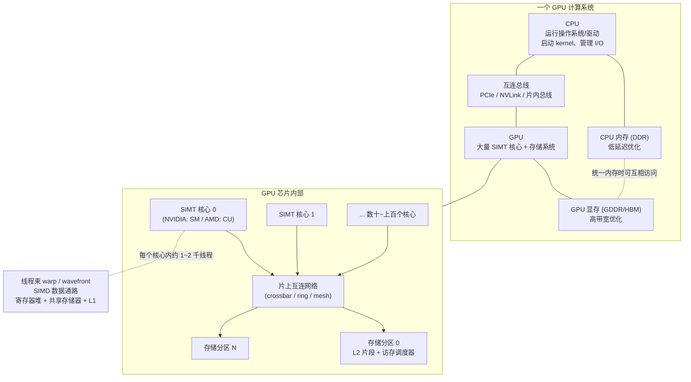
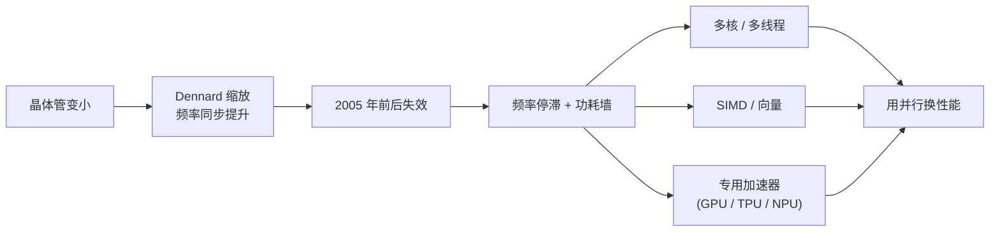
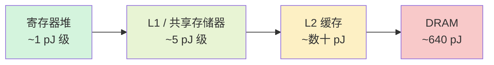
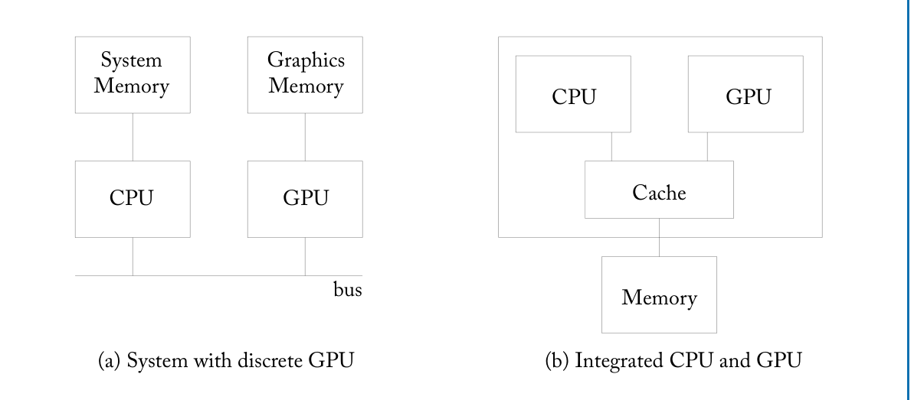
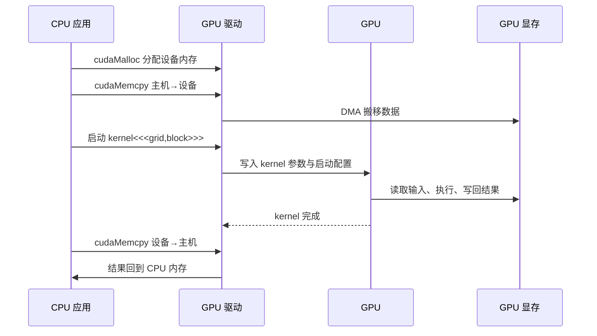
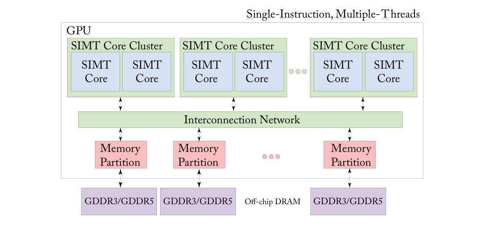
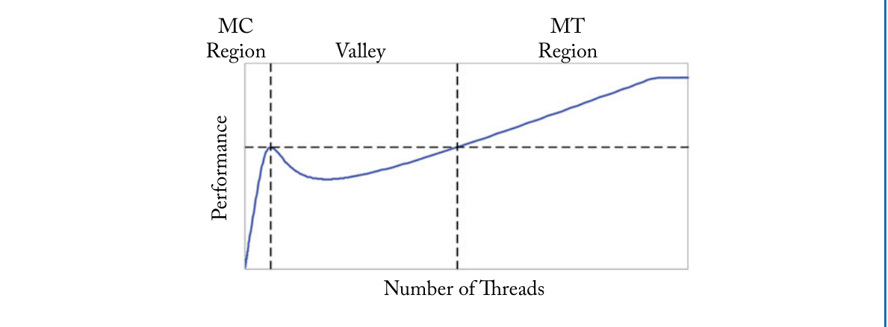
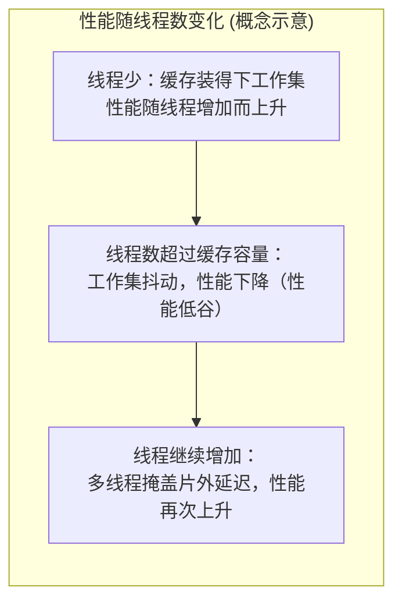
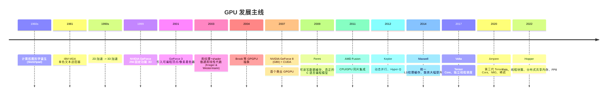
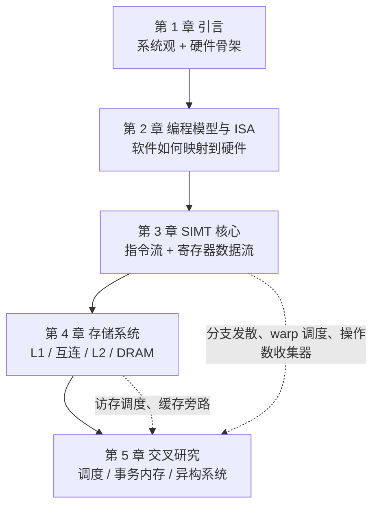

# 第 1 章　引言与 GPU 硬件基础

> **对应原书**：第 1 章 *Introduction*（1.1 计算加速器的格局、1.2 GPU 硬件基础、1.3 GPU 发展简史、1.4 全书结构）
>
> **本章目标**：先建立三幅"地图"——GPU 在计算世界中的位置、GPU 在系统中的位置、GPU 芯片内部的位置。读完本章，你应当能回答：为什么 CPU 和 GPU 必须协作？GPU 凭什么比 CPU 能效高？一个 GPU 由哪些部件构成？以及本书后面四章分别在讲什么。

---

## 1.0 先给初学者的一幅总图

很多人第一次接触 GPU 体系结构，会被 SIMT、warp、occupancy、bank conflict 这些词淹没。其实整本书只围绕一个核心矛盾展开：

> **GPU 用"很多个简单的线程"去填满"很宽的运算流水线"，用"大规模并行"换取"高吞吐率和高能效"；代价是单个线程的性能、编程的直观性、以及存储系统的复杂度。**

把这个矛盾记住，后面所有设计都只是它的推论。**图 1-1** 是本书的"全景地图"：



**图 1-1**：一个 GPU 计算系统的总体组成：CPU、GPU、互连与两类内存

**读图要点**：

1. GPU 不是"独立的计算机"，它永远依附于一个 CPU。CPU 负责"开始"和"结束"（启动 kernel、搬数据、处理 I/O），GPU 负责"中间那段高度并行的计算"。
2. 一个 GPU 由很多个**同构的 SIMT 核心**组成，核心之间通过**片上互连**连到**存储分区**，存储分区再连到片外 DRAM。
3. 本章只讲"骨架"，第 3 章拆开一个 SIMT 核心，第 4 章拆开存储系统，第 5 章讲跨部件的调度与系统问题。

---

## 1.1 为什么需要 GPU：计算加速器的格局

### 1.1.1 从 Dennard 缩放终结说起

过去几十年，处理器性能指数增长，靠的是四件事的合力：晶体管变小、体系结构改进、编译器进步、算法改进。书里引用 Hennessy 与 Patterson 的估计：**约一半的性能提升来自晶体管尺寸缩小**，因为更小的器件工作得更快。

但这个规律在 2005 年前后撞墙了。经典规律叫 **Dennard 缩放（Dennard Scaling）**：晶体管尺寸每缩小一代，单位面积功耗基本不变，因此可以在不增加功耗密度的前提下提高频率。Dennard 缩放失效后：

- 晶体管仍然在变小（摩尔定律还在延续一段时间），但**频率几乎不再提升**；
- 功耗密度成为约束，芯片进入"**暗硅（dark silicon）**"时代——你不能让所有晶体管同时以最高频率工作；
- 于是性能提升必须来自**体系结构**，尤其是**并行**与**专用化**。

这直接解释了 GPU 为什么兴起：既然不能靠"让一个核跑得更快"，那就"放很多个简单的核，让它们同时干活"。**图 1-2** 概括了这一转变：



**图 1-2**：Dennard 缩放终结后，性能提升转向并行与专用化

### 1.1.2 硬件专用化能带来多大收益？

书里引用 Hameed 等人 [2010] 的结论：**通过硬件专用化，能效可以提升多达 500 倍**。这个数字要拆开看，否则容易误解：

| 收益来源 | 大致倍数 | 本质 |
|---|---|---|
| 转向向量硬件（如 GPU 的 SIMD） | ~10× | 摊薄指令取指、译码、调度的开销：一条指令处理 32 个数据 |
| 减少数据移动 | 剩余的大部分 | 避免频繁访问寄存器堆/缓存等大存储阵列；用复杂指令一次完成多个运算 |
| 定制数据通路 | 叠加 | 让数据在算术单元之间直接流动，而不是"存取寄存器" |

这里有一个贯穿全书的**第一性原理**：

> **在先进工艺下，"搬数据"比"算数据"更贵。**

书中的表 1.1（45nm 工艺）给出了直观数量级：

| 操作 | 能耗 (pJ) | 相对 32 位整数加法 |
|---|---:|---:|
| 32 位整数加法 | 0.1 | 1× |
| 32 位浮点加法 | 0.9 | 9× |
| 32 位整数乘法 | 3.1 | 31× |
| 32 位浮点乘法 | 3.7 | 37× |
| 32 位 SRAM 读（32KB） | 5 | 50× |
| 32 位 DRAM 读 | 640 | 6400× |

**怎么读这张表**：一次 DRAM 访问的能量，够做 6400 次整数加法。所以 GPU 体系结构的大量设计——共享存储器、寄存器堆分 bank、操作数收集器、缓存旁路、寄存器压缩——本质上都是在**减少数据移动**或**把数据移动放到更近的层级**。**图 1-3** 把这一原理画成了存储层次：



**图 1-3**：存储层次的单位访问能耗量级：越靠近线程越便宜
> 越往右，容量越大、带宽越低、单位访问能耗越高。GPU 存储层次的设计目标就是：让绝大多数访问停在左边。

### 1.1.3 灵活性与效率的权衡：GPU 的位置

**图 1-4** 把加速器排成一条"专用化光谱"：


**图 1-4**：通用 CPU、GPU、DSP 与 ASIC 的专用化光谱

书里强调两个关键点：

1. **GPU 是图灵完备的**：只要给足够时间和存储，任何计算都能在 GPU 上表达。这让它对软件开发者友好——你不需要为每种算法造一块芯片。
2. **GPU 的效率可以比 CPU 高一个数量级**（Lee et al. [2010]），对于能充分利用其并行的软件。

这正是 GPU 的甜蜜点：**比 CPU 灵活得多，比 ASIC 通用得多**。机器学习之所以大量转向 GPU，正是因为神经网络的训练/推理既有海量规则并行，又需要不断演进的算法灵活性。

> **延伸（外网补充）**：2017 年之后，专用 AI 加速器（Google TPU、各类 NPU）大量出现，但它们通常只覆盖推理或特定算子。GPU 通过 Tensor Core、稀疏化、低精度格式（FP8/FP4）不断吸收专用化的收益，同时保留通用可编程性。到 Hopper（H100/H20）一代，GPU 已经同时包含：
> - 通用 SIMT 单元（CUDA Core）
> - 矩阵单元（Tensor Core，支持 FP16/BF16/TF32/FP8/INT8 等）
> - 张量内存加速器（TMA，负责大块数据搬运）
> - 线程块簇（Thread Block Cluster）与分布式共享存储器
>
> 这体现了本书反复出现的主题：**在通用架构里逐步加入专用硬件**。

---

## 1.2 GPU 硬件基础

### 1.2.1 CPU 与 GPU 如何协作

书里反复强调：**GPU 不是独立设备，它和 CPU 绑在一起**。原因有三：

1. 计算的开始和结束通常要访问 I/O 设备，而 I/O 与操作系统服务天然适合 CPU；
2. 应用的控制逻辑、内存分配、错误处理更适合 CPU；
3. 即使有 GPU 直接 I/O 的 API，迄今仍假定存在一个邻近的 CPU。

两种典型集成方式（对应原书图 1.1）：



**图 1.1**：GPU 计算系统包含 CPU（原书插图）

| 形态 | 内存 | DRAM 技术 | 特点 |
|---|---|---|---|
| **独立 GPU（discrete）** | CPU 系统内存 + GPU 设备内存，物理分离 | CPU 用 DDR，GPU 用 GDDR/HBM | GPU 带宽高；需要显式或统一内存拷贝 |
| **集成 GPU（integrated / APU）** | 单一内存空间，CPU/GPU 共享 | LPDDR 等低功耗内存 | 无需拷贝；但有缓存一致性问题，带宽受共享内存限制 |

**数据流的三种模式**如 **图 1-5** 所示：



**图 1-5**：CPU 启动 kernel 与搬运数据的典型时序

- **显式拷贝（早期独立 GPU）**：程序员负责 `cudaMemcpy`。
- **统一内存（Unified Memory，Pascal 起）**：运行时 + 硬件 + 页错误机制自动在 CPU/GPU 间迁移数据，程序员写起来像共享内存。
- **集成共享内存**：物理上就是同一块 DRAM，无需拷贝，但要处理 CPU/GPU 缓存一致性。

> **延伸**：现代 NVLink / NVSwitch 让多 GPU 之间、GPU 与 CPU 之间的带宽远高于 PCIe。Hopper 的 NVLink 4.0 单链路双向 50 GB/s，一个 GPU 可聚合到 900 GB/s；这也是为什么大模型训练能把一个"GPU 集群"当成一个更大的加速器来用。

### 1.2.2 一个 GPU 的宏观结构

原书图 1.2 给出了通用现代 GPU 的骨架：



**图 1.2**：一种通用的现代 GPU 体系结构（原书插图）

把它翻译成文字：

1. **许多 SIMT 核心**（NVIDIA 叫 Streaming Multiprocessor, SM；AMD 叫 Compute Unit, CU）。
   - 每个核心执行一个 SIMT 程序（对应一个 kernel）。
   - 每个核心通常维持约 **一千个线程**（现代 GPU 可达 2048 线程/SM）。
   - 同一核心内的线程通过**便笺式存储器（scratchpad / shared memory）**通信，用**屏障（barrier）**同步。
   - 每个核心有自己的 **L1 指令缓存**和 **L1 数据缓存**，充当带宽过滤器。
2. **片上互连网络**：把核心连到存储分区，常见是交叉开关（crossbar），也有 ring / mesh。
3. **多个存储分区**：每个分区含一部分末级缓存（L2）和一个访存调度器，连接若干 DRAM 通道。
4. **片外 DRAM**：提供高带宽，但延迟高达数百周期。

**核心设计哲学**：GPU 把更大比例的芯片面积用于 **ALU**，更小比例用于**控制逻辑**。CPU 则相反——大量面积用于分支预测、乱序调度、大缓存。这直接导致：

- CPU：单线程快，但面积效率低；
- GPU：单线程慢，但单位面积吞吐率高。

### 1.2.3 用 Guz 模型理解"为什么要很多线程"

书里引用 Guz 等人 [2009] 的分析模型（原书图 1.3）。模型假设：线程间不共享数据、片外带宽无限。结论是一条很有意思的曲线：



**图 1.3**：多核 CPU 与 GPU 的性能权衡（原书插图）

**图 1-6** 用概念曲线表示了这条曲线的三个阶段：



**图 1-6**：Guz 模型：性能随线程数变化出现“性能低谷”

- **多核 CPU 对应曲线左半段**：少量线程共享一个大缓存，性能随线程数上升；一旦工作集超过缓存，性能掉进"低谷"。
- **GPU 对应曲线右半段**：GPU 本来就不指望缓存装下工作集，而是用**大量线程**把片外延迟"藏起来"。当一个线程等待内存时，调度器切换到另一个就绪线程。

这就是 GPU 的核心生存方式：**用线程级并行（TLP）容忍延迟（latency tolerance），而不是消除延迟**。

> **关键公式（吞吐率视角）**：
> $$
> \text{吞吐率} \approx \frac{\text{并发线程数}}{\text{每次访存延迟}}
> $$
> 只要在途线程足够多，即使每个线程都很慢，整体吞吐率仍然很高。第 3 章的 warp 调度、第 4 章的 MSHR/访存并行，都是在为这个公式服务。

### 1.2.4 能效：GPU 设计的第二约束

书里指出：访问大型存储结构的能量可能与计算相当甚至更多。这就是 1.1.2 节表 1.1 的含义。对 GPU 体系结构研究而言，这意味着：

- 一个"更快"的设计如果增加了大量数据搬运，可能在能效上更差；
- 评估新架构时必须同时看**性能**和**能耗**；
- 模拟器（如 GPGPU-Sim）因此集成了能耗模型（Leng et al. [2013]）。

---

## 1.3 GPU 发展简史（一条"可编程性不断增强"的主线）

书里用一小节回顾历史。不要把它当成年代记忆题，而要看出**每一次演进都在解决"如何既保持高吞吐、又让程序员更好用"**这个问题。**图 1-7** 概括了这条主线：



**图 1-7**：GPU 发展主线：从固定功能到可编程，再到专用加速

**几个关键转折点的技术含义**：

| 阶段 | 变化 | 为什么重要 |
|---|---|---|
| GeForce 256（1999） | 固定功能 3D 流水线 | 硬件专门做变换/光照/光栅化，性能高但不可编程 |
| GeForce 3（2001） | 顶点/像素**着色器**可编程 | 第一次让开发者能写"程序"控制 GPU |
| GeForce 8 / CUDA（2007） | 统一的着色器核心 + CUDA C | 首次把 GPU 当通用并行处理器；支持任意地址写、shared memory |
| Fermi（2009） | 可读写数据缓存、ECC、真正的缓存层次 | GPGPU 从"实验"走向"可靠计算" |
| Volta（2017） | Tensor Core + 独立线程调度 | 面向深度学习；同时修复 SIMT 栈的死锁/重汇聚缺陷（见第 3 章） |
| Hopper（2022） | TMA、线程块簇、分布式共享内存 | 把"数据搬运"和"跨 SM 协作"做成硬件原语 |

> **延伸（Volta 独立线程调度）**：这是本书第 3 章重点讨论的"无栈 SIMT"在工业界的落地。传统 SIMT 栈在自旋锁等场景会导致 **SIMT 死锁**；Volta 的 Independent Thread Scheduling 给每个线程独立的 PC 和调用栈，允许线程束内线程在不同点推进，从硬件上消除了这类死锁。详见第 3 章 3.1.2。

---

## 1.4 全书结构：后面四章怎么读

书里 1.4 节给出了路线图。**图 1-8** 用一张依赖图表示：



**图 1-8**：全书五章的组织与依赖关系

- **第 2 章**：先讲软件。不理解 CUDA/OpenCL 如何映射到硬件，就无法理解硬件为什么长这样。
- **第 3 章**：拆开一个 SIMT 核心，围绕**取指循环、发射循环、寄存器访问循环**三层"近似"逐步深入。
- **第 4 章**：拆开存储系统，从 L1、纹理缓存、互连到 L2、DRAM 访存调度。
- **第 5 章**：讲无法归入单个部件的问题——线程调度、替代并行表达、事务内存、异构系统。

---

## 1.5 H20 实测：把"宏观参数"落到真实硬件

本节用当前环境的 NVIDIA H20-3e 实测数据，把书中的抽象概念对应到真实参数。测试代码见 `code/`（可按文末说明复现）。

### 1.5.1 设备参数

用 `cudaGetDeviceProperties` 读取到的关键参数：

| 参数 | H20-3e 实测值 | 对应书中的概念 |
|---|---:|---|
| SIMT 核心数（SM） | **78** | 原书图 1.2 中的"许多核心" |
| 每 SM 最大线程数 | **2048** | "每个核心约一千个线程"的现代值 |
| 每 SM 寄存器数 | **65536 个 32-bit**（256 KB） | 第 3 章的大寄存器堆 |
| 每 SM 共享存储器 | **228 KB**（可 opt-in 到 227 KB/block） | 第 4 章的便笺式存储器 |
| L2 缓存 | **60 MB** | 第 4 章的末级缓存 |
| 显存位宽 | **6016 bit** | 第 4 章的高带宽 DRAM |
| warp 大小 | **32** | 第 2/3 章的线程束 |
| 每 block 最大线程数 | **1024** | CUDA 编程模型约束 |

**算一笔账**：78 个 SM × 2048 线程 = **159,744 个线程**可同时驻留。这正是 GPU"用海量线程掩盖延迟"的物理基础。如果每个线程 32 个寄存器，则 2048 × 32 = 65536，刚好用满寄存器堆——这就是第 3 章"占用率（occupancy）"概念的由来。

### 1.5.2 峰值带宽实测

用 `float4` 向量化拷贝，分别在 67 MB / 268 MB / 1 GB / 2 GB 数组上测（读 + 写都计入有效字节）：

| 数组大小 | 耗时 | 有效带宽 |
|---|---:|---:|
| 67 MB | 0.037 ms | 3603 GB/s |
| 268 MB | 0.139 ms | 3852 GB/s |
| 1 GB | 0.549 ms | 3909 GB/s |
| 2 GB | 1.097 ms | **3915 GB/s** |

**解读**：

- H20 的 HBM3 标称带宽约 4 TB/s，实测拷贝达到 **3.9 TB/s**，说明这个微基准已经接近硬件的可持续带宽上限。
- 对比第 1 章表 1.1：一次 DRAM 访问 640 pJ，而一次 ALU 只需 0.1 pJ。即使带宽高达 4 TB/s，数据搬运仍然是 GPU 最贵的操作之一。
- 这也解释了为什么第 4 章要花大量篇幅讲**访存合并、缓存、数据放置**——它们直接决定了你能否接近这条带宽上限。

### 1.5.3 一个"性能低谷"的直观演示

书里 Guz 模型的"性能低谷"在真实 GPU 上不易直接复现（因为 GPU 的缓存/带宽参数与模型不同），但可以用**占用率扫描**看到类似的"线程太少 → 吞吐上不去；线程足够 → 吞吐饱和"现象。第 5 章会给出实测：在依赖 FMA 链的延迟受限内核上，每 SM 从 256 线程增加到 2048 线程，吞吐从约 **7.8 TFMA/s 提升到 13.7 TFMA/s**，提升约 **1.76 倍**，之后趋于饱和。这正是"用 TLP 掩盖延迟"的直接证据。

---

## 1.6 本章小结

用五句话概括第 1 章：

1. **Dennard 缩放终结**迫使体系结构转向并行与专用化，GPU 是这一趋势最成功的通用代表。
2. **硬件专用化可带来最多约 500× 能效提升**，其中约 10× 来自向量化，其余主要来自**减少数据移动**。
3. GPU 与 CPU **协作而非替代**：CPU 管开始/结束与 I/O，GPU 管中间的大规模并行计算。
4. GPU 由**许多 SIMT 核心 + 片上互连 + 存储分区 + 高带宽 DRAM**构成，靠**海量线程**容忍延迟。
5. 能效是第二约束：**一次 DRAM 访问 ≈ 6400 次整数加法**，所以存储层次和减少数据移动是全书主线。

### 思考题

1. 为什么"提高频率"在 2005 年后不再是提升性能的主要手段？这对 GPU 的设计有什么影响？
2. 一个独立 GPU 系统中，数据从 CPU 内存到 GPU 显存要经过哪些步骤？统一内存改变了什么、没有改变什么？
3. 用 Guz 模型解释：为什么 GPU 不追求"消除缓存缺失"，而追求"用线程掩盖缓存缺失"？
4. H20 有 78 个 SM、每 SM 2048 线程。如果每个线程用 40 个寄存器，最多能驻留多少线程？这说明寄存器为什么是 occupancy 的关键资源？
5. 表 1.1 中 DRAM 访问的能耗是整数加法的 6400 倍。请举出三个本书之后会讲到的、用来"减少数据移动"的机制。

---

## 附：本章实测代码位置与复现方法

```bash
# 设备参数
nvcc -arch=sm_90 props.cu -o props && ./props

# 峰值带宽（float4 拷贝，多种数组大小）
nvcc -O3 -arch=sm_90 --extended-lambda bw.cu -o bw && ./bw
```

> 说明：H20 的 compute capability 为 **9.0**（Hopper 架构），因此编译时使用 `-arch=sm_90`。如果你的环境是其他架构，请相应替换为 `sm_80`（Ampere）、`sm_89`（Ada）等。
