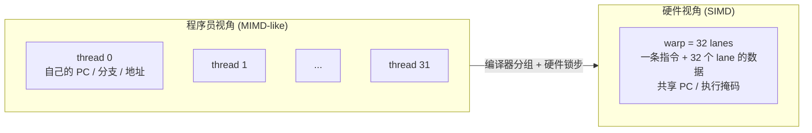
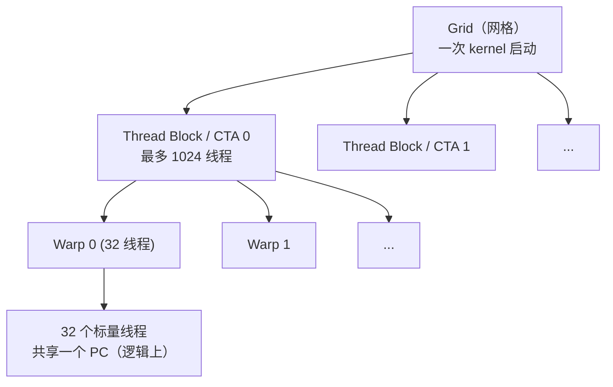
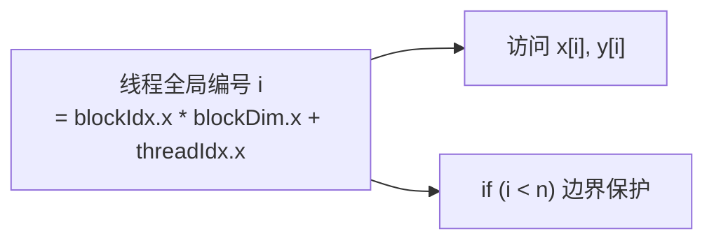
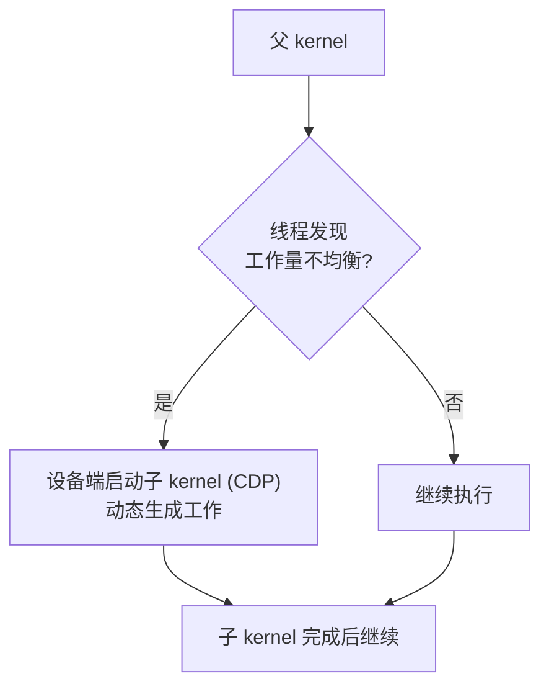
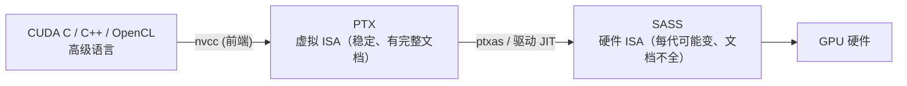
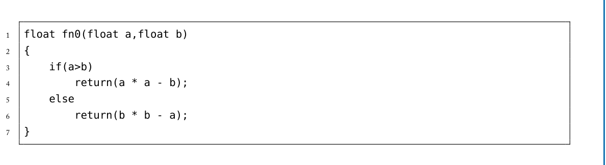
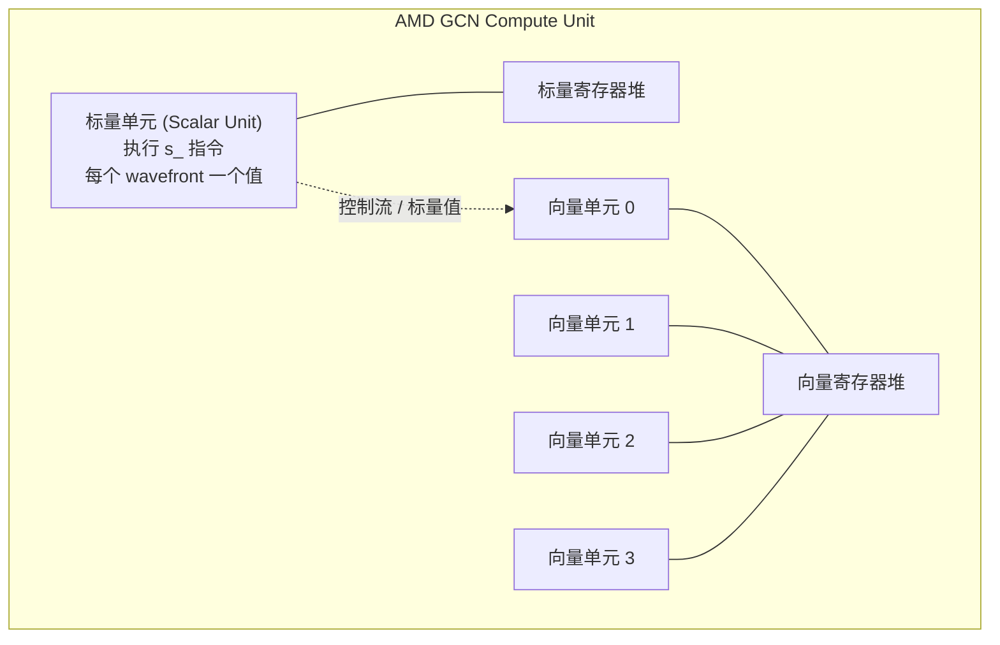

# 第 2 章　编程模型与指令集体系结构

> **对应原书**：第 2 章 *Programming Model*（2.1 执行模型、2.2 GPU 指令集体系结构，含 NVIDIA PTX/SASS 与 AMD GCN）
>
> **本章目标**：理解"程序员写的一个线程"如何一步步变成"GPU 硬件上执行的 SIMD 指令"。本章是第 3、4 章的软件前提：**不知道软件假设了什么，就无法理解硬件为什么这样设计。**

---

## 2.0 一句话抓住本章

GPU 的编程模型是 **MIMD 的样子，SIMD 的里子**：

- 程序员看到的是"成千上万个独立线程，每个线程有自己的 PC、可以走自己的分支、访问任意地址"（类似 MIMD）；
- 硬件实际用 **SIMD 数据通路**执行，把 32 个线程捆成一个 **warp（线程束）**，锁步执行同一条指令；
- 二者之间的鸿沟，由**编译器 + 硬件（SIMT 栈、谓词、调度器）**共同填补。

**图 2-1** 画出了这两种视角的对应关系：



**图 2-1**：MIMD 编程外观与 SIMD 硬件执行之间的鸿沟

---

## 2.1 执行模型

### 2.1.1 从一段 SAXPY 看 CPU 与 GPU 的分工

书里用 **SAXPY**（`y = a*x + y`）贯穿讲解。它是 BLAS 的基础操作，简单又有代表性。

**CPU 版本（原书图 2.1）**：

```c
void saxpy_serial(int n, float a, float *x, float *y) {
    for (int i = 0; i < n; ++i)
        y[i] = a*x[i] + y[i];
}
```

**CUDA 版本（原书图 2.2）**：

```c
__global__ void saxpy(int n, float a, float *x, float *y) {
    int i = blockIdx.x*blockDim.x + threadIdx.x;
    if (i < n)
        y[i] = a*x[i] + y[i];
}

int main() {
    float *h_x, *h_y;
    int n;
    // 省略：分配并初始化 CPU 内存
    float *d_x, *d_y;
    int nblocks = (n + 255) / 256;

    cudaMalloc(&d_x, n * sizeof(float));
    cudaMalloc(&d_y, n * sizeof(float));
    cudaMemcpy(d_x, h_x, n*sizeof(float), cudaMemcpyHostToDevice);
    cudaMemcpy(d_y, h_y, n*sizeof(float), cudaMemcpyHostToDevice);

    saxpy<<<nblocks, 256>>>(n, 2.0, d_x, d_y);

    cudaMemcpy(h_x, d_x, n*sizeof(float), cudaMemcpyDeviceToHost);
    // 省略：释放内存
}
```

**逐点对照**：

| CPU 版本 | GPU 版本 | 含义 |
|---|---|---|
| `for` 循环的每次迭代 | 一个**线程** | 循环并行化 = 把迭代映射到线程 |
| 循环变量 `i` | `blockIdx.x*blockDim.x + threadIdx.x` | 每个线程算出自己的全局编号 |
| 无 | `if (i < n)` | 边界保护：多启动的线程不越界 |
| 函数调用 | `<<<nblocks, 256>>>` | **内核配置语法**：网格大小 × 块大小 |

**关键洞察**：GPU 版本并没有"循环"，而是把循环展开成**由线程 ID 索引的并行执行**。这就是 SIMD/SIMT 编程的本质——**用数据索引代替循环**。

### 2.1.2 线程的三层组织：grid → block → warp

**图 2-2** 给出了 grid → block → warp 的三层组织：



**图 2-2**：Grid → Thread Block(CTA) → Warp 的三层线程组织

- **Grid**：一次 kernel 启动对应一个 grid，由若干 block 构成。
- **Thread Block / CTA**（Cooperative Thread Array）：可包含最多 1024 个线程；同一 block 的线程可以通过 **shared memory** 通信，用 **`__syncthreads()`** 同步。
- **Warp**（NVIDIA）/ **Wavefront**（AMD）：硬件执行单位。NVIDIA 为 32 线程，AMD GCN 为 64 线程（RDNA 为 32）。

**CUDA 的三维索引**：grid 和 block 都有 x/y/z 三个维度，每个线程因此有唯一的 `(blockIdx, threadIdx)` 组合。SAXPY 只用 x 维，所以 y、z 都是 0（**图 2-3**）。



**图 2-3**：用线程全局编号索引数据并做边界保护

### 2.1.3 GPU 的存储空间（这是理解第 4 章的钥匙）

书里明确列出 CUDA/OpenCL 提供的几类存储空间，它们对应不同的硬件：

| 编程模型中的名字 | 硬件位置 | 作用域 | 生命周期 | 书中相关章节 |
|---|---|---|---|---|
| **寄存器** | 寄存器堆 | 单线程 | 线程 | 3.3、3.6 |
| **local memory** | 全局内存（被缓存） | 单线程 | 线程 | 4.1（寄存器溢出） |
| **shared memory**（CUDA）/ local（OpenCL） | 片上便笺式存储器（scratchpad） | 单 CTA | CTA | 4.1.1 |
| **global memory** | 片外 DRAM + 各级缓存 | 所有线程 | 应用 | 4.1–4.3 |
| **constant memory** | 常量缓存 | 所有线程，只读 | 应用 | 2.2、3.5 |
| **texture memory** | 纹理缓存 | 所有线程，只读 | 应用 | 4.1.2 |

**为什么 shared memory 重要**：它是一个**由软件显式管理**的片上存储。程序员知道哪些数据会被反复使用，就手动把它搬进 shared memory，避免反复访问高延迟、高能耗的 DRAM。这是"用软件局部性替代硬件缓存"的典型手段。

> **AMD 的对应物**：GCN 有 **LDS（Local Data Store）**，每 CU 64 KB；此外还有 **GDS（Global Data Store）**，由全 GPU 共享，用于跨 CU 通信。LDS 在图形流水线里用于顶点着色器与像素着色器之间传递参数。
>
> **延伸（Hopper）**：Hopper 引入 **分布式共享内存（Distributed Shared Memory, DSMEM）**，允许一个线程块簇（cluster）内的 SM 互相访问对方的 shared memory，把"片上便笺"从单 SM 扩展到多 SM。这是第 5 章"异构/多核协作"的硬件基础。

### 2.1.4 屏障、动态并行与负载不均衡

书里提到几个编程模型细节，它们会直接影响硬件设计：

1. **屏障（barrier）**：同一 CTA 内的线程用 `__syncthreads()` 同步，硬件提供 barrier 指令。屏障是"块内线程必须一起到达的点"，也是第 3 章 SIMT 栈/重汇聚讨论的近亲。
2. **CUDA 动态并行（CDP，Kepler 起）**：GPU 上的线程可以**自己启动新的 kernel**，无需回到 CPU。动机是：不规则应用会造成线程间负载不均衡，动态生成工作可以更好地填满硬件。
3. **动态并行的代价**：第 5 章会看到，CDP 在 Kepler 上的设备端启动开销很大（内核多、每个内核线程少、配置占用大量存储），后来出现 DTBL 等改进。**图 2-4** 给出了 CDP 的控制流：



**图 2-4**：动态并行：GPU 线程在设备端启动子 kernel

---

## 2.2 GPU 指令集体系结构

这一节回答：**CUDA C 是如何变成硬件能执行的指令的？**

### 2.2.1 为什么 GPU 需要"虚拟 ISA"

CPU 有很强的**向后兼容**传统：1976 年的 8086 程序理论上能在今天的 x86 上跑。GPU 没有这个包袱，原因在于：

- GPU 厂商众多、硬件迭代极快，每代微架构可能大改；
- 如果要求二进制兼容，厂商就无法重新设计指令编码；
- 于是 GPU 采用**两层 ISA**（**图 2-5**）：



**图 2-5**：CUDA → PTX → SASS 的两层 ISA 编译流程

- **PTX（Parallel Thread Execution）**：NVIDIA 的虚拟 ISA。类似 RISC（ARM/MIPS/SPARC），有**无限多的虚拟寄存器**，很像编译器中间表示。
- **SASS（Streaming ASSembler）**：真正的硬件 ISA。NVIDIA 只部分公开文档，且**每代可能彻底重设计**。这既让学术模拟器难做，也让厂商获得了指令集演进的自由。

> **延伸**：截至 Hopper（sm_90），PTX 版本已到 8.x/9.0，SASS 仍然不完整公开。社区工具（如 `nvdisasm`、`cuobjdump`、Triton 的汇编器）和逆向工程（decuda、Maxwell 逆向）一直在填补这个空白。

### 2.2.2 PTX 长什么样：SAXPY 的实际编译结果

下面是在当前 H20 环境（CUDA 13.0，`-arch=sm_90`）用 `nvcc -ptx` 生成的 PTX（有删节）：

```ptx
.visible .entry _Z5saxpyifPfS_(
    .param .u32 _Z5saxpyifPfS__param_0,   // n
    .param .f32 _Z5saxpyifPfS__param_1,   // a
    .param .u64 _Z5saxpyifPfS__param_2,   // x
    .param .u64 _Z5saxpyifPfS__param_3    // y
)
{
    .reg .pred %p<2>;
    .reg .f32  %f<5>;
    .reg .b32  %r<6>;
    .reg .b64  %rd<8>;

    ld.param.u32   %r2, [_Z5saxpyifPfS__param_0];
    ld.param.f32   %f1, [_Z5saxpyifPfS__param_1];
    ld.param.u64   %rd1, [_Z5saxpyifPfS__param_2];
    ld.param.u64   %rd2, [_Z5saxpyifPfS__param_3];
    mov.u32        %r3, %ctaid.x;      // blockIdx.x
    mov.u32        %r4, %ntid.x;       // blockDim.x
    mov.u32        %r5, %tid.x;        // threadIdx.x
    mad.lo.s32     %r1, %r3, %r4, %r5; // i = blockIdx*blockDim + threadIdx
    setp.ge.s32    %p1, %r1, %r2;      // p1 = (i >= n)
    @%p1 bra       $L__BB0_2;          // if (i>=n) 跳过

    cvta.to.global.u64 %rd3, %rd2;
    cvta.to.global.u64 %rd4, %rd1;
    mul.wide.s32   %rd5, %r1, 4;       // 偏移 = i*4 字节
    add.s64        %rd6, %rd4, %rd5;   // &x[i]
    ld.global.f32  %f2, [%rd6];
    add.s64        %rd7, %rd3, %rd5;   // &y[i]
    ld.global.f32  %f3, [%rd7];
    fma.rn.f32     %f4, %f2, %f1, %f3; // a*x[i] + y[i]
    st.global.f32  [%rd7], %f4;

$L__BB0_2:
    ret;
}
```

**PTX 的三个特点**（书里强调的）：

1. **无限虚拟寄存器**：每个定义通常用新寄存器（`%r1, %r2, ...`），类似 **SSA（静态单赋值）形式**。硬件没有这么多寄存器，由 `ptxas` 做寄存器分配。
2. **RISC 风格**：只有 load/store 访问内存，算术在寄存器之间进行。
3. **谓词执行**：`setp` + `@%p1 bra` 是典型的分支/谓词表达（Allen et al. [1983]）。

### 2.2.3 SASS 长什么样：硬件真实指令

用 `cuobjdump -sass` 提取同一内核在 sm_90 上的 SASS（节选）：

```asm
/*0000*/  LDC R1, c[0x0][0x28] ;
/*0010*/  S2R R0, SR_TID.X ;                 // threadIdx.x
/*0020*/  S2UR UR4, SR_CTAID.X ;             // blockIdx.x -> 统一寄存器
/*0030*/  LDC R7, c[0x0][RZ] ;               // blockDim.x
/*0040*/  IMAD R7, R7, UR4, R0 ;             // i = blockDim*blockIdx + tid
/*0050*/  ULDC UR4, c[0x0][0x210] ;          // n
/*0060*/  ISETP.GE.AND P0, PT, R7, UR4, PT ;
/*0070*/  @P0 EXIT ;                         // i>=n 直接退出
/*0080*/  LDC.64 R2, c[0x0][0x218] ;         // x 指针
/*0090*/  ULDC.64 UR4, c[0x0][0x208] ;       // y 指针
/*00a0*/  ULDC UR6, c[0x0][0x214] ;          // a
/*00c0*/  IMAD.WIDE R2, R7, 0x4, R2 ;        // &x[i]
/*00d0*/  LDG.E R2, desc[UR4][R2.64] ;       // 读 x[i]
/*00e0*/  IMAD.WIDE R4, R7, 0x4, R4 ;        // &y[i]
/*00f0*/  LDG.E R7, desc[UR4][R4.64] ;       // 读 y[i]
/*0100*/  FFMA R7, R2, UR6, R7 ;             // a*x[i]+y[i]
/*0110*/  STG.E desc[UR4][R4.64], R7 ;       // 写 y[i]
/*0120*/  EXIT ;
```

**PTX 与 SASS 的关键差异**（书里列出的，加上 sm_90 的新观察）：

| 维度 | PTX | SASS（sm_90） |
|---|---|---|
| 寄存器 | 几乎无限，SSA 风格 | 数量有限（每线程最多 255），需分配 |
| 参数传递 | 独立的 `.param` 地址空间 | 通过**常量存储器 bank**（`c[0x0][...]`）传递 |
| 控制信息 | 显式分支 | 每几条指令附带**控制位/控制指令**（编码在第二列） |
| 统一值 | 无特殊处理 | 出现 **UR（Uniform Register）** 与 `S2UR`/`ULDC`：标量/仿射数据走统一数据通路 |
| 描述符 | 无 | `LDG.E desc[UR4][...]`：使用内存描述符 |

**几个值得注意的细节**：

1. **常量 bank**：SASS 里 `n`、`a`、指针都从 `c[0x0][...]` 读取。非 load/store 指令可以直接把常量作为操作数，减少寄存器压力。
2. **统一寄存器（UR）**：`UR4`、`UR6` 存放的是**整个 warp 共享的值**（如 blockIdx、kernel 参数）。这是第 3 章"标量化/仿射执行"思想在硬件上的体现——不用为 32 个 lane 各存一份。
3. **控制信息**：SASS 每条指令右边的第二个 `/* 0x... */` 编码了调度相关信息（停顿计数、依赖屏障、reuse 标志等）。书上讲 Kepler/Maxwell 用"控制指令"显式管理依赖；到 sm_90，这些信息仍以控制位形式存在，只是编码更复杂。
4. **`LDG.E desc[...]`**：现代 SASS 用**内存描述符**（descriptor）来携带地址空间/缓存策略等信息，而不是早期简单的 `[R2]`。

> **延伸（编译器视角）**：`nvcc` 的实际流程是：CUDA C → NVVM IR（基于 LLVM）→ PTX → `ptxas` → SASS。你可以用 `nvcc -keep` 保留中间文件，或用 `nvcc -ptx` / `cuobjdump -sass` 分别查看两层。Triton、TVM 等框架则直接生成 PTX，绕过 CUDA C 前端。

### 2.2.4 AMD GCN：标量单元 + 向量单元的分离

书里用 AMD Southern Islands（GCN 第一代）作为对比。它与 NVIDIA 的一个**关键区别**是：

> **AMD GCN 把标量指令（`s_`）和向量指令（`v_`）显式分开，并有独立的标量单元。**

原书图 2.6 / 2.7 的例子（一段 OpenCL 的 if-else）。



**图 2.6**：OpenCL 代码（原书插图）

对应的 GCN 微码如下（原书图 2.7 的内容）：

```asm
// r0 = a, r1 = b, 结果放 r2
v_cmp_gt_f32   r0, r1          // 向量比较: a > b
s_mov_b64      s0, exec        // 保存当前执行掩码
s_and_b64      exec, vcc, exec // 执行 if 分支
s_cbranch_vccz label0          // 若所有 lane 都不满足则跳过
v_mul_f32      r2, r0, r0      // result = a*a
v_sub_f32      r2, r2, r1      // result = result - b
label0:
s_not_b64      exec, exec      // 执行 else 分支
s_and_b64      exec, s0, exec
s_cbranch_execz label1
v_mul_f32      r2, r1, r1      // result = b*b
v_sub_f32      r2, r2, r0
label1:
s_mov_b64      exec, s0        // 恢复 exec
```

**图 2.7**：Southern Islands（GCN）微码（原书图 2.7 的代码）

**怎么读**：

- `v_` 前缀 = **向量指令**：在向量单元上执行，为 wavefront 中每个线程算出不同的 32 位值。
- `s_` 前缀 = **标量指令**：在标量单元上执行，算出一个**由整个 wavefront 共享**的 32 位值。
- `exec` 是特殊寄存器，**按 lane 的谓词掩码**，用来实现 SIMT 的条件执行。
- 控制流（比较、掩码、分支）尽量用标量指令完成，**只有数据计算走向量单元**。**图 2-6** 给出了 GCN 计算单元的标量/向量划分：



**图 2-6**：AMD GCN：一个标量单元与四个向量单元耦合

**AMD 的另一个重要机制：`S_WAITCNT`**。每个 wavefront 有三个计数器：

- **向量访存计数（VM）**：未完成的向量内存操作数；
- **LDS/GDS 计数（LG）**：未完成的局部/全局数据存储操作数；
- **导出计数（EX）**：未完成的寄存器导出操作数。

编译器/程序员插入 `s_waitcnt`，让 wavefront 等到未完成操作数降到阈值以下。这相当于**显式的记分牌/依赖等待**，与 NVIDIA 用控制位隐式管理依赖形成对比。

> **延伸**：GCN 后来演进到 RDNA（wave32/wave64 可选）、CDNA（面向计算，强调矩阵单元）。AMD 的虚拟 ISA 叫 **HSAIL**（HSA 的一部分），理念与 PTX 类似。

---

## 2.3 H20 实测：从 CUDA 到 PTX 到 SASS

本节给出可复现的实验，帮助你建立"软件 → 硬件"的直觉。代码在 `code/saxpy.cu`。

### 2.3.1 编译并查看两层 ISA

```bash
nvcc -arch=sm_90 -ptx   saxpy.cu -o saxpy.ptx      # 生成虚拟 ISA
nvcc -arch=sm_90 -cubin saxpy.cu -o saxpy.cubin    # 生成硬件二进制
cuobjdump -sass saxpy.cubin                        # 反汇编为 SASS
```

实测输出见 2.2.2 / 2.2.3。你可以清楚地看到：

- PTX 里 `i = blockIdx*blockDim + threadIdx` 被展开成 `mad.lo.s32`；
- SASS 里同样的计算变成 `S2R`（读特殊寄存器）+ `IMAD`，并且 `blockIdx` 走 **统一寄存器 UR**；
- `a*x+y` 在 PTX 是 `fma.rn.f32`，在 SASS 是 `FFMA`——**融合乘加**，一条指令完成两次运算，这正是第 1 章"硬件专用化减少指令数"的微观体现。

### 2.3.2 观察寄存器与占用率

用 `nvcc -Xptxas -v` 可以看到每个内核用了多少寄存器、多少 shared memory：

```bash
nvcc -arch=sm_90 -Xptxas -v -c saxpy.cu -o saxpy.o
```

典型输出会告诉你 `Used N registers`。这个 N 直接决定 **occupancy**（第 3 章）：

$$
\text{每 SM 可驻留线程数} = \min\left(
\frac{65536}{\text{每线程寄存器数}},\ 
\frac{228\text{KB}}{\text{每线程 shared 字节数}},\ 
2048
\right)
$$

例如每线程用 32 个寄存器，则 `65536/32 = 2048`，刚好达到 H20 的线程上限；若每线程用 64 个寄存器，则最多 1024 线程，occupancy 降到 50%。

### 2.3.3 一个"SIMT 矛盾"的极小实验

写一个内核，让同一个 warp 内线程走不同分支：

```cuda
__global__ void demo(int *out) {
    int t = threadIdx.x;
    if (t & 1) out[t] = t * 2;   // 奇数线程
    else       out[t] = t + 1;   // 偶数线程
}
```

在 SASS 级别，你会看到编译器要么用**谓词执行**（两条指令都发射，按 lane 掩码），要么用**分支 + 重汇聚**（第 3 章的 SIMT 栈）。无论哪种，**warp 内 32 个 lane 不会真正"各走各的"**——这就是 SIMT 的核心约束，也是第 3 章要展开的主题。

---

## 2.4 本章小结

1. GPU 编程模型是 **MIMD 的外观、SIMD 的实现**：程序员写标量线程，硬件按 warp 锁步执行。
2. 线程组织为 **grid → block(CTA) → warp**；warp 是硬件调度单位（NVIDIA 32，AMD GCN 64）。
3. GPU 有多层存储空间：**寄存器、local、shared、global、constant、texture**，分别对应不同硬件与第 4 章的缓存结构。
4. GPU 采用 **两层 ISA**：**PTX（虚拟 ISA，稳定、SSA、无限寄存器）** 与 **SASS（硬件 ISA，每代可变、寄存器有限、含控制位）**。
5. AMD GCN 的独特之处是 **标量单元与向量单元分离**，用 `s_` 指令处理控制流和标量值，用 `v_` 指令处理数据并行；`s_waitcnt` 显式管理长延迟依赖。
6. 现代 SASS（sm_90）已经体现**统一寄存器、内存描述符、控制位**等设计，是第 3 章"标量化/仿射执行"和"操作数收集器"的硬件线索。

### 思考题

1. 为什么 GPU 不需要像 x86 那样保持二进制向后兼容？这对 GPU 体系结构研究意味着什么？
2. PTX 的"无限虚拟寄存器"和 SASS 的"有限物理寄存器"之间，编译器需要做哪些事？
3. 在 SAXPY 的 SASS 中，`n`、`a`、指针为什么从常量存储器读取，而不是普通寄存器？这对寄存器压力有什么好处？
4. AMD GCN 为什么要把标量指令和向量指令分开？举一个"整个 wavefront 共享同一个值"的例子。
5. 如果把 `saxpy<<<nblocks, 256>>>` 改成 `<<<nblocks, 1024>>>`，会改变哪些硬件资源的使用？对 occupancy 有什么影响？

---

## 附：本章实测命令

```bash
cd code
nvcc -arch=sm_90 -ptx saxpy.cu -o saxpy.ptx
nvcc -arch=sm_90 -cubin saxpy.cu -o saxpy.cubin
cuobjdump -sass saxpy.cubin
nvcc -arch=sm_90 -Xptxas -v -c saxpy.cu -o saxpy.o
```
