# 第 3 章　SIMT 核心：指令与寄存器数据流

> **对应原书**：第 3 章 *SIMT Core: Instruction and Register Data Flow*（3.1 一层循环、3.2 两层循环、3.3 三层循环、3.4 分支发散研究、3.5 标量化与仿射、3.6 寄存器堆研究）
>
> **本章目标**：拆开一个 GPU 核心，理解它如何在"一条 SIMD 流水线"上执行"成千上万个独立线程"。这是全书技术含量最高的一章，建议按"三层近似"的顺序读，不要跳。

---

## 3.0 先建立三层近似的心智模型

原书图 3.1 是最重要的图。它把 SIMT 核心拆成三个**协同的调度循环**：

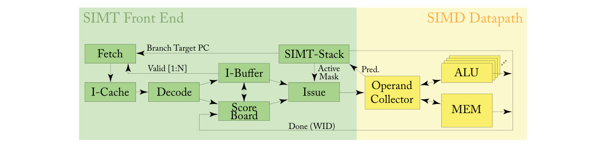

**图 3.1**：通用 GPGPU 核心的微架构（原书插图）

本笔记用 **图 3-1** 重绘了这三个调度循环（对应原书图 3.1）：

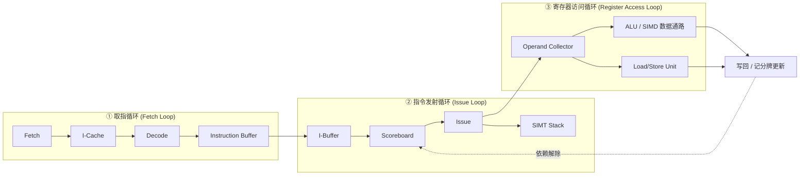

**图 3-1**：SIMT 核心的三个调度循环：取指、发射、寄存器访问

三个循环对应书里的三层"近似"（approximation）：

| 近似 | 看到的硬件 | 能解释什么 | 不能解释什么 |
|---|---|---|---|
| **一层循环** | 只有一个调度器，每周期选一个 warp，取指→译码→读寄存器→执行 | warp 调度、SIMT 执行屏蔽、分支发散 | 无法在指令未完成时发射同 warp 后续指令 |
| **两层循环** | 增加指令缓冲 + 记分牌，取指与发射解耦 | 指令级并行、数据冒险检测 | 寄存器堆端口/bank 冲突 |
| **三层循环** | 增加操作数收集器，解耦"发射"与"读操作数" | 寄存器 bank 冲突、WAR 冒险、结构冒险 | 更底层的电路/时序 |

> **为什么叫"近似"**：即使最详细的三层描述也省略了细节（例如具体的 SRAM 时序、时钟门控、冗余通路）。书里说得很清楚：这是一个"足够解释设计权衡"的模型，不是某款产品的精确复原。

---

## 3.1 一层循环近似：最朴素的 GPU

### 3.1.1 SIMT 执行屏蔽（SIMT Execution Masking）

**基本流程**（每周期）：

1. 调度器选一个 warp；
2. 用 warp 的 PC 访问指令缓存，取出下一条指令；
3. 译码；
4. 从寄存器堆读源操作数；
5. 同时确定 **SIMT 执行屏蔽（active mask）**；
6. 在 SIMD 数据通路上执行：mask 置位的 lane 执行，其余 lane 空闲。

**为什么需要 mask**：程序里一个 warp 的 32 个线程可能走不同分支。硬件只有一条 SIMD 通路，同一周期只能执行一条指令。于是硬件把不同路径**串行化**，用 mask 标记"当前哪些 lane 是活跃的"。

**与谓词执行的关系**：

- 传统谓词执行（predication）：每条指令带一个谓词寄存器，条件为假时该指令不写回。
- SIMT 执行：谓词执行 + **SIMT 栈（一叠谓词屏蔽）**。栈解决两个谓词执行单独搞不定的问题：
  1. **嵌套控制流**：分支里套分支；
  2. **整段跳过**：当所有 lane 都不走某条路径时，直接跳过该路径的计算。

**图 3-2** 对比了两种实现：

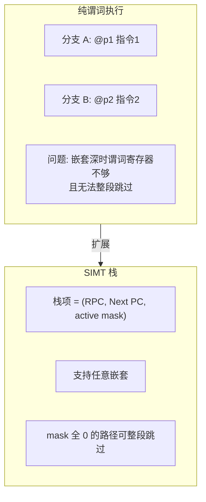

**图 3-2**：谓词执行与 SIMT 栈：栈解决嵌套控制流与整段跳过

### 3.1.2 用例子走一遍 SIMT 栈

原书用图 3.2 的 CUDA 代码和图 3.3 的 PTX，配合原书图 3.4 的栈操作。我们把它简化成"4 线程 warp"来讲。

```c
do {
    t1 = tid*N;              // A
    t2 = t1 + i;
    t3 = data1[t2];
    t4 = 0;
    if (t3 != t4) {          // 分支 1
        t5 = data2[t2];      // B
        if (t5 != t4) {      // 分支 2
            x += 1;          // C
        } else {
            y += 2;          // D
        }
        // E: 重汇聚点（内层）
    } else {
        z += 3;              // F
    }
    i++;                     // G: 重汇聚点（外层）
} while (i < N);
```

原书图 3.4 给出了完整的 SIMT 栈操作示例（控制流图、时间线与栈状态）：

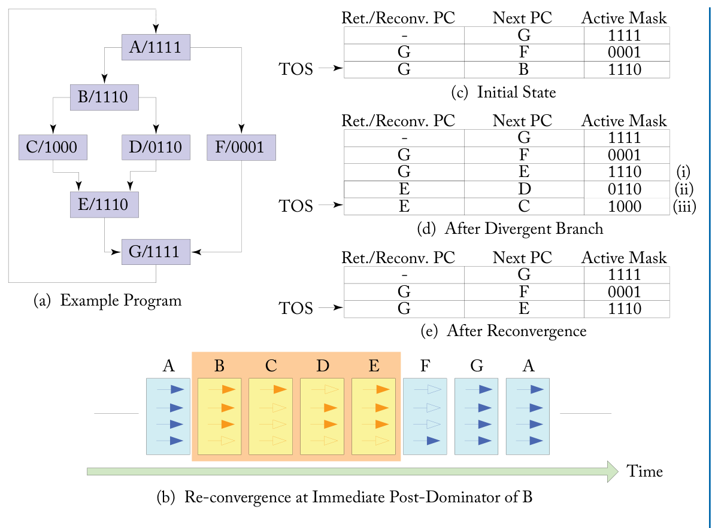

**图 3.4**：SIMT 栈操作示例（原书插图）

**图 3-3** 给出了控制流图与执行时间线：

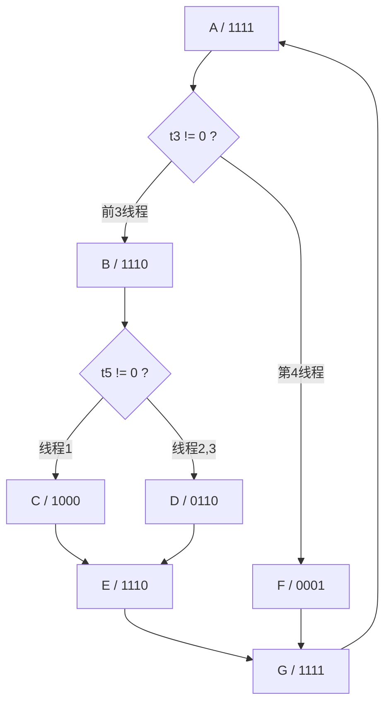

**图 3-3**：4 线程 warp 在嵌套分支下的控制流图与活跃掩码

**SIMT 栈的三个字段**（原书图 3.4c）：

| 字段 | 含义 |
|---|---|
| **RPC**（Reconvergence PC） | 重汇聚点地址：何时可以把发散线程重新合并 |
| **Next PC** | 该栈项下一条要执行的指令地址 |
| **active mask** | 哪些 lane 在该路径上活跃 |

**执行过程**：

1. 初始全部 4 个线程在 A，mask=1111。
2. 执行到分支，前 3 个线程走 B、第 4 个走 F。硬件压栈：栈顶放一条路径的 `(RPC, Next PC, mask)`。
3. 先执行 B 路径（mask=1110），第 4 个线程被屏蔽。B 内又遇分支，再压栈，分成 C（1000）和 D（0110），RPC 设为 E。
4. C、D 串行执行，到 E 重汇聚（1110）。
5. 外层：B 路径执行完到 G；此时弹出 F 路径（0001），执行 F 到 G。
6. 全部 4 个线程在 G 重汇聚（1111），继续循环。

**几个关键设计点**：

- **重汇聚点选哪里？** 一般选发散分支的**直接后支配节点（immediate post-dominator）**。这是编译期能保证"所有路径必然再次汇合"的最早位置。
- **压栈顺序**：为了让栈深度随线程数呈**对数增长**，应先压**活跃线程多**的路径，再压少的路径（AMD 文档所述）。这样最坏深度是 `log2(32)=5` 左右，而不是 32。
- **运行时可能更早重汇聚**：书里 3.4.2 节会讲"可能汇聚点""线程前沿""OREC"，它们试图在 post-dominator 之前就合并，提高 SIMD 效率。

> **直觉类比**：SIMT 栈像一个"分支的待办清单"。遇到分叉，就把"待会儿要走的那条路"记在清单上，先走一条；走完再回来走另一条；所有路都走完，就在汇合点把大家重新聚齐。

### 3.1.3 SIMT 死锁与无栈 SIMT 架构

这是本章最精彩、也最容易被忽略的一节。它解释了**为什么 Volta 要重新设计线程发散管理**。

**问题：自旋锁导致的死锁**

```c
A: *mutex = 0;
B: while (!atomicCAS(mutex, 0, 1));   // 自旋等锁
C: // 临界区
   atomicExch(mutex, 0);              // 释放锁
```

- `atomicCAS` 对每个线程原子执行"读-比较-交换"。同一 warp 内多个线程访问同一地址会被**串行化**。
- 只有一个线程看到 `mutex==0` 并成功加锁，其余线程看到 `1`，继续自旋。
- **关键**：成功加锁的线程**退出了 while 循环**，到达重汇聚点，按 SIMT 栈的规则它"不再活跃于栈上"；而在栈顶活跃的，是那些还在自旋的线程。
- 结果：持有锁的线程无法执行 C 行去释放锁，自旋的线程永远等下去——**SIMT 死锁**。在真正的 MIMD 机器上这根本不会发生。

原书图 3.5 给出了这个自旋锁示例的代码与线程状态：


**图 3.5**：SIMT 死锁示例（原书插图）

死锁过程如 **图 3-4** 所示：

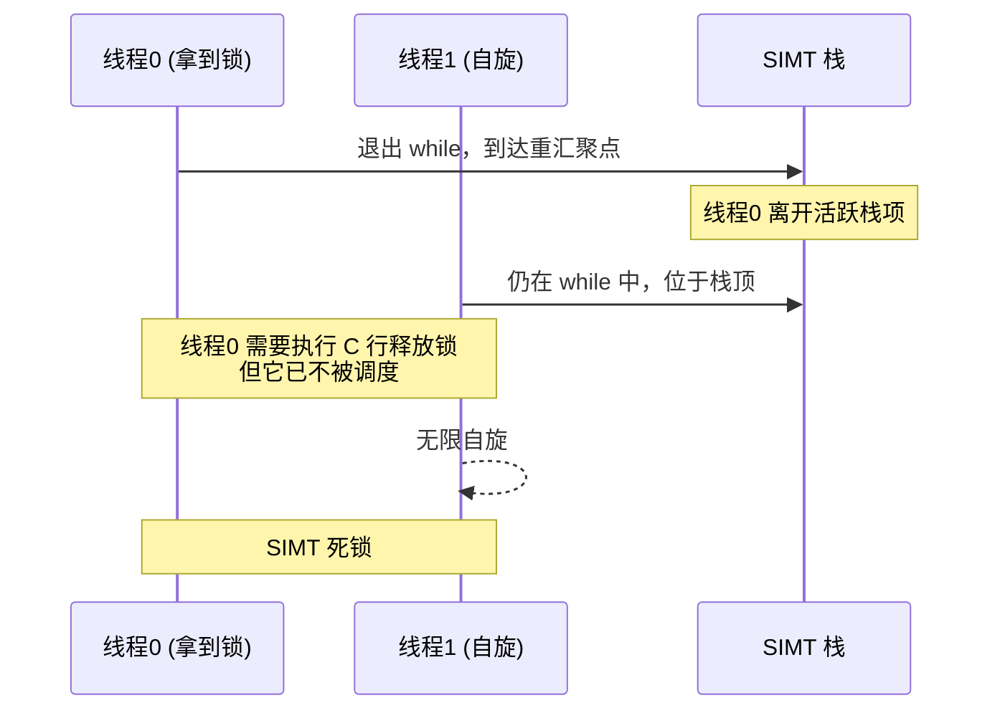

**图 3-4**：SIMT 死锁：持锁线程离开活跃栈项，自旋线程永远等待

**解决方案：无栈（stackless）汇聚屏障**

NVIDIA 在 Volta 的 **Independent Thread Scheduling** 中采用了类似学术方案（ElTantawy & Aamodt [2016], Diamos et al. [2015] 专利）的机制。核心思想：**用每 warp 的汇聚屏障（convergence barrier）取代栈**。

原书图 3.6 给出的每 warp 字段：

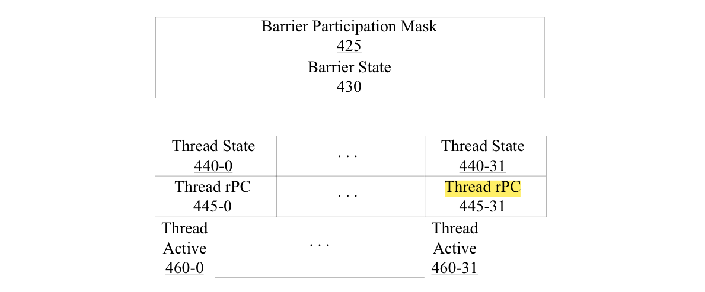

**图 3.6**：基于无栈汇聚屏障的分支发散处理机制（原书插图）

| 字段 | 作用 |
|---|---|
| **Barrier Participation Mask** | 32 位，标记哪些线程参与某个汇聚屏障 |
| **Barrier State** | 哪些线程已到达该屏障 |
| **Thread State** | 每个线程：就绪 / 阻塞在某屏障 / 已让出（yield） |
| **Thread rPC** | 每个非活跃线程的下一条 PC |
| **Thread Active** | 每个线程是否活跃 |

**工作方式**：

- 分支发散后，调度器可以**自由地在各组已发散线程（warp split）之间切换**，而不是被栈强制串行。
- `ADD` 指令初始化屏障参与掩码；`WAIT` 指令让到达屏障的 warp split 阻塞；所有参与者都到达后，再合并。
- `YIELD` 允许某些线程让出，使其他线程（例如持锁线程）能继续推进。

原书用图 3.7 的嵌套控制流和图 3.8 的代码示例说明该机制：

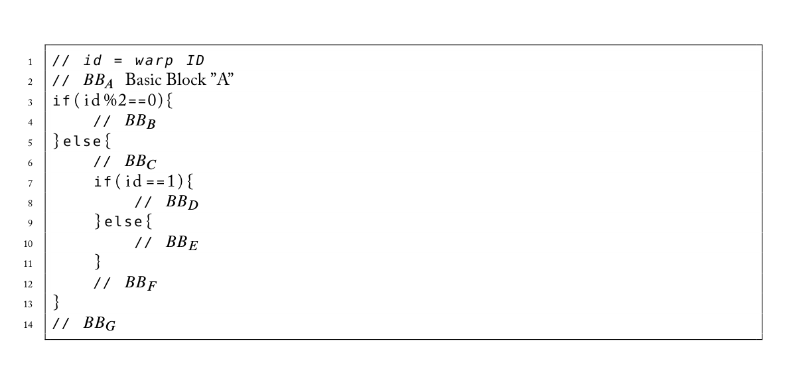

**图 3.7**：嵌套控制流示例（原书插图）

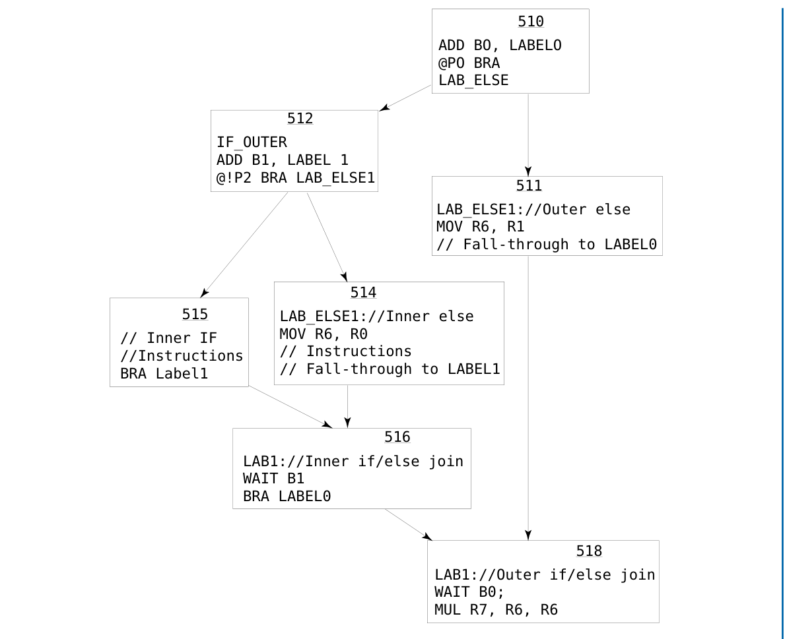

**图 3.8**：汇聚屏障分支发散处理机制的代码示例（原书插图）

**图 3-5** 给出了汇聚屏障的工作过程：

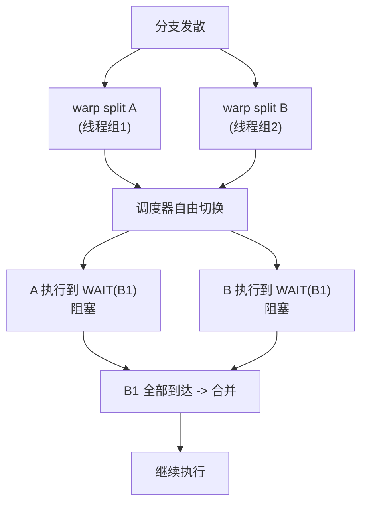

**图 3-5**：无栈汇聚屏障：warp split 在屏障处等待并合并

**效果**（原书图 3.9 vs 原书图 3.10）：

- 基于栈：语句 A、B 与 X、Y 严格串行（先走一条完整路径再走另一条）。
- Volta 独立线程调度：A、B 与 X、Y 可以**交错执行**，自旋锁代码也能正确推进（原书图 3.11）。

原书图 3.9、3.10、3.11 分别给出了基于栈的重汇聚、Volta 的交错执行，以及无栈机制在自旋锁上的行为：

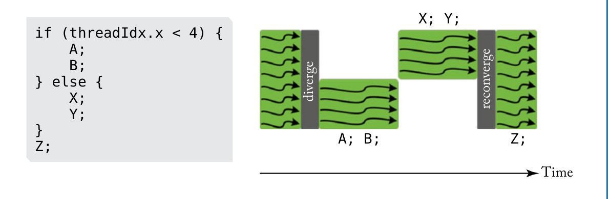

**图 3.9**：基于栈的重汇聚行为示例（原书插图）

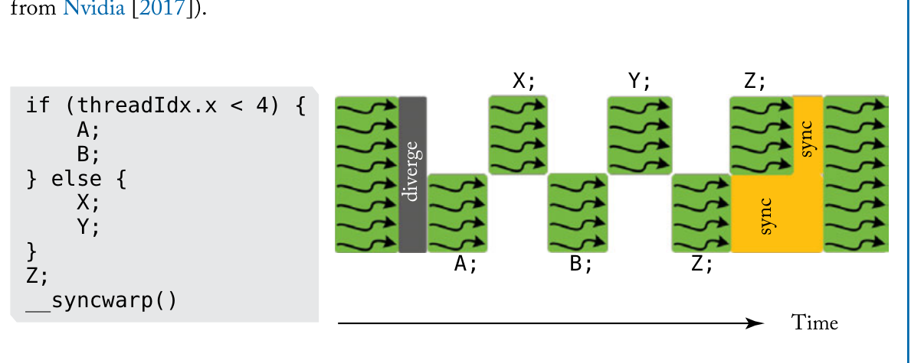

**图 3.10**：Volta 重汇聚行为示例（原书插图）

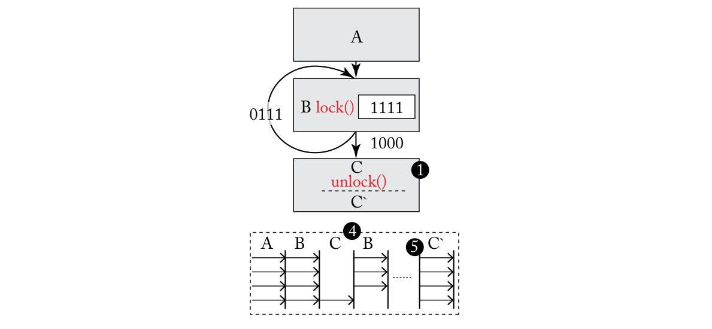

**图 3.11**：无栈机制在自旋锁代码上的行为示例（原书插图）

> **延伸**：这正是 Volta 白皮书中"Independent Thread Scheduling"的硬件基础。它让 warp 内线程可以有不同的 PC 和调用栈，代价是硬件更复杂（每线程 PC、屏障状态）、以及需要编译器配合。CUDA 9 起，`__syncwarp()` 成为显式同步原语，程序员不能再假设 warp 内线程自动锁步。

### 3.1.4 线程束调度（Warp Scheduling）

一个核心驻留大量 warp，每周期该选谁？这是 GPU 性能的关键。

**最朴素的方案：轮转（Round Robin）**

- warp 有固定顺序（如按 warp ID），调度器按顺序选。
- 优点：实现简单，让每条指令有大致相等的完成时间；如果 `warp 数 × 每 warp 发射间隔 > 存储延迟`，执行单元就能一直忙碌。
- 代价：**寄存器堆随 warp 数线性增长**。每线程必须有独立寄存器，所以 warp 越多，寄存器堆占芯片面积比例越大，能放的核心越少。

**局部性的两难**：

| 场景 | 有利的调度 |
|---|---|
| 不同线程在相近时点共享数据（如图形纹理） | **轮转**：让大家同步推进，提高缓存命中 |
| 线程访问互不相交的数据（不规则结构） | **反复调度同一 warp**：最大化单 warp 局部性（如 CCWS，见 5.1.2） |

> 这为第 5 章的 CCWS、DAWS、GTO、两级调度埋下伏笔。

---

## 3.2 两层循环近似：让指令"飞起来"

一层循环的缺陷：调度器只能看到 warp ID 和下一条 PC，**不知道这条指令是否依赖前面还没完成的指令**。要支持"前一条还没完成就发射后一条"，必须：

1. 用**指令缓冲（I-Buffer）**暂存取出的指令；
2. 用**记分牌（Scoreboard）**跟踪寄存器依赖；
3. 用独立的发射调度器从 I-Buffer 中选"无依赖"的指令。

**图 3-6** 给出了这套结构：

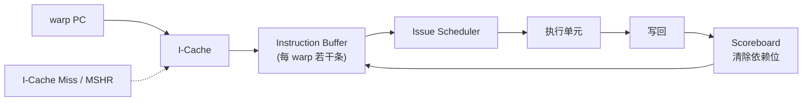

**图 3-6**：两层循环：指令缓冲 + 记分牌把取指与发射解耦

### 3.2.1 顺序记分牌为什么在 GPU 上很贵

CPU 的顺序记分牌很简单：每个寄存器一位，发射写该寄存器的指令时置位，写回时清零。但 GPU 上：

- 每 warp 最多 128 个寄存器，每核心最多 64 个 warp → **8192 位**；
- 更麻烦的是**探测**：每条等待中的指令都要反复查记分牌。若允许所有 warp 每周期都探测，每指令最多 4 个操作数 → **256 个读端口**，代价极高；
- 若限制每周期探测的 warp 数，又会限制可调度范围，甚至出现"能发射的指令没被查到"。

### 3.2.2 Coon 等人的稀疏记分牌

书里给出了一个巧妙方案（Coon et al. [2008]）：

- 不为每 warp 的每个寄存器存一位，而是每 warp 只存**少量表项**（约 3–4 项），每项记录"某条已发射但未完成指令要写的寄存器 ID"。
- 指令**放入 I-Buffer 时**，把它的源/目的寄存器与该 warp 的表项比较，生成一个很短的位向量（3–4 位），附在指令旁边。
- 只有位向量全 0，指令才有资格被发射。
- 指令写回时清空对应表项和 I-Buffer 中的相关位。

**图 3-7** 给出了稀疏记分牌的处理流程：

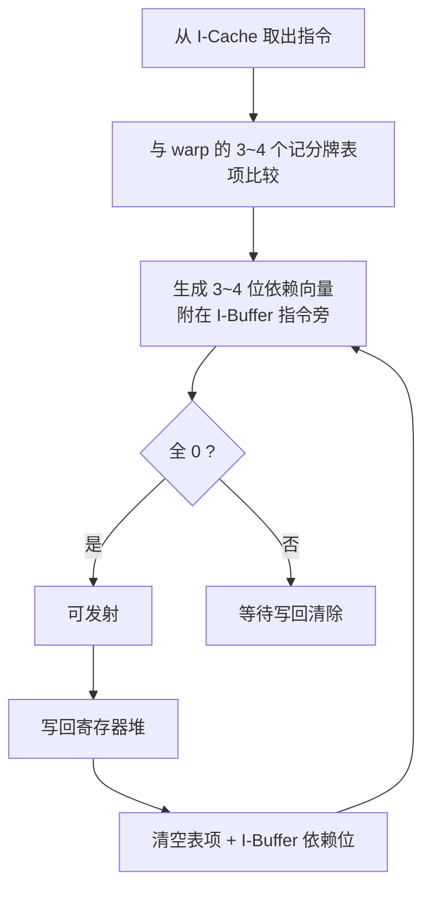

**图 3-7**：Coon 稀疏记分牌：用少量表项生成依赖位向量

**两层循环的分工**：

- 循环 1：选一个 I-Buffer 还有空间的 warp，取指放入 I-Buffer；
- 循环 2：从 I-Buffer 中选一条无未决依赖的指令，发射到执行单元。

---

## 3.3 三层循环近似：寄存器堆与操作数收集器

### 3.3.1 问题：寄存器堆的端口与 bank 冲突

GPU 寄存器堆很大（Kepler/Maxwell/Pascal 达 256 KB），而 **SRAM 面积与端口数成正比**。如果每条指令的每个操作数都要一个端口，寄存器堆会大到不可接受。

常见做法：用**多个单端口 bank** 模拟多端口。但会出现 **bank 冲突**：同一周期多个操作数落在同一个 bank，只能串行读。

原书图 3.12–3.17 用一系列时序图说明：

- 朴素分 bank：`warp0.r0→bank0, r1→bank1, ...`，回绕分配。
- 当一条指令的多个源操作数落在同一 bank（如 `r5` 和 `r1` 都在 bank1），就要多周期。
- 更糟的是，不同 warp 的写回也会争抢 bank。

原书图 3.12–3.14 给出了朴素分 bank 寄存器堆的结构、布局与时序：

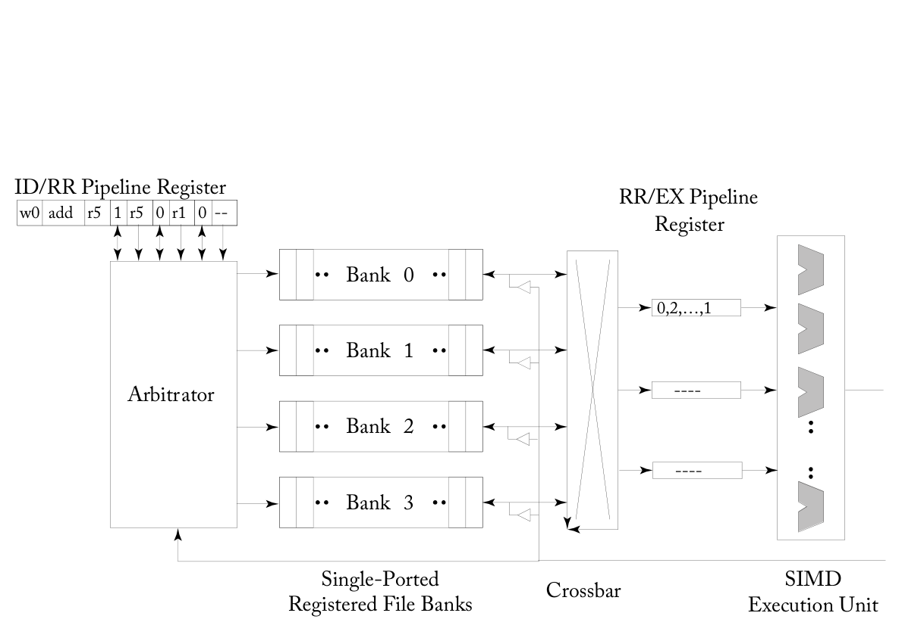

**图 3.12**：朴素的分 bank 寄存器堆微架构（原书插图）


**图 3.13**：朴素的分 bank 寄存器布局（原书插图）

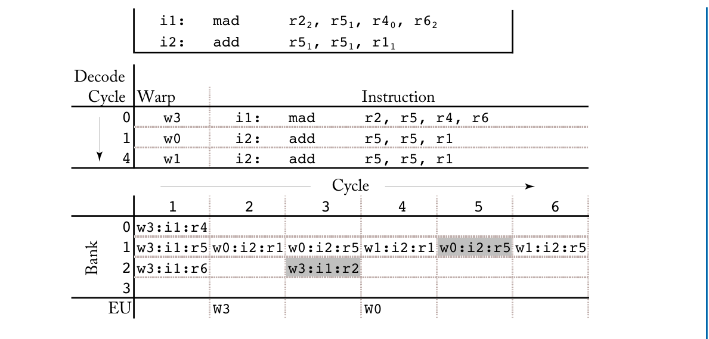

**图 3.14**：朴素分 bank 寄存器堆的时序（原书插图）

**图 3-8** 是本笔记的简化图：

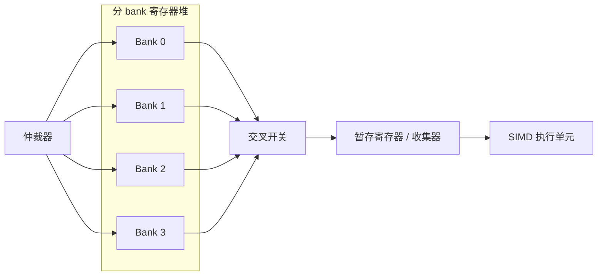

**图 3-8**：分 bank 寄存器堆与交叉开关

### 3.3.2 操作数收集器（Operand Collector）

原书图 3.15 的关键创新：把"暂存寄存器"换成**收集器单元（collector unit）**。

- 每条进入读寄存器级的指令分配一个收集器单元；
- 多个收集器单元并存，**多条指令可以重叠地读源操作数**；
- 仲裁器在多个指令的多个操作数之间寻找**bank 级并行**：某个 bank 空闲就取一个操作数，冲突的就等下一周期。

原书图 3.15 给出了操作数收集器的完整微架构：

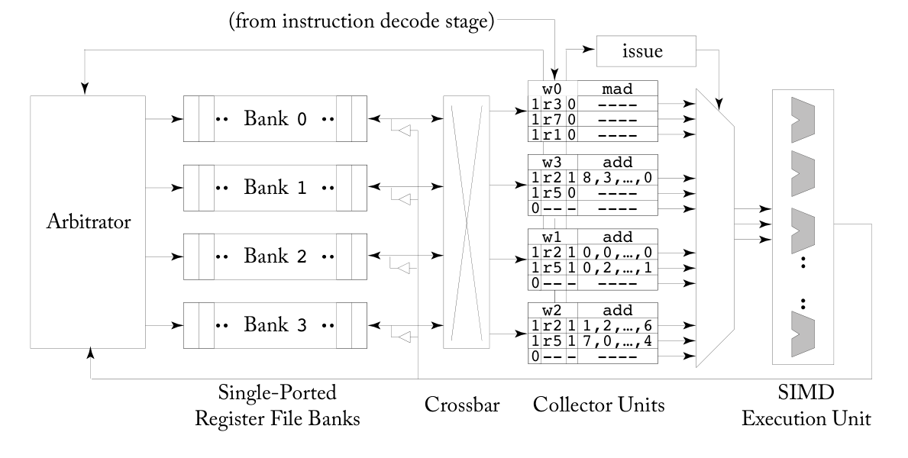

**图 3.15**：操作数收集器微架构（原书插图）

**图 3-9** 给出了操作数收集器的结构：

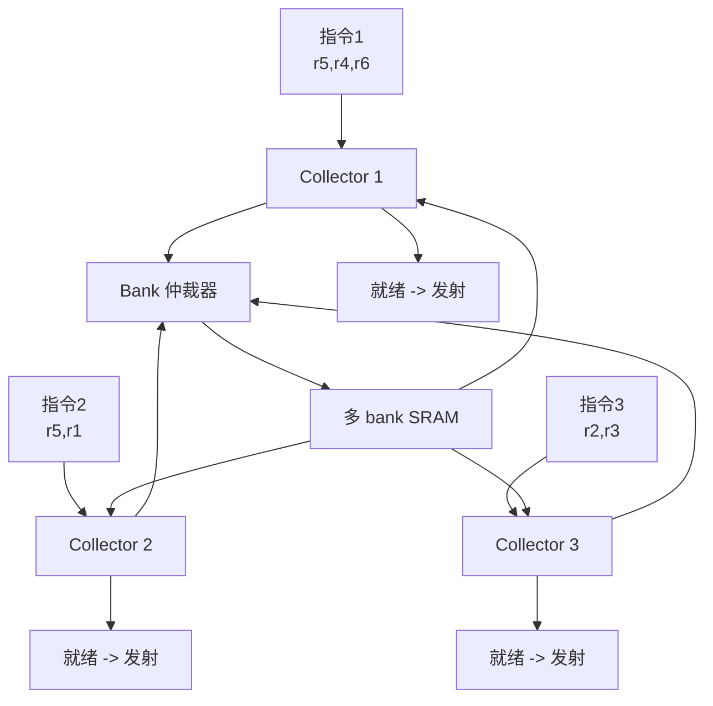

**图 3-9**：操作数收集器：多条指令重叠读取源操作数

**减少 bank 冲突的布局技巧**（原书图 3.16）：把**不同 warp 的同名寄存器**放到不同 bank。例如 `warp0.r0→bank0`、`warp1.r0→bank1`。这样当多个 warp 交替推进时，冲突减少。这不能解决单条指令内部操作数的冲突，但能缓解 warp 之间的冲突。


**图 3.16**：混洗式分 bank 寄存器布局（原书插图）

原书图 3.17 给出了操作数收集器的时序：

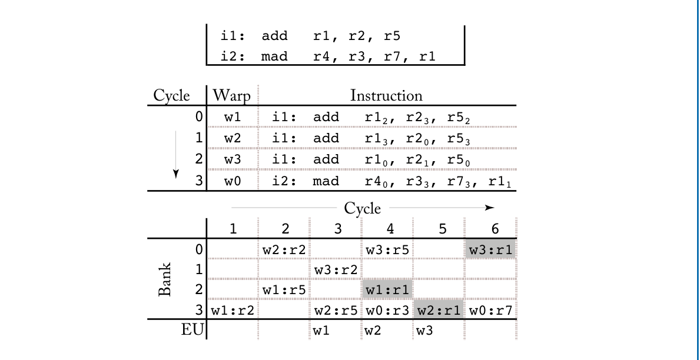

**图 3.17**：操作数收集器的时序（原书插图）

### 3.3.3 WAR 冒险与"看板"方案

操作数收集器带来一个隐蔽问题：**写后读（WAR）冒险**。如果同一 warp 的两条指令同时在收集器中，指令 1 要读的寄存器正是指令 2 要写的，而指令 1 因 bank 冲突迟迟读不到，指令 2 可能先把新值写进去，指令 1 就读到错误的新值。

书里介绍 Mishkin 等人 [2016] 的三种方案：

| 方案 | 规则 | 性能影响 |
|---|---|---|
| **release-on-commit** | 每 warp 最多一条指令在执行 | 某些情况下降近 50% |
| **release-on-read** | 每 warp 最多一条指令在收集器中收集操作数 | 至多降 10% |
| **bloomboard** | 用一个小布隆过滤器跟踪未完成的读 | 影响不到几个百分点 |

> **延伸**：Maxwell 引入的"读依赖屏障"（read dependency barrier）由控制指令管理，正是为了避免某些 WAR 冒险（见第 2 章 SASS 控制位）。

### 3.3.4 指令重放：处理结构冒险

当指令遇到结构冒险（如收集器不够、访存单元忙、bank 冲突）时，GPU 不像 CPU 那样让年轻指令停顿，而是**重放（replay）**：

- 指令留在 I-Buffer，直到确认完成或所有部分执行完毕；
- 遇到冲突的那部分被"退回"，下周期再试；
- 好处：不阻塞其他 warp、不引入复杂停顿分发逻辑；代价：冲突时浪费发射槽。

**图 3-10** 给出了重放流程：

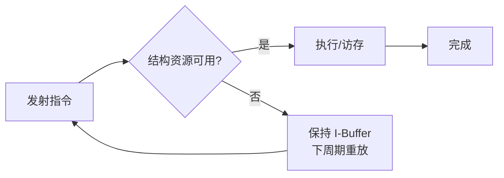

**图 3-10**：指令重放：结构冒险时保留指令、下周期重试

---

## 3.4 分支发散的研究方向（研究综述）

书里 3.4 节（基于 Wilson Fung 的博士论文）系统总结了"分支发散"的代价与各类改进方案。这是全章最"研究味"的部分。

### 3.4.1 分支发散的四大代价

1. **SIMD 效率降低**：串行化分支目标，部分 lane 空闲。
2. **不必要的串行化**：GPU 编程模型**不要求** warp 内线程之间有隐式数据依赖（只能通过 shared memory/barrier 显式通信），所以串行化不是正确性必需的。
3. **MIMD 抽象不充分**：基线 SIMT 栈强制在编译器定义的重汇聚点同步，可能与细粒度锁产生病态交互（SIMT 死锁），也无法处理异常/中断引入的流。
4. **面积开销**：SIMT 栈随 warp 数增长；在发散很少的应用里，这块面积本可用于缓存/ALU。

### 3.4.2 线程束压缩（Warp Compaction）

**观察**：许多 warp 执行同一 kernel，会在同一组数据相关分支处发散。同一分支目标可能由**很多线程**执行，但它们分散在多个静态 warp 中，每个 warp 各自低效地串行。

**核心思路**：把不同静态 warp 中"执行同一条指令"的线程**压缩**进新的动态 warp，提高 SIMD 效率。**图 3-11** 用一个例子说明压缩前后的对比：

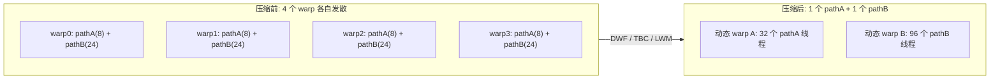

**图 3-11**：线程束压缩：把多个发散 warp 合并成无冲突的动态 warp

主要方案：

| 方案 | 关键思想 | 局限 |
|---|---|---|
| **DWF**（动态线程束形成）[Fung et al. 2007, 2009] | 在发散分支处把分散线程重组为动态 warp | 依赖时序窗口；贪心调度会饿死；增加非合并访存/shared bank 冲突 |
| **TBC**（线程块压缩）[Fung & Aamodt 2011] | 只在**线程块内**、在分支/重汇聚点压缩；扩展 SIMT 栈到块范围 | 每个分支同步会减少 TLP |
| **LWM**（大线程束微架构）[Narasiman et al. 2011] | 组内 warp 完全锁步，每指令都可压缩 | 进一步削减 TLP；需更复杂记分牌 |
| **CAPRI** [Rhu & Erez 2012] | 预测"压缩是否划算"，只在有益时压缩 | 预测器开销 |
| **线程束内压缩** [Vaidya et al. 2013] | 把宽执行组切成与硬件宽度匹配的子组，跳过空闲子组 | 需要 swizzle 才有效 |
| **SBI/SWI** [Brunie et al. 2012] | 前端每周期发射两条指令，交织多个分支/warp | 前端复杂度翻倍 |

**对寄存器堆的影响**：压缩后的动态 warp 可能不遵守"同一 warp 线程寄存器连续存放"的布局。Fung 等人提出用**窄端口 SRAM bank** 的更灵活寄存器堆，代价是需要更多 bank 维持带宽。

**软件侧压缩**：conditional streams、stream compaction（前缀和）、延迟着色、运行时重映射、CCC（集体上下文收集）等。它们不需要改硬件，但会增加访存流量。

### 3.4.3 线程束内发散路径管理

目标有两个：**（1）让不同分支目标交错执行；（2）在 post-dominator 之前更早重汇聚。**

| 方案 | 思想 |
|---|---|
| **多路径并行** | warp split 可以像多个 warp 一样交错执行，提升 TLP（不提升 SIMD 效率，但能填满访存空闲） |
| **DWS**（动态线程束细分）[Meng et al. 2010] | 用一个 split 表扩展 SIMT 栈，split 可并发；访存发散时也拆分（命中部分先走，等于预取） |
| **DPS**（双路径 SIMT 栈）[Rhu & Erez 2013a] | 限制为两个并发 split，硬件简单得多，获得 DWS 大部分收益 |
| **MPM**（多路径执行）[ElTantawy et al. 2014] | 用 warp-split 表 + reconvergence 表取代栈；扩展记分牌按线程跟踪依赖 |
| **线程前沿** [Diamos et al. 2011] | 按拓扑序排基本块，优先执行 PC 最小的线程，让落后的追赶 |
| **可能汇聚点** [Fung & Aamodt 2011] | 给 SIMT 栈加 LPC/LPos 字段，利用循环 break 等提前汇聚 |
| **OREC**（机会式提前重汇聚）[ElTantawy et al. 2014] | 无需编译器分析，动态发现可提前合并的 split |

原书图 3.18 给出了分支发散处多路径执行的示例：

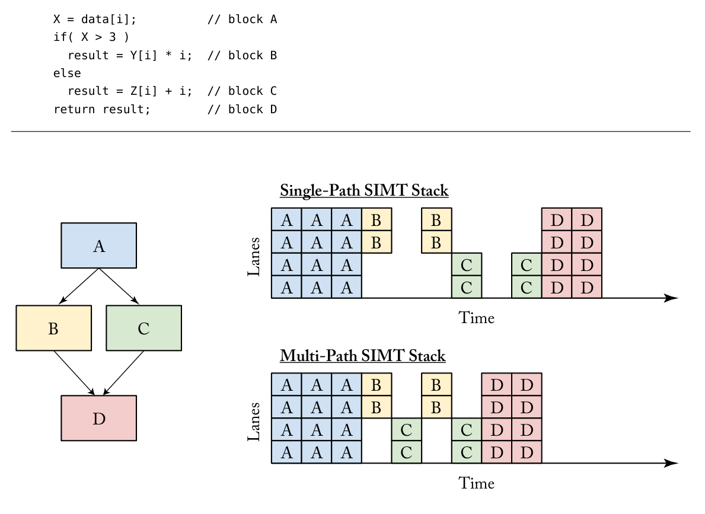

**图 3.18**：分支发散处的多路径执行（原书插图）

**"提前重汇聚"的例子**（书里算法 3.2）：循环里 `if (X==0) ... else if (X==1) break;`。从 C 到 D 的路径极少执行，所以大多数情况下线程可以在 E 处提前汇聚，而不必等到 F（直接后支配节点）。

原书图 3.19 给出了这个例子的控制流图与提前汇聚点：

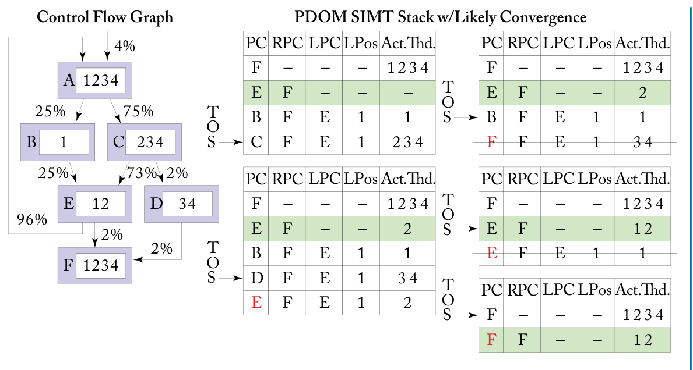

**图 3.19**：早于直接后支配节点的重汇聚点（原书插图）

**图 3-12** 画出了这个控制流图：

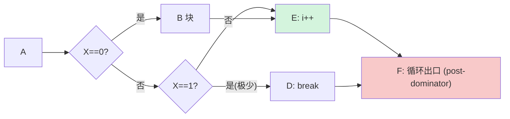

**图 3-12**：提前重汇聚：在直接后支配节点之前于 E 处汇合
> 绿色 E 是"大多数情况下"的提前汇聚点，红色 F 是编译器保证的确定汇聚点。

### 3.4.4 增加 MIMD 能力

思路：平时用 SIMD 保持高效，一旦发散就切到有限 MIMD。

| 方案 | 做法 |
|---|---|
| **向量线程（VT）** | 每个 lane 有 L0 指令缓存，可独立 MIMD 执行；规则时锁步 |
| **时间 SIMT（Temporal SIMT）** | warp 在单个 lane 上分时复用，每个 lane 跑自己的 warp；控制流开销在时间上摊薄 |
| **可变线程束规模（VWS）** | 多个切片各有取指单元；平时组成 gang 锁步，发散时分裂成独立 warp |
| **SBI/SWI** | 每周期发射两条指令，同时执行分支两个目标 |

### 3.4.5 低复杂度而有效的发散管理

目标是**在不发散的常见情况下不浪费面积**。

| 方案 | 做法 |
|---|---|
| **标量寄存器堆模拟 SIMT 栈**（AMD GCN） | 用 wavefront 共享的标量寄存器存谓词；优先执行活跃线程少的分支，最坏只需 `log2(32)` 个标量寄存器 |
| **线程前沿** | 每线程 PC 只在可能发散的内核中分配；其他内核把寄存器还给 occupancy |
| **无栈 SIMT** [Asanovic et al. 2013] | 编译器识别汇聚区域，插入 `syncwarp`；发散区域各线程私有 PC |
| **谓词执行** | 简单 if 用谓词，避免压栈/弹栈；Lee et al. [2014b] 的线程感知谓词算法可扩展到任意控制流 |

**谓词执行 vs SIMT 栈的权衡**（书里总结）：

- 优点：编译器可以调度不同分支目标的指令，交错执行，利用 TLP；
- 缺点：增加寄存器压力（保守分配无法复用两侧寄存器），可能降低 occupancy；
- 优化：静态/运行时分支一致性优化（`cbranch.ifnone`、`cbranch.ifany`）、`find_unique` 等新指令。

---

## 3.5 标量化与仿射执行的研究方向

**核心洞见**：同一 kernel 的线程之间，值往往有结构（value structure）[Kim et al. 2013]。

- **均匀变量（uniform）**：所有线程取相同值（如常量、kernel 参数）。
- **仿射变量（affine）**：每个线程的值是线程 ID 的线性函数，如 `&y[idx] = &y[0] + 4*threadIdx.x`，可用 `(base, stride)` 两个标量表示。

```c
__global__ void vsadd(int y[], int a) {
    int idx = threadIdx.x;
    y[idx] = y[idx] + a;               // a 是 uniform
    if (y[idx] > THRESHOLD)            // THRESHOLD 是 uniform
        y[idx] = Y_MAX_VALUE;
}
// &y[idx] 是 affine: base=&y[0], stride=4
```

### 3.5.1 如何检测均匀/仿射

| 方法 | 代表工作 | 特点 |
|---|---|---|
| **编译器分析** | GCN、Asanovic et al. 2013、DAC | 精确，但只对静态可判定部分有效 |
| **基于标签** | Collange et al. 2010 | 每寄存器带标签（U/A/V），沿指令传播；几乎零硬件开销，但保守 |
| **写回时比较** | Gilani et al. 2013、Lee et al. 2015、G-Scalar | 运行时检测，能发现静态分析漏掉的值；需要额外比较逻辑 |
| **近似/相似度** | Warp Approximation [Wong et al. 2016] | 用 d-similarity 判断 lane 值是否足够接近 |

**标签传播规则**（原书表 3.1）如下：


**表 3.1**：均匀/仿射状态传播规则（原书插图）

下面摘录其中的加法表作为示例：

| + | U | A | V |
|---|---|---|---|
| **U** | U | A | V |
| **A** | A | V | V |
| **V** | V | V | V |

> 直觉：uniform + uniform = uniform；uniform + affine = affine；两个不同的 affine 相加可能变成 vector（因为 stride 不同）。

### 3.5.2 如何利用

1. **压缩寄存器存储**：uniform/affine 用更少比特，腾出寄存器给更多 warp。
2. **标量寄存器堆**：GCN、FG-SIMT 的 ASRF、Gilani 的标量 RF。
3. **部分寄存器堆访问**：BDI 压缩、只读代表 lane，降低读能耗。
4. **专用仿射线程束**：DAC 把仿射值缓存在一个专用 warp 的寄存器中。
5. **操作标量化**：输入全是 uniform/affine 的算术，只在标量通路做一次。
6. **专用标量流水线**：GCN 的标量单元、FG-SIMT 的控制处理器；还能卸载系统功能。
7. **时钟门控 SIMD 通路**：G-Scalar/Warp Approximation 在单 lane 执行，其余 lane 门控。
8. **访存加速**：仿射地址步长已知 → 合并更简单、可整块传输、可预取。

> **与 H20 SASS 的呼应**：第 2 章看到的 **UR（Uniform Register）** 和 `S2UR`/`ULDC`，正是 NVIDIA 在硬件上实现"uniform 值走单独通路"的证据。

---

## 3.6 寄存器堆体系结构的研究方向

GPU 寄存器堆很大（Fermi 可同时维持 2 万多线程，寄存器总量 2 MB），访问能耗高（GTX280 上约占总功耗 10%）。书里总结了五类优化。

### 3.6.1 层次化寄存器堆

- **观察**：一条指令产生的值最多 70% 只被读一次，只有 10% 被读两次以上（Gebhart et al. 2011b）。
- **寄存器堆缓存（RFC）**：小容量 FIFO，缓存最近产生的值；未命中不装入（避免污染）。
- **编译期活跃性信息**：指令编码加一位标记"最后一次读"，死亡值逐出时不写回主 RF。
- **LRF（Last Result File）**：只缓存每个活跃 warp 最后一条指令的结果。
- **ORF（操作数寄存器堆）**：编译器显式管理值进出，省去标签查找。

### 3.6.2 低功耗（休眠）寄存器堆

- **三态**：ON / OFF / **Drowsy（休眠，保留值但需唤醒）**。
- 未分配寄存器 OFF；已分配寄存器访问后立即 Drowsy。
- 利用 GPU 细粒度多线程：同一寄存器相邻访问间隔长，大部分时间可休眠；长流水线又能掩盖唤醒延迟。

### 3.6.3 寄存器堆虚拟化

- **观察**：等待访存时，活跃寄存器很少；某些应用多达 60% 寄存器闲置（Tarjan & Skadron 2011）。
- **寄存器重命名**：线程开始时不分配寄存器，译码时给目的寄存器分配物理寄存器；最后一次读后释放。
- **代价**：需要"最后读"标注或元数据指令；Jeon et al. 2015 估计 128 KB RF 需 3.8 KB 重命名硬件（优化后 1 KB）。
- **收益**：RF 规模可减半而不损失性能；还能做子阵列电源门控。

### 3.6.4 分区寄存器堆（Pilot Register File）

- 分为 **FRF（快，普通 SRAM）** 与 **SRF（慢，近阈值电压 NTV SRAM）**。
- NTV SRAM 访问能量和漏电都低，但延迟多周期；由操作数收集器吸收额外延迟。
- 每个 warp 在 FRF 有 4 个表项；用**先导 CTA** 剖析最常用寄存器，决定放置。
- 与层次化 RF 的区别：**分区各持有独占寄存器，划分在线程生命周期内不变**。

### 3.6.5 RegLess

- **目标**：取消寄存器堆，改用**操作数暂存缓冲（OSU）**。
- **观察**：100 周期窗口内，访问的寄存器不到 2048 KB RF 的 10%。
- **区域（region）**：编译器把基本块切成连续指令段，限制活跃寄存器数。
- **容量管理器（CM）**：判断哪些 warp 可调度；新区域开始时，把寄存器从全局内存后备区调入 OSU（8 bank 缓存，每周期服务两条指令）。
- **预装**：发第一条指令前预取，避免停顿。
- **结果**：512 表项 OSU 性能略优于 2048 KB RF，面积仅 25%，GPU 总能耗降 11%。**图 3-13** 对比了传统寄存器堆与 RegLess：

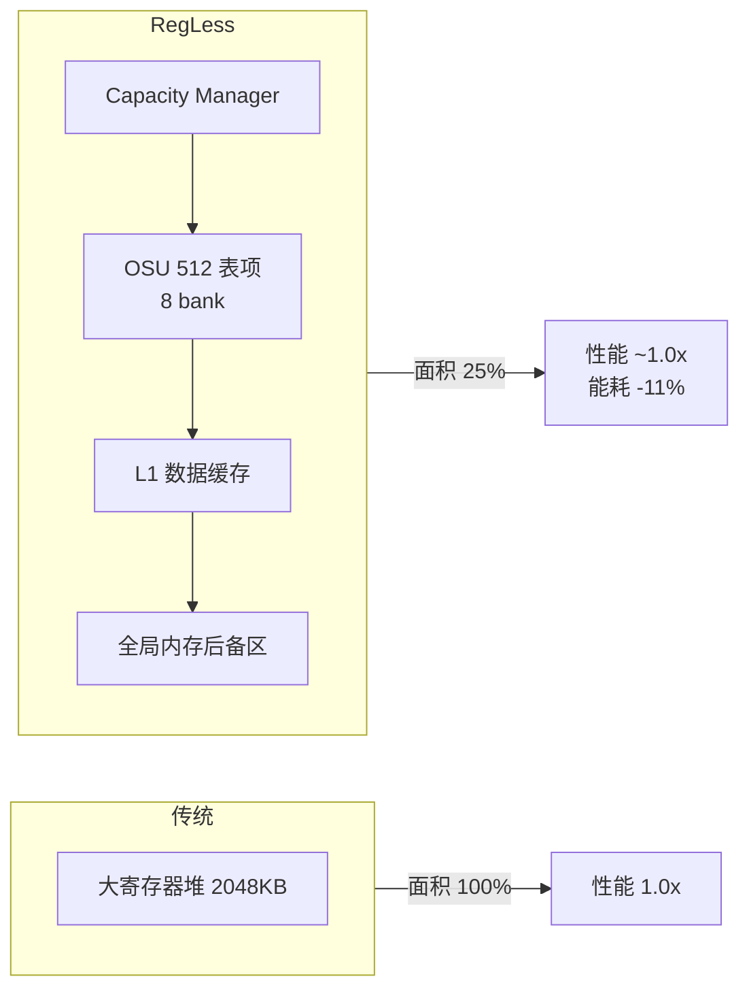

**图 3-13**：RegLess：用操作数暂存单元 OSU 取代大寄存器堆

---

## 3.7 H20 实测：分支发散的代价

### 3.7.1 实验设计

写两个内核，工作量相同：

- `div_heavy`：所有线程执行 256 次 FMA 的依赖链。
- `div_branch`：偶数 lane 执行一套 FMA 链、奇数 lane 执行另一套（**两条路径的代码不同，编译器无法合并**）。

```cuda
__global__ void div_heavy(const float* in, float* out, int n) {
    int i = blockIdx.x*blockDim.x + threadIdx.x; float v = in[i%n];
    float a=0,b=0;
    for (int k=0;k<256;k++){ a=fmaf(a,1.000001f,v); b=fmaf(b,0.999999f,a); }
    out[i]=a+b;
}
__global__ void div_branch(const float* in, float* out, int n) {
    int i = blockIdx.x*blockDim.x + threadIdx.x; float v = in[i%n];
    float a=0,b=0;
    if ((threadIdx.x&1)==0) {
        for (int k=0;k<256;k++){ a=fmaf(a,1.000001f,v); b=fmaf(b,0.999999f,a); }
    } else {
        for (int k=0;k<256;k++){ a=fmaf(a,0.999999f,v); b=fmaf(b,1.000001f,a); }
    }
    out[i]=a+b;
}
```

测试配置：78 个 SM × 8 个 block × 256 线程，重复 200 次取平均。

### 3.7.2 结果

| 内核 | 时间 | 相对 |
|---|---:|---:|
| `div_heavy`（无发散） | 0.007 ms | 1.00× |
| `div_branch`（交替发散） | 0.012 ms | **1.66×** |

**解读**：

- 同一个 warp 内一半 lane 走 if、一半走 else；SIMD 通路只能先执行一条路径、再执行另一条，**总指令发射量翻倍**。
- 实测 1.66× 而不是理论 2×，原因是分支两端仍有部分可重叠/流水化，且测量包含固定开销。
- 这正是 3.1 节 SIMT 栈串行化的直接代价。也解释了为什么 3.4 节要研究**线程束压缩、多路径、MIMD** 等方案。

### 3.7.3 与 occupancy 的关系（第 5 章预告）

如果 warps 足够多，一个 warp 的分支发散造成的空闲周期可以被**其他 warp** 填满，所以实际性能损失可能小于 1.66×。书里 3.1.3 说：轮转调度在 `warp 数 × 发射间隔 > 延迟` 时能让执行单元保持忙碌。第 5 章的占用率实验会定量展示这一点。

---

## 3.8 本章小结

1. **三层近似**是理解 SIMT 核心的钥匙：一层（调度+mask）、两层（I-Buffer+记分牌）、三层（操作数收集器+bank）。
2. **SIMT 栈**用 `(RPC, Next PC, active mask)` 处理嵌套控制流和整段跳过；分支不同路径被串行化，损失 SIMD 效率。
3. **SIMT 死锁**（自旋锁场景）暴露了栈式设计的缺陷；**Volta 独立线程调度/汇聚屏障**用每线程 PC + 屏障状态取代栈，允许 warp split 交错推进。
4. **warp 调度**是性能关键：轮转利于局部性，但寄存器堆面积随 warp 数增长；实际有 GTO、两级、CCWS、DAWS 等多种策略（第 5 章展开）。
5. **操作数收集器**通过多指令重叠读操作数来容忍 bank 冲突；重放机制避免流水线停顿，代价是冲突时浪费发射槽。
6. **分支发散研究**分四类：线程束压缩、warp 内路径管理、增加 MIMD、低复杂度方案。
7. **标量化/仿射**利用 uniform/affine 值结构，把工作搬到标量通路，省寄存器、省能耗。
8. **寄存器堆研究**从层次化、休眠、虚拟化、分区到 RegLess，目标都是降低面积/能耗。

### 思考题

1. 画出一个 8 线程 warp 在如下代码上的 SIMT 栈变化：`if (a) { if (b) X; else Y; } else Z;`。假设各线程条件不同。
2. 为什么 SIMT 栈的压栈顺序会影响最坏栈深度？证明先压活跃线程多的路径可使深度为 O(log n)。
3. 用 SIMT 死锁的例子解释：为什么 Volta 的独立线程调度必须允许"线程让出（yield）"？
4. 操作数收集器如何把"bank 冲突"从**必然停顿**变成**可容忍的延迟**？它为什么不能消除冲突？
5. 线程束压缩（DWF/TBC/LWM）分别在什么粒度上同步？各自的 TLP 代价是什么？
6. 解释 uniform 与 affine 的区别，并说明为什么 `uniform + affine = affine`，而 `affine + affine` 可能是 vector。
7. RegLess 用 OSU 取代寄存器堆，为什么能省面积却几乎不损失性能？它的关键前提是什么？

---

## 附：本章实测代码

见 `code/divergence.cu`：编译并运行：

```bash
nvcc -O3 -arch=sm_90 --extended-lambda divergence.cu -o divergence
./divergence
```
