# 第 4 章　存储系统

> **对应原书**：第 4 章 *Memory System*（4.1 一级存储结构、4.2 片上互连、4.3 存储分区单元、4.4 研究方向）
>
> **本章目标**：理解 GPU 从"线程发出的一条 load/store"到"DRAM 芯片里的一行数据"之间的完整路径。存储系统是 GPU 性能的第一瓶颈——本书反复强调：**GPU 计算往往受限于片外存储带宽**。

---

## 4.0 一张图看懂 GPU 存储层次

GPU 存储层次如 **图 4-1** 所示：

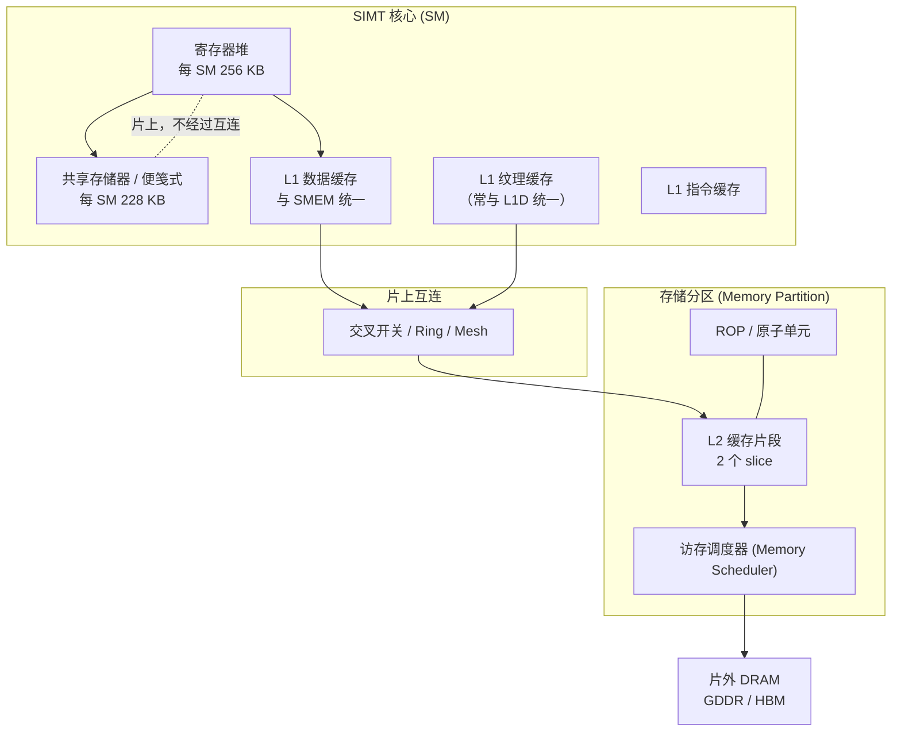

**图 4-1**：GPU 存储层次：寄存器、shared/L1、L2 与 DRAM

**三条最重要的直觉**：

1. **越靠近线程，越贵但越快**：寄存器 > shared/L1 > L2 > DRAM。第 1 章表 1.1 的能耗差距是数量级的。
2. **GPU 的缓存不追求"装下工作集"**：它依赖海量线程容忍缺失。缓存的作用是**带宽过滤**，减少发往低层的请求。
3. **合并（coalescing）和 bank 冲突是程序员/编译器能直接影响的两件事**：它们决定了你实际使用多少带宽。

---

## 4.1 一级存储结构

### 4.1.1 便笺式存储器与 L1 数据缓存

#### 共享存储器（shared memory / scratchpad）

在 CUDA 里叫 `shared memory`，OpenCL 里叫 `local memory`。它是一块**由程序员显式管理**的片上 SRAM：

- 每个 **CTA**（Cooperative Thread Array，协作线程数组；即 CUDA 的**线程块 / thread block**，OpenCL 的 **work-group**）内的线程共享；容量小（每 SM 16–64 KB，H20 为 228 KB 可配置）；
- 延迟接近寄存器；
- 早期 NVIDIA 专利甚至称它为 **Global Register File**（Acocella & Goudy 2010）；
- 用 `__shared__` 关键字分配。

**为什么用它**：在一些应用里，程序员**知道**哪些数据会被反复访问。手动把数据搬进 shared memory，就把"高延迟、高能耗的 DRAM 访问"变成"低延迟的片上访问"。这是"用软件局部性替代硬件缓存"。

**代价：bank 冲突（bank conflict）**

shared memory 用 SRAM 实现，典型组织是**每个 lane 对应一个 bank，每 bank 一读一写端口**。一个 warp 的 32 个线程同时访问：

- 若 32 个线程访问**不同 bank** → 无冲突，一拍完成；
- 若多个线程访问**同一 bank 的不同地址** → **bank 冲突**，需要多拍串行；
- 若访问**同一 bank 的同一地址** → **广播（broadcast）**，无冲突。

**图 4-2** 给出了 lane 与 bank 的对应关系：

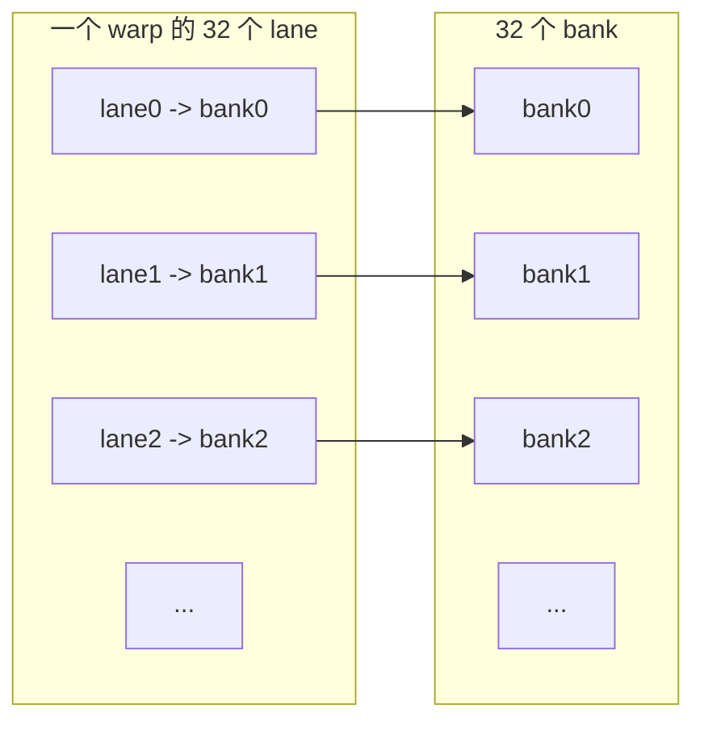

**图 4-2**：一个 warp 的 32 个 lane 与 32 个 bank 的对应关系

**经典冲突模式**：

| 访问模式 | 冲突程度 | 例子 |
|---|---|---|
| stride = 1 | 无冲突 | `s[tid]` |
| stride = 2 | 2-way | `s[2*tid]` |
| stride = 32 | 32-way（最坏） | `s[32*tid]`（列访问） |
| 同一地址 | 广播，无冲突 | `s[0]` |

> **实测见 4.5.2**：在 H20 上，2-way 冲突约 1.85×，4-way 约 3.70×，32-way 约 **29.56×**。这是本章最"疼"的实验。

#### L1 数据缓存

L1 数据缓存保存**全局地址空间的一个子集**。与 CPU 不同，GPU 的 L1 有几个特殊之处：

- **可能只缓存只读数据**（早期为避免一致性问题）；从 Kepler 起，NVIDIA 只允许寄存器溢出/栈数据（local）和只读全局数据进 L1。
- **不保证一致性**：书里举例——SM1 缓存了 A，SM2 写了 A，SM1 再读会读到旧值。这是 GPU 没有硬件缓存一致性的直接后果。
- **虚拟索引/虚拟标记（VIVT）**：与 CPU 常用的 VIPT 不同。原因：GPU 每个 warp 每周期都像一次上下文切换，但所有 warp 同属一个应用，冲刷 L1 的代价相对可接受；页式虚拟内存仍有助于内存分配和减少碎片。

#### 合并访存（coalescing）：全局访存的第一原则

当一个 warp 的 32 个线程执行同一条 load：

- 若它们访问的地址落在**同一个/少数几个缓存块**内 → 合并成少量请求（**coalesced**）；
- 若访问分散在很多不同块 → 产生多次请求（**uncoalesced**），带宽浪费。**图 4-3** 对比了两种访问：

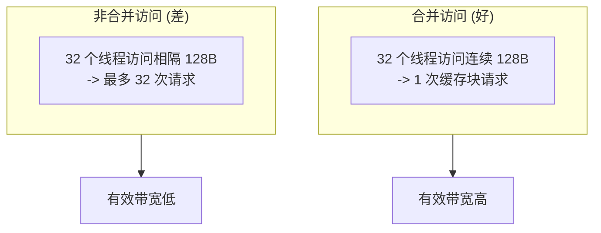

**图 4-3**：合并访存与非合并访存产生的缓存块请求数

原书图 4.1（Minkin et al. 2012）描述了统一的 L1/共享存储器微架构：

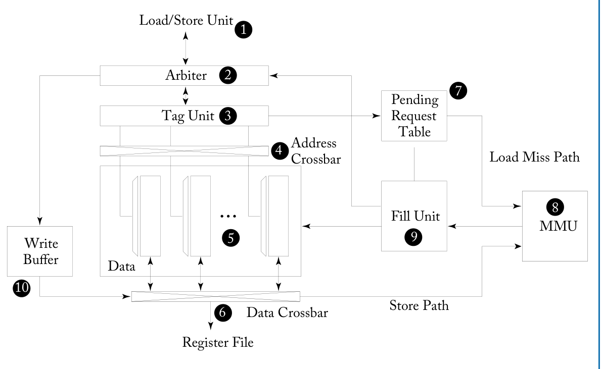

**图 4.1**：统一的 L1 数据缓存与共享存储器（原书插图）

**关键部件与流程**：

1. **加载/存储单元（LSU）①**：计算地址、施加合并规则，把 warp 的一次访存拆成若干合并请求。
2. **仲裁器②**：资源不足时拒绝请求（如组内所有路忙、PRT 无空项）。
3. **标记单元③**：检查是否命中；对 shared memory 直接映射可绕过标记查找。
4. **地址交叉开关④ → 数据阵列⑤ → 数据交叉开关⑥**：把地址分发到 bank，数据返回 lane。
5. **待处理请求表（PRT）⑦**：类似 CPU 的 **MSHR**，记录缺失块地址、块内偏移、目标寄存器、subid。
6. **MMU⑧**：虚拟地址 → 物理地址。
7. **填充单元⑨**：缺失数据返回后，用 subid 查 PRT，重新调度 load，确保命中。
8. **写数据缓冲（WDB）⑩**：暂存写数据。

**shared memory 访问流程**：

- 仲裁器检查 bank 冲突；
- 有冲突则拆成"可接受部分"和"需重放部分"；
- 可接受部分绕过标记查找，直接读数据阵列，安排写回；
- 重放部分送回流水线，下一周期再试。

**缓存读流程**：

- 合并后的请求进仲裁器；
- 命中：访问数据阵列相应行，返回；
- 缺失：通知 LSU 重放，同时写入 PRT；请求经 MMU 转物理地址，发往存储分区；
- 返回后填充单元用 subid 找 PRT，重新调度。

**写策略**：

| 场景 | 策略 | 原因 |
|---|---|---|
| 全局内存大数组写（时间局部性差） | **写直达 + 不写分配** | 写完就走，不必占用缓存 |
| 寄存器溢出/栈（local，时间局部性好） | **写回 + 写分配** | 后续会再读 |

> **延伸（H20/Hopper）**：现代 GPU 的 L1 通常与 shared memory 物理统一（同一块 SRAM 可配置比例），并引入**扇区（sector）**：128B 缓存行分 4 个 32B 扇区，匹配 GDDR/HBM 的最小访问粒度。书上说 Fermi/Kepler 是 128B 行，Maxwell/Pascal 起分成 4×32B 扇区（Liptay 1968 的 sectored cache 思想）。这能减少非合并访问浪费的带宽。

### 4.1.2 L1 纹理缓存

纹理缓存是为图形渲染设计的，但对理解"吞吐率处理器如何容忍缺失"很有启发。

**纹理映射基础**：把一幅图像（纹理）贴到 3D 表面。屏幕像素映射到**纹素（texel）**；相邻像素映射到相邻纹素，且通常对邻近纹素求平均（双线性/三线性过滤）→ 极强的空间局部性。

原书图 4.2（基于 Igehy et al. 1998）的核心结构：

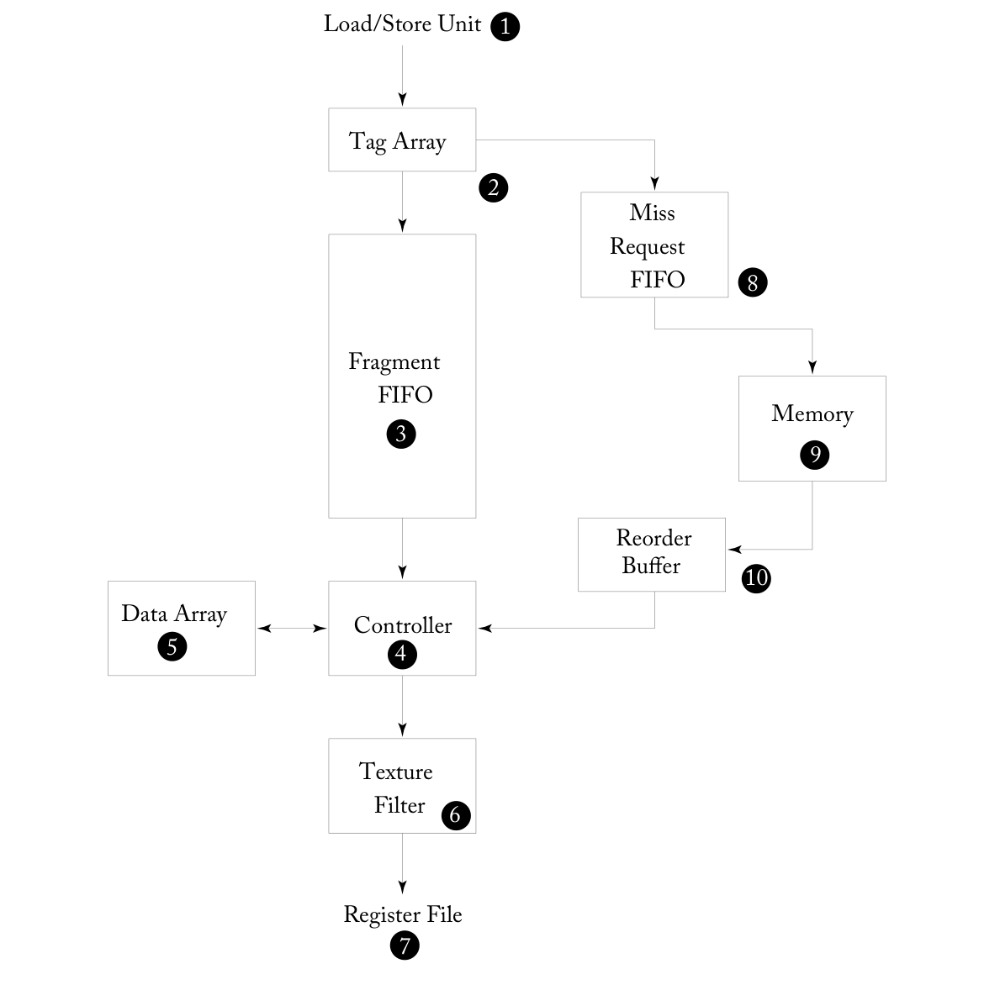

**图 4.2**：一级纹理缓存（原书插图）

**与数据缓存的关键区别**：标记阵列②与数据阵列⑤之间有一个 **FIFO③**。**图 4-4** 是本笔记的简化图：

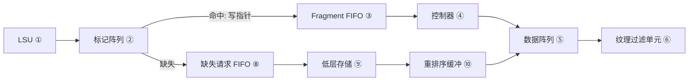

**图 4-4**：L1 纹理缓存：FIFO 分离标记阵列与数据阵列

**设计哲学**（书里讲得很透）：

- 纹理缓存假设**缺失频繁、工作集小**；
- 标记阵列"跑在"数据阵列前面：标记反映的是"大约一次缺失往返之后数据阵列的状态"；
- FIFO 把命中与缺失的延迟拉平——**吞吐率提高，但延迟不敏感**；
- 缺失请求乱序发往 DRAM（访存调度器优化行局部性），但数据必须**按序返回**，用**重排序缓冲（ROB）**保证一致。

### 4.1.3 纹理与数据统一缓存

现代 GPU（NVIDIA Maxwell/Pascal 起、AMD GCN）把数据缓存与纹理缓存统一：

- 最简单做法：**只把保证只读的数据放进 L1**，这样纹理缓存硬件几乎不用改，只改寻址；
- AMD GCN 中**所有向量访存都经过纹理缓存**；
- NVIDIA 的 Maxwell/Pascal 用统一 L1（Heinrich et al. 2017 专利）。

> **延伸**：统一缓存的好处是面积和灵活性；代价是缓存策略要同时满足两类访问（纹理过滤 vs 通用 load/store）。现代驱动会通过**内存描述符**（第 2 章 SASS 的 `desc[UR4]`）携带缓存策略。

---

## 4.2 片上互连网络

GPU 需要把**几十个 SM** 连到**多个存储分区**，带宽极高。

- **地址交织（address interleaving）**：把连续物理地址分散到多个存储分区，平衡流量。NVIDIA 专利描述了以 **256B 或 1024B** 为粒度、在最多 6 个分区之间平衡的方案（Edmondson & Van Dyke 2011）。
- **拓扑**：
  - NVIDIA 近期专利描述为**交叉开关（crossbar）**；
  - AMD 有时用**环形网络（ring）**；
  - 大规模 GPU 研究（Bakhoda et al. 2010/2013）认为 SM 增多后需要 **mesh** 等可扩展拓扑，并提出"多—少—多"流量模式与"半路由器"。

**图 4-5** 给出了互连结构：

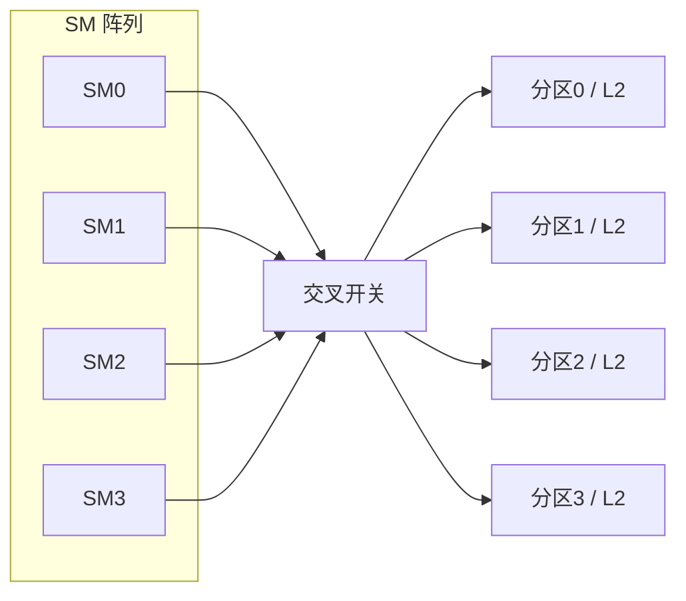

**图 4-5**：片上互连：SM 阵列经交叉开关连接存储分区

> **延伸（Hopper）**：H100/H20 的片上网络还包括 **NVLink/C2C** 与 **TMA** 专用的数据通路。TMA（Tensor Memory Accelerator）可以异步地把大块数据在 global 与 shared 之间搬运，减少线程级的地址计算与寄存器中转——这是"减少数据移动"思想的极致体现。

---

## 4.3 存储分区单元

书里依据 NVIDIA 专利（早于 Fermi 约一年）介绍存储分区（原书图 4.3）：

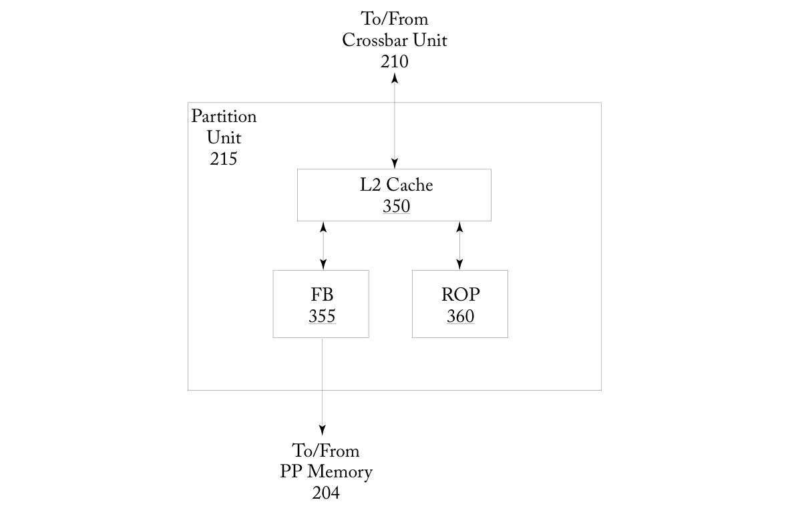

**图 4.3**：存储分区单元总览（原书插图）

每个分区包含：

1. **L2 缓存的一部分**；
2. **一个或多个访存调度器（memory access scheduler / 帧缓冲 FB）**；
3. **一个 ROP（光栅操作）单元**。

### 4.3.1 L2 缓存

- 每个分区内部分 **2 个 slice**（Edmondson et al. 2013），各有独立标记/数据阵列，按序处理请求。
- 每条缓存行含 **4 个 32B 扇区**，匹配 GDDR5 的 32B 原子大小。
- **写缺失时**：合并写通常完整覆盖扇区，因此**不先从 DRAM 读出**（no write-allocate read），直接写。这与 CPU 缓存教科书不同，是为吞吐率优化。
- 非合并写（不能覆盖整个扇区）：专利未说明，可能用字节级有效位，或直接绕过 L2。
- 待写数据先缓冲在 L2 行中，减小访存调度器面积。

### 4.3.2 原子操作

- ROP 单元含执行原子/归约操作的函数单元；
- 本地 ROP 缓存使同一地址的一串原子操作可流水化；
- 原子操作用于跨线程块同步。

### 4.3.3 访存调度器与 DRAM

**DRAM 基础**（书里讲得很细）：

- DRAM 用电容存比特；
- 读一行：先把整行（page）读入 **行缓冲（row buffer）**；
- 需要**预充电（precharge）** 和 **激活（activate）**，期间不能读写；
- 多个 **bank** 各有行缓冲，可并行；
- 行切换有延迟，因此需要**重排请求**减少行切换。

**调度器结构**：

- 每个分区可有多个调度器；最简单是每个 L2 slice 一个。
- 读请求与写请求（脏数据通知）分别排序。
- 用两张表把同一 bank 同一行的读请求归并：
  - **读请求排序器（read request sorter）**：按地址访问的组相联结构；
  - **读请求存储表（read request store）**：存每个组的请求列表。

**图 4-6** 给出了调度流程：

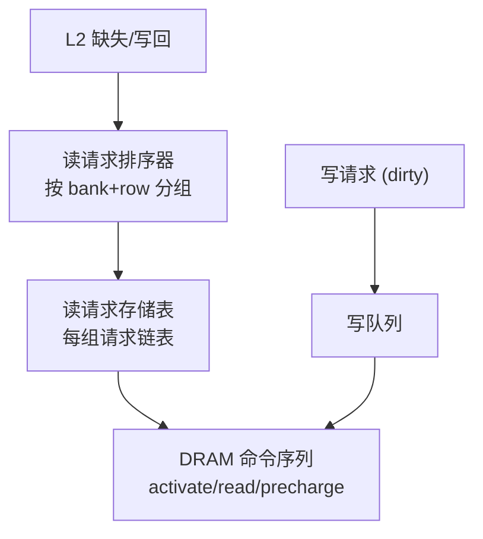

**图 4-6**：DRAM 访存调度：读请求按 bank+row 分组排序

> **核心指标**：**行缓冲命中率（row-buffer hit rate）**。同一行的连续访问只需一次 activate；跨行则要 precharge + activate，代价高。第 4.4 节的很多研究都在优化它。

---

## 4.4 GPU 存储系统的研究方向

书里用近一半篇幅综述研究。按主题归纳：

### 4.4.1 访存调度与互连网络设计

- **Yuan et al. 2009**：单个 SM 的请求具有行缓冲局部性，但与其他 SM 混流后局部性下降。提出改互连仲裁，优先放行同 SM 或地址相近的包。
- **Bakhoda et al. 2010/2013**：研究片上网络；吞吐率对互连延迟不敏感；流量呈"多—少—多"；提出"半路由器"可扩展拓扑。

### 4.4.2 缓存有效性

- **Bakhoda et al. 2009**（GPGPU-Sim）：加 L1/L2 对不同应用效果不同。
- **Jia et al. 2012**：在 Fermi 上开关缓存；发现**命中率不足以预测性能**，要看对 L2/分区请求流量的影响；L1 不划分扇区时，一次缺失可能引起更大的 128B 片外访存，带宽受限应用反而变慢。提出三类局部性：**warp 内、block 内、跨指令**。

### 4.4.3 访存请求优先级划分与缓存旁路

- **线程束内争用（intra-warp contention）**：一个 warp 的多个缺失映射到同一缓存组，导致相联度停顿。方案：无法分配时**绕过 L1**（Jia et al. 2014）。
- **线程束间争用（cross-warp contention）**：一个 warp 驱逐另一个的数据。方案：**MRPB（memory request prioritization buffer）**，在 L1 前用多 FIFO 按线程束 ID 重排，固定优先级排空。相对 64 路 16KB 缓存取得约 4% 几何平均加速。
- **Arunkumar et al. 2016**：按访存发散度决定旁路与行大小。
- **Lee & Wu 2016**：控制环，逐指令预测重用行为并旁路。

### 4.4.4 利用线程束间的异构性（MeDiC）

**观察**：同一 kernel 中各 warp 的延迟发散程度不同，可分为全命中、大部分命中、均衡、大部分缺失、全缺失。

**MeDiC 四部件**（Ausavarungnirun et al. 2015）：

1. **warp 类型检测**：按间隔采样命中率，分五类；
2. **感知类型的旁路**：全缺失/多数缺失的请求直接送访存调度器；
3. **感知类型的插入策略**：多数缺失的行插入 LRU 位置，其他插入 MRU；
4. **感知类型的调度器**：高优先级队列（全/多数命中）优先于低优先级队列。**图 4-7** 给出了 MeDiC 的分流结构：

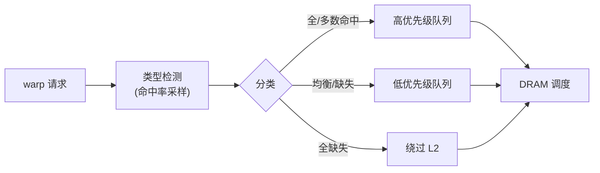

**图 4-7**：MeDiC：按 warp 类型分流与旁路

### 4.4.5 协同缓存旁路

**Xie et al. 2015**：按静态 load 指令的局部性标记"好/差/中"。好的用 L1，差的永远旁路，中的按线程块自适应（用同时考虑命中与流水线冲突的指标在线调整阈值）。

### 4.4.6 自适应缓存管理

**Chen et al. 2014b**：把**缓存旁路**与**线程束节流**协同。用 CPU 的**保护距离（protection distance）**技术：行插入时给一个保护距离，计数到 0 前不被逐出；组内没有未保护行时旁路。保护距离对工作负载相对不敏感。

### 4.4.7 缓存优先级划分

**Li et al. 2015**：线程束节流优化了 L1 命中率，却可能让片外带宽/L2 利用不足。给 warp 分配**令牌**决定谁能向 L1 分配行；无令牌的"无污染 warp"可执行但不能逐出数据。两个旋钮：可调度 warp 数 W、持令牌 warp 数 T。静态最优比 CCWS 提升 17%；动态方案 dynPCALMTLP / dynPCALCCWS 分别带来相当/11% 提升。

### 4.4.8 虚拟内存页放置

**Agarwal et al. 2015**：未来系统同时有**容量优化型**和**带宽优化型**内存。Linux 页放置不考虑带宽差异。结论：

- 带宽受限应用可同时用 CPU+GPU 内存提升聚合带宽；
- 按可用带宽比例分配页是理想的；
- 带宽型容量不足时，要细化为按访问频率放置；
- 用剖析引导的页放置可获得 oracle 约 90% 的收益。

### 4.4.9 数据放置（PORPLE）

**Chen et al. 2014a**：GPU 存储种类多，程序员难判断数据放哪，且不可移植。PORPLE 三件套：

1. **存储规约语言**：按"何时会被串行化"描述存储（相邻 global 可合并、同 bank shared 必串行）；
2. **PORPLE-C 源到源编译器**：插入保护代码，选最佳放置；
3. **自适应运行时放置器**：静态分析不确定时，用 CPU 上的轻量函数跟踪访问模式。

模型用**串行化条件**估计事务数，用**重用距离**估计命中率。

### 4.4.10 多芯片模块 GPU（MCM-GPU）

**Arunkumar et al. 2017**：摩尔定律放缓，用多个小 GPU 模块组成大 GPU。三招：

1. 对远端数据做本地缓存；
2. 局部性感知的 CTA→模块调度；
3. 首次触碰（first-touch）页分配。

结果：性能与"不可实现的单片大 GPU"相差不超过 10%，比同工艺可实现的最大单片 GPU 高 45%。

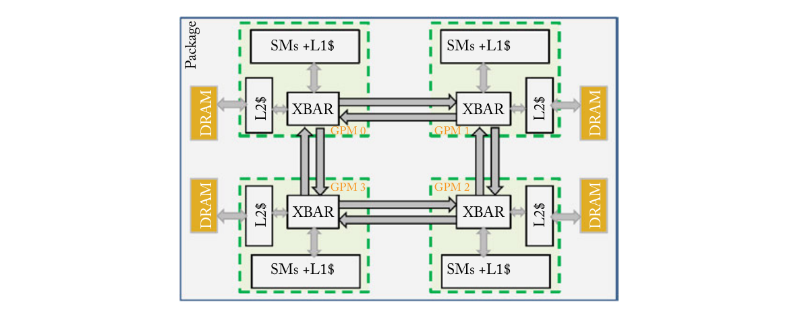

**图 4.4**：多芯片模块 GPU（原书插图）

**图 4-8** 画出了 MCM 的组织：

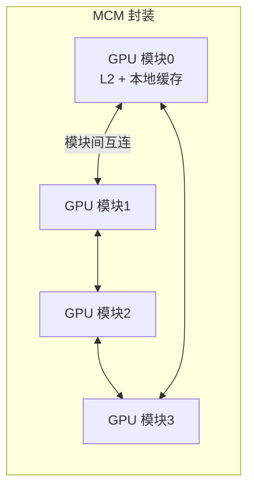

**图 4-8**：MCM-GPU：多个 GPU 模块通过封装内互连组成大 GPU

> **延伸（Hopper/Blackwell）**：NVIDIA 的 NVLink/NVSwitch 与 AMD 的 Infinity Fabric 都是"多 GPU/多芯片"路线的工业实现。H20 的 8 卡系统通过 NVLink 组成一个高带宽域，软件可用 NCCL 把它当成一个大设备。

---

## 4.5 H20 实测：带宽、合并与 bank 冲突

这一节是本课程最值得动手的部分。所有实验在 H20-3e 上完成（78 SM，HBM3，60 MB L2）。

### 4.5.1 实验一：合并访存决定有效带宽

**内核**：把一个 64 MB 的 float 数组读进来、乘 2、写出去。通过改变"同一 warp 内相邻线程的地址间隔（stride）"制造合并非合并。

```cuda
__global__ void copy_coalesced(const float* in, float* out, int n) {
    int i = blockIdx.x*blockDim.x + threadIdx.x;
    if (i < n) out[i] = in[i]*2.0f;
}
__global__ void copy_strided(const float* in, float* out, int n, int stride) {
    int i = blockIdx.x*blockDim.x + threadIdx.x;
    int j = (i%32)*stride + (i/32)*32;   // warp 内地址相隔 stride 个元素
    if (j < n && i < n) out[j] = in[j]*2.0f;
}
```

**结果**（有效字节 = 读 + 写 = 128 MB）：

| 访问模式 | 时间 | 有效带宽 | 相对合并 |
|---|---:|---:|---:|
| **coalesced（stride=1）** | 0.082 ms | **1635 GB/s** | 1.00× |
| stride=8 | 0.110 ms | 1223 GB/s | 0.75× |
| **stride=32** | 0.339 ms | **396 GB/s** | **0.24×** |

**解读**：

- 合并时一个 warp 的 32 个 float（128B）正好是一个缓存块，1 次请求；
- stride=32 时，warp 内每个 lane 相隔 128B，落在 32 个不同缓存块 → 32 次请求，有效带宽降到约 1/4；
- 这就是**为什么写 CUDA 要保证 `threadIdx.x` 对应最内层连续下标**。这也是第 2 章 SAXPY 用 `i = blockIdx*blockDim + threadIdx` 直接索引数组的原因。

### 4.5.2 实验二：共享存储器 bank 冲突

**内核**：每个线程从 shared memory 做 2000×32 次读，访问模式由 `STRIDE` 控制：

```cuda
template<int STRIDE>
__global__ void bank_kernel(float* out, int reps) {
    __shared__ volatile float s[1024];
    int t = threadIdx.x;
    for (int k=t; k<1024; k+=blockDim.x) s[k] = k*0.5f;
    __syncthreads();
    float acc = 0.f;
    int base = (t*STRIDE) & 1023;
    for (int r=0; r<reps; r++)
        for (int k=0; k<32; k++)
            acc += s[(base + (r*7+k)*STRIDE) & 1023];
    out[blockIdx.x*blockDim.x+t] = acc;
}
```

**结果**（624 个 block，每线程 64,000 次读）：

| stride | 冲突程度 | 时间 | 相对 stride=1 |
|---|---|---:|---:|
| 1 | 无冲突 | 2.423 ms | 1.00× |
| 2 | 2-way | 4.480 ms | **1.85×** |
| 4 | 4-way | 8.956 ms | **3.70×** |
| 32 | 32-way | 71.630 ms | **29.56×** |

> **实验注意事项**：第一版代码里 `s` 不是 `volatile`，且地址在 `r` 循环中不变，编译器把 shared 读提到了循环外，结果四种 stride 都是 0.65 ms、测不出冲突。改为 `__shared__ volatile float s[]` 并让地址随 `r` 变化后，冲突效应才显现。这说明：**微基准必须防止编译器优化掉你想测的东西。**

**解读**：

- 32-way 冲突意味着一个 warp 的 32 个 lane 全部访问同一个 bank 的不同地址，需要 32 拍串行，理论最坏 ~32×；实测 29.6× 非常接近。
- 这解释了书里 4.1.1 强调的"仲裁器拆分请求 + 重放"：硬件能保证正确性，但性能代价真实存在。
- **编程建议**：shared memory 数组按 `s[tid]`、`s[tid*32 + j]`（转置/填充 padding）访问，避免列访问。

### 4.5.3 实验三：峰值带宽与存储层次

用 `float4` 向量化拷贝测不同数组大小（见第 1 章）：

| 数组大小 | 有效带宽 |
|---|---:|
| 67 MB | 3589 GB/s |
| 268 MB | 3848 GB/s |
| 1 GB | 3909 GB/s |
| 2 GB | **3915 GB/s** |

**解读**：

- 小数组（67 MB）已部分落在 60 MB L2 之外，但仍有 ~3.6 TB/s；
- 大数组稳定在 ~3.9 TB/s，接近 H20 HBM3 的标称 4 TB/s；
- 对比第 4.5.1 的 1635 GB/s：**合并访存 + 向量化 + 足够大的工作集** 才能接近峰值。这也是为什么"优化访存"往往比"优化算术"收益更大。

---

## 4.6 本章小结

1. GPU 存储层次：**寄存器 → shared/L1 → L2 → DRAM**，越远越慢越耗能；GPU 用海量线程容忍延迟，缓存主要起**带宽过滤**作用。
2. **shared memory** 是软件管理的便笺，关键是避免 **bank 冲突**；**全局访存**的关键是**合并（coalescing）**。
3. **L1 数据缓存**与 shared memory 常统一；GPU 的 L1 通常**不保证一致性**，只缓存只读/局部数据；采用 VIVT、扇区等吞吐率导向设计。
4. **纹理缓存**用 FIFO 把命中/缺失延迟拉平，用 ROB 保证乱序缺失按序返回，体现"吞吐率优先"的微架构哲学。
5. **片上互连**用地址交织平衡分区流量；**存储分区**含 L2 slice、访存调度器、ROP/原子单元。
6. **DRAM 调度**的核心是提高**行缓冲命中率**；L2 写缺失常不做 read-allocate，以优化吞吐。
7. 研究方向覆盖：访存调度、缓存有效性、旁路/优先级、MeDiC、协同旁路、自适应管理、页放置、数据放置、MCM-GPU。
8. H20 实测：合并访存差距达 **4×**，32-way bank 冲突达 **~30×**，峰值带宽 **3.9 TB/s**。

### 思考题

1. 为什么 GPU 的 L1 可以不做缓存一致性？在什么情况下这会出错？
2. 一个 warp 访问 `A[tid]` 与 `A[tid*32]`，分别产生多少次缓存块请求？为什么？
3. shared memory 的 32-way bank 冲突为什么接近 32× 而不是精确 32×？
4. 纹理缓存为什么要在标记阵列与数据阵列之间放 FIFO？它如何把"延迟"换成"吞吐率"？
5. DRAM 的行缓冲命中率为什么重要？访存调度器如何提高它？
6. MeDiC 如何利用"warp 间异构性"？它的四个部件各自解决什么问题？
7. 如果 L2 容量只有 60 MB，而工作集是 2 GB，为什么 GPU 仍能跑得很快？这和第 1 章的 Guz 模型有什么关系？

---

## 附：本章实测代码

见 `code/coalescing.cu`、`code/bank_conflict.cu`、`code/bandwidth.cu`。

```bash
nvcc -O3 -arch=sm_90 --extended-lambda coalescing.cu -o coalescing && ./coalescing
nvcc -O3 -arch=sm_90 --extended-lambda bank_conflict.cu -o bank_conflict && ./bank_conflict
nvcc -O3 -arch=sm_90 --extended-lambda bandwidth.cu -o bandwidth && ./bandwidth
```
