# 第 5 章　GPU 计算架构的交叉研究

> **对应原书**：第 5 章 *Cross-Cutting Research*（5.1 线程调度、5.2 表达并行性的其他方式、5.3 事务内存、5.4 异构系统）
>
> **本章目标**：前面几章拆开了"核心"和"存储"，本章处理那些**同时牵扯多个部件**的问题——线程怎么被调度、并行性还能怎么表达、如何支持事务内存、CPU/GPU 如何共存。这些问题没有单一归属，却往往决定真实系统的性能与可用性。

---

## 5.0 本章的定位

本章的定位如 **图 5-1** 所示：

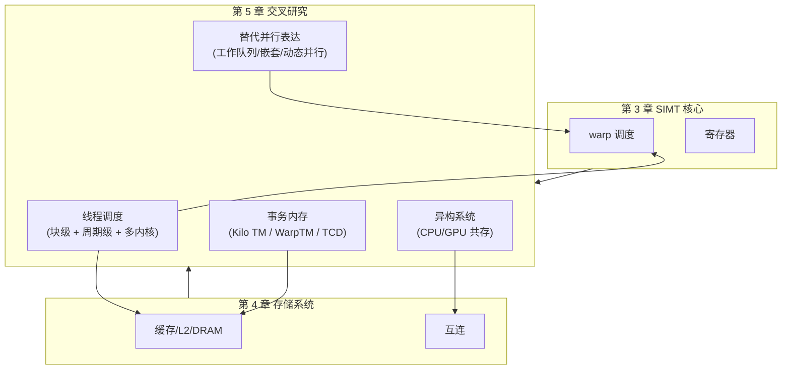

**图 5-1**：第 3、4 章部件与第 5 章交叉研究的对应关系

---

## 5.1 线程调度

### 5.1.1 三种调度层级

书里把 GPU 的线程调度分为三个层次：

| 层级 | 粒度 | 谁在做 | 何时 |
|---|---|---|---|
| **线程 → 线程束** | 32 个线程 | 硬件（静态）+ 压缩技术 | kernel 启动 / 分支时 |
| **线程块 → 核心** | 多个 warp | 全局工作分发器 | 块启动/结束 |
| **逐周期调度** | 单条指令 | warp 调度器 | 每周期 |
| **多内核调度** | 整个 kernel | 硬件队列（Streams/Hyper-Q） | 运行时 |

线程调度层级如 **图 5-2** 所示：

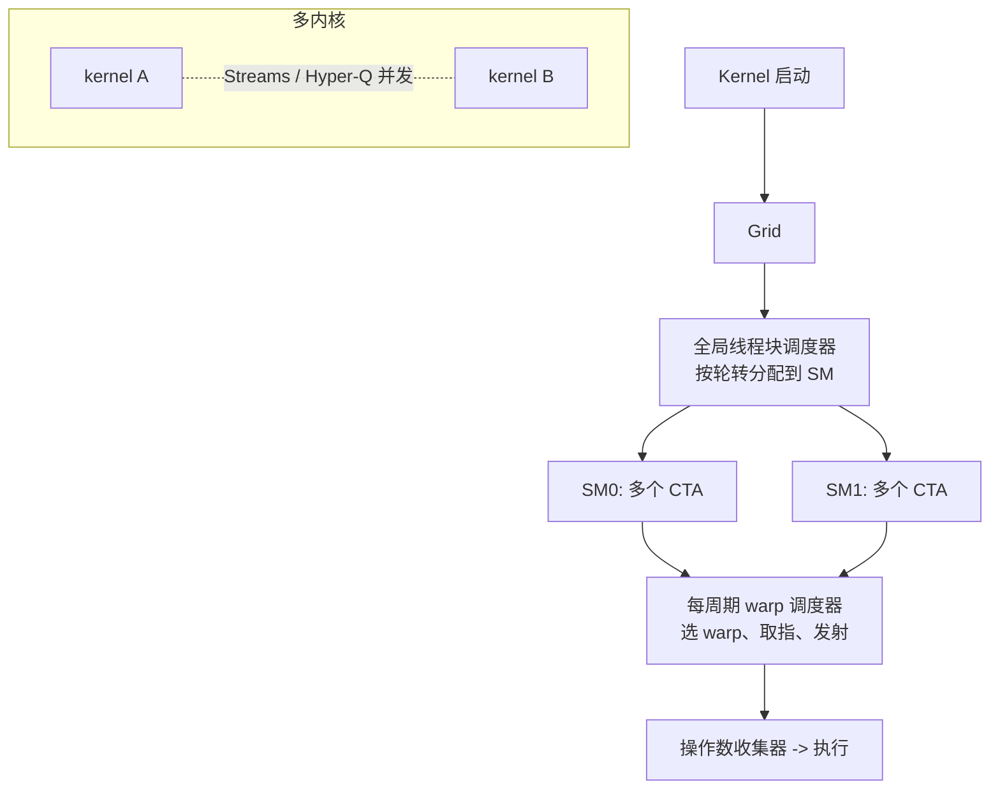

**图 5-2**：线程调度层级：kernel → grid → CTA → warp → 指令

**关键事实**：

- **线程块不会被打断**（非抢占）：一个 CTA 一旦分配到 SM，就运行到结束，资源才释放。这简化了硬件，但导致"长尾"问题（第 5.1.3 的抢占研究就是解决它）。
- **块级调度是资源驱动的**：每个 SM 有固定数量的 warp 槽、寄存器、shared memory、block 槽；块按轮转分配，直到某种资源耗尽。
- **多内核**：早期 GPU 一次只能跑一个 kernel；NVIDIA Streams/Hyper-Q 允许并发，类似 CPU 多道程序设计。

### 5.1.2 线程块到核心分配的研究

**线程块级节流（Kayiran et al. 2013）**：

- 问题：过多 CTA 造成存储系统争用。
- 做法：初始只给每 SM 最大块数的一半；监测**空闲周期**与**访存延迟周期**；若某 SM 主要在等内存，就不再给它分配块，甚至暂停已有块发射。
- 本质：**粗粒度 TLP 节流**，用更少 CTA 换取更少干扰。

**Equalizer（Sethia & Mahlke 2014）**：

- 硬件运行时，动态监测资源争用，同时调**线程数、核心频率、存储频率**。
- 四个决策参数：
  1. SM 中活动 warp 数；
  2. 等待内存的 warp 数；
  3. 就绪可执行 ALU 的 warp 数；
  4. 就绪可执行访存的 warp 数。
- 两种模式：**节能模式**（削减利用率不足的资源）与**性能增强模式**（提升瓶颈资源）。
- 频率调整按 ±15%，全芯片频率由各 SM 的"多数表决"决定。**图 5-3** 给出了 Equalizer 的结构：

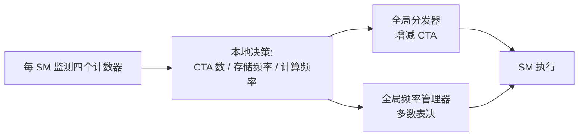

**图 5-3**：Equalizer：每 SM 本地决策 + 全局分发与频率管理

### 5.1.3 逐周期调度决策的研究

这是 GPU 微架构研究的"主战场"。

| 工作 | 核心思想 |
|---|---|
| **Lakshminarayana & Kim 2010** | 早期无缓存 GPU 上，公平性调度对"每 warp 动态指令数均衡"的应用有效；ICOUNT（优先进展快的 warp）在规则负载上未必有效 |
| **两级调度（Gebhart 2011c）** | 分活动池/非活动池；遇长延迟依赖就移出，按轮转移回；缩小选择逻辑、降能耗 |
| **两级调度（Narasiman 2011）** | 用"取指组（fetch group）"让各组同时到达长延迟点，保持组内局部性；组间切换隐藏延迟 |
| **CCWS（Rogers 2012）** | 按**warp 内局部性丢失**节流活动 warp 数；用**牺牲块标签数组**检测抖动 |
| **DAWS（Rogers 2013）** | 在 CCWS 基础上，用循环足迹更精确估计每 warp 缓存需求；按发散调整 |
| **预取感知调度（Jog 2013b）** | 用不连续 warp 组成取指组，提高 DRAM bank 并行；为其他组预取 |
| **CTA 感知调度（Jog 2013a）** | 按 CTA 组合取指组，利用 CTA 间页局部性；结合节流与预取 |
| **Mascar（Sethia 2015）** | 访存感知调度（MAS）+ 缓存访问重执行（CAR），让计算与访存更好重叠 |

**CCWS 的微架构**（原书图 5.1）：

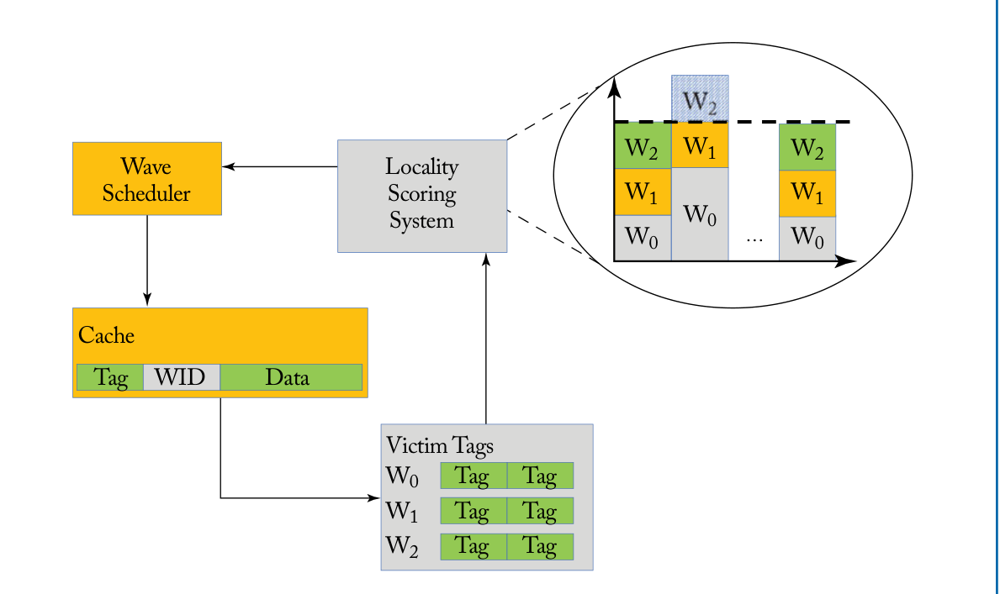

**图 5.1**：缓存感知波前调度的微架构（原书插图）

本笔记用 **图 5-4** 重绘其核心机制：

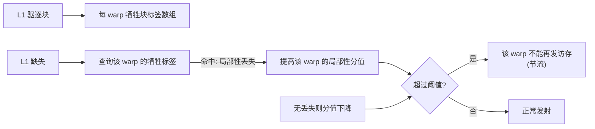

**图 5-4**：CCWS：用牺牲块标签检测局部性丢失并节流

**关键结论**：CCWS 证明**线程束调度器的决策空间远大于缓存替换策略**。用 LRU 的 CCWS 甚至优于"用 Belady 最优替换"的旧调度器。

**细粒度同步感知调度（ElTantawy & Aamodt 2018）**：

- 观察到自旋等锁开销大；对未拿到锁的线程简单退避会拖慢同 warp 中已持锁线程。
- 用**PC 低位路径历史 + 谓词更新历史**检测"在锁上自旋的循环"。
- 当持锁线程释放锁后、warp 执行自旋循环后向分支时，**降低该 warp 优先级**。
- 相比 Lee & Wu 2014：性能 1.5×，能耗降低 1.6×。

### 5.1.4 多内核调度与抢占

**Chimera（Park et al. 2015）**：GPU 抢占式多任务。

- 采用更宽松的**幂等性（idempotence）**定义：检测线程执行是否一直幂等。
- 每个 CTA 在三种上下文切换方式中动态选择：
  1. 完整保存/恢复上下文；
  2. 等该块执行完；
  3. 若幂等可安全重跑，直接停止、不保存。
- 需要一个算法在满足用户指定切换延迟目标的同时，最小化对吞吐率的影响。Chimera 的选择流程如 **图 5-5** 所示：

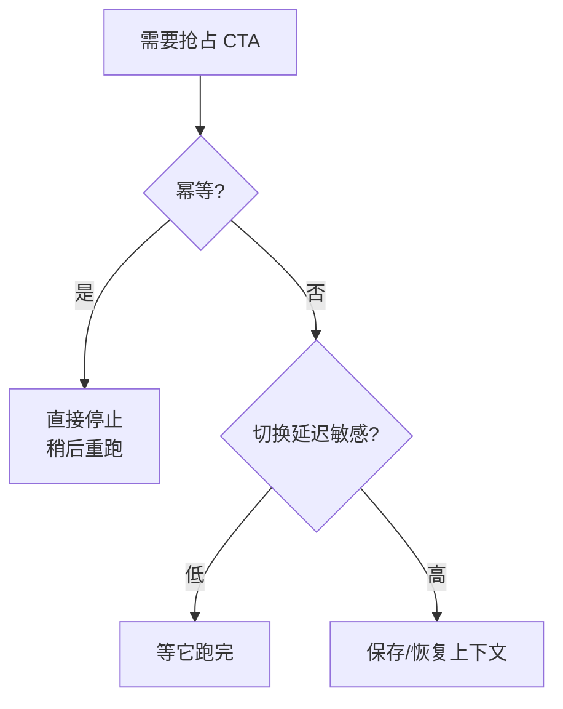

**图 5-5**：Chimera：按幂等性在三种抢占方式之间选择

> **延伸（现代 GPU）**：MPS（Multi-Process Service）、MIG（Multi-Instance GPU）、以及 Hopper 的 **线程块簇**都在不同层面做"资源分区/调度"。MIG 把一个大 GPU 切成多个独立实例（各自有 SM、L2 slice、DRAM 带宽），本质上是用硬件分区替代细粒度调度。

---

## 5.2 表达并行性的其他方式

GPU 的传统模型是"启动固定数量的线程，每个线程处理一份数据"（**拓扑式**）。但有些应用更适合**数据驱动**：工作动态生成、在线程间均衡。

### 5.2.1 细粒度工作队列

**Kim & Batten 2014**：在每个 SM 加一个硬件工作列表。

- 动机：不规则程序用**数据驱动**（工作动态生成）往往比拓扑式好，因为拓扑式会启动很多不做事的线程。
- 问题：软件工作队列有**推送/拉取争用**和**静态划分负载不均**。
- 方案：硬件工作列表分布在多个结构中，减少争用；在线程空闲前动态重分配；ISA 增加 push/pull 指令；每 lane 一个小的单端口 SRAM 存工作 ID。
- 支持**虚拟化**：动态工作超出硬件容量时可扩展。

**图 5-6** 给出了硬件工作队列的结构：

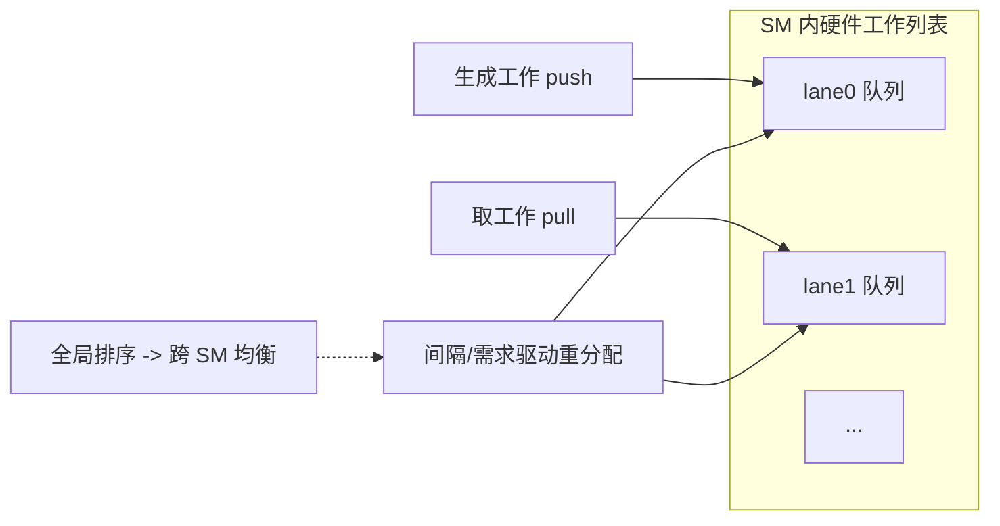

**图 5-6**：硬件工作队列：push/pull 与跨 lane、跨 SM 再平衡

### 5.2.2 嵌套并行模式的映射

**Lee et al. 2014a**：把嵌套并行（map/reduce/foreach/filter）映射到 GPU，**没有普适最优映射**。

三种映射：

1. **一维映射**：并行化外层循环；
2. **线程块/线程映射**：外层迭代 → 一个 block，内层在 block 内并行；
3. **基于 warp 的映射**：外层迭代 → 一个 warp，内层在 warp 内并行。

框架用 **span / split** 控制每线程处理多少元素：

- `span(1)`：每线程一个元素，最大并行；
- `span(all)`：每线程全部元素（用于需要同步的 reduce，或大小运行时才确定）；
- `split(2)`：每线程一半，另一个"合并内核"汇总结果。

用**硬约束 + 软约束**的评分算法搜索（维数、块大小、span），搜索空间虽指数增长但底数 <100、嵌套通常 <3 层，几秒可完成。

### 5.2.3 动态并行（CDP）

**观察（Wang & Yalamanchili 2014）**：Kepler 上 CDP 开销很大：

- 设备端启动的内核数量极多；
- 每个内核通常只有约 40 个线程（略多于一个 warp）；
- 启动配置不同，配置信息占用大量存储；
- 为并发放进不同流，利用 32 个硬件队列。

**改进**：

- **DTBL（dynamic thread block launch，Wang et al. 2016a）**：让设备端启动的内核**共享硬件队列**，与已在运行的同代码内核**聚合**；维护聚合 CTA 链表；性能比 CDP 提升 1.4×，比高度调优的非 CDP 版本提升 1.2×。
- **子块调度（Wang et al. 2016b）**：鼓励把子 CTA 调度到父 CTA 同一 SM；兼顾负载均衡，比朴素轮转提升 27%。

DTBL 的调度过程如 **图 5-7** 所示：

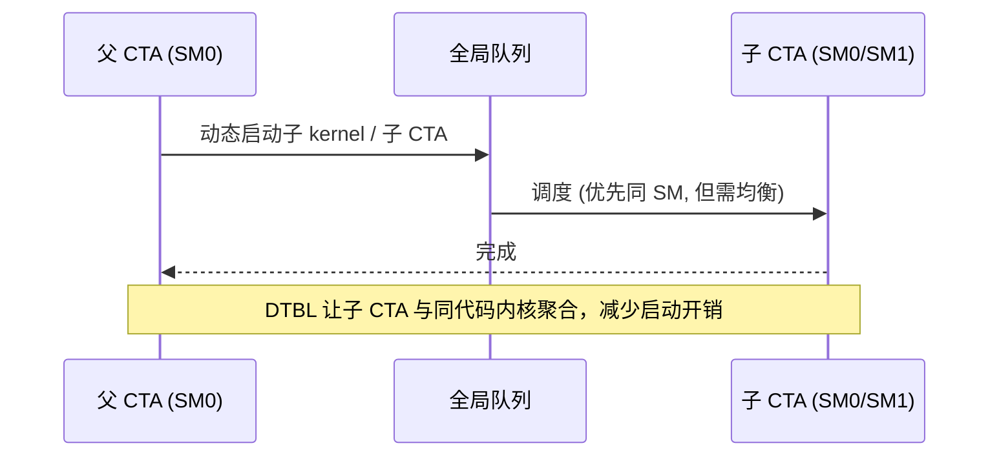

**图 5-7**：动态并行与 DTBL：子 CTA 的生成与调度

> **延伸（现代）**：CUDA Graphs 把一系列 kernel 启动"录下来"一次性提交，减少 CPU 端启动开销；Hopper 的 **TMA + 线程块簇**让"数据搬运 + 跨 SM 协作"成为硬件原语。这些都可以看作"降低动态调度开销"这一主线的延续。

---

## 5.3 对事务内存（TM）的支持

### 5.3.1 为什么 GPU 需要 TM

现代 GPU 上，线程间细粒度通信只有两条路：

1. **用屏障把同步粗化**：可能要大改算法；
2. **用单字原子操作做细粒度锁**：开发工作量大、风险高。

TM 提供"乐观并发"：一段代码（事务）要么全部生效，要么全部回滚。对不规则并行应用，这能大幅降低同步难度，促进强扩展。

### 5.3.2 GPU 上 TM 的独特挑战

- 不是几十个"大足迹"事务，而是**数万个小事务**；
- 需要**字级**冲突检测（不是缓存块级）；
- 每个 SM 的私有缓存由数百线程共享，**削弱了用缓存一致性检测冲突**的收益（这与 CPU CMP 的硬件事务内存设计不同）。

### 5.3.3 Kilo TM（首个公开的 GPU 硬件事务内存）

**核心：基于值的冲突检测（value-based conflict detection）**

- 不维护全局元数据；
- 事务在**验证时读取全局内存中已有的数据**，判断是否与已提交事务冲突；
- 利用 GPU 存储子系统的高度并行性，避免冲突事务直接交互，检测粒度最细。

**问题**：原生实现要求事务**串行提交**。

**解决：近期性布隆过滤器（recency bloom filter）**

- 一种压缩"大量小条目集合"的新数据结构，利用时间/顺序概念；
- 压缩所有正在提交事务的写集；
- 每个提交事务查询它，得到一个**近似**的冲突事务集合（有误报）；
- 用近似信息把**数百个互不冲突的事务**调度起来**并行验证和提交**；
- 布隆过滤器只有几 KB，可驻留片上。**图 5-8** 给出了 Kilo TM 的提交流程：

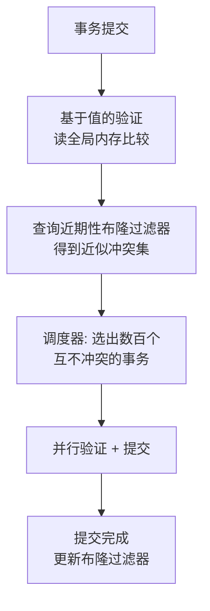

**图 5-8**：Kilo TM：基于值验证 + 近期性布隆过滤器并行提交

**分支发散与 TM**：事务提交时，同一 warp 内有的线程成功、有的中止，导致**验证后发散**。原书图 5.2 给出 SIMT 栈扩展：

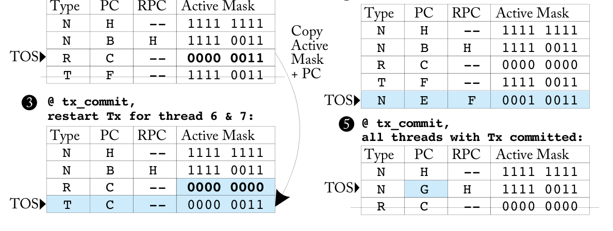

**图 5.2**：为处理事务中止发散而扩展 SIMT 栈（原书插图）

本笔记用 **图 5-9** 表示重试过程：

- 进入事务（`tx_begin`）时压入两个特殊项：
  - **R（retry）**：活跃掩码初始为空，PC 指向 `tx_begin` 之后，用于重跑中止的线程；
  - **T（top）**：跟踪当前这次事务尝试。
- `tx_commit` 时，未通过验证的线程把 R 项中自己的位置位；
- T 项弹出后，用 R 的掩码和 PC 压入新的 T 项，重启中止线程；R 掩码清零；
- 若 R 为空，T/R 都弹出，恢复原来的 N 项，PC 指向 `tx_commit` 之后。


**图 5-9**：事务中止导致的 SIMT 栈扩展与重试

### 5.3.4 WarpTM 与时间冲突检测（TCD）

**WarpTM（Fung & Aamodt 2013）**：利用 warp 内线程的空间局部性，摊薄 Kilo TM 的控制开销，提高存储子系统利用率。

- 前提：高效消解 **warp 内冲突**；
- 提出**两阶段并行 warp 内冲突消解**；
- 冲突消解后，把同一 warp 多个事务的验证/提交**合并成更宽的访存**（validation and commit coalescing），充分利用 GPU 宽访存。

**TCD（时间冲突检测）**：

- 用一组**全局同步的片上计时器**检测只读事务冲突；
- 计时器初始化后各自独立运行、互不通信（隐式同步）；
- 用时间戳推断"事务读"与"其他事务更新"的先后；
- **只读事务**可直接提交，无需基于值的检测，大幅降低带宽开销；
- 对"用事务遍历数据结构"的应用尤其有效。**图 5-10** 给出了 TCD 的判定流程：

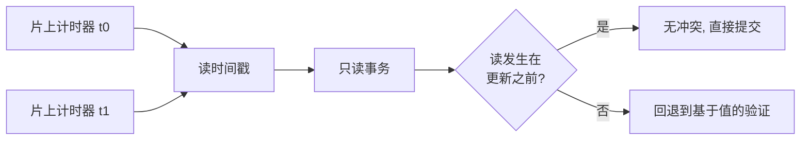

**图 5-10**：TCD：用全局同步计时器判断只读事务冲突

---

## 5.4 异构系统

CPU 与 GPU 共享内存/互连/存储控制器，会互相干扰。

### 5.4.1 异构系统中的并发管理

**Kayiran et al. 2014**：

- GPU 的干扰会让同时运行的 CPU 应用性能显著下降；
- 提出 **TLP 限制方案**：观察共享存储控制器与互连的拥塞指标，估计每 SM 应有多少活动 warp。
- 两种策略：
  1. **以 CPU 为中心**：只提升 CPU 性能；
  2. **均衡**：在 GPU 因节流损失与 CPU 受干扰之间折中，优化系统总吞吐。
- 结论：限制 GPU TLP 对 GPU 可能有益也可能有害，但**绝不会损害 CPU**。

### 5.4.2 异构系统一致性

**Power et al. 2013a**：

- 集成系统中，GPU 访存流量增加时，**目录带宽成为瓶颈**；
- 用**粗粒度区域一致性（coarse-grained region coherence）** 减少目录流量；
- 一旦获得区域权限，大多数请求不必访问目录，一致性流量可走一条**非一致的直接访问总线**。**图 5-11** 给出了这一结构：

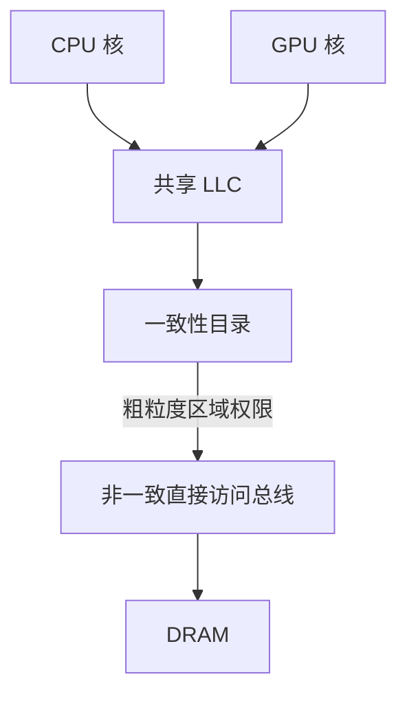

**图 5-11**：异构系统一致性：粗粒度区域一致性减少目录流量

### 5.4.3 面向 CPU-GPU 的缓存管理

**Lee & Kim 2012**：

- CPU 对缓存命中率敏感，GPU 常不敏感（延迟可被 TLP 掩盖）；
- 用**逐核心性能采样**判断 GPU 是否缓存敏感：一部分核旁路 LLC、一部分插入 MRU；按相对性能决定其余核策略；
- GPU 在 LLC 上产生的流量是 CPU 的 5–10 倍，缓存容量会向 GPU 倾斜，损害 CPU；
- 扩展**基于效用的缓存划分**，把访问比例纳入考虑。

---

## 5.5 H20 实测：TLP 与占用率

### 5.5.1 实验设计

用**依赖 FMA 链**制造延迟受限内核（每线程 4096 次依赖 FMA），扫描每 SM 的线程数，观察吞吐率：

```cuda
__global__ void chain(float* out, int reps) {
    float a = threadIdx.x*1e-6f + 1.f;
    for (int r=0; r<reps; r++) a = fmaf(a, 1.0000001f, 1e-7f);
    out[blockIdx.x*blockDim.x+threadIdx.x] = a;
}
```

配置：78 个 SM，每 block 256 线程，总工作量固定（线程数变化时调整 reps）。

### 5.5.2 结果

| 每 SM block 数 | 每 SM 线程数 | 吞吐 |
|---:|---:|---:|
| 1 | 256 | 7.79 TFMA/s |
| 2 | 512 | 12.66 TFMA/s |
| 4 | 1024 | 13.17 TFMA/s |
| 8 | 2048 | **13.72 TFMA/s** |

**相对提升**：1.00× → 1.63× → 1.69× → 1.76×。

**解读**：

- 依赖 FMA 链的延迟固定，线程少时流水线填不满；增加线程（TLP）能隐藏延迟，吞吐上升。
- 到 1024 线程后接近饱和——因为 256 线程/SM 时只有 8 个 warp，不足以覆盖 FMA 延迟；到 32/64 个 warp 后延迟被充分隐藏。
- 这正是第 1 章 Guz 模型、第 3 章"用 TLP 容忍延迟"的定量证据。
- **但 TLP 不是越多越好**：过多 warp 会增加缓存争用、降低每 warp 局部性（第 4 章 CCWS/MeDiC 的动机），也会增加寄存器压力。第 5.1 节的节流研究就是在找平衡点。**图 5-12** 是实测曲线：

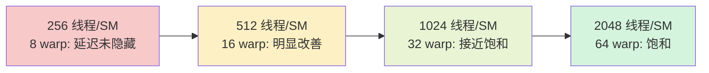

**图 5-12**：H20 实测：线程数增加对延迟受限内核吞吐的影响

### 5.5.3 与事务内存/调度的关系

- 这个内核没有分支发散、没有 shared memory 冲突，所以测的是"纯 TLP 收益"。
- 真实应用中，TLP 的边际收益会被**缓存争用**（第 4 章）、**分支发散**（第 3 章）、**同步开销**（第 5.3 节 TM）抵消。这就是为什么需要 CCWS、MeDiC、Equalizer、Chimera 这些"跨部件"的调度机制。

---

## 5.6 延伸：从本书到现代 GPU 架构

书出版于 2018 年（Volta 时代）。之后的发展可以看作本书主题的延续：

| 方向 | 本书中的雏形 | 现代实现（H20/Hopper 及以后） |
|---|---|---|
| 独立线程调度 | 3.1.2 无栈 SIMT / 汇聚屏障 | Volta Independent Thread Scheduling；`__syncwarp()` |
| 标量化/仿射 | 3.5 uniform/affine；AMD 标量单元 | Hopper SASS 的 **UR（Uniform Register）**、统一数据通路 |
| 减少数据移动 | 第 1 章能耗表、第 4 章缓存 | **TMA（Tensor Memory Accelerator）**：大块异步搬运 |
| 跨 SM 协作 | 5.1 线程块调度 | **Thread Block Cluster + 分布式共享内存（DSMEM）** |
| 专用矩阵硬件 | 1.3 Volta Tensor Core | 第四代 Tensor Core、FP8/FP4、稀疏加速 |
| 多芯片扩展 | 4.4.10 MCM-GPU | NVLink/NVSwitch、AMD Infinity Fabric、Chiplet |
| 资源分区 | 5.1 多内核/抢占 | **MIG**（Multi-Instance GPU）、MPS |
| 异步/流水 | 第 4 章访存重叠 | `cuda::pipeline`、异步拷贝、warp specialization |

演进主线如 **图 5-13** 所示：


**图 5-13**：从本书到现代 GPU 的演进主线

---

## 5.7 本章小结

1. **线程调度分四层**：线程→warp、block→SM、逐周期 warp 调度、多内核调度；块级非抢占是简化硬件的关键取舍。
2. **块级研究**关注 TLP 节流（Kayiran）与动态资源调节（Equalizer）；**周期级研究**关注局部性（CCWS/DAWS）、预取、CTA 感知、计算/访存重叠（Mascar）。
3. **抢占（Chimera）** 用幂等性在"保存上下文 / 等待 / 直接重跑"之间动态选择。
4. **替代并行表达**：硬件工作队列（数据驱动）、嵌套模式映射（span/split）、动态并行（CDP→DTBL）。
5. **GPU 事务内存**的独特挑战是"数万个小事务 + 字级检测 + 缓存一致性收益弱"；**Kilo TM** 用基于值的检测 + 近期性布隆过滤器实现并行提交；**WarpTM** 做 warp 内合并；**TCD** 用全局同步计时器加速只读事务。
6. **异构系统**要处理 CPU/GPU 的带宽争用（TLP 限制）、缓存一致性（粗粒度区域）、LLC 划分（感知访问比例）。
7. H20 实测：依赖链内核从 256→2048 线程/SM，吞吐提升约 **1.76×**，验证 TLP 掩盖延迟；但真实应用还需与缓存、发散、同步权衡。

### 思考题

1. 为什么 GPU 的线程块默认不可抢占？Chimera 如何在不保存全部上下文的情况下实现抢占？
2. CCWS 如何用"牺牲块标签"检测局部性丢失？它为什么比"提高缓存相联度"更有效？
3. 多内核并发（Hyper-Q）与多道程序设计有什么相似与不同？
4. Kilo TM 的"近期性布隆过滤器"为什么允许误报？误报的代价是什么？
5. 为什么 GPU 上的硬件事务内存不能直接照搬 CPU 的缓存一致性冲突检测？
6. TCD 用"全局同步计时器"检测只读事务冲突，它依赖什么假设？如果时钟漂移会怎样？
7. 在异构系统中，为什么"限制 GPU 的 TLP"可能同时提升 CPU 和 GPU 的性能？

---

## 附：本章实测代码

见 `../cuda_examples/occupancy.cu`：

```bash
nvcc -O3 -arch=sm_90 --extended-lambda occupancy.cu -o occupancy
./occupancy
```

> 说明：实验中的 `reps` 会随 block 数调整以保持总工作量近似恒定，因此不同配置的耗时可比。
