# 通用图形处理器体系结构

**General-Purpose Graphics Processor Architectures**

Tor M. Aamodt（不列颠哥伦比亚大学）
Wilson Wai Lun Fung（三星电子）
Timothy G. Rogers（普渡大学）

*Synthesis Lectures on Computer Architecture*（计算机体系结构综合讲座）第 44 讲
丛书主编：Margaret Martonosi，普林斯顿大学
创始主编：Mark D. Hill，威斯康星大学麦迪逊分校

Morgan & Claypool Publishers，2018

---

> 版权声明：原书 *General-Purpose Graphics Processor Architectures*，作者 Tor M. Aamodt、Wilson Wai Lun Fung、Timothy G. Rogers，Copyright © 2018 by Morgan & Claypool Publishers，ISBN 9781627059237（平装）、9781627056182（电子书）、9781681733586（精装），DOI 10.2200/S00848ED1V01Y201804CAC044，丛书 ISSN 1935-3235（印刷）、1935-3243（电子）。
>
> 本文件是应读者个人学习与研究需要而制作的中文参考译本，仅供个人阅读使用，不得用于任何商业用途或再分发。原文的一切权利归原作者与出版者所有；如需引用或转载，请以英文原书为准。

---

## 关于本书

图形处理器（GPU）最初是为支持电子游戏而开发的，如今被越来越多地用于通用（非图形）应用，从机器学习到加密货币挖矿都能见到它的身影。与中央处理器（CPU）相比，GPU 将更大比例的硬件资源专门用于计算，因而可以获得更高的性能与能效。此外，GPU 具备通用可编程性，这使得当代 GPU 相对于领域专用加速器对软件开发者更有吸引力。本书为希望研究支持通用计算的 GPU 体系结构的读者提供入门导引，并把目前散落于各类不同来源的信息汇集到一起。本书作者曾主导 GPGPU-Sim 模拟器的开发，该模拟器在 GPU 体系结构的学术研究中被广泛使用。

本书第 1 章描述 GPU 的基本硬件结构，并简要回顾其发展历史。第 2 章概述与后续内容相关的 GPU 编程模型。第 3 章探讨 GPU 计算核心的体系结构。第 4 章探讨 GPU 存储系统的体系结构。第 3、4 章在描述现有系统体系结构之后，还给出了相关研究的综述。第 5 章总结同时影响计算核心与存储系统的交叉性研究。

对于希望理解用于加速通用应用的图形处理器（GPU）体系结构的读者，以及希望了解“如何改进这类 GPU 体系结构”这一快速增长的庞杂研究的读者，本书都应当是一份有价值的资料。

**关键词**：GPGPU，计算机体系结构

---

# 序言

本书面向两类读者：一是希望理解图形处理器（GPU）体系结构的人，二是希望了解“如何改进 GPU 设计”这一不断壮大的研究领域的人。阅读本书假定读者已熟悉流水线、缓存等计算机体系结构概念，并且有兴趣从事与 GPU 体系结构相关的研究和／或开发工作。这类工作往往聚焦于不同设计之间的权衡；因此本书的写法力求揭示这些权衡，使读者不必再通过反复试错去重新发现资深设计者早已知道的东西。

为达到这一目的，本书把目前散落在专利、产品文档、研究论文等各类不同来源中的大量相关信息汇集到一处。我们希望这能缩短刚起步的学生或工程师从入门到能独立产出成果所需的时间。

本书虽然涵盖了当代 GPU 设计的若干方面，但也试图对已发表的研究进行“综合归纳”。这在某种程度上是不得已而为之：厂商对具体 GPU 产品的微架构公开甚少。在描述一个“基准”GPGPU 体系结构时，本书既依赖已公开的产品描述（期刊论文、白皮书、手册），有时也依赖专利中的描述。专利中的细节可能与实际产品的微架构有相当大的出入。在某些情况下，微基准测试研究已为研究者澄清了一些细节；而在另一些情况下，本书的基准描述只是我们基于公开信息做出的“最佳猜测”。尽管如此，我们相信这仍然是有益的，因为我们的重点在于理解那些已经被研究过、或值得在未来研究中探索的体系结构权衡。

本书有若干部分侧重综述近年来大量关于改进 GPU 体系结构的研究论文。由于该主题近年来热度大增，本书无法尽数覆盖，因此我们不得不在“写什么”和“舍弃什么”之间做出艰难取舍。

Tor M. Aamodt、Wilson Wai Lun Fung、Timothy G. Rogers
2018 年 4 月

---

# 致谢

我们要感谢家人在本书写作期间给予的支持。此外，我们要感谢出版人 Michael Morgan 和编辑 Margaret Martonosi，他们在本书成稿过程中表现出极大的耐心。我们还要感谢 Carole-Jean Wu、Andreas Moshovos、Yash Ukidave、Aamir Raihan 和 Amruth Sandhupatla，他们为本书早期草稿提供了详细反馈。最后，我们感谢 Mark Hill 分享了他关于如何撰写 Synthesis Lectures 系列讲座的想法，以及针对本书的具体建议。

Tor M. Aamodt、Wilson Wai Lun Fung、Timothy G. Rogers
2018 年 4 月

---

# 译者说明

## 关于这个译本

本书是 *General-Purpose Graphics Processor Architectures*（Tor M. Aamodt、Wilson Wai Lun Fung、Timothy G. Rogers 著，Morgan & Claypool Publishers，2018 年，Synthesis Lectures on Computer Architecture 第 44 讲）的中文全译本，按原书章节顺序完整译出正文，供个人学习与研究参考。

## 术语与文体

- **术语**：关键术语在每章首次出现时以“中文（English）”形式给出，之后主要使用中文。常驻术语对照如下：

   | 英文 | 本书译名 |
   |---|---|
   | warp / wavefront | 线程束（warp）/ 波前（wavefront） |
   | thread block / CTA | 线程块（CTA） |
   | SIMT / SIMD / MIMD | 单指令多线程 / 单指令多数据 / 多指令多数据 |
   | register file | 寄存器堆 |
   | warp scheduler | 线程束调度器 |
   | operand collector | 操作数收集器 |
   | scoreboard | 记分牌 |
   | scratchpad memory | 便笺式存储器 |
   | memory coalescing | 访存合并 |
   | divergence / reconvergence | 发散 / 重汇聚 |
   | branch divergence | 分支发散 |
   | occupancy | 占用率 |
   | memory partition | 存储分区 |

- **专名**：产品名、机构名、人名和指令集专名（NVIDIA、AMD、CUDA、OpenCL、GPGPU-Sim、Volta、Fermi、GCN、PTX、SASS 等）保留英文原文，不音译。
- **文献引用**：如 `[Hennessy and Patterson, 2011]` 保留原貌，便于对照英文原书与参考文献表；参考文献表本身保留英文，不做翻译。
- **代码清单**：C/CUDA、PTX、SASS、GCN 汇编保持原样，只翻译其中的英文注释，便于读者对照真实工具链的输出。
- **图表编号**：沿用原书编号（图 3.6 即原书 Figure 3.6），便于与原书交叉查阅。图题已译为中文，图内文字（如硬件框图、坐标轴标签）保留原文。

## 关于原文的说明

原书是一本综述性著作，许多段落是对已发表研究论文的归纳，作者在序言中也说明了“基准体系结构”描述部分来自公开的产品资料、白皮书与专利，可能与实际产品存在差异。译文如实保留这些表述及其不确定性措辞（如“可能”“据我们推测”），不做补充或修正。

原书为英文排版，部分公式、符号与特殊字符（如“×”、上下标）在从 PDF 转写为文本时可能略有损失；凡影响理解之处，译文均按上下文做了还原，并在必要处用文字说明。

## 引用建议

学术写作中引用本书内容时，请以英文原书为准：

> Tor M. Aamodt, Wilson Wai Lun Fung, and Timothy G. Rogers. *General-Purpose Graphics Processor Architectures*. Synthesis Lectures on Computer Architecture. Morgan & Claypool Publishers, 2018. DOI: 10.2200/S00848ED1V01Y201804CAC044.

---

# 目录

- **第 1 章　引言**
  - 1.1 计算加速器的格局
  - 1.2 GPU 硬件基础
  - 1.3 GPU 发展简史
  - 1.4 全书结构
- **第 2 章　编程模型**
  - 2.1 执行模型
  - 2.2 GPU 指令集体系结构
    - 2.2.1 NVIDIA GPU 指令集体系结构
    - 2.2.2 AMD Graphics Core Next 指令集体系结构
- **第 3 章　SIMT 核心：指令与寄存器数据流**
  - 3.1 一层循环近似
    - 3.1.1 SIMT 执行屏蔽
    - 3.1.2 SIMT 死锁与无栈 SIMT 架构
    - 3.1.3 线程束调度
  - 3.2 两层循环近似
  - 3.3 三层循环近似
    - 3.3.1 操作数收集器
    - 3.3.2 指令重放：处理结构冒险
  - 3.4 分支发散的研究方向
    - 3.4.1 线程束压缩
    - 3.4.2 线程束内的发散路径管理
    - 3.4.3 增加 MIMD 能力
    - 3.4.4 低复杂度而有效的发散管理
  - 3.5 标量化与仿射执行的研究方向
    - 3.5.1 均匀变量或仿射变量的检测
    - 3.5.2 在 GPU 中利用均匀变量与仿射变量
  - 3.6 寄存器堆体系结构的研究方向
    - 3.6.1 层次化寄存器堆
    - 3.6.2 低功耗（休眠）状态的寄存器堆
    - 3.6.3 寄存器堆虚拟化
    - 3.6.4 分区寄存器堆
    - 3.6.5 RegLess
- **第 4 章　存储系统**
  - 4.1 一级存储结构
    - 4.1.1 便笺式存储器与 L1 数据缓存
    - 4.1.2 L1 纹理缓存
    - 4.1.3 纹理与数据统一缓存
  - 4.2 片上互连网络
  - 4.3 存储分区单元
    - 4.3.1 L2 缓存
    - 4.3.2 原子操作
    - 4.3.3 访存调度器
  - 4.4 GPU 存储系统的研究方向
    - 4.4.1 访存调度与互连网络设计
    - 4.4.2 缓存有效性
    - 4.4.3 访存请求优先级划分与缓存旁路
    - 4.4.4 利用线程束间的异构性
    - 4.4.5 协同缓存旁路
    - 4.4.6 自适应缓存管理
    - 4.4.7 缓存优先级划分
    - 4.4.8 虚拟内存页放置
    - 4.4.9 数据放置
    - 4.4.10 多芯片模块 GPU
- **第 5 章　GPU 计算架构的交叉研究**
  - 5.1 线程调度
    - 5.1.1 线程块到核心分配的研究
    - 5.1.2 逐周期调度决策的研究
    - 5.1.3 多内核调度的研究
    - 5.1.4 细粒度同步感知调度
  - 5.2 表达并行性的其他方式
  - 5.3 对事务内存的支持
    - 5.3.1 Kilo TM
    - 5.3.2 WarpTM 与时间冲突检测
  - 5.4 异构系统
- **参考文献**
- **作者简介**

---

# 第 1 章　引言

本书探讨图形处理器（GPU）的硬件设计。GPU 最初是为了实现实时渲染而引入的，重点面向电子游戏。如今，从智能手机、笔记本电脑、数据中心一直到超级计算机，GPU 几乎无处不在。事实上，对 Apple A8 应用处理器的一项分析表明，它分配给集成 GPU 的芯片面积比分配给中央处理器（CPU）核心的还要多 [A8H]。对越来越逼真的图形渲染的需求，是 GPU 创新的最初驱动力 [Montrym and Moreton, 2005]。尽管图形加速仍然是 GPU 的主要用途，但 GPU 越来越多地支持非图形计算。当今备受关注的一个突出例子，是越来越多地使用 GPU 来开发和部署机器学习系统 [NVIDIA Corp., 2017]。因此，本书的重点是与提升非图形应用的性能和能效相关的特性。

本章作为引言，对 GPU 作一简要概述。我们首先在 1.1 节讨论更广泛意义上的计算加速器这一类别背后的动因，以理解 GPU 与其他方案相比有何不同。接着，在 1.2 节简要介绍当代 GPU 硬件。最后，1.4 节给出通往本书其余部分的路线图。

## 1.1 计算加速器的格局

几十年来，一代又一代计算系统的每美元性能呈指数级增长。其根本原因在于晶体管尺寸缩小、硬件体系结构改进、编译器技术进步以及算法改进的共同作用。据一些估计，这些性能提升中有一半来自晶体管尺寸的缩小，因为尺寸更小的器件工作得更快 [Hennessy and Patterson, 2011]。然而，大约自 2005 年起，晶体管的缩放不再遵循如今被称为 Dennard 缩放（Dennard Scaling）的经典规律 [Dennard et al., 1974]。一个关键后果是，随着器件变小，时钟频率的提升要慢得多。要提升性能，就必须找到更高效的硬件体系结构。

通过利用硬件专用化，可以把能效提升多达 500 倍 [Hameed et al., 2010]。正如 Hameed 等人所指出的，要获得这样的效率提升涉及若干关键方面。转向向量硬件——例如 GPU 中所采用的向量硬件——可以消除指令处理的开销，从而带来约 10 倍的效率提升。硬件专用化所带来的其余收益，很大一部分来自尽量减少数据移动；要做到这一点，可以引入复杂操作，让单个操作完成多个算术运算，同时避免访问寄存器堆之类的大型存储阵列。

当今计算机体系结构设计者面临的一个关键挑战是：如何更好地平衡使用专用硬件所能获得的效率收益与支持各类程序所需的灵活性。若没有这样的体系结构，就只有那些能用于大量应用的算法才能高效运行。一个正在兴起的例子是为支持深度神经网络而专门设计的硬件，例如 Google 的张量处理单元 [Jouppi et al., 2017]。尽管机器学习看来很可能占用计算硬件资源的很大一部分，而且这些资源可能会转向专用硬件，但我们认为，仍然需要高效地支持以传统编程语言编写的软件所表达的计算。

除了把 GPU 用于机器学习之外，人们对 GPU 计算兴趣浓厚的另一个原因，是现代 GPU 支持图灵完备（Turing Complete）的编程模型。所谓图灵完备，是指只要给予足够的时间和存储空间，任何计算都可以运行。相对于专用加速器，现代 GPU 是灵活的。对于能够充分利用 GPU 硬件的软件，GPU 的效率可以比 CPU 高一个数量级 [Lee et al., 2010]。这种灵活性与效率的结合是非常理想的。因此，无论是从峰值性能还是从能效来看，许多顶尖超级计算机现在都采用了 GPU [top]。在一代又一代产品中，GPU 厂商不断改进 GPU 的体系结构和编程模型，在提高灵活性的同时改善能效。

## 1.2 GPU 硬件基础

初次接触 GPU 的人常常会问：GPU 最终是否会完全取代 CPU。这似乎不太可能。在目前的系统中，GPU 并不是独立的计算设备。相反，它们与 CPU 结合在一起：或者集成在同一块芯片上，或者把一块只含 GPU 的扩展卡插入包含 CPU 的系统中。CPU 负责在 GPU 上启动计算，并负责把数据传入和传出 GPU。CPU 与 GPU 之间之所以这样分工，一个原因是计算的开始和结束通常都需要访问输入/输出（I/O）设备。尽管目前有人在努力开发直接在 GPU 上提供 I/O 服务的应用编程接口（API），但迄今为止这些接口都假定存在一个邻近的 CPU [Kim et al., 2014, Silberstein et al., 2013]。这些 API 的作用是提供便捷的接口，把管理 CPU 与 GPU 之间通信的复杂性隐藏起来，而不是彻底消除对 CPU 的需求。为什么不干脆去掉 CPU 呢？用于访问 I/O 设备以及提供操作系统服务的软件，似乎缺少大规模并行性之类的特性，因而并不适合在 GPU 上运行。因此，我们先从考察 CPU 与 GPU 的交互开始。

图 1.1 给出了一个包含 CPU 与 GPU 的典型系统的抽象示意图。左侧是典型的独立 GPU 配置：其中包含一条连接 CPU 与 GPU 的总线（例如 PCIe），NVIDIA 的 Volta 等体系结构即采用这种配置；右侧则是典型的 CPU 与 GPU 集成方案的逻辑示意图，例如 AMD 的 Bristol Ridge APU 或移动 GPU。需要注意的是，采用独立 GPU 的系统为 CPU（通常称为系统内存）和 GPU（通常称为设备内存）分别设有独立的 DRAM 存储空间。这些存储器所用的 DRAM 技术往往不同（CPU 用 DDR，GPU 用 GDDR）。CPU 的 DRAM 通常针对低延迟访问进行优化，而 GPU 的 DRAM 则针对高吞吐率进行优化。相比之下，采用集成 GPU 的系统只有单一的 DRAM 存储空间，因此必然使用相同的存储技术。由于集成 CPU 与 GPU 常见于低功耗移动设备，共享的 DRAM 内存通常针对低功耗进行优化（例如 LPDDR）。

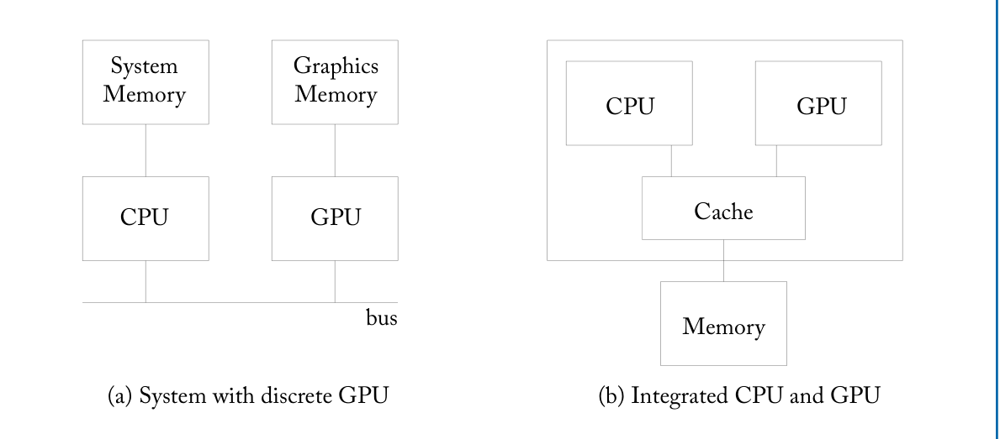

**图 1.1**：GPU 计算系统包含 CPU。

GPU 计算应用从 CPU 上开始运行。通常，应用的 CPU 部分会分配并初始化一些数据结构。在 NVIDIA 和 AMD 较早的独立 GPU 上，GPU 计算应用的 CPU 部分通常要在 CPU 内存和 GPU 内存中分别为数据结构分配空间。对于这些 GPU，应用的 CPU 部分必须负责协调数据从 CPU 内存搬移到 GPU 内存。较新的独立 GPU（例如 NVIDIA 的 Pascal 体系结构）具备软件和硬件支持，可以自动把数据从 CPU 内存传输到 GPU 内存。这可以借助 CPU 和 GPU 两侧的虚拟内存支持来实现 [Gelado et al., 2010]。NVIDIA 称之为“统一内存”（unified memory）。在 CPU 与 GPU 集成在同一块芯片上并共享同一内存的系统中，不需要由程序员控制从 CPU 内存到 GPU 内存的复制。不过，由于 CPU 和 GPU 都使用缓存，而且其中一些缓存可能是私有的，因此可能存在缓存一致性问题，需要硬件开发者加以解决 [Power et al., 2013b]。

在某个时刻，CPU 必须启动 GPU 上的计算。在当前的系统中，这是借助运行在 CPU 上的驱动程序完成的。在 GPU 上启动计算之前，GPU 计算应用要指明哪段代码应在 GPU 上运行。这段代码通常称为内核（kernel，详见第 2 章）。与此同时，GPU 计算应用的 CPU 部分还要指明应运行多少个线程，以及这些线程应到哪里寻找输入数据。要运行的内核、线程数量和数据位置，经由运行在 CPU 上的驱动程序传达给 GPU 硬件。驱动程序会转换这些信息，再把它放入 GPU 可访问的内存，且正位于 GPU 被配置为查找它的那个位置。随后，驱动程序通知 GPU：有新的计算需要它执行。

现代 GPU 由许多核心构成，如图 1.2 所示。NVIDIA 称这些核心为*流多处理器*（streaming multiprocessor），AMD 称其为*计算单元*（compute unit）。每个 GPU 核心执行一个单指令多线程（SIMT）程序，对应于已在 GPU 上启动运行的那个内核。GPU 上的每个核心通常可以运行约一千个线程。在单个核心上执行的线程可以通过便笺式存储器（scratchpad memory）相互通信，并利用快速的屏障操作进行同步。每个核心通常还包含一级指令缓存和数据缓存。这些缓存充当带宽过滤器，减少发往存储系统更低层次的通信量。当数据在一级缓存中找不到时，一个核心上运行的大量线程就用来掩盖访问内存的延迟。

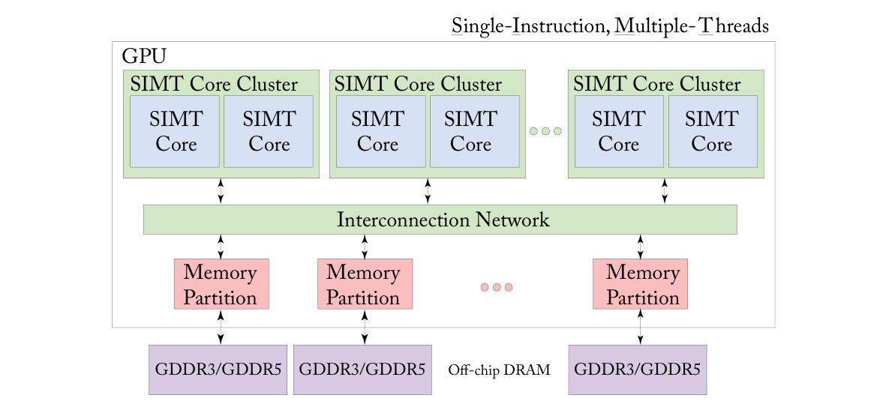

**图 1.2**：一种通用的现代 GPU 体系结构。

为维持高计算吞吐率，必须使高计算吞吐率与高存储带宽相平衡。这又要求存储系统具有并行性。在 GPU 中，这种并行性由多个存储通道提供。通常，每条存储通道都关联着某个存储分区中的一部分末级缓存。GPU 核心与存储分区通过片上互连网络（例如交叉开关）相连。也可以采用其他组织形式。例如，在超级计算市场上与 GPU 直接竞争的 Intel Xeon Phi，就把末级缓存分散布置在各核心处。

在高并行度的工作负载上，与超标量乱序 CPU 相比，GPU 可以获得更高的单位面积性能，办法是把更大比例的芯片面积用于算术逻辑单元，相应地把更小的面积用于控制逻辑。为了帮助读者直观理解 CPU 与 GPU 体系结构之间的权衡，Guz 等人 [2009] 提出了一个富有洞见的分析模型，展示了性能如何随线程数变化。为使模型保持简单，他们假设了一个简单的缓存模型：线程之间不共享数据，且片外存储带宽无限。图 1.3 复现了他们论文中的一幅图，展示了他们用该模型发现的一种有趣的权衡关系。当一个大容量缓存由少量线程共享时（多核 CPU 就是这种情况），性能随线程数增加而提升。然而，如果线程数增加到缓存无法容纳整个工作集的程度，性能就会下降。随着线程数进一步增加，性能又因多线程掩盖较长的片外延迟的能力而提升。GPU 体系结构对应于此图的右侧部分。GPU 的设计思路就是利用多线程来容忍频繁的缓存缺失。

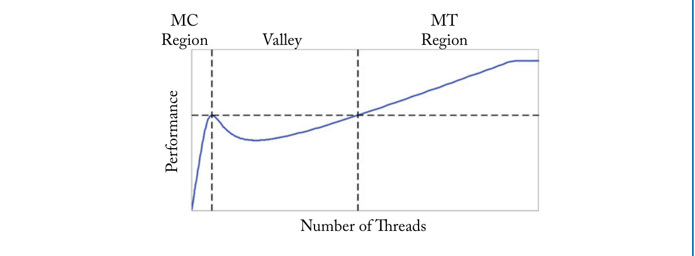

**图 1.3**：对多核（MC）CPU 体系结构与 GPU 等多线程（MT）体系结构之间性能权衡的一项基于分析模型的研究表明，如果线程数量不足以覆盖片外存储访问延迟，就可能出现“性能低谷”（据 Guz et al. [2009] 的图 1 改绘）。

随着 Dennard 缩放（Dennard Scaling）的终结 [Horowitz et al., 2005]，提升能效已成为计算机体系结构研究创新的主要驱动力。一个关键的观察是：访问大型存储结构所消耗的能量，可能与计算相当，甚至更多。

例如，表 1.1 给出了 45 nm 工艺下各种操作的能耗数据 [Han et al., 2016]。在提出新的 GPU 体系结构设计时，必须把能耗考虑在内。为此，近期的 GPGPU 体系结构模拟器（如 GPGPU-Sim [Bakhoda et al., 2009]）已经集成了能耗模型 [Leng et al., 2013]。

**表 1.1**：45 nm 工艺下各种操作的能耗（据 Han et al. [2016] 的表 1 改绘）

| 操作 | 能耗 [pJ] | 相对开销 |
|---|---|---|
| 32 位整数加法 | 0.1 | 1 |
| 32 位浮点加法 | 0.9 | 9 |
| 32 位整数乘法 | 3.1 | 31 |
| 32 位浮点乘法 | 3.7 | 37 |
| 32 位 SRAM（32 KB） | 5 | 50 |
| 32 位 DRAM | 640 | 6400 |

## 1.3 GPU 发展简史

本节简要回顾图形处理器的发展历史。计算机图形学诞生于 20 世纪 60 年代，其代表项目包括 Ivan Sutherland 的 Sketchpad [Sutherland, 1963]。从一开始，计算机图形学就与电影动画的离线渲染密不可分；与此同时，面向电子游戏的实时渲染也得到了发展。早期的显卡始于 1981 年的 IBM 单色显示适配器（MDA），它只支持文本。后来，显卡先引入二维加速，随后又引入三维加速。除电子游戏之外，三维加速器还面向计算机辅助设计。早期的三维图形处理器（如 NVIDIA GeForce 256）功能相对固定（fixed-function）。NVIDIA 以顶点着色器（vertex shader）的形式为 GPU 引入了可编程能力 [Lindholm et al., 2001]，并在 2001 年推出的 GeForce 3 中引入了像素着色器（pixel shader）。研究者很快学会了如何利用这些早期 GPU 实现线性代数：把矩阵数据映射到纹理（texture）中，再施加着色器 [Krüger and Westermann, 2003]；随后不久，把通用计算映射到 GPU 上、使程序员无需了解图形学的学术工作也相继出现 [Buck et al., 2004]。这些努力促使 GPU 厂商在图形之外直接支持通用计算。首个这样做的商业产品是 NVIDIA GeForce 8 系列。GeForce 8 系列引入了若干创新，包括着色器可以向任意内存地址写入，以及用便笺式存储器（scratchpad）来限制片外带宽需求——这些在此前的 GPU 中是缺失的。下一项创新是 NVIDIA 的 Fermi 体系结构实现了对可读写数据的缓存。随后的改进包括 AMD 的 Fusion 体系结构（把 CPU 与 GPU 集成在同一块芯片上），以及允许 GPU 自身启动线程的动态并行（dynamic parallelism）。最近，NVIDIA 的 Volta 引入了诸如 Tensor Core 之类专门面向机器学习加速的特性。

## 1.4 全书结构

本书其余部分组织如下。

设计硬件时，必须考虑硬件将要支持的软件。因此，第 2 章简要概述编程模型、代码开发流程和编译流程。

第 3 章探讨支持数千个线程执行的单个 GPU 核心的体系结构。我们将逐步构建起越来越细致的理解，弄清支持高吞吐率与灵活编程模型之间涉及哪些权衡。本章最后总结与 GPU 核心体系结构相关的近期研究，以帮助刚进入这一领域的研究者迅速上手。

第 4 章探讨存储系统，既包括 GPU 核心内部的一级缓存，也包括存储分区的内部组织。理解 GPU 的存储系统十分重要，因为在 GPU 上运行的计算往往受限于片外存储带宽。本章最后总结与 GPU 存储系统体系结构相关的近期研究。

最后，第 5 章概述另外一些关于 GPU 计算体系结构的研究，这些内容无法整齐地归入第 3 章或第 4 章。

---

# 第 2 章　编程模型

本章的目的是提供足够的背景，说明 GPU 是如何针对非图形计算进行编程的，使此前没有 GPU 使用经验的读者也能跟上后续章节的讨论。我们在此只关注最核心的内容，更深入的探讨留给其他文献（例如 [Kirk and Wen-Mei, 2016]）。如今已有许多 GPU 计算基准测试套件可用于体系结构研究。了解 GPU 的编程方式，对关注 GPU 计算的计算机体系结构研究者很有意义，因为这能让他们更好地理解硬件/软件接口；而如果你想把修改硬件/软件接口作为自己研究工作的一部分，这种了解就变得不可或缺。在后一种情况下，可能并不存在现成的基准测试，于是就需要自行创建，也许是通过修改现有 GPU 计算应用的源代码来实现。例如，探索在 GPU 上引入事务内存（TM）的研究就必须这样做，因为当前的 GPU 并不支持 TM（见 5.3 节）。

现代 GPU 采用宽 SIMD 硬件来挖掘 GPU 应用中的数据级并行性。GPU 计算 API（如 CUDA 和 OpenCL）并没有把这套 SIMD 硬件直接暴露给程序员，而是提供了一种类似 MIMD 的编程模型，允许程序员把一大批标量线程启动到 GPU 上。每个标量线程都可以沿自己独有的执行路径前进，并且可以访问任意的内存位置。在运行时，GPU 硬件把称为*线程束*（warp，在 AMD 术语中称为*波前*（wavefront））的一组标量线程放在 SIMD 硬件上以锁步方式执行，从而利用它们之间的规律性和空间局部性。这种执行模型称为单指令多线程（SIMT）[Lindholm et al., 2008a, Nickolls and Reusch, 1993]。

本章其余部分将对此展开讨论，组织如下。2.1 节探讨近期 GPU 编程模型所采用的概念性执行模型，并简要总结过去十年间发布的典型 GPU 的执行模型。2.2 节讨论 GPU 计算应用的编译过程，并简要介绍 GPU 的指令集体系结构（ISA）。

## 2.1 执行模型

GPU 计算应用从 CPU 上开始执行。对于独立 GPU，应用中的 CPU 部分通常会为 GPU 上的计算分配内存，然后启动把输入数据传入 GPU 存储器的传输，最后在 GPU 上启动一个计算内核。对于集成 GPU，只需要最后一步。一个计算内核（通常）由数千个线程组成。每个线程执行同一段程序，但根据计算的结果，可能在该程序中走不同的控制流路径。下面我们用一个具体的 CUDA 代码例子详细考察这一流程。在下一节中，我们将从汇编层面考察执行模型。我们的讨论并不着眼于 GPU 编程模型的性能问题。不过，Seo 等人 [2011] 在 OpenCL（一种与 CUDA 类似、可编译到多种体系结构的编程模型）的背景下有一个有趣的观察：针对某一种体系结构（例如 GPU）精心优化的代码，在另一种体系结构（例如 CPU）上可能性能很差。

图 2.1 给出了一个著名运算的 CPU 实现所对应的 C 代码，该运算是*单精度标量值 A 乘以向量值 X 再加上向量值 Y*，称为 SAXPY。SAXPY 是著名的基础线性代数软件（BLAS）库的一部分 [Lawson et al., 1979]，可用于实现高斯消元等更高层的矩阵运算 [McCool et al., 2012]。由于它简单而实用，在讲授计算机体系结构时常常被用作示例 [Hennessy and Patterson, 2011]。图 2.2 给出了 SAXPY 对应的 CUDA 版本，它把执行划分到 CPU 和 GPU 上。

图 2.2 的例子展示了 CUDA 及相关编程模型（例如 OpenCL [Kaeli et al., 2015]）所提供的抽象。代码从函数 main() 开始执行。为了让例子聚焦于 GPU 计算特有的细节，我们省略了数组 x 和 y 的分配与初始化细节。接着调用函数 saxpy_serial。该函数的输入参数包括：参数 n，给出向量 x 和 y 中的元素个数；参数 a，给出标量值；以及指向用于表示向量 x 和 y 的数组的指针。该函数遍历数组 x 和 y 的每个元素。在每次迭代中，第 4 行的代码用循环变量 i 读取 x[i] 和 y[i] 的值，把 x[i] 乘以 a 再加上 y[i]，然后用结果更新 x[i]。为简单起见，我们省略了 CPU 如何使用该函数调用结果的细节。

接下来，我们考虑 SAXPY 的 CUDA 版本。与传统的 C 或 C++ 程序类似，图 2.2 中的代码通过在 CPU 上运行函数 main() 来开始执行。我们不逐行讲解这段代码，而是先突出与 GPU 执行相关的方面。

在 GPU 上执行的线程属于由某个函数所指定的计算*内核*。在图 2.2 所示的 SAXPY 的 CUDA 版本中，第 1 行的 CUDA 关键字 __global__ 表明内核函数 saxpy 将在 GPU 上运行。在图 2.2 的例子中，我们把图 2.1 中的“for”循环并行化了。具体来说，图 2.1 中原有的纯 CPU C 代码里第 4 行的“for”循环的每次迭代，都被转换为一个单独的线程，由它运行图 2.2 中第 3–5 行的代码。

一个计算内核通常由数千个线程组成，其中每个线程都从运行同一个函数开始。在我们的示例中，CPU 在第 17 行使用 CUDA 的内核配置语法在 GPU 上启动计算。内核配置语法看上去很像 C 语言中的一次函数调用，只是多了一些附加信息，用来指定所包含的线程数量，而这个数量写在三重尖括号（<<<>>>）之间。

**图 2.1**：传统的 CPU 代码（基于 Harris [2012]）。

```c
1 void saxpy_serial(int n, float a, float *x, float *y)
2 {
3 for (int i = 0; i < n; ++i)
4 y[i] = a*x[i] + y[i];
5 }
6 main() {
7 float *x, *y;
8 int n;
9 // 省略：为 x 和 y 分配 CPU 内存并初始化其内容
10 saxpy_serial(n, 2.0, x, y); // 调用串行 SAXPY 内核
11 // 省略：在 CPU 上使用 y，释放 x 和 y 所指向的内存
12 }
```

**图 2.2**：CUDA 代码（基于 Harris [2012]）。

```c
1 __global__ void saxpy(int n, float a, float *x, float *y)
2 {
3 int i = blockIdx.x*blockDim.x + threadIdx.x;
4 if(i<n)
5 y[i] = a*x[i] + y[i];
6 }
7 int main() {
8 float *h_x, *h_y;
9 int n;
10 // 省略：为 h_x 和 h_y 分配 CPU 内存并初始化其内容
11 float *d_x, *d_y;
12 int nblocks = (n + 255) / 256;
13 cudaMalloc( &d_x, n * sizeof(float) );
14 cudaMalloc( &d_y, n * sizeof(float) );
15 cudaMemcpy( d_x, h_x, n * sizeof(float), cudaMemcpyHostToDevice );
16 cudaMemcpy( d_y, h_y, n * sizeof(float), cudaMemcpyHostToDevice );
17 saxpy<<<nblocks, 256>>>(n, 2.0, d_x, d_y);
18 cudaMemcpy( h_x, d_x, n * sizeof(float), cudaMemcpyDeviceToHost );
19 // 省略：在 CPU 上使用 h_y，释放 h_x、h_y、d_x 和 d_y 所指向的内存
20 }
```

组成计算内核的线程被组织成一个层次结构：*网格*（grid）由*线程块*（thread block）构成，而线程块又由*线程束*（warp）构成。在 CUDA 编程模型中，各个线程所执行指令的操作数都是标量值（例如 32 位浮点数）。为了提高效率，典型的 GPU 硬件会让成组的线程以锁步（lock-step）方式一起执行。NVIDIA 把这些组称为*线程束*（warp），AMD 则称之为*波前*（wavefront）。NVIDIA 的线程束由 32 个线程组成，而 AMD 的波前由 64 个线程组成。线程束又被组合成一个更大的单元，NVIDIA 称之为协作线程数组（cooperative thread array，CTA），也就是线程块。第 17 行表明，该计算内核应当启动一个网格，其中包含 nblocks 个线程块，每个线程块包含 256 个线程。CPU 代码传给内核配置语句的参数，会被分发给 GPU 上正在运行的每一个线程实例。

如今，许多移动设备的片上系统把 CPU 和 GPU 集成在同一块芯片上，笔记本电脑和台式机中的处理器也是如此。然而，传统上 GPU 拥有自己独立的 DRAM，而且对于用于机器学习的数据中心里的 GPU 来说，这种情况至今未变。需要指出的是，NVIDIA 推出了统一内存（Unified Memory），它能够在 CPU 内存与 GPU 内存之间透明地互相更新数据。在启用了统一内存的系统中，运行时系统（runtime）和硬件负责代替程序员完成数据拷贝。鉴于人们对机器学习的兴趣日益增长，而本书的目标又是理解硬件，因此在我们的示例中，我们考虑的是由程序员管理彼此独立的 CPU 内存与 GPU 内存这种一般情形。

遵循许多 NVIDIA CUDA 示例中的惯例，我们在为 CPU 内存中分配的存储空间命名指针变量时使用前缀 h_，而为 GPU 内存中分配的存储空间使用前缀 d_。在第 13 行，CPU 调用 CUDA 库函数 cudaMalloc。该函数会调用 GPU 驱动程序，请它在 GPU 上分配一块供程序使用的内存。对 cudaMalloc 的调用使 d_x 指向 GPU 内存中的一片区域，其空间足以容纳 n 个 32 位浮点数值。在第 15 行，CPU 调用 CUDA 库函数 cudaMemcpy。该函数会调用 GPU 驱动程序，请它把 h_x 所指向的 CPU 内存中数组的内容，拷贝到 d_x 所指向的 GPU 内存中的数组。

最后让我们聚焦于线程在 GPU 上的执行。并行编程中常用的一种策略，是为每个线程分配一部分数据。为便于采用这一策略，GPU 上的每个线程都能在由线程块组成的网格中找到自己的身份。在 CUDA 中，实现这一点的机制要用到网格、线程块和线程标识符。在 CUDA 中，网格和线程块都具有 x、y、z 三个维度。在执行过程中，每个线程在网格与线程块中都拥有一个固定的、由非负整数 x、y、z 坐标组成的唯一组合。每个线程块在网格中具有 x、y、z 坐标。类似地，每个线程在线程块中具有 x、y、z 坐标。这些坐标的取值范围由内核配置语法设定（第 17 行）。在我们的示例中，没有指定 y 和 z 维度，因此所有线程的 y、z 线程块坐标和线程坐标值都为零。在第 3 行，threadIdx.x 的值标识该线程在其线程块内的 x 坐标，blockIdx.x 则给出该线程块在其网格内的 x 坐标。blockDim.x 的值表示 x 维度上的最大线程数。在我们的示例中，blockDim.x 的求值结果为 256，因为第 17 行指定的就是这个值。表达式 blockIdx.x*blockDim.x + threadIdx.x 用于计算偏移 i，供访问数组 x 和 y 时使用。正如我们将看到的，借助下标 i，我们为每个线程分配了 x 和 y 中一个独一无二的元素。

在相当大的程度上，正是编译器与硬件的结合，才使程序员无需关心一个线程束（warp）中各线程以锁步（lock-step）方式执行这一事实。编译器与硬件共同营造出一种表象：线程束中的每个线程都在独立执行。在图 2.2 的第 4 行，我们把索引 i 的取值与 n（数组 x 和 y 的长度）进行比较。只有 i 小于 n 的线程才会执行第 5 行。图 2.2 的第 5 行实现了图 2.1 中原始循环的一次迭代。当网格（grid）中的所有线程都完成后，计算内核（kernel）在第 17 行之后把控制权交还给 CPU。在第 18 行，CPU 调用 GPU 驱动程序，把 d_y 所指向的数组从 GPU 存储器复制回 CPU 存储器。

CUDA 编程模型还有一些细节未在 SAXPY 示例中体现，但后文会讨论，列举如下。

同一 CTA 内的线程可以通过每个计算核心私有的便笺式存储器（scratchpad）高效地相互通信。NVIDIA 把这种便笺式存储器称为*共享存储器*（shared memory）。每个流多处理器（SM）都含有一块共享存储器，其空间由在该 SM 上运行的所有 CTA 瓜分。AMD 的 Graphics Core Next（GCN）体系结构 [AMD, 2012] 包含一种类似的便笺式存储器，AMD 称之为*局部数据存储*（local data store，LDS）。这些便笺式存储器容量不大，每个 SM 为 16–64 KB，并作为不同的存储空间暴露给程序员。程序员在源代码中使用专门的关键字（例如 CUDA 中的“__shared__”）把存储器分配到便笺式存储器中。便笺式存储器的作用相当于由软件控制的缓存。GPU 中虽然也有由硬件管理的缓存，但通过这类缓存访问数据可能导致频繁的缓存缺失。当程序员能够找出被频繁且以可预测方式复用的数据时，使用便笺式存储器会给应用带来好处。与 NVIDIA 的 GPU 不同，AMD 的 GCN GPU 还包含一种*全局数据存储*（global data store，GDS）便笺式存储器，由 GPU 上的所有核心共享。便笺式存储器在图形应用中用于在不同的图形着色器之间传递结果。例如，在 GCN 中，LDS 用于在顶点着色器与像素着色器之间传递参数值 [AMD, 2012]。同一 CTA 内的线程可以利用硬件支持的屏障（barrier）指令高效地同步。不同 CTA 中的线程也可以通信，但必须通过所有线程均可访问的全局地址空间来进行。无论从时间还是能耗来看，访问这一全局地址空间的代价通常都高于访问共享存储器。

NVIDIA 在 Kepler 一代 GPU 上引入了 CUDA 动态并行（CUDA Dynamic Parallelism，CDP）[NVIDIA Corporation, a]。提出 CDP 的动因在于观察到：数据密集型的不规则应用可能造成 GPU 上运行的各线程之间负载不均衡，从而导致 GPU 硬件得不到充分利用。在许多方面，这一动因与动态线程束形成（Dynamic Warp Formation，DWF）[Fung et al., 2007] 以及 3.4 节讨论的相关方法类似。

## 2.2 GPU 指令集体系结构

本节简要讨论如何把计算内核从 CUDA、OpenCL 之类的高级语言翻译为 GPU 硬件所执行的汇编级代码，以及当前 GPU 指令集的形式。GPU 体系结构中一个与 CPU 体系结构有所不同的有趣之处，在于 GPU 生态系统为支持指令集演进所形成的发展方式。例如，x86 微处理器可以向后兼容 1976 年发布的 Intel 8086。向后兼容意味着，为上一代体系结构编译的程序无需任何改动即可在下一代体系结构上运行。因此，40 年前为 Intel 8086 编译的软件，理论上可以在当今任何一款 x86 处理器上运行。

### 2.2.1 NVIDIA GPU 指令集体系结构

考虑到提供 GPU 硬件的厂商有时数量众多（每家都有自己的硬件设计），随着早期 GPU 开始具备可编程能力，通过 OpenGL 着色语言（OpenGL Shading Language，OGSL）和微软的高级着色语言（High-Level Shading Language，HLSL）实现一定程度的指令集虚拟化便成为一种普遍做法。NVIDIA 在 2007 年初推出 CUDA 时，决定走类似的道路，提出了自己的面向 GPU 计算的高级虚拟指令集体系结构，称为并行线程执行 ISA，即 PTX [NVI, 2017]。NVIDIA 在每次发布 CUDA 时都会为这一虚拟指令集体系结构提供完整的文档，以至于本书作者可以很容易地开发出支持 PTX 的 GPGPU-Sim 模拟器 [Bakhoda et al., 2009]。PTX 在许多方面类似于 ARM、MIPS、SPARC 或 ALPHA 等标准的精简指令集计算机（RISC）指令集体系结构。它也与优化编译器内部使用的中间表示有相似之处，其中一例是使用数量不受限制的虚拟寄存器。图 2.3 给出了图 2.2 中 SAXPY 程序的 PTX 版本。

在 GPU 上运行 PTX 代码之前，必须先把 PTX 编译成硬件实际支持的指令集体系结构。NVIDIA 把这一层称为 SASS，是“Streaming ASSembler”的缩写 [Cabral, 2016]。从 PTX 转换为 SASS 的过程既可以由 GPU 驱动程序完成，也可以由 NVIDIA CUDA Toolkit 提供的一个名为 ptxas 的独立程序完成。NVIDIA 并未完整公开 SASS 的文档。这虽然使学术界的研究人员更难开发出能够体现全部编译器优化效果的体系结构模拟器，但也让 NVIDIA 摆脱了客户对硬件级向后兼容的要求，从而可以在代际更替时对指令集体系结构作彻底重新设计。于是，那些希望从底层理解性能的开发者不可避免地开始自己编写反汇编 SASS 的工具。最早的工作出自 Wladimir Jasper van der Laan 之手，名为“decuda”[van der Lann]，于 2007 年底面世，针对 NVIDIA 的 GeForce 8 系列（G80）；此时距第一款支持 CUDA 的硬件发布大约一年。

**图 2.3**：图 2.2 中计算内核对应的 PTX 代码（使用 CUDA 8.0 编译）。

```ptx
1 .visible .entry _Z5saxpyifPfS_(
2 .param .u32 _Z5saxpyifPfS__param_0,
3 .param .f32 _Z5saxpyifPfS__param_1,
4 .param .u64 _Z5saxpyifPfS__param_2,
5 .param .u64 _Z5saxpyifPfS__param_3
6 )
7 {
8 .reg .pred %p<2>;
9 .reg .f32 %f<5>;
10 .reg .b32 %r<6>;
11 .reg .b64 %rd<8>;
12
13
14 ld.param.u32 %r2, [_Z5saxpyifPfS__param_0];
15 ld.param.f32 %f1, [_Z5saxpyifPfS__param_1];
16 ld.param.u64 %rd1, [_Z5saxpyifPfS__param_2];
17 ld.param.u64 %rd2, [_Z5saxpyifPfS__param_3];
18 mov.u32 %r3, %ctaid.x;
19 mov.u32 %r4, %ntid.x;
20 mov.u32 %r5, %tid.x;
21 mad.lo.s32 %r1, %r4, %r3, %r5;
22 setp.ge.s32 %p1, %r1, %r2;
23 @%p1 bra BB0_2;
24
25 cvta.to.global.u64 %rd3, %rd2;
26 cvta.to.global.u64 %rd4, %rd1;
27 mul.wide.s32 %rd5, %r1, 4;
28 add.s64 %rd6, %rd4, %rd5;
29 ld.global.f32 %f2, [%rd6];
30 add.s64 %rd7, %rd3, %rd5;
31 ld.global.f32 %f3, [%rd7];
32 fma.rn.f32 %f4, %f2, %f1, %f3;
33 st.global.f32 [%rd7], %f4;
34
35 BB0_2:
36 ret;
37 }
```

decuda 项目对 SASS 指令集的理解已经详尽到足以开发出一个汇编器的程度。这项工作为在 GPGPU-Sim 3.2.2 [Tor M. Aamodt et al.] 中支持 SASS 提供了帮助，所支持的范围一直覆盖到 NVIDIA 的 GT200 体系结构。NVIDIA 后来推出了一个名为 cuobjdump 的工具，并开始部分地公开 SASS 的文档。截至 2018 年 4 月，NVIDIA 的 SASS 文档 [NVIDIA Corporation, c] 只给出了汇编操作码名称的列表，并未详细说明操作数格式或 SASS 指令的语义。更晚一些时候，随着 GPU 在机器学习中的应用急剧增长，以及人们对性能优化代码的需求，其他人又针对后续的体系结构开发了类似 decuda 的工具，例如面向 NVIDIA 的 Fermi [Yunqing] 和 NVIDIA 的 Maxwell 体系结构 [Gray] 的工具。

图 2.4 给出了我们的 SAXPY 内核的 SASS 代码，它是针对 NVIDIA 的 Fermi 体系结构 [NVI, 2009] 编译的，并用 NVIDIA 的 cuobjdump（CUDA Toolkit 的一部分）提取得到。图 2.4 中的第一列是指令的地址，第二列是汇编代码，第三列是编码后的指令。如前所述，NVIDIA 只部分公开了其硬件汇编的文档。比较图 2.3 与图 2.4 可以看出，虚拟 ISA 层与硬件 ISA 层之间既有相似之处，也有差异。从宏观上看，二者有重要的相似之处：它们都属于 RISC（二者都用加载和存储指令访问存储器），并且都采用谓词执行 [Allen et al., 1983]。更细微的差异则包括：（1）PTX 版本拥有几乎无限多的可用寄存器，因此每次定义通常都使用一个新的寄存器，很像静态单赋值形式 [Cytron et al., 1991]；而 SASS 使用的寄存器数量有限。（2）内核参数的传递方式不同：在 SASS 中，参数通过按 bank 分组的常量存储器（constant memory）传递，非加载/存储指令也能访问这些参数；而在 PTX 中，参数被分配到它们自己独立的“参数”地址空间。

图 2.5 给出的是 SAXPY 的 SASS 代码，它由同一版本的 CUDA 生成，但针对的是 NVIDIA 的 Pascal 体系结构，同样用 NVIDIA 的 cuobjdump 提取得到。将图 2.5 与图 2.4 相比可以清楚地看到，NVIDIA 的 ISA 发生了显著变化，指令编码方式也不例外。图 2.5 中有一些行没有对应的反汇编指令（例如第 3 行地址 0x0000 处）。这些是 NVIDIA 在 Kepler 体系结构中引入的特殊“控制指令”，其目的是免去用记分牌（scoreboard）进行显式相关性检查的需要 [NVIDIA Corporation, b]。Lai 和 Seznec [2013] 探讨了 Kepler 体系结构中控制指令的编码。正如 Lai 和 Seznec [2013] 所指出的，这些控制指令似乎类似于 Tera 计算机系统 [Alverson et al., 1990] 上的显式相关性前瞻（explicit-dependence lookahead）。Gray 详细描述了他们对 NVIDIA 的 Maxwell 体系结构所能推断出的控制指令编码的诸多细节。据 Gray 所述，在 Maxwell 中，每三条常规指令就配有一条控制指令。如图 2.5 所示，NVIDIA 的 Pascal 体系结构看来也是如此。据 Gray 所述，Maxwell 中 64 位的控制指令包含三组 21 位的字段，为紧随其后的三条指令分别编码以下信息：停顿计数（stall count）、让出提示标志（yield hint flag），以及写、读、等待相关性屏障（dependency barrier）。Gray 还描述了常规指令上寄存器复用标志的用法，这一点在图 2.5 中同样可以看到（例如，第一个源操作数使用了 R0.reuse）。

```asm
1 Address Dissassembly Encoded Instruction
2 ======== =============================================== ========================
3 /*0000*/ MOV R1, c[0x1][0x100]; /* 0x2800440400005de4 */
4 /*0008*/ S2R R0, SR_CTAID.X; /* 0x2c00000094001c04 */
5 /*0010*/ S2R R2, SR_TID.X; /* 0x2c00000084009c04 */
6 /*0018*/ IMAD R0, R0, c[0x0][0x8], R2; /* 0x2004400020001ca3 */
7 /*0020*/ ISETP.GE.AND P0, PT, R0, c[0x0][0x20], PT; /* 0x1b0e40008001dc23 */
8 /*0028*/ @P0 BRA.U 0x78; /* 0x40000001200081e7 */
9 /*0030*/ @!P0 MOV32I R5, 0x4; /* 0x18000000100161e2 */
10 /*0038*/ @!P0 IMAD R2.CC, R0, R5, c[0x0][0x28]; /* 0x200b8000a000a0a3 */
11 /*0040*/ @!P0 IMAD.HI.X R3, R0, R5, c[0x0][0x2c]; /* 0x208a8000b000e0e3 */
```

**图 2.4**：与图 2.2 中计算内核对应的底层 SASS 代码（使用 CUDA 8.0 为 NVIDIA Fermi 架构 sm_20 编译）。

```c
12 /*0048*/ @!P0 IMAD R4.CC, R0, R5, c[0x0][0x30]; /* 0x200b8000c00120a3 */
13 /*0050*/ @!P0 LD.E R2, [R2]; /* 0x840000000020a085 */
14 /*0058*/ @!P0 IMAD.HI.X R5, R0, R5, c[0x0][0x34]; /* 0x208a8000d00160e3 */
15 /*0060*/ @!P0 LD.E R0, [R4]; /* 0x8400000000402085 */
16 /*0068*/ @!P0 FFMA R0, R2, c[0x0][0x24], R0; /* 0x3000400090202000 */
17 /*0070*/ @!P0 ST.E [R4], R0; /* 0x9400000000402085 */
18 /*0078*/ EXIT; /* 0x8000000000001de7 */
```

该源操作数即第 7 行整数短乘法加（Integer Short Multiply Add）指令 XMAD 中的操作数。这似乎表明，从 Maxwell 开始，NVIDIA 的 GPU 中加入了一种“操作数复用缓存”（相关研究见 3.6.1 节）。这种操作数复用缓存似乎使得每次访问主寄存器堆时都能多次读取寄存器值，从而降低能耗和/或提升性能。

### 2.2.2 AMD Graphics Core Next 指令集体系结构

与 NVIDIA 不同，AMD 在推出 Southern Islands 架构时，公开发布了一份完整的硬件级 ISA 规范 [AMD, 2012]。Southern Islands 是 AMD 的 Graphics Core Next（GCN）架构的第一代产品。AMD 硬件 ISA 相关文档的公开，帮助学术研究人员开发出了工作在更低层次上的模拟器 [Ubal et al., 2012]。AMD 的编译流程中还包含一个虚拟指令集体系结构，称为 HSAIL，它是异构系统架构（Heterogeneous System Architecture，HSA）的一部分。

AMD 的 GCN 架构与 NVIDIA 的 GPU（包括 NVIDIA 最新的 Volta 架构 [NVIDIA Corp., 2017]）之间的一个关键区别，在于标量指令与向量指令是彼此分离的。图 2.6 和图 2.7 复现了 AMD [2012] 给出的一个示例：一段高层 OpenCL（类似于 CUDA）代码，以及与之等价的 AMD Southern Islands 架构机器指令。

**图 2.5**：与图 2.2 中计算内核对应的底层 SASS 代码（使用 CUDA 8.0 为 NVIDIA Pascal 架构 sm_60 编译）。

```asm
1 Address Dissassembly Encoded Instruction
2 ======== =============================================== ========================
3 /* 0x001c7c00e22007f6 */
4 /*0008*/ MOV R1, c[0x0][0x20]; /* 0x4c98078000870001 */
5 /*0010*/ S2R R0, SR_CTAID.X; /* 0xf0c8000002570000 */
6 /*0018*/ S2R R2, SR_TID.X; /* 0xf0c8000002170002 */
7 /* 0x001fd840fec20ff1 */
8 /*0028*/ XMAD.MRG R3, R0.reuse, c[0x0] [0x8].H1, RZ; /* 0x4f107f8000270003 */
9 /*0030*/ XMAD R2, R0.reuse, c[0x0] [0x8], R2; /* 0x4e00010000270002 */
10 /*0038*/ XMAD.PSL.CBCC R0, R0.H1, R3.H1, R2; /* 0x5b30011800370000 */
11 /* 0x081fc400ffa007ed */
12 /*0048*/ ISETP.GE.AND P0, PT, R0, c[0x0][0x140], PT; /* 0x4b6d038005070007 */
13 /*0050*/ @P0 EXIT; /* 0xe30000000000000f */
14 /*0058*/ SHL R2, R0.reuse, 0x2; /* 0x3848000000270002 */
15 /* 0x081fc440fec007f5 */
16 /*0068*/ SHR R0, R0, 0x1e; /* 0x3829000001e70000 */
17 /*0070*/ IADD R4.CC, R2.reuse, c[0x0][0x148]; /* 0x4c10800005270204 */
18 /*0078*/ IADD.X R5, R0.reuse, c[0x0][0x14c]; /* 0x4c10080005370005 */
19 /* 0x0001c800fe0007f6 */
20 /*0088*/ IADD R2.CC, R2, c[0x0][0x150]; /* 0x4c10800005470202 */
21 /*0090*/ IADD.X R3, R0, c[0x0][0x154]; /* 0x4c10080005570003 */
22 /*0098*/ LDG.E R0, [R4]; } /* 0xeed4200000070400 */
23 /* 0x0007c408fc400172 */
24 /*00a8*/ LDG.E R6, [R2]; /* 0xeed4200000070206 */
25 /*00b0*/ FFMA R0, R0, c[0x0][0x144], R6; /* 0x4980030005170000 */
26 /*00b8*/ STG.E [R2], R0; /* 0xeedc200000070200 */
27 /* 0x001f8000ffe007ff */
28 /*00c8*/ EXIT; /* 0xe30000000007000f */
29 /*00d0*/ BRA 0xd0; /* 0xe2400fffff87000f */
30 /*00d8*/ NOP; /* 0x50b0000000070f00 */
31 /* 0x001f8000fc0007e0 */
32 /*00e8*/ NOP; /* 0x50b0000000070f00 */
33 /*00f0*/ NOP; /* 0x50b0000000070f00 */
34 /*00f8*/ NOP; /* 0x50b0000000070f00 */
```

在图 2.7 中，标量指令以 s_ 为前缀，向量指令以 v_ 为前缀。在 AMD GCN 架构中，每个计算单元（例如 SIMT 核心）都包含一个标量单元，该标量单元与四个向量单元耦合。向量指令在向量单元上执行，为波前（wavefront）中的每个线程分别计算出不同的 32 位值。相反，标量指令在标量单元上执行，计算出一个由波前中所有线程共享的单一 32 位值。在图 2.7 所示的示例中，标量指令与处理控制流有关。特别地，exec 是一个特殊寄存器，用于在 SIMT 执行中对各个向量 lane 进行谓词执行。GPU 上使用掩码处理控制流的做法将在 3.1.1 节中更详细地介绍。GCN 架构中标量单元的另一个潜在好处在于：SIMT 程序中某些计算部分常常会得到与线程 ID 无关的相同结果（见 3.5 节）。

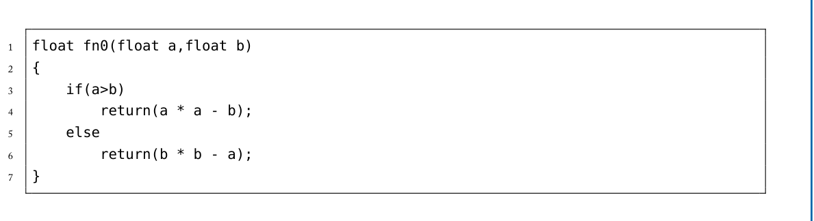

**图 2.6**：OpenCL 代码（基于 AMD [2012] 中的图 2.2）。

```asm
1 // 寄存器 r0 存放 ”a”，r1 存放 ”b”
2 // 返回值放在 r2 中
3 v_cmp_gt_f32 r0, r1 // a>b
4 s_mov_b64 s0, exec // 保存当前 exec 掩码
5 s_and_b64 exec, vcc, exec // 执行 ”if”
6 s_cbranch_vccz label0 // 若所有 lane 都不满足则跳转
7 v_mul_f32 r2, r0, r0 // result = a * a
8 v_sub_f32 r2, r2, r1 // result = result - b
9 label0:
10 s_not_b64 exec, exec // 执行 ”else”
```

**图 2.7**：Southern Islands（Graphics Core Next）微码（基于 AMD [2012] 中的图 2.2）。

```asm
11 s_and_b64 exec, s0, exec // 执行 else 分支
12 s_cbranch_execz label1 // 若所有 lane 均不满足条件则跳转
13 v_mul_f32 r2, r1, r1 // result = b * b
14 v_sub_f32 r2, r2, r0 // result = result - a
15 label1:
16 s_mov_b64 exec, s0 // 恢复 exec 掩码
```

AMD 的 GCN 硬件指令集手册 [AMD, 2012] 为理解 AMD GPU 硬件提供了许多有价值的见解。例如，为了能够解决长延迟操作的数据相关性问题，AMD 的 GCN 体系结构引入了 S_WAITCNT 指令。每个波前（wavefront）都有三个计数器：向量访存计数、局部/全局数据存储计数，以及寄存器导出计数。每个计数器都表示某一类型尚未完成的操作数量。编译器或程序员插入 S_WAITCNT 指令，让波前一直等待，直到未完成操作的数量降到指定阈值以下。

---

# 第 3 章　SIMT 核心：指令与寄存器数据流

在本章及下一章中，我们将考察现代 GPU 的体系结构与微架构。我们把对 GPU 体系结构的讨论分为两部分：(1) 在本章考察实现计算的 SIMT 核心；(2) 在下一章考察存储系统。

在其传统的图形渲染角色中，GPU 所访问的数据集（例如精细的纹理贴图）往往大到无法全部缓存在片上。为了获得高性能的可编程性——这在图形领域既有助于在图形模式数量不断增加时降低验证成本，也有助于游戏开发者更容易地实现产品差异化 [Lindholm et al., 2001]——就必须采用一种能够维持大容量片外带宽的体系结构。因此，当今的 GPU 会并发执行数万个线程。虽然分摊到每个线程的片上存储容量很小，但缓存仍能有效减少相当数量的片外访存。例如，在图形工作负载中，相邻像素操作之间存在显著的空间局部性，可以被片上缓存捕获。

图 3.1 展示了本章所讨论的 GPU 流水线的微架构。该图给出了图 1.2 中单个 SIMT 核心的内部组织。该流水线可分为 SIMT 前端与 SIMD 后端。流水线由三个协同作用于同一条流水线的调度“循环”构成：取指循环、指令发射循环和寄存器访问调度循环。取指循环包括标有 Fetch、I-Cache、Decode 和 I-Buffer 的模块。指令发射循环包括标有 I-Buffer、Scoreboard、Issue 和 SIMT Stack 的模块。寄存器访问调度循环包括标有 Operand Collector、ALU 和 Memory 的模块。在本章余下的部分中，我们将结合依赖于这些循环的体系结构关键方面，帮助你完整理解图中各个模块。

由于完整理解这一组织涉及许多细节，我们分几部分进行讨论。我们安排这些内容的目的是逐步建立对核心微架构越来越细致的认识。我们先给出整体 GPU 流水线的高层视图，然后再补充细节。我们之所以把这些越来越精确的描述称为“近似”，是因为即便我们最详细的描述也省略了某些细节。由于当今 GPU 的核心组织原则是多线程，我们围绕上述三个调度循环来组织这些“近似”。

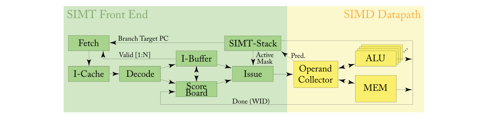

**图 3.1**：通用 GPGPU 核心的微架构。

我们发现，把本章按三个逐步精确的“近似循环”来组织是方便的，这些循环逐步把上述调度器循环的细节纳入考虑。

## 3.1 一层循环近似

我们首先考虑只有一个调度器的 GPU。这种对硬件的简化看法，与人们只读了 CUDA 编程手册中的硬件描述后所预期硬件会做的事情相差不大。

为提高效率，NVIDIA 把线程组织成称为“线程束”（warp）的组，AMD 则称为“波前”（wavefront）。因此，调度的单位是线程束。每个周期，硬件选择一个线程束进行调度。在一层循环近似中，用线程束的程序计数器访问指令存储器，以找出该线程束下一条要执行的指令。取出一条指令后，对该指令进行译码，并从寄存器堆中读取源操作数寄存器。在从寄存器堆读取源操作数的同时，确定 SIMT 执行屏蔽的取值。下一小节描述 SIMT 执行屏蔽的取值是如何确定的，并将其与现代 GPU 中同样采用的谓词执行进行对比。

当执行屏蔽和源寄存器都就绪后，执行便以单指令多数据的方式进行。只要 SIMT 执行屏蔽置位，每个线程就在与某个 lane 相对应的功能单元上执行。与现代 CPU 设计一样，功能单元通常是异构的，即某个功能单元只支持指令的一个子集。例如，NVIDIA GPU 含有*特殊功能单元*（SFU）、*加载/存储单元*、*浮点功能单元*、*整数功能单元*，并且自 Volta 起还含有 *Tensor Core*。

所有功能单元名义上都含有与一个线程束内线程数一样多的 lane。然而，若干 GPU 采用了另一种实现方式：单个线程束或波前要分几个时钟周期才能执行完。这是通过以更高的频率为功能单元提供时钟来实现的，这样就能以增加能耗为代价获得更高的单位面积性能。提高功能单元时钟频率的一种方法是将其执行过程流水化，或增加其流水线深度。

### 3.1.1 SIMT 执行屏蔽

现代 GPU 的一个关键特性是 SIMT 执行模型。从功能（尽管不是性能）的角度看，该模型向程序员呈现的抽象是：各个线程完全独立地执行。这种编程模型原则上可以仅靠谓词执行来实现。然而，在当前的 GPU 中，它是通过把传统谓词执行与一叠谓词屏蔽（我们把这一叠谓词屏蔽称为 *SIMT 栈*）结合起来实现的。

SIMT 栈有助于高效地处理两类关键问题，这两类问题都出现在所有线程均可独立执行的情形下。第一类是嵌套控制流。在嵌套控制流中，一个分支控制依赖于另一个分支。第二类是在线程束中所有线程都避开某条控制流路径时完全跳过相应的计算。对于复杂的控制流，这可以带来可观的节省。传统上，支持谓词执行的中央处理器（CPU）通过使用多个谓词寄存器来处理嵌套控制流；此外，文献中还提出了支持跨 lane 谓词测试的方案。

图形处理器（GPU）所采用的 SIMT 栈既能处理嵌套控制流，也能跳过计算。专利和指令集手册中描述了若干种实现。在这些描述中，SIMT 栈至少部分由专门为此目的设计的特殊指令来管理。这里我们改为介绍一项学术工作中提出的略有简化的版本，该版本假定由硬件负责管理 SIMT 栈。

为描述 SIMT 栈，我们使用一个示例。图 3.2 给出了一段 CUDA C 代码，其中包含嵌套在 do-while 循环内的两个分支；图 3.3 给出了对应的 PTX 汇编。图 3.4 复现了 Fung 等人 [Fung et al., 2007] 的图 5，它展示了在假定每个线程束有四个线程的 GPU 上，这段代码如何与 SIMT 栈交互。

图 3.4a 给出了与图 3.2 和图 3.3 中代码相对应的控制流图（CFG）。如 CFG 顶部节点内标注的“A/1111”所示，起初线程束中的全部四个线程都在执行基本块 A 中的代码，该基本块对应图 3.2 中第 2 行至第 6 行以及图 3.3 中第 1 行至第 6 行的代码。在执行图 3.3 第 6 行的分支（对应图 3.2 第 6 行的“if”语句）之后，这四个线程走上了不同（发散）的控制流。具体而言，如图 3.4a 中标注“B/1110”所示，前三个线程未跳转，落入基本块 B，即图 3.3 的第 7 行（图 3.2 的第 7 行）。如图 3.4a 中标注“F/0001”所示，执行该分支后第四个线程跳转到基本块 F，它对应图 3.3 的第 14 行（图 3.2 的第 14 行）。

类似地，当在基本块 B 中执行的那三个线程到达图 3.3 第 9 行的分支时，第一个线程发散到基本块 C，而第二、第三个线程发散到基本块 D。之后，这三个线程都到达基本块 E，并如图 3.4a 中标注“E/1110”所示一起执行。在基本块 G 处，全部四个线程一起执行。

在一个周期只允许执行一条指令的 SIMD 数据通路上，GPU 硬件如何让同一线程束内的线程沿代码中的不同路径执行？

**图 3.2**：用于说明 SIMT 栈操作的 CUDA C 示例代码。

```c
1 do {
2 t1 = tid*N; // A
3 t2 = t1 + i;
4 t3 = data1[t2];
5 t4 = 0;
6 if( t3 != t4 ) {
7 t5 = data2[t2]; // B
8 if( t5 != t4 ) {
9 x += 1; // C
10 } else {
11 y += 2; // D
12 }
13 } else {
14 z += 3; // F
15 }
16 i++; // G
17 } while( i < N );
```

**图 3.3**：用于说明 SIMT 栈操作的 PTX 汇编示例代码。

```ptx
1 A: mul.lo.u32 t1, tid, N;
2 add.u32 t2, t1, i;
3 ld.global.u32 t3, [t2];
4 mov.u32 t4, 0;
5 setp.eq.u32 p1, t3, t4;
6 @p1 bra F;
7 B: ld.global.u32 t5, [t2];
8 setp.eq.u32 p2, t5, t4;
9 @p2 bra D;
10 C: add.u32 x, x, 1;
11 bra E;
12 D: add.u32 y, y, 2;
13 E: bra G;
14 F: add.u32 z, z, 3;
15 G: add.u32 i, i, 1;
16 setp.le.u32 p3, i, N;
17 @p3 bra A;
```

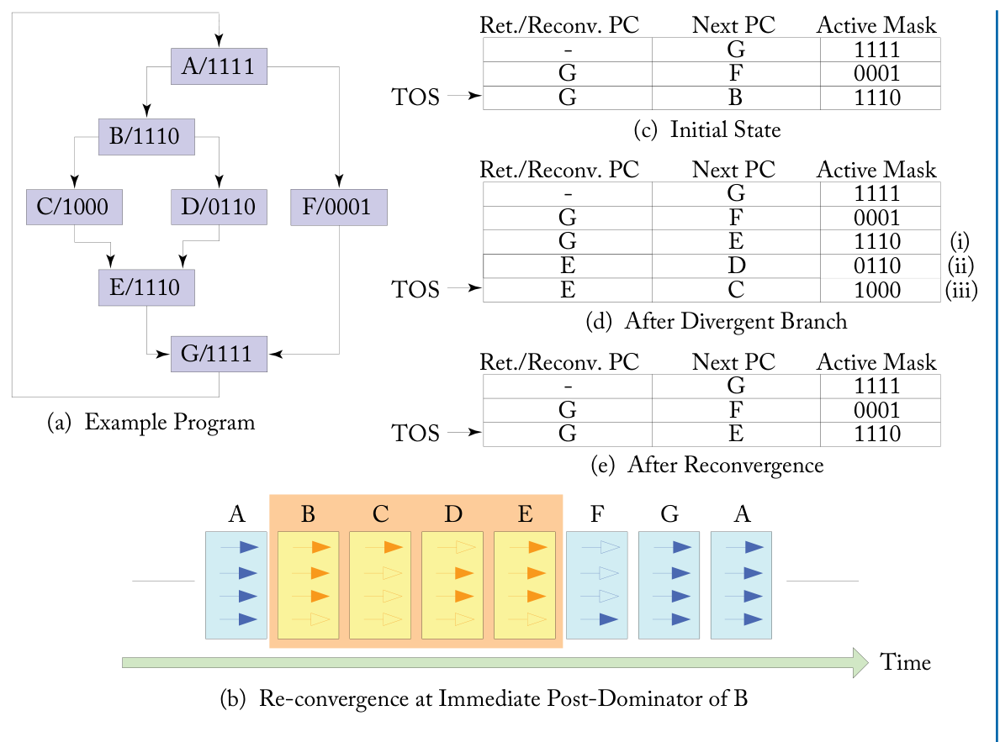

**图 3.4**：SIMT 栈操作示例（基于 Fung 等人 [2007] 的图 5）。

当前 GPU 采用的做法，是把同一线程束内沿不同路径执行的线程串行化。图 3.4b 示出了这一点，其中箭头代表线程。实心箭头表示该线程正在执行对应基本块（由每个矩形上方的字母标出）中的代码。空心箭头表示该线程被屏蔽。图中时间向右推进，如图底部的箭头所示。起初，每个线程都在基本块 B 中执行。随后，在执行分支之后，前三个线程执行基本块 B 中的代码。注意此时第四个线程被屏蔽。为维持 SIMD 执行，第四个线程在另一时刻（本例中为若干周期之后）执行经由基本块 F 的那条代码路径。

要实现发散代码路径的这种串行化，一种方法是使用图 3.4c–e 所示的那种栈。该栈的每个栈项包含三项内容：重汇聚程序计数器（RPC）、下一条待执行指令的地址（Next PC）以及活跃掩码（active mask）。

图 3.4c 示出了线程束执行完图 3.3 第 6 行分支之后紧接着的栈状态。由于三个线程分支到基本块 B、一个线程分支到基本块 F，栈顶（TOS）新增了两个栈项。线程束下一条要执行的指令由栈顶（TOS）栈项中的 Next PC 值决定。在图 3.4c 中，该 Next PC 值为 B，即基本块 B 中第一条指令的地址。与之对应的活跃掩码项“1110”表明，只有线程束中的前三个线程应当执行这条指令。

线程束中的前三个线程继续执行基本块 B 中的指令，直到它们到达图 3.3 第 9 行的分支。如前面所述，执行这条分支之后它们便发生发散。这次分支发散给栈带来三处变化。第一，执行该分支之前栈顶（TOS）栈项中的 Next PC 字段（图 3.4d 中标注为 (i)）被改为该分支的*重汇聚点*，即基本块 E 中第一条指令的地址。随后，图 3.4d 中标注为 (ii) 和 (iii) 的两个栈项被压入栈，执行该分支后线程束中线程所走的每一条路径各对应其中一个栈项。

重汇聚点是程序中的一个位置，发散的线程可以在该处被强制恢复为同步（lock-step）执行。一般倾向于选择最近的重汇聚点。在给定的一次程序执行中，编译期能够保证发散线程重新同步执行的最早位置，是导致该分支发散的那条分支语句的直接后支配节点（immediate post-dominator）。在运行时，有时可以在程序中更早的位置实现重汇聚 [Coon and Lindholm, 2008, Diamos et al., 2011, Fung and Aamodt, 2011]。

一个有趣的问题是：“在一条发散分支之后，应该按什么顺序把栈项压入栈？”为使重汇聚栈的最大深度随线程束中的线程数呈对数增长，最好先压入活跃线程数最多的栈项，再压入活跃线程较少的栈项 [AMD, 2012]。图 3.4d 遵循这一顺序，而图 3.4c 采用的是相反的顺序。

### 3.1.2 SIMT 死锁与无栈 SIMT 架构

最近，NVIDIA 公布了其即将推出的 Volta GPU 体系结构的细节 [NVIDIA Corp., 2017]。他们重点强调的一项变化涉及发散情形下屏蔽（masking）的行为，以及这种屏蔽与同步操作之间的相互作用。基于栈的 SIMT 实现可能导致一种死锁状况，ElTantawy 和 Aamodt [2016] 称之为“SIMT 死锁”。学术工作已经描述了另一种用于 SIMT 执行的硬件 [ElTantaway et al., 2014]，只需稍作修改 [ElTantawy and Aamodt, 2016]，这种硬件就能避免 SIMT 死锁。NVIDIA 将其新的线程发散管理方法称为独立线程调度（Independent Thread Scheduling）。对独立线程调度的描述表明，他们所获得的行为与上述学术方案所得到的行为类似。下面我们先描述 SIMT 死锁问题，然后描述一种避免 SIMT 死锁的机制，该机制与 NVIDIA 对独立线程调度的描述一致，并在 NVIDIA 近期的一项专利申请中公开 [Diamos et al., 2015]。

图 3.5 的左侧给出了一个说明 SIMT 死锁问题的 CUDA 示例，中间部分给出了相应的控制流图。A 行将共享变量 mutex 初始化为零，表示锁空闲。在 B 行，线程束中的每个线程都执行 atomicCAS 操作，该操作对包含 mutex 的存储单元执行比较并交换（compare-and-swap）操作。atomicCAS 是一个编译器内建函数（intrinsic），它会被翻译成一条 atom.global.cas 的 PTX 指令。从逻辑上看，比较并交换首先读取 mutex 的内容，然后将其与第二个输入 0 进行比较。如果 mutex 的当前值为 0，则比较并交换操作把 mutex 的值更新为第三个输入 1。atomicCAS 返回的值是 mutex 的原值。重要的是，比较并交换对每个线程都以原子方式执行上述逻辑操作序列。因此，同一线程束内不同线程通过 atomicCAS 对任一单个存储单元的多次访问会被串行化。由于图 3.5 中的所有线程访问同一存储单元，只有一个线程会看到 mutex 的值为 0，其余线程看到的值则为 1。接下来，回想 SIMT 栈，考虑 B 行的 while 循环在 atomicCAS 返回之后会发生什么。不同线程看到的循环条件不同。具体而言，一个线程希望退出循环，而其余线程希望留在循环中。退出循环的线程已经到达重汇聚点，因此它不再活跃于 SIMT 栈上，也就无法执行 C 行的 atomicExch 操作来释放锁。留在循环中的线程则在 SIMT 栈顶处于活跃状态，将无限自旋。由此产生的线程间循环依赖引入了一种新的死锁形式，ElTantawy 和 Aamodt [2016] 称之为 SIMT 死锁；如果这些线程在 MIMD 体系结构上执行，这种死锁根本不会存在。

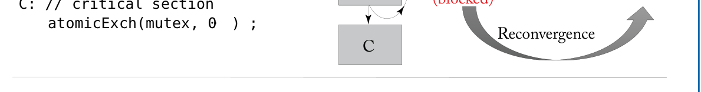

**图 3.5**：SIMT 死锁示例（基于 ElTantawy 和 Aamodt [2016] 的图 1）。

```c
A: *mutex = 0;
B: while(!atomicCAS(mutex, 0, 1));
C: // 临界区
   atomicExch(mutex, 0);
```

接下来，我们概述一种无栈的分支重汇聚机制，它与 NVIDIA 近期一项美国专利申请中的机制类似 [Diamos et al., 2015]。该机制与 NVIDIA 迄今对 Volta 重汇聚处理机制的描述相一致 [Nvidia, 2017]。其核心思想是用每线程束的汇聚屏障（convergence barrier）取代栈。图 3.6 给出了 NVIDIA 专利申请中所述按线程束维护的各个字段，图 3.8 则给出一个相应的示例来说明汇聚屏障的工作过程。实际上，该方案提供了多路径 IPDOM（Multi-Path IPDOM）的另一种实现 [ElTantaway et al., 2014]，我们将在 3.4.2 节中结合更早的学术工作对它加以介绍。汇聚屏障机制与 Fung 和 Aamodt [2011] 所述的*线程束屏障*（warp barrier）概念有一些相似之处。为便于下面解释汇聚屏障机制，我们考察单个线程束在图 3.8 代码上的执行过程，该图给出了由图 3.7 所示那样的 CUDA 代码所生成的控制流图。

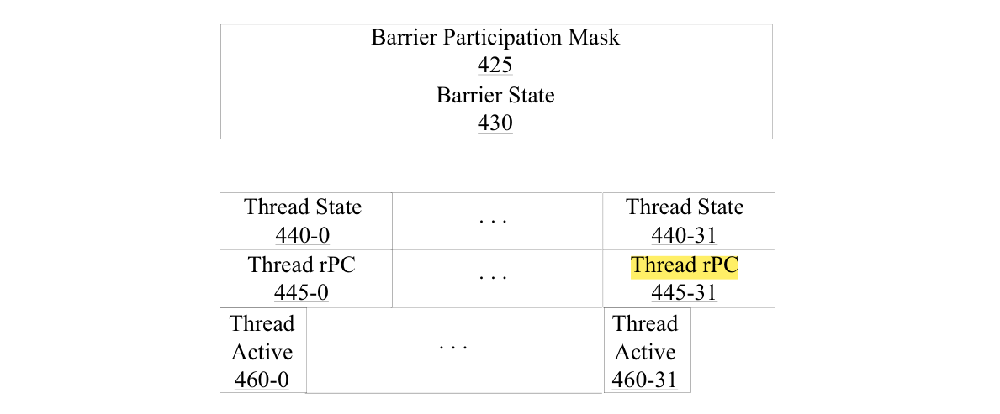

**图 3.6**：NVIDIA 近期描述的另一种基于无栈汇聚屏障的分支发散处理机制（基于 Diamos 等人 [2015] 的图 4B）。

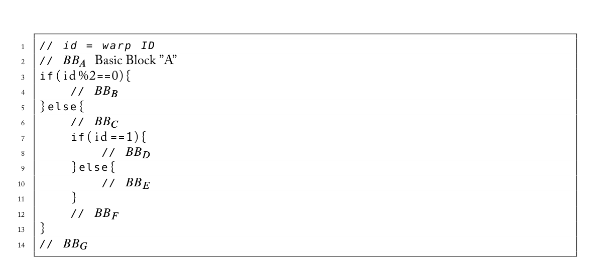

**图 3.7**：嵌套控制流示例（基于 ElTantaway 等人 [2014] 的图 6(a)）。

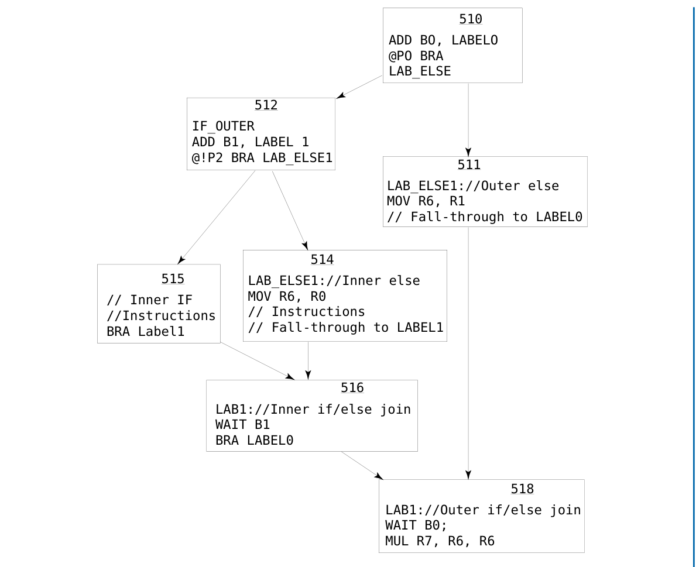

**图 3.8**：NVIDIA 近期描述的汇聚屏障分支发散处理机制的代码示例（基于 Diamos 等人 [2015] 的图 5B）。

接下来，我们介绍图 3.6 中的各个字段。这些字段保存在寄存器中，由硬件线程束调度器使用。每个*屏障参与掩码*（Barrier Participation Mask）用于跟踪给定线程束内哪些线程参与某个给定的汇聚屏障。一个线程束可能有多个屏障参与掩码。通常情况下，由某个屏障参与掩码所跟踪的线程会相互等待，以便在发散分支之后到达程序中的同一个点，从而一起重汇聚。为支持这一点，*屏障状态*（Barrier State）字段用于跟踪哪些线程已经到达某个给定的汇聚屏障。*线程状态*（Thread State）字段为线程束中的每个线程跟踪：该线程是已就绪可执行、已阻塞在某个汇聚屏障处（若如此，是哪一个屏障），还是已经让出。看起来，让出状态可能用于在否则会导致 SIMT 死锁的情形下，让线程束中的其他线程越过该汇聚屏障继续向前推进。Thread rPC 字段为每个非活跃线程记录下一条待执行指令的地址。Thread Active 字段是一个比特，指示线程束中对应的线程是否活跃。

假设一个线程束包含 32 个线程，则屏障参与掩码为 32 位宽。若某位被置位，即表示线程束中对应的线程参与该汇聚屏障。线程在执行分支指令时发生发散，例如图 3.8 中基本块 510 和 512 末尾的那些分支指令。这些分支对应于图 3.7 中的两个“if”语句。线程束调度器利用屏障参与掩码，在特定的汇聚屏障位置把线程停下，该位置可以是分支的直接后支配节点（immediate post-dominator），也可以是其他位置。在任一时刻，每个线程束都可能需要多个屏障参与掩码，以支持嵌套的控制流结构，如图 3.7 中的嵌套 if 语句。图 3.6 中的寄存器既可以用通用寄存器实现，也可以用专用寄存器实现，还可以用两者的某种组合实现（专利申请中并未说明）。由于屏障参与掩码只有 32 位宽，如果每个线程都持有一份屏障参与掩码副本——若天真地用通用寄存器堆来存放，就会出现这种情况——那将是冗余的。然而，由于控制流可以任意深度地嵌套，一个给定的线程束可能需要任意数量的屏障参与掩码，因此由软件来管理这些掩码是可取的。

为初始化汇聚屏障参与掩码，采用了一条特殊的“ADD”指令。当线程束执行这条 ADD 指令时，所有活跃线程在该 ADD 指令所指示的汇聚屏障中对应的位都被置位。执行分支之后，某些线程可能发散，这意味着它们下一条待执行指令的地址（即 PC）将各不相同。出现这种情况时，调度器会选取具有相同 PC 的一部分线程，并更新 Thread Active 字段，使线程束中的这些线程得以执行。学术界的方案把这样一部分线程称为“线程束分裂”（warp split）[ElTantaway et al., 2014, ElTantawy and Aamodt, 2016, Meng et al., 2010]。与基于栈的 SIMT 实现相比，在采用汇聚屏障的实现中，调度器可以自由地在各组已发散线程之间切换。这样，当线程束中某些线程已获得锁而另一些尚未获得时，线程之间仍能向前推进。

“WAIT”指令用于在某个线程束分裂到达汇聚屏障时将其停下。如 NVIDIA 的专利申请所述，WAIT 指令带有一个操作数，用于指明汇聚屏障的标识。WAIT 指令的作用是把该线程束分裂中的线程加入该屏障的 Barrier State 寄存器，并把这些线程的状态改为阻塞。一旦屏障参与掩码中的所有线程都执行了相应的 WAIT 指令，线程调度器就可以把原先那个线程束分裂中的所有线程切换为活跃，从而维持 SIMD 效率。图 3.8 的例子中有两个汇聚屏障 B1 和 B2，其 WAIT 指令分别位于基本块 516 和 518 中。为支持在线程束分裂之间切换，NVIDIA 描述了使用 YIELD 指令，以及其他一些细节（例如对间接分支的支持），这些我们在本讨论中略过 [Diamos et al., 2015]。

图 3.9 给出了基于栈的重汇聚时序示例，图 3.10 则展示了按 NVIDIA Volta 白皮书所述采用独立线程调度时可能出现的时序。在图 3.10 中可以看到，Volta 把语句 A、B 与语句 X、Y 交错执行，这与图 3.9 中的行为形成对照。这种行为与上文所述的汇聚屏障机制（以及 Multi-Path IPDOM [ElTantaway et al., 2014]）相一致。最后，图 3.11 说明了无栈体系结构可以如何执行图 3.5 中的自旋锁代码，从而避免 SIMT 死锁。

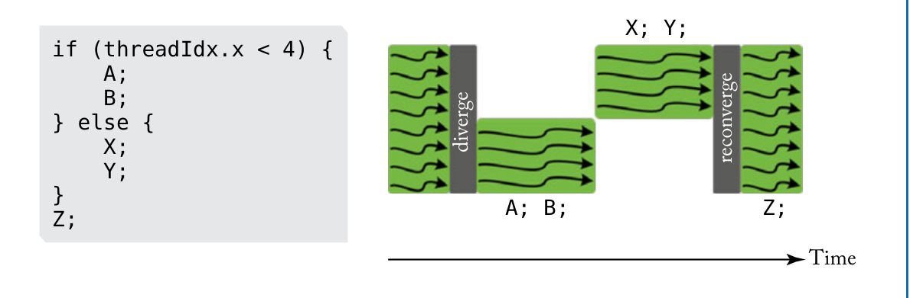

**图 3.9**：基于栈的重汇聚行为示例（基于图 20）。

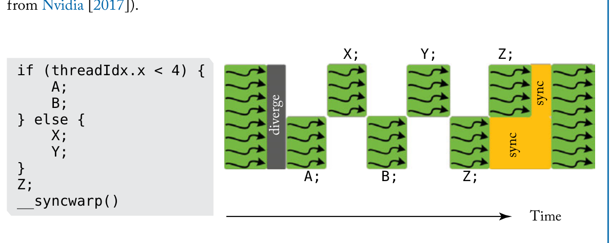

**图 3.10**：Volta 重汇聚行为示例（基于 Nvidia [2017] 的图 23）。

### 3.1.3 线程束调度

GPU 中的每个核心都驻留大量线程束。一个很有意思的问题是：这些线程束应当按什么顺序调度。为简化讨论，我们假设每个线程束在被调度时只发射一条指令，并且在第一条指令执行完成之前，该线程束不能再发射另一条指令。本章稍后将重新讨论这一假设。

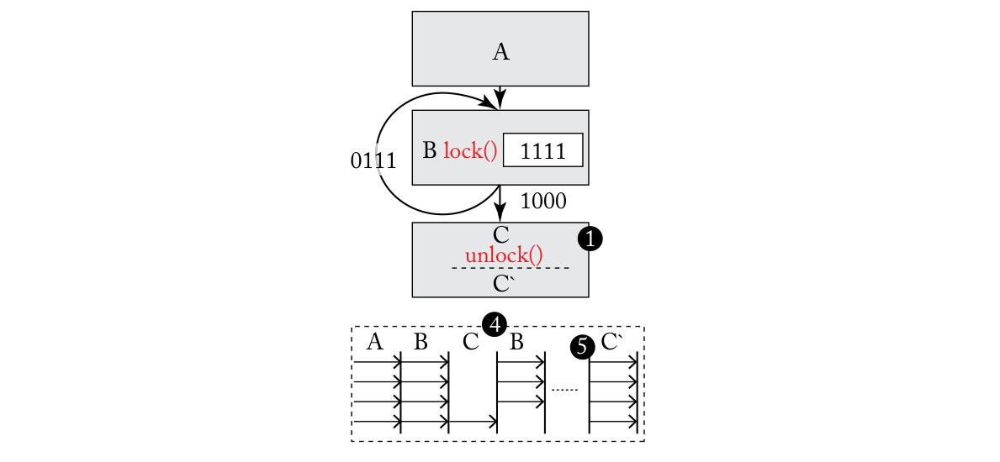

**图 3.11**：一种类似汇聚屏障的学术机制在图 3.5 自旋锁代码上的行为示例（基于 ElTantawy 与 Aamodt [2016] 的图 6(a)）。

如果存储系统是“理想”的，即在某个固定延迟内响应访存请求，那么从理论上说，就可以把核心设计成支持足够多的线程束，用细粒度多线程来隐藏这一延迟。在这种情况下可以论证：对于给定的吞吐率，按“轮转”（round robin）顺序调度线程束能够减小芯片面积。在轮转调度中，各线程束有一个固定的顺序，例如按线程标识符递增排序，调度器按此顺序选择线程束。这种调度顺序的一个特点是，它让每条已发射的指令都有大致相等的时间来完成执行。如果核心中线程束的数量乘以每个线程束的发射时间超过存储延迟，核心中的执行单元就会始终处于忙碌状态。因此，在这一限度之内增加线程束数量，原则上可以提高每个核心的吞吐率。

然而，这里存在一个重要的权衡：要让不同的线程束在每个周期都能发射指令，每个线程必须拥有自己的寄存器（这样就不必在寄存器与存储器之间复制和恢复寄存器状态）。因此，增加每个核心的线程束数量，会使芯片面积中用于寄存器堆存储的比例相对于用于执行单元的比例上升。在芯片面积固定的情况下，增加每个核心的线程束数会减少每块芯片上的核心总数。

在实践中，存储器的响应延迟取决于应用的局部性特征，以及片外访存所遭遇的争用程度。在考虑 GPU 的存储系统时，调度会起什么作用？过去几年里这一直是大量研究的主题，等我们在 GPU 微架构模型中加入更多存储系统细节之后，会再回到这个问题。不过简而言之，局部性特征既可能有利于、也可能不利于轮转调度：当不同线程在执行过程的相近时点共享数据时——例如在图形像素着色器中访问纹理贴图时——让各线程取得相同进展是有益的，因为这样可以增加在片上缓存中“命中”的访存次数，而轮转调度正有助于此 [Lindholm et al., 2015]。类似地，当时间上相近的访问落在地址空间中相近的位置时，访问 DRAM 的效率更高，这同样受到轮转调度的促进 [Narasiman et al., 2011]。另一方面，当各线程大多访问互不相交的数据时（在较复杂的数据结构中往往如此），反复调度同一个线程以最大化局部性可能是有益的 [Rogers et al., 2012]。

## 3.2 两层循环近似

为了帮助减少每个核心为隐藏长执行延迟而必须支持的线程束数量，最好能在某个线程束此前的指令尚未完成时，就发射该线程束的后续指令。然而，前面介绍的一层循环微架构无法做到这一点，因为该设计中的调度逻辑只能看到线程标识符和下一条待发射指令的地址。具体来说，它并不知道该线程束下一条要发射的指令是否依赖于一条尚未执行完成的更早指令。要提供这种相关性信息，就必须先从存储器取出指令，以确定存在哪些数据冒险和/或结构冒险。为此，GPU 实现了指令缓冲，指令在访问缓存之后被放入其中。另有一个独立的调度器负责决定：指令缓冲中的若干条指令里，下一条应当发射哪一条送往流水线的其余部分。

指令存储器实现为一级指令缓存，并由一级或多级二级缓存（通常是统一缓存）作为后备。指令缓冲与指令缺失状态处理寄存器（MSHR）配合，还有助于隐藏指令缓存缺失的延迟 [Kroft, 1981]。在缓存命中或缺失后完成填充之后，指令信息被放入指令缓冲。指令缓冲的组织形式可以多种多样。一种特别直接的做法是为每个线程束设置一条或多条指令的存储空间。

接下来，我们考虑如何检测同一线程束内指令之间的数据相关性。在传统 CPU 架构中，检测指令间相关性有两种传统方法：记分牌和保留站。保留站用于消除名字相关，但需要引入关联逻辑，这在面积和能耗上代价高昂。记分牌既可以设计成支持顺序执行，也可以支持乱序执行。支持乱序执行的记分牌（如 CDC 6600 中所用的那种）也相当复杂。另一方面，单线程顺序 CPU 的记分牌非常简单：每个寄存器在记分牌中用一位表示，只要有指令发射并将要写入该寄存器，这一位就被置位。任何想要读或写某个寄存器的指令，只要该寄存器对应的位已被置位，就会被停顿，直到写该寄存器的指令清除该位。这样就能同时避免写后读（read-after-write）和写后写（write-after-write）冒险。当与顺序发射相结合时，只要对寄存器堆的读取被约束为按序发生（顺序 CPU 设计中通常如此），这种简单的记分牌就能避免读后写（write-after-read）冒险。由于这是最简单的设计，因而消耗的面积和能耗最少，所以 GPU 采用顺序记分牌。不过，正如下文将要讨论的，在支持多个线程束时使用顺序记分牌会面临一些挑战。

上文所述的简单顺序记分牌设计所面临的第一个问题，是现代 GPU 中寄存器的数量非常庞大。每个线程束最多有 128 个寄存器，每个核心最多有 64 个线程束，因此实现记分牌在每个核心上总共需要 8192 位。

这种简单顺序记分牌设计的另一个问题是，遇到相关性的指令必须反复在记分牌中查询其操作数，直到它所依赖的先前指令把结果写入寄存器堆。在单线程设计中，这几乎不会带来什么复杂性。然而，在顺序发射的多线程处理器中，来自多个线程的指令可能都在等待更早的指令完成。如果所有这类指令都必须探测记分牌，那就需要额外的读端口。近期的 GPU 每个核心支持多达 64 个线程束，而每条指令最多可有 4 个操作数，若允许所有线程束每个周期都探测记分牌，就需要 256 个读端口，代价将非常高昂。一种替代做法是限制每个周期能够探测记分牌的线程束数量，但这同时限制了可供调度考虑的线程束数量。此外，如果所检查的指令中没有任何一条不存在相关性，那么即使其他未被检查的指令恰好不存在相关性，也可能一条指令都无法发射。

这两个问题都可以用 Coon 等人 [2008] 提出的一种设计来解决。该设计不为每个线程束的每个寄存器保存一位，而是为每个线程束设置少量表项（近期一项研究估计约为 3 项或 4 项 [Lashgar et al., 2016]），每个表项是一个寄存器的标识符，该寄存器将由某条已经发射但尚未执行完成的指令写入。常规的顺序记分牌在指令发射时和写回时都会被访问；而 Coon 等人的记分牌则是在指令被放入指令缓冲时，以及指令把结果写入寄存器堆时被访问。

当一条指令从指令缓存中取出并放入指令缓冲时，会把对应线程束的各记分牌表项与该指令的源寄存器和目的寄存器进行比较。这样会得到一个很短的位向量，其中每一位对应该线程束在记分牌中的一个表项（例如 3 位或 4 位）。如果记分牌中相应的表项与该指令的任一操作数相匹配，就把该位置 1。随后，这个位向量会被复制到指令缓冲中该指令的旁边。只有当所有位都被清零时，这条指令才有资格被指令调度器考虑，而这一点可以通过把向量的每一位送入一个或非门来判断。当指令把结果写入寄存器堆时，指令缓冲中的相关性位就被清零。如果某个线程束的所有表项都已用完，那么要么所有线程束的取指都停顿，要么该指令被丢弃并必须重新取指。当一条已执行完的指令准备写入寄存器堆时，它清空记分牌中分配给自己的表项，同时清空指令缓冲中来自同一线程束的任何指令的相应相关性位。

在两层循环架构中，第一个循环选择一个在指令缓冲中尚有空间的线程束，查找其程序计数器，并访问指令缓存以取得下一条指令。第二个循环则在指令缓冲中选择一条没有未决相关性的指令，把它发射到执行单元。

## 3.3 三层循环近似

如前所述，要隐藏较长的访存延迟，就必须在每个核心中支持大量线程束；而要支持线程束之间的逐周期切换，就必须有一个大型寄存器堆，为每个正在执行的线程束保存各自独立的物理寄存器。例如，在 NVIDIA 近期的 GPU 架构（如 Kepler、Maxwell 和 Pascal 架构）上，这样的寄存器堆容量达 256 KB。另一方面，SRAM 的面积与端口数量成正比。寄存器堆的朴素实现要求每个周期发射的每条指令的每个操作数都有一个端口。减小寄存器堆面积的一种方法是，用多个单端口 bank（存储体）来模拟大量端口。虽然可以通过把这些 bank 暴露给指令集体系结构来达到这一效果，但在某些 GPU 设计中，似乎是用一种称为操作数收集器的结构 [Coon et al., 2009, Lindholm et al., 2008b, Lui et al., 2008] 以更透明的方式实现这一点。如下文所述，操作数收集器实际上构成了第三个调度循环。

为了更好地理解操作数收集器所解决的问题，请先看图 3.12，它给出了一种用于提高寄存器堆带宽的朴素微架构。该图展示了 GPU 指令流水线的寄存器读级，其中寄存器堆由四个单端口逻辑 bank 组成。实际上，由于寄存器堆非常庞大，每个逻辑 bank 还可能进一步分解为更多物理 bank（图中未画出）。这些逻辑 bank 通过一个交叉开关连接到暂存寄存器（图中标注为 “pipeline register”），后者在把源操作数送往 SIMD 执行单元之前对其进行缓冲。由仲裁器控制对各 bank 的访问，并把结果经交叉开关送到相应的暂存寄存器。

图 3.13 给出了每个线程束的寄存器到逻辑 bank 的一种朴素布局。在该图中，线程束 0（w0）的寄存器 r0 存放在 Bank 0 的第一个位置，线程束 0 的寄存器 r1 存放在 Bank 1 的第一个位置，依此类推。如果计算所需的寄存器数量多于逻辑 bank 的数量，分配就会回绕。例如，线程束 0 的寄存器 r4 存放在 Bank 0 的第二个位置。

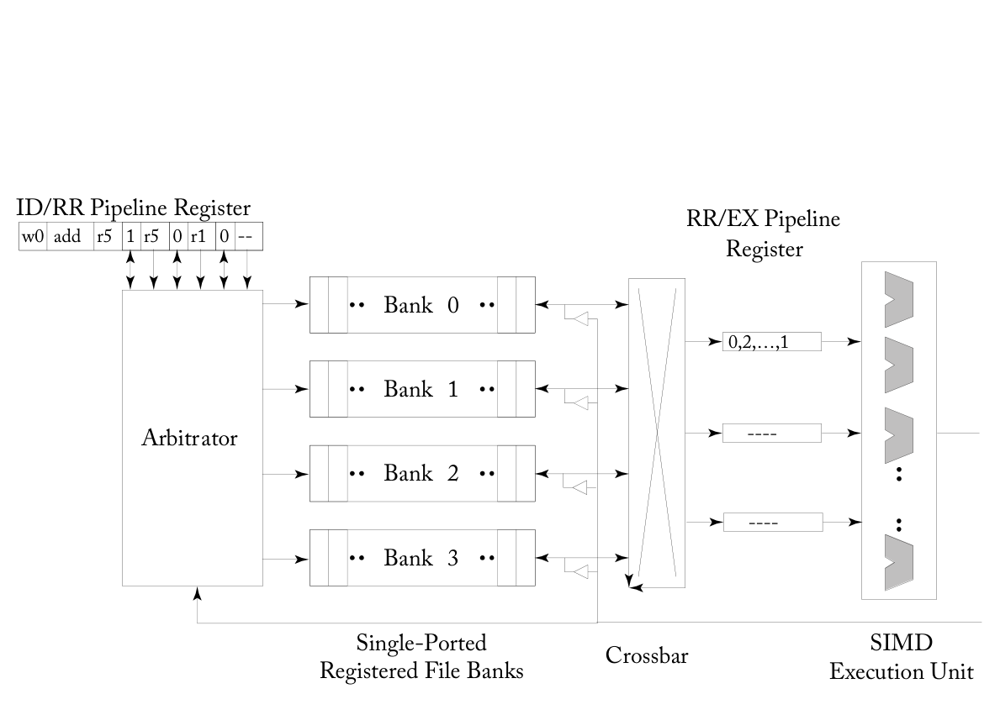

**图 3.12**：朴素的分 bank 寄存器堆微架构。


**图 3.13**：朴素的分 bank 寄存器布局。

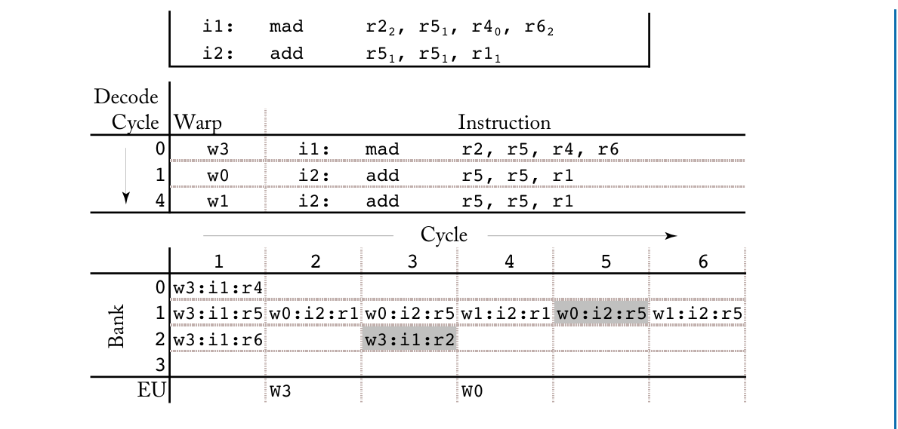

**图 3.14**：朴素分 bank 寄存器堆的时序。

图 3.14 给出一个时序示例，用以说明这种微架构可能如何损害性能。该示例涉及图的上部所示的两条指令。第一条指令 i1 是一条乘加运算，它读取分别分配在 bank 1、bank 0 和 bank 2 中的寄存器 r5、r4 和 r6（图中以下标标出）。第二条指令 i2 是一条加法指令，它读取均分配在 bank 1 中的寄存器 r5 和 r1。图的中部给出了指令发射的顺序。在第 0 周期，线程束 3 发射指令 i1；在第 1 周期，线程束 0 发射指令 i2；在第 4 周期，线程束 1 在因下述 bank 冲突而延迟之后发射指令 i2。图的底部说明了不同指令对不同 bank 的访问时序。在第 1 周期，来自线程束 3 的指令 i1 能够在第 1 周期读取其全部三个源寄存器，因为它们映射到不同的逻辑 bank。然而在第 2 周期，来自线程束 0 的指令 i2 只能读取其两个源寄存器中的一个，因为二者都映射到 bank 1。在第 3 周期，该指令的第二个源寄存器与线程束 3 指令 i1 的写回并行读出。在第 4 周期，来自线程束 1 的指令 i2 能够读取其第一源操作数，但读不了第二个，因为二者又一次都映射到 bank 1。在第 5 周期，来自线程束 1 的指令 i2 的第二个源操作数无法从寄存器堆中读出，原因在于该 bank 已被更早由线程束 0 发射的指令 i2 的更高优先级写回占用。最后，在第 6 周期，线程束 1 的 i2 的第二个源操作数从寄存器堆中读出。总之，三条指令完成源寄存器读取共需六个周期，而在这段时间内许多 bank 并未被访问。

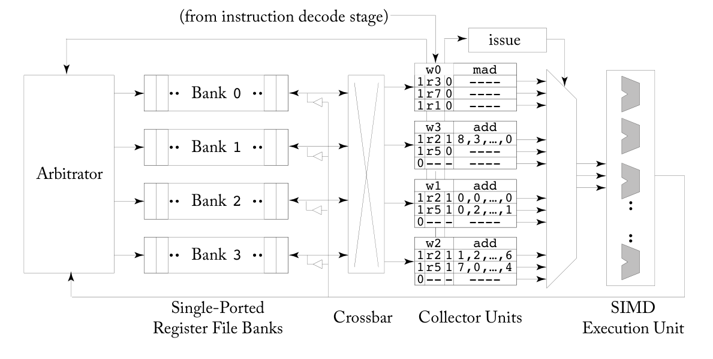

**图 3.15**：操作数收集器微架构（基于 Tor M. Aamodt 等人的图 6）。

### 3.3.1 操作数收集器

操作数收集器微架构 [Lindholm et al., 2008b] 如图 3.15 所示。关键的变化在于，暂存寄存器（staging register）被替换为*收集器单元*。每条指令在进入寄存器读取级时都会被分配一个收集器单元。由于存在多个收集器单元，多条指令可以重叠地读取源操作数，这在各条指令自身的源操作数之间存在 bank 冲突时有助于提高吞吐率。每个收集器单元都包含用于执行一条指令所需的全部源操作数的缓冲空间。由于多条指令的源操作数数量更多，仲裁器更有可能获得更高的 bank 级并行度，从而并行访问多个寄存器堆 bank。

操作数收集器通过调度来容忍已经发生的 bank 冲突。这留下了一个尚未解决的问题：如何减少 bank 冲突的数量。图 3.16 给出了 Coon 等人为帮助减少 bank 冲突而描述的一种修改后的寄存器布局。其思路是把不同线程束中的同名寄存器分配到不同的 bank。例如，在图 3.16 中，线程束 0 的寄存器 r0 分配到 bank 0，而线程束 1 的寄存器 r0 分配到 bank 1。这并未解决单条指令内部各寄存器操作数之间的 bank 冲突。但它确实有助于减少不同线程束的指令之间的 bank 冲突。尤其是在各线程束推进得相对均衡时（例如由于轮转调度，或由于两级调度 [Narasiman et al., 2011]，即同一取指组内的各个线程束按轮转顺序被调度）。


**图 3.16**：混洗式分 bank 寄存器布局。

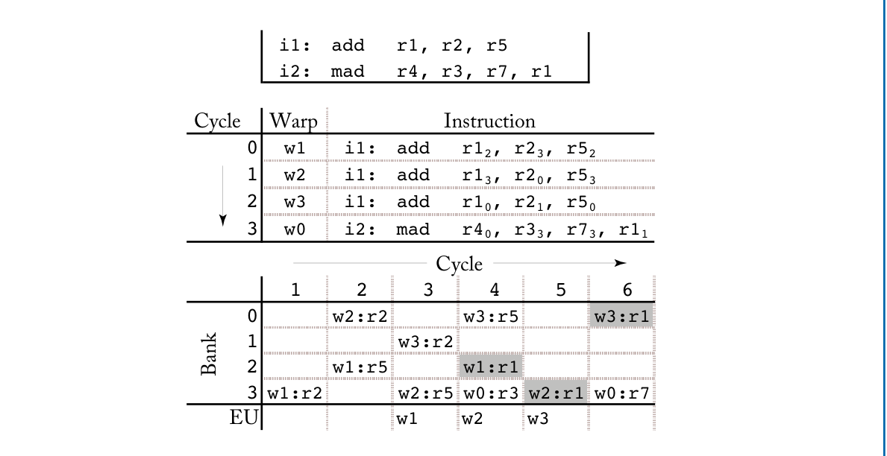

**图 3.17**：操作数收集器的时序。

图 3.17 给出一个时序示例，图的上部是一串加法与乘加指令。图的中部给出了发射顺序。来自线程束 1 至线程束 3 的三个 i1 实例分别在第 0 周期至第 2 周期发射。来自线程束 0 的指令 i2 的一个实例在第 3 周期发射。注意，加法指令写入寄存器 r1，而对任意给定的线程束而言，r1 都与源寄存器 r5 分配在同一个 bank 中。然而，与使用图 3.13 布局的情形不同，此处不同线程束访问不同的 bank，这有助于减少一个线程束的写回与其他线程束读取源操作数之间的冲突。图的底部给出了由操作数收集器引起的、bank 一级的访问时序。在第 1 周期，线程束 1 的寄存器 r2 读取 Bank 3。在第 4 周期可以看到，线程束 1 的寄存器 r1 的写回，与线程束 3 读取寄存器 r5、线程束 0 读取寄存器 r3 并行进行。

前文所述的操作数收集器有一个不易察觉的问题：由于它并不对不同的指令何时可以发射施加任何次序约束，因此可能允许写后读（write-after-read，WAR）冒险 [Mishkin et al., 2016]。如果同一线程束的两条指令同时存在于操作数收集器中，且第一条指令要读取的寄存器正是第二条指令将要写入的寄存器，就会发生这种冒险。若第一条指令的源操作数访问反复遇到 bank 冲突，第二条指令就可能在第一条指令读到（正确的）旧值之前，先把新值写入该寄存器。防止这种 WAR 冒险的一种简单办法，就是要求同一线程束的指令按程序顺序离开操作数收集器进入执行单元。Mishkin 等人 [2016] 探索了三种硬件复杂度较低的可行方案，并评估了它们的性能影响。第一种是*提交时释放线程束看板*（release-on-commit warpboard），它最多只允许每个线程束有一条指令在执行。不出所料，他们发现这会对性能产生负面影响，在某些情况下使性能降低近一半。他们的第二种方案是*读取时释放线程束看板*（release-on-read warpboard），它只允许每个线程束在同一时刻有一条指令在操作数收集器中收集操作数。在他们所研究的工作负载上，该方案至多造成 10% 的性能下降。最后，为了在操作数收集器中允许指令级并行，他们提出了一种*布隆看板*（bloomboard）机制，用一个小的布隆过滤器来跟踪尚未完成的寄存器读操作。与（错误地）允许 WAR 冒险相比，其影响不到几个百分点。另外，Gray 所做的一项分析表明，NVIDIA 的 Maxwell GPU 引入了“读依赖屏障”，它由特殊的“控制指令”管理，可用于避免某些指令的 WAR 冒险（见 2.2.1 节）。

### 3.3.2 指令重放：处理结构冒险

GPU 流水线中结构冒险的潜在成因有很多。例如，寄存器读取级可能耗尽操作数收集器单元。许多结构冒险的来源与存储系统有关，我们将在下一章更详细地讨论。一般而言，一个线程束执行的一条访存指令可能需要分解为多个独立操作。其中每个独立操作在给定周期内都可能充分利用流水线的某一部分。

当一条指令在 GPU 流水线中遇到结构冒险时会发生什么？在单线程的顺序 CPU 流水线中，一种标准做法是让较年轻的指令停顿，直到遇到停顿条件的指令能够继续推进为止。在高度多线程的吞吐率架构中，这种方法可以说并不那么可取，至少有两个原因。首先，考虑到寄存器堆规模很大，而且支持完整图形流水线需要很多流水级，分发停顿信号可能影响关键路径。而把停顿周期的分发流水化，又会需要引入额外的缓冲，从而增加面积。其次，让某个线程束的一条指令停顿，可能使其他线程束的指令也跟着在它后面停顿。如果这些指令并不需要那条引发停顿的指令所需的资源，吞吐率就会受损。

为避免这些问题，GPU 实现了一种指令重放机制。指令重放也见于某些 CPU 设计，在那里它被用作一种恢复机制：当把一条依赖指令推测性地调度到一条延迟可变的更早指令之后时，就用它来恢复。例如，加载可能在一级缓存中命中，也可能缺失，而工作频率很高的 CPU 设计可能把一级缓存的访问流水化为多达四个时钟周期。一些 CPU 会对依赖某次加载的指令进行推测性唤醒，以提高单线程性能。相比之下，GPU 避免使用推测，因为推测往往会浪费能量并降低吞吐率。相反，GPU 使用指令重放，以避免流水线堵塞，并避免因停顿而产生的电路面积和/或时序开销。

为实现指令重放，GPU 可以让指令保留在指令缓冲中，直到确知该指令已经完成，或者该指令的所有各个部分都已执行完毕 [Lindholm et al., 2015]。

## 3.4 分支发散的研究方向

*本节基于 Wilson Fung 的博士论文 [Fung, 2015]。* 理想情况下，同一线程束内的各线程沿相同的控制流路径执行，这样 GPU 就能在 SIMD 硬件上以锁步方式执行它们。然而线程具有自主性，当同一线程束内的线程在一条依赖数据的分支上分赴不同目标时，该线程束就可能出现*分支发散*。现代 GPU 包含专门的硬件来处理线程束内的分支发散。3.1.1 节介绍了基准 SIMT 栈，本书的基准 GPU 体系结构使用的正是它。基准 SIMT 栈通过串行化不同目标的执行来处理线程束内的分支发散。尽管基准 SIMT 栈对大多数现有 GPU 应用都能正确处理分支发散，但它仍有以下缺陷。

**SIMD 效率降低** 在出现分支发散时，基线 SIMT 栈会把每个分支目标的执行串行化。在执行每个目标时，SIMT 栈只激活运行该目标的那一部分标量线程。这会使 SIMD 硬件中的部分 lane 处于空闲状态，从而降低整体的*SIMD 效率*。

**不必要的串行化** 基线 SIMT 栈对每个分支目标的串行执行并不是功能正确性所必需的。GPU 编程模型并未在线程束内的标量线程之间强加任何隐式的数据依赖——它们必须通过共享存储器和屏障显式通信。GPU 可以把一个发散线程束的所有分支目标的执行交织起来，以利用 SIMD 硬件中的空闲周期。

**MIMD 抽象不充分** 基线 SIMT 栈迫使发散线程束在编译器定义的某个重汇聚点重汇聚，这就在每个重汇聚点隐式地强加了一个线程束范围的同步点。这对许多现有的 GPU 应用是有效的。然而，这种隐式同步可能会与其他用户实现的同步机制（例如细粒度锁）产生病态交互，导致线程束死锁。编译器定义的重汇聚点也没有考虑异常、中断等系统级构造所引入的控制流发散。

**面积开销** 尽管基线 SIMT 栈为每个线程束所需的面积只有 32 × 64 位（或低至 6 × 64 位），但其面积会随 GPU 中正在执行的线程束数量而增长。在分支发散很少出现的典型 GPU 应用中，SIMT 栈占用的这块面积本可以另作他用，以其他方式提升应用的吞吐率（例如更大的缓存、更多的 ALU 单元等）。

工业界和学术界都提出了替代方案来解决上述缺陷。各种方案可以归为以下几类：线程束压缩、线程束内发散路径管理、增加 MIMD 能力以及降低复杂度。有些方案所包含的改进同时体现了多个类别的特点，因此会被多次提及。

### 3.4.1 线程束压缩

由于 GPU 采用细粒度多线程来容忍长访存延迟，每个 SIMT 核心中都有许多线程束，标量线程总数可达数百到数千个。由于这些线程束通常运行同一个计算内核，它们很可能遵循相同的执行路径，并在同一组数据相关分支处遇到分支发散。因此，一个发散分支的每个目标很可能由大量线程执行，但这些线程分散在多个静态线程束中，每个线程束各自独立地处理该发散。

本节总结一系列研究，这些研究利用上述观察来改善遭受分支发散困扰的 GPU 应用的性能。这一系列方案都涉及新颖的硬件机制，把来自不同*静态线程束*的线程*压缩*进新的*动态线程束*，以提高这些发散 GPU 应用的整体 SIMD 效率。这里的静态线程束是指 GPU 硬件在内核启动生成标量线程时形成的线程束。在我们的基线 GPU 架构中，这种安排在线程束的整个执行过程中固定不变。把标量线程安排进静态线程束，是 GPU 硬件强加的一种任意分组，对编程模型而言基本上是不可见的。

**动态线程束形成。** 动态线程束形成（dynamic warp formation，DWF）[Fung et al., 2007, Fung et al., 2009] 利用这一观察，把这些执行同一条指令的分散线程重新组织成新的动态线程束。在一个发散分支处，DWF 可以把分散在多个已发散静态线程束中的线程压缩进更少的无发散动态线程束，从而提升应用的整体 SIMD 效率。这样，DWF 就能够在 SIMD 硬件上获得 MIMD 硬件相当大一部分的好处。然而，DWF 要求各线程束在一个很短的时间窗口内遇到同一个发散分支。DWF 这种依赖时序的特性使它对于线程束调度策略非常敏感。

Fung 和 Aamodt [2011] 的后续工作指出了 DWF 的两类主要性能病态：(1) 贪心调度策略可能使某些线程饥饿，导致 SIMD 效率下降；(2) DWF 中的线程重组会增加非合并访存和共享存储器 bank 冲突。这些病态使 DWF 在许多现有 GPU 应用上性能下降。此外，依赖静态线程束中隐式同步的应用在 DWF 下会执行出错。

上述病态可以通过一种改进的调度策略得到部分解决，该策略有效地把计算内核划分为两类区域：发散区域和非发散（一致）区域。发散区域从 DWF 中显著受益，而一致区域没有分支发散，却容易受到 DWF 病态的影响。我们发现，通过强制 DWF 在一致区域中把标量线程重新组织回其静态线程束，可以显著减轻 DWF 病态的影响。

**线程块压缩** 线程块压缩（thread block compaction，TBC）[Fung and Aamodt, 2011] 正是基于这一洞见提出的，其出发点是：不断地把线程重新编排成新的动态线程束并不能带来额外的收益。这种重排（即*压缩*）只需发生在发散分支之后（即发散区域的起点）、以及其重汇聚点之前（即一致区域的起点）。我们注意到，现有的每线程束 SIMT 栈（见 3.1.1 节）会在发散分支的重汇聚点处隐式地让发散到不同执行路径上的线程同步，并在执行一致区域之前把这些发散的线程重新合并回一个静态线程束。TBC 扩展了 SIMT 栈，使其涵盖在同一核心中执行的所有线程束，迫使它们在发散分支和重汇聚点处同步并压缩，从而稳定地获得 DWF 的性能收益。然而，在每一个发散分支处让一个核心内的所有线程束同步以进行压缩，会大幅减少可用的线程级并行性（TLP）。GPU 体系结构依赖充裕的 TLP 来容忍流水线延迟和存储器延迟。

TBC 在 SIMD 效率与可用 TLP 之间采取了折中：它把压缩限制为只在一个*线程块*内发生。GPU 应用通常在一个核心上并发执行多个线程块，以重叠同步延迟和存储器延迟。TBC 利用这一软件层面的优化来重叠发散分支处的压缩开销——当一个线程块中的线程束在发散分支处同步以进行压缩时，其他线程块中的线程束可以让硬件保持忙碌。TBC 把每线程束的 SIMT 栈扩展为涵盖一个线程块内的所有线程束。线程束调度逻辑利用这个线程块范围的 SIMT 栈，来决定一个线程块中的线程束应在何时同步并压缩成一组新的线程束。由此得到的机制更加稳健、也更加简单，它获得了 DWF 的大部分收益，却没有那些病态行为。

**大线程束微架构** 大线程束微架构（large warp microarchitecture，LWM）[Narasiman et al., 2011] 与 TBC 类似，也扩展 SIMT 栈，以管理一组线程束的重汇聚。但 LWM 并不把压缩限制在分支和重汇聚点处，而是要求组内的线程束以完全的锁步方式执行，以便它在每条指令处都能对组进行压缩。与 TBC 相比，这会进一步削减可用的 TLP，但使 LWM 能够对谓词执行指令以及无条件跳转进行压缩。

与 TBC 类似，LWM 把在同一核心上运行的线程束划分为多个组，并限制压缩只在组内发生。它还选择了一种更复杂的记分牌微架构，以线程为粒度跟踪寄存器依赖关系。这使得组内某些线程束可以略微领先于其他线程束执行，以补偿锁步执行所损失的 TLP。

**压缩充分性预测器** Rhu 和 Erez [2012] 用压缩充分性预测器（compaction-adequacy predictor，CAPRI）对 TBC 做了扩展。该预测器在每个分支处判断把线程压缩进少数几个线程束是否有效，并且只在预测认为压缩能够带来收益的分支处才同步线程。这就收回了 TBC 因无益的停顿与压缩而损失的 TLP。Rhu 和 Erez [2012] 还表明，一个类似于单级分支预测器的简单历史预测器就足以达到很高的准确率。

**线程束内压缩** Vaidya 等人 [2013] 提出了一种低复杂度的压缩技术，它有益于那些需要在较窄硬件单元上多周期执行的宽 SIMD 执行组。其基本做法是把单个执行组划分为多个与硬件宽度相匹配的子组。遭受发散的 SIMD 执行组在窄硬件上运行时，可以跳过完全空闲的子组，从而运行得更快。为了造出更多完全空闲的子组，他们提出了一种混洗（swizzle）机制，在发生发散时把元素压缩进更少的子组中。

**同时线程束交织** Brunie 等人 [2012] 提出了同时分支交织与同时线程束交织（simultaneous branch and warp interweaving，SBI 和 SWI）。他们扩展了 GPU 的 SIMT 前端，使其每周期能够发射两条不同的指令。他们通过把线程束的宽度扩大为原来的两倍来弥补这一复杂度的增加。SWI 把来自一个遭受发散的线程束的指令与来自另一个发散线程束的指令共同发射，以填补分支发散留下的空隙。

**对寄存器堆微架构的影响** 为了避免在 SIMT 核心之间引入额外的通信流量，各种硬件压缩方案通常只在单个 SIMT 核心内部进行。由于被压缩的线程都位于同一个核心上并共享同一个寄存器堆，因此只要采用更灵活的寄存器堆设计，就有可能在不搬移其体系结构状态的情况下完成压缩 [Fung et al., 2007]。正如本章前文所讨论的，GPU 寄存器堆用大型单端口 SRAM bank 实现，以最大化其面积效率。同一线程束中线程的寄存器存放在同一 SRAM bank 中的连续区域里，从而可以通过单个宽端口一起访问。这样既能获得高带宽的寄存器堆访问，又能摊薄寄存器堆访问控制硬件的开销。硬件线程束压缩所创建的动态线程束可能并不遵守这种寄存器排布。Fung 等人 [2007] 提出了一种更灵活的寄存器堆设计，其特点是采用窄端口的 SRAM bank。这种设计需要更多 SRAM bank 才能维持相同的带宽。

**动态微内核** Steffen 和 Zambreno [2010] 利用*动态微内核*（dynamic micro-kernels）提高了 GPU 上光线追踪的 SIMD 效率。他们为程序员提供了一组原语，可以把依赖数据的循环中的各次迭代拆解为一连串相继的微内核启动。这种拆解本身并不能提升并行度，因为每一次迭代都依赖于前一次迭代的数据。真正起作用的是启动机制：它把仍然活跃的线程压缩到少数几个线程束中，从而缓解同一核心内不同线程之间的负载不均衡。它也与其余硬件线程束压缩技术不同：这里的压缩会连同体系结构状态一起迁移线程，并以每个核私有的便笺式存储器（scratchpad）作为中转区。

3.4.1 节总结了一系列在软件中实现线程束压缩的研究。这类方法不需要更灵活的寄存器堆设计，但作为代价，这些方案会引入额外的访存流量，以便把线程从一个 SIMT 核迁移到另一个核。

**软件中的线程束压缩** 在现有 GPU 上，提高应用 SIMD 效率的一种途径是软件线程束压缩——用软件按照控制流行为对线程/工作项进行分组。这种重新分组需要移动线程及其在内存中的私有数据，因而可能带来可观的存储带宽开销。下面我们介绍若干关于软件压缩技术的研究工作。

条件流（conditional streams）[Kapasi et al., 2000] 把这一概念应用于流计算。它把一个面向流处理器、可能含有发散控制流的计算内核拆分成多个内核。在发散分支处，内核依据每个数据元素的分支结果，把它的数据流拆分成多条流。每条流随后由单独的内核处理，并在控制流发散结束之处重新汇合。

Billeter 等人 [2009] 提出用并行前缀和（parallel prefix sum）来实现 SIMD *流压缩*（stream compaction）。流压缩把承载各种不同任务的元素流重新组织为若干由相同任务组成的紧凑子流。该实现利用 GPU 片上便笺式存储器的访问灵活性来获得高效率。Hoberock 等人 [2009] 针对光线追踪提出了一种延迟着色（deferred shading）技术，它借助流压缩来提高含有多种材质类别的复杂场景中像素着色的 SIMD 效率。每一材质类别都需要各自特有的计算。若把每个材质类别的计算都合到一个像素着色器里，它在 GPU 上运行效率很低。流压缩把击中材质类别相近物体的光线归到一组，使 GPU 的 SIMD 硬件能够高效地为这些像素执行着色器。

Zhang 等人 [2010] 提出了一种运行时系统，它在运行过程中把线程重新映射到不同的线程束，以同时提高 SIMD 效率和访存的空间局部性。该运行时系统采用流水化结构：由中央处理器（CPU）完成动态重映射，由 GPU 对重映射后的数据/线程执行计算。

Khorasani 等人 [2015] 提出了*集体上下文收集*（Collective Context Collection，CCC），这是一种编译技术，它把给定的、可能承受分支发散代价的 GPU 计算内核加以变换，以提高其在现有 GPU 上的 SIMD 效率。CCC 关注的是这样一类计算内核：其中每个线程在每一步所完成的计算量都不规则，例如在不规则图上做广度优先搜索。CCC 不为每个线程分配一个节点（在其他应用中是任务），而是先变换计算内核，使每个线程处理多个节点，并且节点到线程束（注意：不是到线程）的分配在内核启动之前就已确定。随后，CCC 再变换计算内核，使线程束中的每个线程都能把一个任务的上下文卸载到存放在共享存储器中的、线程束专用的栈上。某个线程束若在当前这批任务上 SIMD 效率很低，就可以把这些任务卸载到栈上，并利用这些被卸载的任务来填补那些在处理后续一批任务时闲置下来的线程。实际上，CCC 把来自多个线程束的任务集中到更少的线程束中，再借助存放在快速片上共享存储器中的线程束专用栈，把发散的任务压缩到每个线程束内更少的迭代中，由此实现了“线程束压缩”。

**线程束内线程分配的影响** 在本书通篇研究的基线 GPU 体系结构中，线程号连续的线程被静态地融合在一起构成线程束。关于如何把线程静态分配到线程束或线程束内的 lane，学术界的相关工作很少。这一默认的顺序映射对大多数工作负载都很有效，因为相邻线程倾向于访问相邻数据，从而改善访存合并。不过，也有一些研究考察了其他可选方案。

**SIMD lane 置换** Rhu 和 Erez [2013b] 观察到，对于本节前面所述的线程束压缩技术而言，把线程号顺序映射到线程束内的相邻线程并非最优。大多数线程束压缩与线程束构造工作的一个关键局限在于：当线程被分配到新的线程束时，它们不能被分配到不同的 lane，否则其寄存器堆状态就必须搬到向量寄存器中的另一个 lane。Rhu 和 Erez 观察到，程序的结构会使某些 SIMD lane 偏向于某些控制流路径。这种偏向使得压缩更难达成，因为走同一路径的线程往往位于同一个 lane，从而无法被合并到一起。Rhu 和 Erez 提出了若干种不同的线程映射置换方案，可以消除这类由程序带来的偏向，并显著提高压缩率。

**线程束内周期压缩** Vaidya 等人 [2013] 利用了这样一个事实：SIMD 数据通路的宽度并不总是等于线程束宽度。例如，在 NVI [2009] 中，SIMD 宽度为 16，而线程束大小为 32。这意味着一个 32 线程的线程束要在 2 个核心周期内执行完。Vaidya 等人 [2013] 观察到，当发生发散时，如果一条指令有整整一个 SIMD 宽度那么多的连续线程被屏蔽掉，那么该指令只需一个周期就能发射，跳过这些被屏蔽的 lane。他们把自己的技术称为*周期压缩*（cycle compression）。然而，如果被屏蔽的线程并不连续，这一基本技术就不会带来任何性能提升。为解决这个问题，他们提出了*混洗式周期压缩*（swizzled cycle compression），即重新安排哪些线程位于哪些 lane 中，以便创造更多的周期压缩机会。

**线程束标量化** 另一些工作，例如 [Yang et al., 2014]，认为当一个线程束中的各线程操作的是相同数据时，SIMT 编程模型是低效的。若干解决方案提出在流水线中加入一个标量单元，用来处理编译器或程序员能够先验判定为标量的工作。AMD 的 Graphics Core Next（GCN）体系结构为此包含了一条标量流水线。更多细节见 3.5 节。

### 3.4.2 线程束内的发散路径管理

以直接后支配节点作为重汇聚点的 SIMT 栈虽然能够处理具有任意控制流的分支发散，但它在多个方面仍可进一步改进。

1. 发散线程束中走向不同分支目标的各线程，可以交错执行，从而利用 SIMD 硬件中的空闲周期。

2. 尽管发散分支的直接后支配节点是确定的汇聚点，但走向不同分支目标的线程或许能够在发散分支的直接后支配节点*之前*就汇聚。

下面几个小节介绍若干尝试从这两个方面改进 SIMT 栈的工作。

**多路径并行** 当一个线程束在分支处发散时，各线程被划分为多个组，称为*线程束分裂*（warp-split）。每个线程束分裂由走向同一分支目标的线程组成。在基线的*单路径* SIMT 栈中，同一线程束的各个线程束分裂逐个执行，直到该线程束分裂到达其重汇聚点。这种串行化便于实现相对简单的硬件，但对于功能正确性而言并非必需。线程束中的各线程拥有独立的寄存器，并且只通过访存操作以及屏障等同步操作显式地相互通信。换言之，同一线程束的每个线程束分裂都可以*并行*执行。我们把这种执行模式称为*多路径执行模式*。

不同的线程束分裂或许无法在同一周期运行于同一硬件上（毕竟它们执行的是不同的指令），但它们可以像多个线程束在同一数据通路上交错执行那样，在同一硬件上交错执行。通过这种方式，多路径执行模式提升了应用中可用来容忍访存延迟的线程级并行性（TLP）。尽管 SIMD 效率并未提高，多路径执行仍能提升访存受限应用的整体性能，因为在这类应用中 SIMT 核有大量空闲周期可以用有用的工作来填补。

例 3.1 给出了一个可能从多路径执行中受益的简短的计算内核。在该例中，两个分支目标的代码路径都包含一次访存读取。在单路径 SIMT 栈中，块 B 和块 C 各自串行执行，直到相应的线程束分裂到达块 D（重汇聚点），即使该线程束分裂因等待访存数据而停顿也是如此。这会使整个线程束停顿，在数据通路中引入空闲周期（如图 3.18 所示），这些空闲周期只能由其他线程束的工作来填补。采用多路径执行时，块 B 与块 C 的线程束分裂可以交错执行，从而消除访存所引入的这些空闲周期。

**算法 3.1**：分支发散下多路径并行的示例。

```c
X = data[i]; // 块 A
if( X > 3 )
result = Y[i] * i; // 块 B
else
result = Z[i] + i; // 块 C
return result; // 块 D
```

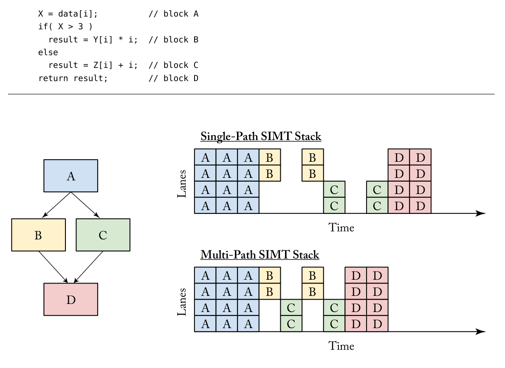

**图 3.18**：分支发散处的多路径执行。

**动态线程束细分** Meng 等人 [2010] 提出，*动态线程束细分*（dynamic warp subdivision，DWS）是第一个利用多路径执行所带来的 TLP 提升的方案。DWS 用一个线程束分裂表扩展 SIMT 栈，把一个发散的线程束细分为可并发执行的多个线程束分裂。各个线程束分裂分别执行一个发散的分支目标，它们可以并行执行，以回收因访存而闲置的硬件资源。另外，在发生访存发散时——即一个线程束中只有一部分线程在 L1 数据缓存中命中——也会创建线程束分裂。DWS 并不等待所有线程都取到各自的数据，而是拆分该线程束，让在缓存中命中的那个线程束分裂先行执行，从而有可能为那些缓存缺失的线程预取数据。

**双路径执行** Rhu 和 Erez [2013a] 提出了双路径 SIMT 栈（dual-path SIMT stack，DPS），它通过把每个线程束限制为只执行两个并发的线程束分裂，解决了 DWS 在实现上的一些缺陷。这一限制虽然使 DPS 只能获得完整 DWS 优势中的相当一部分，却带来了简单得多的硬件设计。DPS 只需在基线 SIMT 栈上增加一组 PC 和活跃掩码，用以编码多出的那个线程束分裂。只有位于线程束栈顶项的两个线程束分裂会并行执行；同一线程束中其他所有线程束分裂都被暂停，直到其栈项到达栈顶。DPS 还配合对记分牌的扩展，以独立跟踪每个线程束分裂的寄存器依赖关系。这使得双路径执行模型能够获得比采用基线记分牌的 DWS 更大的 TLP。

**多路径执行** ElTantawy 等人 [2014] 提出多路径执行模型（multi-path execution model，MPM），消除了双路径的限制。MPM 用两张表取代 SIMT 栈：一张线程束分裂表（warp-split table），维护发散线程束所产生的全部线程束分裂；一张重汇聚表（reconvergence table），负责让具有同一重汇聚点的所有线程束分裂同步。

在发散分支处，重汇聚表中新建一个表项，记录该发散分支的重汇聚点（即其直接后支配节点）。线程束分裂表中则创建多个（通常两个）表项，每个线程束分裂各占一个。每个分裂表项维护该分裂的当前 PC、其活动掩码、重汇聚 PC（RPC），以及指向重汇聚表中对应表项的 R 索引。线程束分裂表中的每个分裂都可以被调度执行，直到其 PC == RPC 为止。此时，重汇聚表中对应的表项被更新，以表明来自该分裂的线程已经到达重汇聚点。当所有未决线程都到达重汇聚点后，该重汇聚表项被释放，并以重汇聚后的线程为活动线程、从 RPC 处开始，新建一个分裂表项。

MPM 还扩展了记分牌，使其能够跟踪每个线程的寄存器依赖关系，而又不必为每个线程完整复制一份记分牌（若真这么做，巨大的面积开销将令 MPM 无法实用）。这一扩展至关重要，正是它使各线程束分裂能够以真正独立的方式执行——若没有该扩展，一个分裂的寄存器依赖就可能被误认为同一线程束中另一个分裂的依赖。

MPM 进一步引入了机会式提前重汇聚，从而提升了非结构化控制流的 SIMD 效率（见 3.4.2 节）。

DWS 以及本节讨论的其他技术，与 3.4.1 节讨论的线程束压缩技术是相互正交的。例如，TBC 中块级的 SIMT 栈可以配合 DWS 进行扩展，以提高可用的 TLP。

**更好的汇聚** 基于后支配节点（post-dominator，PDOM）栈的重汇聚机制 [Fung et al., 2007, Fung et al., 2009] 采用统一算法来识别重汇聚点，而不是把源代码中的控制流惯用结构翻译成指令 [AMD, 2009, Coon and Lindholm, 2008, Levinthal and Porter, 1984]。被选作重汇聚点的发散分支的直接后支配节点，是程序中发散线程*必定*重汇聚的最早位置。在某些情形下，线程可以在*更早的位置*重汇聚，若硬件能够利用这一点，就能提高 SIMD 效率。我们认为，正是这一观察促使近期的 NVIDIA GPU 引入了 break 指令 [Coon and Lindholm, 2008]。

例 3.2 中的代码（取自 [Fung and Aamodt, 2011]）就体现了这种提前重汇聚。它所对应的控制流图如图 3.19 所示，其中每条边都标注了各个标量线程沿该路径执行的概率。块 F 是 A 和 C 的直接后支配节点，因为 F 是从 A（或从 C）出发的*所有*路径首次重合的位置。在基线机制中，当线程束在 A 处发散时，重汇聚点被设为 F。然而，从 C 到 D 的路径极少被执行，因此在*大多数*情况下，线程可以更早地在 E 处重汇聚。

**算法 3.2**：分支重汇聚早于直接后支配节点的示例。

```c
while (i < K) {
X = data[i]; // 块 A
if( X == 0 )
result[i] = Y; // 块 B
else if ( X == 1 ) // 块 C
break; // 块 D
i++; // 块 E
}
return result[i]; // 块 F
```

**可能汇聚点** Fung 和 Aamodt [2011] 提出为 SIMT 栈增加*可能汇聚点*（likely convergence point）。该扩展为每个 SIMT 栈表项新增两个字段：一个记录可能汇聚点的 PC（LPC），另一个是 LPos，即一个指针，记录某个特殊的“可能汇聚”表项在栈中的位置；当某分支的可能汇聚点不同于其直接后支配节点时，就会创建这样一个表项。每个分支的可能汇聚点既可以通过控制流分析识别，也可以借助（可能是在运行时收集的）性能剖析信息识别。Fung 和 Aamodt [2011] 的方案把可能汇聚点限定为包围该分支的最近的后向分支，以刻画循环中“break”语句的影响 [Coon and Lindholm, 2008]。

当线程束在带有可能汇聚点的分支处发散时，SIMT 栈会压入三个表项。第一个表项是 LPC 表项，为分支的可能汇聚点而创建。另外两个表项分别对应分支的跳转路径与顺序执行路径，其创建方式与基线机制相同。这两个表项中的 LPC 字段都填入该发散分支的可能汇聚点，LPos 字段则填入 LPC 表项在栈中的位置。LPC 表项的 RPC 被设为该发散分支的直接后支配节点，即确定的重汇聚点，于是该表项中的线程最终将重汇聚到确定的重汇聚点。

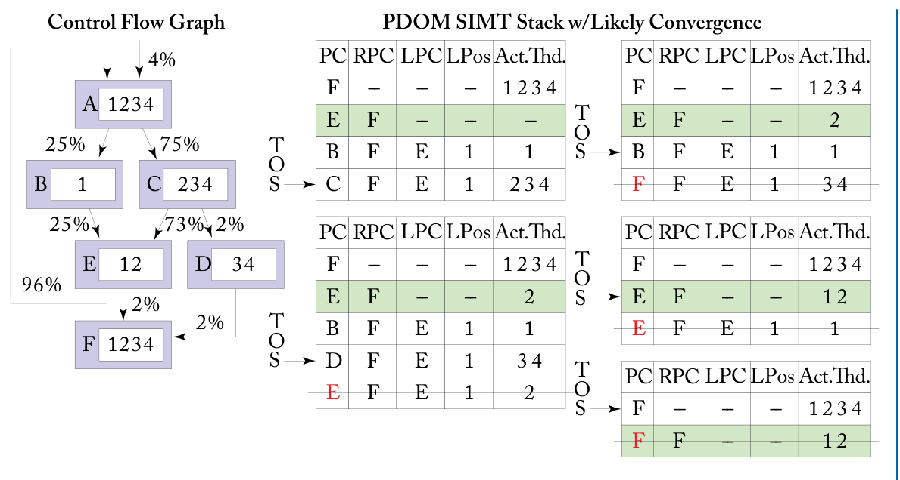

**图 3.19**：早于直接后支配节点的重汇聚点。可能汇聚点捕获了在 E 处发生的这种提前重汇聚。

当线程束以 SIMT 栈顶项为依据执行时，它会把自身的 PC 分别与 RPC 字段（与基线 SIMT 栈中的做法相同）和 LPC 字段进行比较。若 PC == LPC，则弹出该 SIMT 栈项，并把被弹出项中的线程合并到 LPC 项中。否则，若 PC == RPC，则直接弹出该栈项——RPC 项已经在其活跃掩码中记录了这些线程。当 LPC 项到达 SIMT 栈顶时，它就像其他任何 SIMT 栈项一样被执行；若其活跃掩码为空，则直接被弹出。

**线程前沿** Diamos 等人 [2011] 完全放弃了 SIMT 栈，转而提出用*线程前沿*（thread frontiers）在发散之后对线程进行重汇聚。支持线程前沿的编译器按照拓扑序对内核中的基本块进行排序。这样一来，在较高 PC 处执行的线程就绝不会跳转到较低 PC 处的指令。循环的处理方式是把循环出口放在循环体末尾。有了这种排序后的代码布局，发散的线程束最终会通过优先执行 PC 较低的线程（让它们追赶上来）而重汇聚。

与采用直接后支配节点重汇聚的 SIMT 栈相比，对于非结构化控制流的应用，通过线程前沿实现重汇聚能获得更高的 SIMD 效率。多表达式条件语句的求值语义以及异常的使用，都可能生成非结构化控制流的代码。用可能的汇聚点扩展 SIMT 栈，也能在非结构化控制流的应用上取得类似的 SIMD 效率提升；然而，SIMT 栈中的每个栈项只能容纳有限个可能的汇聚点，而线程前沿方法则没有这种限制。

**机会式提前重汇聚** ElTantawy 等人 [2014] 提出了*机会式提前重汇聚*（opportunistic early reconvergence，OREC），它无需任何额外的编译器分析，就能提升非结构化控制流的 GPU 应用的 SIMD 效率。OREC 建立在同一篇论文提出的多路径（multi-path，MP）SIMT 栈之上（见 3.4.2 节）。MP SIMT 栈使用一张单独的线程束分裂表，保存当前可供执行的线程束分裂集合。在发散分支处，硬件以分支目标 PC 和该发散分支的重汇聚 PC 创建新的线程束分裂。采用 OREC 时，硬件并不只是把这些新的线程束分裂插入线程束分裂表，而是先遍历该表，查找是否已存在起始 PC 与 RPC 都相同的线程束分裂。若存在这样的线程束分裂，硬件就在重汇聚表中创建一个提前重汇聚点，使这两个线程束分裂在原 RPC 之前汇聚。该提前重汇聚点在某个特定 PC 上同步这两个线程束分裂，因此即使已有的线程束分裂已经沿发散路径推进，二者仍可合并。在 ElTantawy 等人 [2014] 的方案中，提前重汇聚点就是已有线程束分裂的下一条 PC。

### 3.4.3 增加 MIMD 能力

以下方案通过引入有限程度的 MIMD 能力，改善了 GPU 对发散控制流的适应性。所有这些方案都提供两种工作模式：

- SIMD 模式：前端发射一条指令，由线程束中的所有线程共同执行；或者
- MIMD 模式：前端为发散线程束中的每个线程分别发射不同的指令。

当线程束未发散时，它以 SIMD 模式执行，从而利用线程束中各线程所表现出的控制流局部性，其能效可与传统 SIMD 体系结构相当。线程束一旦发散，就切换到 MIMD 模式。在该模式下线程束的运行效率较低，但其性能损失小于传统 SIMD 体系结构上的损失。

**向量线程体系结构** 向量线程（vector-thread，VT）体系结构 [Krashinsky et al., 2004] 兼有 SIMD 与 MIMD 体系结构的特点，目标是兼取两者之长。VT 体系结构包含一组 lane，它们连接到一个公共的 L1 指令缓存。在 SIMD 模式下，所有 lane 直接接收来自 L1 指令缓存的指令，以锁步方式执行；但每个 lane 都可以切换到 MIMD 模式，依靠自己 L0 缓存中的指令按自己的节奏运行。Lee 等人 [2011] 最近将 VT 体系结构与传统 SIMT 体系结构（如 GPU）所做的一项比较表明，VT 体系结构在规则并行应用上的效率与后者相当，而在不规则并行应用上的效率则高得多。

**时间 SIMT** 时间 SIMT（temporal SIMT）[Keckler et al., 2011, Krashinsky, 2011] 允许每个 lane 以 MIMD 方式执行，与 VT 体系结构类似。不过，它并不让一个线程束在全部 lane 上锁步运行，而是让该线程束的执行在单个 lane 上分时复用，每个 lane 运行各自的一组线程束。时间 SIMT 通过为整个线程束只取一次指令来获得 SIMD 硬件的效率。它把控制流开销在时间上摊销，而传统 SIMD 体系结构则把同样的开销在空间上摊销到多个 lane 上。

**可变线程束规模体系结构** 可变线程束规模（variable warp size，VWS）体系结构 [Rogers et al., 2015] 包含多个（例如 8 个）切片（slice），每个切片都含有一个取指与译码单元，因此各切片可以同时执行不同的指令，这与 VT 和时间 SIMT 类似。VWS 并不借助窄数据通路对宽线程束做分时复用，而是让每个切片由窄（4 宽）线程束组成。这些窄线程束随后被组合成更大的执行实体，称为*编组*（gang）。每个编组由来自每个切片的一个线程束组成。

在没有分支发散的应用中，同一个线程束组（gang）内的各线程束按锁步方式执行，从共享的取指单元和共享的一级指令缓存中取指令。一旦遇到分支发散（或访存发散），该线程束组就分裂成多个线程束组。新的线程束组还可能继续分裂，直到每个线程束都各自成为一个组。此时，这些只含单个线程束的组分别借助各自切片的取指单元和私有的 L0 指令缓存独立执行。随后，硬件会比较各个组的 PC，伺机把这些分裂出去的组合并回原来的组。如果所有 PC 都相同，就重建原来的组。Rogers 等人 [2015] 还提出在首个发散分支的直接后支配节点处插入一个组级同步屏障。

本书还结合共享一级指令缓存的带宽，评估了各切片中 L0 指令缓存容量对性能的影响。在非分组模式下，各切片中的 L0 缓存可能同时向一级缓存请求指令，形成带宽瓶颈。他们的评估表明，即使对于存在发散的应用，256 字节的 L0 缓存也能滤除对共享一级缓存的大部分请求。因此，一级缓存只需基线 SIMT 架构 2 倍的带宽，就足以弥补大部分带宽缺口。

**同时分支交织** Brunie 等人 [2012] 在线程块压缩发表之后，提出了同时分支交织与线程束交织（SBI 与 SWI）。他们扩展了 GPU 的 SIMT 前端，使其每个周期可以发射两条不同的指令。当同一个线程束遇到分支发散时，SBI 会把该线程束的两条指令一并发射。同时执行一个发散分支的两个目标，可以显著消除该分支带来的性能损失。

### 3.4.4 低复杂度而有效的发散管理

基线 SIMT 栈为每个线程束所需的面积仅为 32 × 64 位（若采用 AMD GCN 中所用的优化，可低至 6 × 64 位）。虽然与 SIMT 核心中的寄存器堆相比这块面积很小，但它会随 GPU 中正在执行的线程束数量以及每线程束的线程数成正比增长。此外，在分支发散很少出现的典型 GPU 应用中，SIMT 栈占用的这块面积本来可以用其他方式来提升应用的吞吐率。已有若干方案用替代机制取代 SIMT 栈，这些机制共享同一批资源，当线程束不遇到任何分支发散时，这些资源可以另作他用。

**标量寄存器堆中的 SIMT 栈** AMD GCN [AMD, 2012] 具有一个由线程束中所有线程共享的标量寄存器堆。其寄存器可用作谓词寄存器，控制线程束中每个线程的活跃状态。当编译器在计算内核中检测到可能发散的分支时，就用这个标量寄存器堆在软件中模拟 SIMT 栈。GCN 架构还提供了专用指令来加速 SIMT 栈的模拟。

一种能把支持最坏情况发散所需的标量寄存器数量降到最少的优化是：优先执行活跃线程数较少的那个分支目标。这样，只需 log2（每线程束的线程数）个标量寄存器就能支持最坏情况的发散，远少于基线 SIMT 栈所需的表项数。此外，当计算内核中没有可能发散的分支时，编译器可以把为 SIMT 栈预留的标量寄存器用于其他标量计算。

**线程前沿** 如 3.4.2 节所述，Diamos 等人 [2011] 用*线程前沿*（thread frontiers）取代了 SIMT 栈。采用线程前沿时，每个线程在寄存器堆中维护自己的 PC，并且代码按拓扑序排序，使分支的重汇聚点总是具有更高的 PC。当一个线程束发散时，它总是优先执行其所有线程中 PC 最小的那部分线程。这组线程称为该线程束的线程前沿。优先执行前沿中的线程，会隐式地迫使程序中走得更远的那些线程在分支的重汇聚点等待，以便合并。

由于只有在计算内核包含可能发散的分支时才需要每线程 PC，编译器只需在这些计算内核中分配 PC 寄存器。在其他计算内核中，多出来的寄存器存储可用于提高线程束占用率，增加每个 SIMT 核心能够维持的线程束数量，从而更好地容忍访存延迟。

**无栈 SIMT** Asanovic 等人 [2013] 提出用一条 syncwarp 指令扩展时间 SIMT 架构。在该方案中，当线程束中的各线程执行计算内核的*汇聚区域*（convergent regions）时，它们按锁步方式运行，编译器保证在这些区域中线程束绝不会发散。在发散分支处，线程束中的每个线程各以自己的私有 PC 沿各自的控制流路径执行，从而利用了时间 SIMT 架构中的 MIMD 能力。

编译器在发散分支的重汇聚点放置一条 syncwarp 指令。这会迫使已发散的线程束中的所有线程在进入计算内核的下一个汇聚区域之前，先在重汇聚点同步。

虽然这一机制无法捕获嵌套发散分支下可能出现的重汇聚，但它仍是一种开销更低的替代方案，对于那些很少出现分支发散的 GPU 应用，它能提供与基线 SIMT 栈相当的性能。该文提出了一种汇聚性与变异性相结合的分析（combined convergent and variant analysis），使编译器能够判定任意计算内核中哪些操作适合进行*标量化*和/或*仿射变换*。在无栈 SIMT 的语境下，同样的分析使编译器能够判定任意计算内核中的汇聚区域与发散区域。

1. 编译器首先假定所有基本块都是*线程无关*（thread-invariant）的。

2. 它把所有依赖于线程 ID 的指令、原子指令，以及对易失性存储器（volatile memory）的访存指令标记为*线程相关*（thread-variant）。

3. 然后迭代地把所有依赖于线程相关指令的指令也标记为线程相关。

4. 那些*控制相关*（control dependent）于某条线程相关分支指令的基本块中的全部指令同样也是线程相关的。从本质上说，位于某条线程相关分支的直接后支配节点之后的指令可以保持线程无关，只要它们没有因其他条件而被标记为线程相关。

这一分析使编译器能够识别出每个线程束中所有线程都一致跳转的分支。由于这些分支不会导致线程束发散，编译器既无须为这些分支插入用于检测动态发散的代码，也无须在其直接后支配节点处插入 syncwarp 指令来强制重汇聚。

**谓词执行** 在把完整的 SIMT 栈引入体系结构之前，带有可编程着色器的 GPU 就已经像传统向量处理器那样，通过*谓词执行*（predication）在着色器程序中支持有限的控制流结构。在现代 GPU 中，谓词执行仍然是一种处理简单 if 分支的低开销方式，它避免了压入和弹出 SIMT 栈的开销。在 NVIDIA 的实现中，每条指令都扩展出一个额外的操作数字段，用来指定其谓词寄存器。谓词寄存器本质上就是专用于控制流的标量寄存器。

Lee 等人 [2014b] 提出了一种*线程感知的谓词执行算法*（thread-aware predication algorithm），把谓词执行的应用范围扩展到任意控制流，其性能与 NVIDIA 的 SIMT 栈相当。该线程感知的谓词执行算法在每个分支处增设谓词节点，以此扩展标准的控制流依赖图（Control-Flow Dependency Graph，CDG）。随后，每个基本块所需的谓词就可以依据其控制流依赖关系计算出来，并在不破坏功能行为的前提下得到严格优化。该文接着描述了基于这一线程感知 CDG 的两种优化，以及其先前工作 [Asanovic et al., 2013] 中的汇聚性与变异性分析。

• 当编译器依据汇聚性分析能够保证某条分支在整个线程束中一致跳转时，就采用*静态分支一致性优化*（static branch-uniformity optimization）。在这种情况下，编译器可以用一条一致分支（uniform branch）指令取代谓词的生成。

• 在其他情况下则采用*运行时分支一致性优化*（runtime branch-uniformity optimization）。编译器会发射共识分支（consensual branch，`cbranch.ifnone`），这种分支只在给定空谓词（即所有线程都被屏蔽）时才跳转。这使线程束能够跳过谓词为空的代码——这正是 SIMT 栈所提供的一项关键优势。与 BOSCC 等面向向量处理器的早期工作不同，这一方法依靠结构分析来确定该优化的候选对象。

尽管谓词执行与 SIMT 栈从根本上提供相同的功能，且能耗与面积开销相近，Lee 等人 [2014b] 仍强调了两种方法之间的以下权衡。

• 由于不同的分支目标由不同的谓词寄存器守护，编译器可以调度来自不同分支目标的指令，把不同分支目标的执行交错起来，从而利用线程级并行性（TLP）；而在另一种方法中，要利用这种并行性就需要更复杂的硬件分支发散管理机制。

• 谓词执行往往会增加寄存器压力，进而降低线程束占用率，并带来整体性能损失。之所以如此，是因为保守的寄存器分配无法让分支的两侧复用同一批寄存器：它无法可靠地证明来自不同分支目标的指令所操作的是寄存器中互斥的 lane 集合。上述两种优化所插入的一致分支指令和共识分支指令缓解了这一问题。

• 谓词执行可能以多种方式影响动态指令数。在某些情况下，检查一致分支的开销会显著增加动态指令数；而如果不做这种检查，则意味着某些路径要以空谓词掩码执行。在另一些情况下，它又省去了维护 SIMT 栈所需的压栈/出栈指令。

最后，该文提出了若干新指令，以降低谓词执行的开销。

• 对于函数调用和间接分支，他们提出了一条新指令 `find_unique`，通过循环逐个串行执行每个分支目标/函数。

• cbranch.ifany 指令（在已有的共识分支指令 cbranch.ifnone 与 cbranch.ifall 之外新增）有助于降低动态一致分支检测所引入的指令数开销。

## 3.5 标量化与仿射执行的研究方向

如第 2 章所述，CUDA 和 OpenCL 等 GPU 计算 API 具有类 MIMD 的编程模型，允许程序员向 GPU 上启动由大量标量线程组成的数组。虽然其中每个标量线程都可以走自己独有的执行路径，也可以访问任意内存位置，但在通常情况下，它们都遵循少数几条执行路径，并执行相似的操作。绝大多数（即便不是全部）现代 GPU 都通过 SIMT 执行模型来利用 GPU 线程之间汇聚的控制流——在该模型中，标量线程被组织成运行在 SIMD 硬件上的线程束（见 3.1.1 节）。

本节综述一系列通过*标量化*与*仿射执行*进一步利用这些标量线程之间相似性的研究工作。这些研究的关键洞见，来自对执行同一计算内核的各线程之间*值结构*（value structure）[Kim et al., 2013] 的观察。这两类值结构——*均匀*（uniform）与*仿射*（affine）——在例 3.3 的计算内核中得到了展示。

**均匀变量** 在计算内核中对每个线程都取相同常量值的变量。在算法 3.3 中，变量 a 以及字面量 THRESHOLD 和 Y_MAX_VALUE 在所有线程之间都具有均匀的取值。均匀变量可以存放在单个标量寄存器中，供计算内核中的所有线程复用。

**仿射变量** 指这样一种变量：对计算内核中的每个线程而言，其取值都是线程 ID 的线性函数。在算法 3.3 中，变量 y[idx] 的内存地址可以表示为线程 ID threadIdx.x 的*仿射*变换：

```c
&(y[idx]) = &(y[0]) + size(int) * threadIdx.x;
```

这种仿射表示可以存储为一对标量值——*基址*（base）与*步长*（stride）——它比完全展开的向量紧凑得多。

关于如何在 GPU 中*检测*与*利用*均匀变量或仿射变量，已有多种研究方案。本节余下部分从这两个方面对这些方案加以综述。

### 3.5.1 均匀变量或仿射变量的检测

检测 GPU 计算内核中是否存在均匀变量或仿射变量，主要有两类方法：编译器驱动检测与硬件检测。

**编译器驱动检测** 检测 GPU 计算内核中是否存在均匀变量或仿射变量的一种方法，是通过专门的编译器分析来完成。之所以可行，是因为已有的 GPU 编程模型 CUDA 和 OpenCL 已经为程序员提供了把某个变量声明为在整个计算内核中保持常量的手段，同时也为线程 ID 提供了专门的变量。编译器可以执行控制依赖分析，找出完全依赖于常量和线程 ID 的变量，并把它们标记为均匀/仿射变量。仅对均匀/仿射变量进行运算的操作，随后就成为*标量化*的候选对象。

**算法 3.3**：计算内核中标量与仿射操作的示例（引自 [Kim et al., 2013]）。

```c
__global__ void vsadd( int y[], int a )
{
int idx = threadIdx.x;
y[idx] = y[idx] + a;
if ( y[idx] > THRESHOLD )
y[idx] = Y_MAX_VALUE;
}
```

AMD 的 GCN [AMD, 2012] 依赖编译器来检测均匀变量以及可由专用标量处理器存储和处理的标量操作。

Asanovic 等人 [2013] 提出了一种把汇聚性分析与变异性分析结合起来的方法，使编译器能够判定任意计算内核中哪些操作适合进行*标量化*和/或*仿射变换*。位于计算内核汇聚区域内的指令可以转换为标量/仿射指令。在计算内核从发散区域转入汇聚区域的每一次转换处，编译器都会插入一条 syncwarp 指令，以处理两个区域之间由控制流引起的寄存器依赖关系。Asanovic 等人 [2013] 采用这一分析，为 Temporal-SIMT 体系结构 [Keckler et al., 2011, Krashinsky, 2011] 生成标量操作。

解耦仿射计算（Decoupled Affine Computation，DAC）[Wang and Lin, 2017] 依赖类似的编译器分析，提取出可被解耦到另一个独立线程束中执行的标量候选与仿射候选。Wang 和 Lin [2017] 在这一过程中加入了发散仿射分析，目标是提取出从计算内核一开始就具有仿射性质的指令流片段。这些仿射指令流片段被从主内核中解耦出来，形成一个仿射内核，由它通过硬件队列向主内核输送数据。

**硬件检测** 与编译器驱动检测相比，在硬件中检测均匀/仿射变量具有两点潜在优势。

1. 它使得标量化与仿射执行可以应用于原有的 GPU 指令集体系结构。这样就省去了与硬件协同开发专用标量化编译器的麻烦。

2. 硬件检测发生在计算内核执行期间。因此，它能够检测出动态出现、却被静态分析漏掉的均匀/仿射变量。

**基于标签的检测** Collange 等人 [2010] 提出了一种基于标签的检测系统。在该系统中，每个 GPU 寄存器都扩展出一个标签，用以指示该寄存器中存放的是均匀值、仿射值还是通用向量值。在计算内核启动时，存放线程 ID 的那个寄存器的标签被置为仿射状态。从常量存储器或共享存储器中的单个位置广播取值的指令，会把目的寄存器的标签置为均匀状态。在内核执行过程中，各寄存器的状态按照表 3.1 给出的简单规则，沿算术指令从源操作数传播到目的操作数。虽然这种基于标签的检测几乎不带来硬件开销，但它的判断往往偏于保守——例如，它会保守地把均匀变量与仿射变量相乘所得的结果判定为向量变量。

**表 3.1**：Collange 等人 [2010] 中均匀状态与仿射状态沿指令传播的规则示例。对于每种运算，第一行与第一列给出输入操作数的状态，其余表项给出输入操作数状态在各种排列下输出操作数的状态（U 表示 uniform，即均匀；A 表示 affine，即仿射；V 表示 vector，即向量）。

**加法（+）**

| + | U | A | V |
|---|---|---|---|
| **U** | U | A | V |
| **A** | A | V | V |
| **V** | V | V | V |

**乘法（×）**

| × | U | A | V |
|---|---|---|---|
| **U** | U | V | V |
| **A** | A | V | V |
| **V** | V | V | V |

**左移（<<）**

| << | U | A | V |
|---|---|---|---|
| **U** | U | A | V |
| **A** | A | V | V |
| **V** | V | V | V |

FG-SIMT 体系结构 [Kim et al., 2013] 在 Collange 等人 [2010] 的基于标签的检测机制基础上做了扩展，对分支提供了更好的支持。仿射分支——即对仿射操作数进行比较的分支——只要其中一个操作数是均匀的，就通过标量数据通路来判定。Kim 等人 [2013] 还提出了一种*惰性展开*（lazy expansion）方案：在出现发散分支或谓词执行指令之后，才把仿射寄存器惰性展开为完整的向量寄存器。之所以需要这种展开，是为了让发散线程束中的一部分线程能够更新目的寄存器中属于自己的槽位，同时保持其他槽位不变——这样做维护了 SIMT 执行语义。更朴素的“急切”展开方案会在每个仿射寄存器经历第一次发散分支之后就把它展开，与之相比，惰性展开方案避免了许多不必要的展开。

**写回时比较** Gilani 等人 [2013] 提出了一种更激进的均匀变量检测机制：在向量指令的每次写回时，比较一个线程束中所有线程的寄存器值。一旦检测到均匀变量，检测逻辑就把写回改道至标量寄存器堆，并更新一张内部表以记录该寄存器的状态。此后对该寄存器的使用都会被重定向到标量寄存器堆。所有操作数都来自标量寄存器堆的指令，则在一条独立的标量流水线上执行。

Lee 等人 [2015] 采用了类似的检测方案。他们没有使用简单的均匀变量检测器，而是在寄存器写回级加入了一个寄存器值压缩器，利用 Pekhimenko 等人 [2012] 提出的算法，把输入的取值向量变换为 <基址；差值；立即数>（BDI）三元组。

Wong 等人 [2016] 提出了*线程束近似*（Warp Approximation），这是一个在线程束内部利用近似计算的框架，其特点同样是在寄存器写回时进行检测。检测器在写回寄存器堆的向量所含的全部取值中，计算最小的 *d 相似度*——即两个给定值共享 *d* 个最高有效位（MSB）。*d* 相似度高于阈值的寄存器被标记为*相似*，随后这个标记用来判定后续依赖指令是否有资格进行近似执行。

与 Lee 等人 [2015] 的方案类似，G-Scalar [Liu et al., 2017] 也在寄存器写回级设置了一个寄存器值压缩器，但该压缩器采用的算法更简单：它只提取线程束中所有 lane 上的全部取值共同使用的字节。如果所有字节都是公共的，该寄存器中就存放着一个均匀变量。任何只对均匀变量进行运算的指令都可以被标量化。

G-Scalar 还把寄存器值压缩器扩展用于检测在分支发散下适合标量执行的运算。此前所有方案一旦线程束发生发散，就会退回到向量执行。Liu 等人 [2017] 观察到，在分支发散下的许多指令中，活跃 lane 的操作数取值是均匀的。使用这些“部分均匀”寄存器的指令实际上有资格进行标量执行。他们于是扩展了寄存器值压缩器，用一套特殊逻辑只检查活跃 lane 的取值。这大幅增加了各种 GPU 计算工作负载中可标量化的指令数量。需要注意的是，在发散情况下，被写入的寄存器并不做压缩。

### 3.5.2 在 GPU 中利用均匀变量与仿射变量

GPU 的设计可以从多个方面利用计算内核中存在的值结构。

**压缩的寄存器存储** 均匀变量与仿射变量的紧凑表示，使它们能够以少得多的比特存放在寄存器堆中。节省出来的存储空间可以用来支撑更多在途线程束，从而在寄存器堆资源相同的情况下提高 GPU 对访存延迟的容忍能力。

**标量寄存器堆** 许多利用 GPU 中均匀变量或仿射变量的方案与设计，都设置了一个专用于存放标量值/仿射值的寄存器堆。

• AMD GCN 体系结构配备了一个标量寄存器堆，标量流水线与向量流水线都可以访问它。

• FG-SIMT 体系结构 [Kim et al., 2013] 把均匀值/仿射值存放在一个独立的仿射 SIMT 寄存器堆（Affine SIMT Register File，ASRF）中。ASRF 记录每个寄存器的状态（仿射/均匀/向量），使控制逻辑能够检测出可以在控制处理器上直接执行的操作。

• Gilani 等人 [2013] 提出的动态均匀检测方案，把动态检测出的均匀值存入一个专用的标量寄存器堆。

**部分寄存器堆访问** Lee 等人 [2015] 对写回寄存器堆的寄存器施加基址、差值、立即数（BDI）压缩。这些被压缩的寄存器在作为源操作数读回时，再解压还原为普通的向量。在该方案中，每个压缩寄存器仍占用与未压缩寄存器相同的存储槽位，但只用到其中的一部分寄存器体（bank），因此读出寄存器的压缩表示所消耗的能量更少。

Warp Approximate 体系结构 [Wong et al., 2016] 通过只访问相似性检测所选出的代表线程所对应的 lane，来降低寄存器读写的能耗。

类似地，G-Scalar [Liu et al., 2017] 也采用了压缩寄存器，这些寄存器只占用原本分配给未压缩寄存器的一部分寄存器体，从而降低寄存器读出的能耗。

**专用仿射线程束** 解耦仿射计算（Decoupled Affine Computation，DAC）[Wang and Lin, 2017] 把编译器提取出的所有仿射变量都缓存在一个专用仿射线程束的寄存器中。这个仿射线程束与其他非仿射线程束一样，共享同一份向量寄存器堆存储，但它利用每个寄存器表项中的各个 lane 来存放基址，以及不同非仿射线程束各自的差值。

**操作标量化** 除了高效的存储之外，对均匀变量或仿射变量的操作还可以*标量化*。与其通过 SIMD 数据通路在一个线程束的所有线程上重复执行同一操作，不如在单个标量数据通路中只做一次，这样整个过程消耗的能量要少得多。一般来说，只要一条算术操作的输入操作数全部由均匀变量或仿射变量组成，该操作就可以标量化。

**专用标量流水线** AMD 的 GCN 体系结构配备了专用的标量流水线，用于执行编译器生成的标量指令。FG-SIMT 体系结构 [Kim et al., 2013] 则配备了一个控制处理器，它能够直接执行动态检测出的仿射操作，而无需动用 SIMD 数据通路。

在这两种实现中，标量流水线还负责 SIMD 流水线的控制流与谓词执行。这种解耦意味着许多与系统相关的功能（例如与主机处理器通信）也可以卸载到标量流水线上，从而把 SIMD 数据通路从实现完整指令集的负担中解放出来。

**时钟门控的 SIMD 数据通路** Warp Approximate 体系结构 [Wong et al., 2016] 与 G-Scalar [Liu et al., 2017] 都在 SIMD 数据通路的某一个 lane 上执行动态检测出的标量指令。此时，其他 lane 被时钟门控，以降低动态功耗。

这种做法免去了在专用标量数据通路上支持完整指令集的重复工作，也免去了必须挑选出要在标量数据通路上实现的指令子集的工作。例如，G-Scalar [Liu et al., 2017] 能够以相对较低的开销，对特殊功能单元所支持的指令进行标量化。

**聚集到仿射线程束** 解耦仿射计算（DAC）[Wang and Lin, 2017] 把来自多个线程束的仿射操作聚集到每个 SIMT 核心中的一个仿射线程束上。这个仿射线程束与其他线程束一样在 SIMD 数据通路上执行，但它执行的每条指令同时作用于多个线程束的仿射表示。

**访存加速** 当均匀变量或仿射变量被用来表示访存操作（加载/存储）的地址时，该访存操作所触及的内存位置是高度可预测的——相邻位置之间相隔一个已知的步长。这带来了多种优化机会。例如，对已知步长的内存位置进行访存合并，要比对任意随机位置进行合并简单得多。仿射变量还可以用来表示一次成块传输，用一条指令完成，而不必通过加载/存储指令的循环来完成。

FG-SIMT 体系结构 [Kim et al., 2013] 在控制处理器中配备了专门的地址生成单元，把带有仿射地址的访存操作展开成实际地址。由于仿射地址在各线程之间具有固定的步长，用更简单的硬件就可以把这些仿射访存合并成缓存行。

解耦仿射计算（DAC）[Wang and Lin, 2017] 也采用了类似的优化来利用仿射访存中的固定步长。此外，它还让仿射线程束先于其余非仿射线程束执行，为这些线程束预取数据。预取到的数据存放在一级缓存中，稍后由相应的非仿射线程束通过一条特殊的出队（dequeue）指令取回。

## 3.6 寄存器堆体系结构的研究方向

现代 GPU 采用数量众多的硬件线程（线程束），把它们的执行复用到数量少得多（但依然很大）的 ALU 上，以此同时容忍流水线延迟和访存延迟。为了在线程束之间实现快速而高效的切换，GPU 使用硬件线程束调度器，并把所有硬件线程的寄存器保存在片上寄存器堆中。在许多 GPU 体系结构上，这些寄存器堆的容量都相当可观，有时甚至超过末级缓存的容量，其原因一方面在于 GPU 采用了宽 SIMD 数据通路，另一方面则在于需要极多的线程束才能容忍数百个周期的访存延迟。例如，NVIDIA 的 Fermi GPU 可以同时维持 2 万多个在途线程，其寄存器总容量达到 2 MB。

为了尽量减小寄存器堆存储所占用的面积，GPU 上的寄存器堆一般用端口数较少的 SRAM bank 来实现。这些 SRAM bank 被并行访问，以提供维持宽 SIMD 流水线以峰值吞吐率执行指令所需的操作数带宽。如本章前面所述，某些 GPU 使用操作数收集器来协调多条指令的操作数访问，从而把 bank 冲突的代价降到最低。

每次访问这些大容量寄存器堆都要消耗大量动态能量，而其庞大的规模还会带来很高的静态功耗。在 NVIDIA GTX280 GPU 上，GPU 总功耗中有近 10% 是寄存器堆消耗的。这为在 GPU 寄存器堆体系结构上进行创新以降低其能耗提供了明确的动力。正因如此，近年来这一主题上涌现了大量研究论文。本节余下部分将对旨在实现这一目标的若干研究方案加以综述。

### 3.6.1 层次化寄存器堆

Gebhart 等人 [2011b] 观察到，在一组真实世界的图形与计算工作负载中，一条指令产生的值最多有 70% 只被读取一次，而只有 10% 会被读取两次以上。为了利用大多数寄存器值的这种短生命期，他们提出用*寄存器堆缓存*（register file cache，RFC）来扩展 GPU 上的主寄存器堆。由此形成一个寄存器堆层次结构，可大幅降低对主寄存器堆的访问频率。

在该工作中，RFC 为每条指令的目的操作数分配一个新表项，替换策略为先进先出（FIFO）。未命中 RFC 的源操作数不会被装入 RFC，以减少对本来容量就很小的 RFC 的污染。默认情况下，每个从 RFC 中逐出的值都会写回主寄存器堆。不过，由于其中许多值此后再也不会被读取，Gebhart 等人 [2011b] 用编译期生成的静态活跃性信息扩展了这个纯硬件实现的 RFC。指令编码中增加了一个额外的位，用来标识消费某个寄存器值的最后一条指令。某个寄存器一旦被最后一次读取，就在 RFC 中被标记为死亡。在逐出时，它不会被写回主寄存器堆。

为了进一步减小 RFC 的容量，Gebhart 等人 [2011b] 把它与两级线程束调度器结合起来。这种两级线程束调度器把执行限制在一个由*活跃*线程束构成的池中，而该池只包含每个 SIMT 核心中一小部分线程束。该工作考虑在每个 SIMT 核心总共 32 个线程束中设立由 4–8 个线程束构成的活跃线程束池。RFC 只保存来自活跃线程束的值，因此容量更小。当线程束遇到长延迟操作（例如全局存储器加载或纹理取数）时，它会被从活跃池中移出。此时，该线程束在 RFC 中的表项被冲刷，腾出的空间留给由第二级调度器激活的另一个线程束。

**编译期管理的寄存器堆层次** Gebhart 等人 [2011a] 在这一寄存器堆层次的基础上进一步扩展，加入了末次结果文件（Last Result File，LRF），它只缓存每个活跃线程束最后一条指令产生的寄存器值。该工作还用编译期管理的操作数寄存器堆（operand register file，ORF）取代了硬件管理的 RFC。值进出 ORF 的搬移由编译器显式管理，这就省去了 RFC 所需的标签查找。对于大多数 GPU 工作负载中的寄存器使用模式，编译器还拥有更全面的视角，因而能够做出更优的决策。该工作还扩展了两级线程束调度器，使编译器能够指示某个线程束何时可以退出活跃池。这样做是必需的，因为需要让 ORF 的内容与线程束的活跃状态相协调：在线程束被换出之前，把 ORF 中所有活跃数据搬回主寄存器堆。

### 3.6.2 低功耗（休眠）状态的寄存器堆

Abdel-Majeed 和 Annavaram [2013] 提出了一种三态寄存器堆设计，用于降低大容量 GPU 寄存器堆的漏电功耗。三态寄存器堆中的每个表项都可以在开启（ON）、关闭（OFF）和休眠（Drowsy）三种模式之间切换。开启模式是正常的操作模式；关闭模式不保留寄存器的值；休眠模式保留寄存器的值，但在访问之前需要把该表项唤醒到开启模式。在该工作中，所有未分配的寄存器都处于关闭模式，而所有已分配的寄存器在每次访问之后立即进入休眠状态。由于 GPU 采用细粒度多线程，GPU 上同一寄存器的相邻两次访问之间间隔很长；该策略正是利用这一点，让寄存器堆中的寄存器大部分时间都处于休眠模式。GPU 中较长的流水线也意味着，把寄存器从休眠状态唤醒所带来的额外延迟不会造成明显的性能损失。

### 3.6.3 寄存器堆虚拟化

Tarjan 和 Skadron [2011] 观察到，在等待访存操作完成期间，GPU 线程中活跃寄存器的数量往往很少。他们声称，在某些 GPU 应用中，多达 60% 的寄存器处于闲置状态。他们提出，可以通过寄存器重命名来虚拟化物理寄存器，从而把物理寄存器堆的规模缩减最多 50%，或者在寄存器堆规模不变的前提下把并发执行的线程数提高一倍。在他们提出的机制中，线程开始执行时不会分到任何寄存器，物理寄存器是在指令译码时分配给目的寄存器的。Tarjan 和 Skadron 进一步指出，可以借助编译器分析确定某个寄存器最后一次被读取的位置，从而更早地释放物理寄存器。他们提出了“最后读取标注”（final read annotations），建议“为每个操作数增加一个比特，用以指示它是否为最后一次读取”，并指出这可能需要指令编码中增加额外的比特。

Jeon 等人 [2015] 量化了通过把寄存器溢出到内存来缩减 GPU 寄存器堆规模所带来的影响。他们发现，采用溢出（spilling）把寄存器堆规模缩减 50%，会使执行时间平均增加 73%。他们回顾了早期在采用乱序执行的中央处理器上做寄存器重命名时提前回收物理寄存器的若干方案。针对“最后读取标注”需要额外比特这一问题，他们提出增加“元数据指令”（metadata instructions），由这类指令高效地编码物理寄存器何时可以被回收，并利用寄存器生命周期的活跃性分析（liveness analysis）来生成这些指令。他们的一个重要观察是：在判定何处可以安全地回收物理寄存器时，必须把分支发散考虑在内（Kloosterman 等人 [2017] 对此作了进一步阐述）。对于一个 128 KB 的寄存器堆，直接实现 Jeon 等人的重命名技术需要 3.8 KB 的重命名硬件。他们表明，若不对生命周期较长的寄存器做重命名，这一开销可以降到 1 KB。为了利用这一机会，他们提出只对逻辑寄存器编号大于编译器所确定阈值的寄存器做重命名。Jeon 等人还提出用重命名来实现寄存器堆子阵列的电源门控。他们评估了其详细方案在通过寄存器重命名支持寄存器堆虚拟化方面的效果，表明确实可以在不损失性能的前提下把寄存器堆规模缩减 50%。

### 3.6.4 分区寄存器堆

Abdel-Majeed 等人 [2017] 提出了*先导寄存器堆*（Pilot Register File），它把 GPU 寄存器堆划分为一个快速寄存器堆和一个慢速寄存器堆（FRF 与 SRF）。FRF 用普通 SRAM 实现，而 SRF 用近阈值电压（near-threshold voltage，NTV）SRAM 实现。与普通 SRAM 相比，NTV SRAM 的访问能量低得多，漏电功耗也低得多。作为代价，NTV SRAM 的访问延迟要慢得多，通常需要若干个周期（而普通 SRAM 只需一个周期）。在这项工作中，SRF 的容量明显大于 FRF。每个线程束在 FRF 中拥有 4 个表项。关键在于用 FRF 来处理大部分访问，以弥补 SRF 速度较慢的不足。访问 SRF 所带来的额外延迟由操作数收集器来处理。FRF 还借助 FinFET 的背栅控制增加了低功耗模式，使处于非活跃状态的线程束的 FRF 可以切换到低功耗模式。这样一来，FRF 无需显式地把线程束调入或调出活跃池，就能获得两级调度器的好处。

这项工作与层次化寄存器堆的不同之处在于：不同的分区各自持有一组独占的寄存器，而且这种划分在线程束的整个生命期内保持不变。Abdel-Majeed 等人 [2017] 没有用编译器来确定应当放入 FRF 的寄存器集合，而是在每次内核启动时用一个先导 CTA 来剖析使用最频繁的寄存器。这组高频使用的寄存器被记录在一张查找表中，该内核启动之后的所有线程束都可以访问这张表。

### 3.6.5 RegLess

Kloosterman 等人 [2017] 提出了*RegLess*，其目标是取消寄存器堆，改用一个操作数暂存缓冲（operand staging buffer）来替代它。该文观察到，在相对较短的时间跨度内，被访问的寄存器数量只占寄存器堆总容量的一小部分。例如，在 100 个周期的时间段内，他们所评估的许多应用在使用 GTO 或两级线程束调度器时，访问到的寄存器不到 2048 KB 寄存器堆的 10%。为了利用这一观察，RegLess 用一种编译器算法把内核的执行过程划分为若干个区域（region）。区域是单个基本块内的一段连续指令。区域之间的边界经过挑选，以限制活跃寄存器的数量。利用区域标注，容量管理器（Capacity Manager，CM）判定哪些线程束有资格被调度。当某个线程束开始执行一个新区域中的指令时，该区域所用的寄存器会从后备存储区调入操作数暂存单元（Operand Staging Unit，OSU）；该后备存储区分配在全局内存中，并可能缓存于一级数据缓存。OSU 本质上是一个由 8 个 bank 组成的缓存，其带宽足以每周期服务两条指令。为了避免在访问 OSU 中的数据时发生停顿，CM 会在发出某个区域中的第一条指令之前预先把寄存器装入。为了管理预装过程，CM 为每个线程束维护一个状态机，用以指示下一个区域所需的寄存器是否已经在 OSU 中。为了减少 OSU 与存储层次之间产生的访存流量，RegLess 采用了利用仿射值（见 3.5 节）的寄存器压缩技术。

Kloosterman 等人对其方案进行了详细评估，其中包括 Verilog 综合，以及提取 RegLess 所引入硬件单元的寄生电容与电阻值。评估结果表明，一个具有 512 个表项的 OSU 相比 2048 KB 的寄存器堆可以取得略好的性能，而占用面积仅为后者的 25%，并使 GPU 的总体能耗降低 11%。

---

# 第 4 章　存储系统

本章探讨 GPU 的存储系统。GPU 计算内核通过加载和存储指令与存储系统交互。传统图形应用会与纹理、常量、渲染表面等多个存储空间交互。虽然 CUDA 等 GPGPU 编程 API 也提供对这些存储空间的访问，但本章将聚焦于 GPGPU 编程所使用的存储空间，尤其是实现这些存储空间所需的微架构支持。

中央处理器（CPU）通常包含两个独立的存储空间：寄存器堆与存储器。现代 GPU 在逻辑上进一步把存储器细分为本地存储器（local memory）和全局存储器（global memory）两个空间。本地存储器空间为每个线程私有，通常用于寄存器溢出（register spilling）；全局存储器则用于在多个线程之间共享的数据结构。此外，现代 GPU 通常还实现一个由程序员管理的便笺式存储器（scratchpad），供协作线程数组（cooperative thread array）中一起执行的线程共享访问。引入共享地址空间的一个动机是：在许多应用中，程序员知道在计算的某一步需要访问哪些数据。一次性把这些数据全部装入共享存储器，就能让长延迟的片外存储器访问与计算重叠，并在对这些数据进行计算的过程中避免长延迟的存储器访问。更重要的是，在给定时间内 GPU 与片外存储器之间可传输的字节数（DRAM 带宽）相对于同一时间内可执行的指令数是很少的。此外，在片外存储器与 GPU 之间传输数据所消耗的能量，比从片上存储器访问数据所消耗的能量高出几个数量级。因此，从片上存储器访问数据既能获得更高的性能，又能节省能量。

我们把对存储系统的讨论分为两部分，这对应于存储器在 GPU 核心内部的部分与在连接片外 DRAM 芯片的存储分区中的部分之间的划分。

## 4.1 一级存储结构

本节介绍 GPU 上的一级缓存结构，重点是由 L1 数据缓存与便笺式“共享存储器”构成的统一结构，以及它们如何与核心流水线交互。我们还会简要讨论 L1 纹理缓存的典型微架构。把纹理缓存也纳入讨论，是因为它虽然在 GPU 计算应用中用途有限，却能提供一些洞见和直觉，说明 GPU 与 CPU 的差异所在。最近一项专利描述了如何把纹理缓存与 L1 数据缓存统一起来（例如 NVIDIA 的 Maxwell 和 Pascal GPU 中的做法）[Heinrich et al., 2017]。我们将先考察纹理缓存的组织方式，然后再讨论这种设计。GPU 一级存储结构的一个有趣之处在于，当遇到冒险（hazard）时，它们如何与核心流水线交互。如第 3 章所述，流水线冒险可以通过重放（replay）指令来处理。本章将在先前关于重放的讨论基础上进一步展开，重点放在存储系统中的冒险。

### 4.1.1 便笺式存储器与 L1 数据缓存

在 CUDA 编程模型中，“共享存储器”指的是一个相对较小的存储空间，它被期望具有低延迟，但可被给定 CTA 内的所有线程访问。在其他体系结构中，这样的存储空间有时被称为便笺式存储器（scratchpad memory）[Hofstee, 2005]。访问该存储空间的延迟通常与寄存器堆访问延迟相当。事实上，早期 NVIDIA 专利把 CUDA 的“共享存储器”称作全局寄存器堆（Global Register File）[Acocella and Goudy, 2010]。在 OpenCL 中，该存储空间被称为“本地存储器”。从程序员的角度看，使用共享存储器时，除容量有限之外，需要重点考虑的一个方面是可能出现*存储体冲突*（bank conflict）。共享存储器用静态随机存储器（SRAM）实现，一些专利 [Minkin et al., 2012] 描述其实现方式是每个 lane 对应一个存储体（bank），每个存储体有一个读端口和一个写端口。每个线程都可以访问所有存储体。当在一个周期内有多个线程访问同一个存储体、且这些线程希望访问该存储体中的不同位置时，就会产生*存储体冲突*。在详细考察共享存储器的实现之前，我们先来看 L1 数据缓存。

L1 数据缓存在缓存中保存全局存储器地址空间的一个子集。在某些体系结构中，L1 缓存只包含不被内核修改的数据位置，这有助于避免因 GPU 缺乏缓存一致性而产生的复杂性。从程序员的角度看，访问全局存储器时的一个关键考虑是：给定线程束（warp）内不同线程所访问的存储位置彼此之间的关系。如果线程束中的所有线程访问的位置都落在同一个 L1 数据缓存块内，而该块又不在缓存中，那么只需向更低层级的缓存发送一个请求。这样的访问称为“合并访存”（coalesced）。如果线程束内的线程访问不同的缓存块，就需要产生多次存储器访问。这样的访问称为非合并访存（uncoalesced）。程序员会尽量避免存储体冲突和非合并访存，但为了简化编程，硬件对两者都予以支持。

图 4.1 给出了一种 GPU 缓存组织，与 Minkin 等人 [2012] 所描述的类似。图中所示的设计实现了共享存储器与 L1 数据缓存的统一，这是 NVIDIA 的 Fermi 架构中引入、在 Kepler 架构中也同样具备的特性。图的中央是一个 SRAM 数据阵列⑤，它可以通过配置 [Minkin et al., 2013]，把一部分用作共享存储器的直接映射访问，另一部分用作组相联缓存。该设计借助重放机制来处理存储体冲突和 L1 数据缓存缺失，从而与指令流水线之间构成不会停顿的接口。为便于说明这一缓存架构的工作过程，我们先考察共享存储器访问是如何处理的，再考察合并的缓存命中，最后考察缓存缺失与非合并访存。在所有情形下，访存请求都首先由指令流水线中的加载/存储单元发往 L1 缓存①。一个访存请求由一组内存地址以及操作类型构成，其中线程束中的每个线程对应一个地址。

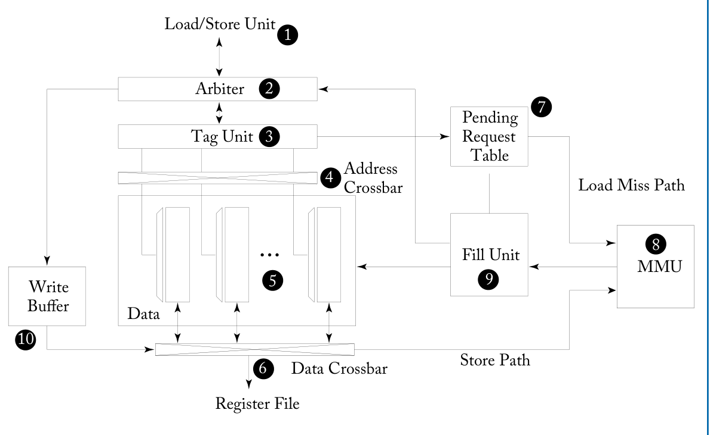

**图 4.1**：统一的 L1 数据缓存与共享存储器 [Minkin et al., 2012]。

**共享存储器访问操作** 对于共享存储器访问，仲裁器判定线程束内所请求的地址是否会造成存储体冲突。如果这些请求地址会造成一个或多个存储体冲突，仲裁器就把该请求拆分为两部分。第一部分包含线程束中一部分线程的地址，这些地址之间不存在存储体冲突。原请求的这一部分被仲裁器接受，交由缓存进一步处理。第二部分包含与第一部分中的地址发生存储体冲突的那些地址。原请求的这一部分被送回指令流水线，必须重新执行。这次后续执行称为“重放”（replay）。原共享存储器请求中需要重放的部分存放在何处，存在权衡。从指令缓冲重放访存指令可以节省面积，但访问庞大的寄存器堆会消耗能量。从能效上看，更好的选择或许是在加载/存储单元中为重放访存指令提供有限的缓冲，并在该缓冲的可用空间即将耗尽时避免从指令缓冲调度访存操作。在考察重放请求后续如何处理之前，我们先看看访存请求中被接受的那部分是如何处理的。

被接受的这部分共享存储器请求会绕过标记单元③内的标记查找，因为共享存储器是直接映射的。在接受共享存储器读请求时，由于在没有存储体冲突的情况下直接映射存储器查找的延迟是固定的，仲裁器会安排一次向指令流水线中寄存器堆的写回事件。标记单元确定每个线程的请求映射到哪个存储体，以此控制地址交叉开关④，由后者把地址分发到数据阵列内各个存储体。数据阵列⑤中的每个存储体宽 32 位，并各有自己的译码器，从而可以独立访问各存储体中不同的行。数据经数据交叉开关⑥返回到相应线程的 lane，以便存入寄存器堆。只有线程束中活跃线程所对应的 lane 才向寄存器堆写入值。

假定共享存储器查找的延迟为单周期，那么共享存储器请求中需要重放的部分可以在前一部分被接受之后的下一周期访问 L1 缓存仲裁器。如果这一重放部分又遇到存储体冲突，它会被进一步划分为被接受的部分和重放的部分。

**缓存读操作** 接下来考察对全局存储器空间的读操作是如何处理的。由于只有全局存储器空间的一部分被缓存在 L1 中，标记单元需要检查数据是否存在于缓存中。数据阵列划分了很多存储体，以便各个线程束能够灵活访问共享存储器；但与此同时，对全局存储器的访问被限制为每周期一个缓存块。这一限制有助于降低标记存储相对于所缓存数据量的开销，同时也是与标准 DRAM 芯片之间的标准接口所导致的结果。在 Fermi 和 Kepler 中，L1 缓存块的大小为 128 字节；在 Maxwell 和 Pascal [NVIDIA Corp.] 中，它进一步划分为四个 32 字节的扇区（sector）[Liptay, 1968]。32 字节的扇区大小对应于现代图形 DRAM 芯片（如 GDDR5）在单次访问中能够读出的最小数据量。每个 128 字节的缓存块由 32 个存储体中同一行上的 32 位表项组成。

加载/存储单元①计算内存地址，并施加访存合并规则，把线程束的一次访存拆分为若干次合并访存，再送入仲裁器②。如果资源不足，仲裁器可能拒绝某个请求。例如，该访问所映射到的缓存组中所有路都处于忙状态，或者下文将要介绍的待处理请求表⑦中没有空闲表项。假定有足够的资源来处理一次缺失，仲裁器便会请求指令流水线安排在未来某个固定周期数之后向寄存器堆写回，该周期数对应于一次缓存命中。与此同时，仲裁器还请求标记单元③检查该访问实际上导致缓存命中还是缺失。若发生缓存命中，则在所有存储体中访问数据阵列⑤的相应行，数据经数据交叉开关⑥返回到指令流水线中的寄存器堆。与共享存储器访问的情形一样，只有活跃线程所对应的寄存器 lane 会被更新。

在访问标记单元（Tag Unit）时，如果判定某个请求会引发缓存缺失，仲裁器就通知访存单元（load/store unit）必须重放该请求，同时把该请求的信息送往待处理请求表（pending request table，PRT）7。待处理请求表所提供的功能，与 CPU 缓存存储系统中传统缺失状态处理寄存器（MSHR）所支持的功能颇为相似 [Kroft, 1981]。NVIDIA 的专利中至少描述了两种版本的待处理请求表 [Minkin et al., 2012, Nyland et al., 2011]。图 4.1 所示 L1 缓存架构所对应的版本，看上去与传统的 MSHR 有些相似。数据缓存的传统 MSHR 保存发生缓存缺失的块地址，以及块内偏移和相关寄存器的信息，后者指明该块被填入缓存时需要写入哪个寄存器。通过记录多个块内偏移和寄存器，可以支持对同一块的多次缺失。图 4.1 中的 PRT 支持把对同一块的两个请求合并起来，并记录所需的信息，以便告知指令流水线应重放哪一条被推迟的访存操作。

图 4.1 所示的 L1 数据缓存采用虚拟索引、虚拟标记（virtually indexed and virtually tagged）。与现代 CPU 微架构大多采用虚拟索引/物理标记（virtually indexed/physically tagged）的 L1 数据缓存相比，这一点可能令人意外。CPU 采用这种组织方式，是为了避免上下文切换时冲刷 L1 数据缓存所带来的开销 [Hennessy and Patterson, 2011]。虽然 GPU 实际上在每个线程束发射的周期都相当于进行一次上下文切换，但这些线程束同属于一个应用。即使 GPU 一次只能运行一个操作系统应用，基于页的虚拟内存在 GPU 内部仍然具有优势，因为它有助于简化内存分配并减少内存碎片。在 PRT 中分配到一个表项之后，访存请求被送往内存管理单元（memory management unit，MMU）8，进行虚拟地址到物理地址的转换，然后经交叉开关互连送往相应的存储分区单元。如 4.3 节将进一步说明的，存储分区单元包含一组 L2 缓存以及一个访存调度器。除了要访问的物理存储地址和要读取的字节数之外，访存请求还包含一个“subid”，当该请求返回核心时，可以用它来查找 PRT 中记录该请求相关信息的表项。

加载操作的访存响应一旦返回核心，就由 MMU 传给填充单元（fill unit）9。填充单元进而利用访存请求中的 subid 字段，在 PRT 中查找该请求的相关信息。这些信息可由填充单元经由仲裁器 2 传给访存单元，用来重新调度该加载操作；该缓存行被放入数据阵列 5 之后即被锁定，因此重新调度的加载操作必定能在缓存中命中。

**缓存写操作** 图 4.1 中的 L1 数据缓存既可以支持写直达（write through）策略，也可以支持写回（write back）策略。因此，对全局存储器的存储指令（写操作）可以用多种方式处理。写入的具体存储空间决定了该写操作按写直达还是按写回方式处理。在许多 GPGPU 应用中，对全局存储器的访问往往时间局部性很差，因为内核通常这样编写：线程在即将退出之前才把数据写出到一个大数组中。对于这类访问，采用写直达且不写分配（write through with no write allocate）的策略可能比较合理 [Hennessy and Patterson, 2011]。相比之下，把寄存器溢出到栈上所产生的本地存储器写操作可能具有较好的时间局部性，其后的加载操作足以证明采用写回且写分配（write back with write allocate）策略是合理的 [Hennessy and Patterson, 2011]。

无论要写入共享存储器还是全局存储器，数据都先放入写数据缓冲（write data buffer，WDB）10。对于非合并访存，或当某些线程被屏蔽时，只写入缓存块的一部分。如果该块已在缓存中，数据就可以经数据交叉开关 6 写入数据阵列。如果该块不在缓存中，则必须先从 L2 缓存或 DRAM 中读出该块。完全填满一个缓存块的合并写，如果会使缓存中任何陈旧数据的标记失效，就可以绕过缓存。

请注意，图 4.1 所描述的缓存组织并*不*支持缓存一致性。例如，假设在 SM 1 上执行的一个线程读取存储单元 A，该值被存入 SM 1 的 L1 数据缓存；随后，在 SM 2 上执行的另一个线程写存储单元 A。如果 SM 1 上的某个线程随后在该值被逐出 SM 1 的 L1 数据缓存之前读取存储单元 A，那么它得到的将是旧值而不是新值。为避免这一问题，从 Kepler 开始的 NVIDIA GPU 只允许把寄存器溢出和栈数据所对应的本地存储器访问，或者只读的全局存储器数据，放入 L1 数据缓存。近期研究探讨了如何在 GPU 上实现具有一致性的 L1 数据缓存 [Ren and Lis, 2017, Singh et al., 2013]，以及明确定义 GPU 内存一致性模型的必要性 [Alglave et al., 2015]。

### 4.1.2 L1 纹理缓存

NVIDIA 近期的 GPU 架构把一级数据缓存与纹理缓存合并在一起，以节省芯片面积。要更好地理解这样的缓存如何工作，首先有必要对独立纹理缓存的设计略作了解。这里讨论的细节有助于读者进一步体会如何为吞吐率处理器开发微架构。本节的许多讨论基于 Igehy 等人 [1998] 的一篇论文，该文意在弥补文献的不足——关于工业界的纹理缓存设计如何容忍缓存缺失所带来的长片外延迟，此前鲜有记载。近期的工业界 GPU 专利 [Minken et al., 2010, Minken and Rubinstein, 2003] 描述了与此密切相关的设计。由于本书的重点不在图形学，我们只简要概述那些促使人们引入纹理缓存的纹理操作。

在三维图形中，人们希望让场景看起来尽可能逼真。为了在实时渲染所要求的高帧率下达到这种逼真度，图形 API 采用了一种称为*纹理映射*（texture mapping）的技术 [Catmull, 1974]。在纹理映射中，一幅称为纹理的图像被施加到三维模型的某个表面上，使该表面看起来更逼真。例如，可以用一幅纹理让场景中的一张桌子呈现出天然木材的外观。为实现纹理映射，渲染流水线首先要确定纹理图像内一个或多个采样点的坐标。这些采样点称为纹素（texel）。然后利用这些坐标求出存放相应纹素的内存单元的地址。由于屏幕上的相邻像素映射到相邻的纹素，而且通常会对邻近纹素的取值求平均，纹理访存中存在显著的局部性，可被缓存加以利用 [Hakura and Gupta, 1997]。

图 4.2 示出了 Igehy 等人 [1998] 所描述的一级纹理缓存的微架构。与 4.1.1 节所述的一级数据缓存不同，这里的标记阵列 2 与数据阵列 5 之间用一个 FIFO 缓冲 3 隔开。设置该 FIFO 的目的，是隐藏那些可能需要由 DRAM 服务的缺失请求的延迟。从本质上说，纹理缓存的设计前提是：缓存缺失会频繁发生，而工作集的规模相对较小。为使标记阵列和数据阵列的规模都保持较小，标记阵列实际上是跑在数据阵列前面的。标记阵列的内容反映的是：在大约相当于一次缺失请求往返内存所需的时间之后，数据阵列将会呈现的状态。与容量和缺失处理资源都有限的常规 CPU 设计相比，这种设计的吞吐率有所提高，但缓存命中和缓存缺失所经历的延迟却大致相同。

具体而言，图 4.2 所示的纹理缓存工作过程如下。访存单元（load/store unit）1 把算出的纹素地址送往标记阵列 2 进行查找。若该访问命中，则把指向数据阵列中数据位置的指针，连同完成该纹理操作所需的其他信息，一起写入片段 FIFO 3 尾部的一个表项。当该表项到达片段 FIFO 的头部时，控制器 4 用该指针从数据阵列 5 中取出纹素数据，并将其送回纹理过滤单元 6。虽然图中没有详细示出，但对于双线性过滤和三线性过滤（mipmap 过滤）之类的操作，每个片段（即屏幕像素）实际上要做四次或八次纹素查找。纹理过滤单元把这些纹素组合起来，产生一个颜色值，再经由寄存器堆返回指令流水线。

若在标记查找期间发生缓存缺失，标记阵列就通过缺失请求 FIFO 8 发出访存请求。缺失请求 FIFO 把请求送往存储系统的较低层次 9。GPU 存储系统可以借助访存调度技术来提高 DRAM 带宽利用率 [Eckert, 2008, 2015]，这类技术可以乱序处理访存请求，以减小行切换的代价。为保证数据阵列 5 的内容与标记阵列 2 的延时状态保持一致，数据必须按顺序从存储系统返回。这一点是借助一个重排序缓冲 10 实现的。

### 4.1.3 纹理与数据统一缓存

在 NVIDIA 和 AMD 近期的 GPU 架构中，数据值和纹理值的缓存由一个统一的一级缓存结构来完成。要以最直接的方式做到这一点，只需把能够保证是只读的数据值缓存到一级缓存中。对于符合这一限制的数据，纹理缓存的硬件几乎可以不加改动地使用，只需改动寻址逻辑。近期的一项专利描述了这样的设计 [Heinrich et al., 2017]。在 AMD 的 GCN GPU 架构中，所有向量访存操作都经由纹理缓存处理 [AMD, 2012]。

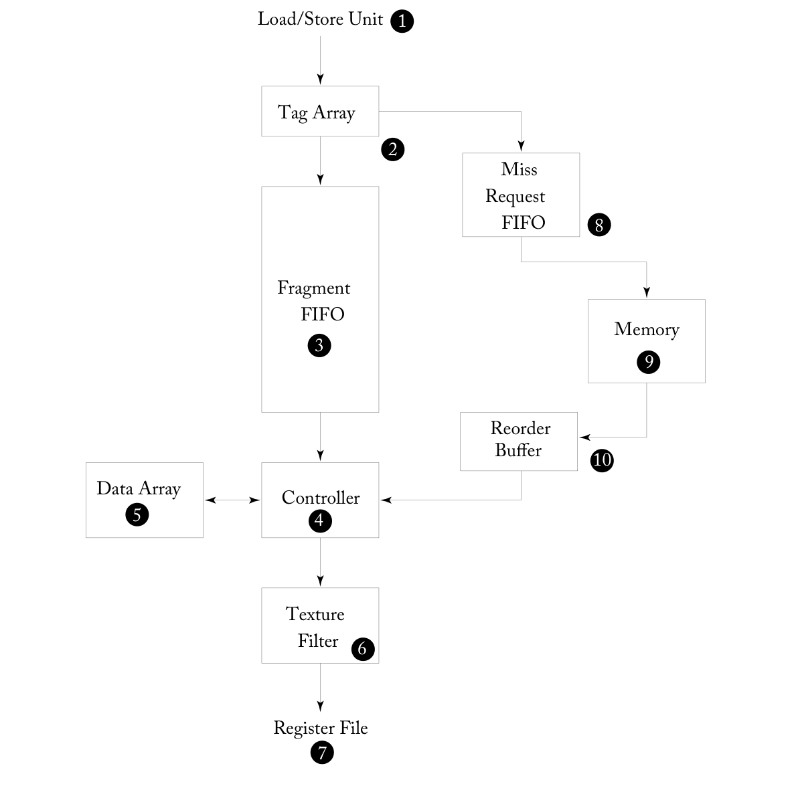

**图 4.2**：一级纹理缓存（部分基于 [Igehy et al., 1998] 中的图 2）。

## 4.2 片上互连网络

为了向 SIMT 核心提供其所需的巨大存储带宽，高性能 GPU 通过存储分区单元（见 4.3 节）并行连接到多个 DRAM 芯片。访存流量借助地址交织分布到各个存储分区单元上。一项 NVIDIA 专利描述了以 256 字节或 1,024 字节为粒度、在最多 6 个存储分区之间平衡流量的地址交织方案 [Edmondson and Van Dyke, 2011]。

SIMT 核通过片上互连网络连接到存储分区单元。NVIDIA 近期专利中描述的片上互连网络是交叉开关 [Glasco et al., 2013, Treichler et al., 2015]。AMD 的图形处理器则有时被描述为采用环形网络 [Shrout, 2007]。

## 4.3 存储分区单元

下面，我们依据 NVIDIA 近期的几项专利来介绍存储分区单元的微架构。从历史背景看，这些专利的申请时间比 NVIDIA Fermi 图形处理器架构的发布大约早一年。如图 4.3 所示，每个存储分区单元包含二级（L2）缓存的一部分，以及一个或多个访存调度器（memory access scheduler，又称“帧缓冲”，即 FB）和一个光栅操作（ROP）单元。L2 缓存中既存放图形数据，也存放计算数据。访存调度器对存储器的读操作和写操作重新排序，以降低访问 DRAM 的开销。ROP 单元主要用于 alpha 混合之类的图形操作，并支持图形表面的压缩。ROP 单元还支持原子操作，例如 CUDA 编程模型中的那些原子操作。这三个单元紧密耦合，下面将较为详细地逐一介绍。

### 4.3.1 L2 缓存

L2 缓存的设计包含若干优化，用以提高图形处理器单位面积上的总体吞吐率。每个存储分区内部的 L2 缓存部分由两个分片（slice）组成 [Edmondson et al., 2013]。每个分片都包含相互独立的标记阵列和数据阵列，并按顺序处理到达的请求 [Roberts et al., 2012]。为与 GDDR5 中 32 字节的 DRAM 原子大小相匹配，分片内的每条缓存行包含四个 32 字节的扇区（sector）。缓存行可被分配给存储指令使用，也可被分配给加载指令使用。在写缺失时，合并写会完整覆盖每个扇区，这是常见情形；为优化此种情形下的吞吐率，不会先从存储器读出任何数据。这与标准计算机体系结构教科书对 CPU 缓存的常见描述大不相同。对于不能完整覆盖一个扇区的非合并写该如何处理，我们查阅的专利并未说明，但有两种解决思路：一是保存字节级的有效位，二是完全绕过 L2。为减小访存调度器的面积，正在写入存储器的数据在等待调度期间先缓冲在 L2 的缓存行中。

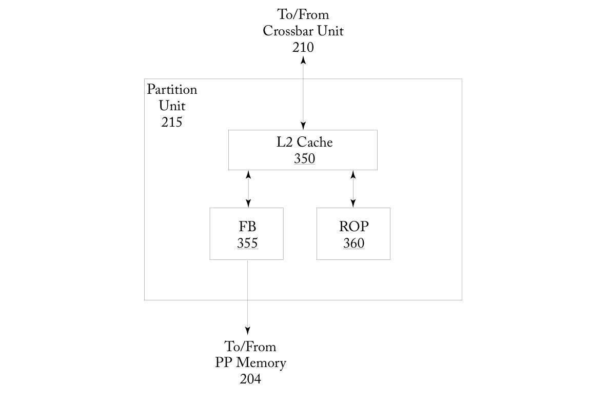

**图 4.3**：存储分区单元总览（基于 Edmondson 等人 [2013] 的图 3B）。

### 4.3.2 原子操作

如 Glasco 等人 [2012] 所述，ROP 单元包含用于执行原子操作和归约操作的函数单元。由于 ROP 单元内含一个本地 ROP 缓存，访问同一存储位置的一串原子操作可以流水化执行。原子操作可用于在不同线程块中运行的线程之间实现同步。

### 4.3.3 访存调度器

为存储大量数据，图形处理器采用 GDDR5 之类的专用动态随机存储器（DRAM）。DRAM 把各个比特存储在微小的电容器中。例如，要从这些电容器中读出数值，首先把一行比特（称为一个页，page）读入一个称为行缓冲（row buffer）的小型存储结构。为完成这一操作，必须先把连接各个存储电容器与行缓冲的位线（它们自身也具有电容）预充电到 0 与电源电压之间一半的电压。在激活（activate）操作中，当电容器通过访问晶体管与位线相连时，电荷会从位线流入或流出存储单元，使位线电压略微上升或下降。随后由灵敏放大器把这一微小变化放大，直至读出干净的逻辑 0 或 1。把数值读入行缓冲的过程同时刷新了电容器中存储的数值。预充电和激活操作会引入延迟，在此期间无法对 DRAM 阵列进行数据读写。为缓解这些开销，DRAM 中包含多个存储体（bank），每个存储体都有自己的行缓冲。然而，即使有多个 DRAM 存储体，访问数据时也往往无法完全隐藏行与行之间切换的延迟。这就促成了访存调度器的采用 [Rixner et al., 2000, Zuravleffand Robinson, 1997]，它通过重排 DRAM 访存请求，减少数据必须在行缓冲与 DRAM 单元之间搬移的次数。

为支持对 DRAM 的访问，GPU 中的每个存储分区可以包含多个访存调度器 [Keil and Edmondson, 2012]，把它所包含的那部分 L2 缓存连接到片外 DRAM。最简单的做法是让 L2 缓存的每个分片拥有自己的访存调度器。每个访存调度器都包含独立的逻辑，分别用于对 L2 缓存送来的读请求和写请求（“脏数据通知”，dirty data notifications）进行排序 [Keil et al., 2012]。为了把对 DRAM 同一存储体中同一行的读请求归并到一起，采用了两个独立的表。第一个表称为读请求排序器（read request sorter），它是一个按存储地址访问的组相联结构，把给定存储体中同一行的所有读请求映射到单个指针上。该指针用于在第二个表（称为读请求存储表，read request store）中查找由各个读请求组成的列表。

## 4.4 GPU 存储系统的研究方向

### 4.4.1 访存调度与互连网络设计

Yuan 等人 [2009] 针对运行以 CUDA 编写的 GPU 计算应用的图形处理器，研究了访存调度器的设计。他们观察到，由单个流多处理器（SM）产生的请求具有行缓冲局部性（row-buffer locality）。若序列中位置相近的请求访问同一 DRAM 存储体中同一 DRAM 行，则称发往某一给定存储分区的一串访存请求具有行缓冲局部性。然而，当一个 SM 的访存请求发往各存储分区时，它们会与发往同一存储分区的其他 SM 的请求混在一起。结果是，进入该存储分区的请求序列的行缓冲局部性下降。Yuan 等人 [2009] 提出，通过修改片上互连网络来保持行缓冲局部性，从而降低访存调度的复杂度。具体做法是引入若干仲裁策略，优先放行那些含有来自同一 SM 的访存请求、或含有存储体地址与行地址相近的访存请求的数据包。

Bakhoda 等人 [2010, 2013] 研究了图形处理器片上互连网络的设计。该互连网络把各流多处理器连接到各存储分区。他们认为，随着 SM 数量增加，将有必要采用网格（mesh）之类可扩展的拓扑结构。他们研究了片上网络设计如何影响系统吞吐率，发现许多 CUDA 应用的吞吐率对互连延迟相对不敏感。他们分析了互连网络上的流量，发现其呈现出“多—少—多”的模式。基于这一流量模式，他们提出了一种更为受限的可扩展拓扑，由若干“半路由器”（half-router）构成，从而降低了路由器的面积开销。

### 4.4.2 缓存有效性

Bakhoda 等人 [2009] 利用他们开发的 GPGPU-Sim 模拟器，研究了在支持 CUDA 的图形处理器上为全局存储器访问增加 L1 缓存和（或）L2 缓存所带来的影响，结果表明一些应用从中获益，另一些则没有。

Jia 等人 [2012] 的后续工作在 NVIDIA Fermi 图形处理器硬件上通过启用或禁用缓存来刻画缓存的有效性，得到了相似的结论。他们观察到，那些经 L1 缓存把数据读入便笺式共享存储器的应用，并不会因启用 L1 缓存而获益。即使排除这类应用，Jia 等人 [2012] 仍发现仅凭缓存命中率不足以预测启用缓存能否提升性能。他们发现，必须考虑缓存对发往 L2 缓存（例如各存储分区）的请求流量的影响。在他们所研究的 Fermi 图形处理器上，L1 缓存不划分扇区，因此启用缓存后，一次缺失可能引起更大的 128 字节片外访存。对于受存储带宽限制的应用，这部分额外的片外访存流量会导致性能下降。Jia 等人 [2012] 提出了三类局部性的分类方法：线程束内局部性、线程块内局部性和跨指令局部性。线程束内局部性出现在下述情形：单个线程束中不同线程执行同一条加载指令所产生的读访问访问同一缓存块。线程块内局部性出现在下述情形：同一线程块中不同线程束的线程执行同一条加载指令所产生的读访问访问同一缓存块。跨指令局部性出现在下述情形：同一线程块中的线程执行不同加载指令所产生的读访问访问同一缓存块。Jia 等人 [2012] 借助这一分类提出了一种编译期算法，用以帮助推断对单条加载指令而言启用缓存是否有益。

### 4.4.3 访存请求优先级划分与缓存旁路

在上述刻画研究 [Jia et al., 2012] 以及 Rogers 等人 [2012] 的工作（后者表明线程束调度可以提升缓存有效性，见 5.1.2 节）的基础之上，Jia 等人 [2014] 提出了面向图形处理器的访存请求优先级划分与缓存旁路技术。相对于线程数目而言相联度较低的缓存，可能遭受严重的冲突缺失 [Chen and Aamodt, 2009]。Jia 等人 [2014] 指出，若干用 CUDA 编写的 GPGPU 应用所包含的数组索引方式，会使单个线程束发出的一次访存请求在采用标准的取模缓存组索引函数 [Hennessy and Patterson, 2011, Patterson and Hennessy, 2013] 时，产生映射到同一缓存组的多个缺失。Jia 等人 [2014] 把这种现象称为线程束内争用（intra-warp contention）。假设在检测到缺失时就分配缓存空间<sup>1</sup>，且缺失状态处理寄存器数目有限<sup>2</sup>，那么线程束内争用就可能导致存储流水线停顿<sup>3</sup>。为解决线程束内争用，Jia 等人 [2014] 提出：当发生缺失、且因相联度停顿而无法分配缓存块时，绕过 L1 数据缓存。所谓相联度停顿，是指缓存组中的所有块都已被预留，用于存放尚在途的缓存缺失将要返回的数据。

Jia 等人 [2014] 还考察了他们所称的线程束间争用（cross-warp contention）。当一个线程束驱逐了另一个线程束调入的数据时，就会产生这种形式的缓存争用。为解决这类争用，Jia 等人 [2014] 建议采用一种他们称为“访存请求优先级缓冲”（memory request prioritization buffer，MRPB）的结构。与 CCWS [Rogers et al., 2012] 一样，MRPB 通过改变对缓存的访问顺序来提高局部性，从而减少容量缺失。但与 CCWS 间接地通过线程调度实现这一目标不同，MRPB 是在线程已被调度之后，通过改变各次访存之间的顺序来提高局部性。

MRPB 就在一级数据缓存之前实现访存请求重排序。MRPB 的输入是在指令发射流水级中产生、并已经过访存合并处理的访存请求。MRPB 的输出则把访存请求送入一级缓存。在内部，MRPB 包含若干并行的先进先出（FIFO）队列。一条缓存请求依据其“签名”（signature）被分发到这些 FIFO 中。在他们评估的若干方案中，最有效的签名是使用“线程束 ID”（即 0 到流多处理器上可运行的最大线程束数之间的一个编号）。MRPB 采用一种“排空策略”（drain policy）来决定下一次访问缓存时应从哪个 FIFO 中选取访存请求。在所探索的若干方案中，效果最好的是简单的固定优先级方案：每个队列被赋予一个静态优先级，含有请求且优先级最高的队列最先得到服务。

详细的评估表明，将 MRPB 的旁路机制与重排序机制结合起来，相对 64 路组相联的 16 KB 缓存可取得 4% 的几何平均加速比。Jia 等人 [2014] 还与 CCWS 做了一些比较，显示出更大的提升。顺带指出，Rogers 等人 [2012] 的评估所采用的基线架构使用了更复杂的组索引哈希函数<sup>4</sup>，以减轻相联冲突停顿（associativity stall）的影响。此外，Nugteren 等人 [2014] 的后续工作逆向分析了 NVIDIA Fermi 架构中实际采用的组索引哈希函数的细节，发现它使用异或运算（这同样有助于减少此类冲突）。

与 Rogers 等人 [2013] 类似，Jia 等人 [2014] 表明，他们这种对程序员透明的性能改进方法能够缩小使用缓存的简单代码与使用便笺式共享存储器的深度优化代码之间的差距。

<sup>1</sup>这是 GPGPU-Sim 中的默认做法，用以避免协议死锁。<sup>2</sup>与数量有限的待处理请求表项相一致——见 4.1.1 节。<sup>3</sup>Jia 等人 [2014] 所使用的 GPGPU-Sim 3.2.0 版不建模 3.3.2 节与 4.1 节所述的指令重放。<sup>4</sup>参见 https://github.com/tgrogers/ccws-2012/blob/master/simulator/ccws_gpgpu-

```
sim/distribution/src/gpgpu-sim/gpu-cache.cc
```

Arunkumar 等人 [2016] 依据一条静态指令中访存发散的程度，考察了缓存旁路与改变缓存行大小所带来的效果。他们利用观测到的重用距离模式与访存发散度，来预测是否应当旁路以及最优的缓存行大小。

Lee 和 Wu [2016] 提出一种基于控制环的缓存旁路方法，试图在运行时逐条指令地预测重用行为。缓存行的重用行为受到监视。若某个程序计数器所加载的缓存行未能获得足够重用，该指令的访存就会被旁路。

### 4.4.4 利用线程束间的异构性

Ausavarungnirun 等人 [2015] 针对 GPU 的共享 L2 缓存与存储控制器提出了一系列改进，以缓解不规则 GPU 应用中的访存延迟发散。这些技术统称为访存发散纠正（Memory Divergence Correction，MeDiC），它们利用的观察是：同一内核中各线程束的访存延迟发散程度存在异构性。按照各线程束与共享 L2 缓存的交互方式，内核中的每个线程束可被刻画为全部/大部分命中、全部/大部分缺失，或均衡三类。作者们证明，让线程束不处于全部命中状态几乎没有收益，因为大部分命中的线程束必须等到最慢的那次访存返回后才能继续执行。他们还证明，L2 缓存处的排队延迟会带来不可忽视的性能影响，而对所有非全部命中的线程束，让其全部请求（即便是本可能命中的请求）都旁路 L2 缓存，可以缓解这一影响。这样做通过减少排队延迟，降低了全部命中线程束的访存延迟。除自适应旁路技术之外，他们还提出对缓存替换策略和存储控制器调度器加以修改，以尽量缩短被判定为全部命中的线程束的延迟。他们还指出，即使对全部命中的线程束而言，由于 L2 各存储体（bank）之间的排队延迟并不均衡，这种不均衡也会造成额外、本可避免的排队延迟。

作者提出的微架构机制由四个部分组成：(1) 线程束类型检测模块——它把 GPU 中的线程束归为五种可能类型之一：全部缺失、大部分缺失、均衡、大部分命中或全部命中；(2) 感知线程束类型的旁路逻辑模块，决定请求是否应旁路 L2 缓存；(3) 感知线程束类型的插入策略，决定 L2 中的插入位置落在 LRU 栈的何处；(4) 感知线程束类型的访存调度器，决定 L2 缺失/旁路请求以何种顺序发往 DRAM。

检测机制按间隔对每个线程束的命中率（总命中次数/总访问次数）进行采样。根据该比率，线程束被赋予上述五种分类之一。决定这些分类边界的具体命中率会针对每种工作负载动态调整。在分类间隔期间，不允许任何请求旁路缓存，以便对各线程束 L2 特性的阶段性变化作出反应。

缓存旁路机制位于 L2 缓存之前，接收的访存请求都带有一个标记，指明该请求由哪一类线程束产生。该机制试图消除来自全缺失线程束（all-miss warp）的访问，并把多数缺失线程束（mostly-miss warp）转化为全缺失线程束。这个模块的做法很简单：把所有标记为来自全缺失线程束和多数缺失线程束的请求直接送往访存调度器。

MeDiC 的缓存管理策略通过改变从 DRAM 返回的请求在 L2 的 LRU 栈中的插入位置来起作用。由多数缺失线程束请求的缓存行被插入到 LRU 位置，而其他所有请求则插入到传统的 MRU 位置。

最后，MeDiC 修改基线访存请求调度器，使其包含两个访存队列：一个高优先级队列，用于全命中和多数命中线程束；一个低优先级队列，用于均衡、多数缺失和全缺失线程束。访存调度器只是让高优先级队列中的所有请求优先于低优先级队列中的任何请求。

### 4.4.5 协同缓存旁路

Xie 等人 [2015] 探讨了有选择地启用缓存旁路以提高缓存命中率的潜力。他们借助剖析（profiling）为 GPGPU 应用中的每条静态加载指令判定其局部性属于良好、较差还是中等，并据此对指令加以标记。标记为局部性良好的加载操作被允许使用 L1 数据缓存；标记为局部性较差的加载操作则总是被旁路。标记为中等局部性的加载指令采用一种自适应机制，其工作方式如下。该自适应机制以线程块为粒度工作。对于给定的线程块，所执行的所有中等局部性加载被统一对待：它们要么都使用 L1，要么都旁路。具体行为在线程块启动时确定，依据是一个阈值，而该阈值利用一项同时考虑 L1 缓存命中与流水线资源冲突的性能指标在线调整。他们的评估表明，与静态线程束限制相比，这种方法能更大幅度地提高缓存命中率。

### 4.4.6 自适应缓存管理

Chen 等人 [2014b] 提出把缓存旁路与线程束节流（warp throttling）协同起来，利用线程束节流和缓存旁路两者的优势，提高对缓存高度敏感的应用的性能。所提机制在运行时检测缓存争用与存储资源争用，并据此协调节流策略和旁路策略。该机制借助一种已有的 CPU 缓存旁路技术——保护距离（protection distance）——来实现缓存旁路，保护距离可使某条缓存行在若干次访问之内不被逐出。缓存行插入缓存时会被赋予一个保护距离，同时由计数器跟踪各行剩余的保护距离。一旦剩余保护距离降为 0，该行就不再受保护，可以被逐出。当一个新的访存请求试图把新行插入某个组（set），而该组中没有未受保护的行时，该访存请求就旁路缓存。

保护距离是全局设定的，其最优值因工作负载而异。在这项工作中，Chen 等人 [2014b] 对静态保护距离进行了扫描，并证明 GPU 工作负载对保护距离的取值相对不敏感。

### 4.4.7 缓存优先级划分

Li 等人 [2015] 观察到，线程束节流虽然优化了 L1 缓存的命中率，却可能使片外带宽和 L2 缓存等其他资源显著得不到充分利用。他们提出一种机制，为线程束分配令牌，以决定哪些线程束可以向 L1 缓存中分配缓存行。额外的“无污染线程束”（non-polluting warps）不获得令牌，因此它们虽然可以执行，却不被允许逐出 L1 中的数据。由此形成一个优化空间：可调度的线程束数量（W）和持有令牌的线程束数量（T）都可以设为小于可执行线程束的最大数量。他们表明，静态地选取 W 和 T 的最优值，相比采用静态线程束限制的 CCWS 可带来 17% 的提升。

基于这一观察，Li 等人 [2015] 探索了两种学习 W 和 T 最佳值的机制。第一种方法基于这样的思想：在提高缓存命中率的同时保持高线程级并行度。这种方法称为 dynPCALMTLP：在一个采样周期内，以 W 设为最大线程束数来运行内核，然后让 T 在不同的 SIMT 核上取不同值，最后选取性能达到最大的 T 值。由此可获得与 CCWS 相当的性能，而面积开销显著更小。第二种方法称为 dynPCALCCWS，它先用 CCWS 设定 W，再用 dynPCALMTLP 确定 T，然后监测共享结构的资源使用情况，以动态增大或减小 W。相比 CCWS，这带来 11% 的性能提升。

### 4.4.8 虚拟内存页放置

Agarwal 等人 [2015] 考察了在同时包含容量优化型存储器和带宽优化型存储器的异构系统中，跨多种物理内存类型支持缓存一致性会带来哪些影响。由于面向带宽优化的 DRAM 在成本和能耗上都比面向容量优化的 DRAM 更高，未来的系统很可能同时包含这两类存储器。Agarwal 等人 [2015] 观察到，当前的页放置策略（例如 Linux 中采用的策略）并未把存储带宽的非均匀性考虑在内。他们研究了一种未来的系统：GPU 能够以低延迟访问低带宽、高容量的 CPU 内存，所需付出的代价是 100 个核心时钟周期。他们的实验使用修改版的 GPGPU-Sim 3.2.2，并为其配置了额外的 MSHR 资源，以建模更近期的 GPU。

在这一配置下，他们首先发现，对于受存储带宽限制的应用，同时使用 CPU 和 GPU 的存储器来提高聚合存储带宽，可以带来可观的性能提升。他们发现，受存储延迟限制的 GPGPU 应用中，属于这种情形（即无法获益）的应用较少。在假定各页被均匀访问、且带宽优化型存储器的容量不构成限制的前提下，他们证明：按各存储区域可用存储带宽的比例把页分配给这些区域，是最优的做法。在带宽优化型存储器的容量不成问题的假设下，他们发现一种简单的策略——按存储带宽所决定的概率，把页随机分配给带宽优化型或容量优化型存储器——在真实的 GPGPU 程序上确实行之有效。然而，当带宽优化型存储器的容量不足以满足应用需求时，他们发现必须细化页放置，把访问频率也考虑进来。

为了细化页放置，他们提出了一套系统，其中包含一个性能剖析阶段，该阶段用 NVIDIA 开发者工具 nvcc 与 ptxas 的修改版本来实现；系统还扩展了现有的 CUDA API，使其能够接受页放置提示。使用由剖析引导的页放置提示，可以获得理想（oracle）页放置算法约 90% 的收益。他们把页面迁移策略留作今后的工作。

### 4.4.9 数据放置

Chen 等人 [2014a] 提出 PORPLE，这是一种可移植的数据放置策略，由规约语言、源到源编译器以及自适应运行时数据放置器组成。他们的出发点是这样一种观察：GPU 上可用的存储器种类繁多，程序员很难判断哪些数据应当放在何处，而且这种判断往往无法从一种 GPU 架构移植到另一种 GPU 架构。PORPLE 的目标是可扩展、能适应输入，并且普遍适用于规则访问与不规则访问。他们的方法依赖三项解决方案。

第一项解决方案是一种存储规约语言，用以支持可扩展性和可移植性。该存储规约语言依据访问这些存储空间时在何种条件下会被串行化，来描述 GPU 上各种形式的存储器。例如，对相邻全局数据的访问会被合并，因而可以并发进行；而对共享存储器中同一存储体的访问则必须串行化。

第二项解决方案是一个名为 PORPLE-C 的源到源编译器，它把原 GPU 程序转换为一个与放置方式无关的版本。该编译器在访存操作周围插入保护代码，从中选出与预测出的最佳数据放置方式相对应的那次访问。

最后，为了预测哪种数据放置方式最优，他们用 PORPLE-C 通过代码分析找出静态访问模式。当静态分析无法确定访问模式时，编译器会生成一个函数，由它跟踪运行时的访问模式并尝试做出预测。该函数在 CPU 上运行一小段时间，帮助在启动内核之前确定最佳的、基于 GPU 的数据放置方式。在这项工作的范围内，该系统只处理数组的放置，因为数组是 GPU 内核中最常用的数据结构。

PORPLE 中用于做出放置预测的轻量级模型，根据存储器的串行化条件来估计所产生的事务数量。对于具有缓存层次的存储器，它用重用距离来估计缓存命中率。当多个数组共享一个缓存时，各数组所占缓存份额的估计值，是按数组大小对缓存做线性划分得到的。

### 4.4.10 多芯片模块 GPU

Arunkumar 等人 [2017] 指出，摩尔定律的放缓将导致 GPU 性能提升的速度放慢。他们提出，在多芯片模块（MCM）上由较小的 GPU 模块构建大型 GPU，以此延续性能的扩展（见图 4.4）。他们证明，把对远端数据的本地缓存、考虑局部性的 CTA 到模块的调度，以及首次触碰（first-touch）式页分配结合起来，可以使性能与单个大型（且无法实现的）单片 GPU 相差不超过 10%。根据他们的分析，这比在同样工艺下采用可实现的最大单片 GPU 要高出 45%。

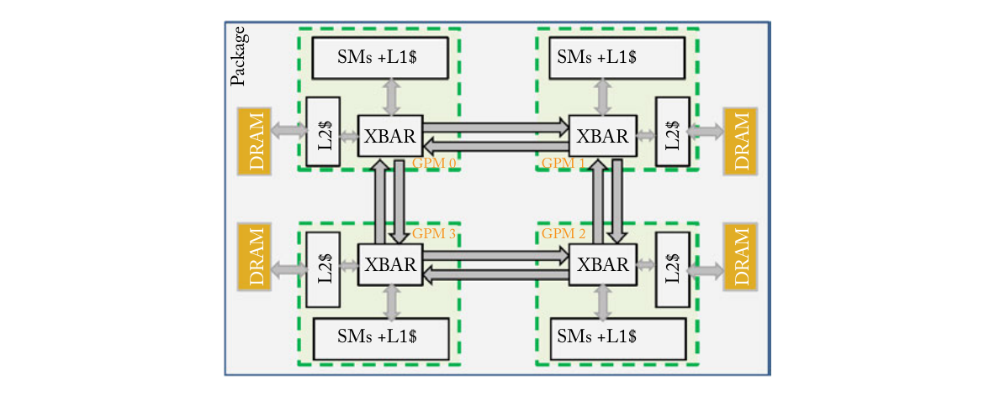

**图 4.4**：多芯片模块 GPU（基于 Arunkumar 等人 [2017] 的图 3）。

---

# 第 5 章　GPU 计算架构的交叉研究

本章详细讨论 GPGPU 体系结构中若干无法整齐归入前面各章的研究方向，前面各章聚焦于 GPU 体系结构的特定组成部分。5.1 节探讨有关 GPU 中线程如何被调度的工作，5.2 节考察替代性的编程方法，5.4 节则审视异构 CPU/GPU 计算方面的工作。

## 5.1 线程调度

当代 GPU 与 CPU 的根本差异在于，前者依赖大规模并行。无论程序以何种方式编写（例如使用 OpenCL、CUDA、OpenACC 等），只要负载不具备大量由软件定义的并行性，就不适合用 GPU 加速。GPU 采用多种机制来聚集并调度所有这些线程。在 GPU 上，线程的组织与调度主要有三种方式。

**线程到线程束的分配** 由于 GPU 用 SIMD 单元来执行由 MIMD 编程模型定义的线程，必须把这些线程以线程束的形式融合在一起，以锁步方式执行。在本书通篇研究的基线 GPU 体系结构中，线程号连续的线程被静态地融合为一个线程束。3.4.1 节综述了为获得更好的线程束压缩而提出的各种替代性线程编排方案。

**线程块到核心的动态分配** CPU 可以一次一个地把线程分配到硬件线程上，GPU 则不同：在 GPU 中，工作是以成批的方式分配到 GPU 核心的，这个工作单元由多个线程束组成，形式为一个线程块。在我们的基线 GPU 中，线程块按轮转（round-robin）顺序分配到各核心。核心的资源（如线程束槽位、寄存器堆和共享存储器空间）以线程块为粒度被占用。由于每个线程块都关联着大量状态，当代 GPU 不会抢占线程块的执行。线程块中的线程要一直运行到结束，其资源才能分配给另一个线程块。

**逐周期的调度决策** 线程块分配到某个 GPU 核心之后，一组细粒度的硬件调度器会在每个周期决定：取指哪些线程束、发射哪些线程束去执行，以及何时为每条已发射的指令读/写操作数。

**多内核调度** 线程块级的调度决策和逐周期的调度决策，既可以发生在单个内核内部，也可以跨越在同一 GPU 上并发运行的多个内核。早期的内核调度只允许一个内核在 GPU 上处于活动状态。不过，NVIDIA 的 Streams 与 HyperQ 调度机制的问世，使并发内核的运行成为可能。这种情况在某些方面与 CPU 上的多道程序设计类似。

### 5.1.1 线程块到核心分配的研究

内核启动时，该次内核启动中的线程被划分为若干线程块。一个 GPU 全局的线程块调度机制依据资源可用情况，把每个线程块分配到某个 SIMT 核。每个核都有固定数量的便笺式存储器（在 CUDA 中称为共享存储器，在 OpenCL 中称为局部存储器）、固定数量的寄存器、线程束槽位和线程块槽位。在内核启动时，每个线程块的这些参数都是已知的。最直观的线程块调度算法是以轮转方式把线程块分配到各核，以使参与的核心数量最大化。线程块被持续调度，直到每个核中至少有一种资源耗尽为止。注意，一个内核包含的线程块可能多于 GPU 一次所能运行的线程块数。因此，在内核的某些线程块执行的同时，另一些线程块可能根本没有在 GPU 上运行。已有若干研究技术在权衡线程块调度空间中的各种取舍。

**线程块级节流** Kayiran 等人 [2013] 提出对分配到每个核的线程块数量进行节流，以减少线程超额订阅在存储系统中引起的争用。他们设计了一种算法，用来监测核心空闲周期和访存延迟周期。该算法一开始只给每个核分配其最大线程块数量的一半，随后监测空闲周期与访存延迟周期。如果某个核主要是在等待存储器，就不再给它分配更多线程块，并可能暂停已有的线程块，阻止它们继续发射指令。该技术实现了一种粗粒度的并行度节流机制，尽管并发活动的 CTA 更少，它却限制了存储系统中的相互干扰，提高了应用的整体性能。

**动态调节 GPU 资源** Sethia 和 Mahlke [2014] 提出 Equalizer，这是一个硬件运行时系统，它动态监测资源争用情况，并调节线程数量、核心频率和存储器频率，以同时改善能耗与性能。该系统依据四个参数作出决策：（1）一个 SM 中活动的线程束数；（2）等待存储器数据的线程束数；（3）已就绪、可执行算术指令的线程束数；（4）已就绪、可执行访存指令的线程束数。根据这些参数，它先决定在一个 SM 上保持活动的线程束数，然后依据该值以及另外三个计数器的值（它们分别作为存储争用、计算密集度和访存密集度的代理指标），决定如何最好地调节核心与存储系统的频率。

Equalizer 有两种工作模式：节能模式与性能增强模式。在节能模式下，它通过缩减利用率不足的资源来节省能量，在使能耗最小化的同时减轻对性能的影响。在性能增强模式下，Equalizer 提升瓶颈资源，以高能效的方式提高性能。

他们通过考察在改变存储器频率、计算频率以及并发运行的线程数时所伴随的性能与能量取舍，把来自 Rodinia 和 Parboil 的一组工作负载归类为计算密集型、访存密集型、缓存敏感型或未饱和型。如果目标是最小化能量（而不牺牲性能），那么计算密集型内核应当以较低的存储器频率运行，访存密集型内核则应当以较低的 SIMT 核频率运行。这有助于减少系统在基线频率下因资源未被充分利用而无谓消耗的能量。

Equalizer 以区间（interval）为单位对频率和并发度作出决策。该技术为每个 SIMT 核增加了监测硬件，由它依据前面列出的四个计数器作出局部决策。每个 SIMT 核在本地决定本区间（epoch）内三个输出参数（CTA 数量、存储器频率和计算频率）应取何值。它把该 SM 应当使用的 CTA 数量告知全局工作分发引擎：如果某个 SIMT 核需要更多工作，就由该引擎向它发放新的线程块。如果该 SM 应以更少的 CTA 运行，它就暂停核上的一些 CTA。在确定要运行的 CTA 数量之后，每个 SIMT 核向全局频率管理器提交一个存储器/计算电压目标，后者依据多数表决函数设定全芯片范围的频率。

局部决策是通过观察等待执行访存指令的线程束数量以及等待执行 ALU 指令的线程束数量作出的。如果等待存储器的线程束数大于一个 CTA 中的线程束数，那么就减少该 SIMT 核上运行的 CTA 数量，这可能有助于缓存敏感型工作负载的性能。如果已就绪、可发射访存（或 ALU）指令的线程束数多于一个 CTA 中的线程束数，则认为该 SIMT 核是访存（或计算）密集型的。如果等待存储器（或计算）的线程束数少于一个 CTA 中的线程束数，那么只要活动线程束中有一半以上处于等待状态，且等待存储器的线程束不超过两个，该 SIMT 核仍可被视为受 ALU 或存储器限制。若属于这种情况，则把核上活动的 CTA 数量加一，并根据是等待计算的线程束更多还是等待存储器的线程束更多，判定该 SIMT 核受计算限制还是受存储器限制。

一旦各 SIMT 核作出各自的局部决策，存储器与各核的频率便依据 Equalizer 当前所处的运行模式，按 ±15% 进行调节。

### 5.1.2 逐周期调度决策的研究

**逐周期调度的早期特征刻画** Lakshminarayana 和 Kim [2010] 在一个没有硬件管理缓存的早期 GPU 上考察了大量线程束调度策略，并表明：对于每个线程束执行的动态指令数对称（均衡）的应用，基于公平性的线程束与 DRAM 访问调度策略能够提升性能。该策略在他们研究所用的规则 GPU 工作负载上效果良好，因为线程束之间的规则访存请求既能在核内合并，又能更好地利用 DRAM 行缓冲局部性。该文还刻画了其他若干线程束调度策略，其中包括 ICOUNT——它最初由 Tullsen 等人 [1996] 针对同时多线程（SMT）CPU 提出。ICOUNT 的设计目标是通过优先调度进展最快的线程束（或线程）来提高系统吞吐率。Lakshminarayana 和 Kim [2010] 表明，在他们那种早期的无缓存 GPU 上、针对早期的规则工作负载，只优先调度少数几个线程束通常并不能提升性能。

**两级调度** Gebhart 等人 [2011c] 引入两级调度器来提升能效。他们的两级调度器把核中的线程束划分为两个池：活动池，其中的线程束会在下一个周期被纳入调度考虑；非活动池，其中的线程束则不会。线程束一旦遇到编译器识别出的全局存储器或纹理存储器依赖，就转出活动池；此后又按轮转方式从非活动池转回活动池。每个周期都从一个更小的线程束池中选择，可减小线程束选择逻辑的规模并降低其能耗。

Narasiman 等人 [2011] 提出的两级调度器则着眼于通过允许各组线程在不同时刻到达同一个长延迟操作来提升性能。这有助于保证一个取指组（fetch group）内部的缓存局部性和行缓冲局部性得以维持。系统随后可以在不同取指组之间切换，从而隐藏长延迟操作。相比之下，缓存感知的线程束调度（Cache-Conscious Warp Scheduling，见下文）着眼于依据线程束内局部性（intra-warp locality）损失的程度，自适应地限制系统可维持的多线程数量，以此来提升性能。

**缓存感知的线程束调度** Rogers 等人 [2012] 把 GPU 内核中存在的存储局部性分为两类：*线程束内*（intra-warp）局部性，即一个线程束先做一次装入、随后又引用自己装入的数据；以及*线程束间*（inter-warp）局部性，即一个线程束与其他线程束共享数据。他们指出，线程束内局部性是缓存敏感型负载中最常见的局部性形式。基于这一观察，他们提出了一种缓存感知波前调度（cache-conscious wavefront scheduling，CCWS）机制，依据存储系统的反馈对处于活动调度状态的线程束数量进行节流，从而利用这种局部性。

在更少的线程束之间进行活动调度，能让每个线程束占用更多的缓存空间，并减少一级数据缓存的争用。具体来说，当具有局部性的负载正在使缓存发生抖动时，就会触发节流。为了检测这种抖动，CCWS 引入了一种丢失局部性检测机制，它基于一级数据缓存的替换牺牲块标签。

图 5.1 给出 CCWS 的高层微架构。缓存每次发生驱逐时，被驱逐块的标签都会写入线程束私有的牺牲块标签数组（victim tag array）。每个线程束都有自己的牺牲块标签数组，因为 CCWS 只关心检测线程束内局部性。此后每次发生缓存缺失时，都会查询发生缺失的那个线程束的牺牲块标签数组。如果在牺牲标签中找到该标签，就说明已有部分线程束内局部性丢失。CCWS 假定：如果该线程束对一级数据缓存拥有更多的独占访问权，它本来有可能命中这一行，因此可能从节流中获益。

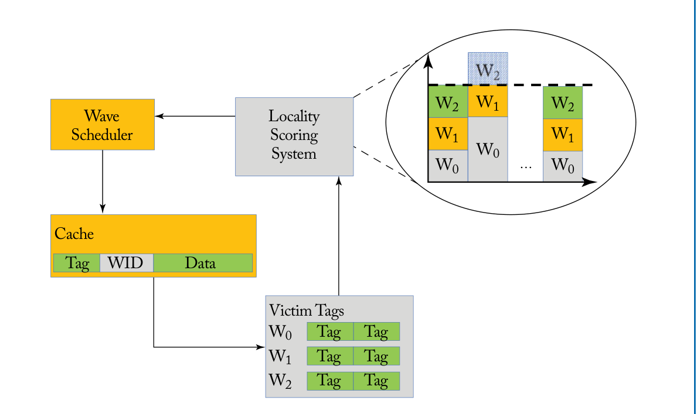

**图 5.1**：缓存感知波前调度的微架构。

为了反映这种局部性损失，会向调度系统发送一个信号。发射调度器使用一套局部性计分系统，来估计系统中每个线程束已经丢失了多少局部性，这近似于每个线程束还需要多少额外的缓存容量。局部性计分系统中的所有线程束都获得一个初始分值，其前提是假定所有线程束需要相同的缓存容量且不发生节流（图 5.1 中的堆叠条）。随着时间的推进并检测到局部性丢失，各个线程束的分值会被调高。在图 5.1 的例子中，线程束 0 发生了局部性损失，其分值已被调高。它分值的升高把线程束 3 推过了阈值，从而使线程束 3 无法再向一级数据缓存发出请求，实际上就节流了核心上处于活动调度状态的线程束数量。随着时间推移，如果没有局部性丢失，线程束 0 的分值就会下降，直到线程束 2 能够降到阈值以下，重新可以发出访存请求。

CCWS 进一步通过把各种调度机制与缓存替换策略作比较，说明了缓存命中率对调度决策的敏感程度。该文表明，线程束调度器可用的决策空间远大于替换策略所能做出的、相对受限的决策空间。该文还进一步表明，采用 LRU 替换策略的 CCWS 方案，相比此前的各种调度机制（即便它们采用 Belady 最优缓存替换策略），能够更大幅度地提高缓存命中率。

Rogers 等人 [2013] 提出了发散感知线程束调度（Divergence-Aware Warp Scheduling，DAWS），它是在 CCWS 的基础上，增加了对每个线程束缓存足迹更精确的估计。DAWS 利用了这样一个事实：GPU 负载中大多数线程束内局部性都出现在循环中。DAWS 为处于循环中的线程束建立逐线程束的缓存足迹估计。DAWS 依据每个线程束预测出的循环足迹，预先对循环中的线程束数量进行节流。DAWS 还会随每个线程束所经历的控制流发散程度调整其缓存足迹估计。线程束中已经退出循环的线程不再计入足迹估计。DAWS 进一步探讨了 GPU 的可编程性，表明只要采用更智能的线程束调度器，一个在数据传输上未做任何优化（例如用共享存储器取代缓存）的基准测试程序，其性能就可以非常接近同一基准测试程序的 GPU 优化版本。

**预取感知的线程束调度** Jog 等人 [2013b] 在 GPU 上探索了一种预取感知的线程束调度器。他们让该调度器基于两级调度机制，但用不连续的线程束来构成取指组。这一策略提高了 DRAM 中 bank 级并行的程度，因为预取器不会再针对连续的访问去查询同一个 DRAM bank。他们进一步扩展了这一思路，依据线程束组（warpgroup）的划分来操纵预取器。通过为其他组中的线程束预取数据，他们可以改善行缓冲局部性，并在预取请求与数据需求之间留出间隔。

**CTA 感知调度** Jog 等人 [2013a] 提出了一种 CTA 感知的线程束调度器，它同样建立在两级调度器之上，通过有选择地组合 CTA 来构成取指组。他们利用若干基于 CTA 的特性来提升性能。他们采用一种节流优先级技术，对核心中活动线程束的数量进行节流，这与其他的节流调度器类似。在节流之外，他们还利用不同核心上 CTA 之间的 CTA 间页面局部性。在只考虑局部性的 CTA 调度器下，连续的 CTA 常常会在同一时间访问同一个 DRAM bank，从而降低 bank 级并行度。他们再把这一机制与预取机制结合起来，同时也改善 DRAM 行局部性。

**调度对分支发散缓解技术的影响** Meng 等人 [2010] 提出了动态线程束细分（Dynamic Warp Subdivision，DWS）：当线程束中一部分 lane 在缓存中命中、另一部分 lane 没有命中时，就把该线程束拆分开。这种方案使得在缓存中命中的各个标量线程，即使其所在线程束中的其他线程发生缓存缺失，也能继续推进。DWS 之所以能提升性能，是因为它让超前运行（runahead）的线程更早发起自己的缺失请求，并对滞后的线程产生预取效果。DWS 试图通过提高数据装入缓存的速率来改善线程束内的局部性。

Fung 等人 [2007] 考察了线程束调度策略对其动态线程束形成（Dynamic Warp Formation，DWF）技术有效性的影响。DWF 试图缓解控制流发散：当同一线程束中的标量线程在一条分支指令上走向不同路径时，动态创建新的线程束。他们提出了五种调度器，并评估了它们对 DWF 的影响。

Fung 与 Aamodt [2011] 还提出了三种线程块优先级机制，作为对线程块压缩（Thread Block Compaction，TBC）技术的补充。这些优先级机制试图把同一 CTA 内的线程调度到一起。他们的方法与 Narasiman 等人 [2011] 同期提出的两级调度工作相似，区别在于被一起调度的是线程块，而不是取指组。

3.4 节对 DWS、DWF 和 TBC 给出了更详细的综述。

**调度与缓存重执行** Sethia 等人 [2015] 提出了 Mascar，它试图在访存密集型负载中让计算与访存更好地重叠。Mascar 由两个相互交织的机制组成。

• 一是访存感知的线程束调度器（memory aware warp scheduler，MAS）。当核内的 MSHR 与 L1 缺失队列条目被过度占用时，它优先执行单个线程束。这种优先安排即使在负载不具备数据局部性时也有助于提升性能：它使在顺序核上执行的线程束更快到达其计算操作，从而让被优先线程束的计算与其他线程束的访存相互重叠。

• 二是缓存访问重执行（cache access re-execution，CAR）机制。当低局部性的访问阻塞了存储流水线、致使缓存中已有数据的线程束无法发射时，该机制允许 L1 数据缓存出现“缺失下的命中”（hits-under-misses），从而避免 L1 数据缓存发生抖动（thrashing）。

MAS 有两种工作模式：等优先级（equal priority，EP）模式与访存优先（memory access priority，MAP）模式。系统依据 L1 MSHR 和存储缺失队列的充满程度在 EP 与 MAP 之间切换。一旦这些结构接近写满，系统就切换到 MAP 模式。MAS 包含两个队列，一个用于访存线程束（试图发射访存指令的线程束），另一个用于计算线程束（试图发射其他类型指令的线程束）。在每个队列内部，线程束按贪婪优先、再最旧优先（greedy-then-oldest）的顺序被调度。对访存相关指令的跟踪，是通过扩充记分牌来实现的，以指明某个输出寄存器何时因一次载入而被填充。当观察到负载是均衡的、且存储系统未被过度订阅时，调度器工作在 EP 模式。在 EP 模式下，调度机制优先照顾访存线程束。由于存储系统未被过度订阅，可以预期尽早发起访存会提升性能。工作在 MAP 模式时，调度器优先照顾计算线程束，以便让可用的计算与已成为瓶颈的存储系统更好地重叠。在众多访存线程束中，只有其中一个——“属主线程束”（owner warp）——被允许发射访存指令，直到它遇到一条依赖于尚未完成的访存请求的操作。

除调度机制之外，Sethia 等人 [2015] 还指出，访存密集型内核所达到的 IPC 占其峰值的比例远低于计算密集型内核。他们说明，在访存密集型应用中，很大一部分周期都花在 SIMT 核的载入存储单元（LSU）因访存过多造成的存储反压而停顿上。在 LSU 停顿期间，有相当一部分时间里已就绪线程束的数据就在 L1 数据缓存中，但这些线程束却无法发射，因为 LSU 已被其他线程束的访存请求堵满。缓存访问重执行（CAR）机制试图纠正这一行为：它在 LSU 流水线旁提供一块缓冲，用来存放被阻塞的访存指令，并允许其他指令发射进入 LSU。只有当 LSU 未停顿、且没有新请求需要发射时，才会处理重执行队列中的请求；除非重执行队列已满，此时则优先处理重执行队列中的访问，直到队列中腾出空间。

当重执行队列与访存感知调度器结合使用时，需要特别小心，因为重执行队列中的请求可能来自被优先的属主线程束之外的线程束。工作在 MAP 模式时，非属主线程束从重执行队列发往 L1 的请求若在 L1 未命中，会被进一步推迟。具体而言，当非属主线程束的请求在 L1 缺失时，该请求不会被转发给二级缓存，而是被重新插入重执行队列的尾部。

### 5.1.3 多内核调度的研究

**在 GPU 上支持抢占** Park 等人 [2015] 研究了在 GPU 上支持抢占式多任务这一难题。该工作采用一种更宽松的幂等性定义，以便能够冲刷（flush）线程块内的计算。这一更宽松的幂等性定义的做法是：检测从线程开始执行起，其执行是否一直是幂等的。他们提出的方案 Chimera 为每个线程块在三种实现上下文切换的方法之间动态选择：

• 完整的上下文保存/存储；

• 等待该线程块执行完毕；以及

• 如果由于幂等性该线程块可以安全地从头重新开始，则直接停止该线程块而不保存任何上下文。

每种上下文切换技术都在切换延迟与对系统吞吐率的影响之间给出不同的折中。为实现 Chimera，需要一个算法来估计当前正在运行的线程块中哪些子集可以在满足用户指定的上下文切换延迟目标的同时，以对系统吞吐率影响最小的方式被停止。

### 5.1.4 细粒度同步感知调度

ElTantawy 和 Aamodt [2018] 探讨了在运行涉及细粒度同步的代码时线程束调度所受到的影响。他们利用真实的 GPU 硬件证明，当线程自旋等待锁时会产生显著的开销。他们指出，对于包含未能获取锁的线程的线程束，若简单地对其执行进行退避，可能会阻止或减慢同一线程束中已经持有锁的其他线程的进展。他们提出一种硬件结构，用于动态识别哪些循环涉及自旋锁；由于采用了基于栈的重汇聚机制 [ElTantawy and Aamodt, 2016]，这一识别变得更具挑战性。该结构利用包含程序计数器最低若干位的路径历史，以及一份独立的谓词寄存器更新历史，来准确检测在锁上自旋的循环。为减少争用并提升性能，他们提出：对于被识别为正在执行自旋循环的线程束，当该线程束中持有锁的线程都已释放锁之后、该线程束执行自旋循环的后向分支时，降低该线程束的优先级。他们发现，与 Lee and Wu [2014] 相比，该方法分别将性能提升 1.5 倍、将能耗降低 1.6 倍。

## 5.2 表达并行性的其他方式

**细粒度工作队列** Kim 和 Batten [2014] 提出在 GPU 的每个 SIMT 核中增加一个细粒度硬件工作列表。他们利用了这样一个观察：不规则 GPGPU 程序在以软件方式采用数据驱动方法实现时往往性能最佳——此时工作被动态生成并在线程之间均衡；这与拓扑方法相反，后者启动固定数量的线程，而其中许多线程并不做有用的工作。数据驱动方法有潜力提高工作效率并改善负载均衡，但若没有大量的软件优化，其性能可能很差。该文提出一种片上硬件工作列表，支持核内以及核间的负载均衡。他们采用线程等待机制，并按固定间隔对线程生成的任务重新均衡。他们在 lonestar GPU 基准测试套件中若干不规则应用的各种实现上评估了该硬件机制，这些实现同时使用了拓扑式与数据驱动式的工作分配。

核内硬件工作列表解决了数据驱动软件工作列表的两个主要问题：(1) 线程把生成的工作推送出去时存储系统中的争用；(2) 基于线程 ID 静态划分工作所导致的负载不均衡。不依赖静态划分的软件实现在推送和拉取两个方向上都遭受存储争用。对工作做静态划分则解决了拉取时的争用。硬件工作列表分布在多个结构中，从而减少了争用。它在线程变为空闲之前就把生成的工作动态地重新分配给这些线程，从而改善了负载均衡。作者在 ISA 中增加了专用指令，用于向硬件队列推送以及从硬件队列拉取。核内的每个 lane 都分配到一个小的单端口 SRAM，用作该 lane 所使用和生成的工作 ID 的存储空间。

该文提出了基于间隔和需求驱动（仅在推送/拉取请求时才重新分配）的两种工作重分配方法，并对前者进行了深入评估。基于间隔的方法要么依据简单的阈值，要么依据更复杂的排序来重分配工作。阈值方法把工作量多于阈值的 lane 归类为“贪心”（工作过多），把工作量少于阈值的 lane 归类为“匮乏”（工作不足）。随后一次排序过程把工作从贪心 bank 重新分配给匮乏 bank。基于排序的技术更复杂，但能实现更好的负载均衡，因为所有匮乏 bank 也能把工作捐赠给其他匮乏 bank。他们的技术还包括一个全局排序机制，可用于在核之间分配工作。此外，该架构还支持对硬件工作列表进行虚拟化，使其可扩展到那些生成的动态工作超出硬件结构容量的工作负载。

**基于嵌套并行模式的编程** Lee 等人 [2014a] 提出了 GPU 上嵌套并行模式的局部性感知映射（Locality-Aware Mapping of Nested Parallel Patterns on GPUs），其出发点是一个观察：把嵌套并行计算映射到 GPU 线程，并不存在普适的最优映射方式。具有嵌套并行性的算法（例如 map/reduce 操作），其并行性可以因 GPU 程序的写法不同而在不同层次上暴露给 GPU。作者利用了 GPU 上嵌套并行映射的三种推广形式：

• 一维映射，即把串行程序的外层循环并行化；

• 线程块/线程映射，即把串行程序外层循环的每次迭代分配给一个线程块，并在一个线程块范围内把内层模式并行化；以及

• 基于线程束的映射，即把外层循环的每次迭代分配给一个线程束，并在线程束范围内把内层模式并行化。

这项工作提出了一个自动编译框架。该框架根据局部性以及嵌套模式中所暴露的并行度生成预测性能评分，据此为若干常见的嵌套并行模式选择最合适的映射方式。这些模式由 map、reduce、foreach、filter 等集合操作构成。框架试图把线程映射到对集合中每个元素的操作上。框架处理模式嵌套的方式是：先把应用中每一层嵌套分配给一个维度（x、y、z 等）。双重嵌套的模式（即一个包含 reduce 的 map）具有两个维度。随后，映射过程确定 CUDA 线程块中某个给定维度上的线程数。在设定线程块的维度与大小之后，框架还借助线程跨度（spanning）与切分（splitting）的概念，为每个线程分配多个元素，从而进一步控制内核中的并行度。在二维内核中（即模式嵌套有两层），如果每个维度都被赋予 span(1)，那么内核中启动的每个线程只负责操作集合中的一个元素。这种映射暴露出最大的并行度。相反，span(all) 表示每个线程要操作集合中的所有元素。跨度可以是 1 与 all 之间的任意数值。span(all) 用于两种特殊情形：一是某个维度的大小要等到内核启动之后才能确定（例如内层模式中所操作的元素数量是动态确定的）；二是该模式需要同步（例如 reduce 操作）。

由于 span(all) 会严重限制所暴露的并行度，使 GPU 得不到充分利用，该框架还提供了*切分*（split）的概念。split(2) 表示每个线程操作给定维度中一半的元素（可以把它理解为 span(all)/2）。使用切分时，框架会再启动一个内核（称为合并内核，combiner kernel），把各切分的结果汇总起来，从而得到与按 span(all) 划分内核时相同的结果。

为了同时选定每个维度上的块大小以及每个维度的 split/span，框架采用一种基于硬约束与软约束的评分算法。该算法遍历整个搜索空间——所有可能的维度、块大小与跨度。搜索空间随循环嵌套的层数呈指数增长。不过，这个指数的底数小于 100，而典型内核的嵌套层数不到 3 层。因此，只需几秒钟就能完成对整个空间的搜索。搜索过程会剪除违反硬约束的配置——也就是那些会导致执行不正确的配置，例如一个块中的最大线程数过高。它为软约束赋予加权评分，例如确保模式的顺序访存被分配到 x 维度，以改善访存合并。

该框架还执行两项常见的 GPU 优化：预分配内存，而不是在嵌套内核中动态分配全局内存；以及在判定把数据预取到共享存储器对某个嵌套模式有益时，使用共享存储器。结果表明，自动生成的代码具有与专家手工调优的代码相当的性能。

**动态并行** Wang 和 Yalamanchili [2014] 刻画了在 Kepler GPU 硬件上使用 CUDA 动态并行（Dynamic Parallelism）所带来的开销，发现这些开销可能相当可观。具体而言，他们指出在所研究的工作负载中有若干限制效率的关键问题。第一，这些应用使用了数量极多的设备端启动内核。第二，每个内核通常只有 40 个线程（仅略多于一个线程束）。第三，尽管每个动态内核中执行的代码相似，但启动配置不同，导致内核配置信息占用大量存储空间。最后，第四点，为了实现并发，设备端启动的内核被放入不同的流中，以利用 Kepler 支持的 32 个并行硬件队列（Hyper-Q）。他们发现这些因素叠加在一起，造成了极差的利用率。

Wang 等人 [2016a] 随后提出了动态线程块启动（dynamic thread block launch，DTBL），它修改了 CUDA 编程模型，使设备端启动的内核能够共享硬件队列资源，从而实现更高的并行度，并更好地利用 GPU 硬件。其方案的一个关键在于：使动态启动的内核能够与正在运行同一代码的既有内核聚合在一起。为此，它维护一个聚合线程块的链表，修改后的硬件在启动内核时使用该链表。他们通过修改 GPGPU-Sim 对 DTBL 进行评估，发现 DTBL 相比 CDP 将性能提升了 1.4 倍，相比未采用 CDP 的高度调优 CUDA 版本提升了 1.2 倍。

Wang 等人 [2016b] 进一步考察了动态启动的线程块被调度到哪一个 SM 会产生什么影响。他们发现，在兼顾各 SM 之间工作负载分布的同时，鼓励把子线程块调度到父线程块所在的同一个 SM 上，相比朴素的轮转（round-robin）分发机制可将性能提升 27%。

## 5.3 对事务内存的支持

本节综述在 GPU 架构上支持事务内存（transactional memory，TM）[Harris et al., 2010, Herlihy and Moss, 1993] 编程模型的各种方案。

这些方案的动力来自事务内存编程模型的潜力：对于具有充足不规则并行性的 GPU 应用，它有望减轻管理线程之间不规则、细粒度通信这一难题。在现代 GPU 上，应用开发者要么借助屏障把线程之间的同步粗化，要么尝试用许多现代 GPU 都提供的单字原子操作，为这类通信实现细粒度锁。前一种做法可能需要对底层算法做重大改动；后一种做法则伴随着细粒度锁在开发工作量上的不确定性，对于务实的、由市场驱动的软件开发来说风险过高（当然也有少数例外）。在 GPU 上支持事务内存可以简化同步，并提供一种强大的编程模型，以促进细粒度通信和并行工作负载的强扩展（strong scaling）。事务内存的这一前景，有望鼓励软件开发者用这类不规则应用去探索 GPU 加速。

**在 GPU 上支持事务内存的独特挑战** GPU 高度多线程的特性给事务内存系统的设计带来了一系列新的挑战。GPU 上的事务内存系统并不追求运行数十个足迹（footprint）相对较大的并发事务——那是近年来面向多核处理器的事务内存研究的主要关注点——而是要扩展到数万个小规模并发事务。这反映了 GPU 高度多线程的特性：数万个线程协同工作，每个线程都在为某个共同目标完成一小部分任务。这些小事务按字级粒度跟踪，从而使冲突检测的分辨率比以缓存块为单位更精细。此外，GPU 中每个核上的私有缓存都由数百个 GPU 线程共享。这就大大削弱了借助缓存一致性协议检测冲突所能带来的收益，而面向配备大型 CPU 核的传统 CMP 设计的大多数硬件事务内存采用的正是这一技术。

### 5.3.1 Kilo TM

Kilo TM [Fung et al., 2011] 是首个公开发表的、面向 GPU 架构的硬件事务内存方案。

Kilo TM 采用基于值的冲突检测（value-based conflict detection）[Dalessandro et al., 2010, Olszewski et al., 2007]，从而无需为冲突检测维护全局元数据。每个事务只需在验证时读取全局存储器中已有的数据，以判断自己是否与另一个已提交的事务发生冲突。这种验证方式利用了 GPU 存储子系统高度并行的特性，避免了冲突事务之间的任何直接交互，并以最细的粒度检测冲突。

然而，基于值的冲突检测若按原生方式实现，就要求事务串行提交。为提升提交的并行度，Kilo TM 吸收了已有事务内存系统 [Chafi et al., 2007, Spear et al., 2008] 的思想，并用创新的方案对其加以扩展。具体而言，Fung 等人 [2011] 提出了*近期性布隆过滤器*（recency bloom filter）——一种利用时间与顺序的概念来压缩大量小条目集合的新颖数据结构。Kilo TM 用它来压缩所有正在提交的事务的写集。每个提交事务都向近期性布隆过滤器查询一个近似的冲突事务集合——该集合中有一些事务属于误报（false positive）。Kilo TM 利用这一近似信息，把数百个互不冲突的事务调度起来并行地验证和提交。近期性布隆过滤器的这种近似特性使它可以保持得很小（量级为几 KB），因而能够驻留在片上以实现快速访问。用近期性布隆过滤器来提升事务提交的并行度，是 Kilo TM 不可或缺的组成部分。

**分支发散与事务内存** 事务内存编程模型引入了一种新型的分支发散。当一个线程束完成一个事务时，它的每个活跃线程都会尝试提交。其中一些线程可能中止，并需要重新执行自己的事务；另一些线程则可能通过验证并提交事务。由于这一结果在整个线程束内未必一致，线程束可能在验证之后发生发散。Fung 等人 [2011] 对 SIMT 硬件提出了一种简单的扩展，以处理这种由事务中止引起的特殊分支发散。该扩展与 Kilo TM 的其他设计方面相互独立，但它是在 GPU 上支持事务内存所必需的一环。

图 5.2 展示了如何扩展 SIMT 栈来处理由事务中止引起的控制流发散。当一个线程束进入事务时（位于第 B 行的 tx_begin 处），它把两个特殊的条目压入 SIMT 栈①。类型为 R 的第一个条目保存用于重新开始该事务的信息：其活跃掩码初始为空，其 PC 字段指向 tx_begin 之后的指令。类型为 T 的第二个条目跟踪当前这一次事务尝试。在 tx_commit 处（第 F 行），任何未通过验证的线程都会把 R 条目中自己的掩码位置位。当线程束完成提交过程（即其活跃线程要么已提交、要么已中止）后，T 条目被弹出②。

随后，会利用 R 条目中的活跃掩码和 PC，把一个新的 T 条目压入 SIMT 栈②，以重新启动那些已被中止的线程。接着，R 条目中的活跃掩码被清零③。如果 R 条目中的活跃掩码为空，则 T 与 R 两个条目都被弹出，露出原来的 N 条目⑤。随后其 PC 被改为指向紧接在 tx_commit 之后的那条指令，线程束随即恢复正常执行。事务内部线程束的分支发散，按与非事务性发散相同的方式处理④。

```c
A: t = tid.x;
if (…) {
B:   tx_begin;
C:   x[t%10] = y[t] + 1;
D:   if (s[t])
E:     y[t] = 0;
F:   tx_commit;
G:   z = y[t];
}
H: w = y[t+1];
```

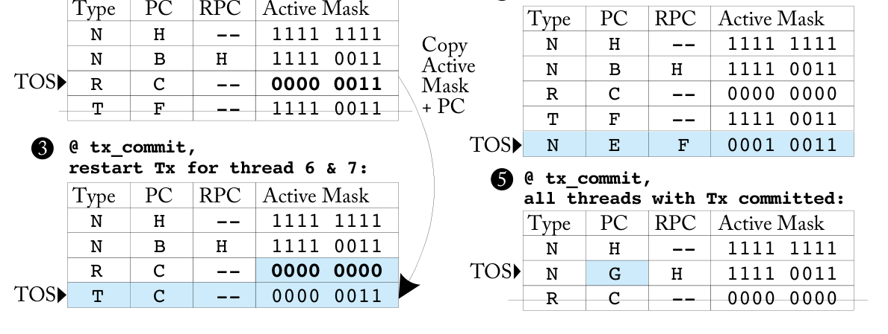

**图 5.2**：为处理由事务中止（验证失败）引起的发散而对 SIMT 栈所做的扩展。线程 6 与线程 7 未通过验证并已被重新启动。栈条目类型：普通（N）、事务重试（R）、事务栈顶（T）。在每种情形下，新增的条目或被修改的字段都以底纹标出。

### 5.3.2 WarpTM 与时间冲突检测

在其后续论文中，Fung 和 Aamodt [2013] 提出了两项各自独立、可提升 Kilo TM 性能与能效的增强机制：线程束级事务管理（WarpTM）与时间冲突检测（TCD）。

线程束级事务管理利用 GPU 编程模型中的线程层次结构——即同一线程束内各线程之间的空间局部性——来提升 Kilo TM 的效率。具体而言，WarpTM 分摊了 Kilo TM 的控制开销，并提高了 GPU 存储子系统的利用率。只有在能够高效消解线程束内部冲突的前提下，这些优化才可能实现；因此，一种低开销的线程束内冲突消解机制，对于保持 WarpTM 所带来的收益至关重要。为此，Fung 和 Aamodt [2013] 提出了一种两阶段的并行线程束内冲突消解方法，能够高效、并行地消解线程束内部的冲突。一旦线程束内的所有冲突都得到消解，Kilo TM 就可以把同一线程束中多个事务在验证与提交时的标量访存合并为更宽的访存。这一优化称为*验证与提交合并*（validation and commit coalescing），它是让 Kilo TM 充分发挥 GPU 宽访问存储系统优势的关键——GPU 的存储系统正是面向向量宽度的访存而优化的。

时间冲突检测是一种低开销机制，它利用一组全局同步的片上计时器来检测只读事务的冲突。一旦完成初始化，每个片上计时器就在各自的微架构模块中独立运行，不与其他计时器通信。这种无需通信的隐式同步，使 TCD 有别于各类软件事务内存系统中采用的、已有的基于时间戳的冲突检测 [Dalessandro et al., 2010, Spear et al., 2006, Xu et al., 2014]。TCD 用从这些计时器获取的时间戳，推断一个事务的存储器读操作相对于其他事务的更新操作所处的先后次序。Kilo TM 引入 TCD 来识别无冲突的只读事务，此类事务无需基于值的冲突检测即可直接提交。这样一来，它就显著降低了这些事务的存储带宽开销；对于那些用事务来做数据结构遍历的 GPU 事务内存应用而言，这类只读事务可能频繁出现。

## 5.4 异构系统

**异构系统中的并发管理** Kayiran 等人 [2014] 提出了一种限制并发度的方案，用它来抑制 GPU 的多线程程度，从而减少多道程序 CPU/GPU 系统中的存储与网络竞争。在异构系统上，来自 GPU 的干扰可能导致同时执行的 CPU 应用性能显著下降。他们提出的线程级并行（TLP）限制方案，观察共享的 CPU/GPU 存储控制器与互连网络中的拥塞指标，据此估计每个 GPU 核上应当有多少个 GPU 线程束处于活跃调度状态。他们提出了两种方案：一种只着眼于提升 CPU 性能；另一种则在 GPU 因多线程受限而造成的性能下降与 CPU 所受干扰之间求得平衡，以优化系统总体吞吐率（CPU 与 GPU 合计）。作者们在 GPU 核与 CPU 核数量比为 2:1 的分块（tile）异构架构上评估了线程束调度对性能的影响，这一比例的依据是：采用相同工艺时，一个 NVIDIA GPU 的 SM 面积约为现代乱序 Intel 芯片的一半。基线配置在 CPU 与 GPU 之间完全共享网络带宽和存储控制器，以求最大化资源利用率。采用该方案后，作者们观察到：限制 GPU 的 TLP 对 GPU 性能既可能有益也可能有害，但绝不会损害 CPU 性能。

为提升 CPU 性能，作者们引入了一种以 CPU 为中心的并发管理技术，它监视全局存储控制器中的停顿情况。该技术分别统计因存储控制器输入队列已满而停顿的访存请求数目，以及因从 MC 到各核的应答网络已满而停顿的访存请求数目。这些指标在各存储控制器本地监测，并汇总到一个集中式单元，再由该单元把信息发送给各 GPU 核。一种由启发式规则驱动的方案为这两个数值分别设定高、低两个阈值。如果两个请求停顿计数之和较低（低于阈值），那么 GPU 上活跃调度的线程束数目就会增加；如果两个计数之和较高，那么活跃线程束数目就会减少，以期 GPU 存储流量的减少能带来 CPU 性能的提升。

一种更均衡的技术试图最大化系统的整体吞吐率，它在以 CPU 为中心的方法基础上做了扩充，把线程束节流（warp throttling）对 GPU 性能的影响也纳入考虑。这种均衡技术在一个并发再平衡区间（他们的工作中取 1,024 个周期）内监测 GPU 无法发射指令的周期数。针对当前的多线程限制级别，GPU 停顿的移动平均值存放在每个 GPU 核心上，用来判断应当提高还是降低多线程级别。均衡技术分两个阶段调节 GPU 的线程级并行度（TLP）。在第一阶段，其行为与以 CPU 为中心的方案完全相同：不考虑 GPU 停顿，只根据访存争用限制 GPU 的 TLP。进入第二阶段后（一旦 GPU 的 TLP 节流开始导致 GPU 性能下降——即 GPU 对延迟的容忍能力已被压低——第二阶段便开始了），如果系统预测继续压制 GPU 并发会损害 GPU 性能，它就停止节流。做出这一预测的方式是：查询目标多线程级别下 GPU 停顿的移动平均值，该值是从此前在该级别上的执行中记录下来的。如果目标多线程级别与当前多线程级别上观测到的 GPU 停顿之差超过阈值 *k* 值，就不降低 TLP 级别。该 *k* 值可由用户设定，它是为 GPU 性能指定优先级的一种代理手段。

**异构系统一致性** Power 等人 [2013a] 提出一种硬件机制，用于在集成系统中高效支持 CPU 与 GPU 之间的缓存一致性。他们发现，随着 GPU 产生的访存流量增加，目录带宽成为显著的瓶颈。他们采用粗粒度区域一致性（coarse-grained region coherence）[Cantin et al., 2005]，以减少传统基于缓存块的一致性目录所造成的过多目录流量。一旦获得粗粒度区域的权限，大多数请求就不必再访问目录，一致性流量也可以转由一条非一致性的直接访问总线承载，而不必走带宽较低的、保持一致性的互连网络。

**面向 CPU-GPU 架构、考虑 TLP 的异构缓存管理** Lee 和 Kim [2012] 评估了在异构环境中由 CPU 核心与 GPU 核心共享末级缓存（LLC）时，对缓存加以管理的效果。他们指出，缓存命中率虽然是 CPU 工作负载的关键性能指标，但许多 GPU 工作负载对缓存命中率并不敏感，因为访存延迟可以被线程级并行度掩盖。为了判断 GPU 应用是否对缓存敏感，他们设计了一种逐核心的性能采样技术：让一部分核心旁路共享 LLC，另一部分核心则把数据插入到最近使用（MRU）位置。根据这两类核心的相对性能，他们可以为其余 GPU 核心设定旁路策略：若性能得到改善，就插入 LLC；若不敏感，则旁路。

其次，他们观察到，以往以 CPU 为中心的缓存管理更偏向访问更频繁的核心。而 GPU 核心在 LLC 上产生的流量是 CPU 核心的 5 到 10 倍。这使缓存容量向 GPU 倾斜，从而降低了 CPU 应用的性能。他们提出对此前关于基于效用的缓存划分（utility-based cache partitioning）[Qureshi and Patt, 2006] 的工作加以扩展，把 LLC 访问的相对比例考虑进来。当 GPU 核心对缓存敏感时，CPU 核心访问可用的缓存路分配额度会被提高，提高的幅度超出基于效用的缓存划分所给出的份额，以补偿 CPU 与 GPU 之间在访问量级与延迟敏感性上的差异。

---

# 参考文献

> 参考文献表保留英文原貌，未作翻译，以便读者按原书条目检索。

- Die photo analysis. http://vlsiarch.eecs.harvard.edu/accelerators/die-photo-analysis

- https://en.wikipedia.org/wiki/GDDR5_SDRAM

- Top500.org

- Tor M. Aamodt, Wilson W. L. Fung, Inderpreet Singh, Ahmed El-Shafiey, Jimmy Kwa, Tayler Hetherington, Ayub Gubran, Andrew Boktor, Tim Rogers, Ali Bakhoda, and Hadi Jooybar. GPGPU-Sim 3.x Manual.

- M. Abdel-Majeed and M. Annavaram. Warped register file: A power efficient register file for GPGPUs. In Proc. of the IEEE International Symposium on High-Performance Computer Architecture (HPCA), February 2013. DOI: 10.1109/hpca.2013.6522337.

- M. Abdel-Majeed, A. Shafaei, H. Jeon, M. Pedram, and M. Annavaram. Pilot register file: Energy efficient partitioned register file for GPUs. In Proc. of the IEEE International Symposium on High-Performance Computer Architecture (HPCA), February 2017. DOI: 10.1109/hpca.2017.47.

- Dominic Acocella and Mark R. Goudy. United States Patent #7,750,915: Concurrent Access of Data Elements Stored Across Multiple Banks in a Shared Memory Resource (Assignee: NVIDIA Corp.), July 2010.

- Neha Agarwal, David Nellans, Mark Stephenson, Mike O’Connor, and Stephen W. Keckler. Page placement strategies for GPUs within heterogeneous memory systems. In Proc. of the ACM Architectural Support for Programming Languages and Operating Systems (ASPLOS), 2015. DOI: 10.1145/2694344.2694381.

- Jade Alglave, Mark Batty, Alastair F. Donaldson, Ganesh Gopalakrishnan, Jeroen Ketema, Daniel Poetzl, Tyler Sorensen, and John Wickerson. GPU concurrency: Weak behaviours and programming assumptions. In Proc. of the ACM Architectural Support for Programming Languages and Operating Systems (ASPLOS), pages 577–591, 2015. DOI: 10.1145/2694344.2694391.

- John R. Allen, Ken Kennedy, Carrie Porterfield, and Joe Warren. Conversion of control dependence to data dependence. In Proc. of the ACM Symposium on Principles and Practices of Parallel Programming (PPoPP), pages 177–189, 1983. DOI: 10.1145/567067.567085. 16 Burton Smith. The tera computer system. In Proc. of the ACM International Conference on Supercomputing (ICS), pages 1–6, 1990. DOI: 10.1145/77726.255132.

- R700-Family Instruction Set Architecture. AMD, March 2009.

- AMD Southern Islands Series Instruction Set Architecture. AMD, 1.1 ed., December 2012.

- A. Arunkumar, S. Y. Lee, and C. J. Wu. ID-cache: Instruction and memory divergence based cache management for GPUs. In Proc. of the IEEE International Symposium on Workload Characterization (IISWC), 2016. DOI: 10.1109/iiswc.2016.7581276.

- Akhil Arunkumar, Evgeny Bolotin, Benjamin Cho, Ugljesa Milic, Eiman Ebrahimi, Oreste Villa, Aamer Jaleel, Carole-Jean Wu, and David Nellans. MCM-GPU: Multi-chipmodule GPUs for continued performance scalability. In Proc. of the ACM/IEEE International Symposium on Computer Architecture (ISCA), pages 320–332, 2017. DOI: 10.1145/3079856.3080231.

- Krste Asanovic, Stephen W. Keckler, Yunsup Lee, Ronny Krashinsky, and Vinod Grover. Convergence and scalarization for data-parallel architectures. In Proc. of the ACM/IEEE International Symposium on Code Generation and Optimization (CGO), 2013. DOI: 10.1109/cgo.2013.6494995.

- Rachata Ausavarungnirun, Saugata Ghose, Onur Kayran, Gabriel H. Loh, Chita R. Das, Mahmut T. Kandemir, and Onur Mutlu. Exploiting inter-warp heterogeneity to improve GPGPU performance. In Proc. of the ACM/IEEE International Conference on Parallel Architecture and Compilation Techniques (PACT), 2015. DOI: 10.1109/pact.2015.38.

- Ali Bakhoda, George L. Yuan, Wilson W. L. Fung, Henry Wong, and Tor M. Aamodt. Analyzing CUDA workloads using a detailed GPU simulator. In Proc. of the IEEE Symposium of Performance and Analysis of Systems and Software, (ISPASS’09), pages 163–174, 2009. DOI: 10.1109/ispass.2009.4919648.

- Ali Bakhoda, John Kim, and Tor M. Aamodt. Throughput-effective on-chip networks for manycore accelerators. In Proc. of the ACM/IEEE International Symposium on Microarchitecture (MICRO), pages 421–432, 2010. DOI: 10.1109/micro.2010.50.

- Ali Bakhoda, John Kim, and Tor M. Aamodt. Designing on-chip networks for throughput accelerators. ACM Transactions on Architecture and Code Optimization (TACO), 10(3):21, 2013. DOI: 10.1145/2509420.2512429.

- Markus Billeter, Ola Olsson, and Ulf Assarsson. Efficient stream compaction on wide SIMD many-core architectures. In Proc. of the ACM Conference on High Performance Graphics, pages 159–166, 2009. DOI: 10.1145/1572769.1572795. 45 weaving for sustained GPU performance. In Proc. of the ACM/IEEE International Symposium on Computer Architecture (ISCA), pages 49–60, 2012. DOI: 10.1109/isca.2012.6237005.

- Ian Buck, Tim Foley, Daniel Horn, Jeremy Sugerman, Kayvon Fatahalian, Mike Houston, and Pat Hanrahan. Brook for GPUs: Stream computing on graphics hardware. In Proc. of the ACM International Conference on Computer Graphics and Interactive Techniques (SIGGRAPH), pages 777–786, 2004. DOI: 10.1145/1186562.1015800.

- Brian Cabral. what is “SASS” short for? https://stackoverflow.com/questions/9798258/wh at-is-sass-short-for, November 2016.

- J. F. Cantin, M. H. Lipasti, and J. E. Smith. Improving multiprocessor performance with coarsegrain coherence tracking. In Proc. of the ACM/IEEE International Symposium on Computer Architecture (ISCA), June 2005. DOI: 10.1109/isca.2005.31.

- Edwin Catmull. A subdivision algorithm for computer display of curved surfaces. Technical Report, DTIC Document, 1974.

- Hassan Chafi, Jared Casper, Brian D. Carlstrom, Austen Mcdonald, Chi Cao, Minh Woongki Baek, Christos Kozyrakis, and Kunle Olukotun. A scalable, non-blocking approach to transactional memory. In Proc. of the IEEE International Symposium on High-Performance Computer Architecture (HPCA), pages 97–108, 2007. DOI: 10.1109/hpca.2007.346189.

- Guoyang Chen, Bo Wu, Dong Li, and Xipeng Shen. PORPLE: An extensible optimizer for portable data placement on GPU. In Proc. of the ACM/IEEE International Symposium on Microarchitecture (MICRO), 2014a. DOI: 10.1109/micro.2014.20.

- Xi E. Chen and Tor M. Aamodt. A first-order fine-grained multithreaded throughput model. In Proc. of the IEEE International Symposium on High-Performance Computer Architecture (HPCA), pages 329–340, 2009. DOI: 10.1109/hpca.2009.4798270.

- Xuhao Chen, Li-Wen Chang, Christopher I. Rodrigues, Jie Lv, Zhiying Wang, and Wen-Mei Hwu. Adaptive cache management for energy-efficient GPU computing. In Proc. of the ACM/IEEE International Symposium on Microarchitecture (MICRO), 2014b. DOI: 10.1109/micro.2014.11.

- Sylvain Collange, David Defour, and Yao Zhang. Dynamic detection of uniform and affine vectors in GPGPU computations. In Proc. of the European Conference on Parallel Processing (Euro-Par), 2010. DOI: 10.1007/978-3-642-14122-5_8.

- Brett W. Coon and John Erik Lindholm. United States Patent #7,353,369: System and Method for Managing Divergent Threads in a SIMD Architecture (Assignee NVIDIA Corp.), April 2008. 26, 49, 50 #7,434,032: Tracking Register Usage During Multithreaded Processing Using a Scorebard having Separate Memory Regions and Storing Sequential Register Size Indicators (Assignee NVIDIA Corp.), October 2008.

- Brett W. Coon, John Erik Lindholm, Gary Tarolli, Svetoslav D. Tzvetkov, John R. Nickolls, and Ming Y. Siu. United States Patent #7,634,621: Register File Allocation (Assignee NVIDIA Corp.), December 2009.

- Ron Cytron, Jeanne Ferrante, Barry K. Rosen, Mark N. Wegman, and F. Kenneth Zadeck. Efficiently computing static single assignment form and the control dependence graph. ACM Transactions on Programming Languages and Systems (TOPLAS), 13(4):451–490, 1991. DOI: 10.1145/115372.115320.

- Luke Dalessandro, Michael F. Spear, and Michael L. Scott. NOrec: Streamlining STM by abolishing ownership records. In Proc. of the ACM Symposium on Principles and Practices of Parallel Programming (PPoPP), pages 67–78, 2010. DOI: 10.1145/1693453.1693464.

- R. H. Dennard, F. H. Gaensslen, and K. Mai. Design of ion-implanted MOSFET’s with very small physical dimensions. IEEE Journal of Solid-State Circuits, October 1974. DOI: 10.1109/jssc.1974.1050511.

- Gregory Diamos, Benjamin Ashbaugh, Subramaniam Maiyuran, Andrew Kerr, Haicheng Wu, and Sudhakar Yalamanchili. SIMD re-convergence at thread frontiers. In Proc. of the ACM/IEEE International Symposium on Microarchitecture (MICRO), pages 477–488, 2011. DOI: 10.1145/2155620.2155676.

- Gregory Frederick Diamos, Richard Craig Johnson, Vinod Grover, Olivier Giroux, Jack H. Choquette, Michael Alan Fetterman, Ajay S. Tirumala, Peter Nelson, and Ronny Meir Krashinsky. Execution of divergent threads using a convergence barrier, July 13, 2015.

- Roger Eckert. United States Patent #7,376,803: Page stream sorter for DRAM systems (Assignee: NVIDIA Corp.), May 2008.

- Roger Eckert. United States Patent #9,195,618: Method and System for Scheduling Memory Requests (Assignee: NVIDIA Corp.), November 2015.

- John H. Edmondson and James M. Van Dyke. United States Patent #7872657: Memory Addressing Scheme using Partition Strides, January 2011.

- John H. Edmondson et al. United States Patent #8,464,001: Cache and Associated Method with Frame Buffer Managed Dirty Data Pull and High-Priority Clean Mechanism, June 2013. 75, 76 multi-path microarchitecture for efficient GPU control flow. In Proc. of the IEEE International Symposium on High-Performance Computer Architecture (HPCA), 2014. DOI: 10.1109/hpca.2014.6835936.

- Ahmed ElTantawy and Tor M. Aamodt. MIMD synchronization on SIMT architectures. In Proc. of the ACM/IEEE International Symposium on Microarchitecture (MICRO), pages 1–14, 2016. DOI: 10.1109/micro.2016.7783714.

- Ahmed ElTantawy and Tor M. Aamodt. Warp scheduling for fine-grained synchronization. In Proc. of the IEEE International Symposium on High-Performance Computer Architecture (HPCA), pages 375–388, 2018. DOI: 10.1109/hpca.2018.00040.

- Alexander L. Minken et al., United States Patent #7,649,538: Reconfigurable High Performance Texture Pipeline with Advanced Filtering (Assignee: NVIDIA Corp.), January 2010.

- Wilson W. L. Fung. GPU Computing Architecture for Irregular Parallelism. Ph.D. thesis, University of British Columbia, January 2015. DOI: 10.14288/1.0167110.

- Wilson W. L. Fung and Tor M. Aamodt. Thread block compaction for efficient SIMT control flow. In Proc. of the IEEE International Symposium on High-Performance Computer Architecture (HPCA), pages 25–36, 2011. DOI: 10.1109/hpca.2011.5749714.

- Wilson W. L. Fung and Tor M. Aamodt. Energy efficient GPU transactional memory via spacetime optimizations. In Proc. of the ACM/IEEE International Symposium on Microarchitecture (MICRO), pages 408–420, 2013. DOI: 10.1145/2540708.2540743.

- Wilson W. L. Fung, Ivan Sham, George Yuan, and Tor M. Aamodt. Dynamic warp formation and scheduling for efficient GPU control flow. In Proc. of the ACM/IEEE International Symposium on Microarchitecture (MICRO), pages 407–420, 2007. DOI: 10.1109/micro.2007.4408272.

- Wilson W. L. Fung, Inderpreet Singh, Andrew Brownsword, and Tor M. Aamodt. Hardware transactional memory for GPU architectures. In Proc. of the ACM/IEEE International Symposium on Microarchitecture (MICRO), pages 296–307, 2011. DOI: 10.1145/2155620.2155655.

- Wilson Fung et al. Dynamic warp formation: Efficient MIMD control flow on SIMD graphics hardware. ACM Transactions on Architecture and Code Optimization (TACO), 6(2):7:1–7:37, 2009. DOI: 10.1145/1543753.1543756.

- M. Gebhart, S. W. Keckler, and W. J. Dally. A compile-time managed multi-level register file hierarchy. In Proc. of the ACM/IEEE International Symposium on Microarchitecture (MICRO), December 2011a. DOI: 10.1145/2155620.2155675. 63 Lindholm, and Kevin Skadron. Energy-efficient mechanisms for managing thread context in throughput processors. In Proc. of the ACM/IEEE International Symposium on Computer Architecture (ISCA), 2011b. DOI: 10.1145/2000064.2000093.

- Mark Gebhart, Daniel R. Johnson, David Tarjan, Stephen W. Keckler, William J. Dally, Erik Lindholm, and Kevin Skadron. Energy-efficient mechanisms for managing thread context in throughput processors. In Proc. of the ACM/IEEE International Symposium on Computer Architecture (ISCA), pages 235–246, 2011c. DOI: 10.1145/2000064.2000093.

- Isaac Gelado, John E. Stone, Javier Cabezas, Sanjay Patel, Nacho Navarro, and Wen-mei W. Hwu. An asymmetric distributed shared memory model for heterogeneous parallel systems. In Proc. of the ACM Architectural Support for Programming Languages and Operating Systems (ASPLOS), pages 347–358, 2010. DOI: 10.1145/1736020.1736059.

- Syed Zohaib Gilani, Nam Sung Kim, and Michael J. Schulte. Power-efficient computing for compute-intensive GPGPU applications. In Proc. of the IEEE International Symposium on High-Performance Computer Architecture (HPCA), 2013. DOI: 10.1109/hpca.2013.6522330.

- David B. Glasco et al. United States Patent #8,135,926: Cache-Based Control of Atomic Operations in Conjunction with an External Alu Block, March 2012.

- David B. Glasco et al. United States Patent #8,539,130: Virtual Channels for Effective Packet Transfer, September 2013.

- Scott Gray. Assembler for NVIDIA Maxwell architecture. https://github.com/NervanaSyst ems/maxas

- Zvika Guz, Evgeny Bolotin, Idit Keidar, Avinoam Kolodny, Avi Mendelson, and Uri C. Weiser. Many-core vs. many-thread machines: Stay away from the valley. IEEE Computer Architecture Letters, 8(1):25–28, 2009. DOI: 10.1109/l-ca.2009.4.

- Ziyad S. Hakura and Anoop Gupta. The design and analysis of a cache architecture for texture mapping. In Proc. of the ACM/IEEE International Symposium on Computer Architecture (ISCA), pages 108–120, 1997. DOI: 10.1145/264107.264152.

- Rehan Hameed, Wajahat Qadeer, Megan Wachs, Omid Azizi, Alex Solomatnikov, Benjamin C. Lee, Stephen Richardson, Christos Kozyrakis, and Mark Horowitz. Understanding sources of inefficiency in general-purpose chips. In Proc. of the ACM/IEEE International Symposium on Computer Architecture (ISCA), pages 37–47, 2010. DOI: 10.1145/1815961.1815968.

- Song Han, Xingyu Liu, Huizi Mao, Jing Pu, Ardavan Pedram, Mark A. Horowitz, and William J. Dally. EIE: efficient inference engine on compressed deep neural network. In

- Mark Harris. An Easy Introduction to CUDA C and CCC. https://devblogs.nvidia.com/para llelforall/easy-introduction-cuda-c-and-c/, 2012.

- Tim Harris, James Larus, and Ravi Rajwar. Transactional Memory, 2nd ed. Morgan & Claypool, 2010. DOI: 10.1201/b11417-16.

- Steven J. Heinrich et al. United States Patent #9,595,075: Load/Store Operations in Texture Hardware (Assignee: NVIDIA Corp.), March 2017.

- John Hennessy and David Patterson. Computer Architecture—A Quantitative Approach, 5th ed. Morgan Kaufmann, 2011.

- Maurice Herlihy and J. Eliot B. Moss. Transactional memory: Architectural support for lockfree data structures. In Proc. of the ACM/IEEE International Symposium on Computer Architecture (ISCA), pages 289–300, 1993. DOI: 10.1109/isca.1993.698569.

- Jared Hoberock, Victor Lu, Yuntao Jia, and John C. Hart. Stream compaction for deferred shading. In Proc. of the ACM Conference on High Performance Graphics, pages 173–180, 2009. DOI: 10.1145/1572769.1572797.

- H. Peter Hofstee. Power efficient processor architecture and the cell processor. In Proc. of the IEEE International Symposium on High-Performance Computer Architecture (HPCA), pages 258–262, 2005. DOI: 10.1109/hpca.2005.26.

- Mark Horowitz, Elad Alon, Dinesh Patil, Samuel Naffziger, Rajesh Kumar, and Kerry Bernstein. Scaling, power, and the future of CMOS. In IEEE International Electron Devices Meeting, 2005. DOI: 10.1109/iedm.2005.1609253.

- Homan Igehy, Matthew Eldridge, and Kekoa Proudfoot. Prefetching in a texture cache architecture. In Proc. of the ACM SIGGRAPH/EUROGRAPHICS Workshop on Graphics hardware, pages 133–ff, 1998. DOI: 10.1145/285305.285321.

- Hyeran Jeon, Gokul Subramanian Ravi, Nam Sung Kim, and Murali Annavaram. GPU register file virtualization. In Proc. of the ACM/IEEE International Symposium on Microarchitecture (MICRO), pages 420–432, 2015. DOI: 10.1145/2830772.2830784.

- W. Jia, K. A. Shaw, and M. Martonosi. MRPB: Memory request prioritization for massively parallel processors. In Proc. of the IEEE International Symposium on High-Performance Computer Architecture (HPCA), 2014. DOI: 10.1109/hpca.2014.6835938.

- Wenhao Jia, Kelly A Shaw, and Margaret Martonosi. Characterizing and improving the use of demand-fetched caches in GPUs. In Proc. of the ACM International Conference on Supercomputing (ICS), pages 15–24, 2012. DOI: 10.1145/2304576.2304582. 78 mut T. Kandemir, Onur Mutlu, Ravishankar Iyer, and Chita R. Das. OWL: Cooperative thread array aware scheduling techniques for improving GPGPU performance. In Proc. of the ACM Architectural Support for Programming Languages and Operating Systems (ASPLOS), 2013a. DOI: 10.1145/2451116.2451158.

- Adwait Jog, Onur Kayiran, Asit K. Mishra, Mahmut T. Kandemir, Onur Mutlu, Ravishankar Iyer, and Chita R. Das. Orchestrated scheduling and prefetching for GPGPUs. In Proc. of the ACM/IEEE International Symposium on Computer Architecture (ISCA), 2013b. DOI: 10.1145/2508148.2485951.

- Norman P. Jouppi, CliffYoung, Nishant Patil, David Patterson, Gaurav Agrawal, Raminder Bajwa, Sarah Bates, Suresh Bhatia, Nan Boden, Al Borchers, et al. In-datacenter performance analysis of a tensor processing unit. In Proc. of the ACM/IEEE International Symposium on Computer Architecture (ISCA), 2017. DOI: 10.1145/3079856.3080246.

- David R. Kaeli, Perhaad Mistry, Dana Schaa, and Dong Ping Zhang. Heterogeneous Computing with OpenCL 2.0. Morgan Kaufmann, 2015.

- Ujval J. Kapasi et al. Efficient conditional operations for data-parallel architectures. In Proc. of the ACM/IEEE International Symposium on Microarchitecture (MICRO), pages 159–170, 2000. DOI: 10.1109/micro.2000.898067.

- O. Kayiran, N. C. Nachiappan, A. Jog, R. Ausavarungnirun, M. T. Kandemir, G. H. Loh, O. Mutlu, and C. R. Das. Managing GPU concurrency in heterogeneous architectures. In Proc. of the ACM/IEEE International Symposium on Microarchitecture (MICRO), 2014. DOI: 10.1109/micro.2014.62.

- Onur Kayiran, Adwait Jog, Mahmut T. Kandemir, and Chita R. Das. Neither more nor less: Optimizing thread-level parallelism for GPGPUs. In Proc. of the ACM/IEEE International Conference on Parallel Architecture and Compilation Techniques (PACT), 2013.

- S. W. Keckler, W. J. Dally, B. Khailany, M. Garland, and D. Glasco. GPUs and the future of parallel computing. Micro, IEEE, 31(5):7–17, September 2011. DOI: 10.1109/mm.2011.89.

- Shane Keil and John H. Edmondson. United States Patent #8,195,858: Managing Conflicts on Shared L2 Bus, June 2012.

- Shane Keil et al. United States Patent #8,307,165: Sorting Requests to the Dram for High Page Locality, November 2012.

- Farzad Khorasani, Rajiv Gupta, and Laxmi N. Bhuyan. Efficient warp execution in presence of divergence with collaborative context collection. In Proc. of the ACM/IEEE International Symposium on Microarchitecture (MICRO), 2015. DOI: 10.1145/2830772.2830796. 45 ware worklists. In Proc. of the ACM/IEEE International Symposium on Microarchitecture (MI- CRO), 2014. DOI: 10.1109/micro.2014.24.

- Ji Kim, Christopher Torng, Shreesha Srinath, Derek Lockhart, and Christopher Batten. Microarchitectural mechanisms to exploit value structure in SIMT architectures. In Proc. of the ACM/IEEE International Symposium on Computer Architecture (ISCA), 2013. DOI: 10.1145/2508148.2485934.

- Sangman Kim, Seonggu Huh, Xinya Zhang, Yige Hu, Amir Wated, Emmett Witchel, and Mark Silberstein. GPUnet: Networking abstractions for GPU programs. In Proc. of the USENIX Symposium on Operating Systems Design and Implementation, pages 6–8, 2014. DOI: 10.1145/2963098.

- David B. Kirk and W. Hwu Wen-Mei. Programming Massively Parallel Processors: A Hands-on Approach. Morgan Kaufmann, 2016. DOI: 10.1016/c2011-0-04129-7.

- John Kloosterman, Jonathan Beaumont, D. Anoushe Jamshidi, Jonathan Bailey, Trevor Mudge, and Scott Mahlke. Regless: Just-in-time operand staging for GPUs. In Proc. of the ACM/IEEE International Symposium on Microarchitecture (MICRO), pages 151–164, 2017. DOI: 10.1145/3123939.3123974.

- R. Krashinsky, C. Batten, M. Hampton, S. Gerding, B. Pharris, J. Casper, and K. Asanovic. The vector-thread architecture. In Proc. of the ACM/IEEE International Symposium on Computer Architecture (ISCA), pages 52–63, June 2004. DOI: 10.1109/isca.2004.1310763.

- Ronny M. Krashinsky. United States Patent Application #20130042090 A1: Temporal SIMT Execution Optimization, August 2011.

- David Kroft. Lockup-free instruction fetch/prefetch cache organization. In Proc. of the ACM/IEEE International Symposium on Computer Architecture (ISCA), pages 81–87, 1981. DOI: 10.1145/285930.285979.

- Jens Krüger and Rüdiger Westermann. Linear algebra operators for GPU implementation of numerical algorithms. In ACM Transactions on Graphics (TOG), V. 22, pages 908–916, 2003. DOI: 10.1145/882262.882363.

- Junjie Lai and André Seznec. Performance upper bound analysis and optimization of SGEMM on Fermi and Kepler GPUs. In Proc. of the ACM/IEEE International Symposium on Code Generation and Optimization (CGO), pages 1–10, 2013. DOI: 10.1109/cgo.2013.6494986.

- Nagesh B. Lakshminarayana and Hyesoon Kim. Effect of instruction fetch and memory scheduling on GPU performance. In Workshop on Language, Compiler, and Architecture Support for GPGPU, 2010. 88 PUs: Outstanding memory handling resources. ACM SIGARCH Computer Architecture News, 43(4):15–21, 2016. DOI: 10.1145/2927964.2927968.

- C. L. Lawson, R. J. Hanson, D. R. Kincaid, and F. T. Krogh. Basic linear algebra subprograms for fortran usage. ACM Transactions on Mathematical Software, 5(3):308–323, September 1979. DOI: 10.1145/355841.355848.

- HyoukJoong Lee, Kevin J. Brown, Arvind K. Sujeeth, Tiark Rompf, and Kunle Olukotun. Locality-aware mapping of nested parallel patterns on GPUs. In Proc. of the ACM/IEEE International Symposium on Microarchitecture (MICRO), 2014a. DOI: 10.1109/micro.2014.23.

- J. Lee and H. Kim. TAP: A TLP-aware cache management policy for a CPU-GPU heterogeneous architecture. In Proc. of the IEEE International Symposium on High-Performance Computer Architecture (HPCA), 2012. DOI: 10.1109/hpca.2012.6168947.

- S. Y. Lee and C. J. Wu. Ctrl-C: Instruction-aware control loop based adaptive cache bypassing for GPUs. In Proc. of the IEEE International Conference on Computer Design (ICCD), pages 133–140, 2016. DOI: 10.1109/iccd.2016.7753271.

- Sangpil Lee, Keunsoo Kim, Gunjae Koo, Hyeran Jeon, Won Woo Ro, and Murali Annavaram. Warped-compression: Enabling power efficient GPUs through register compression. In Proc. of the ACM/IEEE International Symposium on Computer Architecture (ISCA), 2015. DOI: 10.1145/2749469.2750417.

- Shin-Ying Lee and Carole-Jean Wu. CAWS: Criticality-aware warp scheduling for GPGPU workloads. In Proc. of the ACM/IEEE International Conference on Parallel Architecture and Compilation Techniques (PACT), 2014. DOI: 10.1145/2628071.2628107.

- Victor W. Lee, Changkyu Kim, Jatin Chhugani, Michael Deisher, Daehyun Kim, Anthony D. Nguyen, Nadathur Satish, Mikhail Smelyanskiy, Srinivas Chennupaty, Per Hammarlund, et al. Debunking the 100X GPU vs. CPU myth: An evaluation of throughput computing on CPU and GPU. In Proc. of the ACM/IEEE International Symposium on Computer Architecture (ISCA), pages 451–460, 2010. DOI: 10.1145/1815961.1816021.

- Yunsup Lee, Rimas Avizienis, Alex Bishara, Richard Xia, Derek Lockhart, Christopher Batten, and Krste Asanović. Exploring the tradeoffs between programmability and efficiency in data-parallel accelerators. In Proc. of the ACM/IEEE International Symposium on Computer Architecture (ISCA), pages 129–140, 2011. DOI: 10.1145/2000064.2000080.

- Yunsup Lee, Vinod Grover, Ronny Krashinsky, Mark Stephenson, Stephen W. Keckler, and Krste Asanović. Exploring the design space of SPMD divergence management on data-

- Jingwen Leng, Tayler Hetherington, Ahmed ElTantawy, Syed Gilani, Nam Sung Kim, Tor M. Aamodt, and Vijay Janapa Reddi. GPUWattch: Enabling energy optimizations in GPG- PUs. In Proc. of the ACM/IEEE International Symposium on Computer Architecture (ISCA), pages 487–498, 2013. DOI: 10.1145/2508148.2485964.

- Adam Levinthal and Thomas Porter. Chap—A SIMD graphics processor. In Proc. of the ACM International Conference on Computer Graphics and Interactive Techniques (SIGGRAPH), pages 77–82, 1984. DOI: 10.1145/800031.808581.

- Dong Li, Minsoo Rhu, Daniel R. Johnson, Mike O’Connor, Mattan Erez, Doug Burger, Donald S. Fussell, and Stephen W. Redder. Priority-based cache allocation in throughput processors. In Proc. of the IEEE International Symposium on High-Performance Computer Architecture (HPCA), 2015. DOI: 10.1109/hpca.2015.7056024.

- E. Lindholm, J. Nickolls, S. Oberman, and J. Montrym. NVIDIA Tesla: A unified graphics and computing architecture. Micro, IEEE, 28(2):39–55, March–April 2008a. DOI: 10.1109/mm.2008.31.

- Erik Lindholm, Mark J. Kilgard, and Henry Moreton. A user-programmable vertex engine. In Proc. of the ACM International Conference on Computer Graphics and Interactive Techniques (SIGGRAPH), pages 149–158, 2001. DOI: 10.1145/383259.383274.

- John Erik Lindholm, Ming Y. Siu, Simon S. Moy, Samuel Liu, and John R. Nickolls. United States Patent #7,339,592: Simulating Multiported Memories Using Lower Port Count Memories (Assignee NVIDIA Corp.), March 2008b.

- Erik Lindholm et al. United States Patent #9,189,242: Credit-Based Streaming Multiprocessor Warp Scheduling (Assignee NVIDIA Corp.), November 2015.

- John S. Liptay. Structural aspects of the system/360 model 85, II: The cache. IBM Systems Journal, 7(1):15–21, 1968. DOI: 10.1147/sj.71.0015.

- Z. Liu, S. Gilani, M. Annavaram, and N. S. Kim. G-Scalar: Cost-effective generalized scalar execution architecture for power-efficient GPUs. In Proc. of the IEEE International Symposium on High-Performance Computer Architecture (HPCA), 2017. DOI: 10.1109/hpca.2017.51.

- Samuel Lui, John Erik Lindholm, Ming Y. Siu, Brett W. Coon, and Stuart F. Oberman. United States Patent Application 11/555,649: Operand Collector Architecture (Assignee NVIDIA Corp.), May 2008. 35 Patterns for Efficient Computation. Elsevier, 2012.

- Jiayuan Meng, David Tarjan, and Kevin Skadron. Dynamic warp subdivision for integrated branch and memory divergence tolerance. In Proc. of the ACM/IEEE International Symposium on Computer Architecture (ISCA), pages 235–246, 2010. DOI: 10.1145/1815961.1815992.

- Alexander L. Minken and Oren Rubinstein. United States Patent #6,629,188: Circuit and Method for Prefetching Data for a Texture Cache (Assignee: NVIDIA Corp.), September 2003.

- Alexander L. Minkin et al. United States Patent #8,266,383: Cache Miss Processing Usinga Defer/Replay Mechanism (Assignee: NVIDIA Corp.), September 2012.

- Alexander L. Minkin et al. United States Patent #8,595,425: Configurable Cache for Multiple Clients (Assignee: NVIDIA Corp.), November 2013.

- Michael Mishkin, Nam Sung Kim, and Mikko Lipasti. Write-after-read hazard prevention in GPGPUSIM. In Workshop on Deplicating, Deconstructing, and Debunking (WDDD), June 2016.

- John Montrym and Henry Moreton. The geforce 6800. IEEE Micro, 25(2):41–51, 2005. DOI: 10.1109/mm.2005.37.

- Veynu Narasiman, Michael Shebanow, Chang Joo Lee, Rustam Miftakhutdinov, Onur Mutlu, and Yale N. Patt. Improving GPU performance via large warps and two-level warp scheduling. In Proc. of the ACM/IEEE International Symposium on Microarchitecture (MICRO), pages 308– 317, 2011. DOI: 10.1145/2155620.2155656.

- John R. Nickolls and Jochen Reusch. Autonomous SIMD flexibility in the MP-1 and MP-2. In Proc. of the ACM Symposium on Parallel Algorithms and Architectures (SPAA), pages 98–99, 1993. DOI: 10.1145/165231.165244.

- Cedric Nugteren, Gert-Jan Van den Braak, Henk Corporaal, and Henri Bal. A detailed GPU cache model based on reuse distance theory. In Proc. of the IEEE International Symposium on High-Performance Computer Architecture (HPCA), pages 37–48, 2014. DOI: 10.1109/hpca.2014.6835955.

- NVIDIA’s Next Generation CUDA Compute Architecture: Fermi. NVIDIA, 2009.

- Nvidia. NVIDIA tesla V100 GPU architecture. 2017.

- NVIDIA Corp. Pascal l1 cache. https://devtalk.nvidia.com/default/topic/1006066/pasc al-l1-cache/?offset=6 70 .nvidia.com/parallelforall/inside-volta/, May 2017.

- NVIDIA Corporation. NVIDIA’s Next Generation CUDA Compute Architecture: Kepler TM GK110, a.

- NVIDIA Corporation. NVIDIA GeForce GTX 680, b.

- NVIDIA Corporation. CUDA Binary Utilities, c.

- Parallel Thread Execution ISA (Version 6.1). NVIDIA Corporation, CUDA Toolkit 9.1 ed., November 2017.

- Lars Nyland et al. United States Patent #8,086,806: Systems and Methods for Coalescing Memory Accesses of Parallel Threads (Assignee: NVIDIA Corp.), December 2011.

- Marek Olszewski, Jeremy Cutler, and J. Gregory Steffan. JudoSTM: A dynamic binaryrewriting approach to software transactional memory. In Proc. of the ACM/IEEE International Conference on Parallel Architecture and Compilation Techniques (PACT), pages 365–375, 2007. DOI: 10.1109/pact.2007.4336226.

- Jason Jong Kyu Park, Yongjun Park, and Scott Mahlke. Chimera: Collaborative preemption for multitasking on a shared GPU. In Proc. of the ACM Architectural Support for Programming Languages and Operating Systems (ASPLOS), 2015. DOI: 10.1145/2694344.2694346.

- David A. Patterson and John L. Hennessy. Computer Organization and Design: The Hardware/- Software Interface. 2013.

- Gennady Pekhimenko, Vivek Seshadri, Onur Mutlu, Phillip B. Gibbons, Michael A. Kozuch, and Todd C. Mowry. Base-delta-immediate compression: Practical data compression for onchip caches. In Proc. of the ACM/IEEE International Conference on Parallel Architecture and Compilation Techniques (PACT), 2012. DOI: 10.1145/2370816.2370870.

- J. Power, A. Basu, J. Gu, S. Puthoor, B. M. Beckmann, M. D. Hill, S. K. Reinhardt, and D. A. Wood. Heterogeneous system coherence for integrated CPU-GPU systems. In Proc. of the ACM/IEEE International Symposium on Microarchitecture (MICRO), December 2013a. DOI: 10.1145/2540708.2540747.

- Jason Power, Arkaprava Basu, Junli Gu, Sooraj Puthoor, Bradford M. Beckmann, Mark D. Hill, Steven K. Reinhardt, and David A. Wood. Heterogeneous system coherence for integrated CPU-GPU systems. In Proc. of the ACM/IEEE International Symposium on Microarchitecture (MICRO), pages 457–467, 2013b. DOI: 10.1145/2540708.2540747.

- Xiaowei Ren and Mieszko Lis. Efficient sequential consistency in GPUs via relativistic cache coherence. In Proc. of the IEEE International Symposium on High-Performance Computer Architecture (HPCA), pages 625–636, 2017. DOI: 10.1109/hpca.2017.40.

- Minsoo Rhu and Mattan Erez. CAPRI: Prediction of compaction-adequacy for handling control-divergence in GPGPU architectures. In Proc. of the ACM/IEEE International Symposium on Computer Architecture (ISCA), pages 61–71, 2012. DOI: 10.1109/isca.2012.6237006.

- Minsoo Rhu and Mattan Erez. The dual-path execution model for efficient GPU control flow. In Proc. of the IEEE International Symposium on High-Performance Computer Architecture (HPCA), pages 591–602, 2013a. DOI: 10.1109/hpca.2013.6522352.

- Minsoo Rhu and Mattan Erez. Maximizing SIMD resource utilization in GPGPUs with SIMD lane permutation. In Proc. of the ACM/IEEE International Symposium on Computer Architecture (ISCA), 2013b. DOI: 10.1145/2485922.2485953.

- Scott Rixner, William J. Dally, Ujval J. Kapasi, Peter Mattson, and John D. Owens. Memory access scheduling. In Proc. of the ACM/IEEE International Symposium on Computer Architecture (ISCA), pages 128–138, 2000. DOI: 10.1109/isca.2000.854384.

- James Roberts et al. United States Patent #8,234,478: Using Data Cache Array as a Dram Load/Store Buffer, July 2012.

- Timothy G. Rogers, Mike O’Connor, and Tor M. Aamodt. Cache-conscious wavefront scheduling. In Proc. of the ACM/IEEE International Symposium on Microarchitecture (MICRO), 2012. DOI: 10.1109/micro.2012.16.

- Timothy G. Rogers, Mike O’Connor, and Tor M. Aamodt. Divergence-aware warp scheduling. In Proc. of the ACM/IEEE International Symposium on Microarchitecture (MICRO), 2013. DOI: 10.1145/2540708.2540718.

- Timothy G. Rogers, Daniel R. Johnson, Mike O’Connor, and Stephen W. Keckler. A variable warp size architecture. In Proc. of the ACM/IEEE International Symposium on Computer Architecture (ISCA), 2015. DOI: 10.1145/2749469.2750410.

- Sangmin Seo, Gangwon Jo, and Jaejin Lee. Performance characterization of the NAS parallel benchmarks in OpenCL. In Proc. of the IEEE International Symposium on Workload Characterization (IISWC), pages 137–148, 2011. DOI: 10.1109/iiswc.2011.6114174. 10 ory pitstops. In Proc. of the IEEE International Symposium on High-Performance Computer Architecture (HPCA), pages 174–185, 2015. DOI: 10.1109/hpca.2015.7056031.

- Ankit Sethia and Scott Mahlke. Equalizer: Dynamic tuning of GPU resources for efficient execution. In Proc. of the ACM/IEEE International Symposium on Microarchitecture (MICRO), 2014. DOI: 10.1109/micro.2014.16.

- Ryan Shrout. AMD ATI radeon HD 2900 XT review: R600 arrives. PC Perspective, May 2007.

- Mark Silberstein, Bryan Ford, Idit Keidar, and Emmett Witchel. GPUfs: Integrating a file system with GPUs. In Proc. of the ACM Architectural Support for Programming Languages and Operating Systems (ASPLOS), pages 485–498, 2013. DOI: 10.1145/2451116.2451169.

- Inderpreet Singh, Arrvindh Shriraman, Wilson W. L. Fung, Mike O’Connor, and Tor M. Aamodt. Cache coherence for GPU architectures. In Proc. of the IEEE International Symposium on High-Performance Computer Architecture (HPCA), pages 578–590, 2013. DOI: 10.1109/hpca.2013.6522351.

- Michael F. Spear, Virendra J. Marathe, William N. Scherer, and Michael L. Scott. Conflict detection and validation strategies for software transactional memory. In Proc. of the EATCS International Symposium on Distributed Computing, pages 179–193, Springer-Verlag, 2006. DOI: 10.1007/11864219_13.

- Michael F. Spear, Maged M. Michael, and Christoph Von Praun. RingSTM: Scalable transactions with a single atomic instruction. In Proc. of the ACM Symposium on Parallel Algorithms and Architectures (SPAA), pages 275–284, 2008. DOI: 10.1145/1378533.1378583.

- Michael Steffen and Joseph Zambreno. Improving SIMT efficiency of global rendering algorithms with architectural support for dynamic micro-kernels. In Proc. of the ACM/IEEE International Symposium on Microarchitecture (MICRO), pages 237–248, 2010. DOI: 10.1109/micro.2010.45.

- Ivan E. Sutherland. Sketchpad a Man-machine Graphical Communication System. Ph.D. thesis, 1963. DOI: 10.1145/62882.62943.

- David Tarjan and Kevin Skadron. On demand register allocation and deallocation for a multithreaded processor, June 30, 2011. U.S. Patent App. 12/649,238.

- Sean J. Treichler et al. United States Patent #9,098,383: Consolidated Crossbar that Supports a Multitude of Traffic Types, August 2015. 75 Stamm. Exploiting choice: Instruction fetch and issue on an implementable simultaneous multithreading processor. In Proc. of the ACM/IEEE International Symposium on Computer Architecture (ISCA), 1996. DOI: 10.1145/232973.232993.

- Rafael Ubal, Byunghyun Jang, Perhaad Mistry, Dana Schaa, and David Kaeli. Multi2Sim: A simulation framework for CPU-GPU computing. In Proc. of the ACM/IEEE International Conference on Parallel Architecture and Compilation Techniques (PACT), pages 335–344, 2012. DOI: 10.1145/2370816.2370865.

- Aniruddha S. Vaidya, Anahita Shayesteh, Dong Hyuk Woo, Roy Saharoy, and Mani Azimi. SIMD divergence optimization through intra-warp compaction. In Proc. of the ACM/IEEE International Symposium on Computer Architecture (ISCA), pages 368–379, 2013. DOI: 10.1145/2485922.2485954.

- Wladimir J. van der Lann. Decuda. http://wiki.github.com/laanwj/decuda/

- Jin Wang and Sudhakar Yalamanchili. Characterization and analysis of dynamic parallelism in unstructured GPU applications. In Proc. of the IEEE International Symposium on Workload Characterization (IISWC), pages 51–60, 2014. DOI: 10.1109/iiswc.2014.6983039.

- Jin Wang, Norm Rubin, Albert Sidelnik, and Sudhakar Yalamanchili. Dynamic thread block launch: A lightweight execution mechanism to support irregular applications on GPUs. In Proc. of the ACM/IEEE International Symposium on Computer Architecture (ISCA), pages 528– 540, 2016a. DOI: 10.1145/2749469.2750393.

- Jin Wang, Norm Rubin, Albert Sidelnik, and Sudhakar Yalamanchili. Laperm: Locality aware scheduler for dynamic parallelism on GPUs. In Proc. of the ACM/IEEE International Symposium on Computer Architecture (ISCA), 2016b. DOI: 10.1109/isca.2016.57.

- Kai Wang and Calvin Lin. Decoupled affine computation for SIMT GPUs. In Proc. of the ACM/IEEE International Symposium on Computer Architecture (ISCA), 2017. DOI: 10.1145/3079856.3080205.

- D. Wong, N. S. Kim, and M. Annavaram. Approximating warps with intra-warp operand value similarity. In Proc. of the IEEE International Symposium on High-Performance Computer Architecture (HPCA), 2016. DOI: 10.1109/hpca.2016.7446063.

- X. Xie, Y. Liang, Y. Wang, G. Sun, and T. Wang. Coordinated static and dynamic cache bypassing for GPUs. In Proc. of the IEEE International Symposium on High-Performance Computer Architecture (HPCA), 2015. DOI: 10.1109/hpca.2015.7056023.

- Y. Yang, P. Xiang, M. Mantor, N. Rubin, L. Hsu, Q. Dong, and H. Zhou. A case for a flexible scalar unit in SIMT architecture. In Proc. of the IEEE International Parallel and Distributed Processing Symposium (IPDPS), 2014. DOI: 10.1109/ipdps.2014.21.

- George L. Yuan, Ali Bakhoda, and Tor M. Aamodt. Complexity effective memory access scheduling for many-core accelerator architectures. In Proc. of the ACM/IEEE International Symposium on Microarchitecture (MICRO), pages 34–44, 2009. DOI: 10.1145/1669112.1669119.

- Hou Yunqing. Assembler for NVIDIA FERMI. https://github.com/hyqneuron/asfermi

- Eddy Z. Zhang, Yunlian Jiang, Ziyu Guo, and Xipeng Shen. Streamlining GPU applications on the fly: Thread divergence elimination through runtime thread-data remapping. In Proc. of the ACM International Conference on Supercomputing (ICS), pages 115–126, 2010. DOI: 10.1145/1810085.1810104.

- William K. Zuravleff and Timothy Robinson. U.S. patent #5,630,096: Controller for a synchronous dram that maximizes throughput by allowing memory requests and commands to be issued out of order, May 13, 1997.

---

# 作者简介

## TOR M. AAMODT（托尔·M·阿莫特）

**Tor M. Aamodt** 是不列颠哥伦比亚大学电气与计算机工程系的教授，自 2006 年起在该校任教。他目前的研究聚焦于通用 GPU 的体系结构与高能效计算，最近也涉及面向机器学习的加速器。他与研究组的学生一起开发了被广泛使用的 GPGPU-Sim 模拟器。他的论文中有三篇被 *IEEE Micro* 杂志评为“Top Picks”，另有一篇获得“Top Picks”荣誉提名，还有一篇被 *Communications of the ACM* 选为“研究亮点”。他入选了 MICRO 名人堂。2012—2015 年他担任 *IEEE Computer Architecture Letters* 的副编辑，2012—2016 年担任 *International Journal of High Performance Computing Applications* 的副编辑；曾任 ISPASS 2013 的程序委员会主席、ISPASS 2014 的大会主席，并多次担任程序委员会委员。2012—2013 年他在斯坦福大学计算机科学系任访问副教授。他于 2010 年获得 NVIDIA 学术合作奖，2016—2019 年获 NSERC 发现加速器资助，并于 2016 年获得 Google 教职研究奖。Tor 在多伦多大学获得工程科学学士、硕士与博士学位。他的博士工作有相当一部分是在英特尔微架构研究实验室实习期间完成的。此后他在 NVIDIA 从事 GeForce 8 系列 GPU 存储系统架构（“帧缓冲”）方面的工作——GeForce 8 系列是首个支持 CUDA 的 NVIDIA GPU。

Tor 是不列颠哥伦比亚省注册的专业工程师。

## WILSON WAI LUN FUNG（冯伟伦）

**Wilson Wai Lun Fung** 是三星电子奥斯汀研发中心（SARC）先进计算实验室（ACL）的架构师，参与下一代 GPU IP 的开发。他对计算机体系结构的理论面与实践面都有兴趣。Wilson 曾获 NVIDIA 研究生奖学金、NSERC 研究生奖学金和 NSERC 加拿大研究生奖学金。他是被广泛使用的 GPGPU-Sim 模拟器的主要贡献者之一，其两篇论文被 *IEEE Micro* 杂志选为计算机体系结构领域的“Top Pick”。Wilson 在不列颠哥伦比亚大学获得计算机工程学士、硕士与博士学位。攻读博士期间，他曾在 NVIDIA 实习。

## TIMOTHY G. ROGERS（蒂莫西·G·罗杰斯）

**Timothy G. Rogers** 是普渡大学电气与计算机工程系的助理教授，研究聚焦于大规模多线程处理器设计。他有兴趣探索能够同时提升程序员生产率和能效的计算机系统与体系结构。Timothy 曾获 NVIDIA 研究生奖学金和 NSERC 亚历山大·格雷厄姆·贝尔加拿大研究生奖学金。他的工作曾被 *IEEE Micro* 杂志选为计算机体系结构领域的“Top Pick”，并被 *Communications of the ACM* 选为“研究亮点”。攻读博士期间，他曾在 NVIDIA Research 和 AMD Research 实习。在攻读研究生之前，Timothy 曾在艺电（Electronic Arts）任软件工程师，并在麦吉尔大学获得电气工程学士学位。
