# TileLang 学习报告

> 本报告依据 `learning_report_outline.md` 展开，系统梳理 TileLang 的代码目录、整体架构、核心模块与编译流水线。
> 报告中的代码路径、函数名、Pass 名均以仓库当前实现为准；IR 片段为示意，实际以 `TL_LOWER_TRACE` / `TL_ENABLE_DUMP_IR` 的输出为准。

---

## 1. 引言

### 1.1 TileLang 是什么

TileLang（`tile-lang`）是一个面向 GPU / CPU / NPU 高性能 kernel 的领域特定语言（DSL）。它在 TVM 编译基础设施之上，用 Pythonic 语法描述 **tile（数据块）级** 的并行计算与数据搬运，让开发者既能用接近 Python 的方式表达算法，又能显式控制共享内存、寄存器、流水线与硬件 intrinsic，从而在不牺牲生产力的前提下逼近手写 CUDA 的性能。

典型写法如下（`examples/gemm/example_gemm.py`）：

```python
import tilelang
import tilelang.language as T

@tilelang.jit
def matmul(A, B, block_M, block_N, block_K, dtype=T.float16, accum_dtype=T.float32):
    M, N, K = T.const("M, N, K")
    A: T.Tensor((M, K), dtype)
    B: T.Tensor((K, N), dtype)
    C = T.empty((M, N), dtype)

    with T.Kernel(T.ceildiv(N, block_N), T.ceildiv(M, block_M), threads=128) as (bx, by):
        A_shared = T.alloc_shared((block_M, block_K), dtype)
        B_shared = T.alloc_shared((block_K, block_N), dtype)
        C_local = T.alloc_fragment((block_M, block_N), accum_dtype)

        T.clear(C_local)
        for k in T.Pipelined(T.ceildiv(K, block_K), num_stages=3):
            T.copy(A[by * block_M, k * block_K], A_shared)
            T.copy(B[k * block_K, bx * block_N], B_shared)
            T.gemm(A_shared, B_shared, C_local)

        T.copy(C_local, C[by * block_M, bx * block_N])
    return C
```

### 1.2 设计目标

1. **Pythonic 语法**：kernel 就是普通 Python 函数，修改后无需重新编译基础设施。
2. **TVM 编译基础设施**：复用 TVM/TIR(X) 的 IR、Pass 框架、Target 与 CodeGen，专注 tile 级抽象与调度。
3. **生产力与极致性能兼顾**：高层 `T.copy`/`T.gemm` 即可获得接近手写的性能；需要时下沉到 thread primitive 与硬件 intrinsic。
4. **多后端**：CUDA / ROCm / Metal / Ascend / CPU / WebGPU，通过后端注册表可插拔扩展。

### 1.3 报告范围与阅读指引

- 第 2 章介绍背景与生态（重点：与 Triton 的多维度对比）。
- 第 3、4 章给出目录结构与架构图，建立全局视图。
- 第 5 章逐模块介绍核心实现（每个模块配图）。
- 第 6 章深度剖析编译流水线（配图 + 实例 IR 逐级演变）。
- 第 7–9 章为专题、案例与质量保障。
- 建议先读第 4、6 章建立编译心智模型，再回到第 5 章看各模块细节。

---

## 2. 背景与生态

### 2.1 与 TVM / TIR / TIRX 的关系

#### 2.1.1 TVM 的现状与 TileLang 对 TIR 的扩展

TileLang 构建在 TVM 之上，但并非直接使用 upstream TVM 的全部实现。仓库中通过 `from tilelang import tvm` 与 `tvm.tirx` 暴露了一个扩展后的 IR 命名空间 `tirx`：

- **`tirx` 命名空间**：TileLang 在 TIR 基础上扩展出 tile 级块结构 `SBlock`、tile 算子调用、布局注解等。`lower.py`、各后端 pipeline 中大量使用 `tirx.transform.*`。
- **`SBlock`**：比 TVM 的 `Block` 更贴近硬件，用于承载 tile op、alloc buffer、layout 注解，是 `LayoutInference`、`LowerTileOp` 等 Pass 的操作对象。
- **tile 级算子**：`T.gemm`、`T.copy`、`T.reduce_*`、`T.Parallel` 等在前端构建为高层 tile op，后经 `lower_tile_op` 展开为线程级循环与硬件指令。

#### 2.1.2 复用与 fork 的边界

| 类别 | 来源 | 说明 |
| --- | --- | --- |
| TVM runtime / FFI | upstream TVM | `tvm_ffi`、PackedFunc、Target、IRModule |
| TIR / `tirx` | TVM + TileLang 扩展 | TileLang 在 `tirx` 下扩展 tile 结构 |
| transform Pass | 部分 upstream + 大量自研 | `src/transform/` 下多数 Pass 为 TileLang 自研 |
| layout 系统 | 自研 | `tilelang/layout/` + `src/layout/`，含 CuTe 代数 |
| backend registry | 自研 | `tilelang/backend/module.py` 注册与分发 |
| codegen | 自研 + TVM | `src/{cuda,rocm,metal,...}/codegen/`，host 侧可复用 `target.build.llvm` |

#### 2.1.3 为什么在 TVM 之上做 DSL

- 复用成熟的 IR / Pass / Target / FFI，避免重造编译器；
- TVM 的 `TVMScript` 已能用 Python 描述 TIR，但缺少 tile 级抽象与 GPU 内存层次表达；
- TileLang 的价值在于 **tile 抽象 + 布局推断 + 后端抽象**，而非重写整个编译栈。

### 2.2 与 CUTLASS（CuTe）的对比

#### 2.2.1 C++ 模板库 vs Python DSL

CUTLASS/CuTe 是 C++ 模板元编程库，性能上限高但编写与调试成本高、编译慢、对算法改动的反馈周期长。TileLang 用 Python 描述同样的 tiling / layout / pipeline，编译产物为 CUDA/HIP 源码，兼顾开发效率。

#### 2.2.2 CuTe layout algebra 在 TileLang 中的落地

TileLang 借鉴了 CuTe 的布局代数（Layout = shape + stride 的嵌套组合）：

- Python 侧：`tilelang/layout/cute.py`、`_cute_ffi_api.py`
- C++ 侧：`src/layout/cute_layout.cc`、`cute_layout.h`

CuTe 布局用于表达线程 / 值在 tile 上的分布，是 `Fragment` 与 GEMM 专用布局的基础。

#### 2.2.3 生产力 / 可维护性 / 学习曲线

| 维度 | CUTLASS/CuTe | TileLang |
| --- | --- | --- |
| 语言 | C++ 模板 | Python DSL |
| 学习曲线 | 陡峭 | 平缓（Python 语法） |
| 编译/迭代速度 | 慢（模板实例化） | 快（JIT + 缓存） |
| 性能上限 | 极高 | 高（接近手写） |
| 可读性 | 低 | 高 |
| 硬件覆盖 | 主要 NVIDIA | 多后端 |

### 2.3 与 Triton 的多维度详细对比（重点）

#### 2.3.1 设计哲学与抽象层次

- **Triton：block-level，编译器尽量决定。** 用户写一个 program 作用于一块数据，`tl.load/tl.store/tl.dot` 的布局、向量化、共享内存使用、MMA 选择全部交给编译器。
- **TileLang：tile-level，用户显式控制内存层次。** 用户明确声明数据驻留在 global / shared / fragment，显式写出 `T.copy`、`T.Pipelined`、`T.gemm`，编译器负责合法化、布局推断与硬件映射。

一句话：Triton 把「怎么做」尽量交给编译器，TileLang 把「数据放哪、怎么流」交还给用户，编译器负责「合法且高效地落地」。

#### 2.3.2 编程模型对比

| 概念 | Triton | TileLang |
| --- | --- | --- |
| 程序实例化 | `tl.program_id(0)` + `tl.arange` | `T.Kernel(bx, by, threads=128)` + tile 形状 |
| 数据搬运 | `tl.load/tl.store`（隐式向量化、mask） | `T.copy`（tile→tile，自动 TMA/cp.async） |
| 计算 | `tl.dot`（编译器选 MMA） | `T.gemm`（显式 WGMMA / TCGEN5MMA / TMEM） |
| 归约 | `tl.max/tl.sum` | `T.reduce_max/T.reduce_sum` + fragment 布局 |
| 共享内存 | 无显式 API，编译器管理 | `T.alloc_shared` 显式声明 |
| 寄存器/累加器 | 隐式 | `T.alloc_fragment` 显式声明 |

#### 2.3.3 内存层次与布局控制

- **Triton**：没有显式的 shared memory API，shared/register 由编译器分配；blocked layout 由编译器根据算子选择。
- **TileLang**：`T.alloc_shared/alloc_fragment/alloc_local/alloc_barrier` 显式驻留；`LayoutInference` Pass 结合 `Layout`/`Fragment`/`Swizzle`、CuTe 布局代数、GEMM 专用布局（`src/layout/gemm_layouts.cc`、`tcgen05_layout.cc`）以及成本模型（`src/transform/layout_inference/layout_cost_model.cc`）自动推断最优布局。

下面用同一段 GEMM 计算，具体展示两种语言在「内存层次」和「布局控制」上的写法差异。

##### 例 1：Triton 写法 —— 不出现任何 shared / layout / pipeline API

Triton 的 matmul kernel（Triton 官方教程风格；仓库中 `examples/deepseek_nsa/example_triton_nsa_fwd.py` 使用同样的 `tl.dot` 模式）：

```python
@triton.jit
def matmul_kernel(A, B, C, M, N, K,
                  stride_am, stride_ak, stride_bk, stride_bn, stride_cm, stride_cn,
                  BLOCK_M: tl.constexpr, BLOCK_N: tl.constexpr, BLOCK_K: tl.constexpr):
    pid = tl.program_id(0)
    num_pid_n = tl.cdiv(N, BLOCK_N)
    pid_m = pid // num_pid_n
    pid_n = pid % num_pid_n

    rm = pid_m * BLOCK_M + tl.arange(0, BLOCK_M)
    rn = pid_n * BLOCK_N + tl.arange(0, BLOCK_N)
    rk = tl.arange(0, BLOCK_K)
    a_ptrs = A + rm[:, None] * stride_am + rk[None, :] * stride_ak
    b_ptrs = B + rk[:, None] * stride_bk + rn[None, :] * stride_bn

    acc = tl.zeros((BLOCK_M, BLOCK_N), dtype=tl.float32)
    for k in range(0, tl.cdiv(K, BLOCK_K)):
        a = tl.load(a_ptrs, mask=rk[None, :] < K - k * BLOCK_K, other=0.0)
        b = tl.load(b_ptrs, mask=rk[:, None] < K - k * BLOCK_K, other=0.0)
        acc += tl.dot(a, b)
        a_ptrs += BLOCK_K * stride_ak
        b_ptrs += BLOCK_K * stride_bk

    c = acc.to(C.dtype.element_ty)
    c_ptrs = C + rm[:, None] * stride_cm + rn[None, :] * stride_cn
    tl.store(c_ptrs, c, mask=(rm[:, None] < M) & (rn[None, :] < N))
```

这段代码里：

- **没有 `alloc_shared`**：`a`/`b` 只是 `tl.load` 出来的值，是否经过 shared memory 暂存、暂存多大，全部由编译器决定；
- **没有 layout API**：`tl.dot` 的输入/输出布局（blocked / mma / shared）由 `TritonGPU` 的 layout pass 自动挑选；
- **没有 pipeline API**：`num_stages` 不在 kernel 体内，只作为 launch/compile 的 meta 参数。

##### 例 2：TileLang 写法 —— 显式声明内存层次与流水线

等价计算（`examples/gemm/example_gemm.py`）：

```python
with T.Kernel(T.ceildiv(N, BLOCK_N), T.ceildiv(M, BLOCK_M), threads=128) as (bx, by):
    A_shared = T.alloc_shared((BLOCK_M, BLOCK_K), dtype)         # 显式 shared
    B_shared = T.alloc_shared((BLOCK_K, BLOCK_N), dtype)         # 显式 shared
    C_local  = T.alloc_fragment((BLOCK_M, BLOCK_N), accum_dtype) # 显式 register/fragment
    T.clear(C_local)
    for k in T.Pipelined(T.ceildiv(K, BLOCK_K), num_stages=3):   # 显式软件流水
        T.copy(A[by * BLOCK_M, k * BLOCK_K], A_shared)           # 显式搬运 global→shared
        T.copy(B[k * BLOCK_K, bx * BLOCK_N], B_shared)           # 显式搬运 global→shared
        T.gemm(A_shared, B_shared, C_local)                      # 显式 tile 计算
    T.copy(C_local, C[by * BLOCK_M, bx * BLOCK_N])
```

##### 逐关注点映射

| 关注点 | Triton 写法 | Triton 编译器行为 | TileLang 写法 | TileLang 负责 Pass |
| --- | --- | --- | --- | --- |
| shared memory | 无 API | 自动插入 `ttg.local_alloc` + `async_copy` 暂存 | `T.alloc_shared` | 声明后由 `LowerTileOp` 展开 |
| register/fragment | `tl.zeros` | 通过 `ttg.convert_layout` 自动落到寄存器 | `T.alloc_fragment` | `LayoutInference` 推断 |
| 数据布局 | 无 API | `ttg.blocked` / `ttg.mma` / `ttg.shared` 由 pass 选择 | `T.Layout` / `T.Fragment` 可推断可显式 | `LayoutInference` + `layout_cost_model.cc` |
| 软件流水线 | `num_stages` 参数 | compiler pipeline pass 展开 | `T.Pipelined(..., num_stages=)` | `PipelinePlanning` / `InjectSoftwarePipeline` |
| MMA intrinsic | `tl.dot` | 自动选 `mma`/`wgmma` | `T.gemm` | `LowerTileOp` / `LowerHopperIntrin` |
| swizzle | 无 API | 编译器选择 shared swizzle | `T.Swizzle` / 自动推断 | `Swizzle` + `LayoutInference` |

##### Triton 编译器在背后自动补全的内容

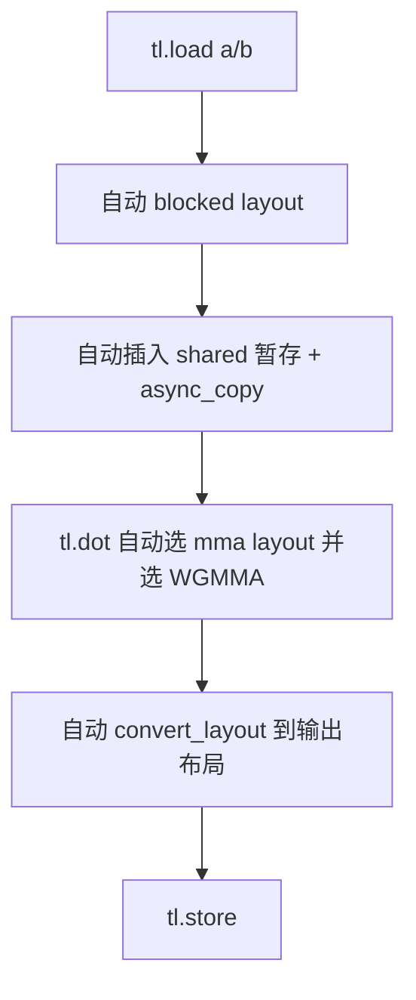

对应到 TTGIR，会看到 `ttg.blocked`、`ttg.shared`、`ttg.mma`、`ttg.convert_layout`、`ttg.async_copy` 等指令——这些都是编译器生成的，用户在 Python 源码里无法直接书写或调整。

##### TileLang 的布局是可见、可干预的

TileLang 把布局做成一等对象，既能显式构造，也能把推断结果画出来。用 `plot_layout` 画一个 4×4 转置布局：

```python
import tilelang.language as T
from tilelang.tools import plot_layout

transpose = T.Layout([4, 4], lambda i, j: (j, i))
plot_layout(transpose, save_directory="./tmp", name="transpose_4x4", formats="png")
```

对 `T.Fragment`，`plot_layout` 会按线程着色，并标注线程号 `T` 与线程本地寄存器下标 `L`：

```python
# fragment 由 LayoutInference 推断后取出即可画图
plot_layout(fragment, name="mma_load", formats="pdf")
```

也可以打开编译期布局推断可视化，让编译器把每个二维 fragment 的推断布局保存成图：

```bash
export TL_LAYOUT_VISUALIZATION_ENABLE=1
# 可选：export TL_LAYOUT_VISUALIZATION_FORMATS=png
python examples/gemm/example_gemm.py
```

##### 仓库中的真实对照

| 场景 | Triton | TileLang | 差异 |
| --- | --- | --- | --- |
| per-token FP8 量化 | `examples/cast/example_triton_cast_to_fp8.py`：`tl.load` + mask + `tl.max`，无 shared/fragment 声明 | `examples/cast/example_per_token_cast_to_fp8.py`：`T.copy` 到 `T.alloc_fragment` + `T.reduce_absmax` | 前者布局/向量化全自动；后者显式 fragment，归约布局由推断决定 |
| NSA 前向 | `examples/deepseek_nsa/example_triton_nsa_fwd.py`：`b_s_slc = tl.dot(b_q, b_k_slc)`，`b_q/b_k_slc/b_v_slc` 均为普通值 | `examples/deepseek_nsa/example_tilelang_nsa_fwd.py`：显式 `alloc_shared/alloc_fragment` + `T.copy` + `T.gemm` | Triton 在 `tl.dot` 前才自动分配 shared 并转 mma 布局；TileLang 源码里已写清驻留位置与流水 |

以 `example_triton_nsa_fwd.py` 为例，`b_q`、`b_k_slc`、`b_v_slc` 只是 `tl.load` 的结果，直到 `tl.dot` 才由编译器为它们分配 shared 并转成 mma 所需布局；而 TileLang 版本在源码里就声明了 `A_shared`、`S_local` 等驻留位置。

**结论**：Triton 用「编译器决定内存与布局」换简洁，用户看不到也改不了 `ttg.blocked/ttg.mma/ttg.shared`；TileLang 用「显式声明 + 推断可视化」换控制力，布局是 IR 里的一等公民，可推断、可查看（`plot_layout` / 布局可视化）、可干预。两者的布局决策都发生在编译期，区别在于用户能否表达与观察该决策。

#### 2.3.4 编译栈与 IR 体系

**Triton** 使用自研 MLIR 系 IR：`TTIR → TTGIR（GPU 相关）→ LLVM IR → PTX/cubin`，与 LLVM 紧耦合。

**TileLang** 使用 TVM/TIR(X)：`Python DSL → tile-level TIR(X) → 多轮 Pass → host/device 分离 → target 源码`，后端通过注册表可插拔。

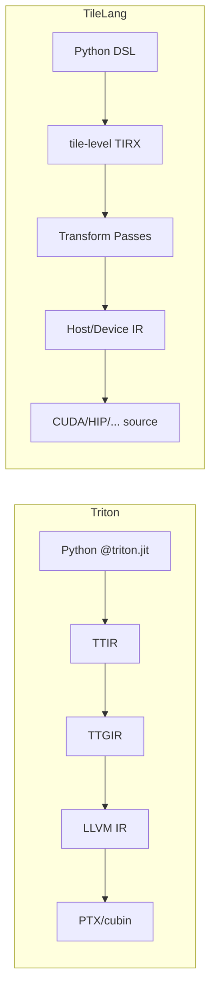

#### 2.3.5 调度与流水线

- **Triton**：`num_stages` 触发编译器自动软件流水；warp 调度由编译器决定。
- **TileLang**：`T.Pipelined(..., num_stages=...)` 提供阶段/顺序注解，`PipelinePlanning` + `InjectSoftwarePipeline` 负责展开；同时支持显式 warp specialization（`AutoWarpSpecialization` / `ProducerConsumerWarpSpecialized`）、persistent kernel（`PersistThreadblock`）与 L2 persistent（`LowerL2Persistent`）。

#### 2.3.6 硬件特性映射

| 硬件特性 | Triton | TileLang |
| --- | --- | --- |
| TMA | 受限模式自动生成 | `T.tma_copy` + `AnnotateDeviceBoundTmaCopies` + `FuseMBarrierArriveExpectTx` |
| WGMMA | 编译器自动选择 | `T.gemm` + `LowerHopperIntrin` |
| Blackwell 2SM / tcgen05 / TMEM | 逐步支持 | `LowerBlackwell2SM`、`LowerSharedTmem`、`InjectTcgen05Fence` |
| mbarrier / fence | 编译器管理 | `T.alloc_barrier`、`LowerSharedBarrier`、`InjectFenceProxy` |

#### 2.3.7 后端与可移植性

- **Triton**：NVIDIA CUDA、AMD ROCm，以及 CPU 等实验性后端。
- **TileLang**：CUDA / ROCm / Metal / Ascend / CPU(LLVM) / WebGPU，通过 `BackendModule` 注册表按 target kind 分发。

#### 2.3.8 可调试性与可观测性

- **Triton**：主要依赖 MLIR dump 与 `triton.compile` 中间产物。
- **TileLang**：提供 `TL_LOWER_TRACE`（逐 Pass before/after IR + codegen 捕获 + HTML 报告）、`pass_diff`、`Analyzer`、`pass_timing`、`plot_layout`、`TL_ENABLE_DUMP_IR` 等，定位「哪一步 IR 变了」非常直接。

#### 2.3.9 自动调优生态

- **Triton**：`@triton.autotune` + config 列表。
- **TileLang**：`tilelang.autotuner`（`tuner.py`、`grouped_compile.py`、`capture.py`）+ `carver`（matmul 分析并自动生成调度）。

#### 2.3.10 性能与生产力权衡

- Triton：上手快、生态集成好（`torch.compile/Inductor`、vLLM、SGLang），但性能上限受编译器布局与调度决策约束。
- TileLang：控制力强、性能上限高，能表达复杂流水线与多后端，但需要理解内存层次与布局。

#### 2.3.11 代码级对比示例

**示例 A：per-token FP8 量化**（`examples/cast/`）

Triton 版本（节选，`example_triton_cast_to_fp8.py`）：

```python
cols = tl.arange(0, BLOCK)
mask = cols < group_size
y = tl.load(y_ptr + cols, mask=mask, other=0.0).to(tl.float32)
_absmax = tl.maximum(tl.max(tl.abs(y)), eps)
y_s = _absmax / fp8_max
y_q = tl.clamp(y / y_s, fp8_min, fp8_max).to(y_q_ptr.dtype.element_ty)
tl.store(y_q_ptr + cols, y_q, mask=mask)
tl.store(y_s_ptr, y_s)
```

TileLang 版本（节选，`example_per_token_cast_to_fp8.py`）：

```python
T.copy(X[row * blk_m:(row + 1) * blk_m, row_g_id * group_size:(row_g_id + 1) * group_size], y_local)
T.reduce_absmax(y_local, y_amax_local, dim=1)
for i in T.Parallel(blk_m):
    y_amax_local[i] = T.max(y_amax_local[i], 1e-4)
    y_s_local[i] = y_amax_local[i] / fp8_max
for i, j in T.Parallel(blk_m, group_size):
    y_q_local[i, j] = T.clamp(y_local[i, j] / y_s_local[i], fp8_min, fp8_max)
```

对比点：Triton 用 mask + `tl.max` 表达归约，布局/向量化由编译器决定；TileLang 显式 `T.copy` 到 fragment、用 `T.reduce_absmax` 表达按行归约，布局由 `LayoutInference` 推断，向量化与线程绑定在 `LowerTileOp`/`VectorizeLoop` 阶段完成。

**示例 B：NSA 稀疏注意力**：`examples/deepseek_nsa/example_triton_nsa_fwd.py` vs `example_tilelang_nsa_fwd.py`。

**示例 C：MLA 解码**：`examples/deepseek_mla/README.md` 给出 TileLang / Triton / FlashMLA / FlashInfer 在 bs64/bs128 上的性能对比，TileLang 以约 80 行 Python 达到接近 FlashMLA 的性能。

**小结表：**

| 示例 | 关键 API 映射 | 编译产物差异 | 性能 |
| --- | --- | --- | --- |
| FP8 量化 | `tl.max/tl.load` ↔ `T.reduce_absmax/T.copy` | Triton: TTGIR→PTX；TileLang: TIRX→CUDA | 同量级 |
| NSA | 稀疏索引循环 | Triton 自动调度 vs TileLang 显式 pipeline | TileLang 可精细控制 |
| MLA | attention pipeline | 后端均为 CUDA | TileLang ≈ FlashMLA > Triton |

#### 2.3.12 横向总览对比表

| 维度 | Triton | TileLang |
| --- | --- | --- |
| 抽象层次 | block-level | tile-level |
| 内存控制 | 隐式 | 显式 |
| 布局控制 | 编译器选择 | 推断 + 可干预 |
| 流水线 | `num_stages` 自动 | `T.Pipelined` + 专用 Pass |
| 硬件 intrinsic | 自动生成 | 显式映射与可控 |
| IR 栈 | 自研 MLIR (TTIR/TTGIR) | TVM/TIR(X) |
| 后端 | CUDA/ROCm(+/CPU 实验) | CUDA/ROCm/Metal/Ascend/CPU/WebGPU |
| 调试 | MLIR dump | Lower Trace / pass_diff / Analyzer |
| 生态 | torch.compile/vLLM/SGLang | examples + autotuner + carver |
| 学习曲线 | 低 | 中 |
| 性能上限 | 受编译器约束 | 更高 |

#### 2.3.13 选型建议

- **选 Triton**：快速原型、规整算子、需要与深度学习框架生态集成。
- **选 TileLang**：追求极致性能、需要复杂软件流水线 / warp specialization、需要多后端（尤其 Ascend 等非 NVIDIA 目标）、需要显式布局控制。

### 2.4 支持的后端矩阵

#### 2.4.1 后端成熟度与特性覆盖

| 后端 | 目录 | 成熟度 | 关键特性 |
| --- | --- | --- | --- |
| CUDA | `tilelang/cuda/` + `src/cuda/` | 高 | TMA/WGMMA/TMEM/tcgen05、warp specialization、NVRTC/CuTeDSL |
| ROCm | `tilelang/rocm/` + `src/rocm/` | 中高 | MatrixCore、hipcc/cython |
| Metal | `tilelang/metal/` + `src/metal/` | 中 | Apple Silicon、torch 适配 |
| Ascend | `tilelang/ascend/` + `src/ascend/` | 中 | SIMD/SIMT、torch_npu 交换、自动调度 |
| CPU | `tilelang/cpu/` + `src/cpu/` | 中 | LLVM、C 源码 |
| WebGPU | `tilelang/webgpu/` | 实验 | 浏览器运行时 |

#### 2.4.2 与 Triton 后端覆盖的差异

Triton 主要覆盖 CUDA / ROCm；TileLang 额外覆盖 Metal、Ascend、CPU、WebGPU，并提供统一的 `BackendModule` 注册机制。

---

## 3. 代码目录结构

### 3.1 顶层目录总览

```text
tilelang/
├── src/            # C++ 核心实现（op/transform/layout/runtime/各 target）
├── tilelang/       # Python 主包
├── examples/       # 各算子与后端示例
├── benchmark/      # 性能基准
├── testing/        # 测试（python/cpp/ascend）
├── 3rdparty/       # 第三方依赖
├── docs/           # 文档
├── maint/          # 维护脚本
├── cmake/          # CMake 辅助
├── CMakeLists.txt
├── pyproject.toml
└── version_provider.py
```

### 3.2 Python 主包 `tilelang/`

```text
tilelang/
├── __init__.py
├── engine/         # lower.py / semantic_check.py / param.py / callback.py
├── jit/            # kernel.py / adapter/ / abi.py / diagnostics.py
├── backend/        # module.py / target.py / device_codegen.py / host_codegen.py
│   └── pass_pipeline/
├── language/       # DSL 门面（转发 CUDA dialect）
├── cuda/           # CUDA 后端（backend/pipeline/codegen/language/op/transform）
├── rocm/           # ROCm 后端
├── metal/          # Metal 后端
├── ascend/         # Ascend 后端
├── cpu/            # CPU/LLVM 后端
├── webgpu/         # WebGPU 后端
├── layout/         # Layout / Fragment / Swizzle / CuTe / GEMM 布局
├── analysis/       # AST 打印、循环/索引检查、布局可视化
├── transform/      # Python 侧 Pass 封装
├── tileop/         # TileOp 抽象
├── autotuner/      # 自动调优
├── carver/         # matmul 分析与调度生成
├── cache/          # kernel/binary 缓存
├── profiler/       # bench/wall/torch_bench/msprof
├── instrumentation/# 编译插桩
├── tools/          # Analyzer/compile_only/lower_trace/pass_timing/plot_layout
├── contrib/        # nvcc/nvrtc/hipcc/msvc/bisheng/rocm 封装
└── utils/          # device/tensor/language/pass_diff/version
```

### 3.3 C++ 核心源码 `src/`

```text
src/
├── op/         # operator/copy/fill/gemm/gemm_sp/gemm_blockscaled/reduce/scan/...
├── transform/  # 核心 Pass（frontend_legalize/layout_inference/lower_tile_op/...）
├── layout/     # layout/cute_layout/gemm_layouts/swizzle_mode/tcgen05_layout
├── runtime/    # error_helpers/logging
├── cuda/       # codegen / op / transform / runtime
├── rocm/  metal/  cpu/  ascend/  webgpu/
├── tl_templates/  # CUDA/HIP 模板头
└── ir.cc / ir.h   # tile IR 定义
```

### 3.4 构建与工程文件

| 文件 | 作用 |
| --- | --- |
| `CMakeLists.txt` | C++ 编译与各 target 源文件组织 |
| `pyproject.toml` | Python 包与依赖 |
| `cmake/` | CMake 辅助模块 |
| `version_provider.py` | 版本号提供 |

---

## 4. 代码架构图

### 4.1 分层架构总览

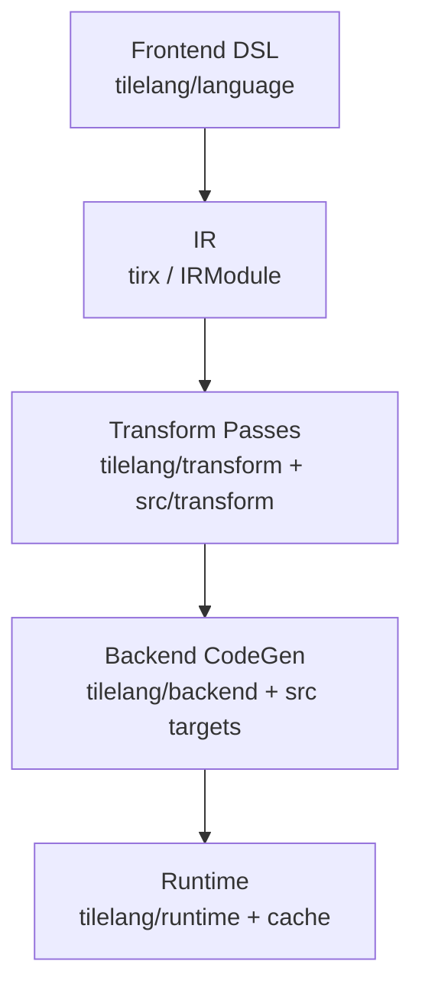

### 4.2 多后端抽象架构图

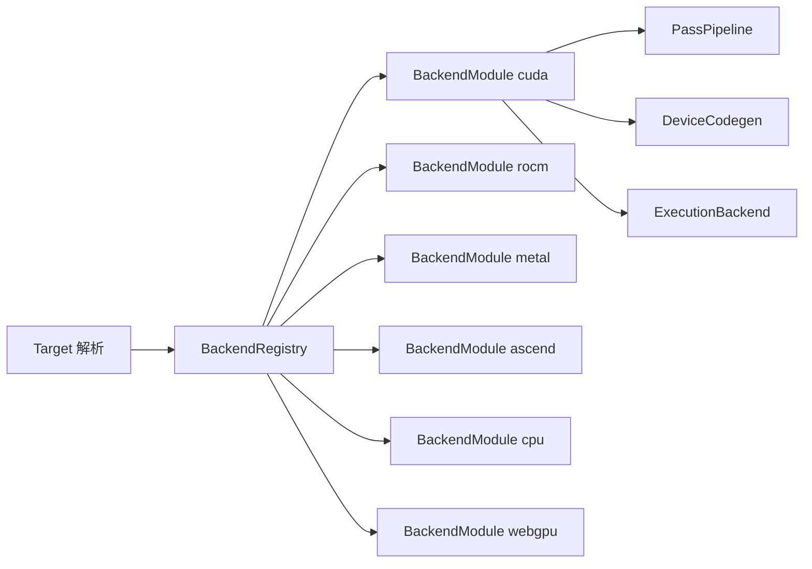

### 4.3 编译流水线数据流图

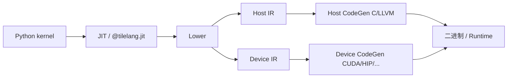

### 4.4 关键 Mermaid 图

模块依赖图：

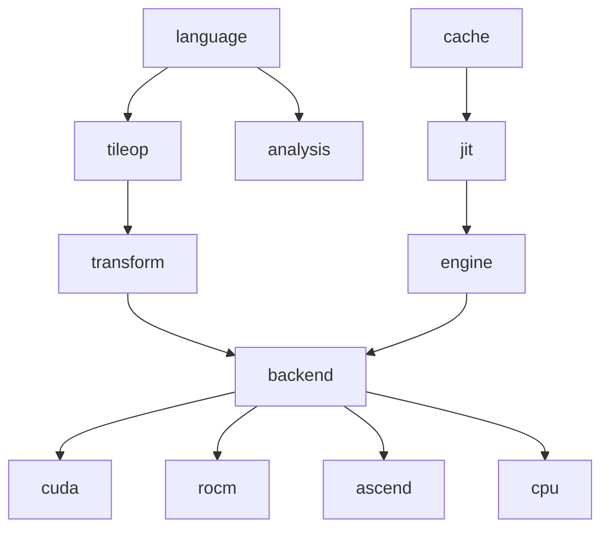

---

## 5. 核心模块详细介绍

> 配图要求：下述每个模块均至少配一张 Mermaid 图，标注关键文件与数据流。

### 5.1 语言层（`tilelang/language/`）

语言层是 DSL 门面，实际能力由各后端 dialect 提供；默认 `import tilelang.language as T` 转发 CUDA dialect（`tilelang/cuda/language/`），其他后端通过 `tilelang.<backend>.language` 访问，均建立在 `language/common.py` 之上。

- **5.1.1 DSL 入口与 kernel 定义**：`kernel.py`、`frame.py`、`allocate.py`。`T.Kernel` 建立 block 上下文；`frame.py` 维护作用域栈；`allocate.py` 提供 `T.alloc_shared/alloc_fragment/alloc_local/alloc_barrier`。
- **5.1.2 数据移动**：`copy_op.py`（`T.copy`、`T.tma_copy`）。
- **5.1.3 计算**：`gemm_op.py`、`reduce_op.py`、`scan_op.py`、`fill_op.py`、`atomic.py`、`logical.py`、`math_intrinsics.py`、`fp8.py`。
- **5.1.4 控制流与调度**：`loop.py`（`T.Pipelined`/`T.Parallel`/`T.Unroll`）、`tile_schedule.py`、`warp_specialize.py`。
- **5.1.5 注解与元信息**：`annotations.py`、`meta.py`、`customize.py`、`symbolics.py`（`T.const`/`T.symbolic`）。
- **5.1.6 TileOp 抽象**：`tilelang/tileop/base.py` 定义 tile 算子的 Python 侧基类。

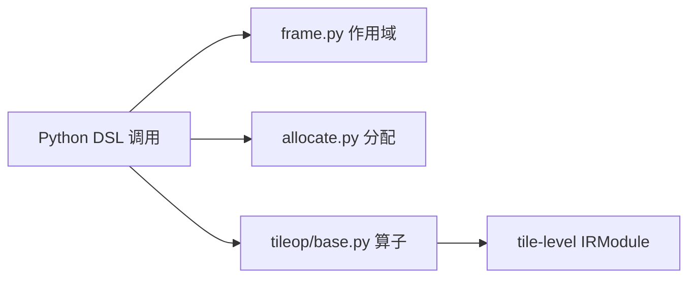

### 5.2 类型系统与数据类型（`tilelang/dtypes.py`、`language/dtypes.py`）

提供标量类型（int/uint/float/bfloat16）、低精度类型（float8_e4m3fn、float8_e5m2、int4 等）、向量类型，以及类型提升与转换规则。`T.Tensor`、`T.empty`、`T.alloc_*` 均基于该类型系统。

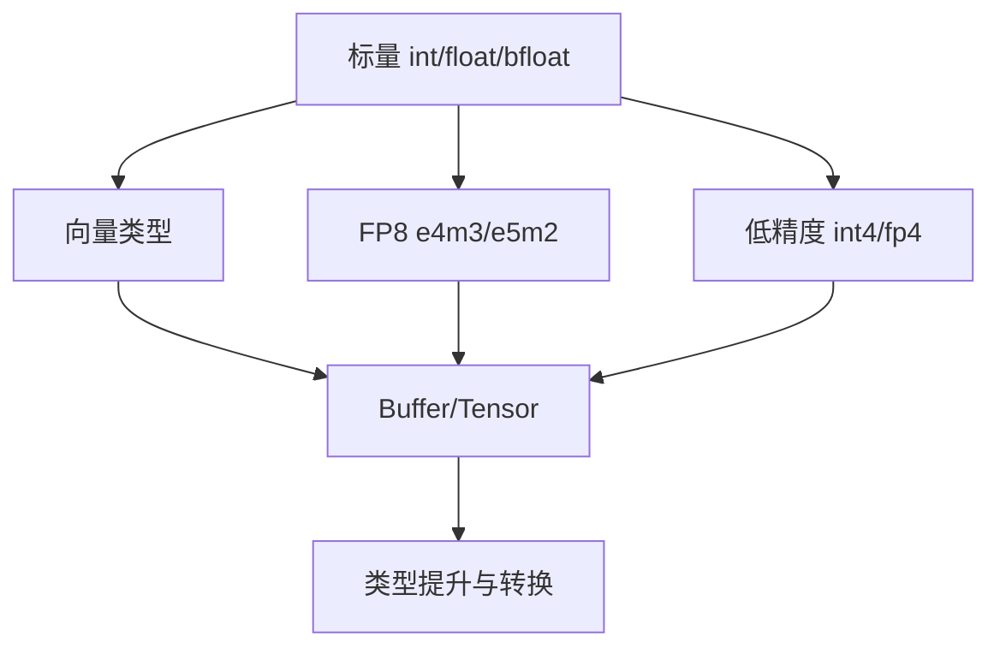

### 5.3 布局系统（`tilelang/layout/` + `src/layout/`）

- **5.3.1** `Layout`/`Fragment`/`PartialFragment`（`layout.py`、`fragment.py`、`partial_fragment.py`）。
- **5.3.2** CuTe 布局代数与转换（`cute.py`、`_cute_ffi_api.py`、`src/layout/cute_layout.cc`）。
- **5.3.3** Swizzle（`swizzle.py`、`swizzle_mode.py`、`src/layout/swizzle_mode.cc`）。
- **5.3.4** GEMM 专用布局（`gemm_sp.py`、`src/layout/gemm_layouts.cc`、`tcgen05_layout.cc`）。
- **5.3.5** Ascend 布局（`layout/ascend.py`）。

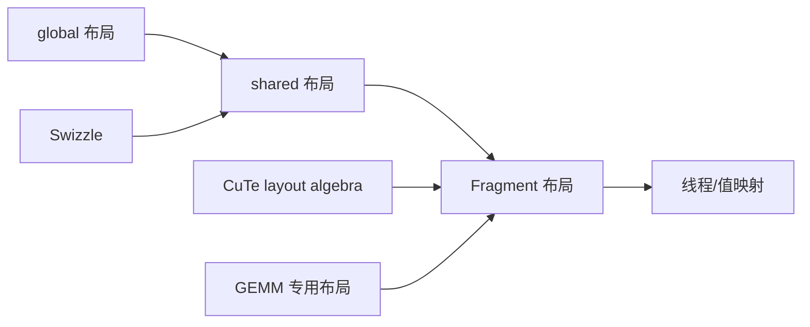

### 5.4 前端解析与分析（`tilelang/analysis/`）

- `ast_printer.py`：AST 打印。
- `nested_loop_checker.py`：嵌套循环检查。
- `fragment_loop_checker.py`：fragment 循环检查。
- `parallel_local_index_checker.py`：并行局部索引检查。
- `layout_visual.py`：布局可视化。

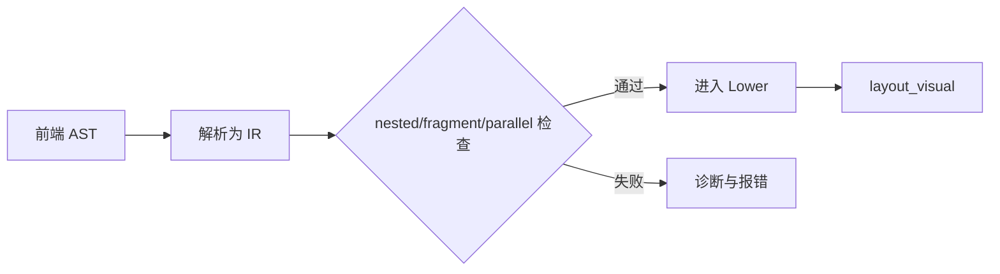

### 5.5 引擎与编译流程（`tilelang/engine/`、`tilelang/jit/`）

- **5.5.1** `lower.py`：`lower`、`lower_with_context`、`lower_to_host_device_ir`、`host_codegen`、`device_codegen`，负责 Host/Device IR 分离。
- **5.5.2** `semantic_check.py`：`PreLowerSemanticCheck` 前置语义检查。
- **5.5.3** `param.py`：`KernelParam`、`CompiledArtifact`。
- **5.5.4** `tilelang/jit/`：`kernel.py`（JITKernel）、`adapter/`（tvm_ffi/cython/nvrtc/cutedsl/torch/pto）、`abi.py`、`diagnostics.py`、`exceptions.py`。

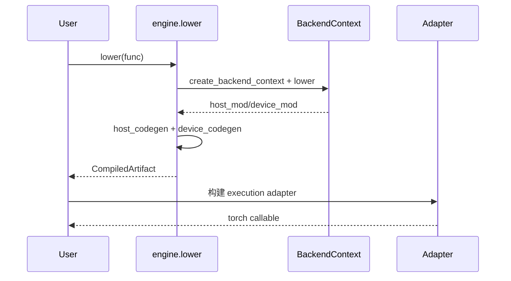

### 5.6 变换与 Pass（`tilelang/transform/` + `src/transform/`）

- **5.6.1 Python 侧封装**：`pass_config.py`、`simplify.py`、`hoist_broadcast_values.py`、`add_bufstore_wrapper.py`、`decouple_type_cast.py`。
- **5.6.2 C++ 侧核心 Pass**（分类）：
  - frontend legalize：`frontend_legalize`
  - loop 变换：`loop_partition`、`loop_vectorize`/`vectorize_loop`、`unroll_loop`、`loop_unswitching`
  - 存储/内存：`flatten_buffer`、`storage_rewrite`、`merge_shared_memory_allocations`、`hoist_global_buffer_allocations`
  - lowering：`inject_pipeline`、`pipeline_planning`、`lower_tile_op`、`lower_intrin`、`lower_thread_allreduce`、`lower_device_kernel_launch`
  - host/device：`split_host_device`、`make_packed_api`、`materialize_kernel_launch`
  - 验证：`verify_buffer_init`、`verify_parallel_loop`、`verify_reducer_consumed`、`verify_reducer_epoch`
- **5.6.3 Pass 管理与编排**：`backend/pass_pipeline/`。

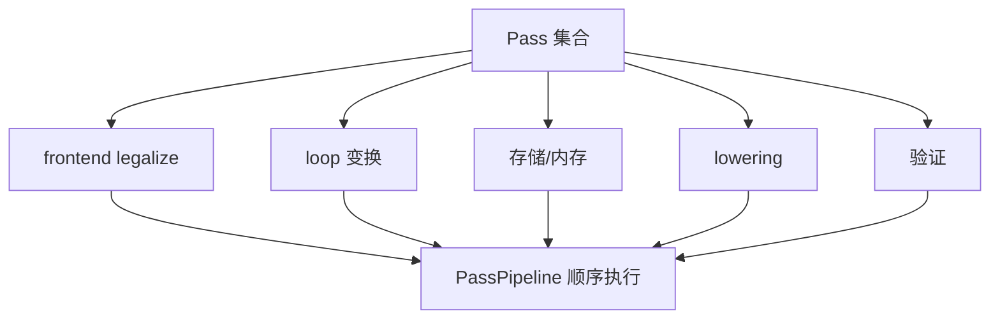

### 5.7 后端抽象层（`tilelang/backend/`）

- **5.7.1** `BackendContext` / Target / Module（`module.py`、`target.py`）。
- **5.7.2** 注册表与分发（`device_codegen.py`、`host_codegen.py`、`execution_backend.py`）。

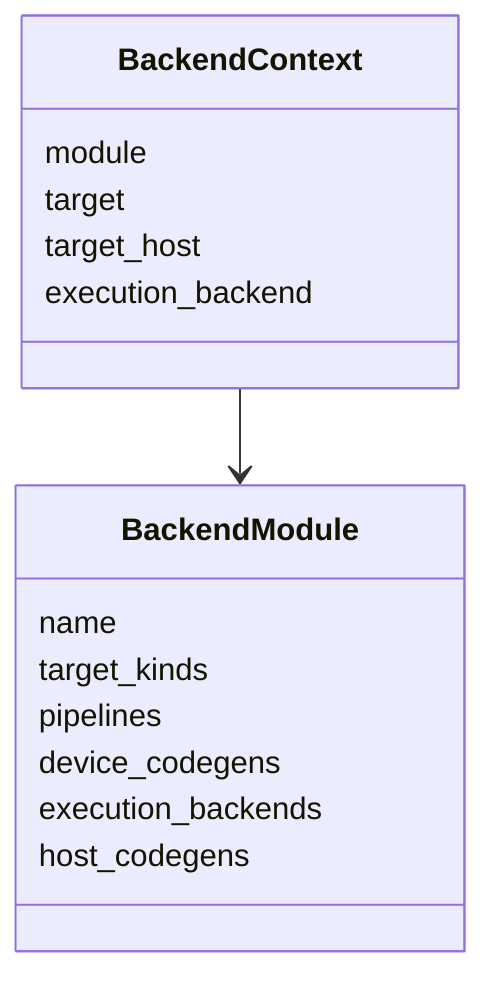

### 5.8 具体后端实现

- **5.8.1 CUDA**（`tilelang/cuda/` + `src/cuda/`）：codegen、pipeline、execution_backend、cutedsl_backend、NVRTC。
- **5.8.2 ROCm**（`tilelang/rocm/` + `src/rocm/`）。
- **5.8.3 Metal**（`tilelang/metal/` + `src/metal/`）。
- **5.8.4 Ascend**（`tilelang/ascend/` + `src/ascend/`）：target、pipeline、codegen、SIMD/SIMT、torch 交换。
- **5.8.5 CPU / LLVM**（`tilelang/cpu/` + `src/cpu/`）。
- **5.8.6 WebGPU**（`tilelang/webgpu/`）。

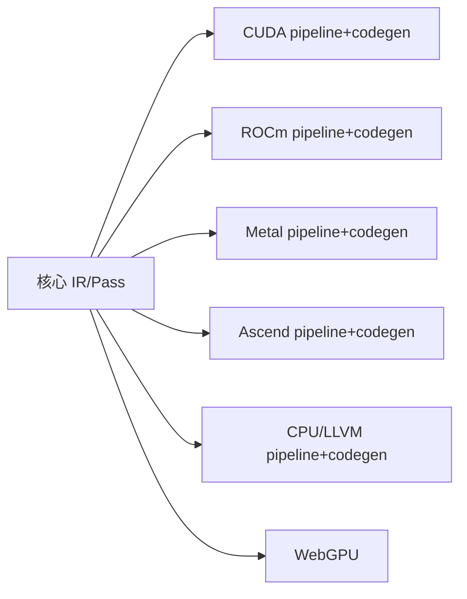

### 5.9 算子层（`src/op/`）

- 注册与基类：`operator.cc`、`operator.h`、`builtin_registry.h`。
- 算子：copy / fill / gemm（含 `gemm_blockscaled`、`gemm_sp`）/ reduce / scan / atomic / logical / math / parallel / transpose。

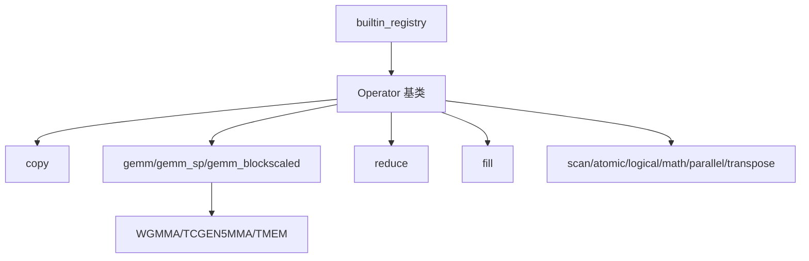

### 5.10 运行时与执行（`tilelang/runtime`、`src/runtime/`）

- **5.10.1** 二进制加载与缓存（`tilelang/cache/`：`kernel_cache.py`、`binary_cache.py`、`cuda_binary_cache.py`、`ascend_binary_cache.py`）。
- **5.10.2** 运行时支撑（`src/runtime/logging.cc`、`error_helpers.cc`、device 管理）。

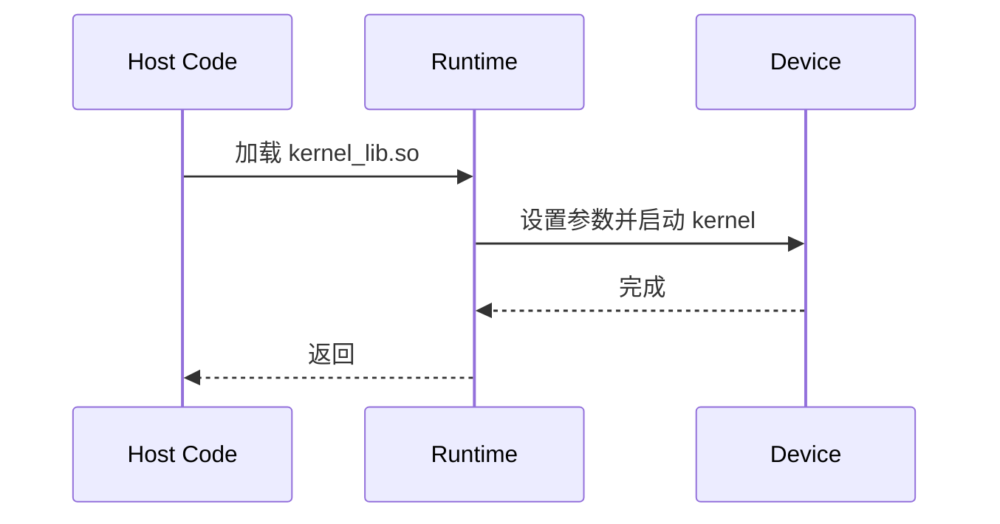

### 5.11 自动调优（`tilelang/autotuner/`、`tilelang/carver/`）

- **5.11.1** `tuner.py`、`param.py`、`capture.py`、`grouped_compile.py`。
- **5.11.2** `carver`：matmul 分析与调度生成（`matmul_analysis.py`、`common_schedules.py`、`roller/`、`template/`）。

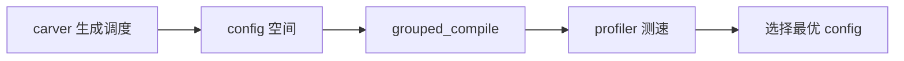

### 5.12 性能剖析与可观测性

- **5.12.1** `tilelang/profiler/`（`bench.py`、`wall.py`、`torch_bench.py`、`msprof.py`）。
- **5.12.2** `tilelang/instrumentation/`（`events.py`、`session.py`，Pass 计时与 lower trace）。
- **5.12.3** `tilelang/tools/`（Analyzer、compile_only、pass_timing、plot_layout、lower_trace、pass_visualizer）。

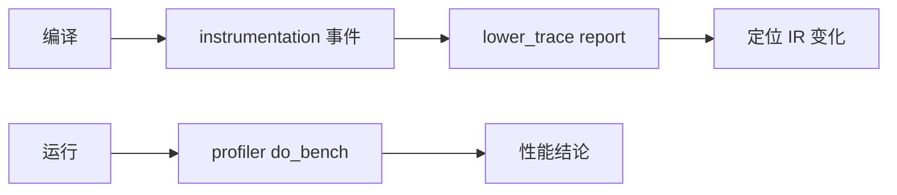

### 5.13 工具与辅助（`tilelang/tools/`、`tilelang/contrib/`、`tilelang/utils/`）

- 编译器封装：`nvcc.py`、`nvrtc.py`、`hipcc.py`、`msvc.py`、`bisheng.py`、`rocm.py`、`cc.py`。
- 通用工具：`device.py`、`tensor.py`、`language.py`、`pass_diff.py`、`version.py`。

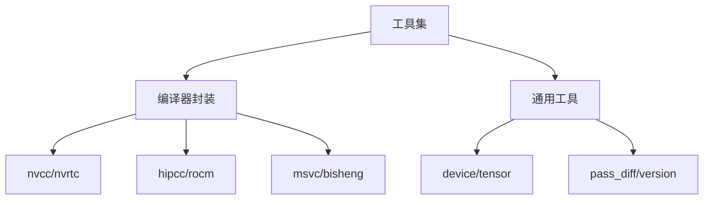

---

## 6. 编译流水线深度剖析

### 6.0 本章导读

本章先用一张总图建立整体心智模型，再用一个真实 GEMM 逐阶段展示 IR 演变，最后按模块逐一拆解。建议先读第 4 章（架构图）与 5.5/5.6/5.7。

### 6.1 编译模块总览

#### 6.1.1 编译相关目录与职责

| 层 | 目录 | 职责 |
| --- | --- | --- |
| 前端与解析 | `tilelang/language/`、`tilelang/analysis/`、`tilelang/tileop/` | DSL、AST、tile 算子 |
| 引擎编排 | `tilelang/engine/` | `lower.py`、`semantic_check.py`、`param.py`、`callback.py` |
| Pass 封装 | `tilelang/transform/` + `src/transform/` | Python 门面 + C++ 核心 Pass |
| 后端抽象 | `tilelang/backend/` | `module.py`、`target.py`、codegen 注册、pass_pipeline |
| 具体后端 | `tilelang/{cuda,rocm,metal,ascend,cpu,webgpu}/` + `src/...` | 各后端 pipeline/codegen |
| JIT 与运行时 | `tilelang/jit/`、`tilelang/cache/`、`tilelang/runtime` | 适配、ABI、缓存 |
| 可观测性 | `tilelang/instrumentation/`、`tilelang/tools/`、`tilelang/profiler/` | 插桩、调试、测速 |

#### 6.1.2 编译流程分层图

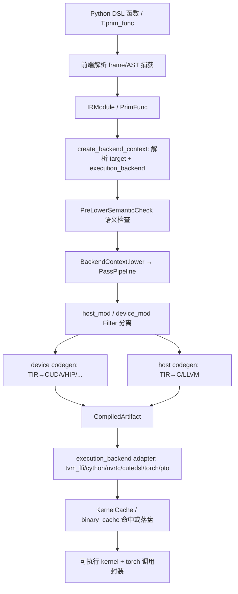

### 6.2 从 Python 函数到 IRModule 的完整链路

#### 6.2.1 编译入口盘点

- `tilelang.compile(func, target=..., execution_backend=...)`
- `@tilelang.jit` 装饰器（`matmul.compile(...)`）
- `tilelang.lower(...)`（只 lower 不构建 adapter）
- `tilelang.autotuner` / `grouped_compile`、`carver`

#### 6.2.2 `@tilelang.jit` 装饰器解析与参数符号化

`@tilelang.jit` 将普通 Python 函数标记为 kernel 工厂；`T.const("M, N, K")` 声明符号维度，`T.symbolic` 声明符号标量，使同一 kernel 可编译多个 shape。

#### 6.2.3 AST 解析与 frame 栈

- `language/frame.py`：维护 `T.Kernel`、`T.Pipelined` 等的作用域栈。
- `language/allocate.py`：分配 buffer 并记录 scope。
- `analysis/`：`nested_loop_checker`、`fragment_loop_checker`、`parallel_local_index_checker` 在构建期做静态检查。

#### 6.2.4 TileOp 抽象与前端合法化

`tilelang/tileop/base.py` 定义 Python 侧 tile 算子；`frontend_legalize` Pass 负责把前端写法规范化，为后续推断做准备。

#### 6.2.5 前端数据流图

```mermaid
sequenceDiagram
  participant Py as Python 函数
  participant Deco as @tilelang.jit
  participant Frame as frame/allocate
  participant IR as IRModule
  Py->>Deco: 调用 matmul(M,N,K,...)
  Deco->>Frame: 进入 T.Kernel 作用域
  Frame->>Frame: 记录 alloc/copy/gemm
  Frame->>IR: 构建 tile-level PrimFunc/IRModule
  IR-->>Deco: 交付给 Lower
```

### 6.3 Lower 阶段拆解（以 `tilelang/engine/lower.py` 为主线）

#### 6.3.1 `BackendContext` 解析

`create_backend_context` → `determine_target` → `_resolve_backend_module` → `resolve_execution_backend`，并校验 target 与 execution_backend 合法性，返回不可变的 `BackendContext`。

#### 6.3.2 `PreLowerSemanticCheck`

在 target 相关 lowering 前执行后端无关的语义检查，可被 `tl.disable_prelower_semantic_check` 关闭。

#### 6.3.3 `context.lower(mod)` → `PassPipeline.lower`

`BackendContext.lower` → `BackendModule.get_pipeline(target).lower` → `PassPipeline.lower`。该边界负责标识 phase 窗口（`pipeline_<name>`），出错时调用 `enrich_error` 附加 `--> file:line:col` 定位信息。

#### 6.3.4 CUDA 主流水线 `CUDAPassPipelineBody` 阶段化拆解

| 阶段 | 关键 Pass |
| --- | --- |
| A · Prologue 前处理 | `BindTarget`、`MaterializeKernelLaunch`、`AnnotateDeviceBoundTmaCopies`、`LetInline`、`AddWrapperForSingleBufStore`、`LegalizeNegativeIndex`、`VerifyParallelLoop`、`InjectAssumes`、`Simplify` |
| B · reducer/语义校验 | `CanonicalizeLegacyReducer`、`VerifyReducerEpoch`、`VerifyBufferInit` |
| C · CUDA/Blackwell 前置 | `AutoWarpSpecialization`、`MaterializeWSSchedule`、`ProducerConsumerWarpSpecialized`、`LowerBlackwell2SM` |
| D · 流水线规划 | `IfStmtBinding`、`UnrollLoop`、`PipelinePlanning`、`InjectSoftwarePipeline` |
| E · 布局推断与 tile 下降 | `LayoutInference`、`ReducerPlanAndMaterialize`、`LowerTileOp`、`VerifyReducerConsumed` |
| F · 低层合法化与向量化 | `DecoupleTypeCast`、`LegalizeVectorizedLoop`、`LegalizeSafeMemoryAccess`、`LowerAccessPtr`、`HoistNonRestrictParams` |
| G · 存储/分配/同步 | `LowerSharedTmem`、`PlanAndUpdateBufferAllocationLocation`、`LowerSharedBarrier`、`FuseMBarrierArriveExpectTx`、`HoistGlobalBufferAllocations`、`FlattenBuffer`、`ConfigIndexBitwidth`、`VectorizeLoop`、`StorageRewrite`、`MergeSharedMemoryAllocations`、`ThreadSync` |
| H · API/设备分离 | `AnnotateDeviceRegions`、`SplitHostDevice`、`MakePackedAPI`、`LowerDeviceKernelLaunch`、`PersistThreadblock` |

```mermaid
flowchart TD
  A[A Prologue] --> B[B reducer/语义]
  B --> C[C CUDA/Blackwell 前置]
  C --> D[D 流水线规划]
  D --> E[E 布局推断与 tile 下降]
  E --> F[F 合法化与向量化]
  F --> G[G 存储/分配/同步]
  G --> H[H API/设备分离]
```

#### 6.3.5 Host/Device 分离判定逻辑

`lower_to_host_device_ir` 用 `Filter` 按 `is_device_call` / `get_host_call` 切分：CUDA 上设备函数由 `CallingConv.DEVICE_KERNEL_LAUNCH` 标识；CPU（`c` target）上则按 target kind 与 C packed 判定。

#### 6.3.6 逐 Pass 清单与分类表

见 5.6.2。每个 Pass 均可在 `tilelang/transform/pass_config.py` 中找到对应开关。

### 6.4 实例走读：一个 GEMM 的 IR 逐级演变（真实 dump）

本节用一个最小 GEMM，把 `TL_LOWER_TRACE` 捕获到的**真实 IR** 按编译阶段逐一展示。
示例在 NVIDIA H20（`sm_90a`）上编译，尺寸 M=N=K=256，`block_M=block_N=128`、`block_K=32`、`num_stages=2`、`threads=128`。

#### 6.4.0 复现命令

构造脚本 `docs/.ir_demo/gemm_ir_demo.py`（内容见 6.4.1），然后：

```bash
cd docs/.ir_demo
TL_LOWER_TRACE=1 TL_LOWER_TRACE_DIR=$PWD/trace python3 gemm_ir_demo.py
```

`TL_LOWER_TRACE` 会在每个 Pass 前后写出 `.tir` 快照，并在 `trace/gemm_ir_demo/report.html` 生成可交互的对比报告。下面每个阶段都标注了对应的快照文件。

#### 6.4.1 源程序

```python
@tilelang.jit
def matmul(M, N, K, block_M=128, block_N=128, block_K=32, num_stages=2):
    @T.prim_func
    def main(A: T.Tensor((M, K), "float16"), B: T.Tensor((K, N), "float16"), C: T.Tensor((M, N), "float16")):
        with T.Kernel(T.ceildiv(N, block_N), T.ceildiv(M, block_M), threads=128) as (bx, by):
            A_shared = T.alloc_shared((block_M, block_K), "float16")
            B_shared = T.alloc_shared((block_K, block_N), "float16")
            C_local = T.alloc_fragment((block_M, block_N), "float32")
            C_shared = T.alloc_shared((block_M, block_N), "float16")
            T.clear(C_local)
            for k in T.Pipelined(T.ceildiv(K, block_K), num_stages=num_stages):
                T.copy(A[by * block_M, k * block_K], A_shared)
                T.copy(B[k * block_K, bx * block_N], B_shared)
                T.gemm(A_shared, B_shared, C_local)
            T.copy(C_local, C_shared)
            T.copy(C_shared, C[by * block_M, bx * block_N])
    return main
```

#### 6.4.2 阶段 0：前端 tile-level IR（`03_BindTarget_before.tir`）

此时 `T.copy`/`T.gemm`/`T.Pipelined` 仍为高层 tile op；`T.Kernel` 变成 `blockIdx` 线程绑定，`alloc_shared`/`alloc_fragment` 变成带 scope 的 `sblock_alloc_buffer`，循环携带 `num_stages=2` 注解。

```python
@I.ir_module
class Module:
    @T.prim_func
    def main(A_handle, B_handle, C_handle):
        A = T.match_buffer(A_handle, (256, 256), "float16", strides=(256, 1))
        B = T.match_buffer(B_handle, (256, 256), "float16", strides=(256, 1))
        C = T.match_buffer(C_handle, (256, 256), "float16", strides=(256, 1))
        for bx in T.thread_binding(2, thread="blockIdx.x"):
            for by in T.thread_binding(2, thread="blockIdx.y"):
                tx = T.launch_thread_idx(0)   # 以及 ty、tz
                with T.sblock("tilelang_root"):
                    T.sblock_attr({"tl.launch_threads": [128, 1, 1]})
                    A_shared = T.sblock_alloc_buffer((128, 32), "float16", scope="shared.dyn")
                    B_shared = T.sblock_alloc_buffer((32, 128), "float16", scope="shared.dyn")
                    C_local  = T.sblock_alloc_buffer((128, 128), scope="local.fragment")
                    C_shared = T.sblock_alloc_buffer((128, 128), "float16", scope="shared.dyn")
                    T.fill(T.region(C_local[0, 0], 2, 128, 128), 0)   # 对应 T.clear
                    for k in T.serial(8, annotations={"num_stages": 2}):
                        T.copy(T.region(A[by * 128, k * 32], 1, 128, 32), T.region(A_shared[0, 0], 2, 128, 32))
                        T.copy(T.region(B[k * 32, bx * 128], 1, 32, 128), T.region(B_shared[0, 0], 2, 32, 128))
                        T.gemm(T.region(A_shared[0, 0], 1, 128, 32), T.region(B_shared[0, 0], 1, 32, 128),
                               T.region(C_local[0, 0], 3, 128, 128), T.bool(False), T.bool(False), 128, 128, 32, 0, ...)
                    T.copy(T.region(C_local[0, 0], 1, 128, 128), T.region(C_shared[0, 0], 2, 128, 128))
                    T.copy(T.region(C_shared[0, 0], 1, 128, 128), T.region(C[by * 128, bx * 128], 2, 128, 128))
```

关键观察：`T.gemm` 的两个 `T.bool(False)` 是 `transpose_A/transpose_B`；`T.copy` 的源/目的都表达为 `T.region`。

#### 6.4.3 阶段 1：流水线规划与展开（`21_InjectSoftwarePipeline_after.tir`）

`PipelinePlanning` 计算 stage/order，`InjectSoftwarePipeline` 把循环展开为**双缓冲**，并**自动应用 warp specialization**（H20 上 `allow_warp_specialized` 为真，出现 `tl_tiled_ws_applied=1`）：

```python
with T.sblock("tilelang_root"):
    mbarrier = T.handle("uint64", "shared.barrier")
    T.sblock_attr({"barrier_init": {mbarrier: [1, 1, 128, 128]}, "tl.launch_threads": [128, 1, 1]})
    A_shared = T.sblock_alloc_buffer((2, 128, 32), "float16", scope="shared.dyn")   # 双缓冲
    B_shared = T.sblock_alloc_buffer((2, 32, 128), "float16", scope="shared.dyn")   # 双缓冲
    C_local  = T.sblock_alloc_buffer((128, 128), scope="local.fragment")
    C_shared = T.sblock_alloc_buffer((128, 128), "float16", scope="shared.dyn")
    mbarrier_1 = T.sblock_alloc_buffer((4,), "uint64", data=mbarrier, scope="shared.barrier")
    T.attr([128, 128], "kWarpSpecializationScope", 0)
    if tx < 128:                                  # producer：TMA 异步搬运
        for k in range(8):
            T.mbarrier_wait_parity(mbarrier_1[k % 2 + 2], T.bitwise_xor(k % 4 // 2, 1))
            T.tma_copy(... A 子块 ..., barrier=mbarrier_1[k % 2], is_tma_copy=1, tl.pipeline_mbar_phase_expr=k % 4 // 2)
            T.tma_copy(... B 子块 ..., barrier=mbarrier_1[k % 2], is_tma_copy=1, emit_arrive=1, ...)
    else:                                         # consumer：wgmma 计算
        T.fill(T.region(C_local[0, 0], 2, 128, 128), 0)
        for k in range(8):
            T.mbarrier_wait_parity(mbarrier_1[k % 2], k % 4 // 2)
            T.gemm(... A_shared[k % 2] ..., ... B_shared[k % 2] ..., C_local, ...)
            T.ptx_arrive_barrier(mbarrier_1[k % 2 + 2])
        T.copy(T.region(C_local[0, 0], 1, 128, 128), T.region(C_shared[0, 0], 2, 128, 128))
        T.copy(T.region(C_shared[0, 0], 1, 128, 128), T.region(C[by * 128, bx * 128], 2, 128, 128))
```

关键观察：普通 load/store 循环变成由 `mbarrier` 同步的 producer/consumer 两段；`T.copy` 升格为 `T.tma_copy`；`num_stages=2` 体现为 buffer 首维 `2` 与 parity 表达式 `k % 4 // 2`。

#### 6.4.4 阶段 2：布局推断（`23_LayoutInference_after.tir`）

`LayoutInference` 为每个 buffer 挂上布局注解（`layout_map`）：`A_shared`/`B_shared`/`C_shared` 得到 `tl.Layout`（含 swizzle），`C_local` 得到 `tl.Fragment`（线程/寄存器映射）：

```python
A_shared = T.Buffer((2, 128, 32), "float16", scope="shared.dyn")
B_shared = T.Buffer((2, 32, 128), "float16", scope="shared.dyn")
C_local  = T.Buffer((128, 128), scope="local.fragment")
C_shared = T.Buffer((128, 128), "float16", scope="shared.dyn")
T.sblock_attr({"layout_map": {
    A_shared: metadata["tl.Layout"][0], B_shared: metadata["tl.Layout"][1],
    C_local: metadata["tl.Fragment"][0], C_shared: metadata["tl.Layout"][2]}})
```

此时 IR 结构与阶段 1 相同，差异只在**布局注解**；这些注解可在后续 Pass 中被可视化（`plot_layout`）或用于 swizzle 计算。注意 `C_local` 仍是 `(128,128)`，尚未按线程切分。

#### 6.4.5 阶段 3：`LowerTileOp` 下降为线程级 + intrinsic（`25_LowerTileOp_after.tir`）

这是变化最大的一步：

- `C_local` 从 `(128,128)` fragment 变成每个线程的 `(128,)` 本地数组；
- `A_shared`/`B_shared` 被 swizzle 成 `(2,1,16,256)` / `(2,2,4,512)` 的物理排布；
- `T.gemm` 展开为 **wgmma**：初始化 descriptor + `T.ptx_wgmma_ss("m64n128k16", ...)`；
- 写回展开为 `ptx_stmatrix`（寄存器→shared）+ `tma_store`（shared→global）。

```python
A_shared = T.sblock_alloc_buffer((2, 1, 16, 256), "float16", scope="shared.dyn")
B_shared = T.sblock_alloc_buffer((2, 2, 4, 512), "float16", scope="shared.dyn")
C_local  = T.sblock_alloc_buffer((128,), scope="local")            # 每线程 128 个 fp32
...
if tx < 128:                                                       # producer
    for k in range(8):
        T.mbarrier_wait_parity(...)
        if T.tl_shuffle_elect(128):
            T.mbarrier_expect_tx(mbarrier_1[k % 2], T.int64(8192))
            T.tma_load(T.create_tma_descriptor(...), mbarrier_1[k % 2], ...)   # TMA 搬运 A
        if T.tl_shuffle_elect(128):
            ... T.tma_load(...)                                                 # TMA 搬运 B
            T.ptx_arrive_barrier(mbarrier_1[k % 2])
else:                                                              # consumer
    for k in range(8):
        T.mbarrier_wait_parity(mbarrier_1[k % 2], k % 4 // 2)
        with T.sblock("_gemm_ssr"):
            desc_a = T.sblock_alloc_buffer((1,), "uint64", scope="local.descriptor.wgmma")
            desc_b = T.sblock_alloc_buffer((1,), "uint64", scope="local.descriptor.wgmma")
            T.initialize_wgmma_descriptor(desc_a[0], ..., 2, 1, 32)
            T.increase_descriptor_offset(desc_a[0], k % 2 * 8192)
            T.initialize_wgmma_descriptor(desc_b[0], ..., 1, 256, 64)
            T.warpgroup_arrive()
            for i in T.unroll(2):
                for ki in T.unroll(2):
                    T.ptx_wgmma_ss("m64n128k16", T.bool(True), T.bool(False), "fp16", "fp16", "fp32",
                                   desc_a.data, ..., desc_b.data, ..., C_local.data, i * 64, 1, 1, 1)
            T.warpgroup_commit_batch()
            T.warpgroup_wait(0)
            T.warpgroup_fence_operand("float32", C_local.data, 0, 128)
        T.ptx_arrive_barrier(mbarrier_1[k % 2 + 2])
    for i in T.unroll(T.FloorDiv(128, 8)):
        T.ptx_stmatrix(0, 4, T.access_ptr(C_shared[...]), ..., "m8n8")     # 寄存器 -> shared
    if T.tl_shuffle_elect(128):
        for i in T.unroll(2):
            T.tma_store(T.create_tma_descriptor(...), ..., bx * 128 + 64 * i, by * 128, 0, 0)
        T.tma_store_arrive()
        T.tma_store_wait(0, T.bool(True))
```

#### 6.4.6 阶段 4：最终 device IR（`codegen/85_codegen_before.tir`）

经 `FlattenBuffer`/`StorageRewrite`/`MergeSharedMemoryAllocations`/`ThreadSync`/`MakePackedAPI` 后，所有 buffer 合并为一块动态共享内存，参数变成 TMA descriptor（`grid_constant`），函数带 `calling_conv=2`（device kernel）与 `thread_extent`：

```python
@T.prim_func
def main_kernel(A_desc: T.handle("uint8x128", "grid_constant"),
                B_desc: T.handle("uint8x128", "grid_constant"),
                C_desc: T.handle("uint8x128", "grid_constant")):
    T.func_attr({"calling_conv": 2, "dyn_shared_memory_buf": 32768,
                 "thread_extent": {"blockIdx.x": 2, "blockIdx.y": 2, "threadIdx.x": 256, ...}, ...})
    bx = T.launch_thread("blockIdx.x", 2)
    buf_dyn_shmem = T.alloc_buffer((32768,), "uint8", scope="shared.dyn")
    A_shared = T.handle("float16", "shared.dyn") = T.handle_add_byte_offset(buf_dyn_shmem.data, 0)
    C_shared = T.handle("float16", "shared.dyn") = T.handle_add_byte_offset(buf_dyn_shmem.data, 0)
    B_shared = T.handle("float16", "shared.dyn") = T.handle_add_byte_offset(buf_dyn_shmem.data, 16384)
    ...
    if tx < 128:
        T.set_max_nreg(24, 0)                       # producer 限制寄存器
        for k in range(8):
            ... T.tma_load(A_desc, mbarrier_1[...], ...)
    else:
        T.set_max_nreg(240, 1)                      # consumer 增加寄存器
        ... T.ptx_wgmma_ss("m64n128k16", ...)
        ... T.ptx_stmatrix(...); T.tma_store(C_desc, ...)
```

#### 6.4.7 阶段 5：生成的 CUDA（`kernel.cu`）

最终由 CUDA codegen 生成如下源码（截取核心部分）：

```cpp
extern "C" __global__ void __launch_bounds__(256, 1)
main_kernel(__grid_constant__ const CUtensorMap A_desc,
            __grid_constant__ const CUtensorMap B_desc,
            __grid_constant__ const CUtensorMap C_desc) {
  ...
  __shared__ __align__(16) uint64_t mbarrier_mem[4];
  auto mbarrier = reinterpret_cast<Barrier*>(mbarrier_mem);
  if (tl::tl_shuffle_elect<0>()) { tl::prefetch_tma_descriptor(A_desc); ... }
  if (tl::tl_shuffle_elect<0>()) { mbarrier[0].init(1); mbarrier[2].init(128); ... }
  tl::fence_barrier_init();
  if (threadIdx.x < 128) {                                   // producer warpgroup
    tl::warpgroup_reg_dealloc<24>();
    for (int k = 0; k < 8; ++k) {
      mbarrier[((k & 1) + 2)].wait((((k & 3) >> 1) ^ 1));
      if (tl::tl_shuffle_elect<128>()) {
        mbarrier[(k & 1)].expect_transaction(8192);
        tl::tma_load(A_desc, mbarrier[(k & 1)],
                     (&(((half_t*)A_shared)[((k & 1) * 4096)])), (k * 32), (((int)blockIdx.y) * 128));
        ...
      }
    }
  } else {                                                   // consumer warpgroup
    tl::warpgroup_reg_alloc<240>();
    for (int k_1 = 0; k_1 < 8; ++k_1) {
      mbarrier[((k_1 & 1))].wait(((k_1 & 3) >> 1));
      tl::GmmaDescriptor desc_a; tl::GmmaDescriptor desc_b;
      tl::initialize_wgmma_descriptor<2, 1, 32>(desc_a, (&(((half_t*)A_shared)[0])));
      tl::increase_descriptor_offset<int>(desc_a, ((k_1 & 1) * 8192));
      ...
      tl::warpgroup_arrive();
      tl::wgmma_ss<tl::DataType::kFloat16, tl::DataType::kFloat16, tl::DataType::kFloat32,
                   64, 128, 16, false, true, 1, 1>(...);
      tl::warpgroup_commit_batch();
      tl::warpgroup_wait<0>();
      mbarrier[((k_1 & 1) + 2)].arrive();
    }
    ...
    tl::ptx_stmatrix_m8n8_x4(...);                            // 寄存器 -> shared
    tl::tma_store(C_desc, ...);                               // shared -> global
  }
}
```

#### 6.4.8 逐级演变总表

| 阶段 | 快照文件 | 触发 Pass | IR 关键变化 |
| --- | --- | --- | --- |
| 0 前端 | `03_BindTarget_before.tir` | 前端解析 | tile-level `T.copy`/`T.gemm`/`T.Pipelined`；buffer 带 scope |
| 1 流水线 | `21_InjectSoftwarePipeline_after.tir` | `PipelinePlanning`/`InjectSoftwarePipeline` | 双缓冲 `(2, ...)`、`tma_copy`、`mbarrier`、producer/consumer 分支 |
| 2 布局 | `23_LayoutInference_after.tir` | `LayoutInference` | `layout_map`：`tl.Layout`（swizzle）+ `tl.Fragment` |
| 3 下降 | `25_LowerTileOp_after.tir` | `LowerTileOp` | `C_local→(128,)`、wgmma descriptor + `ptx_wgmma_ss`、`ptx_stmatrix`+`tma_store` |
| 4 设备 IR | `codegen/85_codegen_before.tir` | `FlattenBuffer`/`StorageRewrite`/`ThreadSync`/`MakePackedAPI` | 合并为 `buf_dyn_shmem`、TMA descriptor 参数、`set_max_nreg` |
| 5 CUDA | `kernel.cu` | CUDA codegen | `__global__` kernel + `tl::tma_load`/`tl::wgmma_ss` |

```mermaid
flowchart LR
  S0["阶段0 tile-level IR"] --> S1["阶段1 pipelined + warp specialization"]
  S1 --> S2["阶段2 layout-annotated IR"]
  S2 --> S3["阶段3 threaded IR + wgmma/TMA"]
  S3 --> S4["阶段4 device IR + dyn shmem"]
  S4 --> S5["阶段5 CUDA source"]
```

#### 6.4.9 如何复现与查看

```bash
TL_LOWER_TRACE=html TL_LOWER_TRACE_DIR=$PWD/trace python3 docs/.ir_demo/gemm_ir_demo.py
# 打开 trace/gemm_ir_demo/report.html 可逐 Pass 对比 before/after
# 设备源码可通过 kernel.get_kernel_source() 获取
```

> 说明：以上 IR 均为 `TL_LOWER_TRACE` 在该示例上生成的真实 dump，为便于阅读对超长行（如 stmatrix 的地址计算）做了 `...` 截断。示例产物保存在 `docs/.ir_demo/trace/` 下。

### 6.5 Pass 编排与可观测性

#### 6.5.1 `PassPipeline` / `BackendModule` 注册与校验

`BackendModule` 要求每个 target kind 恰好一个 pipeline，且 pipeline 名与 target kind 一致；device codegen、execution backend 同样一一对应。

#### 6.5.2 `pass_configs` 与 `PassConfigKey`

常用开关：`tl.enable_async_copy`、`tl.disable_tma_lower`、`tl.disable_wgmma`、`tl.layout_cost_model`、`tl.enable_dump_ir`、`tl.pass_profile`、`tl.force_let_inline` 等。

#### 6.5.3 编译期插桩

`tilelang/instrumentation/` 提供 `compile_pass_instrumentation`、`pass_phase`、`PassEvent`、`CodegenEvent`，编译入口创建 session，pipeline/codegen 作为事件贡献者。

#### 6.5.4 调试与可视化工具

- `TL_LOWER_TRACE`：逐 Pass before/after IR + codegen 捕获，推荐。
- `pass_diff`（旧版）、`Analyzer`、`compile_only`、`pass_timing`、`pass_visualizer`、`plot_layout`。

### 6.6 Host 与 Device 代码生成

#### 6.6.1 codegen 注册表

`device_codegen.py`（`DeviceCodegen.build` / `build_without_compile`）、`host_codegen.py`（`HostCodegen`、`HostCodegenHook`、`STANDARD_HOST_CODEGENS`）、`execution_backend.py`。

#### 6.6.2 Host 侧 Pass 顺序

`BindTarget` → `FP8StorageLegalize`/`BF16StorageLegalize` → `LowerTVMBuiltin` → `LowerCustomDatatypes` → `LowerIntrin` → `CombineContextCall` → `preprocess_host_codegen` → `codegen_host`。

#### 6.6.3 Device 侧准备

`_prepare_device_codegen_mod`（`LowerIntrin`、`Simplify`、`HoistBroadcastValues`）→ `codegen_device(compile_device=...)`。

#### 6.6.4 CUDA codegen 路径

`tilelang/cuda/codegen.py` + `src/cuda/codegen/`；可注册 `register_cuda_postproc` 拦截最终 CUDA 源码。

#### 6.6.5 `CompiledArtifact` 与 `KernelParam`

`CompiledArtifact` 携带 `host_mod`、`device_mod`、`params`、`kernel_source`、`target`、`target_host`、`rt_mod`。

#### 6.6.6 execution backend 对比

| 后端 | 默认 | 编译方式 | `enable_host_codegen`/`enable_device_compile` 语义 |
| --- | --- | --- | --- |
| `tvm_ffi` | 是 | 预编译二进制（PTX/hsaco） | 宿主/设备编译由后端决定 |
| `cython` | 否 | 生成 C/C++ 并编译 | 支持 edit-recompile |
| `nvrtc` | 否 | 运行时 NVRTC 编译 | 支持 edit-recompile |
| `cutedsl` | 否 | CuTeDSL | 支持 edit-recompile |
| `torch` | 否 | torch 适配 | — |
| `pto` | 否 | Ascend PTO | — |

### 6.7 缓存与二次编译命中路径

#### 6.7.1 `KernelCache`

缓存目录包含 `device_kernel.cu`、`host_kernel.cu`、`kernel_lib.so`、`params.json`、`manifest.json`、`resource_usage.json`，cache key 由源码哈希、target、pass_configs、版本等组成。

#### 6.7.2 二进制级缓存

`binary_cache.py`、`cuda_binary_cache.py`、`ascend_binary_cache.py` 缓存编译好的二进制。

#### 6.7.3 `JITKernel.from_database`

命中时跳过 lower，直接用 `from_database` 恢复 adapter 与 ABI，并通过 `prepare_tvm_ffi_callee_allocated_outputs` 重新盖章 ABI 决策。

#### 6.7.4 命中/未命中路径

```mermaid
flowchart TD
  Compile[编译请求] --> Key[计算 cache key]
  Key --> Hit{命中?}
  Hit -->|是| Load[from_database 恢复 adapter]
  Hit -->|否| Lower[Lower + CodeGen]
  Lower --> Save[写入 KernelCache]
  Save --> Build[构建 adapter]
  Load --> Ready[返回可执行 kernel]
  Build --> Ready
```

### 6.8 多后端流水线差异对照

- **6.8.1 ROCm**（`tilelang/rocm/pipeline.py`）：与 CUDA 结构类似，但 intrinsic（MatrixCore）、同步与编译器（hipcc）不同。
- **6.8.2 Metal / Ascend / CPU / WebGPU**：Ascend 有独立的 target、SIMD/SIMT 与 torch_npu 交换；CPU 走 LLVM/C codegen；WebGPU 为实验后端。
- **6.8.3 backend registry**：按 target kind 在 `_TARGET_KIND_INDEX` 中查找候选 `BackendModule`，再按 pipeline/codegen/execution backend 分发。

### 6.9 本章配图与产物清单

- 图 1：编译总流程图（6.1.2）
- 图 2：Python→IRModule 前端链路图（6.2.5）
- 图 3：CUDA PassPipeline 阶段图（6.3.4）
- 图 4：GEMM 实例 IR 演变阶梯图（6.4）
- 图 5：Host/Device codegen 与 execution backend 分发图
- 图 6：缓存命中/未命中路径图（6.7.4）
- 表 1：逐 Pass 输入/输出/开关/观测方式（6.4.7、5.6.2）
- 表 2：execution backend 能力对照表（6.6.6）
- 产物：真实 `.tir` dump 片段、生成的 CUDA 源码片段、`report.html`（lower trace）截图

---

## 7. 关键概念专题

### 7.1 Layout 推断与成本模型

`LayoutInference` 遍历 IR，为 fragment / shared buffer 推断布局；`layout_cost_model.cc` 对候选布局打分，选择访问效率与 bank 冲突最优的方案。相关 config：`tl.layout_cost_model`。

```mermaid
flowchart LR
  Buffers[未注解 buffer] --> Infer[LayoutInference]
  Infer --> Candidate[候选布局]
  Candidate --> Cost[layout_cost_model 打分]
  Cost --> Choose[选定布局并注解]
```

### 7.2 软件流水线（`T.Pipelined`）与 warp specialization

`T.Pipelined(..., num_stages=N)` 自动进行 producer/consumer 流水；`PipelinePlanning` 计算 stage/order，`InjectSoftwarePipeline` 展开为多缓冲与异步拷贝。复杂场景可用显式 `stage`/`order` 注解。warp specialization 由 `AutoWarpSpecialization` / `ProducerConsumerWarpSpecialized` 在高层 tile IR 上完成 producer/consumer 拆分。

```mermaid
flowchart TD
  P[T.Pipelined num_stages] --> Plan[PipelinePlanning]
  Plan --> Inject[InjectSoftwarePipeline]
  Inject --> Multi[多缓冲 + cp.async/TMA]
  Multi --> WS{warp specialization?}
  WS -->|是| Split[producer/consumer 拆分]
  WS -->|否| Done[普通流水]
```

### 7.3 TMA / WGMMA / TMEM（Blackwell）等硬件特性映射

| 概念 | 前端 | 关键实现 |
| --- | --- | --- |
| TMA | `T.tma_copy` | `AnnotateDeviceBoundTmaCopies`、`FuseMBarrierArriveExpectTx` |
| WGMMA | `T.gemm` | `LowerHopperIntrin` |
| TMEM / tcgen05 | `T.gemm` / alloc | `LowerSharedTmem`、`LowerBlackwell2SM`、`InjectTcgen05Fence` |
| mbarrier/fence | `T.alloc_barrier` | `LowerSharedBarrier`、`InjectFenceProxy` |

### 7.4 多后端方言（language dialect）设计

`tilelang/language/__init__.py` 默认转发 CUDA dialect（`tilelang.cuda.language`），各后端在 `language/common.py` 之上扩展自己的 dialect，通过 `tilelang.<backend>.language` 访问，从而在统一 API 下实现后端特化。

### 7.5 数据竞争 / 同步 / 异步生命周期

- `VerifyParallelLoop`：并行循环正确性（可选关闭 `tl.disable_data_race_check`）。
- `VerifyBufferInit`：读前未写告警。
- `VerifyReducerEpoch` / `VerifyReducerConsumed`：reducer v2 生命周期与消费校验。
- `ThreadSync`（`shared` / `shared.dyn`）与 `LowerSharedBarrier`：插入同步与硬件 barrier。

```mermaid
stateDiagram-v2
  [*] --> Init
  Init --> Producing
  Producing --> Arrive
  Arrive --> Waiting
  Waiting --> Consuming
  Consuming --> Producing
  Consuming --> [*]
```

---

## 8. 案例与示例分析

### 8.1 经典 GEMM 走读（`examples/gemm`）

`example_gemm.py` 是最小完整示例；`example_gemm_autotune.py`、`example_gemm_persistent.py`、`example_gemm_intrinsics.py` 分别展示自动调优、persistent kernel 与 intrinsic 用法。源码走读见 §6.4。

### 8.2 FlashAttention（`examples/flash_attention`）

展示 online softmax、分块 QK^T、PV 累加与流水线；`flash_attention_sm100` 展示 Blackwell 特性。

### 8.3 稀疏 / 分组 / FP8 / 量化算子示例

- 稀疏：`examples/gemm_sp`、`examples/blocksparse_gemm`、`examples/blocksparse_attention`。
- 分组：`examples/grouped_gemm`、`examples/fusedmoe`。
- FP8 / 量化：`examples/gemm_fp8`、`examples/cast`、`examples/dequantize_gemm`、`examples/gemm_int4`。

### 8.4 Ascend 后端示例（`examples/ascend`）

展示 Ascend target、SIMD/SIMT 与 torch_npu 交换。

### 8.5 调优与工具示例（`examples/analyze`、`examples/plot_layout`）

`examples/analyze` 展示 Analyzer 用法；`examples/plot_layout`、`examples/visual_layout_inference` 展示布局可视化。

---

## 9. 测试与质量保障

### 9.1 测试体系

- `testing/python/`：Python 层功能与回归测试。
- `testing/cpp/`：C++ 层测试。
- `testing/ascend/`：Ascend 后端测试（`analysis`、`auto_schedule`、`cache`、`language`、`layout`、`runtime`、`target`、`transform`）。

### 9.2 benchmark 基准

`benchmark/` 下含 `matmul`、`matmul_fp8`、`matmul_metal`、`mamba2`、`blocksparse_attention`、`compile_speed` 等。

### 9.3 回归与性能回归

`tilelang/testing/perf_regression.py` 以及各 `regression_example_*.py` 用于性能回归监控。

```mermaid
flowchart LR
  Unit[单元测试] --> CI[CI]
  Regression[性能回归] --> CI
  Benchmark[benchmark] --> CI
  CI --> Report[质量报告]
```

---

## 10. 附录

### 10.1 术语表

| 术语 | 含义 |
| --- | --- |
| TIR / TIRX | TVM IR / TileLang 扩展 IR（含 `SBlock`、tile op） |
| Tile | 数据块，编程模型的一等对象 |
| Fragment | 寄存器/线程本地数据的布局抽象 |
| Layout | 逻辑索引到物理位置的映射 |
| Swizzle | 共享内存地址重排，减少 bank 冲突 |
| TileOp | tile 级算子抽象 |
| LayoutInference | 自动推断 fragment/shared 布局的 Pass |
| Software Pipeline | 通过多缓冲与阶段划分重叠搬运与计算 |
| Warp Specialization | 不同 warp 分工 producer/consumer |

### 10.2 参考文献与相关文档

- 仓库 `README.md`、`docs/`（`get_started/overview.md`、`programming_guides/software_pipeline.md`、`tools/lower_trace.md`、`tutorials/debug_tools_for_tilelang.md`）
- 示例：`examples/gemm`、`examples/deepseek_mla`、`examples/deepseek_nsa`、`examples/cast`

### 10.3 后续学习路线建议

1. 跑通 `examples/gemm/example_gemm.py`，用 `TL_LOWER_TRACE=1` 观察 IR 演变。
2. 阅读 `tilelang/cuda/pipeline.py`，对照 §6.3 理解 Pass 顺序。
3. 深入 `LayoutInference` + `layout_cost_model`，理解布局决策。
4. 学习 `T.Pipelined` 与 warp specialization，写复杂 Attention kernel。
5. 探索 Ascend/ROCm 后端与 `carver` 自动调度。
