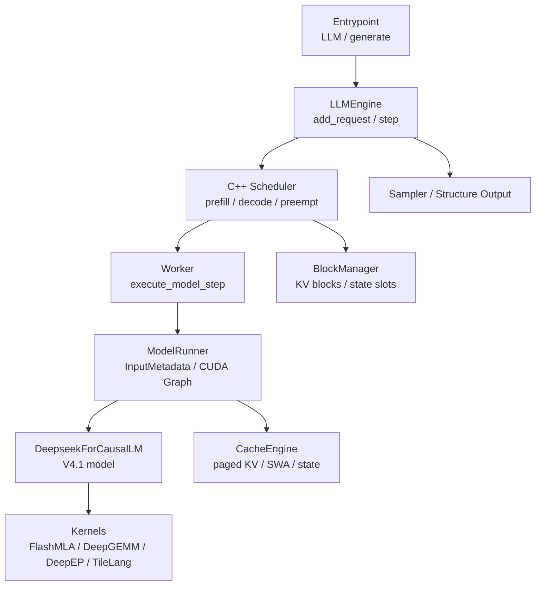
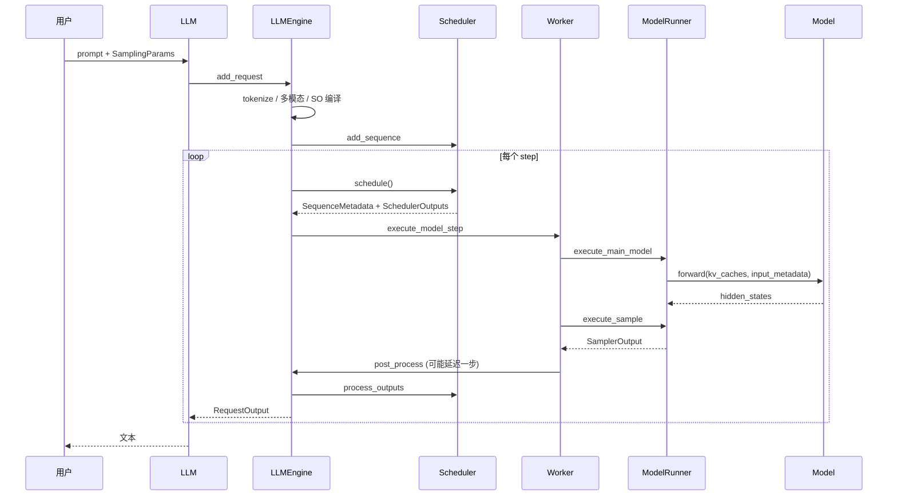
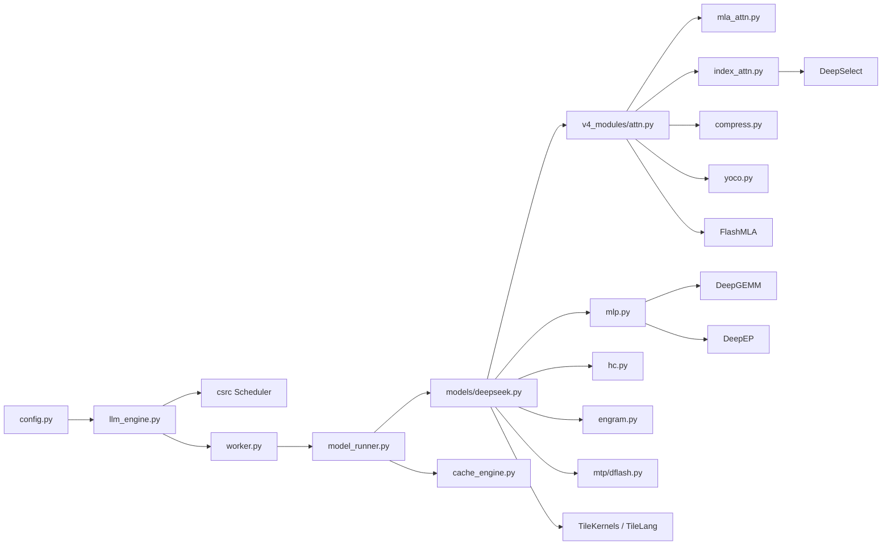
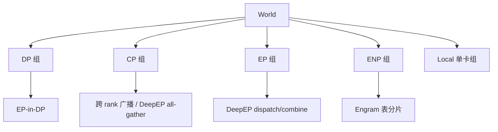
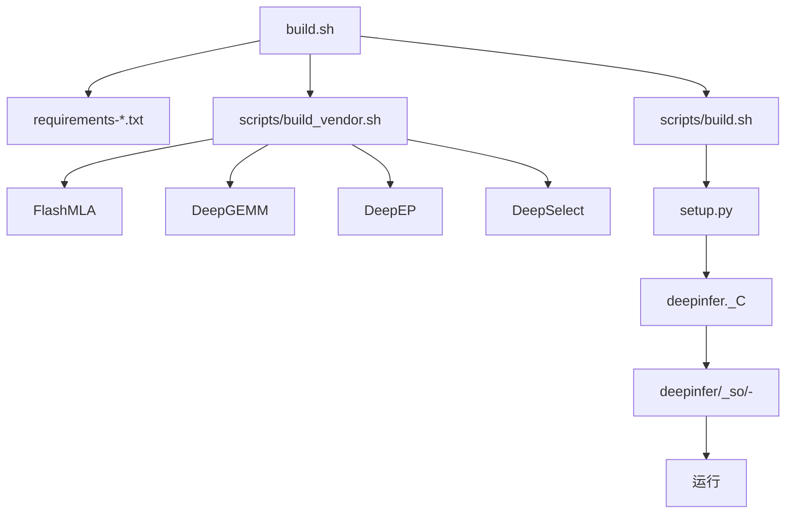
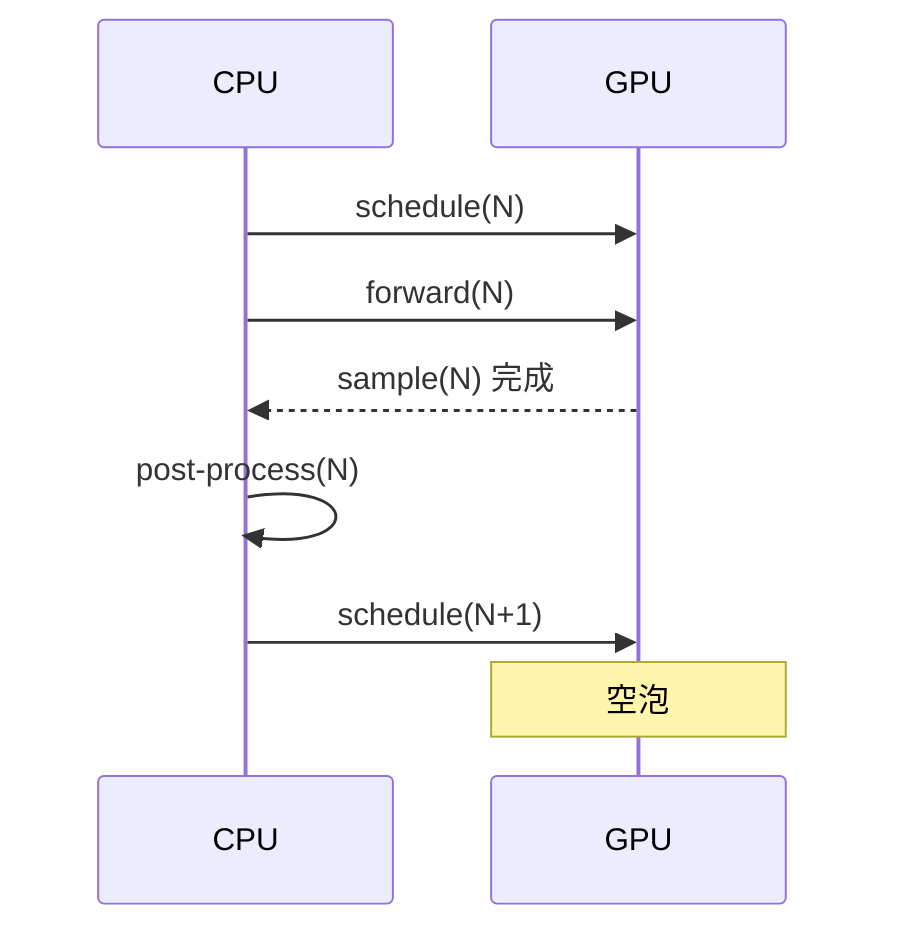
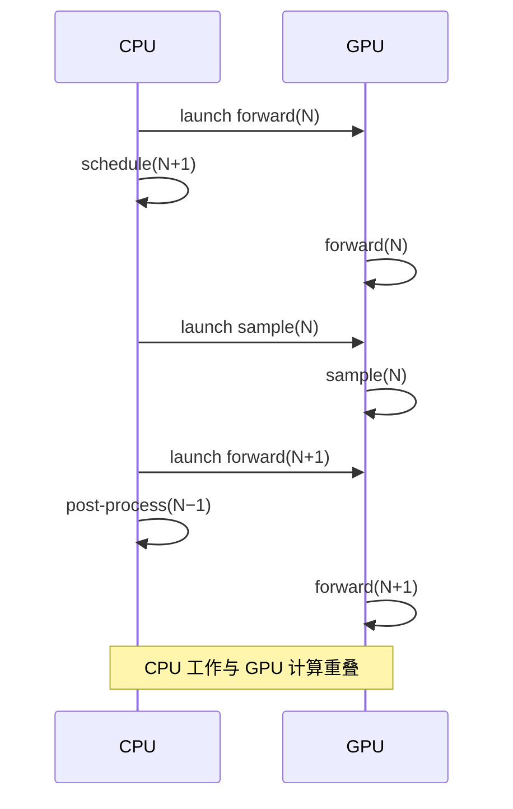

# DeepInfer 学习报告

> 本报告依据 `learning_report_outline.md` 展开，代码与结论以当前仓库为准：
> commit `9bd9cf243fc53ef9afbf8f04d391d989117d6ab9`（2026-10-21，Bump DeepEP）。
> 本次开源版本面向**离线推理**；在线服务封装、KV Cache 存储系统、完整 E/P/D 分离编排与跨副本负载均衡器不在仓库内，报告会明确标注。
> 文中路径、结构体、函数名、环境变量均来自源码；系统级数据来自 `doc/inference_deployment_qa.md` 与 `README.md`，未做推测。

---

## 1. 引言

### 1.1 DeepInfer 是什么

DeepInfer 是 DeepSeek 开源的高性能大模型推理框架，支撑 DeepSeek-V4.1-Flash 在 NVIDIA SM100 GPU 与华为昇腾 950 NPU 上的大规模服务。它不是单一的 Kernel 库，也不是通用推理框架的简单封装，而是把以下层次打通的**端到端引擎**：

- **模型层**：V4.1 的 MLA、压缩 KV、稀疏 indexer、SWA、YoCo、mHC、Engram、MoE、DFlash。
- **算子层**：FlashMLA、DeepGEMM、DeepEP、DeepSelect、TileKernels，以及仓库内大量 TileLang 自定义算子。
- **调度层**：C++ Scheduler、BlockManager、StateManager、Zero-Overhead Scheduling、CUDA Graph、MTP varlen。
- **并行层**：Attention DP、Balanced CP、MoE EP、Wide-EP、Engram Parallel、EPLB。
- **服务层**：离线 `LLM` 入口、结构化输出、多模态、批量基准与 profiling。

一句话概括：**DeepInfer 是“为 DeepSeek V4.1 的模型结构与生产负载手工定制”的推理系统，性能来自模型、Kernel、通信、缓存、调度五者的协同设计。**

### 1.2 能力矩阵

| 维度 | 能力 | 主要入口 / 模块 |
| --- | --- | --- |
| 模型 | DeepSeek-V4.1-Flash | `deepinfer/model_executor/models/deepseek.py` |
| 注意力 | MLA + 压缩 KV + 稀疏 indexer + SWA + sink | `v4_modules/attn.py`、`mla_attn.py`、`compress.py`、`index_attn.py` |
| 模型结构 | YoCo consumer、mHC、Engram、MoE | `v4_modules/yoco.py`、`hc.py`、`engram.py`、`mlp.py` |
| 投机解码 | DFlash / DSpark、Confidence Head、变长验证 | `models/mtp/dflash.py`、`layers/sampler.py` |
| 并行 | DP、CP、EP、ENP；Wide-EP；EPLB | `parallel_utils/`、`eplb/` |
| 调度 | Prefill/Decode、chunked prefill、抢占重算、DP 投票 | `csrc/engine/scheduler.hpp` |
| 异步 | Zero-Overhead Scheduling、CUDA Graph | `worker/worker.py`、`worker/cuda_graph_runner.py` |
| 缓存 | 分页 KV、SWA state、压缩 state、前缀复用 | `worker/cache_engine.py` |
| 采样 | 温度/top-p/top-k、force-topk、golden、prompt logprobs | `layers/sampler.py` |
| 结构化输出 | JSON Schema / Regex / EBNF | `structure_output/` |
| 多模态 | 图像预处理、ViT、aligner | `ve/`、`models/deepseek_vl.py` |
| 硬件 | NVIDIA SM100、Ascend 950 | `platform.py`、`deep_cluster/` |
| 测试 | PPL golden、batch invariant、EPLB、sampler、VE | `tests/` |

### 1.3 开源边界

README 明确列出了“完整推理服务还需要、但本次未包含”的部分：

1. **KV Cache 存储系统**（3FS 上的 paged block cache、SWA state 的跨机目录、swap-in）；
2. **VE / Prefill / Decode 的完整分离部署编排**；
3. **DP 副本级的 Prefill / Decode 负载均衡器**。

仓库里已有的相关接口：

- `EngineType.PROMPT` / `COMPLETION` 与 `Scheduler` 的 prompt-only / decode-only 模式；
- `LLMEngine.init_pd_split`、`send_processed_prompts`、`pe_prepare_save_kvcache`、`pe_do_save_kvcache` 等虚函数钩子；
- `CacheEngine` 的 state 落盘/装载接口（`select_state_slice_to_store`、`load_state_from_store_to_prefill_cache`）；
- `examples/_launch.py` 的多 DP rank 启动。

因此，学习本仓库应把它理解为**单实例引擎 + 可扩展的生产钩子**，而不是完整云服务。

### 1.4 报告范围与阅读指引

- 第 2 章建立 V4.1 模型与推理系统背景。
- 第 3、4 章给出目录与架构图，建立全局调用链。
- 第 5 章逐模块剖析引擎、调度、缓存、模型加载、采样、并行、EPLB。
- 第 6 章深入模型前向与算子实现。
- 第 7、8 章讲调度流水线与 KV Cache。
- 第 9 章讲并行、通信、负载均衡与部署。
- 第 10–12 章讲测试、性能、调优与附录。

建议阅读顺序：第 4 章 → 第 5.2–5.4 节 → 第 6 章 → 第 7、8 章 → 第 9 章。

---

## 2. 背景与生态

### 2.1 DeepSeek-V4.1-Flash 模型架构

#### 2.1.1 MLA、压缩 KV 与稀疏 indexer

V4.1 的注意力仍是 MLA 家族：Q 经过低秩投影 `hidden → q_lora_rank → h_q × d_qk`，KV 经过 `hidden → kv_lora_rank + rope_dim` 的压缩表示。与 V3 不同的是，V4.1 在 KV 侧进一步引入**压缩（compress）与稀疏选择（sparse indexer）**：

- `kv_compress_ratio` 只支持 **C1 / C2**（1 或 2）：
  - C1：每个 token 产生一个压缩 KV；
  - C2：每两个 token 通过 `score`/`latent` 的 softmax 加权合并成一个压缩 KV，`state_cache` 保存窗口边界。
- 主 KV 以 **FP8（MXFP8，528 B/token）** 或 **FP4（288 B/token）** 分页存放；
- Indexer 的 K 以 **FP4（128 维，per-32 ue8m0）** 存放；
- Indexer 对每个 query 计算 `relu(q·k) * weights` 的 logits，再用 DeepSelect 选 topk 个压缩 KV。

因此一次注意力实际由两条路径组成：

1. **Indexer 路径**：先算稀疏候选，得到 `topk` 索引；
2. **Core Attention 路径**：只对 topk 个压缩 KV 做 MLA。

#### 2.1.2 SWA、attention sink 与 YoCo consumer 层

V4.1 同时使用滑动窗口注意力（SWA）与 attention sink：

- SWA 的历史 KV 存在 `swa_cache`（按 state slot 组织的 ring）；
- attention sink 是一个可学习的 per-head logit，参与输出分母，但不改变返回的 `lse`/`max_logits`（在 FlashMLA 语义中）；
- YoCo（You Only Cache Once）把模型后半段定义为 **consumer 层**：`layer_id >= n_prefill_layer` 的层不再独立做完整 KV 投影，而是复用前半段产出的 shared hidden / KV；decode 时只维护有限的 decoder SWA。

`n_prefill_layer` 是 V4.1 的关键配置。它带来两个优化：

1. **Prefill 截断**：consumer 层只计算末尾 `keep_tokens` 个 query（compact），或保留全部 query 但收窄 SWA 可见域（mask），从而显著减少 prefill 计算；
2. **Decoder SWA bounded replay**：只重算最后 128 个 token 的 SWA，而不是重算整个 decoder 窗口。

#### 2.1.3 MoE

V4.1 的 FFN 是 MoE：

- gate 使用 `noaux_tc` + `sqrtsoftplus` scoring；
- 每个 token 选 `num_experts_per_tok` 个 routed expert，另有 shared expert；
- routed expert 权重可为 **MXFP4**（per-32 ue8m0），激活可为 FP8；
- 支持 **Mega MoE**：把 dispatch、grouped GEMM、SwiGLU、combine 融合成更少的 Kernel；
- 支持 **EPLB**：在 EP 组内为热点 expert 复制冗余副本，并周期性重排。

#### 2.1.4 mHC 多路残差主干

mHC（multi-path HC）把 hidden state 扩展成 `hc_mult` 路残差主干 `[tokens, hc_mult, hidden]`。每个子层（attention / FFN）前后做：

- **pre mix**：把多路主干混合成子层输入；
- **post mix**：把子层输出写回多路主干；
- **Sinkhorn 归一化**：对混合矩阵做迭代归一化；
- **HC Head**：在最后把多路主干折回单路 hidden。

`hc_shifted` 是半层偏移变体：每个子层使用上一个子层算出的 pre mix，最后不再需要 HC Head。V4.1 的 mHC 与 MoE/Attention 的融合（`mega_mhc`）是性能关键路径之一。

#### 2.1.5 Engram n-gram 记忆

Engram 是一张按 n-gram 哈希索引的稀疏记忆表：

- 原始 token 先经过 `CompressedTokenizer` 映射到压缩词表；
- 每个 token 的 n-gram 通过哈希查到若干 embedding；
- 这些 embedding 经过融合的 KV 投影与 gate，注入主干；
- 表按 `engram_parallel_size` 分片，跨 rank 通过 `EngramBuffer` 拉取。

在 V4.1 中 Engram 只支持 `hc_enabled=True`，且要求 `engram.placement="pp"`。

#### 2.1.6 DFlash / DSpark 投机解码

DFlash 是 V4.1 的 MTP（Multi-Token Prediction）头：

- 主模型 forward 时顺带把 target layer 的 hidden 写入 DFlash 的 main KV cache；
- decode 时 DFlash 用 draft KV cache 并行生成 `nextn` 个 draft token；
- **Confidence Head** 预测每个 draft token 的接受率；
- 调度器根据置信度与硬件吞吐曲线，选择**变长验证前缀**，而不是固定验证 5 个；
- 被接受的 draft 直接输出，第一个被拒绝的位置用残差分布重采样。

官方数据：动态长度验证把每步验证的 draft 数从 5.00 降到 3.2–4.4，平均接受长度基本不变（3.29 vs 3.20），在生产工作点带来 +4–7% 吞吐。

### 2.2 大模型推理的核心矛盾

#### 2.2.1 Prefill 与 Decode 的 roofline 差异

| 阶段 | 主要瓶颈 | 优化方向 |
| --- | --- | --- |
| Prefill | 计算（Tensor Core） | 大 batch、chunked prefill、FP8/FP4、稀疏化、融合算子 |
| Decode | 显存带宽 + 延迟 + 通信 | KV 量化、SWA、投机解码、Wide-EP、CUDA Graph、异步调度 |

DeepInfer 对两个阶段采用不同的并行与调度策略：Prefill 用较小的 EP/DP（EP2–8 / DP2–8）吃满单机算力；Decode 用 Wide-EP（EP64–128）降低每步 MoE 的显存流量。

#### 2.2.2 KV Cache 容量、带宽与命中率

V4.1 通过 MLA latent、C1/C2 压缩、FP8/FP4 量化把每 token 的 KV 压到几百字节。即便如此，长上下文与高并发仍让 KV Cache 成为核心资源：

- 分页 block 解决碎片与共享；
- SWA state 用固定 slot 和 ring 复用；
- 压缩 state 保存 C2 的窗口边界；
- 生产系统把 block KV 放到 3FS，SWA state 留在本地内存，并用 128-token 粒度做落盘与命中判断。

#### 2.2.3 MoE 专家并行与负载均衡

MoE 的 all-to-all 通信与专家负载偏斜是 decode 的主要成本之一。DeepInfer 的组合拳：

1. **EP** 把 expert 分散到多卡，降低单卡权重与计算；
2. **Wide-EP** 进一步扩大 EP，降低每卡 MoE 的显存流量；
3. **EPLB** 复制热点 expert、周期性重排；
4. **Mega MoE / DeepEP** 融合通信与计算；
5. **DP 步型投票** 让同一 DP 组内的 rank 同步做 prefill 或 decode，避免空转。

#### 2.2.4 CPU 调度开销与 GPU 空泡

同步执行时，decode 每一步都要：

```text
schedule(N) → forward(N) → sample(N) → 同步取结果 → post-process(N) → schedule(N+1)
```

`post-process` 与 `schedule` 是纯 CPU 逻辑，但需要等 `sample(N)` 的 D2H 结果，GPU 在这段时间空转。DeepInfer 的 **Zero-Overhead Scheduling（ZOS）** 把流水重排为：

```text
GPU: forward(N) → sample(N) → forward(N+1) → sample(N+1)
CPU: schedule(N+1) → launch_forward(N+1) → post-process(N−1) → launch_sample(N+1)
```

从而把 CPU 工作藏到 GPU 执行后面。

### 2.3 与相关项目的关系

#### 2.3.1 vLLM / SGLang / TensorRT-LLM

- **vLLM**：DeepInfer 的 `LLMEngine`、`Sequence`、`BlockManager` 等骨架明确标注 “Derived from vLLM; modified by DeepSeek”。
- **SGLang**：异步调度、Radix/前缀复用等思想有借鉴。
- **TensorRT-LLM**：融合算子、CUDA Graph、量化部署思路有借鉴。

DeepInfer 的差异在于：**模型结构（V4.1）与 Kernel（FlashMLA/DeepGEMM/DeepEP/DeepSelect/TileKernels）是深度定制的**，并且原生支持 EPLB、DFlash、YoCo、mHC、Engram 与双硬件。

#### 2.3.2 FlashMLA / DeepGEMM / DeepEP / DeepSelect / TileKernels

| 依赖 | 在 DeepInfer 中的角色 |
| --- | --- |
| **FlashMLA** | 稀疏 MLA prefill/decode、融合 norm+RoPE+attn+RoPE+cast |
| **DeepGEMM** | FP8/FP4 GEMM、grouped GEMM、Mega MoE、MQA logits、SwiGLU、einsum |
| **DeepEP** | MoE dispatch/combine、CP all-gather、Engram 通信 |
| **DeepSelect** | topk / 候选块选择 |
| **TileKernels** | 量化、压缩、mHC、Engram、采样、KV 存取等 |
| **TileLang** | 仓库内 `layers/tilelang_ops/{cuda,asc}` 的自定义算子 |

`vendor/` 目录以 submodule 形式固定这些依赖的版本，`scripts/build_vendor.sh` 负责编译并安装。

#### 2.3.3 与纯 Kernel 库 / DSL 推理栈的对比

| 维度 | DeepInfer | 纯 Kernel 库（FlashMLA 等） | DSL 推理栈（TileLang 示例） |
| --- | --- | --- | --- |
| 范围 | 引擎 + 模型 + Kernel + 并行 + 调度 | 单算子 | 算子/小块模型 |
| 可控性 | 最高（C++ 调度、手写 Kernel） | 高 | 中 |
| 可移植性 | CUDA + Ascend 双后端 | 单平台为主 | 多后端 |
| 生产特性 | EPLB、ZOS、KV 落盘、结构化输出 | 无 | 有限 |
| 开发成本 | 最高 | 中 | 低 |

### 2.4 硬件与部署形态

#### 2.4.1 NVIDIA SM100 与昇腾 950

- NVIDIA 路径要求 SM100（`is_sm_major_10()`），使用 CUDA 13、PyTorch 2.13、FlashMLA/DeepGEMM 的 SM100 Kernel。
- Ascend 路径使用 CANN 9.2、`torch_npu`，TileLang target 固定为 `ascend`，大量算子走 `layers/tilelang_ops/asc/`。
- 两条路径共享 Python 引擎与模型代码，差异集中在 `PLATFORM`、`deep_cluster.hardware`、Kernel 后端与少数环境变量。

#### 2.4.2 EPD 分离、Wide-EP 与 KV 存储

生产部署采用：

- **E/P/D 分离**：Vision Encoder、Prefill、Decode 独立扩缩容；
- **Prefill**：EP2–8 / DP2–8，尽量小的 EP/DP 以吃满 HBM 与算力；
- **Decode**：EP64–128 / DP64–128（Wide-EP）；
- **KV 存储**：block KV 放 3FS，SWA state 放本地内存，128-token 粒度落盘；
- **网络**：每 8 GPU 约 400 Gbps 互联预算。

官方数据：单集群每天服务 155 万亿 token，按谷时电价约 38 美元/GPU-hour。

---

## 3. 代码目录结构

### 3.1 顶层目录总览

```text
DeepInfer/
├── deepinfer/                 # Python 包（引擎、模型、算子封装）
├── csrc/                      # C++ / CUDA / Ascend 扩展
├── deep_cluster/              # 硬件发现与 NUMA 绑定
├── vendor/                    # FlashMLA / DeepGEMM / DeepEP / DeepSelect
├── examples/                  # 离线推理、benchmark、sweep、YoCo 验证
├── tests/                     # 单元/集成/精度/性能测试
├── scripts/                   # 构建、vendor 编译、格式化、stub 生成
├── doc/                       # 部署 Q&A、性能图
├── build.sh                   # 一键构建入口
├── setup.py                   # C++ 扩展构建
├── pyproject.toml             # Python 包与 pytest/ruff 配置
└── README.md
```

### 3.2 Python 包 `deepinfer/`

```text
deepinfer/
├── __init__.py                # 延迟平台初始化、_so/<tag> 路径注入
├── platform.py                # GPU / NPU 平台抽象
├── config.py                  # Model/Cache/Parallel/Scheduler 配置
├── environ.py                 # 集中式环境变量
├── sequence.py                # Python 侧 Sequence / SamplerOutput
├── sampling_params.py         # 采样参数
├── engine/
│   ├── llm_engine.py          # LLMEngine 主循环
│   ├── arg_utils.py           # EngineArgs
│   ├── engine_type.py         # NORMAL / PROMPT / COMPLETION
│   ├── profile_server.py      # HTTP profiling
│   └── stats_logger.py        # 统计日志
├── worker/
│   ├── base.py                # WorkerBase：设备、模型、缓存初始化
│   ├── worker.py              # Worker：四段式执行
│   ├── model_runner.py        # ModelRunner：forward/sample/CUDA Graph
│   ├── cache_engine.py        # KV Cache 布局、分配、落盘
│   ├── cuda_graph_runner.py   # 主模型 CUDA Graph
│   ├── dflash_cuda_graph_runner.py
│   └── decode_perf_cache.py   # decode 性能曲线缓存
├── model_executor/
│   ├── model_loader.py        # 模型构建、HF 加载
│   ├── model_metadata_utils.py# 配置派生、InputMetadata 选择
│   ├── input_metadata/        # V4/VL/YoCo/DFlash 元数据
│   ├── models/                # DeepSeek V4.1 / VL / MTP
│   ├── layers/                # Linear、Sampler、TileLang ops
│   ├── parallel_utils/        # 进程组、CP、userbuffer
│   └── eplb/                  # 专家负载均衡
├── structure_output/          # xgrammar 编译/匹配/掩码
├── ve/                        # 多模态预处理
├── distributed/               # shm broadcast
├── npu_ops/                   # Ascend 补丁算子
├── hugging_face/              # HF 配置/权重/分词器
└── _so/<platform>/            # 构建产物软链接
```

### 3.3 C++ 扩展 `csrc/`

```text
csrc/
├── engine/
│   ├── scheduler.hpp          # 1329 行：prefill/decode 调度、抢占、DP 投票
│   ├── sequence.hpp           # 419 行：Sequence/SequenceMetadata/MtpState
│   ├── block_manager.hpp      # 242 行：block 空闲链表、引用计数
│   ├── zos.cpp/.hpp           # 307 行：ZOS seqlens 修正
│   ├── flops_estimator.hpp    # 330 行：FP8-equivalent FLOPs 估算
│   ├── mtp_varlen.hpp         # 275 行：MTP 变长验证调度
│   ├── prepare_sample.cpp     # 采样输入准备
│   ├── outputs.hpp            # RequestOutput 池
│   ├── input_metadata/        # prompt/decode 张量预处理
│   └── pybind_*.cpp           # Python 绑定
├── cuda_utils.cpp / asc_utils.cpp
├── graph_timer/               # CUDA/HCCL Graph 计时
└── utils/                     # lockable、object_pool、log
```

### 3.4 `vendor/` 与 `deep_cluster/`

- `vendor/DeepGEMM`、`vendor/FlashMLA`、`vendor/DeepEP`、`vendor/DeepSelect` 以及 Ascend 对应版本；
- `deep_cluster/hardware/`：设备发现、可见设备、NUMA、BF16 TFLOPS 上限；
- `deep_cluster/topology/bind.py`：CPU/NUMA 绑定。

### 3.5 `examples/`、`tests/`、`scripts/`、`doc/`

| 路径 | 内容 |
| --- | --- |
| `examples/offline_inference.py` | 离线推理、PPL 输出、结构化输出校验 |
| `examples/benchmark.py` | Prefill/Decode 解耦基准、profile、结果 JSONL |
| `examples/sweep/` | 批量扫描与 Pareto 曲线 |
| `examples/yoco/` | YoCo mask/compact 等价性验证 |
| `tests/models/` | 离线 PPL、batch invariant、EPLB policy、sampler、VE |
| `tests/engine/` | Sequence、FLOPs、多模态 prompt |
| `tests/worker/` | state cache、userbuffer |
| `tests/distributed/` | expert shuffle、shm broadcast |
| `scripts/build_vendor.sh` | 编译并安装 vendor 算子 |
| `scripts/build.sh` | 构建主扩展并链接 `_so` |
| `doc/inference_deployment_qa.md` | 生产部署 Q&A |
| `doc/images/` | 架构与 Pareto 图 |

---

## 4. 代码架构图

### 4.1 分层架构总览



### 4.2 一次请求的完整生命周期



### 4.3 模块依赖图



### 4.4 并行拓扑与进程组



### 4.5 构建与运行架构



---

## 5. 核心模块详细介绍

### 5.1 入口与配置

#### 5.1.1 `entrypoints/llm.py`

`LLM` 是离线推理门面：

- 构造 `EngineArgs` → `LLMEngine.from_engine_args`；
- `generate()` 支持字符串 prompt 或 token id；
- 每个请求 deepcopy 一份 `SamplingParams`；
- `_run_engine()` 循环 `engine.step()`，把 `RequestOutput` 按 request id 聚合，最后按 `decode_sequence` 决定返回文本还是 token 序列；
- 支持 `multi_modal_data`。

注意：`LLM` 不提供 OpenAI 兼容的在线 HTTP 服务；生产服务需要额外的 entrypoint/路由层。

#### 5.1.2 配置类

`deepinfer/config.py` 定义四个配置：

| 配置 | 关键字段 | 作用 |
| --- | --- | --- |
| `ModelConfig` | `model`、`tokenizer`、`max_model_len`、`max_num_seqs`、`load_format` | 模型与 tokenizer、运行时长度 |
| `CacheConfig` | `block_size`、`gpu_memory_utilization`、`lookahead_tokens` | KV block 大小与显存占比 |
| `ParallelConfig` | `data_parallel_size`、`context_parallel_size`、`expert_parallel_size`、`engram_parallel_size` | 并行拓扑 |
| `SchedulerConfig` | `max_num_batched_tokens`、`max_num_seqs`、`chunked_prefill`、`prefill_attempt_interval`、`prefill_any_attempt_interval` | 调度策略 |

`runtime_max_model_len` 不是简单的 `max_model_len`，而是：

```python
runtime_max_model_len = max_model_len + nextn + (nextn + 1 if ZOS else 0) + nextn
```

它为 MTP draft、ZOS 在途 token、调度余量预留 RoPE/position 空间。

`ModelConfig` 在 `__getstate__` 中不 pickle `model_cfg`（不可 pickle），只传运行时标量，worker 进程重新加载配置后回填。

#### 5.1.3 `environ.py`

所有环境变量集中定义，`EnvVar` 是“首次访问时解析并缓存”的非数据描述符，支持 `rearm()` 重新解析。常用变量：

| 变量 | 默认 | 说明 |
| --- | --- | --- |
| `DEEPINFER_ACCELERATOR` | `nvidia` | `nvidia` / `ascend` |
| `DEEPINFER_USE_NEXTN_DECODE` | 5 | 最大 draft 数，0 关闭投机 |
| `DEEPINFER_ENABLE_MTP_VARLEN` | 0 | 变长验证 |
| `DEEPINFER_ZERO_OVERHEAD_SCHEDULING` | 引擎类型决定 | ZOS |
| `DEEPINFER_YOCO_PREFILL_TRUNCATION_MODE` | `off` | `off`/`mask`/`compact` |
| `DEEPINFER_YOCO_PREFILL_KEEP_TOKENS` | 0 | 截断保留 token 数 |
| `DEEPINFER_BATCH_INVARIANT` | 0 | 批次无关 |
| `DEEPINFER_EXPERT_REARRANGEMENT_STEP_INTERVAL` | 0 | EPLB 重排周期 |
| `DEEPINFER_USERBUFFER_COMM_SMS` | 0（自动） | 通信 SM 数 |
| `DEEPINFER_PREFILL_MAX_SUM_SEQLEN_K` | 无 | prefill sum-K 上限 |

### 5.2 `LLMEngine`

#### 5.2.1 初始化顺序

`LLMEngine.__init__` 的顺序非常关键：

1. 读取 `CUDA_VISIBLE_DEVICES`，确定 driver GPU；
2. 加载 tokenizer；
3. 若模型多模态，构造 `MultimodalProcessor`；
4. 启动非 driver 的 CP worker（`SpawnProcessWithCrashHeader`），driver 直接构造 `Worker`；
5. `load_model`；
6. `profile_num_available_blocks` → `init_cache_engine` → `warm_up_model`；
7. 构造 `BlockManager`、`StateManager`、`Scheduler`；
8. 构造 `StatsLogger`。

`_init_cache` 会做显存 profile：用最大 batch 跑一次模型，测出可用显存后计算 `num_gpu_blocks`。并检查 `runtime_max_model_len <= 0.8 * block_size * num_gpu_blocks`，否则直接报错。

#### 5.2.2 `add_request`

`add_request` 做了大量边界处理：

- `SamplingParams` 为空时用默认值；`eos_id` 注入；
- YoCo 截断开启时强制关闭 `prompt_logprobs`（compact 无法计算被裁剪行；mask 会得到退化 logprob）；
- 多模态：`multi_modal_data` 可放在 `extra` 中；失败标记 `FINISHED_VE_FAILED`；
- prompt 不能为空；
- token id 范围校验（含图像特殊 token 偏移）；
- 若使用压缩 tokenizer，同时生成 `compressed_prompt_token_ids`；
- 结构化输出：若 `so_args` 存在，异步提交给 `SOMatcherBuilder`，编译完成后才入队；
- 支持 `chunk_checkpoints`，用于在指定 token 边界切 chunk。

`DeferredRelease` 负责跨步资源回收：本步的 `SequenceMetadata`、`RequestOutput`、clone 的 state/block unpin 都延迟到下一次 `pre_sampler_sync` 释放，与 GPU 计算重叠。

#### 5.2.3 `step`

`step` 是引擎主循环：

1. `scheduler.schedule(pool)` → `seq_metadata_list` + `scheduler_outputs`；
2. 处理 fork/抢占产生的 state/block clone/zero（`clone_and_zero_states_and_blocks_on_default_stream`）；
3. `post_schedule`（PD 钩子）；
4. 多模态 fetch；
5. `_execute_model_async_step` → `worker.execute_model_step`；
6. 收集 `RequestOutput`，下一次 step 释放；
7. `generate_step++`。

`post_process` 由 worker 在 sample 完成后调用，负责：

- `process_MTPInfo` 写入下一轮 draft 信息；
- `scheduler.process_outputs` 更新 sequence 状态、接受 token、停止条件；
- `build_request_outputs` 生成输出；
- 统计日志；
- PROMPT 引擎把处理完的 prompt 发给 COMPLETION 引擎（`send_processed_prompts`）。

### 5.3 Worker 与 ModelRunner

#### 5.3.1 `execute_model_step` 四段式

`Worker.execute_model_step` 是执行核心：

```text
1. forward curr step
2. post-process prev step
3. sample curr step
4. post-process curr step（prompt 或非 ZOS 立即；ZOS decode 延迟到下一步）
```

关键细节：

- 非 driver 的 CP rank 也执行 forward，但只有 driver 做 sampling；
- 先执行 forward，再 post-process 上一步，是为了让 CPU 工作藏在 GPU forward 后面；
- `sample_end_evt` 记录采样完成事件，`_post_process_step` 先同步该事件；
- `forbid_cuda_sync()` 在 `execute_main_model` / `execute_sample` 中禁止同步，避免破坏流水；
- ZOS decode 的 `prev_step_state` 保留到下一步，`flush_inflight_reqs` 在无未完成请求时兜底。

#### 5.3.2 输入准备与 CUDA Graph

`ModelRunner._prepare_input`：

- driver 用 `model_metadata.prepare_inputmetadata_dict` 构造元数据；
- 若 decode 且 CUDA Graph 可用，`cuda_graph_runner.select(total_q)` 选择最接近的 graph size，并用 padding 的 `SequenceMetadata` 填满；
- `input_metadata` 的字段被复制到 graph 的 device buffer；
- CP > 1 时，driver 把元数据广播给 follower；follower 不重新构造，只反序列化。

`_prepare_input_follower` 从 `broadcast_tensor_dict` 恢复；graph 模式下使用 `cuda_graph_used.input_metadata_device`。

#### 5.3.3 无同步执行

```python
with forbid_cuda_sync():
    model_output = self.model(kv_caches=kv_caches, input_metadata=input_metadata)
```

`execute_main_model` 返回 `MainModelOutput`，包含 `model_output`、`input_metadata`、`graph_size`。`execute_sample` 之后返回 `SamplerOutput`；`post_process` 才做 `sample_end_evt.synchronize()`。

#### 5.3.4 profile、capture 与性能曲线

- `profile_run`：按 `max_num_seqs` 和 `max_num_batched_tokens` 构造假请求；prefill 的 `sum_seqlen_k` 可受 `DEEPINFER_PREFILL_MAX_SUM_SEQLEN_K` 限制；用临时 KV cache 跑一次完整 step，并强制 MoE 负载不均（`DEEPINFER_FORCE_IMBALANCE_RATIO=1.8`）以覆盖最坏情况。
- `capture_model`：捕获主模型 CUDA Graph（batch size 分档，默认间隔 8）。
- `capture_dflash_model`：在主流/内存池上捕获 DFlash 图，必须晚于主模型捕获。
- `profile_decode_perf`：对每个 graph size 测 decode 时间，做 1 次 warmup、5 次测量、去掉最高/最低后平均，结果可缓存到 `DecodePerfCache`，供 MTP 变长调度使用。

### 5.4 C++ Scheduler

#### 5.4.1 `EngineType`

| 类型 | 行为 |
| --- | --- |
| `NORMAL` | 同时处理 prompt 与 completion，按 DP 投票决定本步做 prefill 还是 decode |
| `PROMPT` | 只做 prefill，不 decode；用于 PD 分离的 P 引擎 |
| `COMPLETION` | 只做 decode；必须 `stop_preempted_request=true`，因为没有 prefill 通道重算被抢占请求 |

#### 5.4.2 Prefill 调度

`_schedule_prefill` 的关键逻辑：

- 从 `waiting` 队列取请求；
- 若 `block_table` 为空：检查 prompt 长度、`can_allocate`（block + state 联合）；
- 若是 fork 请求（`branch_id` 以 `_` 开头）：复用父请求的 KV/state，克隆 state 和写了一半的 block；
- 限制 `num_curr_seqs + 1 <= max_num_prompts`；
- 限制 `prefill_sum_seqlen_k <= prefill_max_sum_seqlen_k`；
- 计算 `seq_workload = num_prompt_tokens`，按 `max_num_batched_tokens` 截断；
- **CP 对齐**：`cp_align = 2 * cp_size`（CP>1 时），chunk 大小按 `cp_align` 向上/向下取整；
- **chunk checkpoint**：可在指定 token 边界切分（用于长 prompt 的分段处理）；
- **多模态边界**：`_adjust_chunk_size` 保证不在图片中间切 chunk；必要时向前收缩或向后扩展；
- `lookahead_tokens`：为投机解码预留的 token 数，chunk 不得小于它；
- chunked prefill 开启时，一个 chunk 后 `break`（NORMAL 引擎），避免同一步混入过多 prompt。

#### 5.4.3 Decode 调度

`_schedule_decode`：

1. `free_finished_seqs()` 清理 running 中已结束的请求；
2. 清理 waiting 中已 abort/VE/SO 失败的请求；
3. `prompted` 队列的请求转入 `running`（fork 请求先克隆 state 和最后一个 block）；
4. 按 `output_len` 降序排序 running；
5. **LCFS**：从尾部（输出最短的请求）开始调度，优先让短请求完成，降低尾延迟；
6. block 不足时，从头部（输出最长、占用最多）抢占：
   - `stop_preempted_request=true` 或 SO 请求：直接结束（`FINISHED_PREEMPTED`）；
   - 否则 `reset_for_recompute()` 后放回 waiting 队头，后续重算；
7. `_append_slot` 确保 block table 数量与 `get_num_blocks()` 一致；
8. 调用 `_mtp_varlen.schedule` 决定每个请求本步的 `seqlen_q`（MTP 变长验证）；
9. 汇总 `num_batched_tokens`。

#### 5.4.4 DP 步型投票

NORMAL 引擎必须在 DP 组内同步“本步做 prefill 还是 decode”，否则各 rank 的 collective 对不上。调度器使用两个投票点：

- **ALL 点**：每 `prefill_attempt_interval` 个 decode step，所有 rank 都有 prefill 工作才做；
- **ANY 点**：每 `prefill_any_attempt_interval` 个 decode step，任一 rank 有工作就全组做，防止孤立 rank 饿死。

```cpp
bool is_any_point = decode_step != 0 && decode_step % prefill_any_attempt_interval == 0;
bool is_all_point = decode_step % prefill_attempt_interval == 0;
bool want = gpu_cache_usage <= 0.9 && _has_prefill_waiting();
```

投票用 `MIN` all-reduce 实现；第二轮投票确认“确实有 rank 排出了 prefill”，否则退回 decode，避免空 prompt step 把 `decode_step` 清零造成死循环。

#### 5.4.5 `SchedulerOutputs`

`SchedulerOutputs` 携带：

- `scheduled_seqs`、`prompt_run`、`num_batched_tokens`；
- `finished_seqs`、`ignored_seqs`；
- `seqlens_q`（异步/变长场景的乐观估计）；
- `sum_seqlen_qxk`、`max_seqlen_k`、`min_seqlen_k`；
- `attn_tflops`、`total_tflops`（用 `FlopsEstimator` 估算）；
- `num_cached_tokens_gpu`；
- `clone_states`、`clone_blocks`、`zero_states`（借用 vector，下一次 schedule 前必须消费完）。

### 5.5 序列、BlockManager 与状态管理

#### 5.5.1 `Sequence` / `SequenceMetadata`

`Sequence` 分为：

- `SequenceRequest`：seq_id、request_id、user_id、arrival_time；
- `SequenceInput`：原始 token、压缩 token、多模态数据；
- `GenerationState`：采样参数、停止条件、prompt logprobs；
- `KvCacheState`：block_size、num_tokens、block_table、state_id、swa_valid_start；
- `MtpState`：golden tokens、accepted/draft tokens、accept_rates、info slot；
- `StructuredOutputState`：SO 状态与 matcher；
- `SequenceScheduleState`：status、chunked 剩余、inflight token。

`SequenceMetadata` 是调度器传给 worker 的“快照”，包含 `seqlen_q`、`seqlen_k`、`block_table`、`sampling`、`mtp` 等。对象池分配，避免每步分配。`is_last_prompt_chunk()` 判断是否最后一个 prefill chunk；非最后 chunk 不产出 token（`last_output_token=-1`）。

#### 5.5.2 `Blocks`

`Blocks` 是一个带引用计数的双向空闲链表：

- block 0 保留不用（0 表示空）；
- `allocate()` 从头部取一个 free block，`ref_count=1`；
- `pin_block()` 增加引用（fork 共享父 block）；
- `free()` 减少引用，归零后放回尾部；
- `can_allocate_nolock()` 返回 `OK` / `LATER` / `NEVER`；
- `reset()` 要求所有 block 都已释放，防止泄漏。

#### 5.5.3 block + state 联合分配

`BlockManagerMutexAcquire` 同时锁 block manager 和 state manager：

- `try_allocate_seq` 同时检查 block 与 state；
- `allocate_seq` 分配 block table 和一个 state slot；
- `pin_blocks` / `unpin_blocks` 用于 CUDAGraph / 跨请求共享。

state manager 是可选：没有 SWA/压缩 state 的模型不需要。

### 5.6 InputMetadata 与 C++ 预处理

#### 5.6.1 `InputMetadataV4` 字段地图

`InputMetadataV4` 继承 `YocoMetadataMixin`、`DFlashMetadataMixin`、`InputMetadata`，核心字段：

| 类别 | 字段 | 说明 |
| --- | --- | --- |
| 通用 | `input_ids`、`positions`、`valid_token_mask`、`num_reqs` | varlen token、位置、padding 掩码 |
| CP | `total_q`、`cp_mirror_len`、`mirror_cp_index`、`mirror_cp_reverse_index` | mirror CP 重排 |
| 压缩 KV | `positions_c`、`slot_mapping_store_ca`、`state_block_idx` | 每个压缩 token 的位置与写入 slot |
| 稀疏 | `kv_ca_index`、`kv_ca_index_len`、`kv_ca_index_offset_len` | core attention 的 KV 索引 |
| prefill | `cu_seqlens_q/k`、`cu_compressed_seqlens_q`、`load_segments_*`、`total_k_*`、`ks/ke`、`kv_swa_full_index` | 变长、分页加载、SWA 索引 |
| decode | `block_tables`、`klen`、`query_indices`、`context_lens`、`kv_swa_index` | 分页解码 |
| 调度缓存 | `mlp_relu_schedule_metadata`、`flash_mla_sched_meta_dict` | DeepGEMM / FlashMLA 元数据 |
| YoCo | `yoco_*` | 截断视图、compact 索引 |
| DFlash | `dflash_*` | draft 索引、slot |

`compute_attn_info` 在 forward 开始时把“紧凑字段”展开为 kernel 可直接消费的完整索引：SWA full index、CA index、klen、decode 的物理 slot 等。它可重复调用（幂等），因为 CUDA Graph replay 后会清理部分字段。

#### 5.6.2 C++ 预处理

`csrc/engine/input_metadata/prepare_tensor_input_v4.cpp`：

- `update_common_v4`：为每个压缩率生成 `positions_c`、`slot_mapping_store_ca`；
  - prefill：每个序列新增的压缩 token 数量为 `max(1, floor(k/n) - floor((k-q)/n))`；
  - decode：只有 `(orig_pos+1) % n == 0` 的 query 产生新压缩 token；
- `slot_mapping_store_swa`：ring 下标 `state_id * swa_block_size + pos % swa_block_size`，非末尾窗口写 -1；
- `state_block_idx`：prefill 按序列，decode 按 token；
- YoCo 部分：计算 `clip_prefix`、`keep_len`、compact varlen 边界、CP contrib、SWA 可见域；
- 最终由 `prepare_prompt_v4` / `prepare_decode_v4` 组装成 dict，Python 侧构造 `InputMetadataV4`。

#### 5.6.3 CP mirror、YoCo 与 DFlash

- **CP mirror**：prefill 时每个 rank 不是拿连续一段，而是拿“首尾镜像”的两段（`2*cp` 个 block），使 attention 的 KV 分布更均衡；`prepare_cp_mirror` 生成 `mirror_cp_index` / reverse index / ks/ke。
- **YoCo truncation**：`get_mask_view()` / `get_consumer_view()` 生成两种视图；compact 会真正删除前缀 query，mask 只收窄 SWA 可见域。
- **DFlash**：`build_dflash_input` 根据 `first_token_positions`、`last_valid_offset` 构造固定 stride 的 draft 元数据。

### 5.7 CacheEngine 与 KV Cache

#### 5.7.1 `KVCache` 五类视图

```python
@dataclass
class KVCache:
    ica_cache: Tensor | None  # index attn cache: [blocks, block_size//ratio, 1, index_bytes]
    ica_state: Tensor | None  # index attn state: [state_slots, ring, 2, index_dim] fp32
    ca_cache:  Tensor | None  # compressed attn cache: [blocks, block_size//ratio, 1, bytes]
    ca_state:  Tensor | None  # compressed attn state: [state_slots, ring, 2, dim] fp32
    swa_cache: Tensor | None  # sliding window: [state_slots, swa_block_size, 1, 528]
```

其中：

- `ca_cache` 是主压缩 KV，V4.1 FP8 为 **528 B/token**（512 e4m3 + 16 ue8m0），FP4 为 **288 B/token**（256 B e2m1 + 32 e4m3 scale）；
- `ica_cache` 是 indexer K，FP4 128 维 + per-32 scale；
- `swa_cache` 是 SWA KV，528 B/token；
- `*_state` 是 C2 压缩窗口/索引窗口的 fp32 state。

#### 5.7.2 `StateBlock`：stored / dropped 分区

`StateBlock` 计算一个 state slot 的布局：

```text
[stored region: SWA] [dropped region: YOCO consumer SWA | compression state]
```

- **stored region**：需要落盘的 SWA 窗口（V4.1 前 20 层）；
- **dropped region**：YOCO consumer SWA（恢复靠 prefill 重算）与 C2 compression state（窗口边界与 128 对齐，无跨边界依赖）；
- `state_size_to_disk` 只包含 stored SWA 的 inference 窗口；
- 每层按 32 B 对齐；有 SWA 时整体按 `lcm(32, swa_bytes_per_token)` 对齐；
- `swa_block_size_kvstore = inference + prefill extra`，`inference = window_size + max_backtracking`。

官方 Q&A 给出 V4.1 的具体数字：`20 层 × 134 token × 528 B = 1,415,040 B/序列`。

#### 5.7.3 `KVCacheManager` 逐层布局

`KVCacheManager.process(layer_id, attn_module, block_size, cache_list)`：

- 计算 `kv_offset`、`kv_length`（按 32 B 对齐）；
- **SWA**：从 state tensor 的 stored 或 dropped 区切出 ring；
- **Index**：若 `index_mapped_layer_id != layer_id`，复用别层 `ica_cache`；否则分配 `block_size//ratio * index_bytes` 并可能分配 `ica_state`；
- **Main**：若 `kv_mapped_layer_id != layer_id`，复用别层 `ca_cache`；否则分配 `block_size//ratio * bytes_per_token` 并可能分配 `ca_state`；
- `finalize()` 校验 state offset 与 `StateBlock` 预计算一致，并把总 KV 大小对齐到 `lcm(128, bytes_per_token)`。

share-KV / share-index / share-index-K 的复用只影响缓存分配，不改变拓扑校验；`SharedLayerTopology` 在模型构造时已 fail-fast 检查分段关系。

#### 5.7.4 分配、profile 与落盘

`CacheEngine.allocate_gpu_cache`：

1. `get_block_shape` 计算单 block 总字节；
2. 用 `cuda_utils.alloc_tensor` 直接分配 `num_gpu_blocks × block_bytes` 的 uint8；
3. 分配 state tensor `[num_state_slots, total_state_bytes]`；
4. 构造 `GPUCacheInterface`，逐层切 view。

`GPUCacheInterface` 还提供：

- `_carve_state_views`：把 state cache 切成 SWA/stored/dropped 视图；
- `select_state_slice_to_store`：按 128 token 粒度取出要落盘的 state，必要时做 ring 重排；
- `load_state_from_store_to_prefill_cache`：把落盘 state 装回 prefill cache。

这些接口是为生产的 KV 存储系统预留的，仓库内不包含 3FS 客户端。

### 5.8 模型构建与加载

#### 5.8.1 `V41Builder` 与 meta 构建

`build_model_on_meta` 在 `torch.device("meta")` 上构造参数容器，不分配真实显存：

1. `MultimodalEmbedding`；
2. 每个主模型层 `MoeDecoderBlockHC`；
3. `MainPredictHeadHC`；
4. 若 `nextn_predict > 0`，追加 `DFlashNextPredictHeadHC`。

`V41Builder` 会根据 `SharedLayerTopology` 决定哪层真正持有 `PackedWkv` / `index_attn`；share-index-K 的 consumer 直接复用 source 的 `k_proj`/`k_norm` 模块，`named_parameters()` 只访问一次。

#### 5.8.2 HF 覆盖校验与加载

`DeepseekForCausalLM.load_model`：

1. `finalize_model_config`：写入 `max_num_decoding_tokens`、`max_num_prefilling_tokens`、EP 冗余 expert 数；
2. `prepare_hf_coverage`：扫描 HF safetensors 索引；
3. `build_model_on_meta`；
4. `cover_tied_parameters`：处理 tied embedding/lm_head；
5. 逐参数 `materialize_hf_parameter`：
   - 普通参数直接到 cuda；
   - Engram 参数可选留在 CPU（`DEEPINFER_ENGRAM_FORCE_GPU_STORAGE`）；
   - MoE expert 若 `mxfp4`，按 packed FP4 布局加载；
   - tied 参数共享 storage，避免 MTP 再分配一份词表；
6. `load_hf_checkpoint`：校验覆盖、形状，30 分钟 watchdog；
7. `from_model_cfg` 构造运行时模块。

#### 5.8.3 权重重排与 dummy 初始化

- `process_moe_weight`：把 HF 的 `[n_experts*out, in]` 转成 `[n_experts, in, out]`（转置连续），并按 FP8/FP4 重新打包 scale；
- `_convert_mega_moe_weight`：DeepGEMM `transform_weights_for_mega_moe`；
- `merge_linear_weights`：把多个 Linear 权重沿输出维拼在一起，同时拼接 `sf`，并释放原 storage；
- `init_dummy_weight`：dummy 模式下生成随机 FP8/FP4 权重，scale 填 1 或 `0x7F7F7F7F`；
- `ReplicatedLinear`：所有 rank 复制权重（没有 TP），支持 BF16 / FP8 GEMM，输出按 32 B 对齐以便后续 TMA/GEMM。

### 5.9 Sampler 与投机验证

#### 5.9.1 Prompt / Decode 两条路径

`Sampler.forward`：

- 取 `selected_token_indices`（每个 prompt 的最后一个 token，或 decode 的所有 token）；
- `get_logits`：hidden @ lm_head；
- Prompt：应用 EOS 抑制、结构化掩码、golden 生成、prompt logprobs；
- Decode：进入 `_verification`。

#### 5.9.2 采样特性

- **force_topk**：只在 top-k logits 上做 softmax/采样，减少词表计算；维护 token index 映射；
- **golden_token_ids**：teacher forcing，用于精度测试 / batch invariant 对比；
- **decode_token_blacklist**：屏蔽指定 token；
- **prompt_logprobs**：按 `selected_prompt_indices` gather hidden 并计算；
- **temperature / top_p / top_k / min_p**：`process_sampling` 融合 kernel；
- **seq_seed**：每个序列的随机种子，支持确定性采样。

#### 5.9.3 投机验证

Decode 时：

1. 上一轮 DFlash 生成的 draft tokens 在 `MTPInfoPool` 中；
2. `prepare_verification_metadata` 准备验证元数据；
3. 对每个 draft token 比较新旧分布的 logprob，按 speculative sampling 规则接受/拒绝；
4. 第一个拒绝位置用残差分布重采样；
5. 全部接受则在最后一个 draft 后正常采样；
6. `finalize_verification` 汇总 `last_valid_offset`、`golden_tokens`、`confidence_rates`；
7. DFlash 用 golden token 继续生成下一轮 draft。

#### 5.9.4 置信度与变长调度

DFlash 的 `ConfidenceHead` 预测每个 draft 的接受率。`MTPVarlen` 在 GPU 上：

- 对每个请求的 confidence 做累乘；
- 全局排序选择 top-k；
- 生成 remap scatter；
- 写回 pinned buffer，供 CPU 下一步调度使用。

这样即使 ZOS 中 `schedule(N+1)` 拿不到第 N 步的置信度，CPU 只固定总预算，具体每请求长度由 GPU 决定。

### 5.10 结构化输出

#### 5.10.1 编译

`XGrammarCompiler` 包装 `xgrammar.GrammarCompiler`：

- 支持 `json`（strict）、`regex`、`ebnf`；
- 缓存可开关，默认限制 10 GiB（防止 CVE-2025-32381 式无界增长）；
- 编译在线程池中异步执行，`SOMatcherBuilder` 管理 pending 请求。

#### 5.10.2 Matcher

`XGrammarMatcher`：

- **trigger tokens**：只有匹配到触发词后才开始约束（例如工具调用前缀）；
- **KMP**：用失败函数在流式 token 中匹配 trigger，支持回滚；
- **bound_token_id**：可指定边界 token；
- **rollback**：最多回滚 `nextn + 2` 个 token（投机解码需要）；
- **EOS**：EOS 后返回全 mask，允许正常结束；
- **timeout / abort**：编译或匹配失败时标记 `FINISHED_SO_FAILED`。

#### 5.10.3 掩码应用

- 每个 decode step，matcher 推进一个 token，生成 vocab bitmask；
- `apply_token_bitmask_by_step_inplace` 在采样前把非法 token 的 logits 置 `-inf`；
- mask 构建与 logits 计算异步重叠（`so_mask_ready` event）；
- prefill 阶段只有触发后/最后 chunk 需要 mask。

### 5.11 多模态与 VE

- `MultimodalProcessor`：在独立进程/线程池中做图片解码、缩放、patch 化；支持共享内存池（`DEEPINFER_USE_MULTIMODAL_POOL`）避免每请求拷贝；
- `prepare_input_metadata_vl`：生成 `images_raw`、`cu_raw_bytes`、`image_raw_sizes`、`images_spatial_crop`、`cu_seqlens_vit`、`mm_token_type` 等；
- `DeepseekVLModel`：ViT + aligner + LLM；ViT 可用 `npu_fusion_attention`（Ascend）；
- 图像 token 用 `vocab_size + ImageTokenOffset` 表示，scheduler 的 chunk 调整会保护图片单元不被切开。

### 5.12 平台抽象与 `deep_cluster`

- `PLATFORM` 延迟初始化：`PlatformGPU` 用 NCCL，`PlatformNPU` 用 HCCL；
- GPU：`fp8_sf_type=int32`，`cudaHostRegister` 固定 host 内存；
- NPU：`fp8_sf_type=int16`，`aclrtHostRegisterV2`，设置 HCCL 环境变量，`TILELANG_DEFAULT_TARGET=ascend`；
- `deep_cluster.hardware`：通过 `/dev`、NVML、`npu-smi` 等探测设备；提供 `get_bf16_tflops_limit()`（SM100 2250/2500，Ascend 432）。

### 5.13 EPLB

#### 5.13.1 概念

- **logical expert**：模型定义的 expert；
- **physical expert**：GPU 上实际放置的副本；
- `num_physical_experts = num_logical_experts + num_redundant_experts`；
- physical 槽位均匀分到 EP rank。

#### 5.13.2 复制与放置

`rebalance_experts_global(tokens_per_expert, num_physical, num_local)`：

1. 初始布局：前 `num_logical` 个槽位放原 expert，其余放冗余副本；
2. **复制策略**：每轮选“加一个副本后最大每副本负载最小”的 logical expert，分配一个冗余槽；
3. **放置策略** `_batch_greedy_indices`：按历史负载降序，把每个 physical expert 贪心放到“加入后各历史 step 的最大 rank 负载之和最小”的 rank；
4. 输出 `physical_to_logical_map`、`logical_to_physical_map`、`logical_count`。

#### 5.13.3 运行时

`ExpertLoadBalancer`：

- 每 step 累计 `expert_count`；
- 维护 `expert_count_window`（默认 100 步）；
- 每 `DEEPINFER_EXPERT_REARRANGEMENT_STEP_INTERVAL` 步重排；首次重排提前到 1/4 周期；
- 重排时做 EP all-reduce 汇总各 logical expert 负载，调用 policy，然后 shuffle 权重；
- 单机内用 `torch.distributed._symmetric_memory` + IPC 做原地 shuffle；跨机走 P2P；
- 支持 prefill / decode 不同窗口与周期（生产配置：prefill 4 redundant/GPU，100/1000；decode 1 redundant/GPU，1000/10000）。

### 5.14 并行与通信

#### 5.14.1 进程组

`ParallelProcessGroup.create_process_groups` 用 `rearrange` 构造：

- `world`、`local`；
- `dp`：`(replica dp cp) -> (replica cp) dp`；
- `cp`：`(dp cp) -> dp cp`；
- `ep`：连续 `ep_size` 个 rank；
- `enp`：Engram parallel；
- `ep_in_dp`：DP 内的 EP 子组。

`init_device_groups` 会对所有 NCCL/HCCL 子组做一次 `all_reduce`，因为 PyTorch 2.13 默认 CPU(gloo) 后子组是懒初始化；单 rank 组也要做，否则 Engram 的 `deep_ep` 复用 comm 指针会段错误。

#### 5.14.2 CP mirror 与 all-gather

`CPManager` 包装 `deep_ep.BucketBuffer`：

- `session()` 创建一个 bucket session；
- `get_inplace_tensor(shape, dtype)` 在 session 中分配 `[cp_size, *shape]`，返回本 rank 分片；
- `all_gather(x)` 发起异步 all-gather，`wait()` 返回沿 token 维拼接的结果；
- 所有 wait 必须在 session 内消费，gather 结果别名 buffer，下一次 session 会复用。

Attention 的 CP 不是简单切序列，而是 **mirror CP**：每个 rank 拿首尾两段，使每段长度接近，提升负载均衡。

#### 5.14.3 DeepEP dispatch/combine

`DeepseekMoE`：

- `dispatch`：按 `topk_idx` 把 token 发到 expert 所在 rank，支持 FP8 dispatch、TMA-aligned scale、defer epilogue；
- `routed_experts_forward`：grouped GEMM + SwiGLU + grouped GEMM；
- `combine`：把 expert 输出按权重合并，支持 `bias=shared_out` 把 shared expert 结果直接加进去；
- `limit_num_sms`：通信期间暂时把 DeepGEMM/TileKernels 可用 SM 数减少，给通信让路。

#### 5.14.4 userbuffer

`_UserBufferManager` 统一管理：

- `EPBuffer`：MoE dispatch/combine；
- `CPManager`：CP all-gather；
- `EngramBuffer`：Engram 表；
- `SymmBuffer`：Mega MoE 的对称内存。

通信 buffer 按最大 token 数一次性分配，避免每步分配；`DEEPINFER_USERBUFFER_COMM_SMS` 控制通信 SM 配额。

### 5.15 测试、构建与工具链

- `build.sh`：安装 requirement、patche NCCL 2.32.3（NVIDIA）、编译 vendor、编译主扩展；
- `scripts/build_vendor.sh`：按平台选择 CUDA/Ascend 版本，`DG_FORCE_BUILD=1`，编译 wheel 并安装；
- `scripts/build.sh`：`setup.py build`，把 `.so` 链接到 `deepinfer/_so/<platform>-<arch>`，并 `compileall`；
- `setup.py`：公共 C++ 源 + `cuda_utils.cpp`/`graph_timer_cuda.cpp` 或 `asc_utils.cpp`/`graph_timer_asc.cpp`；
- `pyproject.toml`：pytest `--import-mode=importlib`，避免收集 tilelang_ops 时触发重依赖；markers：`ci`、`ci_npu`、`benchmark`、`long_context`、`gpu`。

---

## 6. 模型执行与算子实现

### 6.1 `DeepseekModel` 前向总览

`DeepseekModel.forward`：

1. `hidden_states = embed_tokens(input_ids)`（若未传入）；
2. 初始化 `CrossLayerRuntime`；
3. prefill + CP>1：`prepare_for_mirror_cp()`，然后 `gather(hidden_states, mirror_cp_index)`；
4. 若 DFlash 启用，准备 `dflash_input`（目标层特征拼接）；
5. Engram：计算 n-gram hash，`engram_runtime.fetch(hashes)` 得到每层 embed hook；
6. 逐层 `DeepseekDecoderLayer`：
   - YoCo 边界层切换 compact/mask 视图；compact 时保存 full metadata/hidden；
   - `attn_norm_forward`；
   - 若该层是 DFlash target，写 `dflash_input`；
   - 若该层捕获 shared hidden，写入 `CrossLayerRuntime`；
   - `self_attn(...)`；
   - `ffn_norm_forward`；
   - `mlp(...)`；
7. DFlash：`update_main_cache` 写 main KV；
8. mHC：`hc_post` / `mhc_pre_apply_mix` / `HCHead`；非 HC 直接 `hidden_states.add_(residual)`；
9. `output_norm`；
10. CP>1：`userbuffer.cp.all_gather` + `gather(reverse_index)` 还原顺序；
11. 返回 `CausalLMForwardOutput`。

### 6.2 DecoderLayer

`DeepseekDecoderLayer` 继承 `HCLayerMixin`：

- 构造 `V4Attention`、`DeepseekMoE`、`attn_layernorm`、`ffn_layernorm`；
- 按 `layer_group_key` 归组同构层，用于按层采样 timer；
- `forward` 中：
  - 若到了 YoCo compaction 边界，调用 `compact_yoco_boundary`，把 hidden/residual/topk/candidate 切成 compact；
  - `attn_norm_forward` 返回 `(normed_hidden, bf16_hidden, residual)`；
  - DFlash target 写特征；
  - 第一个 consumer 层捕获 `shared_hidden`；
  - 调 attention；
  - `ffn_norm_forward` + MoE。

`DFlashDecoderLayer` 类似，但 `self_attn` 是 `DFlashAttention`，支持 `prefill_only`（PD 分离的 P 引擎只加载 main-KV 路径参数）。

### 6.3 V4Attention

#### 6.3.1 Q/KV 低秩投影与融合

`V4AttentionBase` 负责：

- `q_a_kv_swa_proj`：把 `Wq.A` 与 `Wkv.A` 合并（除非 YoCo 的 `yoco_swa_share_hidden`，此时 Q/KV 输入不同，不能合并）；
- `kv_swa_proj`：YoCo 共享 hidden 时单独投影 SWA KV；
- `q_b_proj`：把 `Wq.B` 与 indexer 的 `q_B` 合并；
- `current_hidden_proj`：把 `PackedWkv.A/Gate` 与 indexer 的 `weights_proj` 合并；
- `wv_weight`：Wv 权重按 `n_wv_group` 分组，并用 DeepGEMM `transform_sf_into_required_layout` 重排 scale；
- 若启用融合 FlashMLA，先 `permute_q_b_proj` / `permute_wv_proj` 调整布局。

#### 6.3.2 KV 压缩（C1/C2）

`Compressor.forward_pre_norm`：

- **C1**：投影输出直接是 bf16 KV；
- **C2**：投影输出是 fp32 的 `score`/`latent` 两部分；prefill 调 `compress_and_update_state_prefill`，decode 调 `compress_and_update_state_decode`，用 `state_cache` 保存窗口，输出新的压缩 KV（bf16）。

`forward_store_kv_cache` 再做 norm、RoPE、量化、写 `ca_cache`；若 indexer 需要 pre-RoPE KV，则同时返回它。

#### 6.3.3 SWA 路径

`_prepare_swa_kv`：

- prefill：`fused_norm_rope_hadamard_cast_store_kvcache` 做 norm+RoPE+FP8 量化；若 CP，all-gather；输出 `kv_swa`；
- decode：直接写 `KVCacheOutArgs(swa_cache, slot_mapping_store_swa)`，返回 None。

Prefill 时把 `[SWA 历史 | 当前 SWA | 压缩 KV]` 拼成一个连续 bf16 buffer；decode 时把 `swa_cache` 作为 `key_cache`，`ca_cache` 作为 `key_cache_extra` 传给 FlashMLA。

#### 6.3.4 稀疏 indexer

`MQA`：

- Q/K 都用 FP4（e2m1 + ue8m0）；
- Prefill：
  - `deep_gemm.fp8_fp4_mqa_logits`（dense）或 `fp8_fp4_sparse_mqa_logits`（candidate blocks）；
  - 分 chunk 计算，chunk 大小受 `DEEPINFER_INDEX_ATTN_MEMORY_LIMIT` 限制（默认 10 GiB），最大 8192；
  - 可选 candidate block：先按 block max 选候选块，再在候选内选 topk；跨层可复用 candidate；
  - `topk` 输出全局 key 下标（加 `ks` 偏移），无效填 -1；
- Decode：
  - `deep_gemm.fp8_fp4_paged_mqa_logits` 或 `paged_sparse_mqa_logits`；
  - `topk` 输出逻辑压缩 token 下标，再用 `convert_kv_index` 转成 KV cache 物理 slot。

Indexer 的 `weights_proj` 输出 bf16；Q/K 的 scale 布局需要 16 B 对齐，`_align_mqa_weights` 会做行 stride 对齐。

#### 6.3.5 Prefill / Decode 注意力调用

- Prefill：`prefill_attn_varlen_sparse(q, kv, kv_index, softmax_scale, attn_sink, index_length, fused_norm_rope_cast_kwargs)`；
  - 若 fused kwargs 存在，直接调 `fused_norm_rope_attn_rope_cast.prefill`，返回 `(fp8, sf)`；
  - 否则调 `flash_mla_sparse_fwd`，并按需 pad head 到 64/128。
- Decode：`decode_mla_mqa_sparse`；
  - fused kwargs → `fused_norm_rope_attn_rope_cast.decode`；
  - 否则 `flash_mla_with_kvcache`，`block_table=None`、`cache_seqlens=None`、`causal=False`、`is_fp8_kvcache=True`，传 `indices`、`attn_sink`、extra KV、topk_length、batch_invariant。

#### 6.3.6 跨层共享

`SharedLayerTopology` 从 config 的 `layer_info_shared_cfg` 派生三张映射：

- `layer_kv_map`：share-KV；
- `layer_index_module_map`：share-index（topk）；
- `layer_index_k_map`：share-index-K（默认跟随 index_module）；
- `layer_candidate_source_map`：候选块来源。

校验规则：

- 每张 map 必须是连续分段，consumer 只能指向最近的 source；
- 粒度链 `index-topk ⊆ index-K ⊆ KV`；
- consumer 必须携带 `layer_info_shared_cfg`，否则 fail-fast；
- share-KV 不能跨 YoCo compaction 边界；
- candidate source 必须单调非减，且容量 ≥ consumer 的 `index_topk`。

`CrossLayerRuntime` 在单次 forward 中传递：

- `shared_hidden`：第一个 consumer 的 attn-norm bf16 hidden；
- `pre_rope_kv`：最近 KV source 的 pre-RoPE KV，供 index-K source 使用；
- `topk_indices`：最近 index source 的 topk；
- `block_candidate_idxs` / `candidate_mqa_*`：候选块及其 schedule；
- `loaded_prefill_kv` / `loaded_prefill_index_kv`：prefill 已加载的 KV，consumer 直接复用。

#### 6.3.7 YoCo 截断

- `DEEPINFER_YOCO_PREFILL_TRUNCATION_MODE`：
  - `off`：不截断；
  - `mask`：保留全部 query，但把 SWA 可见域限制为“原滑窗 ∩ 末尾 keep_tokens 矩形”；
  - `compact`：真正删除前缀 query，减少 consumer 层计算。
- `keep_tokens` 必须 ≥ `window_size + max_backtracking`，默认 V4.1 用 140。
- `compact` 边界：
  - `DeepseekModel.forward` 在 `i == n_prefill_layer` 时切换到 `consumer_view`；
  - `compact_yoco_boundary` 重排 hidden/residual/topk/candidate，并保存 full hidden；
  - consumer 的 KV source 用 `_store_yoco_full_kv` 写入全量 KV，保证 compact query 仍能 attend 到完整上下文；
  - DFlash target 必须全在同一侧，Engram 不能在 consumer 层。

### 6.4 DFlashAttention 与 DFlash

`DFlashAttention`：

- prefill：`update_main_cache` 把主模型 target hidden 投影成 main K，写 `swa_cache`；
- decode：
  - `forward_drafts` 用 golden token + noise token 初始化 draft hidden；
  - `q_a_kv_proj` 合并 Q/KV 投影；
  - draft K 写入 `swa_cache` 的 draft slot（下一步覆盖）；
  - `decode_mla_mqa_sparse` 计算 draft attention；
  - `_wv_and_o_proj` 输出。

`DFlash`：

- `main_kv_proj` 复制主模型 Wkv 权重，按 MTP 层数拼接；
- `projection` + `projection_norm` 把 target layer 特征投到 hidden；
- `confidence_head` 预测接受率；
- `markov_w1/w2` 可选的 Markov 语言模型修正；
- `sample_drafts` 逐 draft step 采样；
- `run_drafts` 是完整 GPU 图：广播 driver 结果 → 构造 draft 元数据 → 逐层 draft → 采样；
- `decode_forward` 优先 replay DFlash CUDA Graph。

### 6.5 MoE 实现

#### 6.5.1 权重重排

- `process_moe_weight`：`[n_experts*out, in] → [n_experts, in, out]`，scale 同样转置；FP4 路径要求 checkpoint 已是 FP4-QAT；
- `_convert_mega_moe_weight`：DeepGEMM 的 Mega MoE 布局；
- `reconstruct_param`：从 HF 参数重建运行时参数，保留 `sf`。

#### 6.5.2 gate 与 EPLB

`gate_forward`：

- 支持 `DEEPINFER_FORCE_IMBALANCE_RATIO`（profile 用）；
- `moe_topk_gate`（非 GPU）或 `deep_gemm.bf16_mega_gate`（GPU）；
- 传入 `to_physical_map`、`logical_count`，把 logical topk 映射到 physical；
- 支持图像 token 的独立 bias、padding mask、force random。

#### 6.5.3 grouped GEMM 与 SwiGLU

`routed_experts_forward`：

1. `_grouped_gemm`：`m_grouped_fp8_fp4_gemm_nt_contiguous` 或 bf16；
2. `swiglu_forward_and_per_token_cast`：SwiGLU + per-token FP8 量化；
3. `_grouped_gemm` 第二次（down projection）；
4. `shared_forward`：shared expert 的 gate/up、SwiGLU、down；
5. `combine`：DeepEP 合并，`bias=shared_out`。

#### 6.5.4 Mega MoE

当 `use_mega_moe` 为真（GPU 或 FP4 且 EP 在 NVL 域内）：

- `userbuffer.allocate_sym_buffer` 分配对称内存；
- `gate_forward` 写入 `sym_buffer.topk_idx/weights`；
- `mega_moe_func` 一次完成 dispatch + grouped GEMM + SwiGLU + combine；
- shared expert 可 fuse（`fuse_shared`）；
- 支持 `extra_sf_out`、`extra_sf_block_m` 为 Mega MoE 提供 TMA-aligned scale。

### 6.6 mHC 与 mHC Head

`HCLayerMixin`：

- `_hc_fused_post_pre` 把“上一层 post + 本层 pre + RMSNorm（+FP8 cast）”融合；
- `use_mega_mhc`（`hc_mult=4` 且 fn 维度满足 split-K 条件）时用 `mhc_modeling.mhc_pre_big_fuse`；
- 否则分步调用 `mhc_post`、`mhc_pre_apply_mix`、`mhc_pre_split_mixes`、`sinkhorn_normalize`；
- `hc_post` 把子层输出写回多路主干；
- `HCHead` 在最后把多路主干混合成单路。

### 6.7 Engram

- `CompressedTokenizer`：原始 token → 压缩 token；`encode_compressed` 是 C++ 单遍映射；
- `NgramEmbedding`：按 `engram_parallel_size` 分片，`gather_sf` 做 all-gather；
- `Engram.forward`：
  - `embed_hook()` 取 n-gram embedding；
  - `fused_kv_projection` 投影到 `n_embed*(hc_mult+1)`；
  - 与 hidden 做 gate 融合；
  - 输出注入主干。

### 6.8 量化与 GEMM

- `ReplicatedLinear`：
  - BF16 权重走 `deep_gemm.bf16_gemm_nt`；
  - FP8/FP4 权重走 `deep_gemm.fp8_fp4_gemm_nt`；
  - 输入可以是 bf16（内部 `per_token_cast`）或 `(fp8, sf)`；
  - 输出按 32 B 对齐，保证后续 TMA。
- `get_fp8_cast_params`：e4m3、per-32、`round_sf`、packed ue8m0、TMA-aligned col-major sf。
- `tile_kernels.quant.per_token_cast` 与 `cast`/`cast_back` 用于 KV/激活/权重。

### 6.9 TileLang 自定义算子

`deepinfer/model_executor/layers/tilelang_ops/` 有 93 个 Python 文件，按平台分 `cuda/` 与 `asc/`，公共接口在顶层。主要类别：

| 类别 | 代表文件 | 作用 |
| --- | --- | --- |
| KV Cache | `cache_common.py`、`store_kv_cache.py`、`load_paged_kv_cache.py`、`state_cache.py` | 量化格式、分页读写、state 落盘 |
| 压缩 | `compress.py`、`kv_quant.py` | C1/C2 压缩、量化 |
| 稀疏 index | `get_kv_index.py`、`candidate_blocks.py`、`swa_index.py` | 索引展开、候选块、SWA 索引 |
| 融合变换 | `fused_transform.py`、`norm.py` | norm+RoPE+Hadamard+cast+store |
| 采样 | `sampler.py`、`random_sampling.py`、`fused_sample.py`、`sum_smaller_probs.py` | 采样、验证、logprob |
| 投机 | `dflash.py`、`dflash_copy.py`、`schedule_mtp_varlen.py`、`store_mtp_info.py` | DFlash、变长调度 |
| 结构化 | `structure_output.py` | bitmask 应用 |
| 多模态 | `image_embed_ops.py` | 图像 patch |

这些算子在 CUDA 上用 TileLang 生成，在 Ascend 上用 Ascend C/TileLang 生成，接口保持一致。

### 6.10 采样与结构化输出的融合点

- `Sampler` 在 logits 后、采样前应用 `XGrammarUtils.apply_vocab_mask_by_step_inplace`；
- `prepare_verification_metadata` 与 `finalize_verification` 是 TileLang kernel；
- MTP 的 `sample_drafts` 复用 `process_sampling`，保证 draft 与主模型采样规则一致；
- `MTPInfoPool` 跨 step 保存 draft logprobs / confidence，供下一轮验证。

---

## 7. 调度与执行流水线

### 7.1 同步执行基线



### 7.2 Zero-Overhead Scheduling

#### 7.2.1 流水重排

ZOS 开启（NORMAL / COMPLETION 默认）时：

```text
step N:
  forward(N) → sample(N)
  （CPU 同时准备 schedule(N+1)）
  不立即 post-process(N)
step N+1:
  forward(N+1) 先发射
  post-process(N) 与 forward(N+1) 重叠
  sample(N+1)
```

`Worker.execute_model_step` 中：

- `prev_step_state` 保存上一步；
- 进入下一步先 `execute_main_model`，再 `_post_process_step(prev_step_state)`；
- `pre_sampler_sync` 在 sample 前释放上一步资源；
- `flush_inflight_reqs` 在无 unfinished 请求时强制 flush。

#### 7.2.2 seqlens 修正

ZOS 下 CPU 侧 `seqlens_q/k` 滞后一步。`Worker._correct_seqlens_qk`：

1. `prepare_zos_inputs` 比较本步与上一步的 seq_id，生成 `remap`；
2. 对重叠请求，按上一步实际接受的 token 数修正 `seqlens_q/k`；
3. 若开启 MTP varlen，用 confidence 重算 `seqlens_q`；
4. H2D 修正、D2H 回传 pinned buffer；
5. 构造 `MetadataZOS`，传入 `_prepare_input_tensors`。

`csrc/engine/zos.cpp` 的 `prepare_zos_inputs` 会区分“顺序相同”和“部分重叠”两种情况；无重叠时直接生成 packed token 张量，有重叠时只填 fresh 行，匹配行复用上一步 GPU 输出。

#### 7.2.3 抢占与在途请求

ZOS 的 decode 步中，上一步的输出还没 post-process，本步可能已经发生抢占。`process_outputs` 会检查 `status == WAITING` 的在途请求，跳过其记账，避免重复入队与 `cache.num_tokens` 错误推进。

### 7.3 CUDA Graph

#### 7.3.1 捕获

`CudaGraphRunner`：

- `max_batch_size = max_num_seqs * (1 + nextn)`；
- 按 `DEEPINFER_CUDAGRAPH_BATCH_SIZE_INTERVAL`（默认 8）分档；
- 每个档位捕获一个 graph，包含模型 forward 与 sampler（取决于 `do_sample`）；
- padding 请求用 `PLACEHOLDER_REQUEST_ID`，block_table `[0]`，`mtp_info_write_slot=0`（dummy slot，store kernel 跳过）；
- `input_metadata_device` 是 device 上的元数据 buffer，replay 前由 `_prepare_input_tensors(out_dict=...)` 填充。

#### 7.3.2 DFlash 图

`DFlashCudaGraphRunner` 单独捕获 DFlash 的 decode 图：

- 必须晚于主模型捕获；
- 复用主模型的 `graph_memory_pool` 与 `graph_stream`；
- 捕获内容包含：driver 广播、draft 元数据、draft 层、采样、MTP info pool 写入；
- `DFlash.decode_graph_runner` 在捕获后设置。

#### 7.3.3 decode 性能曲线

`profile_decode_perf` 对每个 batch size replay graph 并测时，结果写 `DecodePerfCache`，供 `MTPVarlen` 决定验证长度。缓存有 TTL（默认 1 小时）。

### 7.4 MTP varlen 调度

`MTPVarlen`（`csrc/engine/mtp_varlen.hpp`）：

- 维护每个请求的 `accept_rates`、`confidence_raw`、`prev_accept_rates`；
- 使用 decode 性能曲线估算不同验证长度的收益；
- 在 GPU 上用 confidence 累乘 + 全局 top-k 选择；
- 输出每请求 `seqlen_q = 1 + 验证 draft 数`；
- `Worker._correct_seqlens_qk` 在 ZOS 中重新计算。

### 7.5 PD 分离接口

`LLMEngine` 提供虚函数：

- `init_pd_split()`；
- `send_processed_prompts()`；
- `pe_prepare_save_kvcache()` / `pe_do_save_kvcache()`；
- `should_copy_state()` / `do_copy_state()`；
- `finalize_seq()`。

PROMPT 引擎只做 prefill，COMPLETION 引擎只做 decode。开源版本没有实现完整的请求路由、KV 传输与调度编排，但接口已预留。

### 7.6 端到端时序图（ZOS）



---

## 8. KV Cache、内存与缓存复用

### 8.1 分页 Block 布局

- `block_size` 默认由 `ModelMetadata.resolved_tokens_per_block` 给出，V4.1 为 128（压缩前 token 数）；
- 一个 block 内按层拼接所有 attention cache 的字节；
- `CacheEngine.get_block_shape` 返回单 block 的总字节，`KVCacheManager.finalize` 按 `lcm(128, bytes_per_token)` 对齐；
- 每个 layer 的 `(layer_id, kv_offset, kv_length)` 记录在 `layout`，用于调试和落盘。

### 8.2 主 KV / SWA / index KV 的格式

| 缓存 | 格式 | 每 token 字节 | 说明 |
| --- | --- | --- | --- |
| `ca_cache`（V41） | 512 e4m3 + 16 ue8m0 | 528 | 主压缩 KV |
| `ca_cache`（V41_FP4） | 256 B e2m1 + 32 e4m3 | 288 | 主压缩 KV（FP4） |
| `swa_cache` | 512 e4m3 + 16 ue8m0 | 528 | SWA KV |
| `ica_cache` | 128 e2m1 + per-32 ue8m0 | 68 | indexer K（block-wide data/scale 区段，非 token 交错） |
| `ica_state` | fp32 `[ring, 2, 128]` | — | index 压缩窗口 |
| `ca_state` | fp32 `[ring, 2, 512]` | — | C2 压缩窗口 |

`cache_common.py` 用 `KVCacheFormat` 描述每种格式，`token_interleaved=True` 表示 data 与 scale 在同一 token 记录内相邻，减少 TMA/加载次数。

### 8.3 State Cache 与 128 token 落盘

- 每个序列一个 state slot，`get_num_state_slots(max_num_seqs) = int(1.2 * max_num_seqs) + 1`；
- SWA ring 大小 = `window_size + max_backtracking`；落盘 ring 额外加 `prefill_store_extra_size`（默认 128）与 YoCo 余量；
- `KVSTORE_GRAIN=128`：只在 128 的倍数处落盘；
- prefill 只在最后一个 chunk 落盘，且保留一个 token，向下取整到 128；
- decode 每跨 128 边界把当前窗口复制到 replica region，结束时取最近一次完整副本；
- `StateBlock` 的 stored/dropped 分区保证落盘只取需要持久化的 SWA，consumer SWA 与 compression state 不落盘。

### 8.4 前缀缓存、fork 与重算

- 外部 KV 存储命中时，scheduler 会看到 `block_table` 非空或 `branch_id` 以 `_` 开头；
- fork 请求复用父请求的 block/state，只克隆写了一半的 block 和 state；
- 未命中时正常 prefill；
- 抢占时：`stop_preempted_request=false` 的请求 `reset_for_recompute()` 放回 waiting，后续重算；SO 请求与 `stop_preempted_request=true` 直接结束。

### 8.5 SWA bounded replay

生产系统用两种 bounded replay：

1. **Encoder SWA replay**：前缀命中但 SWA 缺失时，只重算最后 128 token，重建 SWA，block KV 直接复用；
2. **Decoder SWA replay**：YoCo consumer 层只重算最后 128 token 的 SWA，结果只用于 decode，不进入前缀缓存。

这使重算成本与上下文长度、层数解耦，近似为常数。

### 8.6 KV 存储集群与 swap-in（生产依赖）

官方 Q&A：

- block KV 存 3FS，10+2 EC，GC 用 LRU；
- SWA state 存本地内存，跨机命中走 400G VLAN；
- swap-in 用 GDR，避免 CUDA copy engine 在细粒度 block 拷贝上的低效；
- 每 GPU 逻辑容量约 14.4 TB；TTL 3 天（agent）/ 7 天（chatbot）。

这些代码不在仓库内，但 `CacheEngine` 的 state 接口与 `LLMEngine` 的 PD 钩子为对接预留了位置。

### 8.7 显存核算

- `gpu_memory_utilization` 控制 KV cache 可用显存比例；
- profile 时用临时 cache 跑完整 step，测出峰值后计算 `num_gpu_blocks`；
- `max_seq_len = int(block_size * num_gpu_blocks * 0.8)`，若 `runtime_max_model_len` 超过则报错；
- state cache 单独分配，大小由 `StateBlock.total_bytes_kvstore * num_state_slots` 决定；
- CUDA Graph 会额外占用显存，OOM 时降低 `gpu_memory_utilization`。

### 8.8 Batch invariant 的约束

开启 `DEEPINFER_BATCH_INVARIANT=1` 时：

- 禁用 split-KV（FlashMLA 的 `enable_split_kv` 由 `!batch_invariant` 控制）；
- MoE 的 all-reduce 顺序固定（`allow_multiple_reduction` 关闭）；
- 采样使用固定 seed 与确定性 kernel；
- `test_batch_invariant.py` 用同一 prompt 分别 batch 和单条运行，要求 token/logprob/top-k 完全一致。

确定性采样还需要 `DEEPINFER_ENABLE_MTP_VARLEN=0` 且固定 `seq_seed`，因为变长验证会改变 batch 组成。

---

## 9. 并行、通信与负载均衡

### 9.1 并行维度与 rank 重排

`ParallelConfig`：

- `data_parallel_size`：若为 0，自动取 `max(1, expert_parallel_size // context_parallel_size)`；
- `context_parallel_size`：CP；
- `expert_parallel_size`：EP；
- `engram_parallel_size`：ENP，默认 `model_parallel_size * data_parallel_size`；
- `world_size = max(cp*dp, enp)`。

rank 重排公式：

```text
DP:  (replica dp cp) -> (replica cp) dp
CP:  (dp cp) -> dp cp
EP:  (edp ep) -> edp ep
ENP: (replica enp) -> replica enp
```

`ep_in_dp` 是 DP 内的 EP 子组，`ep_size==1` 时等于 local 组。

### 9.2 Attention DP + Balanced CP

- 注意力采用 **DP**：每个 DP rank 持有完整的 attention 权重，处理不同请求；
- CP 用于长序列 prefill：把序列切成 `2*cp` 段做 mirror 分配，每 rank 拿首尾两段；
- CP 的 all-gather 用 DeepEP `BucketBuffer`，在 `userbuffer.cp_session()` 中异步发起；
- CP 只用于 prefill（`parallel_config` 断言 `engine_type != COMPLETION`）。

### 9.3 MoE EP + Wide-EP

- expert 权重按 EP 分片，每个 rank 只持有 `num_physical_experts / ep_size` 个；
- decode 用 Wide-EP（EP64–128）降低每卡权重与显存流量；
- `DeepseekMoE` 的 `use_mega_moe` 要求 EP 在 NVL 域内（`PG.is_within_nvl_domain`）；
- 跨节点 EP 走 DeepEP 的 RDMA。

### 9.4 EPLB

见 5.13。生产建议：

- Prefill：4 redundant/GPU 起，100 步窗口，1000 步重排；
- Decode：1 redundant/GPU 起，1000 步窗口，10000 步重排；
- 实测 `moe_lb`：prefill 1.045–1.074，decode 1.090。

### 9.5 DeepEP 通信与 userbuffer

- `EPBuffer` 一次性分配最大 token 数的通信 buffer；
- `dispatch` / `combine` 支持 `async_with_compute_stream`、`defer_epilogue`、`do_expand`；
- `userbuffer.allocate_cp` 按 `max_num_tokens * max_ag_bytes_per_token * cp_size` 分配；
- `limit_num_sms` 在通信期间减少计算可用 SM；
- `DEEPINFER_NCCL_NUM_SMS` 控制 NCCL CTA 数。

### 9.6 EPD 分离与生产部署

- E（Vision Encoder）/ P（Prefill）/ D（Decode）独立扩缩容；
- Prefill 用 EP2–8 / DP2–8；Decode 用 EP64–128 / DP64–128；
- VE 单卡实例即可；
- P/D 之间传输 block KV 与 state；
- 生产系统还有 Prefill/Decode/VE/EP 四类负载均衡器，仓库只提供单实例调度。

### 9.7 故障、扩缩容与配额（生产）

- Prefill 按非缓存 token 数扩缩容，Decode 按 running 请求数；
- 缩容有 grace period（1 分钟），未完成请求连同 KV 转发到其他 CE；
- 配额利用率 > 0.8 时禁止缩容；
- EP 实例单卡故障会导致整个实例不可用，重启时按健康 GPU 重新确定 EP size。

---

## 10. 正确性、测试与性能

### 10.1 精度基线

`tests/models/test_offline_inference.py`：

- 使用 `tests/models/offline_decode_ppl.json` 作为 golden；
- 按平台/工作负载分 key，每个 DP rank 一组 PPL；
- 要求**逐样本完全相等**（不是近似），因此任何数值变化都必须显式刷新 baseline；
- 长上下文用例：16389 输入 / 4096 输出，nextn=5；
- NVIDIA 用 4 GPU（EP4/CP2），Ascend 用 2 节点 × 8 GPU（EP16/CP8）。

### 10.2 Batch invariant 与确定性

`test_batch_invariant.py`：

- 64 条序列，同一 prompt 分别 batch 与单条运行；
- 要求 token ids、logprobs、top token ids、top logprobs 完全一致；
- 需要 `DEEPINFER_BATCH_INVARIANT=1`；
- 覆盖 nextn=5。

### 10.3 测试矩阵与 CI

| 测试 | 覆盖 |
| --- | --- |
| `test_offline_inference.py` | PPL、结构化输出、长短上下文 |
| `test_batch_invariant.py` | 批次无关 |
| `test_eplb_policy.py` | EPLB 结构自洽、确定性、边界分布 |
| `test_sampler.py` | 采样、验证、logprob |
| `test_ve_batch_invariant.py` | 多模态批次无关 |
| `test_cuda_sync_guards.py` | launch 期同步守卫 |
| `tests/engine/test_sequence.py` | Sequence 状态机 |
| `tests/engine/test_flops_estimator.py` | FLOPs 估算 |
| `tests/worker/test_state_cache_ops.py` | state 落盘/装载 |
| `tests/worker/test_userbuffer.py` | 通信 buffer |
| `tests/distributed/test_expert_shuffle.py` | expert shuffle |
| `tests/distributed/test_shm_broadcast.py` | 共享内存广播 |
| `tests/models/test_offline_inference_long.py` | 长上下文 |

pytest markers：`ci`、`ci_npu`、`benchmark`、`long_context`、`gpu`。

### 10.4 性能基准方法

`examples/benchmark.py`：

- Prefill 与 Decode **解耦**：`--prefill_batch_size`、`--non_cached_tokens` 只影响 prefill；`--decode_num_requests` 只影响 decode；
- 共享前缀 KV：先构造缓存前缀，再 fork 出多个请求；
- Prefill：5 步 warmup、10 个稳态区间（跳过首样本）；
- Decode：50 步 warmup、60 个稳态区间；跳过与 MoE LB flush 冲突的区间；
- 指标：
  - **prefill throughput**（tokens/s/GPU）；
  - **decode avg_SPS**（steps/s）；
  - **decode throughput**（tokens/s/GPU，全接受口径 `avg_SPS * requests * (1+nextn) / cp`）；
- `PROFILE=1` 生成 trace，prefill 2 个 full chunk + decode 3 个稳态 step；
- `--result_jsonl` 追加原始量。

### 10.5 性能图表与生产数据

- README 的 Pareto 图：prefill 在 4 SM100 上测，decode 在 64 SM100 上测；
- Wide-EP 图：EP8 vs EP64；
- 生产 Q&A：单集群 155 万亿 token/天，38 美元/GPU-hour；动态验证 +4–7% 吞吐；EPLB `moe_lb` 见 9.4。

### 10.6 常见问题定位

| 现象 | 可能原因 | 处理 |
| --- | --- | --- |
| CUDA illegal memory access | CUDA Graph OOM | 降低 `gpu_memory_utilization` |
| 启动 OOM | `max_model_len` 太大 / profile 预留不足 | 降 `max_model_len` 或提高显存利用率 |
| CP 下结果不一致 | chunk 未按 `2*cp` 对齐 | 调整 `max_num_batched_tokens` / prefill batch |
| YoCo 数值差异 | `keep_tokens < window + backtracking` | 增大 keep tokens |
| 结构化输出失败 | 编译超时 / cache 过大 / 非法 schema | 查 `FINISHED_SO_FAILED`、调 `DEEPINFER_XGRAMMAR_TIMEOUT` |
| 同步守卫报错 | 在 forward/sample 中触发 `.item()`/`.cpu()` | 移除同步或关 `DEEPINFER_DISABLE_SYNC_GUARD`（仅 debug） |
| MTP 结果异常 | 变长验证 / confidence 配置 | 关闭 `DEEPINFER_ENABLE_MTP_VARLEN` 对比 |
| EPLB 负载仍不均 | 窗口/周期太长、冗余不足 | 调 `DEEPINFER_EXPERT_*`、增加 extra experts |

---

## 11. 调优与部署指南

### 11.1 关键参数表

| 参数 | 作用 | 建议 |
| --- | --- | --- |
| `gpu_memory_utilization` | KV cache 可用显存比例 | 0.85–0.92；OOM 时降低 |
| `max_num_seqs` | 最大并发序列 | decode 吞吐的核心；受 KV 容量约束 |
| `max_num_batched_tokens` | 单步最大 token | prefill 用 32768/65536；chunked 时可更大 |
| `chunked_prefill` | 长 prompt 分块 | 长上下文建议开启 |
| `lookahead_tokens` | 投机预留 token | 与 nextn 对齐，通常 `min(1,nextn)` 或更大 |
| `DEEPINFER_USE_NEXTN_DECODE` | draft 数 | 5 为默认；0 关闭投机 |
| `DEEPINFER_ENABLE_MTP_VARLEN` | 变长验证 | 生产建议开启 |
| `DEEPINFER_YOCO_PREFILL_TRUNCATION_MODE` | YoCo 截断 | 长上下文用 `compact` |
| `DEEPINFER_YOCO_PREFILL_KEEP_TOKENS` | 保留 token | V4.1 默认 140；必须 ≥ window+backtracking |
| `DEEPINFER_BATCH_INVARIANT` | 批次无关 | 精度回归/确定性场景开启 |
| `DEEPINFER_EXPERT_REARRANGEMENT_STEP_INTERVAL` | EPLB 周期 | prefill 1000 / decode 10000 |
| `DEEPINFER_USERBUFFER_COMM_SMS` | 通信 SM | 默认自动；通信瓶颈时可调 |
| `DEEPINFER_PREFILL_MAX_SUM_SEQLEN_K` | prefill sum-K 上限 | 控制单步 prefill 计算量 |

### 11.2 Prefill 调优

- 先用较小 EP/DP（EP2–8/DP2–8）吃满单机；
- 长上下文开启 `chunked_prefill`，并让 `max_num_batched_tokens` 是 `2*cp` 的倍数；
- 用 `DEEPINFER_PREFILL_MAX_SUM_SEQLEN_K` 控制单步总 K，避免长尾请求拖慢整批；
- 多模态 chunk 不能切图片，允许 `_adjust_chunk_size` 前后移动；
- 用 `benchmark.py --prefill_batch_size` 扫点，观察 tokens/s/GPU 与延迟。

### 11.3 Decode 调优

- 提高 `max_num_seqs` 提升吞吐，但 KV 容量与 attention 成本上升；
- 使用 Wide-EP 降低每卡 MoE 流量；
- 开启 ZOS、CUDA Graph、MTP varlen；
- 用 `DecodePerfCache` 让调度器按实测吞吐曲线选验证长度；
- 用 `--decode_num_requests` 扫点画 Pareto。

### 11.4 显存与并行度

- KV 显存 ≈ `num_blocks * block_bytes + num_state_slots * state_bytes`；
- 先确定 `max_model_len`，再调 `gpu_memory_utilization`；
- CP 只影响 prefill，decode 的 CP 不支持；
- EP 越大，单卡 expert 权重越小，但 all-to-all 更多；Wide-EP 适合 decode。

### 11.5 YoCo / DFlash / EPLB 调优

- YoCo：`compact` 省计算但需要重排；`mask` 数值更接近 full，用于对齐；
- DFlash：`nextn` 越大潜在收益越高，但验证成本与显存也上升；变长验证在生产工作点收益最大；
- EPLB：统计窗口应覆盖一个完整流量周期；重排太频繁会增加权重 shuffle 开销。

### 11.6 昇腾平台注意事项

- 设置 `ASCEND_RT_VISIBLE_DEVICES` 与 `CUDA_VISIBLE_DEVICES` 一致；
- `ASCEND_LAUNCH_BLOCKING=1`、`ASCEND_SLOG_PRINT_TO_STDOUT=1` 便于调试；
- TileLang target 固定 `ascend`；
- 部分 CUDA-only 特性（如某些 fused kernel、symm_mem shuffle）在 NPU 上不可用；
- 多模态 ViT 走 `npu_fusion_attention`。

### 11.7 常见故障排查顺序

1. 看启动日志：`load_model` → `init_cache` → `warm_up_model` → `graph capture` 哪一步失败；
2. OOM：降 `gpu_memory_utilization` / `max_model_len` / `max_num_seqs`；
3. 数值：先关 MTP varlen、YoCo、batch invariant，逐步定位；
4. 分布式：检查 `WORLD_SIZE`、`RANK`、`MASTER_PORT`、`CUDA_VISIBLE_DEVICES`；
5. 性能：用 `PROFILE=1` 看 trace，区分 attention / MoE / 通信 / 调度空泡。

---

## 12. 附录

### 12.1 术语表

| 术语 | 含义 |
| --- | --- |
| MLA | Multi-head Latent Attention |
| DSA | DeepSeek Sparse Attention |
| SWA | Sliding Window Attention |
| YoCo | You Only Cache Once |
| mHC | multi-path HC 残差主干 |
| Engram | n-gram 哈希记忆 |
| DFlash / DSpark | MTP 投机解码与置信度调度 |
| EPLB | Expert Parallel Load Balancing |
| ZOS | Zero-Overhead Scheduling |
| PD / EPD | Prefill-Decode / Encoder-Prefill-Decode 分离 |
| Wide-EP | 大 EP 规模的 decode 部署 |
| CP mirror | 首尾镜像的上下文并行切分 |
| SO | Structured Output |
| PPL | Perplexity |
| KVSTORE_GRAIN | KV 落盘粒度（128 token） |

### 12.2 文件与 API 索引

| 主题 | 文件 |
| --- | --- |
| 离线入口 | `deepinfer/entrypoints/llm.py` |
| 引擎主循环 | `deepinfer/engine/llm_engine.py` |
| Worker | `deepinfer/worker/worker.py` |
| ModelRunner | `deepinfer/worker/model_runner.py` |
| C++ 调度 | `csrc/engine/scheduler.hpp` |
| Sequence | `csrc/engine/sequence.hpp` |
| BlockManager | `csrc/engine/block_manager.hpp` |
| ZOS | `csrc/engine/zos.cpp`、`deepinfer/worker/zos_status.py` |
| InputMetadata | `deepinfer/model_executor/input_metadata/input_metadata.py` |
| C++ 预处理 | `csrc/engine/input_metadata/prepare_tensor_input_v4.cpp` |
| KV Cache | `deepinfer/worker/cache_engine.py` |
| 模型 | `deepinfer/model_executor/models/deepseek.py` |
| Attention | `v4_modules/attn.py` |
| MLA 容器 | `v4_modules/mla_attn.py` |
| 压缩 | `v4_modules/compress.py` |
| Indexer | `v4_modules/index_attn.py` |
| 跨层共享 | `v4_modules/cross_layer.py` |
| YoCo | `v4_modules/yoco.py` |
| mHC | `v4_modules/hc.py`、`mhc_ops.py` |
| Engram | `v4_modules/engram.py` |
| MoE | `v4_modules/mlp.py` |
| DFlash | `models/mtp/dflash.py` |
| Sampler | `layers/sampler.py` |
| 结构化输出 | `structure_output/` |
| 并行 | `parallel_utils/parallel_state.py` |
| CP | `parallel_utils/cp.py` |
| EPLB | `eplb/` |
| 构建 | `build.sh`、`scripts/`、`setup.py` |
| 基准 | `examples/benchmark.py` |
| 测试 | `tests/` |

### 12.3 与 vLLM / SGLang / TensorRT-LLM 的对比

| 维度 | DeepInfer | vLLM | SGLang | TensorRT-LLM |
| --- | --- | --- | --- | --- |
| 定位 | DeepSeek V4.1 生产引擎 | 通用推理框架 | 高性能服务框架 | NVIDIA 官方推理库 |
| 模型定制 | 深度定制 V4.1 | 通用 | 较通用 | 通用 + 插件 |
| 调度 | C++ + ZOS + MTP varlen | Python/C++ | Python | C++ |
| 并行 | DP/CP/EP/ENP + Wide-EP | TP/PP/DP/EP | TP/DP/EP | TP/PP/EP |
| MoE 负载均衡 | EPLB + Mega MoE | 有限 | 有限 | 有限 |
| 投机 | DFlash + confidence | 多种 | 多种 | 多种 |
| 多硬件 | NVIDIA + Ascend | NVIDIA/AMD 等 | NVIDIA/AMD 等 | NVIDIA |
| 开源边界 | 引擎核心，服务组件部分缺失 | 完整 | 完整 | 完整 |

### 12.4 后续学习路线

1. 先跑 `examples/offline_inference.py`，观察 PPL、accept rate、decode 输出；
2. 读 `llm_engine.py` 与 `worker.py`，理解 schedule/forward/sample/post-process 四段式；
3. 读 `scheduler.hpp` 的 `_schedule_prefill` / `_schedule_decode`，理解 chunked、抢占、DP 投票；
4. 读 `cache_engine.py`，画出一个 block 的字节布局与 state slot 布局；
5. 读 `attn.py` / `compress.py` / `index_attn.py`，理解 C1/C2、topk、SWA、跨层共享；
6. 读 `mlp.py` 与 `eplb/`，理解 MoE dispatch/combine 与负载均衡；
7. 读 `mtp/dflash.py` 与 `layers/sampler.py`，理解投机验证；
8. 读 `worker/cuda_graph_runner.py` 与 `zos.cpp`，理解异步与图捕获；
9. 用 `benchmark.py` 做消融：开关 ZOS、CUDA Graph、MTP、YoCo、EPLB，观察 Pareto 变化。
