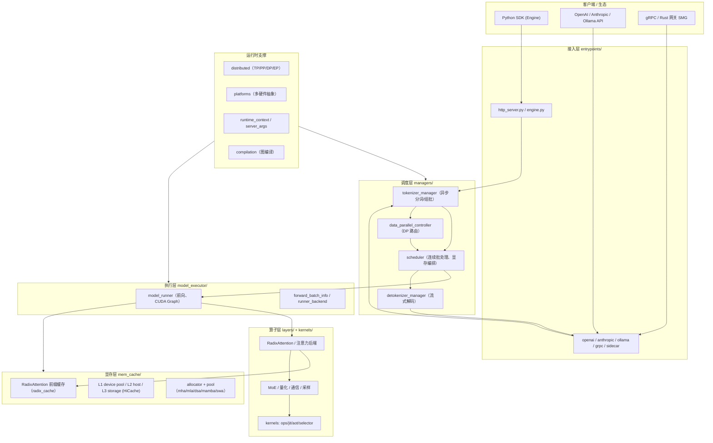
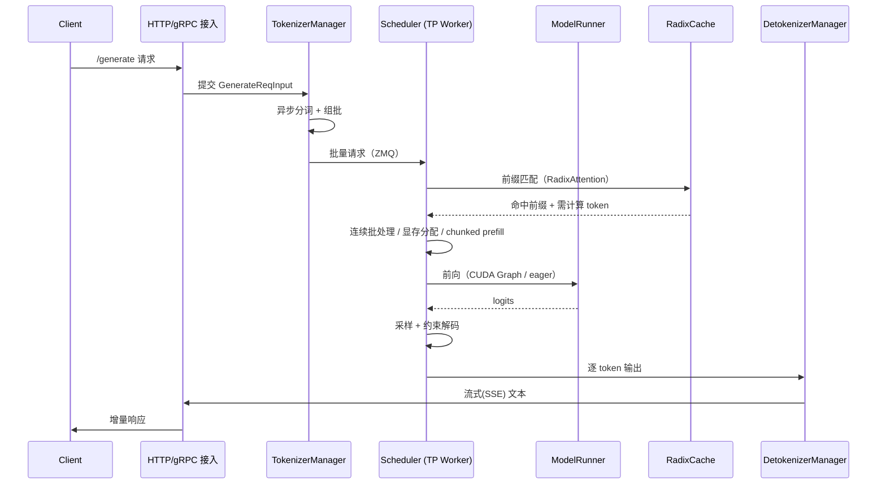
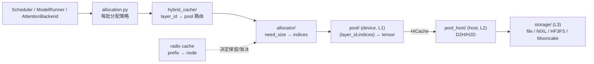

# SGLang 项目介绍

> 目标仓库：`/data/home/shendakuang/workspace/framework/sglang`
> 定位：面向大语言模型（LLM）、视觉语言模型（VLM）与扩散模型的开源推理与服务框架，主打 Agentic 负载、大规模服务与 RL rollout。
> 协议与治理：Apache-2.0，由非营利开源组织 [LMSYS](https://lmsys.org/about/) 托管。官方称其已在全球 40 万+ GPU 上支撑每日数万亿 token 的生成（见 `docs/index.mdx:61`）。

SGLang 名字源自最初的 "Structured Generation Language"（结构化生成语言）。今天其主体是 **SRT（SGLang Runtime）**：一个高吞吐、低延迟的推理运行时，前端 DSL 作为历史能力保留（`python/sglang/README.md:8` 已将其标注为“不再积极维护”）。

---

## 1. 代码结构

### 1.1 仓库顶层

```
sglang/
├── python/              # Python 主体（可 pip 安装的 sglang 包）
├── rust/                # Rust workspace：gRPC / renderer / radix-tree 等原生组件
├── sgl-model-gateway/   # 独立的 Rust 模型网关（SMG），控制面 + 数据面
├── proto/               # gRPC / protobuf 定义与生成脚本
├── kernels packages     # 见 python/sglang/kernels（内核接口/选择/JIT）
├── docs/                # Mintlify 文档站（docs.sglang.io）
├── benchmark/           # 性能基准与数据集工具
├── examples/            # 前端语言、运行时、监控、profiler 等示例
├── scripts/             # 构建、CI、发布脚本
├── docker/              # 镜像构建
├── 3rdparty/            # 厂商（如 AMD）第三方集成
├── experimental/        # 实验性特性
├── test/ tools/ assets/
└── README.md
```

| 目录 | 职责 |
|---|---|
| `python/` | 全部推理逻辑：运行时 `srt/`、内核 `kernels/`、多模态生成 `multimodal_gen/`、CLI、工具 |
| `rust/` | Rust workspace：`sglang-grpc`、`sglang-radix-tree`（经 `tch` 绑定 libtorch）、`sglang-renderer`、`sglang-server`、`sglang-processor`、`sglang-mm`、`sglang-api-types`、`sglang-api-codegen`（`rust/Cargo.toml:3`） |
| `sgl-model-gateway/` | 大规模部署的路由控制面与数据面，OpenAI 兼容，支持 HTTP/gRPC/PD 拓扑 |
| `proto/` | `proto/sglang` 下的 protobuf 与 `build.rs` |
| `docs/` | 站点配置 `docs.json`、MDX 页面、`AGENTS.md` 写作规范 |

### 1.2 Python 包结构（`python/sglang/`）

```
python/sglang/
├── srt/                 # ★ 自回归 LLM 推理运行时（SGLang Runtime），核心
├── kernels/             # 跨运行时共享的内核接口/实现/选择/调试
│   ├── ops/  jit/  aot/  fused_op.py  registry.py  selector.py
├── multimodal_gen/      # 图像/视频/音频生成（多为扩散模型）运行时
├── lang/                # 前端语言（DSL）：api.py/interpreter.py/ir.py/tracer.py（已弃用）
├── api/v1/              # 对外 Python API
├── cli/                 # 命令行入口
├── benchmark/  test/    # 基准与测试工具
├── launch_server.py  utils.py  version.py  check_env.py
```

### 1.3 SRT 运行时（`python/sglang/srt/`，约 45+ 子模块）

```
srt/
├── entrypoints/     # 引擎/HTTP/gRPC/OpenAI/Anthropic/Ollama/SystemOne 接入
├── managers/        # 调度：scheduler / tokenizer / detokenizer / DP controller
├── model_executor/  # 前向执行、CUDA Graph、forward batch 信息
├── models/          # 250 个模型实现（deepseek/qwen/llama/...）
├── model_loader/    # 权重加载与转换
├── layers/          # 网络层：attention / moe / quantization / communication ...
├── mem_cache/       # KV/SSM 显存：radix cache、hicache、allocator、pool
├── disaggregation/  # PD 分离：prefill/decode、传输后端
├── speculative/     # 推测解码：eagle / ngram / uno / dflash / dspark ...
├── sampling/ constrained/   # 采样、约束解码（xgrammar/outlines/llguidance）
├── distributed/     # 并行状态、通信算子、设备通信器
├── eplb/ elastic_ep/        # 专家并行负载均衡、弹性 EP
├── platforms/       # 硬件抽象：cuda/rocm/npu/xpu/cpu/mps/musa
├── compilation/     # torch.compile / piecewise 图编译
├── multimodal/      # 多模态输入处理
├── lora/ session/ multiplex/ observability/ parser/ function_call/
├── compilation/ weight_sync/ checkpoint_engine/ state_capturer/ dllm/ ...
└── server_args.py runtime_context.py environ.py
```

---

## 2. 架构设计

### 2.1 分层架构总览



### 2.2 请求生命周期



### 2.3 进程与并行模型

- **接入进程**：`tokenizer_manager.py` 负责异步分词与请求编排，`detokenizer_manager.py` 独立进程做流式反分词，二者与 GPU Worker 通过 ZMQ 通信。
- **GPU Worker**：每个 TP rank 一个 `Scheduler` 进程（`managers/scheduler.py:14` 注释 "A scheduler that manages a tensor parallel GPU worker"）。
- **并行维度**由 `distributed/parallel_state.py` 统一管理（改编自 vLLM/Megatron）：TP（张量并行）、PP（流水线并行）、DP（数据并行，`data_parallel_controller.py`）、EP（专家并行，配合 `eplb/`）。DP attention 由 `layers/dp_attention.py` 支撑。
- **运行时上下文**：`runtime_context.py` 提供进程级配置/并行态/资源句柄的统一访问（`get_exec/get_parallel/get_memory/...`），替代散落的全局状态。

### 2.4 显存缓存层级


（该分层图源自 `python/sglang/srt/mem_cache/README.md:10`。）

---

## 3. 模块功能（对应第 2 章，逐一展开）

本章逐模块给出**职责 / 关键类与函数（含 `文件:行号`）/ 数据结构 / 与其他模块的交互**。路径基准为 `python/sglang/srt/`；内核为 `python/sglang/kernels/`。因代码行号随版本变化，引用用于定位而非精确定位到单行。

### 3.1 接入层 `entrypoints/`

**职责**：把外部协议（HTTP/gRPC/OpenAI/Anthropic/Ollama/SystemOne）翻译为内部请求，编排引擎子进程与生命周期。

**引擎与启动**

- `engine.py`（2055 行）：
  - `Engine(EngineScoreMixin, EngineBase)`（`engine.py:238`）：离线 Python API。采用三件套进程模型——主进程 `TokenizerManager` + 子进程 `Scheduler`（每 TP rank）+ 子进程 `DetokenizerManager`，ZMQ 通信（`engine.py:242-250`）。
  - `Engine.__init__`（`:268`）→ `_launch_subprocesses`（`:1111`）为启动主干：`server_args.resolve_once` → `_set_envs_and_config`（`:1855`，设 NCCL/MNNVL/NVLS 等环境、`mp.set_start_method("spawn")`）→ `PortArgs.init_new`（`server_args.py:705`，分配 `tokenizer_ipc_name/scheduler_input_ipc_name/detokenizer_ipc_name/rpc_ipc_name` 等，本地用 `ipc://`，分布式用 `tcp://`）→ 可选 `EngineInfoBootstrapServer`（`:1172`）→ 权重缓存守护 `_launch_weight_cache_daemons`（`:716`）→ `_launch_scheduler_processes`（`:879`）→ `_launch_detokenizer_subprocesses`（`:1025`）→ `init_tokenizer_manager`（`:186`）/ `MultiTokenizerRouter`（`:1323`）→ `wait_for_ready` → `SubprocessWatchdog`。
  - `_launch_scheduler_processes`（`:879`）：对每个 `(pp_rank, tp_rank)` 起 `mp.Process(target=run_scheduler_process)`（`managers/scheduler.py:6060`）；当 `num_dp_ranks>1` 或 EP scale 模式，改起 `run_data_parallel_controller_process`（`:960`）。
  - 公共 API：`generate`（`:419`）、`async_generate`（`:531`）、`encode`（`:636`）、`rerank`（`:703`）、权重更新族 `update_weights_from_{distributed,tensor,disk,ipc}`（`:1634+`）、LoRA（`:1738+`）、`release/resume_memory_occupation`（`:1808/:1814`）、`collective_rpc`（`:1839`）、`shutdown`（`:1429`）。
  - `SchedulerInitResult`（`:169`）封装 scheduler 句柄、子进程 PID、就绪/退出回调。
- `EngineBase.py`：`EngineBase(ABC)`（`:7`）声明 `generate/flush_cache/begin_weight_update/end_weight_update/update_weights_from_tensor/release|resume_memory_occupation/shutdown`；`engine_score_mixin.py:EngineScoreMixin`（`:28`）提供 `score/async_score`（委托 `tokenizer_manager.score_request`）。

**HTTP 服务**

- `http_server.py`（2958 行）：FastAPI 应用。`lifespan`（`:285`）在启动时按单/多 tokenizer 模式构建全部 serving handler（completion/chat/embedding/classify/score/decisions/rerank/tokenize/transcription、Ollama/Anthropic/SystemOne、工具服务器、`OpenAIServingResponses`），启动原生 gRPC + 边车、预热线程；`launch_server`（`:2898`）复用 `Engine._launch_subprocesses` 后进入 `_setup_and_run_http_server`（`:2621`，uvicorn/Granian + API Key 中间件）。
  - 中间件/路由基础设施：`ORJSONRequest/ORJSONRoute`（`:458/:470`）、CORS、`RequestDecompressionMiddleware`（`http_request_decompression.py:37`，zstd）、`validation_exception_handler`（`:561/:618`，422→400 并按路由改写）。
  - 原生核心路由：`/ready`（`:697`）、`/health_generate`（`:705`）、`/get_model_info`（`:785`）、`/generate`（`:909`）、`/encode`（`:974`）、`/classify`（`:987`）、`/flush_cache`（`:1006`）。
  - HiCache/专家/权重/内存：`/hicache/storage-backend`（`:1104`）、`/start|stop_expert_distribution_record`（`:1229+`）、`/update_weights_from_*`（`:1262+`）、`/release_memory_occupation`（`:1537`）。
  - OpenAI 兼容：`/v1/completions`（`:1790`）、`/v1/chat/completions`（`:1800`）、`/v1/embeddings`（`:1812`）、`/v1/responses`（`:1996`）、`/v1/rerank`（`:2031`）、`/v1/realtime` websocket（`:1912`）、`/v1/models`（`:1923`）。
  - 解析与控制：`/parse_function_call`（`:1696`）、`/separate_reasoning`（`:1724`）、`/open_session`（`:1649`）、`/pause_generation`（`:1761`）。

**协议适配**

- `openai/`：`serving_base.OpenAIServingBase`（`serving_base.py:28`）定义统一管线 `handle_request`（`:73`，校验→`_convert_to_internal_request`→流式/非流式）。具体 handler：`OpenAIServingChat`（`serving_chat.py:272`，`_convert_to_internal_request:1196`，含 Jinja 模板渲染、tool-call 流式拼接）、`OpenAIServingCompletion`（`:49`）、`OpenAIServingEmbedding`（`:30`）、`OpenAIServingRerank`（`:205`）、`OpenAIServingResponses`（`:159`，`model_type=="gpt_oss"` 时走 Harmony）。请求/响应 Pydantic 模型集中在 `openai/protocol.py`（`ChatCompletionRequest:858`）。
- `anthropic/serving.py:AnthropicServing`（`:183`）：`/v1/messages`，把 Anthropic Messages 转成 `ChatCompletionRequest` 后复用 chat serving（`_convert_to_chat_completion_request:217`）；`ollama/serving.py:OllamaServing`（`:31`）输出 NDJSON 流；`systemone/serving.py:SystemOneServing`（`:69`）基于 decisions。
- gRPC：`grpc_server.serve_grpc`（`:157`）委托 SMG servicer 并挂 aiohttp 边车（`/metrics`、`/start_profile`）；`grpc_bridge.RuntimeHandle`（`:58`）把 Rust 侧请求桥接到同一 `TokenizerManager`/`OpenAIServingBase`（`_get_openai_serving:232`）。
- 辅助：`warmup.py`（命名预热注册表 `execute_warmups:28`）、`sidecar.py:Sidecar`（`:81`）、`context.py`（Harmony 会话上下文）、`request_headers.py`（`x-override-*` 头覆盖字段）、`api_contract.py`（`/generate` body schema 校验）、`engine_info_bootstrap_server.py`（跨实例权重传输的 per-rank 信息 HTTP 服务）。

**交互**：所有入口最终调用 `tokenizer_manager.generate_request`（`managers/tokenizer_manager.py:863`）；结果经 detokenizer 回流。

### 3.2 调度与请求管理 `managers/`

**职责**：SRT 中枢——连续批处理、显存编排、请求生命周期、DP 路由。

**数据流**：`TokenizerManager`（async 分词）→ ZMQ → [`DataParallelController`（dp>1）] → `Scheduler`（每 TP rank）→ `TpModelWorker.forward_batch_generation` → `ModelRunner` → 采样 → `SchedulerOutputStreamer` → `DetokenizerManager` → ZMQ 回 `TokenizerManager`。

**`scheduler.py`（6155 行）**

- `Scheduler(SchedulerDisaggregationDecodeMixin, SchedulerDisaggregationPrefillMixin, SchedulerMultiplexMixin, SchedulerPPMixin, SchedulerDllmMixin, SchedulerMlxOverlapMixin)`（`:442`）。
- 关键状态（`init_running_status` `:1280`）：`waiting_queue: List[Req]`（`:1291`，prefill 队列）、`running_batch: ScheduleBatch`（`:1293`，连续批处理运行批）、`result_queue`（`:1298`，overlap 在途环）、`forward_ct`（`:1303`）、`processed_tokens_counter`（`:474`，HRRN 老化基准）、`chunked_req/chunked_prefill_size/is_mixed_chunk`（`:1316`）、`policy/prefill_delayer`（`:1392`）、`future_map`（`:1617`）。
- 事件循环：`run_event_loop`（`:1889`）→ `dispatch_event_loop`（`:5959`）按 disagg/PP/overlap/pdmux 选择 `event_loop_normal`（`:1940`）或 `event_loop_overlap`（`:1975`）。每轮：`ingest_requests`（`:2098`）→ `get_next_batch_to_run`（`:3751`）→ `run_batch`（`:4474`）+ `process_batch_result`（`:4905`）。
- 请求准入：`process_input_requests`（`:2138`，`TypeBasedDispatcher` `:1744` 按类型分派）→ `handle_generate_request`（`:2810`）→ `_add_request_to_queue`（`:3343`，设优先级、`_prefetch_kvcache`、追加 `waiting_queue`，并记 `arrival_processed_tokens`）。
- 组批核心 `get_next_batch_to_run`（`:3751`）：`process_pending_chunked_abort`/`_process_hicache_events` → 合并上一 prefill（`last_batch.forward_mode.is_extend()` `:3808`，`running_batch.merge_batch` `:3820`）→ `get_new_batch_prefill`（`:3912`）；有 prefill 先跑 prefill，否则 `update_running_batch`（`:4319`）维护 decode；DP attention 钩子 `maybe_prepare_mlp_sync_batch`（`:3852`）。
- prefill 批构建 `_get_new_batch_prefill_raw`（`:3939`）：Grammar 队列并入 → `MinFreeSlotsDelayer.should_delay`（`:3965`）→ **`policy.calc_priority`（`:3991`）** → 构建 `PrefillAdder`（`:4019`）→ 遍历 `waiting_queue`，对每个 req 调 **`req.init_next_round_input(self.tree_cache)`（`:4120`）触发 RadixAttention 前缀匹配**，再 `adder.add_one_req`（`:4131`）→ `ScheduleBatch.init_new`（`:4196`）/`prepare_for_extend`（`:4217`）；chunked-prefill 混合路径 `mix_with_running`（`:4255`）。
- decode 维护 `update_running_batch`（`:4319`）：`batch.check_decode_mem`（`:4329`）容量门 → OOM 时 `batch.retract_decode`（`:4353`）抢占并重排 `_add_request_to_queue(is_retracted=True)`（`:4399`）→ `batch.prepare_for_decode`（`:4411`）。
- 前向 `run_batch`（`:4474`）：`model_worker.forward_batch_generation`（`tp_worker.py:603`）；overlap 模式用 `forward_stream_ctx`/`future_map.resolve_forward_inputs`（`overlap_utils.py:87`）与延迟采样 `launch_batch_sample_if_needed`（`:4867`）。PD prefill 提前发 KV `maybe_send_cached_prefix_chunk`（`:4510`）。
- 结果 `process_batch_result`（`:4905`）分派到 `SchedulerBatchResultProcessor`（`scheduler_components/batch_result_processor.py:97`）。
- idle/控制：`on_idle`（`:5056`）、`abort_request`（`:5442`）、`pause_generation`（`:5460+`/`:5588`）、`flush_cache`（`:5332`）、`handle_shutdown`（`:5920`）。

**`schedule_batch.py`（3967 行）——数据模型与批操作**

- `Req`（`:1003`，`class Req(ReqDllmMixin)`）：单请求状态（`origin_input_ids/output_ids/prefix_len/kv` 等）。`init_next_round_input`（`:1620`）内调 `match_kv_cache`（`:1663`）完成前缀匹配；`update_finish_state`（`:1909`）判定停止/长度/中止；`reset_for_retract`（`:1951`）、`offload/load_kv_cache`（`:2009/:2030`）。
- `ScheduleBatch`（`:2334`）：一批请求 + 共享资源（`req_to_token_pool/token_to_kv_pool_allocator/tree_cache`）。`init_new`（`:2552`）、`prepare_for_extend`（`:2726`，调 `alloc_for_extend`）、`prepare_for_decode`（`:3559`，调 `alloc_for_decode`）、`check_decode_mem`（`:3275`）、`retract_decode`（`:3294`，返回撤取请求 + 新 token 比例）、`filter_batch`（`:3655`）、`merge_batch`（`:3743`）、`mix_with_running`（`:3139`）。
- `NextBatchPlan`（`:3965`，`{batch_to_run, running_batch}`）。

**`schedule_policy.py`（1640 行）——批调度策略与准入**

- `SchedulePolicy`（`:186`）：`calc_priority`（`:209`）实现缓存感知/无关两类策略——`_sort_by_longest_prefix`（`:437`，LPM 最长前缀）、`_sort_by_hrrn`（`:456`）、`_sort_by_dfs_weight`（`:492`）、`_sort_by_shortest_prefill`（`:247`）、`_sort_by_longest_output`（`:263`）、`_sort_by_routing_key`（`:272`）。缓存感知排序用 `RadixCache.create_simulated`（`:207`）建模拟树预判命中。
- `PrefillAdder`（`:581`）：前缀/显存预算与准入，`add_one_req`（`:1302`）、`add_chunked_req`（`:1078`，chunked prefill 截断）、`rem_total_tokens`（`:766`）、`create_prefill_budget`（`:625`）。`AddReqResult`（`:567`）。

**`tokenizer_manager.py`（3993 行）**

- `TokenizerManager(TokenizerControlMixin, TokenizerManagerScoreMixin)`（`:424`）；`ReqState`（`:239`）逐请求状态（out_list、event、增量 token/logprob）。
- 请求：`generate_request`（`:863`）→ `_tokenize_one_request`（`:1064`）/`_handle_batch_request`（`:922`）→ `_send_one_request`（`:1728`，`_dispatch_to_scheduler` `sock_send`）；`_wait_one_response`（`:1885`）/`_stream_one_response`（`:1895`）。
- 输出：`auto_create_handle_loop`（`:2371`）→ `handle_loop`（`:2396`）→ `_handle_batch_output`（`:2411`），按 `BatchStrOutput/BatchTokenIDOutput/BatchEmbeddingOutput` 分支，合并 logprob、设置 `state.event`。

**`detokenizer_manager.py`（563 行）**

- `DetokenizerManager`（`:103`）；`DecodeStatus`（`:76`）；`event_loop`（`:180`）→ `handle_batch_token_id_out`（`:444`）→ `_decode_batch_token_id_output`（`:304`）——用“代理文本”技巧做增量解码并处理不完整 UTF-8，产出 `BatchStrOutput`。

**`data_parallel_controller.py`（936 行）**

- `DataParallelController`（`:143`）；`event_loop`（`:849`）非阻塞收包 → 按策略分发：`round_robin_scheduler`（`:802`）、`follow_bootstrap_room_scheduler`（`:823`）、`total_requests_scheduler`（`:834`）、`total_tokens_scheduler`（`:840`）；`DPBudget`（`:107`）读共享内存负载快照；`maybe_external_dp_rank_routing`（`:787`，`req.routed_dp_rank` 直连指定 worker）。

**重叠与限流**

- `overlap_utils.py`（635 行）：`FutureMap`（`:255`，按 pool index 的中继缓冲，`publish:578`/`stash:603`）、`resolve_forward_inputs`（`:87`）把“上一批结果→下一批输入”的 CPU 中继与 GPU 前向重叠执行。
- `prefill_delayer.py:PrefillDelayer`（`:76`，跨 DP/CP/TP 协商是否放行 prefill）、`min_free_slots_delayer.py:MinFreeSlotsDelayer`（`:25`）。
- `tp_worker.py:TpModelWorker`（`:279`）：`forward_batch_generation`（`:603`）是 scheduler 与 model_runner 的边界（构建 `ForwardBatch`、调 `model_runner.forward/sample`）。
- `cache_controller.py`（1422 行）`HiCacheController`（`:295`）与 `io_struct.py`（2705 行）IPC schema 见 3.6/3.2 交互。

**交互**：上游 `entrypoints`；下游 `model_executor`/`mem_cache`；横向 `disaggregation`、`speculative`、`sampling`、`constrained`、`lora`、`session`。

### 3.3 执行引擎 `model_executor/`

**职责**：把一批 token 变成 logits；用图捕获/编译降低单步开销；管理采样与 KV 池生命周期。

- `model_runner.py`（2486 行）：`ModelRunner`（`:310`）——“runs the forward passes of the models”。
  - `initialize`（`:670`）：采样器（`create_sampler` `:679`）→ `load_model`（`:1221`，经 `load_model_with_memory_saver`，预展开 RoPE 缓存）→ MoE topk → LoRA → KV dtype。
  - `alloc_memory_pool`（`:929`）：经 `KVCacheConfigurator`（`mem_cache/kv_cache_configurator.py`）与 `pool_configurator.py` 定容，返回 `req_to_token_pool/token_to_kv_pool/allocator/max_total_num_tokens`；`_init_post_memory_pool_components`（`:952`）接 KV canary、ngram、hisparse、capturers。
  - `init_attention_backends`（`:1053`）→ `resolve_attention_backend_strs` + `build_attention_backends`（`model_runner_components/attention_backend_setup.py:69`）。
  - `init_cuda_graphs`（`:1126`）→ `capture_cuda_graphs`（`model_runner_components/cuda_graph_setup.py:367`），产出 `eager_runner/prefill_cuda_graph_runner/decode_cuda_graph_runner`；PD 角色切换用 `init_decode/prefill_cuda_graph`（`:1551/:1624`）重捕获。
  - `forward`（`:1756`）→ `_forward_raw`（`:1902`）：发布 `ForwardContext(attn_backend=...)`（`:1912`），按 `can_run_graph` 选 decode 图（`decode_cuda_graph_runner.execute`，直接返回）、prefill 图、split-prefill 或 `eager_runner.execute`；随后 `_preprocess_logits`/`sample`（`:2031`）/`compute_logprobs_only`（`:2087`）。
- `forward_context.py`（84 行）：`ForwardContext`（`:35`）仅持 `attn_backend`；`get_attn_backend`（`:66`）、`get_token_to_kv_pool`（`:70`）、`get_req_to_token_pool`（`:74`）——层在深处取当前后端/池。
- `forward_batch_info.py`（~98 KB）：`ForwardMode`（`:196`）、`CaptureHiddenMode`（`:301`）、`ForwardBatch`（`:491`）、`PPProxyTensors`（`:2189`）；`prepare_mlp_sync_batch`（`:1638`）做 DP/MLP 同步填充。
- `cuda_graph_config.py`：`Phase`/`Backend`（`:32/:40`）、`ALLOWED_BACKENDS_PER_PHASE`（`:51`）、`PhaseConfig`（`:89`）、`CudaGraphConfig`（`:145`）。
- `cuda_graph_buffer_registry.py`（1058 行）：`CudaGraphBufferRegistry`（`:271`）在 `ForwardBatch` 与静态图缓冲间镜像（`register_slot:320`/`fill_from:388`/`extract_buffer:480`）；`build_decode_registry`（`:516`）、`build_prefill_registry`（`:825`）；`PaddingPolicy`（`:77`）。
- `input_buffers.py`：`share_input_buffer`（`:16`）按 `(name,numel,dtype,device)` 复用进程级缓冲；`INDEX_SEMANTIC_BUFFERS`（`:47`）。
- `runner/`：`EagerRunner`（`eager_runner.py:80`，`execute:209` 按模式分派）、`DecodeCudaGraphRunner`（`decode_cuda_graph_runner.py:219`，`capture:1117`/`load_batch:1377`/`execute:1598`）、`PrefillCudaGraphRunner`（`prefill_cuda_graph_runner.py:291`，`can_replay_locally:1275`）；`base_cuda_graph_runner.get_batch_sizes_to_capture`（`:64`）产捕获桶。
- `runner_backend/`：`BaseCudaGraphBackend`（`base_cuda_graph_backend.py:28`）；`FullCudaGraphBackend`（`full_cuda_graph_backend.py:99`）、`BreakableCudaGraphBackend`（`breakable_cuda_graph_backend.py:60`）、`TcPiecewiseCudaGraphBackend`（`tc_piecewise_cuda_graph_backend.py:89`）；`utils.resolve_decode_backend`（`:48`）/`resolve_prefill_backend`（`:107`）按平台/配置选择。
- `hook_manager.py`：`register_forward_hooks`（`:11`）在捕获**之后**挂 hook（避免进入图）。

**交互**：被 `scheduler` 驱动；调用 `layers/`+`kernels/`；读写 `mem_cache` 的池。

### 3.4 模型实现 `models/` + `model_loader/`

**`models/`（247 个 `.py` 文件，≈284 个注册架构名）**

- **注册是约定式，非装饰器**：`models/registry.py` 通过 `import_model_classes`（`:117`）用 `pkgutil.iter_modules` 扫描包内每个模块，读取模块级 `EntryClass`（类或列表）自动注册；全局单例 `ModelRegistry = _ModelRegistry()`（`:153`）。`resolve_model_cls`（`:93`）按 HF `architectures` 查表，未命中回退 `TransformersForCausalLM`（`:88`）。外部模型包用 `SGLANG_EXTERNAL_MODEL_PACKAGE`，禁用架构用 `SGLANG_DISABLED_MODEL_ARCHS`。`models/` 是无 `__init__.py` 的命名空间包。
- 代表模型：`qwen2.py`（`Qwen2ForCausalLM:493`，`EntryClass` `:790`，含 v1/v2 权重加载双路径）；`deepseek_v2.py`（`DeepseekV2ForCausalLM:3191`，`EntryClass=[DeepseekV2/V3/V32] :3494`，MoE+MLA 旗舰，含 shared-experts 融合、EAGLE3/DFLASH 辅助 hidden 捕获）；`qwen2_vl.py`（`Qwen2VLForConditionalGeneration:425`，Vision Tower + M-RoPE）。
- 家族公共代码下沉 `*_common/`：`deepseek_common/`（`deepseek_weight_loader.py:DeepseekV2WeightLoaderMixin:205`、`attention_backend_handler.py:AttentionBackendRegistry:46`）、`dots3_common/`、`inkling_common/`。
- 草稿模型（NextN/MTP/EAGLE）单独文件（约 31 个：`deepseek_nextn.py`、`qwen3_5_mtp.py`、`llama_eagle3.py` 等），子类化目标模型并重映射权重（如 `DeepseekV3ForCausalLMNextN:247`）。

**`model_loader/`**

- `loader.py`（4316 行）：`get_model`（`__init__.py:28`）→ `get_model_loader`（`loader.py:4182`）按 `LoadFormat` 选约 15 种 loader：`DefaultModelLoader`（`:387`，`load_model:994`）、`LayeredModelLoader`（`:1112`）、`ShardedStateLoader`（`:1544`）、`BitsAndBytesModelLoader`（`:2564`）、`GGUFModelLoader`（`:3038`）、`RemoteInstanceModelLoader`（`:3152`，NCCL/传输引擎路径）、`RunaiModelStreamerLoader`（`:3933`，SSD/S3/GCS 流式）。量化配置由 `_get_quantization_config`（`:170`）统一解析，`process_weights_after_loading`（`:1087`）在线重打包。
- `weight_utils.py`：`get_quant_config`（`:269`）、`safetensors_weights_iterator`（`:1146`）、`default_weight_loader`（`:1589`）、`initialize_dummy_weights`（`:1753`）、检查点预取 `_prefetch_checkpoint_file`（`:936`）。
- `auto_loader.py`：`AutoWeightsLoader`/`WeightsMapper`（`:41`）、`StackedParamsDispatch`（`:62`，qkv/gate_up 分片）、`filter_pp_weights`（`:156`）。

**交互**：模型由 `model_runner.load_model` 实例化；权重来自 `model_loader`；计算落到 `layers/`。

### 3.5 算子与注意力 `layers/` + `kernels/`

**注意力后端矩阵与选择**

- `layers/attention/attention_registry.py`：全局 `ATTENTION_BACKENDS`（`:41`）+ `@register_attention_backend`（`:45`），注册约 25 个工厂（flashinfer、fa3、fa4、flashmla、trtllm_mla、trtllm_mha、aiter、triton、torch_native、flex_attention、dsa、qsa、dsv4、ascend、intel_amx、intel_xpu、hpc_ops、wave 等）；`attn_backend_wrapper`（`:360`）按模型类型再包一层（Mamba/线性/稀疏混合）。
- 基类 `base_attn_backend.py:AttentionBackend`（`:36`）：`forward`（`:264`）按模式分派到 `forward_decode`（`:309`）/`forward_extend`（`:322`）/`forward_mixed`（`:335`）；另有 `init_forward_metadata*`、`init_cuda_graph_state`（`:205`）、`get_indexer_metadata`（`:351`，稀疏注意力钩子）。
- 选择路径：`model_override_base.get_default_attn_backend`（`:268`，按架构+平台自动选）→ `arg_groups/overrides.py` 钩子（`_attention_backend_default:1067`、`_deterministic_attention_backend:1034`、`_attention_backend_platform_fallbacks:1264`）→ `ModelRunner.init_attention_backends`（`:1053`）→ `build_attention_backends`（`attention_backend_setup.py:69`）/`_build_full_attention_backend_from_str`（`:271`）。prefill≠decode 用 `HybridAttnBackend`（`hybrid_attn_backend.py:25`）；两批重叠（TBO）用 `TboAttnBackend`（`tbo_backend.py:17`）；PD-mux 用解码后端组。
- 具体后端：`FlashInferAttnBackend`（`flashinfer_backend.py:294`）、`FlashInferMLAAttnBackend`（`flashinfer_mla_backend.py:212`）、`FlashAttentionBackend`（`flashattention_backend.py:132`，FA3/FA4）、`FlashMLABackend`（`flashmla_backend.py:61`）、`TRTLLMMLABackend`（`trtllm_mla_backend.py:199`）、`AiterAttnBackend`（`aiter_backend.py:352`，ROCm）、`TorchNativeAttnBackend`（`torch_native_backend.py:19`，SDPA 参考实现）。
- 子目录：`dsa/`（DeepSeek 稀疏注意力，`DeepseekSparseAttnBackend:407`、`Indexer:dsa_indexer.py:252` 做 top-k 选择；`nsa/` 现为 `dsa` 的弃用转发）；`mamba/`（`Mamba2Metadata:88`、`MambaMixer2:mamba.py:192`）；`linear/`（`GDNAttnBackend:gdn_backend.py:515`、`resolve_linear_attn_backends:utils.py:81`、`ShortConvAttnBackend`）；`minicpm/`。

**`layers/radix_attention.py`——RadixAttention**

- `RadixAttention(nn.Module)`（`:98`）。`forward`（`:159`）**不做后端选择**，而是 `get_attn_backend().forward(q,k,v,self,forward_batch,...)`（`:294`）；处于 tc-piecewise 编译上下文时改走 `unified_attention_with_output*` 拆分自定义算子（`:190/:587`）以便分段编译。`__init__`（`:103`）通过 `quant_config.get_quant_method` 绑定 KV-cache 量化方法（`:150`）。`AttentionType`（`:84`）区分 decoder/双向/encoder-only。

**MoE（`layers/moe/`）——分发器 + runner 双层**

- `fused_moe_triton/layer.py:FusedMoE`（`:293`）：持 `quant_method` 决定的 `MoeRunner`（`create_moe_runner:545`）与 `create_moe_dispatcher`（`:546`）。`forward_impl`（`:1550`）：`_dispatch_with_pre_quant`（`:1589`）→ `run_moe_core`（`:1630`，即 `quant_method.apply`）→ `dispatcher.combine` → 可选 all-reduce。
- `moe_runner/runner.py:MoeRunner`（`:53`）：`run`（`:195`）——有融合函数（`FusedOpPool`）则直调，否则 `pre_permute → runner_core.run → post_permute`。runner core：`TritonRunnerCore`（`triton.py:80`）、`DeepGemmRunnerCore`（`deep_gemm.py:341`，`_run_contiguous_gemm`/`_run_masked_gemm`）等。`initialize_moe_config`（`moe/utils.py:467`）在启动时确定 `a2a_backend`/`runner_backend`。
- `moe/token_dispatcher/`：`StandardDispatcher`（`standard.py:94`，含 `local_expert_mapping`）、`DeepEPDispatcher`（`deepep.py`）、`DeepEPv2Dispatcher`、`FlashinferDispatcher`、`MoriEP`/`Mooncake`/`Nixl`/`AscendTP`；由 `create_moe_dispatcher`（`fused_moe_triton/layer.py:162`）按 `MoeA2ABackend` 选择。`ep_moe/layer.py:DeepEPMoE`（`:63`）为 EP 专用变体。
- `layers/moe/cutlass_moe.py:cutlass_fused_experts_fp8`（`:28`）；`mega_moe*.py`、`fused_moe_native.py`、`topk.py`。

**量化（`layers/quantization/`）**

- 契约 `base_config.py`：`QuantizationConfig`（`:147`，`get_quant_method:256`）、`LinearMethodBase`、`FusedMoEMethodBase`。
- 注册表 `quantization/__init__.py:BASE_QUANTIZATION_METHODS`（`:62`）+ `get_quantization_config`（`:160`）。
- 代表 `fp8.py:Fp8Config.get_quant_method`（`:383`）按层类型分派 `Fp8LinearMethod`/`Fp8MoEMethod`/`Fp8KVCacheMethod`（KV 量化）；FP4 GEMM 后端 `fp4_utils.initialize_fp4_gemm_config`（`:149`）。此外覆盖 AWQ/GPTQ/Int8/GGUF/compressed-tensors/ModelOpt/MXFP4/experpack 等。

**其它层与内核**

- `layers/communication/`：`k3_ar_fusion.py`（all-reduce+norm 融合，`all_reduce_norm:275`）、`k3_sp_collective.py`（序列并行 RS/AG）；可调用内核在 `kernels/ops/communication/`。
- `layers/dp_attention.py`：DP 注意力的 gather/scatter（`dp_gather:937`、`dp_scatter:1030`）与 `DpPaddingMode:135`。
- `layers/sampler.py:Sampler`（`:110`，`forward:142`，含贪心快速路径与跨 TP token 同步）；`layers/logits_processor.py:LogitsProcessor`（`:446`，`forward:511`，LM head + DP/TP 汇聚）。
- `kernels/`：跨运行时内核层（RFC #29630）。**两层分派**：清单解析 `selector.select_kernel`（`selector.py:38`）按 `CapabilityRequirement.is_satisfied_by(PlatformInfo.detect())` 硬过滤，无优先级排序；算子自动选择 `fused_op.BaseFusedOp`（`fused_op.py:334`）按 `priority` + `capabilities` 在 `forward_native/forward_triton/forward_aot/forward_flashinfer/forward_deepgemm/...` 间选（`_resolve_forward_method:538`、`forward:630`）。`ops/` 分 20 组（activation/attention/moe/kvcache/layernorm/...）；`jit/`（JIT/csrc）、`aot/`（`sgl_kernel` 预编译轮子）、`registry.py`、`spec.py:KernelSpec`。

**交互**：被 `model_runner` 调用；`kernels` 按 `platforms` 能力分派；量化配置在启动时初始化。

### 3.6 显存与缓存 `mem_cache/`

**职责**：谁分配 KV/SSM 槽位、谁持有字节、谁镜像到主机/磁盘、缓存保留与淘汰。分层见 `mem_cache/README.md:10`。

**RadixAttention 前缀缓存（两套实现共存）**

- 旧实现 `radix_cache.py`（832 行）：`RadixCache(BasePrefixCache)`（`:281`）。`RadixKey`（`:59`）支持 `extra_key`（LoRA 命名空间）/`cache_salt`/`is_bigram`（EAGLE），`match/match_at`（`:178/:182`）用“指数级 gallop + 二分”做长前缀比较。`TreeNode`（`:250`）记录 `children/lock_ref/last_access_time/hit_count`；`evict`（`:552`）用可淘汰叶子堆（`eviction_strategy.get_priority`）；`match_prefix`（`:364`）/`insert`（`:428`）/`inc_lock_ref`（`:582`）/`dec_lock_ref`（`:597`）。
- 稳定接口 `base_prefix_cache.py`（707 行）：`BasePrefixCache(ABC, PrefixCacheTrait)`（`:383`）定义调度侧契约 `match_prefix/insert/checkpoint/evict/inc_lock_ref/dec_lock_ref`，以及 `MatchResult`（`:269`）、`InsertResult`、`EvictParams/Result`、`init_load_back`（`:589`）、`ready_to_load_host_cache`（`:626`）、会话钩子 `releases/on_release/claim_kv_row`。
- **Unified Radix Cache**（新，`unified_radix_cache.py` 3813 行 + `unified_cache/`）：`UnifiedRadixCache(BasePrefixCache)`（`:174`）把树机制（`unified_tree_core.UnifiedTreeCore:416`）与**按组件**（FULL/SWA/MAMBA/C128，`component_type.py:6`）的驱动器分离，`TreeComponent`（`components/base.py:171`）提供 `create_match_validator`/`commit_insert_component_data`/`evict_component`/`build_hicache_transfers` 等钩子。HiCache 集成在 `init_hicache`（`:424`）。`registry.create_tree_cache`（`registry.py:229`）在两套实现与 `PureSWARadixCache` 间选择。
- 淘汰策略 `evict_policy.py`：`LRUStrategy/LFUStrategy/FIFOStrategy/MRUStrategy/PriorityStrategy/TLRUStrategy(:49)/SLRUStrategy(:84)`，由 `get_eviction_strategy` 选择。

**分配器与池（三层）**

- `allocation.py`（812 行）：每批分配策略 `alloc_for_extend`（`:367`）/`alloc_for_decode_*`（`:613`）/`alloc_req_slots`（`:320`）/`alloc_for_spec_decode`（`:768`），并按设备分派 `ALLOC_FOR_DECODE_FUNCS`/`ALLOC_EXTEND_FUNCS`。
- `allocator/`：基类 `BaseTokenToKVPoolAllocator`（`base.py:41`），分家族——`token.py:TokenToKVPoolAllocator`、`paged.py:PagedTokenToKVPoolAllocator`（`alloc_extend:204`/`alloc_decode:279`/`free_segment:340`）、`swa.py:SWATokenToKVPoolAllocator`（full/SWA 双池）、`mamba.py:MambaSlotAllocator`、`unified_*.py`（full+SWA+Mamba 共享字节预算：`UnifiedSWATokenToKVPoolAllocator:782`、`UnifiedMambaSWATokenToKVPoolAllocator:1271`）、`hisparse.py`、`page_interleave.py`。
- `pool/`（设备 L1）：`memory_pool.py`（6170 行）里 `ReqToTokenPool:374`、`MambaPool:503`、`HybridReqToTokenPool:1369`、`KVCache(ABC):2027` 及各家族 `MHATokenToKVPool:2198`、`MLATokenToKVPool:4672`、`DSATokenToKVPool:5142`、`HybridLinearKVPool:4149`；SWA 池在 `swa_memory_pool.py:SWAKVPool:21`。
- `pool_host/`（主机 L2）：`base.py:HostKVCache(ABC):162`，抽象 `load_to_device_per_layer`（`:383`）/`backup_from_device_all_layer`（`:399`）与 `alloc/free`；实现 `mha.py:MHATokenToKVPoolHost:125`、`mla.py:MLATokenToKVPoolHost:64`、`mamba.py:MambaPoolHost:74`、`dsa.py`、`unified.py`、`memory_pool_host.py`。

**分层缓存 HiCache（L1→L2→L3）**

- 控制器 `managers/cache_controller.py:HiCacheController`（`:295`）绑定设备分配器 + 主机池，建 `L2TransferEngine`（`mem_cache/l2_transfer.py:51`，管 D2H/H2D 流），并可 `attach_storage_backend`（`:532`）挂 L3 并启动后台线程/独立 gloo 组。
  - D2H：`write`（`:813`）分配 host 槽并入队，`start_writing`（`:834`）合并 op 后 `submit_device_to_host`。
  - H2D：`load`（`:868`）分配 device 槽，`start_loading`（`:968`）在 `load_fence_stream` 后 `submit_host_to_device`；真正 H2D/D2H 内核在各 `pool_host/*.py:load_to_device_per_layer`/`backup_from_device_all_layer`（JIT `jit_transfer_hicache_*`）。
  - L3：`prefetch`（`:1018`）/`prefetch_thread_func`、`write_storage`（`:1321`）/`backup_thread_func`，批量 `STORAGE_BATCH_SIZE=128`。写策略 `write_through`/`write_through_selective`/`write_back`。
- L3 接口与后端 `hicache_storage.py`：`HiCacheStorage(ABC):167`、`HiCacheStorageConfig:26`、`MetadataCache:346`、内置 `HiCacheFile:378`；`storage/backend_factory.py:StorageBackendFactory:16` 注册 `file/nixl/mooncake/npu_memcache/hf3fs/aibrix/eic/simm/mori/shm/tensorcast/seaweedfs`。
- 自动定容 `hicache_auto_size.py:auto_size_hicache:82` 按主机内存预算下调比例。

**构建与策略编码**

- `kv_cache_builder.build_kv_cache`（`:248`）→ `KVCacheBuildResult`，选择 hybrid SWA/SSM/DSA 并建 `CacheInitParams`（`cache_init_params.py:19`）/`create_tree_cache`。
- `kv_cache_configurator.KVCacheConfigurator`（3135 行，`:300`）：`configure`（`:417`）→ 推导池大小、初始化池与分配器（`_build_token_to_kv_pool:1607`、`_build_token_to_kv_pool_allocator:2464`、各家族 builder）。
- `common.py`：`match_kv_cache:203`、`checkpoint_kv_cache:253`、`release_kv_cache:378`。

**交互**：`RadixAttention` 命中前缀后仅对未命中 token 计算；`allocator` 提供落点；HiCache 在显存不足时下沉冷 KV 并按页回迁。

### 3.7 PD 分离 `disaggregation/`

**职责**：把 prefill（计算密集）与 decode（访存密集）拆到不同实例，提升整体利用率。

**基础契约** `base/conn.py`（310 行）：`StateType`（`:17`，MAMBA/SWA/DSA/QSA/BLOCK_SCALE 等 per-component 状态）、`KVArgs`（`:54`，设备 KV 指针/长度/aux/state）、`KVPoll`（`:118`，`Failed/Bootstrapping/WaitingForInput/Transferring/Success`）、`BaseKVManager/BaseKVSender/BaseKVReceiver/BaseKVBootstrapServer`（`:126/:160/:235/:308`）。

**公共实现** `common/conn.py`（2918 行）：`CommonKVManager`（`:268`，绑定 PULL zmq、prefill 注册到 bootstrap、decode 建心跳；`register_to_bootstrap:1382`、`send_kv_status_message:692`、`apply_prefill_status:784`）、`CommonKVSender:1911`、`CommonKVReceiver:2150`（`_setup_bootstrap_infos:2292`、`GET /route` `:2373`）、`CommonKVBootstrapServer:2606`（aiohttp，`POST/GET /route`）。`bootstrap.py:DeferredBootstrap:27` 与 `staging_handler.py:DecodeStagingHandler:65`（块级 staging buffer）。

**传输后端**（`get_kv_class` `utils.py:676` 选择；`TransferBackend` `utils.py:638`）：Mooncake（`mooncake/conn.py:MooncakeKVManager:241`，RDMA `send_kvcache*`、`transfer_worker:2413`）、MORI（`mori/conn.py:MoriKVManager:373`）、NIXL（`nixl/conn.py:NixlKVManager:432`，UCX/GDS 等）、Ascend（`ascend/conn.py:AscendKVManager:95`）、Fake（`fake/conn.py`，仿真握手）。

**prefill 侧** `prefill.py`（1732 行）：`PrefillBootstrapQueue`（`:161`，`pop_bootstrapped:462`）、`SchedulerDisaggregationPrefillMixin`（`:548`，`process_disagg_prefill_inflight_queue:1108`、`send_kv_chunk:1452`）。

**decode 侧** `decode.py`（3347 行）：`DecodePreallocQueue`（`:375`，`pop_preallocated:1303`）、`DecodeTransferQueue`（`:2452`，`_commit_transfer_to_req:2500`）、`SchedulerDisaggregationDecodeMixin`（`:3009`）；`decode_hicache_mixin.py` 把 HiCache 恢复并入 KV poll。

**其它**：`utils.py:MetadataBuffers:366`（output_ids/cached_tokens/logprobs/bootstrap_room）、`role_switch.py`（单实例角色切换 `handle_pd_role_switch:43`）、`kv_events.py`（`BlockStored/BlockRemoved` 事件与 `EventPublisher`）。

**端到端握手**：prefill `register_to_bootstrap`（PUT /route）→ decode `GET /route` + `send_metadata`（送 room/kv_indices/state_indices）→ prefill 凑齐 `required_dst_info_num` 后 `WaitingForInput` → prefill `send_kv_chunk` 分块发（末块携 state）→ decode `pop_transferred` 提交为 PREBUILT 批 → 状态终态 `apply_prefill_status`。

**交互**：由 `scheduler.py` 显式集成（两个 Mixin），与 `mem_cache` 的 KV 页/状态传输紧密耦合。

### 3.8 推测解码 `speculative/`

**职责**：草稿模型或多 token 预测一次验证多个 token，降低 decode 延迟。

**算法注册与选择**：`spec_info.py:SpeculativeAlgorithm`（`:32`，DFLASH/UNO/DSPARK/EAGLE/EAGLE3/FROZEN_KV_MTP/STANDALONE/NGRAM/NONE），`from_string:49`（`NEXTN→EAGLE`），`create_worker:302` 按算法建 worker；`spec_registry.py:register_algorithm:234` 支持树外自定义算法。能力谓词如 `is_eagle:102`、`supports_ragged_verify:159`（仅 DSPARK）、`supports_grammar_overlap:165`。

**基类** `base_spec_worker.py`：`EagleDraftWorkerBase:56`（`draft`/`draft_extend`）、`BaseSpecWorker:150`（`_build_hicache_draft_plan:260`、自适应钩子 `activate_step_by_batch:360`/`on_verify_complete_cpu:342`）。

**EAGLE（主力）** `eagle_worker_v2.py`：
- `EagleDraftWorker`（`:160`）：`alloc_memory_pool`（`:223`，共享 target 的 req/allocator）、`init_lm_head`（`:316`，共享 embedding/lm_head）、`draft`（`:614`）、`draft_forward`（`:696`，多步自回归 + 树组织 `select_top_k_tokens:766`）、`_draft_extend_for_decode`（`:1054`）。
- `EAGLEWorkerV2`（`:1239`）：`forward_batch_generation`（`:1350`）主循环——decode 时 `draft` → `verify`（`:1417`）→ 发布 → `_draft_extend_for_decode`。
- verify 主体 `eagle_worker_common.run_eagle_verify`（`:565`）：目标模型 verify forward（`:672`）→ 构建 grammar mask（`:683`）→ 接受采样 `eagle_sample`（`:694`）。`eagle_utils.eagle_sample`（`:738`）做惩罚/偏置、grammar mask（`:801`）、贪心 `verify_tree_greedy_func`（`:383`）/采样 `tree_speculative_sampling_target_only`（`:977`），返回接受长度与接受路径。

**其它算法**：
- N-gram（无草稿模型）`ngram_worker.py:NGRAMWorker:82`：从语料 `NgramCorpus` 取草稿（`_prepare_draft_tokens:238`）、verify 后回写语料（`_update_ngram_corpus:399`）。
- Standalone `standalone_worker_v2.py:StandaloneWorkerV2:125`（独立草稿模型，强制词表一致）。
- UNO（单模型）`uno_worker_v2.py:UnoWorkerV2:57`，一次 F-wide 提议 + 原生 EAGLE verify（`_forward_decode_tree:439`）。
- DFlash `dflash_worker_v2.py:DFlashWorkerV2:370`（block 接受 `_accept_block:2138`）。
- Frozen-KV MTP `frozen_kv_mtp_worker_v2.py:FrozenKVMTPDraftWorker:91`（只读 target KV，不写草稿 KV）。

**基础设施**：`ragged_verify.py`（不规则验证布局，仅 DSPARK）、`spec_sampling_mask.py`（dflash 家族输出 sampling mask）、`draft_checkpoint.py`（多层 EAGLE 虚拟目标缓冲）、`spec_utils.py`（`move_accept_tokens_to_target_kvcache:788`、`commit_mamba_states_after_verify:945`）。

**自适应草稿长度**：`adaptive_spec_params.py:AdaptiveSpeculativeParams:265`（按 batch size 桶路由到 `AdaptiveStepSlot:143`，EMA 追踪接受长度 `_recompute_params:203`）；`adaptive_runtime_state.py:AdaptiveController:69`（为候选步预建 `SpecRuntimeState:11`，`activate_step_by_batch`/`on_verify_complete` 原子切换 backend 与 graph）。

**交互**：与 `scheduler`（验证调度、`on_publish`）、`mem_cache`（草稿/目标 KV 池 `unified_draft_pool`）、`sampling`（接受采样）协作。

### 3.9 采样与约束解码 `sampling/` + `constrained/`

**采样 `sampling/`**

- `sampling_params.py:SamplingParams`（`:112`）：`verify`（`:222`，范围校验 + grammar 互斥）、`normalize`（`:301`，stop 归一化 / 正则最大缓冲长度）。
- `sampling_batch_info.py:SamplingBatchInfo`（`:49`）：批级采样张量与 grammar/penalty/sampling-mask 字段；`from_schedule_batch`（`:119`）、`update_regex_vocab_mask`（`:347`）、`apply_logits_bias`（`:408`，先 pre-grammar 变换 → `grammar_mask.apply` → logit_bias）、`filter_batch`（`:431`）/`merge_batch`（`:506`）。
- `penaltylib/`：`BatchedPenalizerOrchestrator`（`orchestrator.py:13`，`apply:55`）协调 frequency/presence/repetition/min_new_tokens 惩罚；repetition 用 `torch.compile`。
- `custom_logit_processor.py`：`CustomLogitProcessor`（`:24`）、`DisallowedTokensLogitsProcessor`（`:51`）、`ThinkingBudgetLogitProcessor`（`:86`，各模型思考预算）。

**约束解码 `constrained/`**

- `grammar_manager.py:GrammarManager`（`:30`）：`process_req_with_grammar`（`:145`）编译 grammar、`get_ready_grammar_requests`（`:203`）在 PP/DP/TP 间同步就绪集合。
- 后端接口 `base_grammar_backend.py`：`BaseGrammarObject`（`:58`，`accept_token/fill_vocab_mask/try_jump_forward/jump_and_retokenize`）、`GrammarMask`（`:148`，`apply` 把非法 token 掩为 -inf）、`BaseGrammarBackend`（`:201`，线程池编译 + 缓存）；`create_grammar_backend`（`:350`）按配置选后端。
- 具体后端：`xgrammar_backend.py:XGrammarGrammar:77`（`apply_vocab_mask:129`、`try_jump_forward:167`）、`outlines_backend.py:OutlinesGrammar:45`、`outlines_jump_forward.py:OutlinesJumpForwardMap:142`、`llguidance_backend.py:GuidanceGrammar:115`、`reasoner_grammar_backend.py:ReasonerGrammarObject:36`（在真实 grammar 前包裹思考阶段）。
- 掩码与 jump-forward：普通 decode 在 `SamplingBatchInfo.apply_logits_bias`（`:411`）应用 `grammar_mask`；推测 verify 用 `spec_utils.build_grammar_vocab_mask:696` 对整棵 verify 树逐节点填 mask。注意：jump-forward 接口（`try_jump_forward` 等）与后端实现齐备，但在本仓库快照的 `sglang/python` 内**未见接到采样主流程的调用点**（`outlines_backend._compile_regex:160` 亦将 `jump_forward_map` 置 None），应视为“grammar 对象能力”而非当前已启用的路径。

**交互**：采样在 `model_runner`/`scheduler` 内进行（`model_runner.py:2013` 调 `update_regex_vocab_mask`、`:2028` 清空）；约束由 scheduler 持有 `GrammarManager`。

### 3.10 并行与分布式 `distributed/` + `eplb/` + `elastic_ep/`

**`distributed/parallel_state.py`（3554 行）**

- `GroupCoordinator`（`:253`）：封装一组 `torch.distributed` 进程组（设备后端 + gloo CPU 组），并按可用性使用 `PyNcclCommunicator`/`CustomAllreduce`/`QuickAllReduce`/`PyMscclppCommunicator`/`TorchSymmMemCommunicator`/`PcieIpcCommunicator` 等。`all_reduce`（`:693`）是集中分派点（world_size==1 旁路 → HPU/XPU/NPU → 编译期 FlashInfer allreduce → eager 路径选对称内存 PyNccl）。
- `initialize_model_parallel`（`:2561`）：拓扑引擎，按 `get_parallel()` 的宽度建组——TP 连续块（`:2666`）、语法别名优化（如 `moe_ep_size==tp_size` 时 `_MOE_EP=_TP`，`:2886`）、ATTN_CP/ATTN_TP（`:2751/:2787`）、MOE DP/EP/TP（`:2857/:2886/:2916`）、PP strided（`:2946`）、DCP（`:2711`），最终 `get_parallel().override_permanently(**built)`（`:2983`）发布。宽度校验（`tp_size==attn_tp*attn_dp*attn_cp` 等）在 `runtime_context._validate_parallel:266`。
- 访问：`get_parallel().<name>_group`（`tp_group/pp_group/attn_tp_group/moe_ep_group/...`）；旧 `get_*_group()`（`:2223-2281`）为薄封装并带弃用告警。`patch_pipeline_parallel_group:3084`/`patch_tensor_parallel_group:3110` 为草稿 worker 提供作用域覆盖。
- `init_distributed_environment`（`:2463`）：`torch.distributed.init_process_group` + `init_world_group`。
- `bootstrap.py:init_parallel_runtime`（`:90`）：一次性初始化（绑 CPU 线程、Mooncake、建组、NCCL/EPLB 预暖、KV 定容基线 `measure_pre_model_load_memory:187`）。
- `communication_op.py`：`tensor_model_parallel_all_reduce:21`、`attn_cp_tp_broadcast_pyobj:102` 等功能封装；`device_communicators/` 含 `custom_all_reduce.py:CustomAllreduce:40`、`pynccl.py:PyNcclCommunicator:30`、`shm_broadcast.py:MessageQueue:174`、`mooncake_transfer_engine.py`。

**运行时上下文 `runtime_context.py`**：`ParallelContext`（`:353`）解析顺序为“作用域覆盖 → permanent stamp → published config → 声明值”；`get_parallel/get_exec/get_memory/get_spec/...`（`:1278+`）为命名空间访问器；`derive_parallel_widths:137` 推导 moe_tp 等。

**EPLB（`eplb/`）**

- `eplb_manager.py:EPLBManager`（`:29`）：驱动生成器，每 `eplb_rebalance_num_iterations` 触发 `rebalance`（`:96`）；`_check_rebalance_needed`（`:225`）按利用率阈值门控；`update_expert_location_with_recovery`（`:298`）调 `ExpertLocationUpdater.update` 并恢复缺失专家（DRAM 备份或磁盘）。
- `expert_location.py:ExpertLocationMetadata`（`:63`）：`physical_to_logical_map`/`logical_to_all_physical_map` 及分发映射；`init_by_eplb:177` 跑算法。
- `expert_distribution.py`：记录器 `_ExpertDistributionRecorderReal:212` 累积每层专家负载，`_StatAccumulator.dump:982` 产 `logical_count` + `average_utilization_rate_over_window`。
- `eplb_algorithms/`：`rebalance_experts:19` 分派 deepseek / deepseek_vec / elasticity_aware / hierarchical 等；`lplb_solver.py:LPLBSolver:77`（LP 派发）。
- `expert_location_updater.py:ExpertLocationUpdater:185`：P2P 专家权重搬移（`_execute_p2p_ops:483`）。

**弹性 EP（`elastic_ep/`）**

- `elastic_ep.py:ElasticEPStateManager`（`:94`）：跟踪 `active_ranks/effective_ep_size/pending_ep_size` 与扩容状态机；`maybe_recover_ep_ranks:484`（检测死 rank → `try_recover_ranks:415` 重加 WORLD 与各组 → 重置 EPLB 生成器 → 从健康 rank 广播专家位置元数据）、`maybe_rebalance_after_rank_fault:529`。
- `expert_backup_manager.py:ExpertBackupManager:45`：每节点把专家权重切片的 DRAM 缓冲区经 Mooncake 暴露；`expert_backup_client.py:ExpertBackupClient:28` 按需 RDMA 读回缺失专家。

**交互**：被 `layers/model_parallel.py`、MoE 层与 `scheduler` 使用；`ModelRunner.maybe_join_ep_ranks:2341`/`maybe_recover_ep_ranks:2364` 驱动弹性流程。

### 3.11 多硬件平台抽象 `platforms/` + `hardware_backend/`

- `platforms/interface.py`：`SRTPlatform(DeviceMixin)`（`:72`）声明工厂 `get_default_attention_backend`（`:103`）、`get_graph_runner_cls`（`:111`）、`get_kv_pool_cls`（`:123`）、`get_compile_backend`（`:167`）、`get_piecewise_backend_cls`（`:174`）、`get_quantization_config`（`:185`）等；`PlatformCapabilities`（`:49`）为冻结结构，字段 `supports_triton/graph_capture/piecewise_graph/hicache_device_kernels`。树外平台经 entry_points（组 `sglang.srt.platforms`）注册（`__init__._resolve_platform:70`）。
- 具体后端：`cuda.py:CudaSRTPlatform:103`（能力全 True）、`rocm.py:RocmSRTPlatform:23`、`npu.py:NPUSRTPlatform:71`（默认 backend `ascend`）、`xpu.py:XpuSRTPlatform:94`、`cpu.py:CpuSRTPlatform:112`、`mps.py:MpsSRTPlatform:79`（默认 `torch_native`）、`musa.py:MusaSRTPlatform:22`。分布式后端名亦由平台决定（`device_mixin.py:218`、`parallel_state.get_default_distributed_backend:2383`）。
- **能力驱动代码路径**：`supports_triton` → 是否用 Triton 池/内核（`utils/common.py:1440`、`mem_cache/allocator/paged.py:155`）；`graph_capture` → 是否捕获图（`cuda_graph_setup.py:412`、`utils/common.py:649`）；`piecewise_graph` → piecewise 编译后端；`hicache_device_kernels` → 主机池是否用 staging buffer（`memory_pool_host.py:337`、`pool_host/*.py`）。
- `hardware_backend/`：`cpu/`、`gpu/`（AWQ/GPTQ 内核）、`mlx/`（Apple MLX 原生执行 `MlxModelRunner:154`、`MlxTpModelWorker:70`）、`mps/`、`musa/`、`npu/`（Ascend：`attention/`、`graph_runner/`、`moe/`、`quantization/`、`dsv4/`、`sparsity_driven_kv_offload/`）、`xpu/`（Intel）。

**交互**：`kernels/selector.py`、`mem_cache` 分配器、注意力后端均据能力分派。

### 3.12 编译加速 `compilation/`

- `backend.py:SGLangBackend`（`:371`）：Dynamo/Inductor 后端，`__call__`（`:407`）按 cache hash 在 `split_ops` 处切 FX 图并逐子模块编译；`split_graph:230`、`PiecewiseCompileInterpreter:279`。
- `compile.py:install_torch_compiled`（`:150`）：替换 `module.forward` 为 trampoline，`_ensure_compiled:198` 标记动态维并用 `torch.compile(fullgraph=True, backend=...)`。
- `cuda_piecewise_backend.py:CUDAPiecewiseBackend`（`:49`）：`__call__`（`:115`）在每个 runtime shape 内部再捕获 `torch.cuda.CUDAGraph`（`:194`），与外部 CUDA Graph 互补。NPU/XPU 对应 `npu_piecewise_backend.py`/`xpu_piecewise_backend.py`。
- `pass_manager.py:PostGradPassManager:15`、`inductor_pass.py:InductorPass:48` 自定义图优化 Pass；`compilation_config.py:register_split_op:10`（供 `RadixAttention` 拆分）、`CompilationConfig:20`。

### 3.13 多模态与生成 `multimodal/` + `multimodal_gen/`

- `multimodal/processors/base_processor.py:BaseMultimodalProcessor`（`:215`）：`process_mm_data`（`:839`）跑 HF processor、`process_and_combine_mm_data`（`:1796`）组装 `MultimodalDataItem` 与偏移；约 55 个具体处理器（`qwen_vl.py`、`llava.py`、`internvl.py`、`whisper.py` 等）；`executor.py:MultimodalProcessorExecutor:15` 线程池；按 HF arch 选择 `managers/multimodal_processor.py:get_mm_processor_cls:45`。
- 缓存：`mem_cache/multimodal_cache.py:MultiModalStaticCache:76`（服务级 LRU 嵌入缓存）、`multimodal/cache/preprocess_cache.py:MultimodalPreprocessCache:121`（tokenizer 侧异步缓存）；调度经 `managers/mm_schedule.py:get_embedding_and_mask:707`。
- `multimodal_gen/`：图像/视频/音频生成运行时（SGLang Diffusion），含 `apps/`、`runtime/`、`csrc/`、`configs/` 与自有测试。

### 3.14 其它重要子系统

| 子系统 | 关键文件 / 类 | 功能 |
|---|---|---|
| LoRA | `lora/lora_manager.py:LoRAManager:68`、`lora_drainer.py:LoRADrainer:46`、`lora_overlap_loader.py:LoRAOverlapLoader:21`、`lora_registry.py:LoRARegistry:65` | 多适配器热加载、驱逐、侧流异步加载 |
| 会话 | `session/session_controller.py:SessionController:370`、`streaming_session.py:StreamingSession:56` | 长连接会话、token 复用与回滚，KV 记账于 UnifiedRadixCache |
| 多路复用 | `multiplex/multiplexing_mixin.py:SchedulerMultiplexMixin:33`、`pdmux_context.py:PDMuxConfig:15` | 单卡按 SM/流切分 prefill/decode（PD-mux） |
| 批重叠 | `batch_overlap/single_batch_overlap.py:SboFlags`、`two_batch_overlap.py:TboForwardBatchPreparer:506`、`operations.py:execute_overlapped_operations:38` | 计算/通信重叠（SBO/TBO，尤其 MoE） |
| 可观测性 | `observability/metrics_collector.py:SchedulerMetricsCollector:326`、`trace.py:TraceReqContext:320`、`forward_pass_metrics.py` | Prometheus 指标、OpenTelemetry 追踪、逐 pass 遥测 |
| 解析 | `parser/reasoning_parser.py:ReasoningParser:2242`、`template_manager.py:TemplateManager:58`、`harmony_parser.py` | 推理内容/聊天模板解析 |
| 工具调用 | `function_call/function_call_parser.py:FunctionCallParser:66`、`base_format_detector.py:BaseFormatDetector:32` | ~40 个模型的工具调用解析与流式增量 |
| 权重同步/热更 | `weight_sync/utils.py:update_weights:16`、`checkpoint_engine/checkpoint_engine_worker.py:update_weights_from_ipc:72` | 训练侧推送权重 / checkpoint-engine IPC 更新 |
| 状态捕获 | `state_capturer/routed_experts.py:RoutedExpertsCapturer:30`、`indexer_topk.py` | 每 token 路由专家/topk 捕获 |
| DLLM | `dllm/algorithm/base.py:DllmAlgorithm:29`、`dllm/mixin/scheduler.py:SchedulerDllmMixin:22` | 扩散语言模型块式去噪生成 |
| Beam Search | `beam_search/coordinator.py:BeamCoordinator:101`、`beam_group.py:BeamGroup:60` | 跨调度/反分词的束搜索协调 |
| 专家包 | `model_loader/expert_pack_loader.py:ExpertPackModelLoader:142` | 消费级硬件按需加载专家权重（SSD Expert Pack） |

### 3.15 Rust 组件与模型网关

- **`rust/` workspace**（`rust/Cargo.toml:3`）：`sglang-radix-tree`（经 `tch` 绑定 libtorch 的基数树，独立于 workspace 依赖图，`Cargo.toml:14`）、`sglang-grpc`（gRPC 服务）、`sglang-renderer`（模板渲染）、`sglang-server`/`sglang-processor`/`sglang-mm`/`sglang-api-types`/`sglang-api-codegen`。目标：把分词、推理解析、工具调用等热路径前移到 Rust。
- **`sgl-model-gateway/`（SMG）**：独立高并发网关（`sgl-model-gateway/README.md`）。
  - 控制面：Worker Manager（注册校验/能力发现）、Job Queue、健康检查与负载监控、可选 K8s 服务发现。
  - 数据面：HTTP/gRPC/PD/OpenAI 路由器；Rust 原生分词、reasoning/tool 解析；可靠层（重试退避、熔断、令牌桶限流、排队）；负载策略 `random`/`round_robin`/`cache_aware`/`power_of_two`/`bucket`。
  - 可观测：40+ Prometheus 指标、OpenTelemetry。

---

## 4. 创新点、优点与缺点

### 4.1 核心创新

1. **RadixAttention（基数树前缀缓存）**：以 token 前缀为键组织 KV cache，实现跨请求的前缀复用与策略淘汰，是 SGLang 相对早期 vLLM 的关键差异点（`mem_cache/radix_cache.py`，层内落点 `layers/radix_attention.py`）。前缀匹配采用 gallop+二分（`RadixKey.match`），并演化出组件化 **Unified Radix Cache**（FULL/SWA/MAMBA 组件模型）。
2. **分层 KV 缓存 HiCache**：device→host→disk/远端三级缓存与分页回迁，把显存约束转化为层次带宽问题（`mem_cache/README.md`、`cache_controller.py`）。
3. **统一运行时上下文 `runtime_context.py`**：把散落的全局状态收敛为可覆盖、可发布、可作用域化的命名空间，降低并行/多后端组合的复杂度。
4. **能力声明的平台抽象**：`PlatformCapabilities` 让核心“先问平台能做什么，再选路径”，而非命令式开关，便于树外/新硬件接入。
5. **两层内核/算子分派**：`selector`（确定性清单解析）与 `BaseFusedOp`（优先级+能力自动选择）分离，避免“后端选择”逻辑散落。
6. **PD 分离 + 推测解码 + EPLB + 弹性 EP 的组合**：面向大规模生产的多维优化，而非单点加速。
7. **历史创新——前端 DSL**：以 `gen/select/fork` 等原语表达并行、分支、循环与约束，是项目命名来源。**注意**：`python/sglang/README.md:8` 明确标注 `lang/` 为“不再积极维护”，其教学与原型价值仍在，但主战场已转向 SRT 运行时。
8. **Rust 热路径**：把 gRPC、分词、radix-tree 等下沉到 Rust（`rust/`、`proto/`），降低 Python GIL 与序列化开销。

### 4.2 优点

- **性能**：前缀缓存 + 连续批处理 + CUDA Graph/图编译 + 内核融合 + 批重叠，使其在高并发与 Agentic 长前缀场景下吞吐/延迟表现出色。
- **生态广**：OpenAI/Anthropic/Ollama 兼容，约 284 个模型架构，覆盖训练框架（Miles/slime/AReaL/verl）、部署框架（SMG/Ray Serve/llm-d/Dynamo）、扩散/音频/投机训练（Diffusion/Omni/SpecForge）。
- **硬件广**：NVIDIA、AMD、Intel、Apple、Ascend、Moore Threads、Google TPU 等（`README.md:44`）。
- **工程成熟**：模块边界清晰（见 `mem_cache/README.md` 的分层与“不得向上导入”约定），且配有 40+ Prometheus 指标与完整测试/基准/文档。

### 4.3 缺点与代价

- **复杂度高**：`srt/` 子模块众多、`scheduler.py` 6155 行、`schedule_batch.py` 3967 行，上手与二次开发门槛高。
- **前端 DSL 边缘化**：`lang/` 已弃用，早期用户依赖的 DSL 能力不再演进，存在认知/迁移落差。
- **平台差异**：多硬件虽有抽象，但内核/注意力后端仍大量分支（`attention/` 近 50 个后端文件），新平台适配需补大量实现。
- **耦合**：PD 分离、推测解码、缓存层与调度器深度耦合，单独复用某一子系统较难。
- **能力未接线**：个别能力（如 grammar 的 jump-forward）已实现接口与后端但未接入采样主流程，实际效果依赖配置与版本。
- **构建重**：Rust 组件（`tch`/libtorch）、多套 pyproject（cpu/npu/xpu/other）、DeepGEMM 预编译等使构建链较重。

---

## 5. 项目应用

- **大规模在线服务**：单卡到跨节点集群的低延迟、高吞吐推理；官方口径为 40 万+ GPU、每日数万亿 token（`docs/index.mdx:61`）。
- **Agentic 工作流**：长系统提示 + 多轮工具调用天然命中前缀缓存，RadixAttention 收益显著；配合约束解码产出可靠 JSON/工具调用。
- **结构化输出**：`constrained/` 支持 JSON Schema、正则、EBNF 语法，适合数据抽取、代码/工具参数生成。
- **多模态**：VLM 输入处理（`srt/multimodal/`）与图像/视频/音频生成（`multimodal_gen/`，SGLang Diffusion）。
- **RL rollout 与后训练**：与 Miles、slime、AReaL、Tunix、verl 集成，作为 rollout 生成引擎。
- **推测解码部署**：用 SpecForge 训练草稿模型后经 `speculative/` 部署（EAGLE/N-gram/Uno/DFlash 等）。
- **部署编排**：通过 SMG、RBG、llm-d、Ray Serve、NVIDIA Dynamo 做路由、负载均衡、PD 分离与集群编排。
- **教育与研究**：Mini-SGLang、zero-to-sglang、DeepLearning.AI 课程用于讲解推理引擎设计（`README.md:71`）。

---

## 6. 未来展望

结合仓库现状，可观察到的演进方向：

1. **缓存统一与分层深化**：多模型 radix 变体向 **Unified Radix Cache**（`mem_cache/unified_cache/`）收敛，HiCache 的 L3 后端（NIXL/HF3FS/Mooncake）继续扩展，长上下文/Agentic 前缀复用是主线。
2. **Rust 化与网关融合**：`rust/` 与 `sgl-model-gateway/` 持续把分词、渲染、gRPC、路由热路径下沉，形成“运行时 + 网关”一体化的高吞吐栈。
3. **PD 分离与弹性**：`disaggregation/` 传输后端与 `elastic_ep/`、`eplb/` 结合，走向可弹性伸缩、容错的多区部署。
4. **更广硬件与编译**：`platforms/` 能力模型 + `compilation/` piecewise 后端（CUDA/NPU/XPU）继续降低跨平台适配成本。
5. **多模态与生成一体**：SRT 与 `multimodal_gen/`（扩散）共用调度/缓存思想的进一步整合。
6. **模型与内核前沿**：DeepSeek V4/V4.1、NVFP4 KV cache、SSD Expert Pack、稀疏/线性注意力（DSA/NSA/QSA）等已在仓库出现（见 `docs/index.mdx` 博客卡片），预计算法-内核-缓存协同优化将持续成为重点。

---

### 附：关键文件速查

| 关注点 | 位置 |
|---|---|
| 公共 Python API | `python/sglang/__init__.py`、`python/sglang/srt/entrypoints/engine.py` |
| 引擎启动/子进程编排 | `python/sglang/srt/entrypoints/engine.py`、`http_server.py` |
| 调度主循环 | `python/sglang/srt/managers/scheduler.py` |
| 请求/批数据结构 | `python/sglang/srt/managers/schedule_batch.py`、`schedule_policy.py` |
| 执行与图 | `python/sglang/srt/model_executor/model_runner.py`、`runner/`、`runner_backend/` |
| RadixAttention 缓存 | `python/sglang/srt/mem_cache/radix_cache.py`、`unified_radix_cache.py`、`layers/radix_attention.py` |
| 显存分层 | `python/sglang/srt/mem_cache/README.md`、`cache_controller.py`、`hicache_storage.py` |
| 模型注册 | `python/sglang/srt/models/registry.py` |
| 并行状态 | `python/sglang/srt/distributed/parallel_state.py`、`runtime_context.py` |
| 平台抽象 | `python/sglang/srt/platforms/interface.py` |
| PD 分离 | `python/sglang/srt/disaggregation/{prefill,decode,common/conn}.py` |
| 推测解码 | `python/sglang/srt/speculative/eagle_worker_v2.py`、`eagle_worker_common.py` |
| Rust 组件 | `rust/Cargo.toml`、`python/sglang/srt/mem_cache/rust_tree_core/` |
| 模型网关 | `sgl-model-gateway/README.md` |
| 文档站 | `docs/index.mdx`、`docs/AGENTS.md` |
