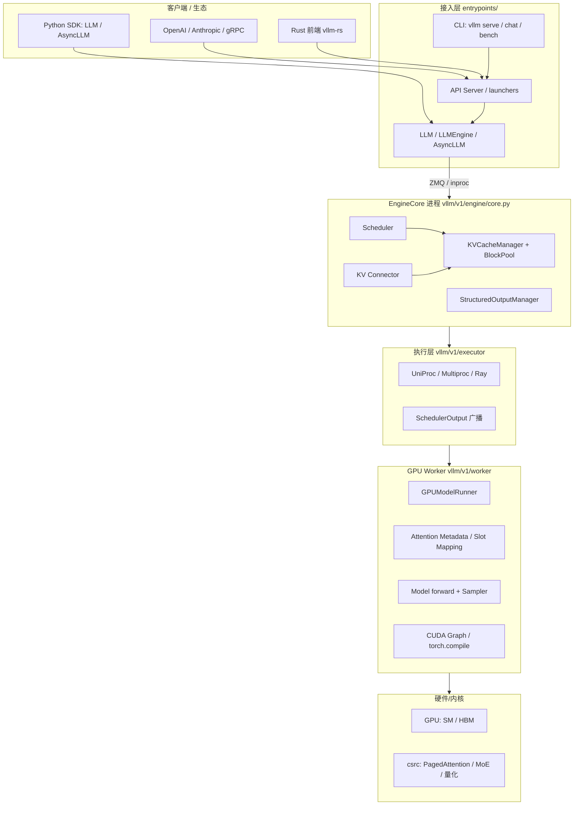
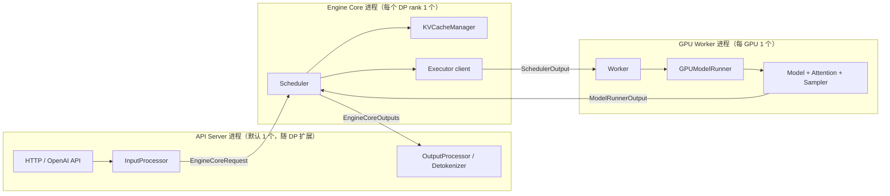
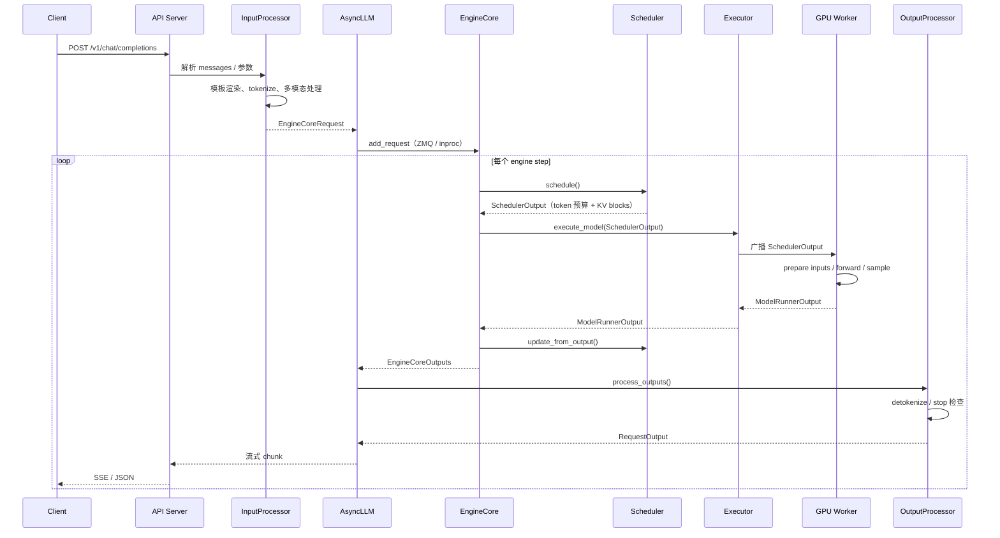
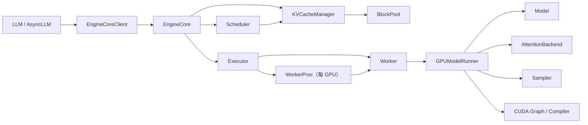
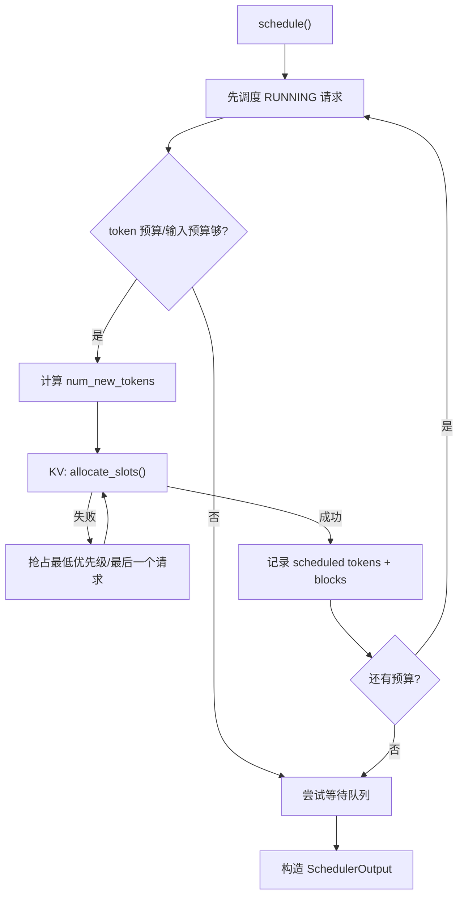
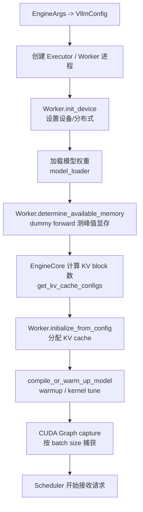
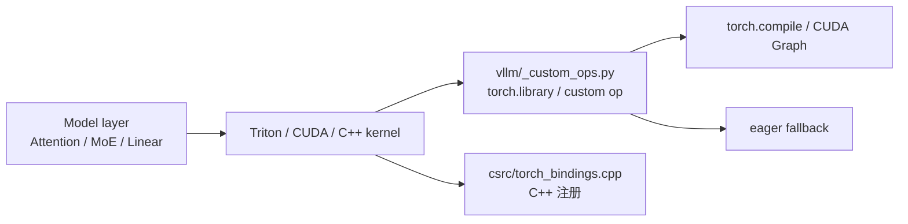

# vLLM 项目介绍

> 目标仓库：`/data/home/shendakuang/workspace/framework/vllm`
> 源码版本：`v0.29.1rc0-57-gb443c1cc4e`（`git describe`）
> 协议：Apache-2.0
> 定位：面向大语言模型（LLM）、视觉语言模型（VLM）、MoE、混合注意力/状态空间模型的高吞吐、低延迟推理与服务框架。
>
> 说明：本机安装的 `vllm` CLI 报告版本为 `0.20.2`，而当前源码树是 `0.29.1rc0-57`，两者不是同一版本。本文所有结论以**当前源码树**为准；涉及运行命令时，API 可能随版本变化。

vLLM 最初由 UC Berkeley Sky Computing Lab 开发，核心论文是 *Efficient Memory Management for Large Language Model Serving with PagedAttention*（SOSP 2023）。今天它已经发展成一个由 2000+ 贡献者维护的大型开源项目，支持 200+ Hugging Face 模型架构，覆盖 NVIDIA GPU、AMD GPU、Intel GPU、CPU，以及 TPU、Gaudi、昇腾等插件后端。

本文按“代码结构 → 架构设计 → 模块功能 → 核心机制 → 使用方法 → 代码案例 → 同行对比 → 未来展望”展开，尽量标注 `文件路径:行号`，方便对照源码阅读。

---

## 1. 代码结构

### 1.1 仓库顶层

```text
vllm/
├── vllm/                 # Python 主体（可 pip 安装的包）
├── csrc/                 # C++/CUDA/HIP 内核与 PyTorch 绑定
├── cmake/                # CMake 构建脚本
├── rust/                 # Rust 前端 workspace（实验性）
├── tests/                # 单元/集成/端到端测试
├── benchmarks/           # 内核、注意力、服务端基准
├── examples/             # 离线/在线/分布式/多模态/LoRA/PD 示例
├── docs/                 # MkDocs 文档站
├── requirements/         # 按平台/用途拆分的依赖
├── scripts/ tools/       # 构建、CI、发布、代码生成
├── docker/               # 镜像构建
├── setup.py
├── pyproject.toml
├── CMakeLists.txt
├── rust-toolchain.toml
├── README.md
└── AGENTS.md / CONTRIBUTING.md / SECURITY.md
```

| 目录 | 职责 |
|---|---|
| `vllm/` | 全部 Python 推理逻辑：V1 引擎、调度、KV 管理、模型、层、分布式、编译、采样、多模态、LoRA、平台抽象 |
| `csrc/` | 自定义 CUDA/C++ 算子：PagedAttention、MoE、量化、CUTLASS 扩展、自定义 all-reduce、QuickReduce、cuMem 分配器等 |
| `rust/` | Rust 版 OpenAI 兼容前端：`vllm-server`、`vllm-chat`、`vllm-text`、`vllm-engine-core-client` 等 |
| `tests/` | 1,865 个 Python 测试文件，覆盖 v1、模型、内核、量化、分布式、入口、spec decode 等 |
| `benchmarks/` | 内核/注意力/服务端/多轮/结构化输出基准 |
| `examples/` | 可直接运行的使用示例，是学习 API 的最佳入口 |
| `docs/` | 设计文档、用户指南、API 文档、部署文档 |
| `requirements/` | `cuda.txt`、`rocm.txt`、`xpu.txt`、`tpu.txt`、`cpu.txt`、`kv_connectors.txt` 等 |

### 1.2 Python 包结构（`vllm/`）

```text
vllm/
├── v1/                    # ★ 当前主运行时（V1 架构）
│   ├── engine/            # EngineCore、EngineCoreClient、AsyncLLM、LLMEngine、Processor
│   ├── core/              # Scheduler、KVCacheManager、BlockPool、KV 工具
│   ├── executor/          # UniProc / Multiproc / Ray / external launcher
│   ├── worker/            # Worker、GPUModelRunner（V1/V2）
│   ├── attention/         # AttentionBackend 抽象、选择器、30+ 后端
│   ├── sample/            # Sampler、RejectionSampler、logprobs
│   ├── spec_decode/       # ngram/suffix/EAGLE/DFlash/Medusa/draft model/MTP
│   ├── structured_output/ # xgrammar/guidance/outlines/lm-format-enforcer
│   ├── kv_offload/        # KV 分层卸载（CPU/文件）
│   ├── metrics/           # 统计与 Prometheus
│   ├── fault_tolerance/   # 故障恢复
│   └── kv_cache_interface.py / kv_cache_layout.py / cudagraph_dispatcher.py ...
├── entrypoints/           # LLM、CLI、OpenAI/Anthropic/gRPC、launchers、renderers
├── engine/                # 旧路径别名：LLMEngine / AsyncLLMEngine 指向 v1
├── config/                # VllmConfig 及 Model/Cache/Parallel/Scheduler/... 子配置
├── model_executor/
│   ├── models/            # 283 个模型实现文件 + 注册表
│   ├── model_loader/      # 默认/HF/PT/ safetensors/runai/tensorizer/分片加载
│   └── layers/            # attention、fused_moe、quantization、rotary_embedding ...
├── models/                # 模型专属内核/实现（DeepSeek V3.2/V4/V4.1、GLM5、Kimi K3 等）
├── distributed/           # 并行状态、通信器、KV transfer、EPLB、Elastic EP
├── compilation/           # torch.compile 后端、fusion pass、CUDA Graph 包装
├── lora/                  # LoRA 模型、Punica 内核、权重加载
├── multimodal/            # 图像/视频/音频输入、处理器、缓存
├── parser/ reasoning/ tool_parsers/ renderers/ tokenizers/  # 前后端解析与渲染
├── platforms/             # CUDA/ROCm/XPU/TPU/CPU/Zen 平台抽象
├── kernels/ ir/ cute_utils/ triton_utils/ tilelang_utils/ vllm_flash_attn/
├── plugins/ profiler/ tracing/ utils/ logging_utils/
└── __init__.py version.py ...
```

### 1.3 V1 运行时（`vllm/v1/`）

V1 是当前唯一主路径（`vllm/engine/llm_engine.py` 只是别名，见 `vllm/engine/llm_engine.py:1-7`）。

```text
vllm/v1/
├── engine/
│   ├── core.py              # EngineCore / EngineCoreProc / DPEngineCoreProc
│   ├── core_client.py       # InprocClient / MPClient / SyncMPClient（ZMQ）
│   ├── async_llm.py         # AsyncLLM（在线服务主入口）
│   ├── llm_engine.py        # LLMEngine（离线/兼容入口）
│   ├── input_processor.py   # EngineInput -> EngineCoreRequest
│   ├── output_processor.py  # EngineCoreOutputs -> RequestOutput
│   ├── detokenizer.py       # 增量 detokenizer
│   └── coordinator.py       # DP Coordinator
├── core/
│   ├── sched/scheduler.py   # 连续批处理调度器
│   ├── sched/output.py      # SchedulerOutput / NewRequestData / CachedRequestData
│   ├── kv_cache_manager.py  # KV 分配、前缀缓存、抢占
│   ├── block_pool.py        # BlockPool / free queue
│   └── kv_cache_utils.py    # KVCacheBlock、hash、容量估算
├── executor/
│   ├── abstract.py          # Executor 抽象与工厂
│   ├── uniproc_executor.py  # 单进程
│   ├── multiproc_executor.py# 多进程（shared-memory MQ + WorkerProc）
│   ├── ray_executor.py      # Ray
│   └── ray_executor_v2.py   # Ray V2
├── worker/
│   ├── worker_base.py       # WorkerBase
│   ├── gpu_worker.py        # GPU Worker：初始化、显存测量、KV 分配、warmup
│   ├── gpu_model_runner.py  # V1 GPUModelRunner：输入/attention metadata/forward/sample
│   └── gpu/                 # V2 GPUModelRunner（实验性）
├── attention/
│   ├── backend.py           # AttentionBackend / Metadata / Builder / Impl
│   ├── selector.py          # 后端选择
│   └── backends/            # FlashAttention/FlashInfer/Triton/MLA/Mamba/ROCm...
├── sample/                  # Sampler、RejectionSampler
├── spec_decode/             # 投机解码
├── structured_output/       # 结构化输出
├── metrics/ fault_tolerance/ kv_offload/ watermarking/ hisparse/
├── cudagraph_dispatcher.py  # FULL/PIECEWISE/NONE 调度
├── kv_cache_interface.py    # KVCacheSpec / AttentionSpec / MambaSpec ...
├── kv_cache_layout.py       # KV cache 物理布局
├── request.py               # Request 状态机
└── outputs.py               # ModelRunnerOutput / EngineCoreOutputs
```

### 1.4 C++/CUDA 与 Rust

**`csrc/`（318 个文件）**：

| 子目录/文件 | 作用 |
|---|---|
| `csrc/attention/` | Attention dtype/generic 辅助（FP16/BF16/FP32/FP8）；PagedAttention 实体在 attention backend、`vllm/v1/attention/ops/` 或外部 FlashAttention/FlashInfer 中 |
| `csrc/moe/` | 特定 MoE 内核（如 dynamic 4-bit int MoE CPU） |
| `csrc/quantization/` | 量化工具与 dtype 支持（W8A8 FP8、CUTLASS epilogue 等） |
| `csrc/cutlass_extensions/` | CUTLASS 扩展（GEMM/量化） |
| `csrc/custom_all_reduce.cuh` | 自定义 all-reduce |
| `csrc/custom_quickreduce.cu` / `csrc/quickreduce/` | QuickReduce |
| `csrc/cumem_allocator.cpp` | cuMem 分配器（可睡眠/唤醒） |
| `csrc/torch_bindings.cpp` | PyTorch 自定义算子注册 |
| `csrc/rocm/` | ROCm 专用 attention/GEMM 内核 |
| `csrc/cpu/` | CPU 后端算子 |
| `vllm/v1/attention/ops/` | Triton PagedAttention、prefix prefill、chunked prefill paged decode、merge states、MLA helpers |
| `vllm/kernels/` | Triton/Helion 内核、AITER/OINK ops、kernel 注册 |
| `vllm/ir/` | IR ops 与编译期模式匹配（layernorm、activation 等） |

**`rust/`（Cargo workspace）**：

```text
rust/
├── proto/                    # protobuf：control.proto / inference.proto
├── src/cmd/                  # vllm-rs CLI
├── src/server/               # OpenAI 兼容 HTTP（axum）
├── src/chat/                 # chat completions、模板渲染、reasoning/tool 解析
├── src/text/                 # tokenizer + 增量 detokenizer
├── src/llm/                  # token-in/token-out facade
├── src/engine-core-client/   # ZMQ + MessagePack 客户端
├── src/managed-engine/       # 受管引擎
├── src/metrics/ parser/ tokenizer/ tracing/ bench/ mock-engine/
└── Cargo.toml
```

Rust 前端是“北向服务层”的替代实现，仍通过 ZMQ 和 Python EngineCore 通信，见 `rust/README.md`。它可以用 `VLLM_USE_RUST_FRONTEND=1 vllm serve ...` 启用。

### 1.5 测试、基准、示例、文档

| 目录 | 内容 |
|---|---|
| `tests/v1/` | V1 引擎、调度、KV、executor、worker、spec decode、structured output 等 |
| `tests/models/`、`tests/model_executor/` | 模型前向、加载、量化、层 |
| `tests/kernels/`、`tests/quantization/` | 内核正确性、量化 |
| `tests/distributed/`、`tests/entrypoints/` | 分布式、API/CLI |
| `tests/evals/` | 模型精度评测 |
| `benchmarks/kernels/`、`benchmarks/attention_benchmarks/` | 内核/注意力基准 |
| `benchmarks/` 根目录 | 服务端吞吐/延迟/多轮/replaySSM 等 |
| `examples/basic/` | 离线推理入门 |
| `examples/features/` | LoRA、投机解码、结构化输出、量化、多模态 |
| `examples/disaggregated/` | PD 分离、KV connector |
| `examples/deployment/`、`examples/ray_serving/` | 部署与 Ray |
| `docs/design/` | 架构、PagedAttention、前缀缓存、CUDA Graph、DBO、Hybrid KV 等 |

### 1.6 规模数据（当前源码树）

| 指标 | 数值 |
|---|---:|
| Python 文件 | 2,476 |
| Python 代码行 | 970,302 |
| 模型实现文件 | 283 |
| 模型注册表条目 | 452 |
| Attention 后端枚举 | 49 |
| C/C++/CUDA 文件 | 318 |
| Python 测试文件 | 1,865 |
| 源码版本 | `v0.29.1rc0-57-gb443c1cc4e` |

> 这些数字说明 vLLM 已经不是一个“单文件推理脚本”，而是一个多后端、多模型、多并行策略的推理操作系统。阅读时应先抓主链路，再看按需模块。

---

## 2. 架构设计

### 2.1 全局分层



### 2.2 V1 多进程模型

V1 的核心设计是**把“接入/调度/执行”拆成不同进程**，避免 Python GIL 和 HTTP 处理干扰 GPU 主循环。



**进程数量**（来自 `docs/design/arch_overview.md`）：

| 进程 | 数量 | 说明 |
|---|---|---|
| API Server | `A`（默认 `DP`） | 处理 HTTP、输入处理、流式输出；`--api-server-count` 可调 |
| Engine Core | `DP`（默认 1） | 调度 + KV 管理 + 协调执行 |
| GPU Worker | `N = DP × PP × TP` | 每 GPU 一个 |
| DP Coordinator | `DP > 1` 时 1 个 | DP 负载均衡、MoE 同步前向 |

例如 4 卡 `-tp=4`：1 API + 1 EngineCore + 4 Worker = **6 个进程**；8 卡 `-tp=2 -dp=4`：4 API + 4 EngineCore + 8 Worker + 1 Coordinator = **17 个进程**。

其中 **API Server 和 EngineCore 都是 CPU-only 进程**：它们不加载模型权重、不占 GPU 显存；GPU 计算完全发生在 Worker 进程。这样设计是为了让调度/HTTP 不受 GPU 显存和模型初始化影响。

对应代码：

- API Server / launchers：`vllm/entrypoints/launchers/api_server/`
- EngineCore：`vllm/v1/engine/core.py:105`（`EngineCore`）、`:1019`（`EngineCoreProc`）
- Worker：`vllm/v1/worker/gpu_worker.py:180`
- Executor：`vllm/v1/executor/multiproc_executor.py:111`
- DP Coordinator：`vllm/v1/engine/coordinator.py:23`

### 2.3 请求生命周期

以在线 OpenAI Chat 请求为例：



关键代码：

- `InputProcessor`：`vllm/v1/engine/input_processor.py:38`
- `AsyncLLM.generate`：`vllm/v1/engine/async_llm.py:624`
- `EngineCore.step`：`vllm/v1/engine/core.py:589`
- `Scheduler.schedule`：`vllm/v1/core/sched/scheduler.py:562`
- `GPUModelRunner.execute_model`：`vllm/v1/worker/gpu_model_runner.py:4187`
- `GPUModelRunner.sample_tokens`：`vllm/v1/worker/gpu_model_runner.py:4566`
- `OutputProcessor.process_outputs`：`vllm/v1/engine/output_processor.py:622`

### 2.4 EngineCore 主循环

`EngineCore.__init__`（`vllm/v1/engine/core.py:108`）做四件事：

1. 创建 `Executor`（`self.model_executor = executor_class(vllm_config)`，`:134`）；
2. 初始化 KV cache 配置（`_initialize_kv_caches`，`:254`）：收集 `KVCacheSpec`、测量可用显存、计算 block 数、分配 KV、warmup/compile；
3. 创建 `Scheduler`（`:162`）；
4. 创建 KV connector、structured output manager、batch queue 等。

`EngineCore.step`（`:589`）是每个推理步的核心：

```python
scheduler_output = self.scheduler.schedule(...)
future = self.model_executor.execute_model(scheduler_output, non_block=True)
grammar_output = self.scheduler.get_grammar_bitmask(scheduler_output)
model_output = future.result()
if model_output is None:
    model_output = self.model_executor.sample_tokens(grammar_output)
engine_core_outputs = self.scheduler.update_from_output(scheduler_output, model_output)
```

这体现了一个重要设计：**执行和采样可以分离**。`execute_model` 返回 `None` 时，说明模型 forward 已完成但采样还没做，EngineCore 再调用 `sample_tokens`；这为异步调度、PP、spec decode 留出重叠空间。

`EngineCoreProc.run_busy_loop`（`:1403`）不断：

1. `_process_input_queue()`：处理客户端请求/中止；
2. `_process_engine_step()`：调用 `step_fn()`；
3. 把 `EngineCoreOutputs` 放入输出队列。

**核心对象关系**：



这张图对应阅读顺序：先看 `LLM/AsyncLLM`，再看 `EngineCore`，然后沿 `Scheduler → KVCacheManager → Executor → Worker → GPUModelRunner → Model/Attention` 深入。

### 2.5 调度与 KV 管理

vLLM V1 的调度器**没有固定的 prefill/decode 阶段**。`Scheduler.schedule` 的注释写得很清楚（`vllm/v1/core/sched/scheduler.py:564`）：

> 每个请求只有 `num_computed_tokens` 和 `num_tokens_with_spec`；调度器每一步把 token 分配给请求，让 `num_computed_tokens` 追上 `num_tokens_with_spec`。

这统一了：

- chunked prefill（把长 prompt 分块）；
- prefix caching（命中前缀直接跳过计算）；
- speculative decoding（额外 draft token）；
- 未来的 jump decoding。

调度流程（简化）：



关键点：

- **running 优先**：先保证已运行请求继续 decode，避免频繁切换。
- **token budget**：`max_num_scheduled_tokens` / `max_num_batched_tokens`，默认 `2048`（`vllm/config/scheduler.py:42`）。
- **max seqs**：默认 `128`（`vllm/config/scheduler.py:44`）。
- **抢占**：KV 不够时，FCFS 抢占最后一个请求，priority 策略抢占最低优先级请求（`scheduler.py:748`）。
- **前缀命中**：`KVCacheManager.get_computed_blocks`（`vllm/v1/core/kv_cache_manager.py:265`）先查 hash，命中块直接复用。
- **分配**：`allocate_slots`（`:370`）分三阶段：释放窗口外块、处理前缀/外部块、分配新 token 块。

### 2.6 执行与模型运行器

`Executor` 抽象（`vllm/v1/executor/abstract.py:38`）负责“把 SchedulerOutput 发到 Worker，并收集 ModelRunnerOutput”。

`MultiprocExecutor`（`vllm/v1/executor/multiproc_executor.py:111`）：

- 为每个 GPU 创建 `WorkerProc`（`WorkerProc` 在 `:600`）；
- 用 shared-memory `MessageQueue` 广播 `SchedulerOutput`；
- 每个 Worker 有独立 response MQ；
- `execute_model` / `sample_tokens` 通过 RPC 调用 Worker。

`Worker`（`vllm/v1/worker/gpu_worker.py:180`）：

- `init_device`（`:358`）：设置设备、初始化分布式、建立内存快照；
- `determine_available_memory`（`:526`）：用 dummy forward 测量峰值显存，计算 KV 可用字节；
- `initialize_from_config`（`:733`）：按 `KVCacheConfig` 分配 KV；
- `compile_or_warm_up_model`（`:771`）：warmup、kernel tune、CUDA Graph capture。

`GPUModelRunner`（`vllm/v1/worker/gpu_model_runner.py:498`）是真正的“模型执行器”：

1. `_update_states(scheduler_output)`：增量更新 persistent batch；
2. `_prepare_inputs`：input ids、positions、slot mapping、logits indices；
3. `_build_attention_metadata`：为每个 attention group 构建 metadata；
4. `_determine_batch_execution_and_padding`：选择 CUDA Graph 模式与 padding；
5. `set_forward_context(...)` + `self._model_forward(...)`；
6. `sample_tokens`：应用 grammar bitmask、采样、spec decode draft、更新状态。

**启动顺序**（理解“为什么启动慢”的关键）：



对应代码：

- `Worker.init_device`：`vllm/v1/worker/gpu_worker.py:358`
- `Worker.determine_available_memory`：`:526`
- `Worker.initialize_from_config`：`:733`
- `Worker.compile_or_warm_up_model`：`:771`
- `GPUModelRunner.profile_run`：`vllm/v1/worker/gpu_model_runner.py:6464`
- `GPUModelRunner.capture_model`：`:6830`
- `GPUModelRunner.initialize_kv_cache`：`:7416`

> 启动时间主要花在：加载权重、dummy forward 显存测量、`torch.compile`、CUDA Graph capture。调大/调小 `gpu-memory-utilization`、`max-model-len`、CUDA Graph capture size 都会影响启动。

### 2.7 并行模型

| 并行 | 作用 | 关键配置 |
|---|---|---|
| TP（Tensor Parallel） | 切分权重/计算 | `--tensor-parallel-size` |
| PP（Pipeline Parallel） | 按层切分，流水线 | `--pipeline-parallel-size` |
| DP（Data Parallel） | 多副本，路由请求 | `--data-parallel-size` |
| EP（Expert Parallel） | MoE 专家分片 | `--enable-expert-parallel` |
| PCP（Prefill Context Parallel） | prefill 上下文并行 | `--prefill-context-parallel-size` |
| DCP（Decode Context Parallel） | decode 上下文并行 | `--decode-context-parallel-size` |
| DBO（Dual Batch Overlap） | 两个 microbatch 重叠 MoE all-to-all | `--enable-dbo` |
| EPLB | 专家负载均衡 | `--enable-eplb` |
| Elastic EP | 动态扩缩 EP/DP | `--enable-elastic-ep` |

并行状态由 `GroupCoordinator`（`vllm/distributed/parallel_state.py:422`）管理；配置在 `ParallelConfig`（`vllm/config/parallel.py:119`）。

### 2.8 配置系统

`EngineArgs`（`vllm/engine/arg_utils.py:432`）是 CLI/参数的聚合器；`create_engine_config`（`:2040`）把它变成 `VllmConfig`。

`VllmConfig`（`vllm/config/vllm.py:358`）包含：

- `model_config` / `cache_config` / `parallel_config` / `scheduler_config` / `device_config`
- `load_config` / `offload_config` / `attention_config` / `mamba_config`
- `lora_config` / `speculative_config` / `structured_outputs_config`
- `compilation_config` / `quant_config` / `kv_transfer_config`
- `observability_config` / `fault_tolerance` / `weight_transfer_config`

平台可以在 `Platform.check_and_update_config`（`vllm/platforms/interface.py:576`）里修改默认值（例如 block size、attention backend）。

### 2.9 架构设计取舍

| 设计 | 好处 | 代价 |
|---|---|---|
| 多进程 API/EngineCore/Worker | 隔离 HTTP/GIL/GPU 主循环，提升吞吐 | 进程多、IPC 复杂、调试门槛高 |
| Scheduler 统一 token budget | prefill/decode/prefix/spec 共用一套逻辑 | 调度器代码复杂、边界条件多 |
| PagedAttention + block table | 显存利用率高、支持共享/前缀缓存 | 内核复杂、block 碎片/对齐问题 |
| `torch.compile` + CUDA Graph | 降低 Python/launch 开销 | 启动编译慢、后端兼容性受限 |
| 可插拔 attention backend | 适配不同硬件/模型 | 选择逻辑复杂、后端行为差异 |
| Rust 前端 | 低开销 HTTP/解析 | 功能尚未完全对齐 Python 前端 |

---

## 3. 模块功能

### 3.1 接入层：`entrypoints/` 与 CLI

**职责**：把用户请求变成引擎能理解的对象，并把引擎输出变成 HTTP/SSE/离线结果。

关键文件：

- CLI 主入口：`vllm/entrypoints/cli/main.py:39`，子命令 `chat`、`complete`、`serve`、`launch`、`bench`、`collect-env`、`run-batch`。
- `vllm serve`：`vllm/entrypoints/cli/serve.py:45`；支持 `--headless`、多 API server、Rust 前端、gRPC。
- OpenAI API：`vllm/entrypoints/openai/chat_completion/`、`completion/`、`responses/`、`models/`、`parser/`。
- API Server launchers：`vllm/entrypoints/launchers/api_server/`。
- Renderer：`vllm/renderers/`（HF chat template、模型专属模板）。

**关键流程**：

1. HTTP 路由解析请求；
2. `BaseServing` / `OpenAIServingChat` 校验模型、参数、LoRA；
3. `InputProcessor` 做模板渲染、tokenize、多模态处理；
4. `AsyncLLM.generate` 提交到 EngineCore；
5. `OutputProcessor` 做增量 detokenize、stop 检查、tool/reasoning parser；
6. 通过 SSE 流式返回。

**小结**：接入层是“协议适配器”，不参与调度和 GPU 计算；它决定了 vLLM 能否无缝接入 OpenAI 生态。

---

### 3.2 前端引擎：`LLM` / `AsyncLLM` / `LLMEngine`

**职责**：给离线/在线用户提供统一 API，并管理输入/输出处理器和 EngineCore 客户端。

- 离线 `LLM`：`vllm/entrypoints/llm.py:67`
  - `generate`（`:418`）：批量生成，自动组批；
  - `enqueue` / `wait_for_completion`：异步提交/等待；
  - `chat`：chat template + 生成；
  - `sleep` / `wake_up`：显存睡眠/唤醒；
  - `collective_rpc` / `apply_model`：对 worker 做 RPC。
- 在线 `AsyncLLM`：`vllm/v1/engine/async_llm.py:77`
  - `generate`（`:624`）：异步生成器，返回 `RequestOutput` 流；
  - 内部 `_run_output_handler` 后台任务从 EngineCore 拉输出，推入每个请求的队列；
  - 支持 streaming input、abort、admission control。
- `LLMEngine`：`vllm/v1/engine/llm_engine.py:48`
  - 同步 `add_request` / `step`，适合离线循环和自定义调度；
  - 兼容旧 API，内部仍是 V1。
- `InputProcessor`：`vllm/v1/engine/input_processor.py:38`
- `OutputProcessor`：`vllm/v1/engine/output_processor.py:448`
- `IncrementalDetokenizer`：`vllm/v1/engine/detokenizer.py:31`

**小结**：前端层是“用户 API + 输入输出胶水”，它把 vLLM 的复杂内部状态包装成简单的生成接口。

---

### 3.3 EngineCore 与客户端

**职责**：EngineCore 是“推理操作系统内核”；EngineCoreClient 是前端到内核的传输层。

- `EngineCore`：`vllm/v1/engine/core.py:105`
- `EngineCoreProc`：`:1019`，独立进程版本，含 busy loop、输入/输出队列、ZMQ。
- `EngineCoreClient`：`vllm/v1/engine/core_client.py:79`
  - `InprocClient`（`:333`）：同进程，方便调试；
  - `MPClient`（`:545`）/ `SyncMPClient`（`:869`）：多进程 + ZMQ；
  - `make_async_mp_client`：在线服务默认。
- `EngineCoreRequest` / `EngineCoreOutputs`：跨进程协议对象。

**小结**：EngineCore 把“调度、KV、执行、输出”收敛到一个主循环；客户端层让前端可以选择同进程或跨进程，兼顾调试与性能。

---

### 3.4 调度器：`Scheduler`

**职责**：每个 step 决定“哪些请求、各算多少 token、用哪些 KV block”。

关键文件：`vllm/v1/core/sched/scheduler.py:80`，接口在 `vllm/v1/core/sched/interface.py:38`。

核心数据：

- `SchedulerOutput`（`vllm/v1/core/sched/output.py:225`）：
  - `scheduled_new_reqs` / `scheduled_resumed_reqs` / `scheduled_running_reqs`
  - `num_scheduled_tokens`
  - `scheduled_spec_decode_tokens`
  - `scheduled_encoder_inputs`
  - `num_common_prefix_blocks`
  - `kv_connector_metadata`
- `NewRequestData` / `CachedRequestData`：新请求/缓存请求的增量描述。

调度策略：

- `fcfs`（默认）或 `priority`（`vllm/config/scheduler.py:141`）；
- running 优先，waiting 其次；
- KV 不足时抢占；
- chunked prefill 默认开启（`enable_chunked_prefill=True`）；
- 支持 encoder-decoder、多模态、Mamba/hybrid、spec decode、KV connector。

**小结**：Scheduler 是 vLLM 吞吐的核心；它把“连续批处理”落成一套 token 预算 + KV 分配 + 抢占机制。

---

### 3.5 KV Cache、PagedAttention 与前缀缓存

**职责**：在有限显存中管理所有请求的 KV，并尽可能复用。

关键文件：

- `KVCacheManager`：`vllm/v1/core/kv_cache_manager.py:134`
  - `get_computed_blocks`（`:265`）：查前缀缓存；
  - `allocate_slots`（`:370`）：分配/追加 block；
  - `free` / `reset_prefix_cache` 等。
- `BlockPool`：`vllm/v1/core/block_pool.py:143`
- `KVCacheBlock` / `FreeKVCacheBlockQueue`：`vllm/v1/core/kv_cache_utils.py:176` / `:246`
- `KVCacheSpec` 体系：`vllm/v1/kv_cache_interface.py:156`
  - `AttentionSpec`（`:479`）、`FullAttentionSpec`（`:539`）、`SlidingWindowSpec`（`:807`）、`MambaSpec`（`:993`）、`MLAAttentionSpec`（`:646`）等。
- PagedAttention 设计文档：`docs/design/paged_attention.md`
- 前缀缓存设计文档：`docs/design/prefix_caching.md`

**PagedAttention 核心**：

- KV 被切成固定大小 block（默认 `block_size=16`，`vllm/config/cache.py:71`）；
- 每个请求维护一张 **block table**，逻辑 token 位置映射到物理 block；
- attention kernel 按 block 读取 K/V，使用 online softmax 累加；
- 不同请求可以共享物理 block（前缀缓存、并行采样、beam search）。

**前缀缓存核心**：

- 每个 full block 的 hash = `hash(parent_hash, block_tokens, extra_hashes)`；
- `extra_hashes` 包含 LoRA ID、多模态 hash、cache salt 等；
- 默认 `sha256`（`vllm/config/cache.py:132`）；
- 新请求先 `get_computed_blocks` 查命中，命中块增加引用计数并复用；
- 释放时按 LRU 顺序回到 free queue；队尾是“最后被使用”的块。

**Hybrid KV Cache**：

- 一个模型可能同时有 full attention、sliding window、Mamba 层；
- 通过 **KV Cache Group** 让不同层类型使用不同 block 数，但统一 page size；
- 见 `docs/design/hybrid_kv_cache_manager.md`。

**小结**：PagedAttention 解决“显存碎片 + 共享”，前缀缓存解决“重复 prefill”，Hybrid KV 解决“混合层类型”。这三者共同构成 vLLM 的显存护城河。

---

### 3.6 Executor

**职责**：把 SchedulerOutput 分发到 Worker，收集输出；管理并行进程/通信。

关键文件：

- `Executor` 抽象：`vllm/v1/executor/abstract.py:38`
- `Executor.get_class`：`:49`，按 `distributed_executor_backend` 选择：
  - `uni` → `UniProcExecutor`（`vllm/v1/executor/uniproc_executor.py:51`）
  - `mp` → `MultiprocExecutor`（`vllm/v1/executor/multiproc_executor.py:111`）
  - `ray` → `RayDistributedExecutor` / `RayExecutorV2`
  - `external_launcher` → `ExecutorWithExternalLauncher`
- `MultiprocExecutor._init_executor`：`:118`，创建 WorkerProc、共享内存 MQ、response MQ。
- `WorkerProc`：`:600`，每个 GPU 一个子进程，加载模型、执行 forward。

**小结**：Executor 是“进程/通信编排器”，把单机多卡、多机 Ray、外部 launcher 统一成同一个 `execute_model` 接口。

---

### 3.7 Worker 与 GPUModelRunner

**职责**：在每张 GPU 上加载模型、准备输入、执行 forward、采样。

- `Worker`：`vllm/v1/worker/gpu_worker.py:180`
- `GPUModelRunner`：`vllm/v1/worker/gpu_model_runner.py:498`
- V2 model runner（实验）：`vllm/v1/worker/gpu/model_runner.py:190`，由 `VLLM_USE_V2_MODEL_RUNNER` 控制（`vllm/envs.py:301`）。

**`execute_model` 的关键步骤**（`:4187`）：

1. 更新 persistent batch 状态（`_update_states`）；
2. 处理 encoder/multimodal 输入；
3. `_prepare_inputs`：input ids、positions、logits indices、spec metadata；
4. 计算 cascade attention prefix；
5. `_determine_batch_execution_and_padding`：选择 CUDA Graph 模式、padding；
6. 构建 slot mapping 与 attention metadata；
7. `set_forward_context` + `_model_forward`；
8. 返回 `ModelRunnerOutput` 或延迟到 `sample_tokens`。

**`sample_tokens`**（`:4566`）：

1. 取回 `execute_model` 保存的 logits/hidden states；
2. 应用 structured output grammar bitmask；
3. `Sampler` 采样；
4. spec decode 的 draft token 生成；
5. 更新状态并返回。

**小结**：GPUModelRunner 是“GPU 侧总导演”，它把调度器的抽象 token 计划变成具体的张量、metadata 和 kernel 调用。

---

### 3.8 Attention 后端与层

**职责**：为不同模型/硬件/精度选择最优注意力实现。

- 抽象：`vllm/v1/attention/backend.py:59`（`AttentionBackend`）、`:377`（`AttentionMetadata`）、`:576`（`AttentionMetadataBuilder`）、`:766`（`AttentionImplBase`）。
- 选择器：`vllm/v1/attention/selector.py:104`（`get_attn_backend`）。
- 枚举：`vllm/v1/attention/backends/registry.py:34`，共 49 个后端。
- 后端目录：`vllm/v1/attention/backends/`
  - `flash_attn.py`（FlashAttention）
  - `flashinfer.py`（FlashInfer）
  - `triton_attn.py`（Triton）
  - `mla/`（FlashMLA、Cutlass MLA、Triton MLA、AITER MLA、稀疏 MLA）
  - `mamba1_attn.py` / `mamba2_attn.py` / `linear_attn.py`
  - `rocm_attn.py` / `rocm_aiter_*.py`
  - `flex_attention.py`、`hpc_attn.py`、`cpu_attn.py` 等
- 层实现：`vllm/model_executor/layers/attention/`、`vllm/model_executor/layers/mla.py`

**小结**：Attention 是 LLM 的性能核心；vLLM 通过“后端枚举 + 选择器 + metadata builder + impl”把硬件差异隔离在 backend 内部。

---

### 3.9 模型注册、加载与量化

**职责**：把 Hugging Face checkpoint 变成可执行的 `nn.Module`，并支持量化。

- 模型注册表：`vllm/model_executor/models/registry.py:772`（`_VLLM_MODELS`）
  - 452 个架构键，283 个模型实现文件；
  - 按 text generation / embedding / late interaction / reward / token classification / sequence classification / multimodal / speculative / transformers 分组。

**代表性模型路径**：

| 模型族 | 实现位置 |
|---|---|
| Llama / Qwen / Gemma 等 decoder-only | `vllm/model_executor/models/llama.py`、`qwen2.py`、`qwen3.py`、`gemma*.py` |
| DeepSeek V2/V3 | `vllm/model_executor/models/deepseek_v2.py` |
| DeepSeek V3.2 / V4 / V4.1 | `vllm/models/deepseek_v32/`、`vllm/models/deepseek_v4/`、`vllm/models/deepseek_v41/`（含 NVIDIA/AMD/CPU/XPU 子实现） |
| GLM5 / Kimi K3 / MiniMax M3 | `vllm/models/glm5next/`、`vllm/models/kimi_k3/`、`vllm/models/minimax_m3/` |
| MoE 通用层 | `vllm/model_executor/layers/fused_moe/` |
| Mamba / 线性注意力 | `vllm/model_executor/layers/mamba/`（含 `mamba_mixer.py`、`mamba_mixer2.py`、`linear/`、`gdn/`）、`vllm/v1/attention/backends/linear_attn.py` |
| 多模态（LLaVA/Qwen-VL） | `vllm/model_executor/models/llava.py`、`qwen2_vl.py`、`qwen3_vl.py` |
- `_ModelRegistry`：`registry.py:1118`
  - `resolve_model_cls`、`inspect_model_cls`、`is_multimodal_model` 等；
  - 支持 `trust_remote_code`、Transformers backend fallback。
- 模型加载：`vllm/model_executor/model_loader/`
  - `BaseModelLoader`（`base_loader.py:25`）
  - `DefaultModelLoader`（`default_loader.py:43`）
  - 支持 `hf`、`safetensors`、`pt`、`npcache`、`runai_streamer`、`sharded_state`、`tensorizer`、`modelexpress`、`ipc_cache` 等。
- 量化：`vllm/model_executor/layers/quantization/`
  - `fp8.py`、`auto_awq.py`、`auto_gptq.py`、`mxfp4.py`、`torchao.py`、`modelopt.py`、`kv_cache.py` 等。

**小结**：模型层的关键设计是 **统一构造签名**：`def __init__(self, *, vllm_config, prefix="")`。这样 model runner 不需要知道具体模型如何初始化，也能在初始化时完成 TP 切分和量化。

---

### 3.10 `torch.compile` 与 CUDA Graph

**职责**：降低 Python 开销和 kernel launch 开销。

- 编译后端：`vllm/compilation/backends.py:805`（`VllmBackend`）
- 编译管理：`vllm/compilation/backends.py:124`（`CompilerManager`）
- CUDA Graph 包装：`vllm/compilation/cuda_graph.py:145`（`CUDAGraphWrapper`）
- 调度器：`vllm/v1/cudagraph_dispatcher.py:15`（`CudagraphDispatcher`）
- 设计文档：`docs/design/torch_compile.md`、`docs/design/cuda_graphs.md`

**核心概念**：

- `CompilationMode`：`NONE` / `STOCK_TORCH_COMPILE` / `VLLM_COMPILE`
- `CUDAGraphMode`：`NONE` / `PIECEWISE` / `FULL` / `FULL_DECODE_ONLY` / `FULL_AND_PIECEWISE`
- `BatchDescriptor`：`(num_tokens, num_reqs, uniform, has_lora)`，作为 CUDA Graph 调度 key；
- `CudagraphDispatcher` 按 `FULL > PIECEWISE > NONE` 优先级选择可用图。

**编译 pass**（`vllm/compilation/passes/fusion/`）：

- `add_rms_fusion.py`
- `act_quant_fusion.py`
- `attn_quant_fusion.py`
- `qk_norm_rope_fusion.py`
- `rope_kvcache_fusion.py`
- `allreduce_rms_fusion.py`
- `sequence_parallelism.py`
- `mla_*_fusion.py`

**小结**：vLLM 把“图编译”和“CUDA Graph”解耦：编译负责融合/代码生成，CUDA Graph 负责消除 launch 开销，dispatcher 负责按 batch 形态选择。

---

### 3.11 采样与结构化输出

**职责**：从 logits 生成 token，并支持 JSON Schema、regex、grammar、choice 等约束。

- `Sampler`：`vllm/v1/sample/sampler.py:21`
  - temperature、top-k、top-p、min-p、repetition penalty、logit bias、logprobs；
  - `apply_penalties`、`apply_logits_processors`。
- `RejectionSampler`：`vllm/v1/sample/rejection_sampler.py:44`
  - 投机解码的接受/拒绝采样；
  - `forward`、`parse_output`、`apply_logits_processors`。
- 结构化输出：`vllm/v1/structured_output/`
  - `backend_xgrammar.py`、`backend_guidance.py`、`backend_outlines.py`、`backend_lm_format_enforcer.py`
  - `StructuredOutputOptions`：JSON / JSON_OBJECT / REGEX / GRAMMAR / CHOICE / STRUCTURAL_TAG（`backend_types.py:17`）
  - grammar 通过 bitmask 在采样前屏蔽非法 token。

**小结**：采样层是“模型输出 → 可用文本/结构”的最后一公里；结构化输出把约束编译成 bitmask，避免生成后再修复。

---

### 3.12 投机解码

**职责**：用小模型/模式匹配生成 draft token，再用目标模型验证，降低 decode 延迟。

支持的方法（`vllm/config/speculative.py:72`）：

- `ngram`
- `medusa`
- `mlp_speculator`
- `draft_model`
- `suffix`
- `custom_class`
- EAGLE 系列
- NGram GPU
- DSpark

关键文件：

- `vllm/v1/spec_decode/llm_base_proposer.py:72`（`SpecDecodeBaseProposer`）
- `vllm/v1/spec_decode/eagle.py:10`（`EagleProposer`）
- `vllm/v1/spec_decode/ngram_proposer.py:12`（`NgramProposer`）
- `vllm/v1/spec_decode/ngram_proposer_gpu.py:217`（`NgramProposerGPU`）
- `vllm/v1/spec_decode/suffix_decoding.py:9`（`SuffixDecodingProposer`）
- `vllm/v1/spec_decode/medusa.py:18`（`MedusaProposer`）
- `vllm/v1/spec_decode/draft_model.py:19`（`DraftModelProposer`）
- `vllm/v1/spec_decode/dflash.py:23`（`DFlashProposer`）

流程：

1. proposer 生成 `k` 个 draft token；
2. 目标模型一次 forward 验证 `k+1` 个位置；
3. rejection sampler 接受最长合法前缀；
4. 未接受部分回滚 KV/状态。

**小结**：投机解码是“用并行换串行”的典型手段；vLLM 把 proposer、验证、拒绝采样、KV 回滚拆成可插拔模块。

---

### 3.13 分布式、EPLB、Elastic EP、DBO

**职责**：把模型/请求分布到多 GPU/多节点，并保持负载均衡与弹性。

- 并行状态：`vllm/distributed/parallel_state.py:422`（`GroupCoordinator`）
- 初始化：`:1775`（`init_distributed_environment`）、`:1977`（`initialize_model_parallel`）
- 通信器：`vllm/distributed/device_communicators/`
  - NCCL、自定义 all-reduce、QuickReduce、PyNCCL、shm broadcast、symmetric memory 等。
- EPLB：`vllm/distributed/eplb/`
  - `EplbState`（`:235`）、`EplbModelState`（`:105`）、rebalance 策略；
  - 统计专家负载，迁移/复制专家。
- Elastic EP：`vllm/distributed/elastic_ep/`
  - `ElasticEPScalingState`（`:64`），支持 scale up/down。
- DBO：`docs/design/dbo.md`
  - 把 batch 切成两个 microbatch，两个线程 ping-pong，重叠 MoE all-to-all 与计算；
  - 需要 DP+EP 和 DeepEP。
- KV Transfer：`vllm/distributed/kv_transfer/`
  - `KVConnectorFactory`（`kv_connector/factory.py:26`）；
  - 支持 NIXL、LMCache、Mooncake、MultiConnector、Offloading、FlexKV 等。

**小结**：分布式层让 vLLM 从“单卡推理”扩展到“多卡/多机 PD 分离 + 专家并行 + 弹性扩缩”。

---

### 3.14 KV Transfer 与 PD 分离

**职责**：把 prefill 产生的 KV 传给 decode 实例，分别优化 TTFT 和 ITL。

- 配置：`vllm/config/kv_transfer.py:57`（`KVTransferConfig`）
- 连接器工厂：`vllm/distributed/kv_transfer/kv_connector/factory.py`
- 文档：`docs/features/disagg_prefill.md`
- 示例：`examples/disaggregated/`

**关键概念**：

- **Connector**：consumer 从 producer 取 KV；
- **角色**：`kv_producer` / `kv_consumer` / `kv_both`；
- **传输后端**：NIXL（UCX/GDS）、LMCache、Mooncake、MultiConnector、Offloading；
- **两实例**：prefill 实例（计算 KV）+ decode 实例（消费 KV）。

**小结**：PD 分离不提升总吞吐，但能独立调 TTFT/ITL、控制尾延迟；它是大规模在线服务的常用部署形态。

---

### 3.15 LoRA

**职责**：在同一个基座模型上高效切换多个低秩适配器。

- 配置：`vllm/config/lora.py:32`（`LoRAConfig`）
- 模型：`vllm/lora/lora_model.py`
- 权重：`vllm/lora/lora_weights.py`
- 层：`vllm/lora/layers/`（column/row parallel、fused MoE、vocab parallel embedding、logits processor）
- 内核：`vllm/lora/punica_wrapper/`（Punica）
- 请求：`vllm/lora/request.py`（`LoRARequest`）

关键参数：`--enable-lora`、`--max-loras`、`--max-lora-rank`、`--max-cpu-loras`。

**小结**：LoRA 通过 Punica 内核和分层适配，把多租户微调模型的切换成本降到很低。

---

### 3.16 多模态

**职责**：处理图像、视频、音频输入，把多模态特征注入语言模型。

- `vllm/multimodal/`
  - `registry.py`：模型/处理器注册；
  - `processing/processor.py`：多模态预处理；
  - `cache.py`：多模态缓存；
  - `inputs.py`、`parse.py`、`hasher.py`；
  - `video_decoders/`：OpenCV、DeepStream、PyNvVideoCodec、TorchCodec。
- 多模态模型：`vllm/model_executor/models/` 中的 LLaVA、Qwen-VL、Pixtral 等。
- EngineCore 侧通过 `MULTIMODAL_REGISTRY` 接收/缓存 encoder 输出。

**小结**：多模态层把“原始媒体 → 模型输入”做成可插拔 registry + processor + cache，避免污染语言模型主路径。

---

### 3.17 平台抽象

**职责**：把 CUDA/ROCm/XPU/TPU/CPU 的差异隔离在 `platforms/`。

- `vllm/platforms/interface.py:134`（`Platform`）
- `vllm/platforms/cuda.py`、`rocm.py`、`xpu.py`、`tpu.py`、`cpu.py`、`zen_cpu.py`
- 关键钩子：
  - `check_and_update_config`（`:576`）
  - `get_attn_backend_cls`（`:373`）
  - `update_block_size_for_backend`（`:609`）
  - `get_device_communicator_cls`（`:1068`）
  - `supports_fp8`（`:1094`）

**小结**：平台层是“硬件适配器”；新增硬件通常只需要实现 `Platform` 和对应 attention/communicator。

---

### 3.18 可观测性与容错

**职责**：指标、日志、追踪、故障恢复。

- 指标：`vllm/v1/metrics/`
  - `LoggingStatLogger`（`loggers.py:100`）、`PrometheusStatLogger`（`:444`）、`StatLoggerManager`（`:1200`）；
  - 指标包括 QPS、TTFT、ITL、KV 使用率、prefix cache 命中、spec decode 接受率等。
- 服务中间件：`vllm/entrypoints/serve/instrumentator/`、`middleware/`
- 追踪：`vllm/tracing/`
- 容错：`vllm/v1/fault_tolerance/engine_core_sentinel.py:35`（`EngineCoreSentinel`）
  - `on_fault`、`retry`、`run_with_fault_tolerance`。

**小结**：可观测性让 vLLM 可运维；容错让长跑服务在 worker 故障时有机会恢复。

---

### 3.19 Rust 前端

**职责**：用 Rust 重写北向服务层，降低 HTTP/解析/流式开销。

- `rust/README.md`：实验性，未完全对齐 Python 前端。
- 分层：
  - `vllm-server`：OpenAI HTTP（axum）
  - `vllm-chat`：chat 模板、reasoning/tool 解析
  - `vllm-text`：tokenizer + detokenizer
  - `vllm-llm`：token-in/token-out facade
  - `vllm-engine-core-client`：ZMQ + MessagePack
- 启用：`VLLM_USE_RUST_FRONTEND=1 vllm serve ...`
- 独立运行：`vllm-rs serve ...`

**小结**：Rust 前端是“把 Python 北向层下沉”的尝试，适合高并发 API 场景；核心推理仍由 Python EngineCore 负责。

---

### 3.20 测试与基准

- `tests/v1/`：V1 引擎/调度/KV/executor/worker/spec/structured output；
- `tests/models/`：模型前向与精度；
- `tests/kernels/`：内核正确性；
- `tests/quantization/`：量化；
- `tests/distributed/`：TP/PP/DP/EP；
- `tests/evals/`：模型评测；
- `benchmarks/`：内核、注意力、服务端吞吐/延迟、多轮、replaySSM。

**小结**：vLLM 的测试规模与功能规模匹配；新增模型/内核/后端时，应优先复用现有测试夹具与 benchmark。

---

### 3.21 CUDA/C++ 内核、Triton 与自定义算子

**职责**：把性能关键路径下沉到自定义 kernel，并通过统一的 PyTorch op 接口暴露给模型层。

**关键文件**：

- `vllm/_custom_ops.py`：自定义算子 Python 门面；`current_platform.import_kernels()` 在导入时按平台注册 kernel（`:20`）。
- `vllm/kernels/__init__.py`：导出 `vllm_c`、`aiter_ops`、`oink_ops`、`triton`。
- `vllm/kernels/vllm_c.py`：通用 C/CUDA 算子。
- `vllm/kernels/triton/`：Triton kernel（activation、quant 等）。
- `vllm/kernels/helion/`：Helion 自动调优 kernel。
- `vllm/v1/attention/ops/`：PagedAttention/prefix prefill/chunked prefill paged decode/merge states/MLA 辅助。
- `vllm/ir/ops/`：IR 层算子（layernorm、activation），供编译 pass 使用。
- `csrc/`：C++/CUDA 源与 PyTorch 绑定（`torch_bindings.cpp`）。

**典型调用链**：



**设计要点**：

- 自定义算子既能在 eager 模式调用，也能被 `torch.compile` 捕获；
- 平台可以在 `import_kernels()` 中注册不同实现（CUDA/ROCm/XPU/CPU）；
- Triton/Helion 适合快速迭代，C++/CUDA 适合极致性能；
- 注意力后端（FlashAttention/FlashInfer/MLA）是“更大的 kernel 组合”，通过 `AttentionBackend` 接口接入。

**小结**：内核层是 vLLM 性能的“最后一公里”；它把模型层的抽象操作映射到具体硬件指令，并通过自定义算子/编译图保持可组合性。

---

## 4. 核心机制与创新

### 4.1 PagedAttention

**动机**：传统 KV cache 需要连续显存，长序列/多请求下碎片严重。

**做法**：

- KV 切成固定大小 block（默认 16 token）；
- 每个请求维护 block table；
- attention kernel 按 block 读取，online softmax 累加；
- block 可共享（前缀缓存、并行采样、beam search）。

**代价**：内核更复杂；block 大小/对齐影响性能；小序列可能浪费尾部空间。

### 4.2 连续批处理与 token budget

**动机**：静态 batch 会让短请求等长请求，GPU 利用率低。

**做法**：

- 每个 step 重新组批；
- 用 `num_computed_tokens` 追上 `num_tokens_with_spec` 的统一抽象；
- running 优先 + waiting 补位；
- chunked prefill 把长 prompt 切块，避免阻塞 decode。

**代价**：调度器复杂；chunked prefill 会影响 TTFT；抢占会带来重算。

### 4.3 前缀缓存

**动机**：多轮对话、RAG、Agent 大量重复 system prompt/文档前缀。

**做法**：

- 对 full block 做 `hash(parent_hash, tokens, extra)`；
- 新请求查 hash，命中块直接复用；
- LRU free queue + 引用计数；
- 支持 `sha256` / `sha256_cbor` / `xxhash`。

**代价**：hash 计算/内存开销；缓存污染与安全隔离（cache salt）；跨实例共享需要额外系统（LMCache/FlexKV）。

### 4.4 V1 多进程 + 异步调度

**动机**：Python GIL、HTTP 处理、输出处理会干扰 GPU 主循环。

**做法**：

- API Server / EngineCore / GPU Worker 分离；
- EngineCore busy loop 只做调度/协调；
- Worker 独立进程执行 forward；
- `execute_model` 与 `sample_tokens` 分离，支持异步调度/PP/DBO。

**代价**：进程多、IPC 复杂；调试需要跨进程日志；小模型/低并发时进程开销可能不划算。

### 4.5 `torch.compile` + CUDA Graph

**动机**：Python 解释、kernel launch、内存分配带来固定开销。

**做法**：

- `torch.compile` + 自定义 fusion pass；
- piecewise/full CUDA Graph；
- `CudagraphDispatcher` 按 `BatchDescriptor` 选择图；
- 编译缓存预热的保证：服务前完成编译。

**代价**：启动慢；编译缓存占磁盘；并非所有 attention 后端支持 full graph；动态 shape/控制流可能回退。

### 4.6 投机解码

**动机**：decode 是内存带宽受限，逐 token 串行延迟高。

**做法**：draft（ngram/suffix/EAGLE/DFlash/Medusa/draft model）→ 目标模型一次验证多个 token → rejection sampling。

**代价**：draft 质量决定收益；额外显存/计算；高并发时可能不如直接 decode。

### 4.7 PD 分离

**动机**：prefill 是计算密集、decode 是内存带宽密集，二者混合会互相干扰。

**做法**：prefill 实例 + decode 实例 + KV connector（NIXL/LMCache/Mooncake 等）。

**代价**：需要传输 KV；部署复杂；不提升总吞吐，主要优化 TTFT/ITL 和尾延迟。

### 4.8 DBO / EPLB / Elastic EP

- **DBO**：把 batch 切成两个 microbatch，两个线程 ping-pong，重叠 MoE all-to-all 与计算；需要 DP+EP+DeepEP。
- **EPLB**：统计专家负载，动态调整专家放置/复制，解决 MoE 专家热点。
- **Elastic EP**：在不重启服务的情况下扩缩 DP/EP。

**代价**：实现复杂；对通信/拓扑敏感；需要特定后端支持。

### 4.9 Rust 前端

**动机**：Python HTTP/模板/解析在高并发下成为瓶颈。

**做法**：Rust 实现 OpenAI server、chat 渲染、tokenizer/detokenizer，通过 ZMQ 和 Python EngineCore 通信。

**代价**：功能尚未完全对齐；双语言维护；调试链路更长。

### 4.10 优点与代价

**优点**：

- 模型覆盖广（200+ 架构，452 个注册项）；
- 吞吐/显存管理成熟（PagedAttention、连续批处理、前缀缓存）；
- 功能全（投机解码、结构化输出、LoRA、多模态、PD 分离、量化）；
- 硬件广（CUDA/ROCm/XPU/TPU/CPU/插件）；
- 生态强（OpenAI API、HF 集成、社区、文档、示例）。

**代价**：

- 代码体量大（97 万行 Python），学习曲线陡；
- 多进程 + 编译 + CUDA Graph 带来启动/调试复杂度；
- 不同 attention 后端/量化/硬件组合的兼容矩阵复杂；
- 高性能需要调参（`gpu-memory-utilization`、`max-num-seqs`、`max-num-batched-tokens`、block size、CUDA Graph 模式）；
- 部分高级特性（PD、DBO、Elastic EP、Rust 前端）仍是实验性。

---

## 5. 使用方法

### 5.1 安装

推荐 `uv`：

```bash
uv venv --python 3.12 --seed
source .venv/bin/activate
uv pip install vllm --torch-backend=auto
```

或 Docker：

```bash
docker run --runtime nvidia --gpus all \
  -v ~/.cache/huggingface:/root/.cache/huggingface \
  -p 8000:8000 \
  --ipc=host \
  vllm/vllm-openai:latest \
  --model Qwen/Qwen3-0.6B
```

### 5.2 离线推理

```python
from vllm import LLM, SamplingParams

prompts = [
    "Hello, my name is",
    "The capital of France is",
]
sampling_params = SamplingParams(temperature=0.8, top_p=0.95, max_tokens=128)

llm = LLM(model="Qwen/Qwen3-0.6B")
outputs = llm.generate(prompts, sampling_params)

for out in outputs:
    print(out.prompt, "->", out.outputs[0].text)
```

### 5.3 在线服务

```bash
vllm serve Qwen/Qwen3-0.6B \
  --host 0.0.0.0 \
  --port 8000 \
  --tensor-parallel-size 1 \
  --gpu-memory-utilization 0.90 \
  --max-model-len 32768
```

OpenAI 兼容：

```bash
curl http://localhost:8000/v1/chat/completions \
  -H "Content-Type: application/json" \
  -d '{
    "model": "Qwen/Qwen3-0.6B",
    "messages": [{"role": "user", "content": "Hello"}],
    "temperature": 0.7,
    "stream": true
  }'
```

### 5.4 并行启动示例

```bash
# TP=4
vllm serve <model> --tensor-parallel-size 4

# TP=2, PP=2
vllm serve <model> --tensor-parallel-size 2 --pipeline-parallel-size 2

# DP=4, TP=2（8 卡）
vllm serve <model> --data-parallel-size 4 --tensor-parallel-size 2

# MoE + EP + DBO
vllm serve <moe-model> \
  --data-parallel-size 2 \
  --enable-expert-parallel \
  --enable-dbo \
  --all2all-backend deepep_low_latency
```

### 5.5 常用参数

| 参数 | 作用 | 建议 |
|---|---|---|
| `--gpu-memory-utilization` | 显存利用率 | 默认 0.92；OOM 时降低 |
| `--max-model-len` | 最大上下文 | 按模型/显存设置 |
| `--max-num-seqs` | 最大并发序列 | 默认 128；高吞吐可增大 |
| `--max-num-batched-tokens` | 每步 token 预算 | 默认 2048；chunked prefill 关键 |
| `--enable-prefix-caching` | 前缀缓存 | 默认开启；多轮/RAG 必开 |
| `--kv-cache-dtype` | KV 精度 | `auto`/`fp8` 等 |
| `--quantization` | 权重量化 | `fp8`/`awq`/`gptq`/`mxfp4` 等 |
| `--enable-chunked-prefill` | 分块 prefill | 默认开启 |
| `--compilation-config` | 编译/CUDA Graph | `-cc.cudagraph_mode=...` |
| `--speculative-config` | 投机解码 | JSON |
| `--enable-lora` | 启用 LoRA | 配合 `--max-loras` |
| `--kv-transfer-config` | PD/KV 传输 | JSON |
| `--enable-expert-parallel` | MoE EP | MoE 模型 |
| `--enable-dbo` | Dual Batch Overlap | DP+EP+DeepEP |
| `--enable-eplb` | 专家负载均衡 | 大规模 MoE |

### 5.6 基准测试

```bash
# 服务端吞吐/延迟
vllm bench serve \
  --model Qwen/Qwen3-0.6B \
  --dataset-name sharegpt \
  --num-prompts 1000

# 延迟
vllm bench latency --model Qwen/Qwen3-0.6B

# 内核/注意力
python benchmarks/kernels/benchmark_paged_attention.py
```

### 5.7 监控与排障

- Prometheus：`/metrics`（`PrometheusStatLogger`）
- 日志：`VLLM_LOGGING_LEVEL=DEBUG`
- 环境信息：`vllm collect-env`
- 显存：`nvidia-smi`、`--gpu-memory-utilization`
- 编译：`-cc.mode=0` / `-cc.cudagraph_mode=NONE` 排查
- 分布式：`--distributed-executor-backend=mp|ray`
- 常见问题：
  - OOM：降低 `gpu-memory-utilization` / `max-model-len` / `max-num-seqs`；
  - 启动慢：编译缓存、CUDA Graph capture；
  - 吞吐低：检查 batch size、prefix cache 命中、spec decode 接受率；
  - PD 失败：检查 connector、NIXL/UCX、网络。

---

## 6. 代码案例

### 6.1 最小离线生成

```python
from vllm import LLM, SamplingParams

llm = LLM(model="Qwen/Qwen3-0.6B")
params = SamplingParams(temperature=0.0, max_tokens=64)

outputs = llm.generate(["1+1=", "The capital of France is"], params)
for out in outputs:
    print(out.outputs[0].text)
```

### 6.2 采样参数与 logprobs

```python
from vllm import LLM, SamplingParams

llm = LLM(model="Qwen/Qwen3-0.6B")
params = SamplingParams(
    temperature=0.8,
    top_p=0.95,
    top_k=50,
    max_tokens=128,
    logprobs=5,
    repetition_penalty=1.05,
    stop=["\n\n"],
)

out = llm.generate(["Write a haiku about GPUs."], params)[0]
print(out.outputs[0].text)
for token, logprob in out.outputs[0].logprobs[0].items():
    print(token, logprob.logprob)
```

### 6.3 使用 `AsyncLLM`

```python
import asyncio
from vllm import AsyncEngineArgs, SamplingParams
from vllm.v1.engine.async_llm import AsyncLLM

async def main():
    engine = AsyncLLM.from_engine_args(
        AsyncEngineArgs(model="Qwen/Qwen3-0.6B")
    )
    params = SamplingParams(temperature=0.7, max_tokens=64)

    async for out in engine.generate(
        "Explain PagedAttention in one paragraph.",
        params,
        request_id="req-1",
    ):
        print(out.outputs[0].text, end="", flush=True)

    engine.shutdown()

asyncio.run(main())
```

> 在线服务请优先使用 `vllm serve`；直接使用 `AsyncLLM` 适合自定义前端/研究。

### 6.4 OpenAI API + 流式

```python
from openai import OpenAI

client = OpenAI(base_url="http://localhost:8000/v1", api_key="EMPTY")

stream = client.chat.completions.create(
    model="Qwen/Qwen3-0.6B",
    messages=[{"role": "user", "content": "用三句话解释 PagedAttention"}],
    stream=True,
)

for chunk in stream:
    delta = chunk.choices[0].delta.content
    if delta:
        print(delta, end="", flush=True)
```

### 6.5 PagedAttention block table（概念示例）

```text
block_size = 4
prompt = [A, B, C, D, E, F]

逻辑 token:   A  B  C  D | E  F
block table:  block 7     | block 3
物理 block:   [A B C D]   | [E F _ _]
```

- 请求的 block table 是 `[7, 3]`；
- 物理 block 7 可能被另一个请求共享（前缀相同）；
- attention kernel 通过 block table 找到 K/V 的物理地址；
- `slot_mapping` 告诉 kernel 新 token 写到哪个 block 的哪个 slot。

### 6.6 前缀缓存 hash（概念示例）

```python
# 伪代码，对应 docs/design/prefix_caching.md
def block_hash(parent_hash, tokens, lora_id=None, mm_hash=None, salt=None):
    components = [parent_hash, tuple(tokens)]
    if lora_id is not None:
        components.append(("lora", lora_id))
    if mm_hash is not None:
        components.append(("mm", mm_hash))
    if salt is not None:
        components.append(("salt", salt))
    return sha256(serialize(components))
```

- 只有 full block 才缓存；
- 第一个 block 的 parent 是 `None`；
- 相同前缀的请求会得到相同 hash，从而复用物理 block；
- `cache_salt` 可以隔离不同租户的缓存。

### 6.7 投机解码：ngram

```bash
vllm serve meta-llama/Meta-Llama-3-8B-Instruct \
  --speculative-config '{"method":"ngram","num_speculative_tokens":5,"prompt_lookup_max":5,"prompt_lookup_min":2}'
```

### 6.8 投机解码：EAGLE3（离线）

```python
from vllm import LLM, SamplingParams

llm = LLM(
    model="meta-llama/Meta-Llama-3-8B-Instruct",
    tensor_parallel_size=2,
    speculative_config={
        "model": "RedHatAI/Llama-3.1-8B-Instruct-speculator.eagle3",
        "draft_tensor_parallel_size": 2,
        "num_speculative_tokens": 2,
        "method": "eagle3",
    },
)
out = llm.generate(["The future of AI is"], SamplingParams(temperature=0.8))[0]
print(out.outputs[0].text)
```

### 6.9 LoRA

```python
from vllm import LLM, SamplingParams
from vllm.lora.request import LoRARequest

llm = LLM(
    model="meta-llama/Llama-3.2-3B-Instruct",
    enable_lora=True,
    max_loras=2,
    max_lora_rank=16,
)

lora = LoRARequest("sql-lora", 1, "/path/to/lora")
out = llm.generate(
    ["Write a SQL query for ..."],
    SamplingParams(temperature=0.0, max_tokens=128),
    lora_request=lora,
)[0]
print(out.outputs[0].text)
```

### 6.10 PD 分离（NIXL 示例）

```bash
# Prefill 实例
CUDA_VISIBLE_DEVICES=0 vllm serve <model> \
  --port 8100 \
  --kv-transfer-config '{"kv_connector":"NixlConnector","kv_role":"kv_producer","kv_port":"14579"}'

# Decode 实例
CUDA_VISIBLE_DEVICES=1 vllm serve <model> \
  --port 8200 \
  --kv-transfer-config '{"kv_connector":"NixlConnector","kv_role":"kv_consumer","kv_port":"14580"}'
```

> 同一台机器上运行多个实例时，`kv_port` 需要各自唯一；跨机部署还要配置正确的 IP/端口和传输后端（UCX/GDS）。实际部署通常还需要代理/路由层，将 prefill 请求发给 producer、decode 请求发给 consumer；完整示例见 `examples/disaggregated/` 与 `docs/features/nixl_connector_usage.md`。

### 6.11 编译与 CUDA Graph 配置

```bash
# 默认 FULL_AND_PIECEWISE
vllm serve <model> --compilation-config '{"cudagraph_mode":"FULL_AND_PIECEWISE"}'

# 只关闭 CUDA Graph
vllm serve <model> -cc.cudagraph_mode=NONE

# 完全关闭 torch.compile（调试）
vllm serve <model> -cc.mode=0
```

### 6.12 多卡 TP + prefix caching + fp8 KV

```bash
vllm serve <model> \
  --tensor-parallel-size 4 \
  --enable-prefix-caching \
  --kv-cache-dtype fp8 \
  --max-model-len 32768 \
  --gpu-memory-utilization 0.90
```

---

## 7. 同行对比

### 7.1 与 SGLang

| 维度 | vLLM | SGLang |
|---|---|---|
| 前缀缓存 | 哈希 block cache（PagedAttention blocks） | RadixAttention（radix tree） |
| 前端 DSL | 无（Python API / OpenAI） | 有 SGLang 前端语言，适合复杂控制流/Agentic |
| 调度 | V1 token-budget 调度、连续批处理 | 连续批处理 + Radix tree 调度 |
| PD 分离 | KV connector（NIXL/LMCache/Mooncake 等） | 原生 PD 分离、HiCache |
| 模型覆盖 | 200+ 架构，452 注册项 | 200+ 模型，Agentic/多模态较强 |
| 硬件 | CUDA/ROCm/XPU/TPU/CPU/插件 | CUDA/ROCm/NPU/XPU 等 |
| 生态 | OpenAI/Anthropic/gRPC、HF、社区大 | LMSYS、Agentic、RL rollout |
| 适合 | 通用高吞吐服务、模型覆盖、生态集成 | Agentic 工作流、复杂前端、RadixAttention 场景 |

**结论**：vLLM 更“通用基础设施”，SGLang 更“Agentic/前端 DSL + RadixAttention”。两者都在快速演进，选型应看模型覆盖、前端需求、PD/缓存形态和团队熟悉度。

### 7.2 与 TensorRT-LLM

| 维度 | vLLM | TensorRT-LLM |
|---|---|---|
| 编译 | `torch.compile` + CUDA Graph | 离线编译 TensorRT engine |
| 硬件 | NVIDIA/AMD/Intel/CPU | 主要 NVIDIA |
| 模型覆盖 | 广，HF 直接加载 | 需要支持/转换 |
| 极致性能 | 高 | 通常更高（NVIDIA 深度优化） |
| 灵活性 | 高（动态模型/量化/插件） | 较低（engine 固定） |
| 适合 | 多模型、多硬件、快速迭代 | NVIDIA 固定模型、追求极致延迟 |

### 7.3 与 LMDeploy

| 维度 | vLLM | LMDeploy |
|---|---|---|
| 引擎 | V1 Python + C++ 内核 | TurboMind（C++/CUDA） |
| 模型覆盖 | 更广 | 主要集中在主流 LLM/VLM |
| 量化 | FP8/AWQ/GPTQ/MXFP4/... | AWQ、KV 量化等 |
| 生态 | OpenAI/Anthropic/gRPC、HF | OpenAI API、HF |
| 适合 | 通用、多模型、多硬件 | NVIDIA 上追求轻量/低延迟 |

### 7.4 与 TGI

| 维度 | vLLM | TGI |
|---|---|---|
| 实现 | Python + Rust 前端 | Rust 服务 + Python 模型 |
| 调度 | V1 多进程、连续批处理 | 连续批处理、router |
| 模型覆盖 | 200+ | HF 主流模型 |
| 功能 | spec/PD/LoRA/多模态/结构化 | 主流功能 |
| 适合 | 广泛模型/硬件、研究+生产 | HF 生态、Rust 服务 |

### 7.5 与 DeepSpeed-FastGen

| 维度 | vLLM | DeepSpeed-FastGen |
|---|---|---|
| 核心技术 | PagedAttention | Dynamic SplitFuse |
| 生态 | 独立推理框架 | DeepSpeed 生态 |
| 模型覆盖 | 更广 | 主要 Transformer |
| 适合 | 通用服务 | DeepSpeed 训练/推理一体化 |

### 7.6 与 MLC-LLM

| 维度 | vLLM | MLC-LLM |
|---|---|---|
| 编译 | torch.compile/CUDA Graph | TVM 编译到多后端 |
| 硬件 | 数据中心 GPU 为主 | 浏览器/移动/消费级 GPU |
| 模型覆盖 | 200+ | 广泛但转换流程不同 |
| 适合 | 服务器推理 | 端侧/跨平台 |

### 7.7 选型建议

- **通用在线/离线 LLM 服务、模型多、硬件多**：vLLM。
- **Agentic 工作流、需要前端 DSL/RadixAttention**：SGLang。
- **NVIDIA 固定模型、追求极致延迟**：TensorRT-LLM。
- **NVIDIA 轻量部署、TurboMind 生态**：LMDeploy。
- **HF 生态 + Rust 服务**：TGI。
- **端侧/浏览器/跨平台**：MLC-LLM。

---

## 8. 未来展望

结合当前源码树，可以看到几条明确的演进方向：

1. **V2 model runner**：`vllm/v1/worker/gpu/model_runner.py` 已经在实验 `VLLM_USE_V2_MODEL_RUNNER`，目标是更模块化的输入/采样/多模态状态。
2. **Rust 前端**：`rust/` 仍在快速补齐 OpenAI/Anthropic/工具解析/权重同步，未来可能承担更高并发的北向流量。
3. **编译与图**：`torch.compile`、piecewise/full CUDA Graph、fusion pass 仍在扩展；`vllm/ir/`、`cute_utils/`、`tilelang_utils/` 显示对 IR/内核生成的投入。
4. **MoE 大规模化**：EPLB、Elastic EP、DBO、DeepEP/NIXL 等，继续优化专家并行与 all-to-all 重叠。
5. **KV 分层**：`vllm/v1/kv_offload/`、`simple_kv_offload/`、LMCache/FlexKV/Mooncake connector，说明 KV 正在从 HBM 扩展到 CPU/文件/远端。
6. **多模态/Agentic**：`vllm/multimodal/`、`parser/`、`reasoning/`、`tool_parsers/`、`renderers/` 持续扩展，服务对象从“文本补全”转向“Agent 工作流”。
7. **异构硬件**：`platforms/` + 插件生态（TPU、Gaudi、昇腾、Apple Silicon、MetaX 等）继续扩大。
8. **弹性与容错**：`fault_tolerance/`、`elastic_ep/` 表明 vLLM 正在从“单实例”走向“可运维的推理集群”。

---

## 附：关键文件速查

| 主题 | 位置 |
|---|---|
| CLI 入口 | `vllm/entrypoints/cli/main.py:31` |
| `vllm serve` | `vllm/entrypoints/cli/serve.py:45` |
| 离线 `LLM` | `vllm/entrypoints/llm.py:67` |
| `AsyncLLM` | `vllm/v1/engine/async_llm.py:77` |
| `LLMEngine` | `vllm/v1/engine/llm_engine.py:48` |
| `InputProcessor` | `vllm/v1/engine/input_processor.py:38` |
| `OutputProcessor` | `vllm/v1/engine/output_processor.py:448` |
| `EngineCore` | `vllm/v1/engine/core.py:105` |
| `EngineCore.step` | `vllm/v1/engine/core.py:589` |
| `EngineCoreProc` | `vllm/v1/engine/core.py:1019` |
| busy loop | `vllm/v1/engine/core.py:1403` |
| `EngineCoreClient` | `vllm/v1/engine/core_client.py:79` |
| `Scheduler` | `vllm/v1/core/sched/scheduler.py:80` |
| `Scheduler.schedule` | `vllm/v1/core/sched/scheduler.py:562` |
| `KVCacheManager` | `vllm/v1/core/kv_cache_manager.py:134` |
| 前缀命中 | `vllm/v1/core/kv_cache_manager.py:265` |
| 分配 slots | `vllm/v1/core/kv_cache_manager.py:370` |
| `BlockPool` | `vllm/v1/core/block_pool.py:143` |
| `KVCacheBlock` | `vllm/v1/core/kv_cache_utils.py:176` |
| `KVCacheSpec` | `vllm/v1/kv_cache_interface.py:156` |
| `Executor` | `vllm/v1/executor/abstract.py:38` |
| `MultiprocExecutor` | `vllm/v1/executor/multiproc_executor.py:111` |
| `WorkerProc` | `vllm/v1/executor/multiproc_executor.py:600` |
| `Worker` | `vllm/v1/worker/gpu_worker.py:180` |
| 显存测量 | `vllm/v1/worker/gpu_worker.py:526` |
| KV 初始化 | `vllm/v1/worker/gpu_worker.py:733` |
| `GPUModelRunner` | `vllm/v1/worker/gpu_model_runner.py:498` |
| `execute_model` | `vllm/v1/worker/gpu_model_runner.py:4187` |
| `sample_tokens` | `vllm/v1/worker/gpu_model_runner.py:4566` |
| Attention 抽象 | `vllm/v1/attention/backend.py:59` |
| Attention 选择 | `vllm/v1/attention/selector.py:104` |
| Attention 枚举 | `vllm/v1/attention/backends/registry.py:34` |
| 模型注册表 | `vllm/model_executor/models/registry.py:772` |
| 模型加载 | `vllm/model_executor/model_loader/base_loader.py:25` |
| 编译后端 | `vllm/compilation/backends.py:805` |
| CUDA Graph 包装 | `vllm/compilation/cuda_graph.py:145` |
| CUDA Graph 调度 | `vllm/v1/cudagraph_dispatcher.py:15` |
| 采样 | `vllm/v1/sample/sampler.py:21` |
| 拒绝采样 | `vllm/v1/sample/rejection_sampler.py:44` |
| 投机解码基类 | `vllm/v1/spec_decode/llm_base_proposer.py:72` |
| EAGLE | `vllm/v1/spec_decode/eagle.py:10` |
| ngram | `vllm/v1/spec_decode/ngram_proposer.py:12` |
| 结构化输出 | `vllm/v1/structured_output/backend_types.py:17` |
| KV transfer 配置 | `vllm/config/kv_transfer.py:57` |
| KV connector 工厂 | `vllm/distributed/kv_transfer/kv_connector/factory.py:26` |
| 并行状态 | `vllm/distributed/parallel_state.py:422` |
| EPLB | `vllm/distributed/eplb/eplb_state.py:235` |
| Elastic EP | `vllm/distributed/elastic_ep/elastic_state.py:64` |
| LoRA 配置 | `vllm/config/lora.py:32` |
| 多模态注册 | `vllm/multimodal/registry.py` |
| 平台抽象 | `vllm/platforms/interface.py:134` |
| Prometheus logger | `vllm/v1/metrics/loggers.py:444` |
| 容错 | `vllm/v1/fault_tolerance/engine_core_sentinel.py:35` |
| Rust 前端说明 | `rust/README.md` |
| PagedAttention 文档 | `docs/design/paged_attention.md` |
| 前缀缓存文档 | `docs/design/prefix_caching.md` |
| CUDA Graph 文档 | `docs/design/cuda_graphs.md` |
| DBO 文档 | `docs/design/dbo.md` |
| Hybrid KV 文档 | `docs/design/hybrid_kv_cache_manager.md` |
| PD 分离文档 | `docs/features/disagg_prefill.md` |

---

## 参考

- 项目主页：<https://github.com/vllm-project/vllm>
- 官方文档：<https://docs.vllm.ai>
- PagedAttention 论文：<https://arxiv.org/abs/2309.06180>
- vLLM 博客：<https://blog.vllm.ai>
- 本仓库设计文档：`docs/design/`
- 本仓库示例：`examples/`
