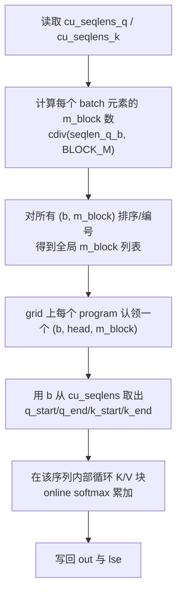
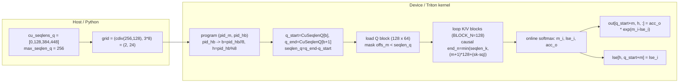
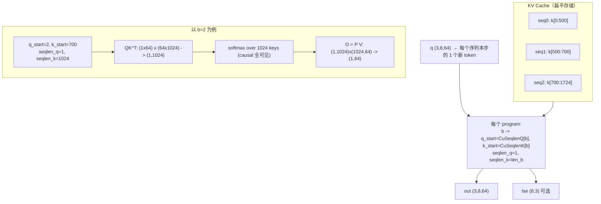

# `flash_attn_varlen_func` 详解：API、算子实现与 Triton 版本

本文单独介绍变长（varlen / ragged / unpadded）注意力接口 `flash_attn_varlen_func`，
包括输入输出、算子层的调度原理、Triton 版本的实现，以及 prefill / decode 的数据流示例。

> 相关源码
> - CUDA / 接口层：`flash_attn/flash_attn_interface.py`（`flash_attn_varlen_func`，第 1391 行；`FlashAttnVarlenFunc`，第 914 行）
> - Triton 参考实现：`flash_attn/flash_attn_triton.py`（`_fwd_kernel`，第 66 行；`_flash_attn_forward`，第 812 行）
> - 原始教程版本：`flash_attn/flash_attn_triton_og.py`

---

## 1. 算子概述

### 1.1 为什么需要 varlen

标准批处理注意力要求一个 batch 内所有序列长度相同（pad 到 `max_seqlen`）。当序列长度差异很大时：

- **显存浪费**：padding token 的 K/V 仍要分配和计算。
- **算力浪费**：padding 位置的注意力被 mask，但 GEMM 仍然执行。

`flash_attn_varlen_func` 采用 **packed（打包）布局**：把整个 batch 的所有 token 拼接成一个连续的一维张量，用 `cu_seqlens`（cumulative sequence lengths）记录每条序列在拼接张量中的区间。这样**没有 padding**，计算量正比于真实 token 数。

### 1.2 打包布局示意

假设 batch = 3，三条序列长度分别为 `128, 256, 64`，`nheads = 8`，`headdim = 64`：

```
cu_seqlens_q = [0, 128, 384, 448]        # 长度 batch+1 = 4，dtype=int32
                ▲   ▲    ▲    ▲
               seq0 seq1  seq2  结束

q (packed): (total_q=448, nheads=8, headdim=64)
            [-------- seq0 (128) --------][---------- seq1 (256) ----------][-- seq2(64) --]
             token 0 .................. 127  token 128 .................. 383  token 384 .. 447
```

第 `b` 条序列的 token 区间是 `q[cu_seqlens_q[b] : cu_seqlens_q[b+1]]`，其长度为
`seqlen_b = cu_seqlens_q[b+1] - cu_seqlens_q[b]`。

`max_seqlen_q = max_b(seqlen_b)` 是 kernel 用来确定循环次数 / grid 大小的**标量上界**。

### 1.3 一句话定义

```python
flash_attn_varlen_func(q, k, v, cu_seqlens_q, cu_seqlens_k, max_seqlen_q, max_seqlen_k, ...)
```

对每个 batch 元素 `b`，在**其自身序列内**独立做：

```
O_b = softmax( scale * Q_b K_b^T + mask ) V_b
```

其中 `Q_b, K_b, V_b` 由 `cu_seqlens` 从打包张量中切出。

---

## 2. 输入与输出详解

### 2.1 函数签名

```python
flash_attn_varlen_func(
    q, k, v,
    cu_seqlens_q, cu_seqlens_k,
    max_seqlen_q, max_seqlen_k,
    dropout_p=0.0,
    softmax_scale=None,
    causal=False,
    window_size=(-1, -1),
    softcap=0.0,
    alibi_slopes=None,
    deterministic=False,
    return_attn_probs=False,
    block_table=None,
)
```

### 2.2 输入张量

| 参数 | 形状 | dtype | 说明 |
| --- | --- | --- | --- |
| `q` | `(total_q, nheads, headdim)` | fp16 / bf16 | 所有 query token 按 batch 顺序拼接；最后一维连续 |
| `k` | `(total_k, nheads_k, headdim)` | fp16 / bf16 | 所有 key token 拼接 |
| `v` | `(total_k, nheads_k, headdim)` | fp16 / bf16 | 所有 value token 拼接 |
| `cu_seqlens_q` | `(batch_size + 1,)` | **int32** | query 的累积长度，`cu_seqlens_q[0] == 0` |
| `cu_seqlens_k` | `(batch_size + 1,)` | **int32** | key 的累积长度，`cu_seqlens_k[0] == 0` |
| `max_seqlen_q` | int（Python 标量） | - | batch 内最大 query 长度 |
| `max_seqlen_k` | int（Python 标量） | - | batch 内最大 key 长度 |
| `block_table` | `(batch_size, max_num_blocks_per_seq)` | int32，可选 | paged KV 的块表（当 K/V 来自分页缓存时） |

**关键约束**

1. `q`、`k`、`v` 最后一维必须连续（`stride(-1) == 1`）；内部会调用 `maybe_contiguous`。
2. `cu_seqlens_*` 必须是 **int32**，且严格非递减（允许长度为 0 的序列）。
3. `max_seqlen_q >= max_b(cu_seqlens_q[b+1] - cu_seqlens_q[b])`，否则会被截断。
4. GQA/MQA：`nheads % nheads_k == 0`。例如 Q 有 6 个头、KV 有 2 个头时，Q 的头 `0,1,2` 关注 KV 头 `0`，头 `3,4,5` 关注 KV 头 `1`。
5. `total_q = cu_seqlens_q[-1]`，`total_k = cu_seqlens_k[-1]`。

### 2.3 由 cu_seqlens 恢复每条序列

```python
total_q = cu_seqlens_q[-1].item()
seqlens_q = (cu_seqlens_q[1:] - cu_seqlens_q[:-1])          # (batch,)
q_b = q[cu_seqlens_q[b] : cu_seqlens_q[b+1]]                # (seqlen_q_b, nheads, headdim)
```

### 2.4 返回值

| 返回值 | 形状 | 说明 |
| --- | --- | --- |
| `out` | `(total_q, nheads, headdim)` | 打包的输出，与 `q` 逐 token 对应 |
| `softmax_lse`（仅 `return_attn_probs=True`） | `(nheads, total_q)` | 每行 `QK^T * scale` 的 logsumexp |
| `S_dmask`（仅 `return_attn_probs=True`） | `(batch_size, nheads, seqlen, seqlen)` | softmax 概率（测试用，不保证缩放正确） |

> `out[b]` 与 `q[b]` 在打包张量中位置一一对应：`out[cu_seqlens_q[b]:cu_seqlens_q[b+1]]`。

### 2.5 内部自动微分入口

`flash_attn_varlen_func` 只是薄封装，实际调用 `FlashAttnVarlenFunc.apply`（`flash_attn_interface.py:914`），它再调用注册为 `torch.library.custom_op` 的底层 CUDA 算子：

- `_flash_attn_varlen_forward(...)`（`flash_attn_interface.py:154`）
- `_flash_attn_varlen_backward(...)`（`flash_attn_interface.py:348`）
- 以及对应的 `*_fake` 实现，用于 `torch.compile` / fake tensor 追踪。

前向保存 `out`、`softmax_lse`、`rng_state`（dropout 用）等供反向使用。

---

## 3. 算子层的调度原理（CUDA 版如何利用 cu_seqlens）

FlashAttention 的核心思想是 **tiling + online softmax**：把 `Q` 按行分成 `BLOCK_M` 大小的块，把 `K/V` 按行分成 `BLOCK_N` 大小的块，逐个 K/V 块累加，边算边用在线 softmax 修正。

变长版相对普通版的关键差异在于 **tile 调度（tile scheduler）**：



要点：

1. **块不跨序列**：第 `b` 条序列的第 `i` 个 query 块，起点是 `cu_seqlens_q[b] + i*BLOCK_M`，块内超出 `seqlen_q_b` 的部分被 mask。
2. **m_block 总数** = `sum_b cdiv(seqlen_q_b, BLOCK_M)`，CUDA 版用更复杂的持久化调度（`tile_scheduler.py`）来负载均衡；教学实现可以用“每个 `(b, m_block)` 一个 program”的简单网格。
3. **因果掩码对齐右下角**：局部下标满足 `key_local <= query_local + (seqlen_k_b - seqlen_q_b)`。当 `seqlen_q == seqlen_k`（自注意力）时退化为 `key_local <= query_local`。
4. **LSE 布局**：`(nheads, total_q)`，便于按打包 token 定位。

---

## 4. Triton 版本实现

### 4.1 仓库中 Triton 版本的现状

`flash_attn/flash_attn_triton.py` 是一个带自动微分、支持任意 head dim 与 attention bias 的 Triton 重实现。其文件头明确写着：

> - Triton version doesn't support different sequence lengths in a batch (i.e., RaggedTensor/NestedTensor).

也就是说：**仓库里的 Triton `flash_attn_func` 接收的是规整的 `(batch, seqlen, nheads, headdim)`，本身不含 `cu_seqlens` 的变长调度**。它通过 `_fwd_kernel` 的 `start_m = tl.program_id(0)` 在**单条序列内**按块切分。

要在 Triton 中复现 `flash_attn_varlen_func` 的能力，需要在 `_fwd_kernel` 基础上加一层“根据 `cu_seqlens` 定位序列”的逻辑，见 4.3。

### 4.2 仓库 `_fwd_kernel` 逐段解析

下面按 `flash_attn_triton.py:66` 的结构解析（这是理解一切变长实现的基础）。

#### (1) 程序编号与偏移

```python
start_m = tl.program_id(0)          # 第几个 query 块
off_hb  = tl.program_id(1)          # = off_b * nheads + off_h
off_b   = off_hb // nheads          # batch 索引
off_h   = off_hb % nheads           # head 索引
offs_m  = start_m * BLOCK_M + tl.arange(0, BLOCK_M)   # query 行下标
offs_n  = tl.arange(0, BLOCK_N)                        # key 列下标（块内）
offs_d  = tl.arange(0, BLOCK_HEADDIM)                  # head 维下标
```

grid 在 Python 侧是：

```python
grid = lambda META: (triton.cdiv(seqlen_q, META["BLOCK_M"]), batch * nheads)
```

即每个 program 负责 **一条序列、一个 head、一个 query 块**。

#### (2) 构造 Q/K/V 指针

```python
q_ptrs = Q + off_b * stride_qb + off_h * stride_qh + (offs_m[:, None] * stride_qm + offs_d[None, :])
k_ptrs = K + off_b * stride_kb + off_h * stride_kh + (offs_n[:, None] * stride_kn + offs_d[None, :])
v_ptrs = V + off_b * stride_vb + off_h * stride_vh + (offs_n[:, None] * stride_vn + offs_d[None, :])
```

注意形参里传入的 `q.stride(0), q.stride(2), q.stride(1)` 对应 `(batch, head, seqlen)`——因为张量是 `(b, s, h, d)`，`stride(1)` 是序列维、`stride(2)` 是 head 维。

#### (3) 载入 Q 并初始化在线 softmax 状态

```python
lse_i = tl.zeros([BLOCK_M], dtype=tl.float32) - float("inf")  # 之前所有块的 logsumexp
m_i   = tl.zeros([BLOCK_M], dtype=tl.float32) - float("inf")  # 之前所有块的最大值
acc_o = tl.zeros([BLOCK_M, BLOCK_HEADDIM], dtype=tl.float32)  # 未归一化的输出累加器
q = tl.load(q_ptrs, mask=..., other=0.0)                      # Q 块常驻 SRAM
```

用 `m_i`（running max）和 `lse_i`（running logsumexp）替代分别维护 `m` 与 `l`，减少一次存储。

#### (4) 主循环：遍历 K/V 块

```python
end_n = seqlen_k if not IS_CAUSAL else tl.minimum((start_m + 1) * BLOCK_M, seqlen_k)
for start_n in range(0, end_n, BLOCK_N):
    start_n = tl.multiple_of(start_n, BLOCK_N)
    k = tl.load(k_ptrs + start_n * stride_kn, mask=..., other=0.0)
    qk = tl.dot(q, k, trans_b=True)            # (BLOCK_M, BLOCK_N)
    # 越界列设 -inf
    qk += tl.where((start_n + offs_n)[None, :] < seqlen_k, 0, float("-inf"))
    # 因果掩码
    if IS_CAUSAL:
        qk += tl.where(offs_m[:, None] >= (start_n + offs_n)[None, :], 0, float("-inf"))
    # 在线 softmax
    m_ij = tl.maximum(tl.max(qk, 1) * softmax_scale, lse_i)
    p    = tl.exp(qk * softmax_scale - m_ij[:, None])
    l_ij = tl.sum(p, 1)
    # 重新缩放 old accumulator
    acc_o_scale = tl.exp(m_i - m_ij)
    acc_o = acc_o * acc_o_scale[:, None]
    # 累加 P @ V
    v = tl.load(v_ptrs + start_n * stride_vn, mask=..., other=0.0)
    p = p.to(v.dtype)
    acc_o += tl.dot(p, v)
    # 更新统计量
    m_i = m_ij
    lse_i = m_ij + tl.log(tl.exp(lse_i - m_ij) + l_ij)
```

这正是在线 softmax 的递推：

```
m_new = max(m_old, rowmax(QK^T * scale))
P     = exp(QK^T * scale - m_new)
O     = O * exp(m_old - m_new) + P V
lse   = m_new + log(exp(lse_old - m_new) + rowsum(P))
```

#### (5) 收尾：归一化并写回

```python
o_scale = tl.exp(m_i - lse_i)      # = 1 / l
acc_o = acc_o * o_scale[:, None]
tl.store(lse_ptrs, lse_i)          # (batch, nheads, seqlen_q_rounded)
tl.store(out_ptrs, acc_o, mask=offs_m[:, None] < seqlen_q)
```

**Triton 版本与 CUDA 版本的差异**（源码注释）：

- Triton 不支持 dropout；
- Triton 前向通常更快，反向更慢；
- Triton 版本支持 attention bias，CUDA 版本不支持；
- Triton 版本不支持一个 batch 内不同序列长度（正是本文要补的部分）。

### 4.3 变长版 Triton 内核（教学参考实现）

下面给出一个**基于仓库 `_fwd_kernel` 扩展**的变长 Triton 前向内核。核心改动：

1. Q/K/V 采用打包布局 `(total, nheads, headdim)`；
2. grid 用 `(max_m_blocks, batch * nheads)`，其中 `max_m_blocks = cdiv(max_seqlen_q, BLOCK_M)`；超出该序列长度的块直接 `return`（简单但正确；生产版会用压缩 m_block 的负载均衡调度）；
3. 每个 program 用 `off_b` 从 `CuSeqlenQ/K` 读出该序列的起止，序列内相对下标从 0 开始；
4. 因果掩码加入 `seqlen_k - seqlen_q` 右下角对齐偏移，同时支持自注意力与交叉注意力。

```python
import math
import torch
import triton
import triton.language as tl


@triton.heuristics(
    {
        "EVEN_HEADDIM": lambda args: args["headdim"] == args["BLOCK_HEADDIM"],
    }
)
@triton.jit
def _fwd_kernel_varlen(
    Q, K, V, Out, Lse, CuSeqlenQ, CuSeqlenK,
    softmax_scale,
    stride_qt, stride_qh,          # Q: (total_q, nheads, headdim)
    stride_kt, stride_kh,          # K: (total_k, nheads, headdim)
    stride_vt, stride_vh,
    stride_ot, stride_oh,
    stride_lh,                     # LSE head 维 stride（= total_q）
    nheads,
    headdim,
    IS_CAUSAL: tl.constexpr,
    BLOCK_HEADDIM: tl.constexpr,
    EVEN_HEADDIM: tl.constexpr,
    BLOCK_M: tl.constexpr,
    BLOCK_N: tl.constexpr,
):
    start_m = tl.program_id(0)
    off_hb = tl.program_id(1)
    off_b = off_hb // nheads
    off_h = off_hb % nheads

    # ---- 1. 用 cu_seqlens 取出本条序列的边界 ----
    q_start = tl.load(CuSeqlenQ + off_b)
    q_end = tl.load(CuSeqlenQ + off_b + 1)
    k_start = tl.load(CuSeqlenK + off_b)
    k_end = tl.load(CuSeqlenK + off_b + 1)
    seqlen_q = q_end - q_start
    seqlen_k = k_end - k_start

    # 该 query 块完全越界：直接退出（grid 按 max_seqlen 分配）
    if start_m * BLOCK_M >= seqlen_q:
        return

    # ---- 2. 序列内相对下标 ----
    offs_m = start_m * BLOCK_M + tl.arange(0, BLOCK_M)   # query 行局部下标
    offs_n = tl.arange(0, BLOCK_N)                       # key 列块内下标
    offs_d = tl.arange(0, BLOCK_HEADDIM)

    # ---- 3. 指针：token 索引要加上 q_start / k_start ----
    q_ptrs = Q + off_h * stride_qh + (q_start + offs_m)[:, None] * stride_qt \
             + offs_d[None, :]
    k_ptrs = K + off_h * stride_kh + (k_start + offs_n)[:, None] * stride_kt \
             + offs_d[None, :]
    v_ptrs = V + off_h * stride_vh + (k_start + offs_n)[:, None] * stride_vt \
             + offs_d[None, :]

    # ---- 4. 初始化在线 softmax 状态 ----
    lse_i = tl.zeros([BLOCK_M], dtype=tl.float32) - float("inf")
    m_i = tl.zeros([BLOCK_M], dtype=tl.float32) - float("inf")
    acc_o = tl.zeros([BLOCK_M, BLOCK_HEADDIM], dtype=tl.float32)

    q = tl.load(q_ptrs, mask=offs_m[:, None] < seqlen_q, other=0.0)

    # ---- 5. 遍历 K/V 块 ----
    if IS_CAUSAL:
        # 右下角对齐：j <= i + (seqlen_k - seqlen_q)
        end_n = tl.minimum(seqlen_k, (start_m + 1) * BLOCK_M + (seqlen_k - seqlen_q))
    else:
        end_n = seqlen_k
    for start_n in range(0, end_n, BLOCK_N):
        start_n = tl.multiple_of(start_n, BLOCK_N)
        k = tl.load(k_ptrs + start_n * stride_kt,
                    mask=(start_n + offs_n)[:, None] < seqlen_k, other=0.0)
        qk = tl.dot(q, k, trans_b=True)
        # 越界列 -> -inf
        qk += tl.where((start_n + offs_n)[None, :] < seqlen_k, 0, float("-inf"))
        # 因果掩码
        if IS_CAUSAL:
            qk += tl.where(
                offs_m[:, None] + (seqlen_k - seqlen_q) >= (start_n + offs_n)[None, :],
                0, float("-inf"),
            )
        m_ij = tl.maximum(tl.max(qk, 1) * softmax_scale, lse_i)
        p = tl.exp(qk * softmax_scale - m_ij[:, None])
        l_ij = tl.sum(p, 1)

        acc_o_scale = tl.exp(m_i - m_ij)
        acc_o = acc_o * acc_o_scale[:, None]

        v = tl.load(v_ptrs + start_n * stride_vt,
                    mask=(start_n + offs_n)[:, None] < seqlen_k, other=0.0)
        p = p.to(v.dtype)
        acc_o += tl.dot(p, v)

        m_i = m_ij
        lse_i = m_ij + tl.log(tl.exp(lse_i - m_ij) + l_ij)

    # ---- 6. 归一化并写回（打包布局） ----
    acc_o = acc_o * tl.exp(m_i - lse_i)[:, None]
    out_ptrs = Out + off_h * stride_oh + (q_start + offs_m)[:, None] * stride_ot + offs_d[None, :]
    tl.store(out_ptrs, acc_o, mask=offs_m[:, None] < seqlen_q)
    # Lse: (nheads, total_q)
    lse_ptrs = Lse + off_h * stride_lh + q_start + offs_m
    tl.store(lse_ptrs, lse_i, mask=offs_m < seqlen_q)
```

启动端（在 Python 里）：

```python
def flash_attn_varlen_triton(
    q, k, v, cu_seqlens_q, cu_seqlens_k, max_seqlen_q, max_seqlen_k,
    softmax_scale=None, causal=False,
):
    batch, nheads, d = cu_seqlens_q.numel() - 1, q.shape[1], q.shape[2]
    softmax_scale = softmax_scale or 1.0 / math.sqrt(d)
    out = torch.empty_like(q)
    lse = torch.empty((nheads, q.shape[0]), device=q.device, dtype=torch.float32)
    BLOCK_HEADDIM = max(triton.next_power_of_2(d), 16)
    BLOCK_M = BLOCK_N = 128
    grid = (triton.cdiv(max_seqlen_q, BLOCK_M), batch * nheads)
    _fwd_kernel_varlen[grid](
        q, k, v, out, lse, cu_seqlens_q, cu_seqlens_k,
        softmax_scale,
        q.stride(0), q.stride(1),
        k.stride(0), k.stride(1),
        v.stride(0), v.stride(1),
        out.stride(0), out.stride(1),
        lse.stride(0),
        nheads, d,
        causal, BLOCK_HEADDIM,
        BLOCK_M=BLOCK_M, BLOCK_N=BLOCK_N,
        num_warps=4 if d <= 64 else 8,
        num_stages=1,
    )
    return out, lse
```

**与仓库实现的区别对照**

| 维度 | 仓库 `_fwd_kernel` | 变长版 `_fwd_kernel_varlen` |
| --- | --- | --- |
| 输入布局 | `(batch, seqlen, nheads, d)` | `(total, nheads, d)` 打包 |
| 序列边界 | 所有序列相同，用 `seqlen_q/k` 标量 | 逐序列由 `CuSeqlenQ/K` 读取 |
| grid | `(cdiv(seqlen_q, BM), batch*nheads)` | `(cdiv(max_seqlen_q, BM), batch*nheads)` |
| 越界处理 | `offs_m < seqlen_q`，需 mask | 整块越界则 `return`，块内仍需 mask |
| 因果对齐 | `offs_m >= start_n+offs_n` | 加 `(seqlen_k - seqlen_q)` 偏移 |
| LSE 布局 | `(batch, nheads, seqlen_q)` | `(nheads, total_q)` |

> **性能提示**：上面的 grid 用 `max_seqlen_q` 分配，当序列长度极不均衡时会有大量空 program。生产级实现（CUDA 版）会把所有真实 `(b, m_block)` 压缩成一个列表并用持久化调度分发，从而消除空转。Triton 里也可以通过预计算 `m_block → (b, i)` 的映射表来复现。

### 4.4 反向（简述）

仓库 `_flash_attn_backward` 拆成两个 kernel：

1. `_bwd_preprocess_do_o_dot`：计算 `delta = rowsum(O * dO)`，并把 `dO` 预除以 `l`。
2. `_bwd_kernel`：用重算的 `P = exp(QK^T*scale - m)`，按块累加 `dV`、`dK`，并把 `dQ` 原子累加到 fp32 的 `dq_accum`，最后 `dq.copy_(dq_accum)`。

其变长化与 4.3 相同：每个 program 用 `off_b` 从 `cu_seqlens` 取边界，序列内下标从 0 开始，LSE 按打包布局读取。需要注意 `dQ` 的累加在变长下仍按打包 token 定位。

---

## 5. 数据流示例

### 5.1 示例一：Prefill（变长 prompt 打包）

**场景**：一次 prefill 3 条 prompt，长度 `[128, 256, 64]`，`nheads = 8`，`headdim = 64`，fp16，`causal = True`。

```
cu_seqlens_q = cu_seqlens_k = [0, 128, 384, 448]   # int32, shape (4,)
max_seqlen_q = max_seqlen_k = 256
total = 448
```

各张量形状：

| 张量 | 形状 | 含义 |
| --- | --- | --- |
| `q` | `(448, 8, 64)` | 打包 query |
| `k` | `(448, 8, 64)` | 打包 key |
| `v` | `(448, 8, 64)` | 打包 value |
| `cu_seqlens_q/k` | `(4,)` int32 | 累积长度 |
| `out` | `(448, 8, 64)` | 打包输出 |
| `lse`（`return_attn_probs`） | `(8, 448)` | 每行 logsumexp |

数据流：



**逐 program 视角**（batch=3 时）：

- `b=0`：`seqlen_q=128`，`grid` 上 `pid_m ∈ {0,1}`，但 `pid_m=1` 时 `1*128 >= 128` → `return`。
- `b=1`：`seqlen_q=256`，`pid_m ∈ {0,1}` 都有效，`pid_m=0` 的因果 `end_n = min(256, 128+0) = 128`，`pid_m=1` 的 `end_n = min(256, 256+0) = 256`。
- `b=2`：`seqlen_q=64`，`pid_m=0` 有效但只处理前 64 行，`end_n = min(64, 128) = 64`。

调用代码：

```python
import torch
from flash_attn import flash_attn_varlen_func

cu = torch.tensor([0, 128, 384, 448], dtype=torch.int32, device="cuda")
q = torch.randn(448, 8, 64, dtype=torch.float16, device="cuda", requires_grad=True)
k = torch.randn(448, 8, 64, dtype=torch.float16, device="cuda", requires_grad=True)
v = torch.randn(448, 8, 64, dtype=torch.float16, device="cuda", requires_grad=True)

out = flash_attn_varlen_func(q, k, v, cu, cu, max_seqlen_q=256, max_seqlen_k=256, causal=True)
# out: (448, 8, 64)
out.sum().backward()
```

从 padded 输入得到 varlen 输入的典型做法（`bert_padding.unpad_input`）：

```python
from flash_attn.bert_padding import unpad_input, pad_input

# hidden: (batch, seqlen, nheads*d), attention_mask: (batch, seqlen) bool
q_unpad, indices_q, cu_seqlens_q, max_seqlen_q, _ = unpad_input(q_padded, mask)
k_unpad, _, cu_seqlens_k, max_seqlen_k, _ = unpad_input(k_padded, mask)
out_unpad = flash_attn_varlen_func(q_unpad, k_unpad, v_unpad, cu_seqlens_q, cu_seqlens_k,
                                  max_seqlen_q, max_seqlen_k, causal=True)
out_padded = pad_input(out_unpad, indices_q, batch, seqlen)   # 还原为 padding 布局
```

### 5.2 示例二：Decode（自回归生成的一步）

**场景**：batch = 3，每个序列已经缓存了长度 `[500, 200, 1024]` 的 KV，本步每个序列新增 **1 个** query token。

用 `flash_attn_varlen_func` 做 decode 时，query 是打包的单 token：

```
cu_seqlens_q = [0, 1, 2, 3]          # 每条序列 1 个 query token，shape (4,)
cu_seqlens_k = [0, 500, 700, 1724]   # 累积 KV 长度，shape (4,)
max_seqlen_q = 1
max_seqlen_k = 1024
total_q = 3
total_k = 1724
```

| 张量 | 形状 | 含义 |
| --- | --- | --- |
| `q` | `(3, 8, 64)` | 3 个新 query（每序列 1 个） |
| `k` | `(1724, 8, 64)` | 打包的历史 key |
| `v` | `(1724, 8, 64)` | 打包的历史 value |
| `cu_seqlens_q` | `(4,)` int32 | `[0,1,2,3]` |
| `cu_seqlens_k` | `(4,)` int32 | `[0,500,700,1724]` |
| `out` | `(3, 8, 64)` | 每个新 token 的输出 |

> decode 时 `causal=True`，由于 `seqlen_q = 1` 且掩码右下角对齐，单个 query 会 attend 到该序列的全部 `seqlen_k` 个 key：条件 `j <= i + (seqlen_k - seqlen_q) = 0 + (seqlen_k - 1)` 恒成立。这正是“看到所有历史”的语义。

数据流：



调用代码：

```python
import torch
from flash_attn import flash_attn_varlen_func

cache_lens = [500, 200, 1024]
cu_q = torch.tensor([0, 1, 2, 3], dtype=torch.int32, device="cuda")
cu_k = torch.tensor([0] + list(torch.cumsum(torch.tensor(cache_lens), 0).tolist()),
                    dtype=torch.int32, device="cuda")

q = torch.randn(3, 8, 64, dtype=torch.float16, device="cuda")     # 3 个新 token
k = torch.randn(1724, 8, 64, dtype=torch.float16, device="cuda")  # 打包历史 KV
v = torch.randn(1724, 8, 64, dtype=torch.float16, device="cuda")

out = flash_attn_varlen_func(q, k, v, cu_q, cu_k, max_seqlen_q=1, max_seqlen_k=1024, causal=True)
# out: (3, 8, 64)
```

**prefill 与 decode 对比**

| 维度 | Prefill | Decode |
| --- | --- | --- |
| `seqlen_q` | 变长（如 128/256/64） | 每条序列 1 |
| `seqlen_k` | 等于 prompt 长度 | 等于历史 KV 长度 |
| `total_q` | `sum(prompt_len)` | `batch_size` |
| `cu_seqlens_q` | 累积 prompt 长度 | `range(batch+1)` |
| 计算特征 | 大 `QK^T`，compute-bound | `seqlen_q=1`，memory-bound（KV 读取为主） |
| `max_seqlen_q` | 最大 prompt 长度 | `1` |
| 典型接口 | `flash_attn_varlen_func` | `flash_attn_varlen_func`（扁平 KV）或 `flash_attn_with_kvcache`（带 cache 原地更新 + RoPE + paged KV） |

> 实际推理中 decode 更常用 `flash_attn_with_kvcache`，因为它能在同一 kernel 内完成 KV 写入、RoPE 与分页寻址；`flash_attn_varlen_func` 适合 KV 已在内存中扁平排布、只需做 attention 的场景。

---

## 6. 常见问题

1. **`cu_seqlens` 为什么必须是 int32？**
   内核用 32 位索引；int64 会显著增加寄存器与寻址开销。总 token 数超过 2^31 时才会溢出，实践中不会。

2. **`max_seqlen` 传大了会怎样？**
   只会浪费 grid（产生空 program），结果正确；传小了会漏掉部分 token。

3. **变长 + GQA 怎么办？**
   直接传 `nheads > nheads_k` 且可整除即可，路由逻辑与普通版一致。

4. **为什么不能直接用 `flash_attn_func` 处理 varlen？**
   `flash_attn_func` 要求统一长度；变长必须用 `flash_attn_varlen_func`（或先 pad，浪费算力）。

5. **Triton 版本现在支持 varlen 吗？**
   仓库中的 `flash_attn_triton.py` **不支持** ragged tensor（见文件头注释）。本文 4.3 给出了基于其内核扩展的参考实现，用于学习内核结构；生产环境应使用 CUDA 版 `flash_attn_varlen_func`。
