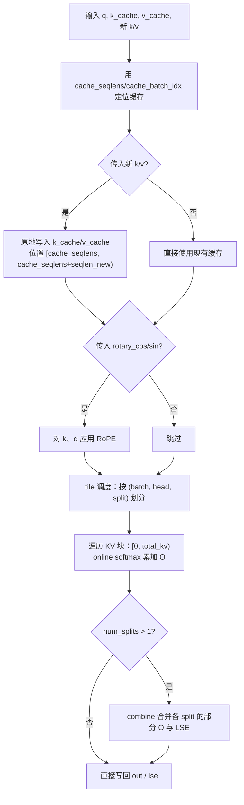
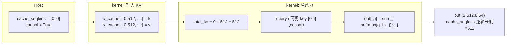
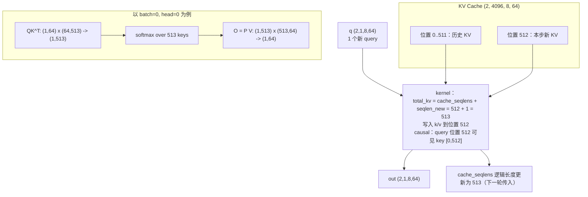

# `flash_attn_with_kvcache` 详解：API、算子实现与 Triton 版本

本文单独介绍推理专用注意力接口 `flash_attn_with_kvcache`，包括输入输出、算子层的 KV Cache 调度原理、
Triton 参考实现，以及 prefill / decode 的数据流示例。

> 相关源码
> - FA2 接口：`flash_attn/flash_attn_interface.py`（`flash_attn_with_kvcache`，第 1485 行）
> - FA3 接口：`hopper/flash_attn_interface.py`（`flash_attn_with_kvcache`，第 942 行）
> - Triton 参考：`flash_attn/flash_attn_triton.py`（**不含** KV Cache 实现，本文第 4 节给出参考实现）

---

## 1. 算子概述

### 1.1 自回归解码的痛点

自回归生成每生成一个 token，就需要基于「已生成的全部 token」做一次注意力。如果每一步都对全部历史 token 重新做 `nheads` 头的 `QK^T`，算力会随序列长度线性增长。**KV Cache** 的思路：把历史 token 的 K、V 缓存起来，每一步只计算**新 token 的 Q**，然后与缓存中的 K/V 做注意力。

```
step t:   Q_t (1 个 token)  ×  [K_0, K_1, ..., K_{t-1}, K_t]^T
          输出 O_t (1 个 token)，并把 K_t, V_t 追加进缓存
```

### 1.2 `flash_attn_with_kvcache` 做了什么

它是一个**融合 kernel**，一次调用同时完成：

1. **原地更新缓存**：若传入 `k`、`v`（新 token），从 `cache_seqlens` 指定的位置写入 `k_cache`、`v_cache`（in-place）。
2. **注意力**：以更新后的缓存为 K/V，对新 `q` 做注意力。支持 MQA/GQA、causal、滑动窗口、softcap。
3. **可选 RoPE 融合**：若传入 `rotary_cos` / `rotary_sin`，对 `k`、`q` 就地应用旋转位置编码。
4. **可选 paged KV**：通过 `block_table` 支持分页缓存（PagedAttention 风格），适配 vLLM 等推理框架。
5. **可选 split-KV**：`num_splits` 沿序列切分 K/V，提升长上下文解码的并行度。

> **不支持反向传播**（推理专用）。训练/前向请使用 `flash_attn_func` / `flash_attn_varlen_func`。

### 1.3 一句话定义

```python
flash_attn_with_kvcache(q, k_cache, v_cache, k=None, v=None, cache_seqlens=None, ...)
```

对新 query `q` 计算：
```
O = softmax( scale * Q K_cache' ^T + mask ) V_cache'
```
其中 `K_cache' = concat(K_cache, k)`（若传入新 `k`），并同步更新缓存。

---

## 2. 输入与输出详解

### 2.1 函数签名（FA2）

```python
flash_attn_with_kvcache(
    q,
    k_cache,
    v_cache,
    k=None,
    v=None,
    rotary_cos=None,
    rotary_sin=None,
    cache_seqlens=None,
    cache_batch_idx=None,
    cache_leftpad=None,
    block_table=None,
    softmax_scale=None,
    causal=False,
    window_size=(-1, -1),
    softcap=0.0,
    rotary_interleaved=True,
    alibi_slopes=None,
    num_splits=0,
    return_softmax_lse=False,
)
```

### 2.2 输入张量

| 参数 | 形状 | dtype | 说明 |
| --- | --- | --- | --- |
| `q` | `(batch_size, seqlen, nheads, headdim)` | fp16/bf16 | 新 query；解码时 `seqlen=1` |
| `k_cache` | 非分页 `(batch_size_cache, seqlen_cache, nheads_k, headdim)`；分页 `(num_blocks, page_block_size, nheads_k, headdim)` | fp16/bf16 | K 缓存，最后一维连续 |
| `v_cache` | 同上 | fp16/bf16 | V 缓存 |
| `k` | `(batch_size, seqlen_new, nheads_k, headdim)`，可选 | fp16/bf16 | 新 token 的 K，写入缓存 |
| `v` | 同上，可选 | fp16/bf16 | 新 token 的 V |
| `rotary_cos` | `(seqlen_ro, rotary_dim / 2)`，可选 | fp32 | RoPE 余弦；`rotary_dim` 必须能被 16 整除 |
| `rotary_sin` | `(seqlen_ro, rotary_dim / 2)`，可选 | fp32 | RoPE 正弦 |
| `cache_seqlens` | int 或 `(batch_size,)` int32 | int32 | 见下文语义 |
| `cache_batch_idx` | `(batch_size,)` int32，可选 | int32 | 索引到缓存的 batch 下标；`None` 表示 `[0..batch-1]` |
| `cache_leftpad` | `(batch_size,)` int32，可选 | int32 | KV 缓存起始位置；`None` 表示 0 |
| `block_table` | `(batch_size, max_num_blocks_per_seq)` int32，可选 | int32 | 分页 KV 的块表；FA2 中 `page_block_size` 必须是 256 的倍数 |

### 2.3 `cache_seqlens` 的精确语义（关键）

`cache_seqlens[b]` 表示**追加新 K/V 之前**，第 `b` 条序列已有的 KV 长度。行为分两种：

- **传入 `k`/`v`（FA 负责写入）**：
  - 新 K/V 被写入缓存位置 `[cache_seqlens[b], cache_seqlens[b] + seqlen_new)`；
  - 注意力覆盖 `[0, cache_seqlens[b] + seqlen_new)`。
- **不传 `k`/`v`（缓存已由外部填好）**：
  - `cache_seqlens[b]` 即当前**总 KV 长度**；
  - 注意力覆盖 `[0, cache_seqlens[b])`。

因果掩码对齐右下角，query 局部下标 `i`（0-based）可见 key 绝对下标 `j` 满足：

```
j <= i + (total_kv - seqlen_q)
```

当 `seqlen_new == seqlen_q` 时，`total_kv - seqlen_q = cache_seqlens[b]`，即第 `i` 个新 query 可见 `[0, cache_seqlens[b] + i]`。

> 测试中的等价校验：`key_padding_mask = arange(seqlen_k) < cache_seqlens[b] + seqlen_new`，即有效 KV 长度等于 `cache_seqlens + seqlen_new`。（见 `tests/test_flash_attn.py::test_flash_attn_kvcache`）

### 2.4 RoPE 行为

- `k`（新 key）在位置 `cache_seqlens, cache_seqlens+1, ...` 处旋转。
- `q`：
  - `causal=True` 或局部（`window_size != (-1, -1)`）时，在位置 `cache_seqlens, cache_seqlens+1, ...` 处旋转（每个 query token 位置不同）；
  - 既非 causal 又非局部时，所有 `q` token 视作位于位置 `cache_seqlens`。
- `rotary_interleaved`：`True` 组合维度 `0&1, 2&3, ...`（GPT-J）；`False` 组合 `0&rotary_dim/2`（GPT-NeoX）。

### 2.5 返回值

| 返回值 | 形状 | 条件 |
| --- | --- | --- |
| `out` | `(batch_size, seqlen, nheads, headdim)` | 总是 |
| `softmax_lse` | `(batch_size, nheads, seqlen)` | `return_softmax_lse=True` |

### 2.6 其他参数

| 参数 | 说明 |
| --- | --- |
| `softmax_scale` | 缩放，默认 `1/sqrt(headdim)` |
| `causal` | 因果掩码（右下角对齐） |
| `window_size` | 滑动窗口 `(left, right)` |
| `softcap` | `> 0` 启用 softcapping |
| `alibi_slopes` | `(nheads,)` 或 `(batch, nheads)`，fp32 ALiBi |
| `num_splits` | `>1` 沿序列切分 KV；`1` 不切；`0` 启发式。除非了解含义不要改动 |

---

## 3. 算子层的调度原理

### 3.1 与训练注意力的差异

| 维度 | 训练 (`flash_attn_func`) | 解码 (`flash_attn_with_kvcache`) |
| --- | --- | --- |
| `seqlen_q` | 通常较大（数百~数千） | 通常为 1 |
| 计算特征 | compute-bound（大 `QK^T`） | memory-bound（读 KV 为主） |
| KV 来源 | 与 Q 同批加载 | 从缓存读取，可能分页 |
| 是否写缓存 | 否 | 是（原地追加新 K/V） |
| 并行度 | 按 Q 块并行 | Q 只有 1 行，需靠 `nheads`、`batch`、split-KV 并行 |

### 3.2 执行流水



### 3.3 分页 KV（PagedAttention）

当使用 `block_table` 时，缓存不再按 `(batch, seqlen_cache, ...)` 连续存储，而是按**页**存储：

```
k_cache: (num_blocks, page_block_size, nheads_k, headdim)
block_table[b] = [block_id_0, block_id_1, ...]   # 第 b 条序列的第 i 个 KV 页是第 block_id_i 块
```

逻辑 KV 位置 `j` 对应物理位置：
```
page = j // page_block_size
offset = j % page_block_size
物理 token = block_table[b, page] * page_block_size + offset
```

这样不同序列可共享/回收页，显存利用率更高（vLLM 的核心思想）。FA2 要求 `page_block_size` 为 256 的倍数；FA3 放宽为任意值。

---

## 4. Triton 版本实现

### 4.1 仓库现状

`flash_attn/flash_attn_triton.py` **没有** KV Cache 实现，其 `flash_attn_func` 只处理规整的 `(batch, seqlen, nheads, d)`。因此下面给出一个**教学参考实现**，拆成两个 kernel：

1. `_update_kv_cache_kernel`：把新 K/V 写入缓存（对应 FA 的原地更新）。
2. `_decode_fwd_kernel`：对新 Q 在缓存上做 causal 注意力（对应 FA 的注意力部分）。

生产级 FA 把二者融合进一个 kernel，并按需融合 RoPE 与分页寻址；这里拆分只为便于理解。

### 4.2 KV 缓存写入 kernel

```python
import torch
import triton
import triton.language as tl


@triton.jit
def _update_kv_cache_kernel(
    KNEW, VNEW, KCACHE, VCACHE, CacheSeqlen,
    stride_knt, stride_knh,          # KNEW: (batch, seqlen_new, nheads_k, headdim)
    stride_vnt, stride_vnh,
    stride_kcb, stride_kcs, stride_kch,   # KCACHE: (batch_cache, seqlen_cache, nheads_k, headdim)
    stride_vcb, stride_vcs, stride_vch,
    nheads_k,
    seqlen_new,
    headdim,
    BLOCK_D: tl.constexpr,
    BLOCK_T: tl.constexpr,
):
    off_b = tl.program_id(0)
    off_h = tl.program_id(1)
    start_t = tl.program_id(2) * BLOCK_T

    # 新 token 写入缓存的起始位置
    dst = tl.load(CacheSeqlen + off_b) + start_t

    offs_t = start_t + tl.arange(0, BLOCK_T)
    offs_d = tl.arange(0, BLOCK_D)
    mask = (offs_t[:, None] < seqlen_new) & (offs_d[None, :] < headdim)

    k = tl.load(
        KNEW + off_b * stride_knt + off_h * stride_knh
        + offs_t[:, None] * stride_knt + offs_d[None, :],
        mask=mask, other=0.0,
    )
    tl.store(
        KCACHE + off_b * stride_kcb + off_h * stride_kch
        + (dst + offs_t)[:, None] * stride_kcs + offs_d[None, :],
        k, mask=mask,
    )

    v = tl.load(
        VNEW + off_b * stride_vnt + off_h * stride_vnh
        + offs_t[:, None] * stride_vnt + offs_d[None, :],
        mask=mask, other=0.0,
    )
    tl.store(
        VCACHE + off_b * stride_vcb + off_h * stride_vch
        + (dst + offs_t)[:, None] * stride_vcs + offs_d[None, :],
        v, mask=mask,
    )
```

启动：

```python
def update_kv_cache(k, v, k_cache, v_cache, cache_seqlens):
    batch, seqlen_new, nheads_k, headdim = k.shape
    BLOCK_D = max(triton.next_power_of_2(headdim), 16)
    BLOCK_T = 16
    grid = (batch, nheads_k, triton.cdiv(seqlen_new, BLOCK_T))
    _update_kv_cache_kernel[grid](
        k, v, k_cache, v_cache, cache_seqlens,
        k.stride(0), k.stride(2),
        v.stride(0), v.stride(2),
        k_cache.stride(0), k_cache.stride(1), k_cache.stride(2),
        v_cache.stride(0), v_cache.stride(1), v_cache.stride(2),
        nheads_k, seqlen_new, headdim,
        BLOCK_D=BLOCK_D, BLOCK_T=BLOCK_T,
    )
```

### 4.3 解码注意力 kernel

在缓存已写好（`cache_seqlens[b]` 为**总 KV 长度**）的前提下，对每个 `(batch, head, q-block)` 做在线 softmax。

```python
@triton.jit
def _decode_fwd_kernel(
    Q, KCACHE, VCACHE, Out, Lse, CacheSeqlen,
    softmax_scale,
    stride_qt, stride_qh,            # Q: (batch, seqlen_q, nheads, headdim)
    stride_kb, stride_ks, stride_kh, # KCACHE: (batch_cache, seqlen_cache, nheads_k, headdim)
    stride_vb, stride_vs, stride_vh,
    stride_ot, stride_oh,
    nheads,
    seqlen_q,                        # 本步 query 数（解码常为 1）
    headdim,
    IS_CAUSAL: tl.constexpr,
    BLOCK_HEADDIM: tl.constexpr,
    BLOCK_M: tl.constexpr,
    BLOCK_N: tl.constexpr,
):
    start_m = tl.program_id(0)
    off_hb = tl.program_id(1)
    off_b = off_hb // nheads
    off_h = off_hb % nheads

    total_kv = tl.load(CacheSeqlen + off_b)   # 本序列总 KV 长度

    offs_m = start_m * BLOCK_M + tl.arange(0, BLOCK_M)
    offs_d = tl.arange(0, BLOCK_HEADDIM)

    q_ptrs = (Q + off_b * stride_qt + off_h * stride_qh
              + offs_m[:, None] * stride_qt + offs_d[None, :])
    q = tl.load(q_ptrs, mask=offs_m[:, None] < seqlen_q, other=0.0)

    lse_i = tl.full([BLOCK_M], float("-inf"), tl.float32)
    m_i = tl.full([BLOCK_M], float("-inf"), tl.float32)
    acc_o = tl.zeros([BLOCK_M, BLOCK_HEADDIM], tl.float32)

    for start_n in range(0, total_kv, BLOCK_N):
        start_n = tl.multiple_of(start_n, BLOCK_N)
        offs_n = start_n + tl.arange(0, BLOCK_N)
        mask_n = offs_n < total_kv

        k = tl.load(
            KCACHE + off_b * stride_kb + off_h * stride_kh
            + offs_n[:, None] * stride_ks + offs_d[None, :],
            mask=mask_n[:, None], other=0.0,
        )
        qk = tl.dot(q, k, trans_b=True) * softmax_scale
        qk = tl.where(mask_n[None, :], qk, float("-inf"))
        if IS_CAUSAL:
            # 右下角对齐：query 绝对位置 = total_kv - seqlen_q + offs_m
            q_abs = total_kv - seqlen_q + offs_m
            qk = tl.where(q_abs[:, None] >= offs_n[None, :], qk, float("-inf"))

        m_ij = tl.maximum(tl.max(qk, 1), m_i)
        p = tl.exp(qk - m_ij[:, None])
        l_ij = tl.sum(p, 1)

        acc_o = acc_o * tl.exp(m_i - m_ij)[:, None]
        v = tl.load(
            VCACHE + off_b * stride_vb + off_h * stride_vh
            + offs_n[:, None] * stride_vs + offs_d[None, :],
            mask=mask_n[:, None], other=0.0,
        )
        acc_o += tl.dot(p.to(v.dtype), v)

        m_i = m_ij
        lse_i = m_ij + tl.log(tl.exp(lse_i - m_ij) + l_ij)

    acc_o = acc_o * tl.exp(m_i - lse_i)[:, None]
    out_ptrs = (Out + off_b * stride_ot + off_h * stride_oh
                + offs_m[:, None] * stride_ot + offs_d[None, :])
    tl.store(out_ptrs, acc_o, mask=offs_m[:, None] < seqlen_q)

    # Lse: (batch, nheads, seqlen_q)
    lse_ptrs = Lse + off_b * nheads * seqlen_q + off_h * seqlen_q + offs_m
    tl.store(lse_ptrs, lse_i, mask=offs_m < seqlen_q)
```

启动：

```python
def flash_attn_with_kvcache_triton(
    q, k_cache, v_cache, cache_seqlens,
    k=None, v=None, softmax_scale=None, causal=False,
):
    batch, seqlen_q, nheads, d = q.shape
    softmax_scale = softmax_scale or 1.0 / (d ** 0.5)
    if k is not None:
        update_kv_cache(k, v, k_cache, v_cache, cache_seqlens)

    out = torch.empty_like(q)
    lse = torch.empty((batch, nheads, seqlen_q), device=q.device, dtype=torch.float32)
    BLOCK_HEADDIM = max(triton.next_power_of_2(d), 16)
    BLOCK_M = 16
    BLOCK_N = 128
    grid = (triton.cdiv(seqlen_q, BLOCK_M), batch * nheads)
    _decode_fwd_kernel[grid](
        q, k_cache, v_cache, out, lse, cache_seqlens,
        softmax_scale,
        q.stride(0), q.stride(2),
        k_cache.stride(0), k_cache.stride(1), k_cache.stride(2),
        v_cache.stride(0), v_cache.stride(1), v_cache.stride(2),
        out.stride(0), out.stride(2),
        nheads, seqlen_q, d,
        causal, BLOCK_HEADDIM,
        BLOCK_M=BLOCK_M, BLOCK_N=BLOCK_N,
        num_warps=4 if d <= 64 else 8,
        num_stages=1,
    )
    return out, lse
```

**与 FA 生产内核的差异**

| 维度 | 本文参考实现 | FA `flash_attn_with_kvcache` |
| --- | --- | --- |
| 写缓存与注意力 | 拆成两个 kernel | 融合在一个 kernel |
| RoPE | 不含 | 融合（`rotary_cos/sin`） |
| 分页 KV | 不含 | 支持（`block_table`） |
| split-KV | 不含 | 支持（`num_splits`） |
| GQA | 需在启动端展开或用 GQA 专用索引 | 原生支持（`nheads % nheads_k == 0`） |
| 局部/softcap/alibi | 不含 | 支持 |
| 反向 | 无 | 无（推理专用） |

> GQA 说明：本文 kernel 假设 `nheads == nheads_k`。若为 GQA，可让 `off_h` 映射到 `off_h // (nheads // nheads_k)` 的 KV head，即 `kv_head = off_h // qhead_per_kvhead`。

---

## 5. 数据流示例

### 5.1 示例一：Prefill（预热，一次性写入 prompt 的 KV）

**场景**：batch = 3，prompt 长度分别为 `[512, 300, 1024]`，但这里展示**规整**用法（每序列长度不同用 `flash_attn_varlen_func`；长度相同则可用 `with_kvcache`）。取 batch=2、prompt 长度 512、`nheads=8`、`headdim=64`、fp16。

| 张量 | 形状 | 说明 |
| --- | --- | --- |
| `q` | `(2, 512, 8, 64)` | prompt 的所有 query |
| `k` | `(2, 512, 8, 64)` | prompt 的所有 key（新 token，写入缓存） |
| `v` | `(2, 512, 8, 64)` | prompt 的所有 value |
| `k_cache` | `(2, 4096, 8, 64)` | 预分配的最大缓存 |
| `v_cache` | `(2, 4096, 8, 64)` | 预分配的最大缓存 |
| `cache_seqlens` | `(2,)` int32 = `[0, 0]` | 追加前缓存为空 |
| `out` | `(2, 512, 8, 64)` | prompt 输出 |

数据流：



prefill 之后，缓存的逻辑长度变为 `512`，进入 decode 阶段。

调用代码：

```python
import torch
from flash_attn import flash_attn_with_kvcache

batch, seqlen, nheads, d, max_len = 2, 512, 8, 64, 4096
q = torch.randn(batch, seqlen, nheads, d, dtype=torch.float16, device="cuda")
k = torch.randn(batch, seqlen, nheads, d, dtype=torch.float16, device="cuda")
v = torch.randn(batch, seqlen, nheads, d, dtype=torch.float16, device="cuda")
k_cache = torch.empty(batch, max_len, nheads, d, dtype=torch.float16, device="cuda")
v_cache = torch.empty(batch, max_len, nheads, d, dtype=torch.float16, device="cuda")
cache_seqlens = torch.zeros(batch, dtype=torch.int32, device="cuda")

out = flash_attn_with_kvcache(
    q, k_cache, v_cache, k=k, v=v,
    cache_seqlens=cache_seqlens, causal=True,
)   # out: (2, 512, 8, 64)；k_cache[:, :512] 已被写入
```

### 5.2 示例二：Decode（自回归逐步生成）

**场景**：承接上例，缓存中已有 `512` 个 token，本步生成第 `513` 个。batch = 2。

| 张量 | 形状 | 说明 |
| --- | --- | --- |
| `q` | `(2, 1, 8, 64)` | 本步的 1 个新 query |
| `k` | `(2, 1, 8, 64)` | 本步的 1 个新 key |
| `v` | `(2, 1, 8, 64)` | 本步的 1 个新 value |
| `k_cache` | `(2, 4096, 8, 64)` | 历史 + 本步 |
| `cache_seqlens` | `(2,)` int32 = `[512, 512]` | **追加前**长度 |
| `out` | `(2, 1, 8, 64)` | 本步输出 |

数据流：



调用代码（循环解码）：

```python
# 承接 prefill：cache_seqlens 逻辑长度为 512
cur_len = 512
for step in range(max_new_tokens):
    q = torch.randn(batch, 1, nheads, d, dtype=torch.float16, device="cuda")
    k = torch.randn(batch, 1, nheads, d, dtype=torch.float16, device="cuda")
    v = torch.randn(batch, 1, nheads, d, dtype=torch.float16, device="cuda")

    # 传入的 cache_seqlens 是“追加前”长度
    out = flash_attn_with_kvcache(
        q, k_cache, v_cache, k=k, v=v,
        cache_seqlens=torch.full((batch,), cur_len, dtype=torch.int32, device="cuda"),
        causal=True,
    )   # out: (batch, 1, 8, 64)
    cur_len += 1
```

> 若外部已经把新 K/V 写进缓存，则**不要**再传 `k`/`v`，并把 `cache_seqlens` 设为**总长度** `cur_len + 1`：
> ```python
> out = flash_attn_with_kvcache(q, k_cache, v_cache, cache_seqlens=total_len, causal=True)
> ```

### 5.3 示例三：带 RoPE 的 decode

解码时若模型使用 RoPE，可让 FA 在同一 kernel 内完成位置编码：

```python
max_len, rotary_dim = 4096, 64
rotary_cos = torch.randn(max_len, rotary_dim // 2, dtype=torch.float32, device="cuda")
rotary_sin = torch.randn(max_len, rotary_dim // 2, dtype=torch.float32, device="cuda")

out = flash_attn_with_kvcache(
    q, k_cache, v_cache, k=k, v=v,
    rotary_cos=rotary_cos, rotary_sin=rotary_sin,
    cache_seqlens=torch.full((batch,), cur_len, dtype=torch.int32, device="cuda"),
    causal=True,
    rotary_interleaved=False,   # GPT-NeoX 风格
)
```

`k`、`q` 会在位置 `cache_seqlens, cache_seqlens+1, ...` 处旋转（`causal=True`）。

### 5.4 示例四：Paged KV Cache

当缓存在不同序列间不连续时（vLLM 场景）：

```python
page_block_size = 256
num_blocks = 64
nheads_k = 8
k_cache = torch.empty(num_blocks, page_block_size, nheads_k, d, dtype=torch.float16, device="cuda")
v_cache = torch.empty(num_blocks, page_block_size, nheads_k, d, dtype=torch.float16, device="cuda")
# block_table[b, i] = 第 b 条序列第 i 个逻辑页对应的物理块 id
block_table = torch.randint(0, num_blocks, (batch, 16), dtype=torch.int32, device="cuda")

out = flash_attn_with_kvcache(
    q, k_cache, v_cache, k=k, v=v,
    cache_seqlens=torch.full((batch,), cur_len, dtype=torch.int32, device="cuda"),
    block_table=block_table,
    causal=True,
)
```

### 5.5 prefill 与 decode 对比

| 维度 | Prefill | Decode |
| --- | --- | --- |
| `q` 形状 | `(batch, seqlen_prompt, nheads, d)` | `(batch, 1, nheads, d)` |
| `cache_seqlens`（传入） | `0`（或已有前缀长度） | 历史长度 |
| `total_kv` | `seqlen_prompt` | 历史长度 + 1 |
| 计算特征 | compute-bound | memory-bound（KV 读取主导） |
| 并行度来源 | Q 块 + head + batch | head + batch + split-KV |
| 缓存变化 | 写入整个 prompt | 追加 1 个 token |
| 常用接口 | `flash_attn_varlen_func`（长度不一）或 `with_kvcache` | `flash_attn_with_kvcache` |

---

## 6. 常见问题

1. **为什么不能对 `flash_attn_with_kvcache` 求梯度？**
   它是推理专用 kernel，内部不保存反向所需的中间量，也没有注册 backward。

2. **`cache_seqlens` 到底是追加前还是追加后？**
   传 `k`/`v` 时是**追加前**（新值写到该位置起）；不传 `k`/`v` 时是**当前总长**。

3. **缓存要分配多大？**
   按 `max_seqlen` 预分配；`cache_seqlens` 记录每条序列当前用到的长度，避免越界。

4. **FA2 分页的 `page_block_size` 限制？**
   必须是 256 的倍数（FA3 无此限制）。

5. **GQA 怎么处理？**
   直接传 `nheads > nheads_k` 且可整除；路由与训练版一致。

6. **Triton 版本支持 kvcache 吗？**
   仓库 `flash_attn_triton.py` 不含此实现；第 4 节给出拆分式的教学参考实现。生产应使用 CUDA 版 `flash_attn_with_kvcache`。
