# CUDA Runtime 库详解（以 CUDA 13.0 + NVIDIA H20-3e 为例）

> 本文基于当前机器上实际安装的 CUDA Toolkit 与 GPU 环境整理，不是泛泛的 API 手册。
> 目标：让第一次接触 CUDA 的同学，从“Runtime 是什么”开始，逐步理解目录、架构、模块、用法、代码案例，最后能和 Driver API、OpenCL、HIP、SYCL 等方案做比较。
> 说明：CUDA Runtime（`libcudart`）本身是 **闭源二进制库**，安装包里没有实现源码。本文的“代码目录”指安装目录与公开头文件的组织；“模块介绍”基于 `cuda_runtime_api.h` 的官方分组、`driver_types.h` 的类型定义，以及 `libcudart.so` 的导出符号与动态依赖。

---

## 0. 环境快照（本文所有结论的基线）

### 0.1 实测环境

| 项目 | 值 |
|---|---|
| GPU | 8 × NVIDIA H20-3e |
| Compute Capability | 9.0（Hopper，`sm_90`） |
| 每卡显存 | 143771 MiB（nvidia-smi，约 140.4 GiB）；Runtime `totalGlobalMem` 约 139.8 GiB（少量保留差异） |
| SM 数量 | 78 |
| Shared Memory / SM | 228 KiB |
| Shared Memory / Block | 48 KiB |
| L2 Cache | 60 MiB |
| Async Engines | 3 |
| 驱动 | 590.44.01 |
| 驱动支持的最高 CUDA | 13.1（`cudaDriverGetVersion = 13010`） |
| CUDA Toolkit | 13.0.88（`version.json` 中 SDK 13.0.2） |
| CUDA Runtime | 13.0.96（`cudaRuntimeGetVersion = 13000`） |
| `nvcc` | release 13.0, V13.0.88 |
| `CUDART_VERSION` | 13000 |
| `libcudart.so` | `libcudart.so.13.0.96`，约 688 KiB |
| `libcudart_static.a` | 约 1.3 MiB |
| 头文件数量 | 186 个 |

本机 `info` 示例的实际输出（后文案例 1 会给出完整代码）：

```text
cudaRuntimeGetVersion = 13000
cudaDriverGetVersion  = 13010
device count          = 8

[0] NVIDIA H20-3e
    cc=9.0  SMs=78  warp=32  maxThreads/block=1024
    globalMem=139.8 GiB  sharedMem/block=48.0 KiB  sharedMem/SM=228.0 KiB
    regs/SM=65536  maxBlocks/SM=32  L2=60.0 MiB  asyncEngines=3
    unifiedAddressing=1  managedMemory=1  pageableAccess=0
    concurrentManagedAccess=1  memoryPools=1  cooperative=1  cluster=1
```

### 0.2 本文用到的“证据”

```bash
nvcc --version
nvidia-smi --query-gpu=index,name,compute_cap,memory.total,driver_version --format=csv
readelf -d $CUDA_HOME/lib64/libcudart.so.13.0.96 | grep NEEDED
nm -D --defined-only $CUDA_HOME/lib64/libcudart.so.13.0.96 | wc -l
grep -n '\\defgroup' $CUDA_HOME/include/cuda_runtime_api.h
```

关键结果：

- `libcudart.so` 的 `NEEDED` 只有 `libc.so.6`、`ld-linux-x86-64.so.2`、`libdl.so.2`、`libpthread.so.0`、`librt.so.1`，**没有 `libcuda.so`**。
- `libcudart.so` 导出约 **423** 个动态符号。
- `cuda_runtime_api.h` 中有 20 多个 `\defgroup` 功能分组（设备、错误、流、事件、内存、图、纹理、表面等）。

这两点对理解架构很重要：**Runtime 库并不在链接期直接依赖驱动库，而是运行时通过动态加载/驱动入口点访问 `libcuda`**。

---

## 1. 三分钟看懂：CUDA Runtime 是什么？

### 1.1 一个类比：GPU 的“C 标准库 + 运行时”

写 C 程序时，你不需要直接操作文件系统的 inode，而是调用 `fopen/fread/fwrite`；这些函数背后由 libc 和内核完成复杂工作。

CUDA Runtime 就是 GPU 编程里的这层“标准库 + 运行时”：

- 你调用 `cudaMalloc`、`cudaMemcpy`、`cudaLaunchKernel`；
- Runtime 负责初始化驱动、管理主上下文、注册内核、分配显存、管理流和事件、处理错误；
- 真正和 GPU 驱动打交道的是更底层的 **CUDA Driver API**（`libcuda.so`）。

### 1.2 三个层次

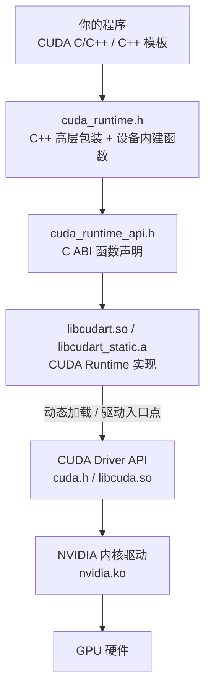

### 1.3 一次 kernel 启动发生了什么？

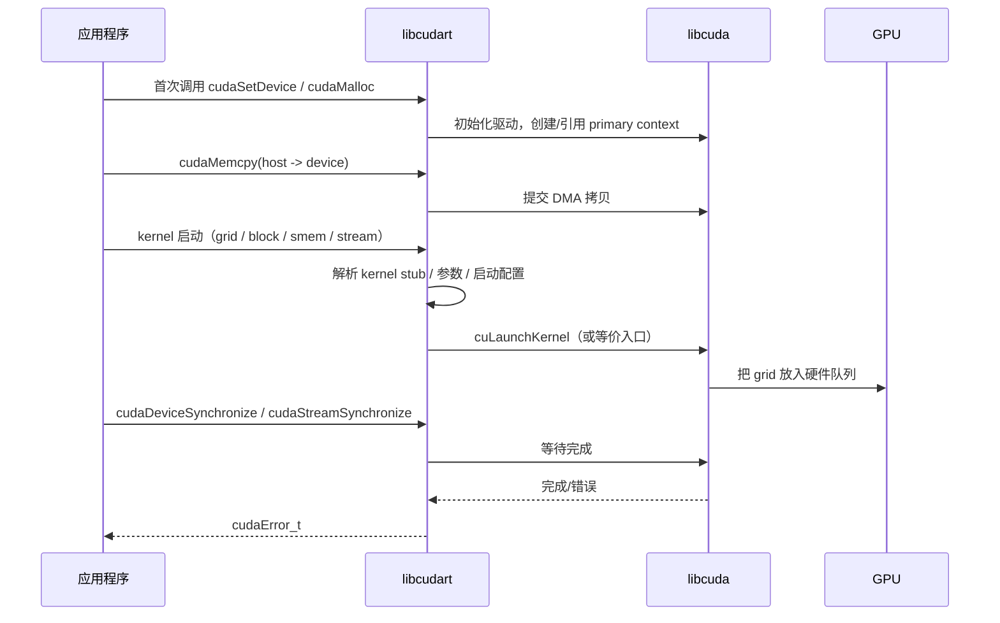

注意：**kernel 启动是异步的**。`<<<>>>` 返回时，kernel 通常还没执行完；很多错误要等到同步或后续 API 调用才会暴露。

### 1.4 编译、链接、运行三件套

```bash
# 编译：nvcc 会自动处理 CUDA 头文件、设备代码、fatbin
nvcc -arch=sm_90 -O2 -o app app.cu

# 运行：需要驱动 + GPU；Runtime 会在第一次调用时初始化
./app
```

- `nvcc` 把设备代码编译成 `sm_90` 的 SASS（以及可选的 PTX），嵌进可执行文件；
- 主机代码链接 `libcudart`（默认静态或动态，取决于 `--cudart`）；
- 运行时从 fatbin 注册 kernel，`<<<>>>` 最终走 `cudaLaunchKernel` / `cudaLaunchKernelExC`。

---

## 2. 代码目录

### 2.1 CUDA Toolkit 安装目录

本机 `CUDA_HOME=/usr/local/cuda`，实际指向 `/usr/local/cuda-13.0`：

```text
/usr/local/cuda-13.0/
├── bin/                    # nvcc、cuobjdump、nvdisasm、compute-sanitizer 等
├── include -> targets/x86_64-linux/include
├── lib64   -> targets/x86_64-linux/lib
├── targets/x86_64-linux/
│   ├── include/            # 186 个头文件
│   └── lib/                # libcudart、cuBLAS、NPP 等（cuDNN/NCCL 通常单独安装）
├── nvvm/                   # libdevice、NVVM 相关
│   ├── bin/
│   ├── include/
│   ├── lib64/
│   └── libdevice/
├── nvml/                   # NVML 头文件/库
├── gds/                    # GPUDirect Storage
├── compute-sanitizer/      # 内存/竞态检查工具
├── extras/
├── tools/
├── doc/  DOCS/  share/  src/
├── version.json            # 各组件精确版本
├── README
└── EULA.txt
```

`/usr/local/cuda` 是一个 alternatives 软链接，方便多版本切换：

```text
/usr/local/cuda -> /etc/alternatives/cuda
/usr/local/cuda-13 -> /etc/alternatives/cuda-13
```

### 2.2 Runtime 相关头文件地图

| 头文件 | 行数（约） | 作用 |
|---|---:|---|
| `cuda_runtime.h` | 2636 | Runtime 的总入口；包含 API 头、类型头、设备内建函数、C++ 高层包装 |
| `cuda_runtime_api.h` | 13963 | **C ABI 主体**：所有 `cudaXxx` 函数声明、功能分组、同步/异步语义说明 |
| `driver_types.h` | 4110 | 核心类型/枚举/结构体：`cudaError_t`、`cudaDeviceProp`、`cudaStream_t`、`cudaGraph_t` 等 |
| `vector_types.h` | 604 | `int2`、`float4`、`dim3` 等向量/维度类型 |
| `channel_descriptor.h` | 599 | `cudaChannelFormatDesc`、`cudaCreateChannelDesc` |
| `texture_types.h` | 180 | 纹理类型与纹理对象描述 |
| `surface_types.h` | 111 | 表面类型与表面对象描述 |
| `library_types.h` | 174 | `cudaDataType`（FP16/BF16/FP8/FP6/FP4 等） |
| `cuda_device_runtime_api.h` | 915 | 设备端 Runtime API（动态并行） |
| `cuda_occupancy.h` | 2197 | 占用率计算辅助（头文件实现） |
| `cuda_fp16.h` | 5363 | `__half` / 半精度类型与运算 |
| `cuda_bf16.h` | 5118 | `__nv_bfloat16` / BF16 类型与运算 |
| `cuda_fp8.h` | 496 | FP8 类型（E4M3/E5M2 等） |
| `cuda_fp6.h` | 362 | FP6 类型 |
| `cuda_fp4.h` | 357 | FP4 类型 |
| `cuda.h` | 26007 | **CUDA Driver API**（不是 Runtime，但 Runtime 底层依赖它） |
| `cudaTypedefs.h` | 715 | Driver API 函数指针 typedef，配合 `cudaGetDriverEntryPoint` |
| `nvrtc.h` | 1150 | 运行时编译 CUDA C++ 到 PTX（NVRTC，独立库） |
| `cuda_profiler_api.h` | - | 控制 profiler 的启停 |
| `cudaGL.h` / `cudaEGL.h` / `cudaVDPAU.h` | - | 图形互操作 |

### 2.3 头文件的包含关系

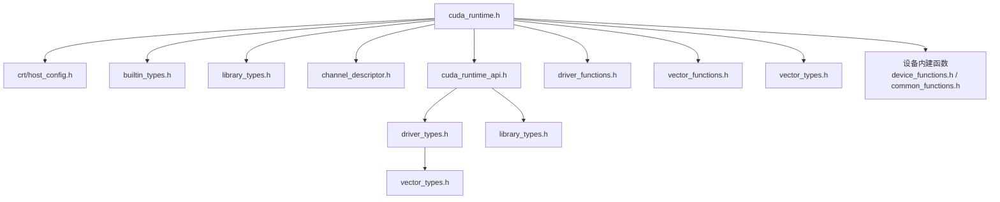

关键理解：

- **`cuda_runtime.h` 是“给应用开发者用的 umbrella header”**；
- **`cuda_runtime_api.h` 是“ABI 合同”**，C 编译器也能用；它在 C++ 下用 `extern "C"`（`:283`）包住声明，并用 `__dv(...)` 提供默认参数；
- **`driver_types.h` 是“类型字典”**，API 和 Driver API 共享大量类型；
- `cuda_runtime.h` 里的 C++ 模板/重载最终调用 `cuda_runtime_api.h` 里的 C 函数。

### 2.4 `libcudart` 二进制

```text
libcudart.so -> libcudart.so.13 -> libcudart.so.13.0.96   # 共享库
libcudart_static.a                                        # 静态库
```

本机观察：

- 共享库约 **688 KiB**，导出约 **423** 个符号；
- 静态库约 **1.3 MiB**；
- `readelf -d` 显示它只依赖 `libc`、`ld-linux`、`libdl`、`libpthread`、`librt`，**不直接依赖 `libcuda.so`**；
- 这说明 Runtime 通过 `dlopen("libcuda.so.1")` + 驱动入口点（`cudaGetDriverEntryPoint`）访问驱动，而不是链接期绑定。

### 2.5 代码目录小结

**CUDA Runtime 的“源码”不在安装包里，但头文件就是它的公开设计图**：

- `cuda_runtime.h` 给你 C++ 友好入口；
- `cuda_runtime_api.h` 给出完整 C ABI 与功能分组；
- `driver_types.h` 定义所有共享类型；
- `libcudart.so` 是闭源实现，动态加载 `libcuda`。

读头文件 + 看导出符号 + 跑示例，是理解这层“闭源运行时”的最有效方式。

---

## 3. 架构设计

### 3.1 分层架构

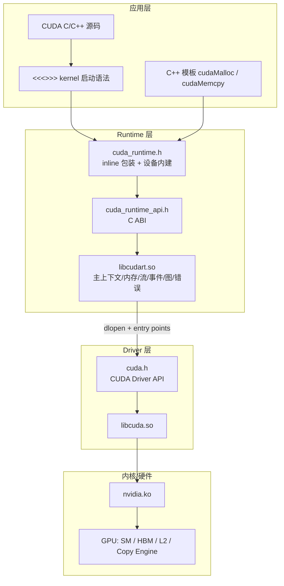

### 3.2 Runtime 的职责（从头文件与行为推断）

| 职责 | 说明 |
|---|---|
| 设备与上下文 | 管理每台设备的 **primary context**；`cudaSetDevice` 切换当前设备 |
| 延迟初始化 | 第一次 Runtime 调用才初始化驱动，减少启动开销 |
| 内核注册 | 解析 fatbin，把 host stub 与 device 代码关联 |
| 内核启动 | 把 `<<<>>>` 转成 launch 配置，提交到流 |
| 内存管理 | `cudaMalloc`、`cudaMallocHost`、`cudaMallocManaged`、数组、内存池 |
| 流与事件 | 异步执行、依赖、计时、回调 |
| 错误管理 | 返回 `cudaError_t`，维护当前线程的 last error |
| 图管理 | stream capture、图构建、实例化、重复 launch |
| 互操作 | OpenGL/D3D/VDPAU/EGL、外部内存/信号量、IPC |
| 版本与兼容 | `cudaRuntimeGetVersion` / `cudaDriverGetVersion` |
| 驱动入口 | `cudaGetDriverEntryPoint` 让应用拿到 Driver API 函数指针 |

### 3.3 设备与上下文模型

- Runtime 使用 **primary context**：每台设备一个，进程内共享；不需要手动 `cuCtxCreate`。
- `cudaSetDevice(i)` 设置“当前线程的当前设备”；后续 Runtime 调用默认作用于它。
- 多线程下每个线程有自己的“当前设备”和 last error；上下文本身是共享的。
- `cudaDeviceReset()` 会销毁当前设备的 primary context，**在多线程/多库环境中很危险**，通常只在进程退出前使用。
- Driver API 则要显式 `cuInit`、`cuCtxCreate`、`cuModuleLoad`；Runtime 把这些隐藏了。

### 3.4 流、事件与异步模型

- **流（stream）** 是 GPU 上的有序命令队列；同一流内顺序执行，不同流可并发。
- **默认流（legacy default stream）** 有隐式同步语义；`cudaStreamNonBlocking` 创建的流不与默认流隐式同步。
- **事件（event）** 用于跨流依赖和计时：`cudaEventRecord` 插入标记，`cudaStreamWaitEvent` 建立依赖，`cudaEventElapsedTime` 测时间。
- **kernel 启动、异步 memcpy、memset 都是异步的**；错误可能延迟暴露。
- 头文件开头专门解释了同步/异步 memcpy 的语义（`cuda_runtime_api.h` 的 `Memcpy` 章节）：pageable 内存可能触发 staging，pinned 内存才是真正异步。

### 3.5 内存模型

| 内存类型 | 分配方式 | 特点 |
|---|---|---|
| Device memory | `cudaMalloc` | GPU 显存，CPU 不能直接解引用 |
| Pinned host memory | `cudaMallocHost` / `cudaHostAlloc` | 页锁定，DMA 效率高，过量会拖慢系统 |
| Managed memory | `cudaMallocManaged` | CPU/GPU 统一地址，按需迁移 |
| CUDA Array | `cudaMallocArray` / `cudaMalloc3DArray` | 纹理/表面用的二维/三维布局 |
| Memory Pool | `cudaMallocAsync` / `cudaMemPoolCreate` | 流序分配，减少同步和碎片 |
| External memory | `cudaImportExternalMemory` | 导入 Vulkan/D3D/其他进程的内存 |

**UVA（Unified Virtual Addressing）**：现代 64 位 Linux 上，CPU 与 GPU 共享一个虚拟地址空间；因此 `cudaMemcpyDefault` 可以根据指针自动推断方向。`cudaDeviceProp.unifiedAddressing` 为 1 表示支持。

### 3.6 错误模型

- 大多数 Runtime API 返回 `cudaError_t`；`cudaSuccess == 0`。
- `cudaGetLastError()` 返回并**清除**当前线程的 last error；`cudaPeekAtLastError()` 只查看不清除。
- kernel 启动错误分两类：
  - **启动前错误**（参数、配置）通常由 `cudaGetLastError()` 立即返回；
  - **执行期错误**（越界、非法地址）要等同步/后续 API 才暴露，属于“粘性错误”（sticky error），可能导致后续调用连续失败。
- 推荐每个 API 都检查；至少在每个 kernel 启动后检查 `cudaGetLastError()`。

### 3.7 图（CUDA Graph）模型


- **capture**：把流上的操作录制成图；
- **instantiate**：把图编译成可执行图，做资源准备；
- **launch**：一次提交整张图，降低 CPU launch 开销；
- 节点类型包括 kernel、memcpy、memset、host、child graph、empty、event wait/record、external semaphore、mem alloc/free、conditional。
- 图适合“固定拓扑、重复执行”的推理/训练小算子序列。

### 3.8 版本与兼容

本机：

```text
runtime = 13000  (13.0)
driver  = 13010  (13.1)
```

- `cudaRuntimeGetVersion` 返回 Runtime 库版本；
- `cudaDriverGetVersion` 返回驱动支持的最高 CUDA 版本；
- 一般要求 **Runtime 版本 ≤ 驱动支持版本**；本机 13.0 ≤ 13.1，兼容。
- CUDA 的 minor version compatibility 允许较新的驱动跑较旧的 Runtime；反过来通常不行。
- 编译时的 `CUDART_VERSION` 是头文件版本；运行时 API 还可能受 `__CUDART_API_VERSION` 影响（见 `cuda_runtime_api.h:139`）。

### 3.9 为什么 `libcudart` 不直接链接 `libcuda`？

这是 CUDA Runtime 设计上的一个重要点：

- 应用可以在没有驱动开发库的机器上链接 CUDA Runtime；
- Runtime 在运行时通过 `dlopen` 找到 `libcuda.so.1`；
- 通过 `cudaGetDriverEntryPoint` / `cudaGetDriverEntryPointByVersion` 获取 Driver API 函数指针；
- 这样可以支持 Forward Compatibility、不同驱动版本、以及容器/精简镜像场景。

### 3.10 架构小结

**CUDA Runtime 是“面向应用的 GPU 操作系统封装”**：

- 向上提供简单、类型安全、C++ 友好的 API；
- 向下通过 Driver API 管理上下文、模块、内存和命令队列；
- 内部负责延迟初始化、primary context、fatbin、流/事件、图、错误状态；
- 通过动态加载驱动入口点，把“编译期依赖”变成“运行期依赖”。

---

## 4. 各模块详细介绍

> 下面的分组名称直接对应 `cuda_runtime_api.h` 中的 `\defgroup`。每个模块给出“职责 → 代表 API → 关键类型 → 小结”。
> 先看 4.0 的模块关系图，再进入单个模块；流与事件的关系是重点，单独放在 4.24。

### 4.0 模块之间的关系总览

CUDA Runtime 的模块不是孤立的。可以按“地基 → 执行 → 数据 → 高级能力 → 横切能力”来理解：

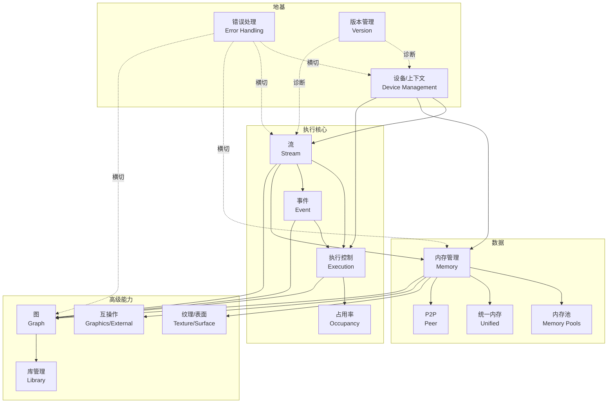

**关系矩阵**：

| 模块 | 直接依赖 | 被谁使用 | 关键交互 |
|---|---|---|---|
| 设备/上下文 | 驱动 | 几乎所有模块 | 决定“在哪张卡上执行” |
| 内存管理 | 设备/上下文 | 流、执行、图、纹理/表面、互操作 | 提供数据缓冲区 |
| 流 | 设备、内存 | 执行、事件、图、内存池 | 提供命令队列和顺序 |
| 事件 | 流、设备 | 流等待、计时、图、IPC | 提供跨流/主机可见的完成标记 |
| 执行控制 | 流、设备 | 占用率、图 | 把 kernel 发射到流 |
| 占用率 | 执行、设备属性 | 执行调参 | 估算 block/warp 驻留 |
| 图 | 流、执行、内存、事件 | 库管理、应用 | 把多条流操作打包成 DAG |
| 纹理/表面 | 内存（数组） | 图形互操作 | 提供缓存/插值/可写表面 |
| 互操作 | 内存、事件/信号量 | 图形/外部 API | 跨 API 共享资源 |
| 库管理 | 执行、图 | 动态 kernel 场景 | 运行时加载 kernel/库 |
| 错误处理 | 无（横切） | 所有模块 | 返回错误码、last error |
| 版本管理 | 无（横切） | 初始化/诊断 | Runtime 与 Driver 版本匹配 |

**三条主线**：

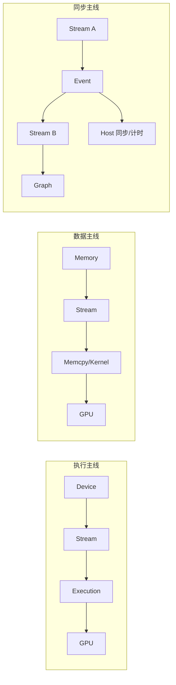

一句话记住：

- **Device/Context 是地基**：没有它，其他模块不知道操作哪张卡；
- **Stream 是命令队列**：kernel、memcpy、memset 都排进流；
- **Event 是流中的标记**：用来让别的流等待，或让主机知道“到点了”；
- **Memory 是数据**：流负责搬运/计算，内存负责存放；
- **Execution 是发射器**：把 kernel 真正提交到流；
- **Graph 是打包器**：把流操作录成 DAG，减少重复 launch 开销；
- **Texture/Surface/Interop 是桥**：连接图形/外部资源；
- **Error/Version 是横切能力**：所有模块都要用，但不属于某一条执行链。

### 4.1 设备管理（CUDART_DEVICE）

**职责**：枚举设备、查询属性、选择当前设备、同步/重置设备、设置设备级限制。

**代表 API**：

```c
cudaGetDeviceCount
cudaGetDeviceProperties
cudaGetDevice
cudaSetDevice
cudaChooseDevice
cudaInitDevice
cudaSetDeviceFlags
cudaSetValidDevices
cudaDeviceGetAttribute
cudaDeviceSynchronize
cudaDeviceReset
cudaDeviceSetLimit / cudaDeviceGetLimit
cudaDeviceSetCacheConfig / cudaDeviceGetCacheConfig
cudaDeviceGetStreamPriorityRange
cudaDeviceGetByPCIBusId / cudaDeviceGetPCIBusId
cudaIpcGetMemHandle / cudaIpcOpenMemHandle / cudaIpcCloseMemHandle
cudaDeviceFlushGPUDirectRDMAWrites
cudaDeviceRegisterAsyncNotification / cudaDeviceUnregisterAsyncNotification
```

**关键类型**：

- `cudaDeviceProp`：`driver_types.h:2467`，本机 `sizeof = 1008` 字节；
  - `name`、`uuid`、`totalGlobalMem`
  - `major/minor`（compute capability）
  - `multiProcessorCount`、`maxThreadsPerBlock`、`warpSize`
  - `sharedMemPerBlock`、`sharedMemPerMultiprocessor`
  - `regsPerMultiprocessor`、`maxBlocksPerMultiProcessor`
  - `l2CacheSize`、`persistingL2CacheMaxSize`
  - `memoryPoolsSupported`、`cooperativeLaunch`、`clusterLaunch`
  - `managedMemory`、`concurrentManagedAccess`、`pageableMemoryAccess`
- `cudaDeviceAttr`：`cudaDeviceGetAttribute` 的枚举参数，适合只查单个属性。

**本机属性**（案例 1 实测）：

```text
cc=9.0  SMs=78  warp=32  maxThreads/block=1024
globalMem=139.8 GiB  sharedMem/block=48.0 KiB  sharedMem/SM=228.0 KiB
regs/SM=65536  maxBlocks/SM=32  L2=60.0 MiB  asyncEngines=3
unifiedAddressing=1  managedMemory=1  pageableAccess=0
concurrentManagedAccess=1  memoryPools=1  cooperative=1  cluster=1
```

**小结**：设备管理是“进门第一步”。先 `cudaGetDeviceCount` / `cudaGetDeviceProperties`，再 `cudaSetDevice`，后面所有 API 都作用于当前设备。

---

### 4.2 错误处理（CUDART_ERROR）

**职责**：返回、查询、解释错误；初始化设备；设置设备标志。

**代表 API**：

```c
cudaGetLastError
cudaPeekAtLastError
cudaGetErrorName
cudaGetErrorString
cudaGetDeviceCount
cudaGetDeviceProperties
cudaDeviceGetAttribute
```

> 设备初始化/选择相关的 `cudaInitDevice`、`cudaChooseDevice`、`cudaSetDevice`、`cudaSetDeviceFlags`、`cudaSetValidDevices` 在功能上属于设备管理，见 4.1。

**关键类型**：

- `cudaError_t`：4 字节枚举，`cudaSuccess = 0`，其余为错误码。
- `cudaError` 枚举在 `driver_types.h:192`，头文件中定义了上百个错误码（如 `cudaErrorMemoryAllocation`、`cudaErrorInvalidValue`、`cudaErrorIllegalAddress`）。
- 错误码有“可恢复”和“粘性”之分；非法的设备地址通常是粘性的，后续调用可能连续失败。

**最佳实践**：

```c
#define CUDA_CHECK(call) do { \
    cudaError_t err = (call); \
    if (err != cudaSuccess) { \
        fprintf(stderr, "%s:%d: %s (%s)\n", __FILE__, __LINE__, \
                cudaGetErrorName(err), cudaGetErrorString(err)); \
        exit(EXIT_FAILURE); \
    } \
} while (0)
```

**小结**：错误处理不是“可选项”。CUDA 的异步特性决定了：不检查错误，问题会以更难定位的方式出现。

---

### 4.3 流管理（CUDART_STREAM）

**职责**：创建/销毁流，控制流内顺序、跨流依赖、回调、优先级、属性、capture。

**代表 API**：

```c
cudaStreamCreate
cudaStreamCreateWithFlags
cudaStreamCreateWithPriority
cudaStreamDestroy
cudaStreamSynchronize
cudaStreamQuery
cudaStreamWaitEvent
cudaStreamAddCallback
cudaStreamGetPriority / cudaStreamGetFlags
cudaStreamGetId / cudaStreamGetDevice
cudaStreamCopyAttributes
cudaStreamGetAttribute / cudaStreamSetAttribute
cudaStreamBeginCapture / cudaStreamEndCapture / cudaStreamIsCapturing
cudaStreamBeginCaptureToGraph
cudaThreadExchangeStreamCaptureMode
cudaCtxResetPersistingL2Cache
cudaStreamAttachMemAsync
```

**关键行为**：

- 默认流（`0`）有隐式同步；`cudaStreamNonBlocking` 创建的流不与默认流同步。
- `cudaStreamWaitEvent` 可以建立跨流依赖，是“多流流水线”的核心。
- `cudaStreamAddCallback` 可以在流中插入主机回调（注意：回调里不要调用 CUDA API）。
- capture 模式用于把流操作录制成图，见 4.11。

**小结**：流是 CUDA 并发的“命令队列”。想让拷贝和计算重叠，必须用非默认流 + 事件依赖。流与事件的完整关系见 4.24。

---

### 4.4 事件管理（CUDART_EVENT）

**职责**：跨流同步、计时、IPC。

**代表 API**：

```c
cudaEventCreate
cudaEventCreateWithFlags
cudaEventRecord
cudaEventRecordWithFlags
cudaEventSynchronize
cudaEventQuery
cudaEventElapsedTime
cudaEventDestroy
cudaIpcGetEventHandle / cudaIpcOpenEventHandle
```

**关键行为**：

- `cudaEventRecord(event, stream)` 在流中插入标记；
- `cudaStreamWaitEvent(stream2, event, 0)` 让 stream2 等待该标记；
- `cudaEventElapsedTime` 只能用于同一设备上的两个事件；
- `cudaEventDisableTiming` 可以关闭计时，降低开销。

**小结**：事件是“流之间的红绿灯”。计时只是它的一个用途，更重要的是建立依赖。事件如何与流配合、如何影响主机和 GPU 的同步，详见 4.24。

---

### 4.5 执行控制（CUDART_EXECUTION）

**职责**：启动 kernel、设置函数属性、查询参数、启动 cooperative kernel、主机回调、获取 kernel 句柄。

**代表 API**：

```c
cudaLaunchKernel
cudaLaunchKernelEx / cudaLaunchKernelExC
cudaLaunchCooperativeKernel
cudaFuncSetCacheConfig
cudaFuncGetAttributes
cudaFuncSetAttribute
cudaFuncGetName
cudaFuncGetParamInfo
cudaLaunchHostFunc
cudaKernel_t
```

**启动配置**（`driver_types.h:4018`）：

```c
typedef struct cudaLaunchConfig_st {
    dim3 gridDim;
    dim3 blockDim;
    size_t dynamicSmemBytes;
    cudaStream_t stream;
    cudaLaunchAttribute *attrs;
    unsigned int numAttrs;
} cudaLaunchConfig_t;
```

**启动属性**（`driver_types.h:3746`）包括：

- `cudaLaunchAttributeAccessPolicyWindow`：L2 访问策略窗口；
- `cudaLaunchAttributeCooperative`：cooperative launch；
- `cudaLaunchAttributeClusterDimension`：线程块集群；
- `cudaLaunchAttributeClusterSchedulingPolicyPreference`；
- `cudaLaunchAttributeProgrammaticStreamSerialization`；
- `cudaLaunchAttributeProgrammaticEvent`；
- `cudaLaunchAttributePriority`；
- `cudaLaunchAttributeMemSyncDomain` / `MemSyncDomainMap`；
- `cudaLaunchAttributePreferredClusterDimension`。

**小结**：`<<<>>>` 是语法糖，底层是 `cudaLaunchKernel`；需要 cluster、L2 策略、优先级等高级能力时，用 `cudaLaunchKernelEx` + `cudaLaunchConfig_t`。

---

### 4.6 占用率（CUDART_OCCUPANCY）

**职责**：给定 kernel 和 block size，估算 SM 上能同时驻留多少 block、推荐 block size、动态共享内存上限、cluster 占用。

**代表 API**：

```c
cudaOccupancyMaxActiveBlocksPerMultiprocessor
cudaOccupancyMaxActiveBlocksPerMultiprocessorWithFlags
cudaOccupancyMaxPotentialBlockSize
cudaOccupancyMaxPotentialBlockSizeWithFlags
cudaOccupancyMaxPotentialBlockSizeVariableSMem
cudaOccupancyMaxPotentialBlockSizeVariableSMemWithFlags
cudaOccupancyAvailableDynamicSMemPerBlock
cudaOccupancyMaxPotentialClusterSize
cudaOccupancyMaxActiveClusters
```

**关键概念**：

- **Occupancy = 活跃 warp 数 / SM 最大 warp 数**；
- 受寄存器、共享内存、block 数、warp 数限制；
- 高占用率不等于高性能；有时低占用 + 更多 ILP 更快。

**小结**：占用率 API 是“调参助手”，不是性能保证。先用它排除明显不合理的 block size，再用 profiler 看真实瓶颈。

---

### 4.7 内存管理（CUDART_MEMORY）

**职责**：分配/释放设备内存、pinned 主机内存、managed 内存、数组、mipmapped 数组；同步/异步拷贝；memset；内存建议与预取。

**代表 API**：

```c
cudaMalloc / cudaFree
cudaMallocHost / cudaHostAlloc / cudaFreeHost
cudaMallocManaged
cudaMallocPitch / cudaMalloc3D
cudaMallocArray / cudaMalloc3DArray / cudaMallocMipmappedArray
cudaMemcpy / cudaMemcpy2D / cudaMemcpy3D
cudaMemcpyAsync / cudaMemcpy2DAsync / cudaMemcpy3DAsync
cudaMemcpyPeer / cudaMemcpyPeerAsync
cudaMemcpyToSymbol / cudaMemcpyFromSymbol
cudaMemcpyToArray / cudaMemcpyFromArray / cudaMemcpyArrayToArray
cudaMemset / cudaMemset2D / cudaMemset3D
cudaMemAdvise
cudaMemPrefetchAsync
cudaMemPrefetchBatchAsync
cudaMemDiscardBatchAsync
cudaMemDiscardAndPrefetchBatchAsync
cudaMemcpyBatchAsync
cudaMemcpy3DBatchAsync
cudaPointerGetAttributes
cudaHostRegister / cudaHostUnregister / cudaHostGetFlags
cudaHostGetDevicePointer
cudaMemGetInfo
```

**`cudaMemcpyKind`**（`driver_types.h:1245`）：

```c
cudaMemcpyHostToHost
cudaMemcpyHostToDevice
cudaMemcpyDeviceToHost
cudaMemcpyDeviceToDevice
cudaMemcpyDefault   // 依赖 UVA，根据指针推断方向
```

**同步/异步语义**（`cuda_runtime_api.h` 开头的说明）：

- pageable host → device：可能先 staging 到 pinned 内存，函数返回不代表 DMA 完成；
- pinned host ↔ device：真正异步；
- device → host：同步版本会等拷贝完成；
- device → device：不同步主机；
- kernel launch 始终异步。

**CUDA 13 的重要变化**：

```c
// CUDA 13 的签名（cuda_runtime_api.h:7152）
cudaError_t cudaMemPrefetchAsync(const void *devPtr, size_t count,
                                 struct cudaMemLocation location,
                                 unsigned int flags, cudaStream_t stream);
```

旧代码常见的 `cudaMemPrefetchAsync(ptr, bytes, device)` 在 CUDA 13 中不再适用；要构造 `cudaMemLocation`：

```c
cudaMemLocation loc{};
loc.type = cudaMemLocationTypeDevice;
loc.id = device;
cudaMemPrefetchAsync(ptr, bytes, loc, 0, stream);
```

**批量 API**（CUDA 13 新增/增强）：

```c
cudaMemcpyBatchAsync(dsts, srcs, sizes, count, attrs, attrsIdxs, numAttrs, stream);
cudaMemcpy3DBatchAsync(...);
cudaMemPrefetchBatchAsync(dptrs, sizes, count, prefetchLocs, prefetchLocIdxs, numPrefetchLocs, flags, stream);
cudaMemDiscardBatchAsync(dptrs, sizes, count, flags, stream);
cudaMemDiscardAndPrefetchBatchAsync(...);
```

适合“很多小块内存”的场景，减少逐个 API 调用的 CPU 开销。

注意：头文件注释要求这些批量 API 使用**非 legacy NULL stream**；批量整体按 stream 顺序执行，但批量内部各操作不保证顺序，因此不要把有依赖的拷贝放进同一批。

**小结**：内存管理是 Runtime 最常用的模块。先分清 device / pinned / managed / array / pool，再决定用同步还是异步、单次还是批量。

---

### 4.8 流序内存分配器 / 内存池（CUDART_MEMORY_POOLS）

**职责**：用流序（stream-ordered）方式分配/释放内存，减少 `cudaMalloc` 的全局同步和碎片。

**代表 API**：

```c
cudaMallocAsync
cudaFreeAsync
cudaMallocFromPoolAsync
cudaMemPoolCreate / cudaMemPoolDestroy
cudaMemPoolTrimTo
cudaMemPoolSetAttribute / cudaMemPoolGetAttribute
cudaMemPoolSetAccess / cudaMemPoolGetAccess
cudaDeviceGetDefaultMemPool / cudaDeviceSetMemPool / cudaDeviceGetMemPool
cudaMemGetDefaultMemPool / cudaMemGetMemPool / cudaMemSetMemPool
cudaMemPoolExportToShareableHandle / cudaMemPoolImportFromShareableHandle
cudaMemPoolExportPointer / cudaMemPoolImportPointer
```

**关键类型**：

- `cudaMemPool_t`：内存池句柄；
- `cudaMemPoolProps`（`driver_types.h:2204`）：分配类型、handle 类型、location、最大池大小、usage；
- `cudaMemLocation`（`driver_types.h:2147`）：device / host / host NUMA。

**行为**：

- `cudaMallocAsync` 的分配和释放都排在同一 stream 上；
- 释放后内存回到池中，不一定立刻还给驱动；
- 适合“每层/每轮迭代临时分配”的推理框架；
- 本机 `cudaDevAttrMemoryPoolsSupported = 1`，可用。

**小结**：内存池是“高频分配/释放”场景的解法；它把分配变成流内操作，避免传统 `cudaMalloc` 的同步代价。

---

### 4.9 统一寻址与统一内存（CUDART_UNIFIED）

**职责**：让 CPU/GPU 共享地址空间；提供 managed memory 的建议、预取、附着。

**代表 API**：

```c
cudaMallocManaged
cudaMemAdvise
cudaMemPrefetchAsync
cudaStreamAttachMemAsync
cudaPointerGetAttributes
cudaHostAlloc
cudaHostGetDevicePointer
cudaMallocHost
cudaHostRegister
```

**关键概念**：

- **UVA**：统一虚拟地址，`cudaMemcpyDefault` 依赖它；
- **Managed Memory**：`cudaMallocManaged` 分配，CPU/GPU 都可访问，页按需迁移；
- **Prefetch**：提前把页迁到目标位置，减少缺页；
- **MemAdvise**：告诉运行时“这块数据主要谁用”“只读”等，优化迁移策略。

**本机属性**：

```text
managedMemory=1
concurrentManagedAccess=1
pageableMemoryAccess=0
```

说明支持 managed memory 和并发访问；pageable 直接访问不可用（很多 Linux dGPU 系统都是这样）。

**小结**：统一内存让编程更简单，但性能取决于迁移和访问模式；热数据要 prefetch，频繁跨设备访问要谨慎。

---

### 4.10 对等设备内存访问（CUDART_PEER）

**职责**：查询/启用/禁用 GPU 之间的 P2P 访问。

**代表 API**：

```c
cudaDeviceCanAccessPeer
cudaDeviceEnablePeerAccess
cudaDeviceDisablePeerAccess
cudaMemcpyPeer
cudaMemcpyPeerAsync
```

**本机实测**：8 张 H20-3e 两两 `cudaDeviceCanAccessPeer` 均为 1：

```text
P2P access matrix (1 = can access peer):
    0 1 2 3 4 5 6 7
0:  - 1 1 1 1 1 1 1
1:  1 - 1 1 1 1 1 1
...
7:  1 1 1 1 1 1 1 -
```

具体拓扑（NVLink / PCIe / NUMA）建议用 `nvidia-smi topo -m` 查看。

**小结**：P2P 让 GPU 直接读写彼此显存，减少主机中转；使用前先查能力，再决定是否 `cudaDeviceEnablePeerAccess`。

---

### 4.11 图管理（CUDART_GRAPH）

**职责**：构建、实例化、更新、启动 CUDA Graph。

**代表 API**：

```c
cudaGraphCreate
cudaGraphAddKernelNode
cudaGraphAddMemcpyNode
cudaGraphAddMemsetNode
cudaGraphAddHostNode
cudaGraphAddChildGraphNode
cudaGraphAddEmptyNode
cudaGraphAddEventWaitNode / cudaGraphAddEventRecordNode
cudaGraphAddExternalSemaphoresSignalNode / WaitNode
cudaGraphAddMemAllocNode / cudaGraphAddMemFreeNode
cudaGraphAddNode / cudaGraphAddDependencies
cudaGraphInstantiate
cudaGraphInstantiateWithParams
cudaGraphExecUpdate
cudaGraphLaunch
cudaGraphUpload
cudaGraphClone
cudaGraphDestroy
cudaGraphExecDestroy
cudaStreamBeginCapture
cudaStreamEndCapture
cudaStreamIsCapturing
```

**节点类型**（`driver_types.h:3390`）：

```text
Kernel / Memcpy / Memset / Host / Graph / Empty
WaitEvent / EventRecord
ExtSemaphoreSignal / ExtSemaphoreWait
MemAlloc / MemFree
Conditional
```

**两种构建方式**：

1. **stream capture**：先正常写流操作，再 `BeginCapture` / `EndCapture` 录制；
2. **手动构图**：`cudaGraphCreate` + `cudaGraphAdd*Node` + `cudaGraphAddDependencies`。

**实例化参数**（`driver_types.h:3587`）：

```c
typedef struct cudaGraphInstantiateParams_st {
    unsigned long long flags;
    cudaStream_t uploadStream;
    cudaGraphNode_t errNode_out;
    cudaGraphInstantiateResult result_out;
} cudaGraphInstantiateParams;
```

**小结**：图是“把一串小操作打包成一张 DAG”。适合固定拓扑、重复执行；capture 最省事，手动构图更灵活。

---

### 4.12 纹理对象（CUDART_TEXTURE_OBJECT）

**职责**：创建/销毁纹理对象，查询纹理描述。

**代表 API**：

```c
cudaCreateChannelDesc
cudaGetChannelDesc
cudaCreateTextureObject
cudaDestroyTextureObject
cudaGetTextureObjectResourceDesc
cudaGetTextureObjectTextureDesc
cudaGetTextureObjectResourceViewDesc
cudaDeviceGetTexture1DLinearMaxWidth
```

**关键类型**：

- `cudaChannelFormatDesc`（`channel_descriptor.h`）：通道类型/位宽；
- `cudaTextureObject_t`：64 位句柄；
- `cudaResourceDesc`：资源类型（线性内存、数组、mipmapped 数组）；
- `cudaTextureDesc`：寻址模式、过滤、归一化坐标、读取模式。

**小结**：纹理对象适合图像/稀疏访问/硬件插值；现代代码优先用纹理对象，而不是旧的纹理引用。

---

### 4.13 表面对象（CUDART_SURFACE_OBJECT）

**职责**：创建/销毁表面对象，查询表面资源描述。

**代表 API**：

```c
cudaCreateSurfaceObject
cudaDestroySurfaceObject
cudaGetSurfaceObjectResourceDesc
```

**关键类型**：

- `cudaSurfaceObject_t`：64 位句柄；
- `cudaResourceDesc`：指定底层数组/线性内存。

**小结**：表面用于“可写纹理”，常见于图像处理、渲染互操作；普通计算优先用全局内存。

---

### 4.14 图形互操作（CUDART_INTEROP）

**职责**：让 CUDA 与 OpenGL / Direct3D / VDPAU / EGL 共享资源。

**代表 API**：

```c
cudaGraphicsGLRegisterBuffer
cudaGraphicsGLRegisterImage
cudaGraphicsD3D9RegisterResource
cudaGraphicsD3D10RegisterResource
cudaGraphicsD3D11RegisterResource
cudaGraphicsEGLRegisterImage
cudaGraphicsVDPAURegisterVideoSurface
cudaGraphicsMapResources
cudaGraphicsUnmapResources
cudaGraphicsResourceGetMappedPointer
cudaGraphicsSubResourceGetMappedArray
cudaGraphicsResourceGetMappedMipmappedArray
cudaGraphicsResourceSetMapFlags
cudaGraphicsUnregisterResource
```

**小结**：互操作是“渲染 + 计算”的桥梁；使用时注意 map/unmap 生命周期和同步。

---

### 4.15 外部资源互操作（CUDART_EXTRES_INTEROP）

**职责**：导入外部内存/信号量（Vulkan、D3D12、RDMA、其他进程等）。

**代表 API**：

```c
cudaImportExternalMemory
cudaExternalMemoryGetMappedBuffer
cudaExternalMemoryGetMappedMipmappedArray
cudaDestroyExternalMemory
cudaImportExternalSemaphore
cudaSignalExternalSemaphoresAsync
cudaWaitExternalSemaphoresAsync
cudaDestroyExternalSemaphore
```

**关键类型**：

- `cudaExternalMemory_t`
- `cudaExternalSemaphore_t`
- `cudaExternalMemoryHandleType`
- `cudaExternalSemaphoreHandleType`

**小结**：外部互操作是现代多 API 管线的关键；它让 CUDA 不必拷贝就能使用 Vulkan/D3D/RDMA 的内存。

---

### 4.16 版本管理（CUDART__VERSION）

**代表 API**：

```c
cudaRuntimeGetVersion
cudaDriverGetVersion
```

**本机**：

```text
cudaRuntimeGetVersion = 13000
cudaDriverGetVersion  = 13010
```

**小结**：上线前先打印这两个版本；排查“编译能过、运行报错”时，版本不匹配是常见原因。

---

### 4.17 错误日志管理（CUDART_LOGS）

**职责**：注册日志回调、导出 Runtime 内部日志。

**代表 API**：

```c
cudaLogsRegisterCallback
cudaLogsUnregisterCallback
cudaLogsCurrent
cudaLogsDumpToFile
cudaLogsDumpToMemory
```

**小结**：这是较新的调试能力，适合排查驱动/Runtime 内部问题；普通业务代码不常用。

---

### 4.18 Driver Entry Point Access（CUDART_DRIVER_ENTRY_POINT）

**职责**：让应用在只链接 Runtime 的情况下，拿到 Driver API 函数指针。

**代表 API**：

```c
cudaGetDriverEntryPoint
cudaGetDriverEntryPointByVersion
```

**为什么重要**：

- `libcudart.so` 不直接链接 `libcuda.so`；
- 它通过动态加载 + entry point 访问驱动；
- 应用也可以用同样方式按需调用 Driver API，而不直接链接 `-lcuda`。

**小结**：这是 Runtime 与 Driver 之间的“暗门”，也是 CUDA 运行期兼容性的关键。

---

### 4.19 库管理（CUDART_LIBRARY）

**职责**：加载 CUDA 库（cubin/fatbin）、获取 kernel/global/函数、枚举 kernel、设置属性。

**代表 API**：

```c
cudaLibraryLoadData
cudaLibraryLoadFromFile
cudaLibraryUnload
cudaLibraryGetKernel
cudaLibraryGetGlobal
cudaLibraryGetManaged
cudaLibraryGetUnifiedFunction
cudaLibraryGetKernelCount
cudaLibraryEnumerateKernels
cudaKernelSetAttributeForDevice
cudaGetExportTable
```

**关键类型**：

- `cudaLibrary_t`（`driver_types.h:3261`）
- `cudaKernel_t`（`driver_types.h:3048`）

**小结**：库管理让 Runtime 支持“运行时加载已编译代码”，是插件化/动态 kernel 场景的基础。

---

### 4.20 C++ 高层 API（CUDART_HIGHLEVEL）

**职责**：`cuda_runtime.h` 里的模板和内联函数，提供类型安全、少写 `sizeof`/强制转换的接口。

**典型能力**：

```cpp
// 类型推导
cudaMalloc(&devPtr, n * sizeof(T));          // T* devPtr
cudaMallocManaged(&devPtr, n * sizeof(T));
cudaMemcpy(dst, src, n * sizeof(T), cudaMemcpyHostToDevice);

// kernel 启动
cudaLaunchKernel(kernel, grid, block, args, sharedMem, stream);
cudaLaunchKernelEx(config, kernel, args...);

// 占用率
cudaOccupancyMaxActiveBlocksPerMultiprocessor(&blocks, kernel, blockSize, smem);
cudaOccupancyMaxPotentialBlockSize(&grid, &block, kernel, smem, limit);

// 符号
cudaGetSymbolAddress(&ptr, symbol);
cudaGetSymbolSize(&size, symbol);

// 图
cudaGraphInstantiate(&exec, graph, flags);
cudaGraphExecUpdate(exec, graph, &resultInfo);
```

**本机 `cuda_runtime.h` 中出现的高层函数名约 61 个**，包括 `cudaMalloc`、`cudaMemcpy`、`cudaLaunchKernel`、`cudaOccupancy*`、`cudaGraph*`、`cudaLibrary*` 等。

**小结**：C++ 高层 API 不是“另一套运行时”，而是对 C ABI 的模板包装；它让代码更短、更安全，但底层仍是同一批 `cudaXxx` 函数。

---

### 4.21 设备端 Runtime API（`cuda_device_runtime_api.h`）

**职责**：让 device 代码（动态并行）在 GPU 上调用部分 Runtime API。

**典型能力**：

```c
// 在 __global__ / __device__ 函数中
cudaMalloc(&ptr, size);
cudaFree(ptr);
cudaMemcpy(...);
cudaDeviceSynchronize();
cudaStreamCreate / cudaStreamDestroy / cudaStreamSynchronize
cudaEventCreate / cudaEventRecord / cudaEventSynchronize
```

**限制**：

- 需要动态并行支持（compute capability 3.5+；H20 9.0 支持）；
- 设备端启动 kernel 有额外开销；
- 不是所有 host 端 API 都能在 device 端调用；
- 递归/嵌套并行要控制深度。

**小结**：设备端 Runtime 是“GPU 上再启动 GPU 工作”的能力；适合自适应细分，不适合滥用。

---

### 4.22 类型系统与低精度类型

**核心类型**：

| 类型 | 位置 | 说明 |
|---|---|---|
| `cudaError_t` | `driver_types.h` | 错误码，4 字节 |
| `cudaDeviceProp` | `driver_types.h:2467` | 设备属性，本机 1008 字节 |
| `cudaStream_t` | `driver_types.h` | 不透明流句柄 |
| `cudaEvent_t` | `driver_types.h` | 不透明事件句柄 |
| `cudaGraph_t` / `cudaGraphExec_t` | `driver_types.h` | 图/可执行图句柄 |
| `cudaMemPool_t` | `driver_types.h` | 内存池句柄 |
| `cudaTextureObject_t` / `cudaSurfaceObject_t` | `driver_types.h` | 64 位对象句柄 |
| `dim3`、`int2`、`float4` | `vector_types.h` | 维度/向量类型 |
| `cudaDataType` | `library_types.h:57` | FP16/BF16/FP8/FP6/FP4/整型等数据类型 |

**低精度头文件**：

- `cuda_fp16.h`：`__half`、`__half2`、转换与算术；
- `cuda_bf16.h`：`__nv_bfloat16`、`__nv_bfloat162`；
- `cuda_fp8.h`：`__nv_fp8_e4m3`、`__nv_fp8_e5m2` 等；
- `cuda_fp6.h`、`cuda_fp4.h`：更新的低精度类型。

H20 属于 Hopper，支持 FP8 张量核心；FP6/FP4 是否可用取决于具体硬件、编译器和库版本，使用前查对应文档。

**小结**：类型系统是 API 的“共同语言”；低精度类型主要服务于 AI 训练/推理和库（cuBLAS/cuDNN）的数据类型描述。

---

### 4.23 与 Driver API 的交互（CUDART_DRIVER）

**职责**：Runtime 内部把许多调用转发给 Driver API；这一组也暴露了一些“桥接”函数。

**代表 API**：

```c
cudaGetDriverEntryPoint / cudaGetDriverEntryPointByVersion
cudaGetFuncBySymbol
cudaGetKernel
cudaMemcpy
cudaMemcpyToSymbol / cudaMemcpyFromSymbol
cudaGraphInstantiateWithParams
cudaGraphUpload
cudaGraphLaunch
cudaStreamBeginCaptureToGraph
cudaStreamGetCaptureInfo
cudaStreamUpdateCaptureDependencies
cudaMemPrefetchAsync
cudaMemcpyBatchAsync
```

**小结**：Runtime 不是“替代 Driver”，而是“Driver 的易用封装”。需要更细粒度控制（显式 context、module、VMM、IPC）时，直接上 Driver API。

---

### 4.24 Stream 与 Event 的关系（重点专题）

#### 4.24.1 一句话理解

- **Stream 是队列**：kernel、memcpy、memset 按提交顺序排队执行。
- **Event 是队列中的“里程碑/栅栏”**：它不执行工作、不携带数据，只记录“某条流在某个时刻之前提交的工作已经完成”。
- **`cudaEventRecord` = 在流里插旗**；**`cudaStreamWaitEvent` = 让另一条流等这面旗**；**`cudaEventSynchronize` = 让主机等这面旗**。

#### 4.24.2 对象关系图

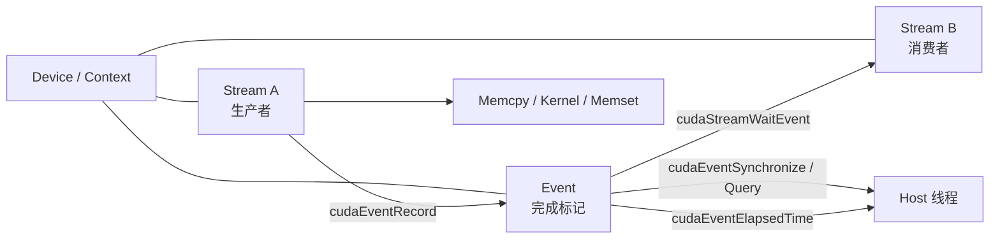

关键点：

- Event 属于某个 **device/context**；`cudaEventRecord` 要求 event 和 stream 在**同一个 CUDA context**。
- Event 记录的是“**调用那一刻**流里已经提交的工作”，之后往流里再提交的工作不会改变这个 event。
- 一个 event 可以被**多条流**等待（fan-out）。
- 一个 event 可以被**重复 record**，每次覆盖之前的状态。

#### 4.24.3 核心规则（直接对应头文件语义）

1. **record 是“快照”**：`cudaEventRecord(e, streamA)` 捕获 streamA 在调用时刻已提交的工作；之后 streamA 再提交的工作不属于这个 event。
2. **wait 只影响未来工作**：`cudaStreamWaitEvent(streamB, e, 0)` 让 streamB **之后提交**的工作等待 e；调用前已经提交的工作不受影响。
3. **wait 不阻塞主机**：它是设备端依赖，主机可以继续提交；`cudaEventSynchronize` 才阻塞主机。
4. **event 可以跨设备等待**：头文件明确说明 `event may be from a different device than stream`；但跨设备同步的性能/拓扑要单独评估。
5. **event 可以重复 record**：重复 record 会覆盖之前的状态；`cudaStreamWaitEvent` 使用**调用时最近一次捕获的状态**，之后的 record 不会反过来影响已经建立的 wait。
6. **未 record 的 event 是“空集”**：第一次 record 之前，`cudaEventQuery` 会返回 `cudaSuccess`。
7. **event 不传递数据**：它只表达“完成”，不表达“哪块 buffer 可读”。数据依赖要靠 buffer 的先后写入/读取顺序和 event 的等待关系共同保证。
8. **计时事件必须启用 timing**：`cudaEventDisableTiming` 的事件不能用于 `cudaEventElapsedTime`（会返回 `cudaErrorInvalidResourceHandle`）。
9. **计时不是绝对精确**：`cudaEventElapsedTime` 分辨率约 0.5 µs；如果事件在非 NULL 流中 record，测得的时间可能包含其他流操作，未必是“纯两事件之间”的间隔；而且它不保证返回最新错误，判断完成请用 `cudaEventQuery`。
10. **`cudaEventSynchronize` 的等待方式**：创建时带 `cudaEventBlockingSync` 则线程阻塞睡眠；不带则可能忙等（busy-wait）。
11. **销毁可以发生在完成前**：`cudaEventDestroy` 不会阻塞等待未完成事件；资源会在事件完成后释放，但句柄销毁后不能再使用。
12. **IPC 事件**：`cudaEventInterprocess` 必须和 `cudaEventDisableTiming` 一起用，配合 `cudaIpcGetEventHandle` / `cudaIpcOpenEventHandle`。
13. **图捕获的 external 事件**：`cudaEventRecordWithFlags(..., cudaEventRecordExternal)` 和 `cudaStreamWaitEvent(..., cudaEventWaitExternal)` 会把事件捕获为图中的 external event 节点。

**默认流提醒**：`cudaEventRecord(e, 0)` 捕获的是 legacy default stream 的内容；默认流有隐式同步语义，容易让多流程序“看起来并行了，实际上没有”。做流水线时优先用 `cudaStreamNonBlocking` 创建的非默认流。

**事件标志速查**：

| 标志 | 用于 | 作用 | 注意 |
|---|---|---|---|
| `cudaEventDefault` | create | 默认事件 | 可用于计时 |
| `cudaEventBlockingSync` | create | `cudaEventSynchronize` 时阻塞睡眠 | 不忙等，CPU 占用低 |
| `cudaEventDisableTiming` | create | 不记录计时数据 | 不能用于 `cudaEventElapsedTime`；等待/查询性能最好 |
| `cudaEventInterprocess` | create | 可导出为进程间事件 | 必须同时带 `cudaEventDisableTiming` |
| `cudaEventRecordDefault` | record | 普通记录 | 默认行为 |
| `cudaEventRecordExternal` | record | 捕获为图的外部事件节点 | 用于跨 capture 的图 |
| `cudaEventWaitDefault` | wait | 普通等待 | 默认行为 |
| `cudaEventWaitExternal` | wait | 捕获为图的外部事件等待节点 | 用于跨 capture 的图 |

**与图（Graph）的关系**：

- 在 stream capture 期间，`cudaEventRecord` 会变成图中的 **event record 节点**，`cudaStreamWaitEvent` 会变成 **event wait 节点**；
- 普通跨流依赖在 capture 后变成图中的边/节点依赖；
- 需要跨 capture 边界的事件时，用 `cudaEventRecordExternal` / `cudaEventWaitExternal`。

**与内存/内存池的关系**：

- `cudaMemcpyAsync` 必须在某个 stream 上，event 可以标记“这次拷贝完成”；
- `cudaMallocAsync` / `cudaFreeAsync` 也是 stream-ordered，event 可以标记“分配/释放完成”；
- 事件本身不持有内存，不要用 event 代替 buffer 生命周期管理。

#### 4.24.4 生产者-消费者时序图

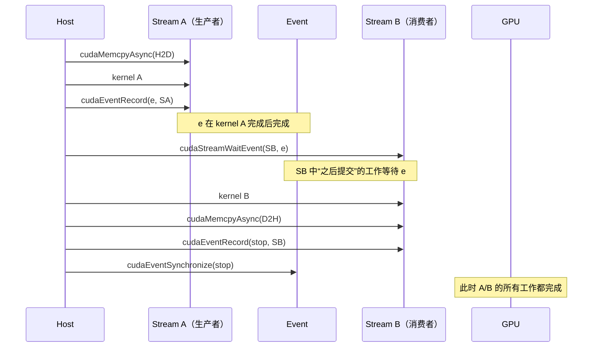

注意图中顺序：**先 record，再 wait**。如果先 wait 一个还没 record 的 event，它等价于等待“空集”，不会建立你想要的依赖。

#### 4.24.5 事件生命周期

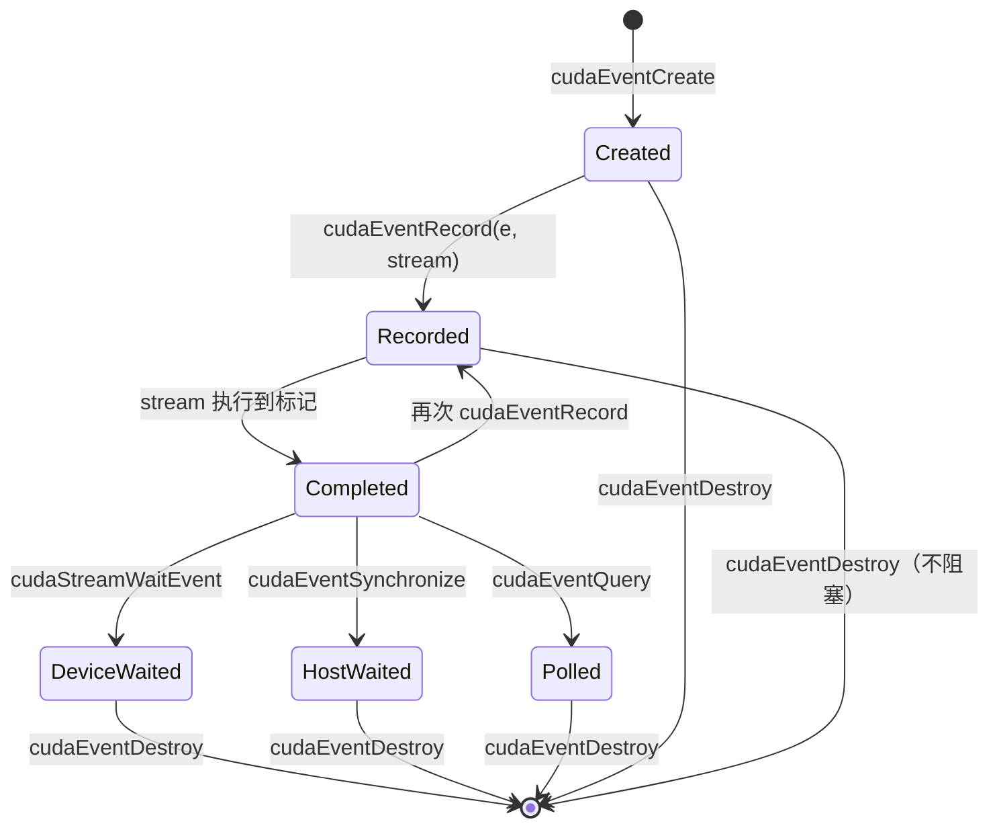

关键理解：

- **Recorded ≠ Completed**：record 只是把标记放进队列，真正完成要等 GPU 执行到那里。
- **Completed 是事件的状态**，不是“主机已经知道”；主机要知道，需要 `cudaEventSynchronize` 或 `cudaEventQuery`。
- **DeviceWaited 是设备端等待**，主机可能完全不知道。
- **重复 record** 会让事件回到“已记录、等待完成”的状态。

#### 4.24.6 六种同步/查询方式对比

| API | 作用对象 | 是否阻塞主机 | 影响范围 | 典型用途 |
|---|---|---|---|---|
| `cudaStreamWaitEvent(stream, event, 0)` | 流 | 否 | 该流**之后提交**的工作 | 跨流依赖、流水线 |
| `cudaEventSynchronize(event)` | 事件 | 是 | 等待该事件最近一次 record 完成 | 主机等待某个阶段 |
| `cudaEventQuery(event)` | 事件 | 否 | 查询是否完成 | 轮询/非阻塞检查 |
| `cudaStreamSynchronize(stream)` | 流 | 是 | 等待该流所有已提交工作 | 阶段结束、调试 |
| `cudaDeviceSynchronize()` | 设备 | 是 | 等待该设备所有流 | 全局收尾、调试 |
| `cudaStreamQuery(stream)` | 流 | 否 | 查询流是否完成 | 非阻塞轮询 |

**选择建议**：

- 只想让 **GPU 上的 B 流等 A 流**：用 `cudaStreamWaitEvent`，不要用 `cudaEventSynchronize`（后者会把主机也拖住）。
- 想让 **主机等某个阶段**：用 `cudaEventSynchronize`。
- 想 **非阻塞检查**：用 `cudaEventQuery` / `cudaStreamQuery`。
- 想 **等整条流/整张卡**：用 `cudaStreamSynchronize` / `cudaDeviceSynchronize`，但不要在高频循环里滥用。

#### 4.24.7 四种常见模式

**模式 A：跨流依赖（生产者/消费者）**


**模式 B：fan-out（一个事件，多条流等待）**

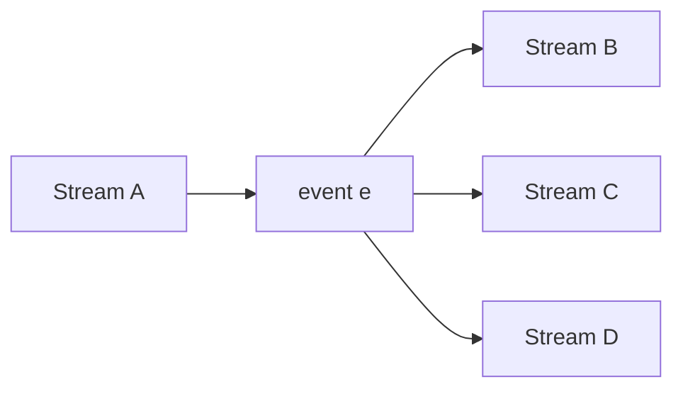

**模式 C：fan-in（多条流完成后再汇合）**

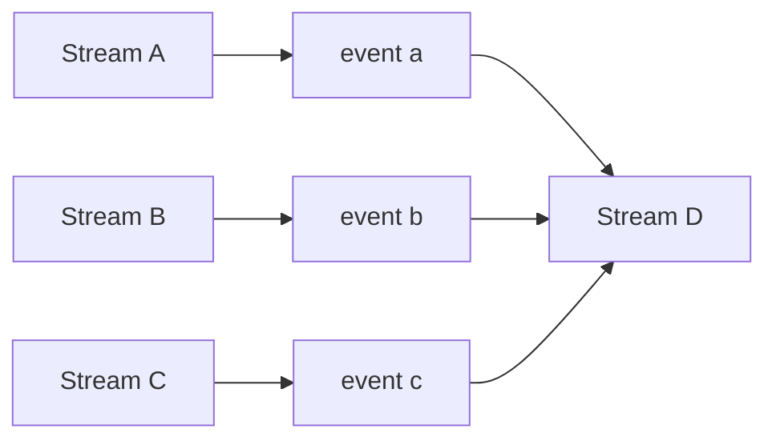

**模式 D：分段流水线（Ping-Pong）**


这些模式的核心都是同一件事：**event 记录一个阶段的完成，stream wait 把下一个阶段接到这个完成点上**。

#### 4.24.8 代码案例：两条流 + 一个依赖事件 + 计时事件

```cuda
#include <cstdio>
#include <cuda_runtime.h>

#define CHECK(x) do { cudaError_t e = (x); if (e != cudaSuccess) { \
    std::printf("CUDA error at %s:%d: %s (%s)\n", __FILE__, __LINE__, \
                cudaGetErrorName(e), cudaGetErrorString(e)); return 1; } } while (0)

__global__ void scaleByTwo(float* data, int n) {
    int i = blockIdx.x * blockDim.x + threadIdx.x;
    if (i < n) data[i] *= 2.0f;
}

__global__ void addOne(float* data, int n) {
    int i = blockIdx.x * blockDim.x + threadIdx.x;
    if (i < n) data[i] += 1.0f;
}

int main() {
    const int n = 1 << 20;
    const size_t bytes = n * sizeof(float);

    float* hostIn = nullptr;
    float* hostOut = nullptr;
    CHECK(cudaMallocHost(&hostIn, bytes));
    CHECK(cudaMallocHost(&hostOut, bytes));
    for (int i = 0; i < n; ++i) hostIn[i] = 1.0f;

    float* device = nullptr;
    CHECK(cudaMalloc(&device, bytes));

    cudaStream_t producer, consumer;
    CHECK(cudaStreamCreateWithFlags(&producer, cudaStreamNonBlocking));
    CHECK(cudaStreamCreateWithFlags(&consumer, cudaStreamNonBlocking));

    // 只用于跨流依赖：关闭 timing，开销更低。
    cudaEvent_t producerDone;
    CHECK(cudaEventCreateWithFlags(&producerDone, cudaEventDisableTiming));

    // 用于整体计时：必须启用 timing。
    cudaEvent_t start, stop;
    CHECK(cudaEventCreate(&start));
    CHECK(cudaEventCreate(&stop));

    CHECK(cudaEventRecord(start, producer));

    // producer：H2D -> kernel A
    CHECK(cudaMemcpyAsync(device, hostIn, bytes, cudaMemcpyHostToDevice, producer));
    scaleByTwo<<<(n + 255) / 256, 256, 0, producer>>>(device, n);
    CHECK(cudaGetLastError());
    CHECK(cudaEventRecord(producerDone, producer));

    // consumer：等 producerDone -> kernel B -> D2H
    CHECK(cudaStreamWaitEvent(consumer, producerDone, 0));
    addOne<<<(n + 255) / 256, 256, 0, consumer>>>(device, n);
    CHECK(cudaGetLastError());
    CHECK(cudaMemcpyAsync(hostOut, device, bytes, cudaMemcpyDeviceToHost, consumer));

    CHECK(cudaEventRecord(stop, consumer));
    CHECK(cudaEventSynchronize(stop));

    // stop 完成意味着 consumer 完成；producerDone 也一定完成。
    CHECK(cudaEventQuery(producerDone));

    float ms = 0.0f;
    CHECK(cudaEventElapsedTime(&ms, start, stop));

    int errors = 0;
    for (int i = 0; i < n; ++i) {
        if (hostOut[i] != 3.0f) ++errors;
    }
    std::printf("stream/event n=%d errors=%d elapsed=%.3f ms\n", n, errors, ms);

    CHECK(cudaEventDestroy(start));
    CHECK(cudaEventDestroy(stop));
    CHECK(cudaEventDestroy(producerDone));
    CHECK(cudaStreamDestroy(producer));
    CHECK(cudaStreamDestroy(consumer));
    CHECK(cudaFree(device));
    CHECK(cudaFreeHost(hostIn));
    CHECK(cudaFreeHost(hostOut));
    return errors == 0 ? 0 : 1;
}
```

本机输出：

```text
stream/event n=1048576 errors=0 elapsed=0.334 ms
```

这个例子同时展示了三种关系：

1. **流内顺序**：producer 中 `H2D → kernel A → event record` 严格有序；
2. **跨流依赖**：consumer 的 `kernel B` 必须等 `producerDone`；
3. **主机同步**：`cudaEventSynchronize(stop)` 让主机等到 consumer 的 D2H 完成。

#### 4.24.9 常见坑

| 坑 | 现象 | 正确做法 |
|---|---|---|
| record 了但没 wait | 两条流完全并发，消费者可能读到旧数据 | 在消费者流上 `cudaStreamWaitEvent` |
| wait 了但 event 从未 record | wait 等价于等空集，没有依赖 | 先 record，再 wait |
| 用 event 传数据 | event 不携带 buffer/所有权 | 用 buffer + event 依赖 |
| 在错误的流上 record | 依赖点不对，可能提前/延后 | record 在“生产者流”的最后一个操作之后 |
| `cudaEventElapsedTime` 用了 `cudaEventDisableTiming` | 返回 `cudaErrorInvalidResourceHandle` | 计时事件用 `cudaEventCreate` / `cudaEventDefault` |
| 在 stop 未完成时取时间 | 返回 `cudaErrorNotReady` | 先 `cudaEventSynchronize(stop)` |
| 用 `cudaEventSynchronize` 做跨流依赖 | 主机被阻塞，流水线退化 | 用 `cudaStreamWaitEvent` |
| 频繁创建/销毁 event | CPU 开销大 | 复用 event，必要时用 `cudaEventDisableTiming` |
| event 已销毁还在 wait | 未定义行为 | 销毁前确保没有未完成的 wait/record |
| 多线程共享 event | 上下文/线程语义混乱 | 明确 event 所属 device/context，避免跨线程误用 |

#### 4.24.10 小结

**Stream 与 Event 的关系可以压缩成三句话**：

1. **Stream 负责“顺序”**：同一流内，工作按提交顺序执行。
2. **Event 负责“完成点”**：在流中 record，表示“这之前的工作完成了”。
3. **Wait 负责“跨流接线”**：`cudaStreamWaitEvent` 把另一条流接到这个完成点上；`cudaEventSynchronize` 把主机接到这个完成点上。

只要记住“**record 插旗、wait 接线、synchronize 等旗**”，绝大多数多流/异步问题都能拆解清楚。

---

## 5. 使用方法

### 5.1 环境变量

本机已配置：

```bash
CUDA_HOME=/usr/local/cuda
PATH=/usr/local/cuda/bin:...
LD_LIBRARY_PATH=/usr/local/cuda/lib64:...
```

常用变量：

| 变量 | 作用 |
|---|---|
| `CUDA_HOME` | Toolkit 根目录 |
| `PATH` | 找到 `nvcc` |
| `LD_LIBRARY_PATH` | 找到 `libcudart.so` 等 |
| `CUDA_VISIBLE_DEVICES` | 只暴露指定 GPU，如 `0,1` |
| `CUDA_LAUNCH_BLOCKING=1` | 让 kernel 启动同步，便于定位错误（会严重降低性能） |
| `CUDA_MODULE_LOADING=LAZY` | 延迟加载模块，减少启动时间 |
| `CUDA_CACHE_PATH` | JIT 缓存目录 |
| `CUDA_FORCE_PTX_JIT=1` | 强制使用 PTX JIT，便于调试 |

### 5.2 编译

**最简单**：

```bash
nvcc -arch=sm_90 -O2 -o app app.cu
```

**推荐**：

```bash
nvcc -arch=sm_90 -O3 -lineinfo -Xcompiler -Wall -o app app.cu
```

- `-arch=sm_90`：为 H20 生成 SASS；
- `-arch=native`：让 nvcc 自动检测本机架构（适合本机运行，不适合分发）；
- `-gencode arch=compute_90,code=sm_90`：显式控制 PTX/SASS；
- `-lineinfo`：保留行号信息，方便 profiler 定位；
- `-Xcompiler`：把参数传给主机编译器。

**共享/静态 Runtime**：

```bash
# 默认（本机 nvcc dryrun 显示 -lcudart_static）
nvcc -arch=sm_90 -o app app.cu

# 显式共享
nvcc -arch=sm_90 --cudart=shared -o app app.cu

# 显式静态
nvcc -arch=sm_90 --cudart=static -o app app.cu
```

> 注意：默认值可能随 nvcc 版本/发行版变化。分发二进制前用 `ldd app` 确认是否依赖 `libcudart.so`。

### 5.3 用 g++/clang 手动编译

如果主机代码用 g++ 编译，需要自己加头文件和库：

```bash
g++ -I$CUDA_HOME/include -c main.cpp
g++ main.o -L$CUDA_HOME/lib64 -lcudart -o app
```

静态：

```bash
g++ main.o -L$CUDA_HOME/lib64 -lcudart_static -ldl -lrt -pthread -o app
```

但设备代码（`.cu` 里的 kernel）仍需要 nvcc 编译；常见做法是 `nvcc -c` 生成 `.o`，再和 g++ 目标文件链接。

### 5.4 CMake

```cmake
cmake_minimum_required(VERSION 3.20)
project(cuda_runtime_demo LANGUAGES CXX CUDA)

find_package(CUDAToolkit REQUIRED)

add_executable(app app.cu)
target_compile_features(app PRIVATE cxx_std_17)
set_target_properties(app PROPERTIES
    CUDA_ARCHITECTURES 90
    CUDA_STANDARD 17
)
target_link_libraries(app PRIVATE CUDA::cudart)
# 或静态：CUDA::cudart_static
```

### 5.5 最小可运行程序

```cuda
#include <cstdio>
#include <cuda_runtime.h>

int main() {
    int count = 0;
    cudaError_t err = cudaGetDeviceCount(&count);
    if (err != cudaSuccess) {
        std::printf("CUDA error: %s\n", cudaGetErrorString(err));
        return 1;
    }
    std::printf("devices = %d\n", count);
    for (int i = 0; i < count; ++i) {
        cudaDeviceProp prop{};
        cudaGetDeviceProperties(&prop, i);
        std::printf("[%d] %s cc=%d.%d\n", i, prop.name, prop.major, prop.minor);
    }
    return 0;
}
```

### 5.6 错误检查模板

```cuda
#define CUDA_CHECK(call) do { \
    cudaError_t err = (call); \
    if (err != cudaSuccess) { \
        std::fprintf(stderr, "CUDA error %s:%d: %s (%s)\n", \
                     __FILE__, __LINE__, cudaGetErrorName(err), \
                     cudaGetErrorString(err)); \
        std::exit(EXIT_FAILURE); \
    } \
} while (0)
```

kernel 启动后至少：

```cuda
kernel<<<grid, block>>>(...);
CUDA_CHECK(cudaGetLastError());
```

需要确认执行完成再：

```cuda
CUDA_CHECK(cudaDeviceSynchronize());
```

### 5.7 调试与性能工具

| 工具 | 用途 |
|---|---|
| `compute-sanitizer` | 内存越界、未初始化、竞态检查 |
| `nsys` / Nsight Systems | 时间线、拷贝/计算重叠、API 调用 |
| `ncu` / Nsight Compute | kernel 级指标、占用率、内存吞吐 |
| `cuda-gdb` | 设备代码调试 |
| `cuobjdump` / `nvdisasm` | 查看 SASS/PTX |
| NVTX | 在 profiler 中标记代码区间 |

示例：

```bash
compute-sanitizer --tool memcheck ./app
nsys profile -o report ./app
ncu --set full -o profile ./app
```

### 5.8 CUDA 13 迁移注意

本机是 CUDA 13.0，读旧代码时注意：

1. **`cudaMemPrefetchAsync` 签名变化**：现在必须传 `cudaMemLocation`、`flags`、`stream`；
2. **批量 API**：`cudaMemcpyBatchAsync`、`cudaMemPrefetchBatchAsync`、`cudaMemDiscardBatchAsync` 等更适合大量小块传输；
3. **deprecated 分组**：`cuda_runtime_api.h` 中带 `[DEPRECATED]` 的设备管理/执行/内存分组（如旧的 shared memory config、array copy API）应尽量替换；
4. **`cudaMemLocation` 支持 host NUMA**：`cudaMemLocationTypeHostNuma`、`HostNumaCurrent`；
5. **图能力增强**：`cudaGraphInstantiateWithParams`、conditional node、`cudaGraphAddNode`；
6. **日志能力**：`cudaLogs*` 可用于内部诊断；
7. **库管理**：`cudaLibrary*` / `cudaKernel_t` 支持更动态的加载方式。

### 5.9 常见坑

| 现象 | 常见原因 |
|---|---|
| `cudaErrorMemoryAllocation` | 显存不足 / 碎片 / 其他进程占用 |
| `cudaErrorIllegalAddress` | 越界访问，且通常是粘性错误 |
| kernel 没执行 | 启动配置非法、参数错误、未检查 `cudaGetLastError()` |
| 拷贝很慢 | 用了 pageable 内存；应使用 pinned + 异步 |
| 多流没有重叠 | 默认流同步 / 依赖没建好 / 拷贝和计算在同一流 |
| managed memory 抖动 | 没有 prefetch / 频繁跨设备访问 |
| 图 capture 失败 | capture 期间调用了不支持的 API（同步、事件查询等） |
| 程序退出时报错 | 在析构阶段调用 CUDA API，Runtime 已卸载 |
| 多线程随机崩溃 | primary context / `cudaDeviceReset` / 每线程当前设备管理不当 |

### 5.10 使用小结

**日常开发的最短路径**：

1. `cudaGetDeviceCount` / `cudaGetDeviceProperties` 确认设备；
2. `cudaSetDevice` 选卡；
3. `cudaMalloc` + `cudaMemcpy` 准备数据；
4. `kernel<<<grid, block>>>` 启动；
5. `cudaGetLastError` + `cudaDeviceSynchronize` 检查；
6. 性能不够时，再引入 pinned memory、多流、事件、图、内存池。

---

## 6. 代码案例

> 以下代码均在本机 CUDA 13.0 + H20-3e 上实际编译运行过（`nvcc -arch=sm_90 -O2`）。
> 输出是“本机一次运行”的结果，不代表所有机器。

### 案例 1：设备信息查询

```cuda
#include <cstdio>
#include <cuda_runtime.h>

#define CHECK(x) do { cudaError_t e = (x); if (e != cudaSuccess) { \
    std::printf("CUDA error at %s:%d: %s (%s)\n", __FILE__, __LINE__, \
                cudaGetErrorName(e), cudaGetErrorString(e)); return 1; } } while (0)

int main() {
    int runtimeVersion = 0, driverVersion = 0;
    CHECK(cudaRuntimeGetVersion(&runtimeVersion));
    CHECK(cudaDriverGetVersion(&driverVersion));

    int count = 0;
    CHECK(cudaGetDeviceCount(&count));
    std::printf("cudaRuntimeGetVersion = %d\n", runtimeVersion);
    std::printf("cudaDriverGetVersion  = %d\n", driverVersion);
    std::printf("device count          = %d\n\n", count);

    for (int i = 0; i < count; ++i) {
        cudaDeviceProp p{};
        CHECK(cudaGetDeviceProperties(&p, i));

        int memoryPools = 0, cooperative = 0, cluster = 0;
        int managed = 0, pageable = 0, concurrentManaged = 0;
        CHECK(cudaDeviceGetAttribute(&memoryPools, cudaDevAttrMemoryPoolsSupported, i));
        CHECK(cudaDeviceGetAttribute(&cooperative, cudaDevAttrCooperativeLaunch, i));
        CHECK(cudaDeviceGetAttribute(&cluster, cudaDevAttrClusterLaunch, i));
        CHECK(cudaDeviceGetAttribute(&managed, cudaDevAttrManagedMemory, i));
        CHECK(cudaDeviceGetAttribute(&pageable, cudaDevAttrPageableMemoryAccess, i));
        CHECK(cudaDeviceGetAttribute(&concurrentManaged, cudaDevAttrConcurrentManagedAccess, i));

        std::printf("[%d] %s\n", i, p.name);
        std::printf("    cc=%d.%d  SMs=%d  warp=%d  maxThreads/block=%d\n",
                    p.major, p.minor, p.multiProcessorCount, p.warpSize,
                    p.maxThreadsPerBlock);
        std::printf("    globalMem=%.1f GiB  sharedMem/block=%.1f KiB  sharedMem/SM=%.1f KiB\n",
                    p.totalGlobalMem / 1024.0 / 1024.0 / 1024.0,
                    p.sharedMemPerBlock / 1024.0,
                    p.sharedMemPerMultiprocessor / 1024.0);
        std::printf("    regs/SM=%d  maxBlocks/SM=%d  L2=%.1f MiB  asyncEngines=%d\n",
                    p.regsPerMultiprocessor, p.maxBlocksPerMultiProcessor,
                    p.l2CacheSize / 1024.0 / 1024.0, p.asyncEngineCount);
        std::printf("    unifiedAddressing=%d  managedMemory=%d  pageableAccess=%d\n",
                    p.unifiedAddressing, managed, pageable);
        std::printf("    concurrentManagedAccess=%d  memoryPools=%d  cooperative=%d  cluster=%d\n\n",
                    concurrentManaged, memoryPools, cooperative, cluster);
    }
    return 0;
}
```

本机输出（节选）：

```text
cudaRuntimeGetVersion = 13000
cudaDriverGetVersion  = 13010
device count          = 8

[0] NVIDIA H20-3e
    cc=9.0  SMs=78  warp=32  maxThreads/block=1024
    globalMem=139.8 GiB  sharedMem/block=48.0 KiB  sharedMem/SM=228.0 KiB
    regs/SM=65536  maxBlocks/SM=32  L2=60.0 MiB  asyncEngines=3
    unifiedAddressing=1  managedMemory=1  pageableAccess=0
    concurrentManagedAccess=1  memoryPools=1  cooperative=1  cluster=1
```

---

### 案例 2：向量加法 + 事件计时

```cuda
#include <cstdio>
#include <cuda_runtime.h>

#define CHECK(x) do { cudaError_t e = (x); if (e != cudaSuccess) { \
    std::printf("CUDA error at %s:%d: %s (%s)\n", __FILE__, __LINE__, \
                cudaGetErrorName(e), cudaGetErrorString(e)); return 1; } } while (0)

__global__ void vectorAdd(const float* a, const float* b, float* c, int n) {
    int i = blockIdx.x * blockDim.x + threadIdx.x;
    if (i < n) {
        c[i] = a[i] + b[i];
    }
}

int main() {
    const int n = 1 << 24;
    const size_t bytes = n * sizeof(float);

    float* hA = nullptr;
    float* hB = nullptr;
    float* hC = nullptr;
    CHECK(cudaHostAlloc(&hA, bytes, cudaHostAllocDefault));
    CHECK(cudaHostAlloc(&hB, bytes, cudaHostAllocDefault));
    CHECK(cudaHostAlloc(&hC, bytes, cudaHostAllocDefault));

    for (int i = 0; i < n; ++i) {
        hA[i] = 1.0f;
        hB[i] = 2.0f;
    }

    float* dA = nullptr;
    float* dB = nullptr;
    float* dC = nullptr;
    CHECK(cudaMalloc(&dA, bytes));
    CHECK(cudaMalloc(&dB, bytes));
    CHECK(cudaMalloc(&dC, bytes));

    cudaStream_t stream;
    CHECK(cudaStreamCreateWithFlags(&stream, cudaStreamNonBlocking));

    cudaEvent_t start, stop;
    CHECK(cudaEventCreate(&start));
    CHECK(cudaEventCreate(&stop));

    CHECK(cudaEventRecord(start, stream));
    CHECK(cudaMemcpyAsync(dA, hA, bytes, cudaMemcpyHostToDevice, stream));
    CHECK(cudaMemcpyAsync(dB, hB, bytes, cudaMemcpyHostToDevice, stream));

    const int threads = 256;
    const int blocks = (n + threads - 1) / threads;
    vectorAdd<<<blocks, threads, 0, stream>>>(dA, dB, dC, n);
    CHECK(cudaGetLastError());

    CHECK(cudaMemcpyAsync(hC, dC, bytes, cudaMemcpyDeviceToHost, stream));
    CHECK(cudaEventRecord(stop, stream));
    CHECK(cudaEventSynchronize(stop));

    float ms = 0.0f;
    CHECK(cudaEventElapsedTime(&ms, start, stop));

    int errors = 0;
    for (int i = 0; i < n; ++i) {
        if (hC[i] != 3.0f) ++errors;
    }
    std::printf("n=%d blocks=%d threads=%d errors=%d time=%.3f ms\n",
                n, blocks, threads, errors, ms);

    CHECK(cudaEventDestroy(start));
    CHECK(cudaEventDestroy(stop));
    CHECK(cudaStreamDestroy(stream));
    CHECK(cudaFree(dA));
    CHECK(cudaFree(dB));
    CHECK(cudaFree(dC));
    CHECK(cudaFreeHost(hA));
    CHECK(cudaFreeHost(hB));
    CHECK(cudaFreeHost(hC));
    return errors == 0 ? 0 : 1;
}
```

本机输出：

```text
n=16777216 blocks=65536 threads=256 errors=0 time=3.898 ms
```

> 这里用 `cudaHostAlloc` 分配 pinned 内存，并用 `cudaStreamCreateWithFlags(cudaStreamNonBlocking)` 创建非默认流，才能真正发挥异步拷贝。

---

### 案例 3：统一内存 + prefetch（CUDA 13 写法）

```cuda
#include <cstdio>
#include <cuda_runtime.h>

#define CHECK(x) do { cudaError_t e = (x); if (e != cudaSuccess) { \
    std::printf("CUDA error at %s:%d: %s (%s)\n", __FILE__, __LINE__, \
                cudaGetErrorName(e), cudaGetErrorString(e)); return 1; } } while (0)

__global__ void scale(float* data, int n, float factor) {
    int i = blockIdx.x * blockDim.x + threadIdx.x;
    if (i < n) data[i] *= factor;
}

int main() {
    const int n = 1 << 20;
    const size_t bytes = n * sizeof(float);

    int device = 0;
    CHECK(cudaGetDevice(&device));

    float* data = nullptr;
    CHECK(cudaMallocManaged(&data, bytes));

    for (int i = 0; i < n; ++i) data[i] = 1.0f;

    // CUDA 13：使用 cudaMemLocation，而不是裸 device 序号
    cudaMemLocation location{};
    location.type = cudaMemLocationTypeDevice;
    location.id = device;
    CHECK(cudaMemPrefetchAsync(data, bytes, location, 0, 0));

    scale<<<(n + 255) / 256, 256>>>(data, n, 2.0f);
    CHECK(cudaGetLastError());
    CHECK(cudaDeviceSynchronize());

    int errors = 0;
    for (int i = 0; i < n; ++i) {
        if (data[i] != 2.0f) ++errors;
    }
    std::printf("unified memory n=%d errors=%d\n", n, errors);

    CHECK(cudaFree(data));
    return errors == 0 ? 0 : 1;
}
```

本机输出：

```text
unified memory n=1048576 errors=0
```

> 如果你从旧代码迁移，编译器会直接报“no suitable constructor exists to convert from int to cudaMemLocation”，这就是 CUDA 13 的签名变化。

---

### 案例 4：CUDA Graph（stream capture）

```cuda
#include <cstdio>
#include <cuda_runtime.h>

#define CHECK(x) do { cudaError_t e = (x); if (e != cudaSuccess) { \
    std::printf("CUDA error at %s:%d: %s (%s)\n", __FILE__, __LINE__, \
                cudaGetErrorName(e), cudaGetErrorString(e)); return 1; } } while (0)

__global__ void addOne(float* data, int n) {
    int i = blockIdx.x * blockDim.x + threadIdx.x;
    if (i < n) data[i] += 1.0f;
}

int main() {
    const int n = 1 << 20;
    const size_t bytes = n * sizeof(float);

    float* data = nullptr;
    CHECK(cudaMallocManaged(&data, bytes));
    for (int i = 0; i < n; ++i) data[i] = 0.0f;

    cudaStream_t capture;
    CHECK(cudaStreamCreate(&capture));

    CHECK(cudaStreamBeginCapture(capture, cudaStreamCaptureModeGlobal));
    addOne<<<(n + 255) / 256, 256, 0, capture>>>(data, n);
    addOne<<<(n + 255) / 256, 256, 0, capture>>>(data, n);
    cudaGraph_t graph = nullptr;
    CHECK(cudaStreamEndCapture(capture, &graph));

    cudaGraphExec_t graphExec = nullptr;
    CHECK(cudaGraphInstantiate(&graphExec, graph, 0));

    CHECK(cudaGraphLaunch(graphExec, capture));
    CHECK(cudaStreamSynchronize(capture));

    int errors = 0;
    for (int i = 0; i < n; ++i) {
        if (data[i] != 2.0f) ++errors;
    }
    std::printf("graph n=%d errors=%d\n", n, errors);

    CHECK(cudaGraphExecDestroy(graphExec));
    CHECK(cudaGraphDestroy(graph));
    CHECK(cudaStreamDestroy(capture));
    CHECK(cudaFree(data));
    return errors == 0 ? 0 : 1;
}
```

本机输出：

```text
graph n=1048576 errors=0
```

> capture 期间不要调用同步 API、事件查询等；这些会让 capture 失败。

---

### 案例 5：内存池 `cudaMallocAsync`

```cuda
#include <cstdio>
#include <cuda_runtime.h>

#define CHECK(x) do { cudaError_t e = (x); if (e != cudaSuccess) { \
    std::printf("CUDA error at %s:%d: %s (%s)\n", __FILE__, __LINE__, \
                cudaGetErrorName(e), cudaGetErrorString(e)); return 1; } } while (0)

__global__ void fill(float* data, int n, float value) {
    int i = blockIdx.x * blockDim.x + threadIdx.x;
    if (i < n) data[i] = value;
}

int main() {
    const int n = 1 << 20;
    const size_t bytes = n * sizeof(float);

    cudaStream_t stream;
    CHECK(cudaStreamCreate(&stream));

    float* data = nullptr;
    CHECK(cudaMallocAsync(&data, bytes, stream));
    fill<<<(n + 255) / 256, 256, 0, stream>>>(data, n, 7.0f);
    CHECK(cudaGetLastError());

    float* host = nullptr;
    CHECK(cudaMallocHost(&host, bytes));
    CHECK(cudaMemcpyAsync(host, data, bytes, cudaMemcpyDeviceToHost, stream));
    CHECK(cudaStreamSynchronize(stream));

    int errors = 0;
    for (int i = 0; i < n; ++i) {
        if (host[i] != 7.0f) ++errors;
    }
    std::printf("mempool n=%d errors=%d\n", n, errors);

    CHECK(cudaFreeAsync(data, stream));
    CHECK(cudaStreamSynchronize(stream));
    CHECK(cudaStreamDestroy(stream));
    CHECK(cudaFreeHost(host));
    return errors == 0 ? 0 : 1;
}
```

本机输出：

```text
mempool n=1048576 errors=0
```

---

### 案例 6：P2P 能力矩阵

```cuda
#include <cstdio>
#include <cuda_runtime.h>

int main() {
    int count = 0;
    cudaGetDeviceCount(&count);
    std::printf("P2P access matrix (1 = can access peer):\n    ");
    for (int j = 0; j < count; ++j) std::printf("%d ", j);
    std::printf("\n");
    for (int i = 0; i < count; ++i) {
        std::printf("%d:  ", i);
        for (int j = 0; j < count; ++j) {
            if (i == j) { std::printf("- "); continue; }
            int can = 0;
            cudaDeviceCanAccessPeer(&can, i, j);
            std::printf("%d ", can);
        }
        std::printf("\n");
    }
    return 0;
}
```

本机输出：

```text
P2P access matrix (1 = can access peer):
    0 1 2 3 4 5 6 7
0:  - 1 1 1 1 1 1 1
1:  1 - 1 1 1 1 1 1
2:  1 1 - 1 1 1 1 1
3:  1 1 1 - 1 1 1 1
4:  1 1 1 1 - 1 1 1
5:  1 1 1 1 1 - 1 1
6:  1 1 1 1 1 1 - 1
7:  1 1 1 1 1 1 1 -
```

---

### 案例 7：C++ 高层 API

```cuda
#include <cstdio>
#include <cuda_runtime.h>

__global__ void addOne(float* data, int n) {
    int i = blockIdx.x * blockDim.x + threadIdx.x;
    if (i < n) data[i] += 1.0f;
}

int main() {
    const int n = 1024;
    float* device = nullptr;

    // 模板推导，少写强制转换
    cudaMalloc(&device, n * sizeof(float));

    float host[n];
    for (int i = 0; i < n; ++i) host[i] = 0.0f;
    cudaMemcpy(device, host, n * sizeof(float), cudaMemcpyHostToDevice);

    addOne<<<4, 256>>>(device, n);
    cudaDeviceSynchronize();

    cudaMemcpy(host, device, n * sizeof(float), cudaMemcpyDeviceToHost);
    std::printf("first=%f last=%f\n", host[0], host[n - 1]);
    cudaFree(device);
    return 0;
}
```

本机输出：

```text
first=1.000000 last=1.000000
```

---

### 案例 8：错误处理最佳实践

```cuda
#define CUDA_CHECK(call) do { \
    cudaError_t err = (call); \
    if (err != cudaSuccess) { \
        std::fprintf(stderr, "CUDA error %s:%d: %s (%s)\n", \
                     __FILE__, __LINE__, cudaGetErrorName(err), \
                     cudaGetErrorString(err)); \
        std::exit(EXIT_FAILURE); \
    } \
} while (0)

// 用法
CUDA_CHECK(cudaSetDevice(0));
CUDA_CHECK(cudaMalloc(&ptr, bytes));
kernel<<<grid, block>>>(ptr);
CUDA_CHECK(cudaGetLastError());       // 启动错误
CUDA_CHECK(cudaDeviceSynchronize());  // 执行错误
```

不要只写：

```cuda
kernel<<<grid, block>>>(ptr);  // 错误被吞掉
```

---

### 案例 9：CMake 工程

```cmake
cmake_minimum_required(VERSION 3.20)
project(cuda_runtime_demo LANGUAGES CXX CUDA)

find_package(CUDAToolkit REQUIRED)

add_executable(app app.cu)
set_target_properties(app PROPERTIES
    CUDA_ARCHITECTURES 90
    CUDA_STANDARD 17
)
target_link_libraries(app PRIVATE CUDA::cudart)

# 如果要用静态 Runtime：
# target_link_libraries(app PRIVATE CUDA::cudart_static)
```

构建：

```bash
cmake -S . -B build
cmake --build build -j
./build/app
```

---

### 案例 10：多流流水线（伪代码）

```cuda
const int kStreams = 4;
cudaStream_t streams[kStreams];
for (int i = 0; i < kStreams; ++i) {
    cudaStreamCreateWithFlags(&streams[i], cudaStreamNonBlocking);
}

for (int i = 0; i < kStreams; ++i) {
    cudaMemcpyAsync(dIn[i], hIn[i], bytes, cudaMemcpyHostToDevice, streams[i]);
    kernel<<<grid, block, 0, streams[i]>>>(dIn[i], dOut[i]);
    cudaMemcpyAsync(hOut[i], dOut[i], bytes, cudaMemcpyDeviceToHost, streams[i]);
}

for (int i = 0; i < kStreams; ++i) {
    cudaStreamSynchronize(streams[i]);
    cudaStreamDestroy(streams[i]);
}
```

要点：

- 使用 pinned host memory；
- 每个流处理独立数据块；
- 如果流之间需要依赖，用 `cudaEventRecord` + `cudaStreamWaitEvent`；
- 不要忘记检查每个 kernel 的 `cudaGetLastError()`。

---

## 7. 同行对比

### 7.1 CUDA Runtime vs CUDA Driver API

| 维度 | CUDA Runtime（`libcudart`） | CUDA Driver（`libcuda`） |
|---|---|---|
| 头文件 | `cuda_runtime.h` / `cuda_runtime_api.h` | `cuda.h` |
| 上下文 | 隐式 primary context | 显式 `cuCtxCreate` / `cuCtxDestroy` |
| 模块加载 | 自动处理 fatbin | 手动 `cuModuleLoad` / `cuModuleGetFunction` |
| 内核启动 | `<<<>>>` / `cudaLaunchKernel` | `cuLaunchKernel` |
| 易用性 | 高 | 低，但控制力强 |
| 版本兼容 | Runtime ≤ Driver | 直接受驱动版本约束 |
| 典型用户 | 大多数应用、教学、框架上层 | 框架底层、驱动工具、需要精细控制的场景 |

**结论**：先学 Runtime；需要显式多上下文、VMM、精细 IPC、动态模块时再用 Driver API。

### 7.2 CUDA Runtime vs OpenCL

| 维度 | CUDA Runtime | OpenCL |
|---|---|---|
| 厂商 | NVIDIA | Khronos，多厂商 |
| 抽象 | device + stream + kernel | platform + device + context + queue + program + kernel |
| 编程语言 | CUDA C++ | OpenCL C / C++ bindings |
| 生态 | cuBLAS/cuDNN/NCCL/TensorRT | 跨厂商库较少 |
| 性能控制 | 高，贴近 NVIDIA 硬件 | 高，但受实现质量影响 |
| 学习曲线 | 中等 | 较陡，样板代码多 |

**结论**：只在 NVIDIA 上追求性能和生态，选 CUDA；必须跨厂商，考虑 OpenCL/SYCL/HIP。

### 7.3 CUDA Runtime vs HIP

| 维度 | CUDA Runtime | HIP |
|---|---|---|
| 厂商 | NVIDIA | AMD（可后端到 NVIDIA） |
| API 风格 | `cudaXxx` | `hipXxx`，与 CUDA 高度相似 |
| 可移植 | NVIDIA 专用 | 源码级可移植到 AMD/NVIDIA |
| 生态 | 最成熟 | ROCm 生态，持续追赶 |
| 迁移 | - | `hipify` 可批量转换 |

**结论**：如果未来可能要跑 AMD，HIP 的迁移成本较低；如果只在 NVIDIA，CUDA 仍是第一选择。

### 7.4 CUDA Runtime vs SYCL

| 维度 | CUDA Runtime | SYCL |
|---|---|---|
| 标准 | NVIDIA 私有 | Khronos 开放标准 |
| 编程模型 | CUDA C++ | C++17 单源、queue + buffer/accessor |
| 跨厂商 | 否 | 是（取决于实现/插件） |
| 生态 | CUDA 库丰富 | oneAPI/DPC++ 等 |
| 性能 | 接近硬件 | 取决于编译器和后端 |

**结论**：追求开放标准和跨厂商，选 SYCL；追求 NVIDIA 生态和成熟工具链，选 CUDA。

### 7.5 CUDA Runtime vs OpenACC / OpenMP

| 维度 | CUDA Runtime | OpenACC / OpenMP target |
|---|---|---|
| 编程方式 | 显式 kernel / API | 编译指令（pragma） |
| 上手难度 | 中 | 低 |
| 控制力 | 高 | 中低 |
| 性能调优 | 细粒度 | 依赖编译器 |
| 适用 | 性能关键、复杂算子 | 已有 CPU 代码快速迁移 |

**结论**：先能用指令并行化，再逐步下沉到 CUDA kernel。

### 7.6 CUDA Runtime vs Vulkan / Metal Compute

| 维度 | CUDA Runtime | Vulkan/Metal |
|---|---|---|
| 定位 | 通用计算 | 图形 + 计算 |
| 生态 | HPC/AI 库丰富 | 图形/游戏/移动 |
| 显式程度 | 中 | 很高（尤其是 Vulkan） |
| NVIDIA 支持 | 原生 | Vulkan 支持，但计算生态弱 |

**结论**：纯计算/AI 用 CUDA；图形互操作或跨平台渲染用 Vulkan/Metal。

### 7.7 CUDA Runtime vs Triton / PyTorch

| 维度 | CUDA Runtime | Triton | PyTorch |
|---|---|---|---|
| 层级 | 底层运行时 | Python DSL + 编译器 | 张量框架 |
| 编写方式 | CUDA C++ | Python kernel | Python 张量运算 |
| 性能控制 | 最高 | 高（自动优化） | 中（依赖后端） |
| 适用 | 自定义 kernel、库开发 | 快速写高性能 kernel | 模型训练/推理 |

**结论**：Triton/PyTorch 最终都落在 CUDA Runtime/Driver 上；理解 Runtime 有助于排查框架底层问题。

### 7.8 对比总表

| 方案 | 抽象层 | 跨厂商 | 性能控制 | 生态 | 适合 |
|---|---|---|---|---|---|
| CUDA Runtime | 中 | 否 | 高 | 最强 | NVIDIA 应用/库 |
| CUDA Driver | 低 | 否 | 最高 | 强 | 框架/工具 |
| OpenCL | 中 | 是 | 中高 | 中 | 跨厂商计算 |
| HIP | 中 | 是（AMD/NVIDIA） | 高 | 中 | AMD 生态/可移植 |
| SYCL | 中高 | 是 | 中高 | 中 | C++ 跨厂商 |
| OpenACC/OpenMP | 高 | 部分 | 中低 | 中 | 快速迁移 |
| Vulkan/Metal | 低 | 部分 | 高 | 图形强 | 图形/互操作 |
| Triton | 高 | 否（主要 NVIDIA） | 高 | 新 | 快速 kernel |
| PyTorch | 很高 | 部分 | 中 | 最强（AI） | 模型开发 |

### 7.9 选型建议

- **只在 NVIDIA 上做 AI/HPC**：CUDA Runtime + cuBLAS/cuDNN/NCCL。
- **需要极致控制/多上下文/动态模块**：CUDA Driver API。
- **要跑 AMD 或未来可能迁移**：HIP 或 SYCL。
- **已有大量 CPU 代码，想快速上 GPU**：OpenACC/OpenMP target。
- **写自定义高性能算子但不想写太多 C++**：Triton。
- **做模型训练/推理**：PyTorch/JAX，底层仍然是 CUDA Runtime/Driver。

### 7.10 对比小结

CUDA Runtime 的定位是“**在 NVIDIA GPU 上，用最低的学习成本获得接近硬件的性能**”。它不是最底层的（Driver 更低），也不是最高的（Triton/PyTorch 更高），但它是 NVIDIA 生态的“通用中间层”。

---

## 8. 术语表

| 术语 | 解释 |
|---|---|
| Runtime API | `cudaXxx`，`libcudart`，隐式上下文 |
| Driver API | `cuXxx`，`libcuda`，显式上下文/模块 |
| Primary Context | Runtime 为每台设备维护的默认上下文 |
| Fatbin | 包含多个架构 SASS/PTX 的二进制容器 |
| PTX | NVIDIA 虚拟指令集，JIT 编译为 SASS |
| SASS | GPU 实际执行的机器码 |
| UVA | Unified Virtual Addressing，统一虚拟地址 |
| Pinned Memory | 页锁定主机内存，DMA 效率高 |
| Managed Memory | CPU/GPU 统一访问、按需迁移的内存 |
| Stream | GPU 命令队列 |
| Event | 流中的标记，用于同步/计时 |
| Capture | 把流操作录制成图 |
| Graph | 由节点和依赖组成的有向无环图 |
| Occupancy | SM 上活跃 warp / 最大 warp |
| Compute Capability | GPU 架构版本，如 9.0 |
| SM | Streaming Multiprocessor |
| MIG | Multi-Instance GPU |
| P2P | GPU 之间直接访问显存 |
| IPC | 进程间通信（CUDA 内存/事件句柄） |
| NVRTC | NVIDIA Runtime Compilation，运行时编译 |
| JIT | Just-In-Time 编译 |

---

## 9. 关键头文件/API 索引

| 主题 | 位置 |
|---|---|
| `CUDART_VERSION` | `cuda_runtime_api.h:139` |
| 设备管理分组 | `cuda_runtime_api.h:287` |
| 错误处理分组 | `cuda_runtime_api.h:1105` |
| 流管理分组 | `cuda_runtime_api.h:1831` |
| 事件管理分组 | `cuda_runtime_api.h:2728` |
| 外部资源互操作 | `cuda_runtime_api.h:3034` |
| 执行控制 | `cuda_runtime_api.h:3703` |
| 占用率 | `cuda_runtime_api.h:4223` |
| 内存管理 | `cuda_runtime_api.h:4432` |
| 内存池 | `cuda_runtime_api.h:7775` |
| 统一寻址 | `cuda_runtime_api.h:8298` |
| 对等访问 | `cuda_runtime_api.h:8451` |
| 图形互操作 | `cuda_runtime_api.h:8576` |
| 纹理对象 | `cuda_runtime_api.h:8828` |
| 表面对象 | `cuda_runtime_api.h:9199` |
| 版本管理 | `cuda_runtime_api.h:9283` |
| 错误日志 | `cuda_runtime_api.h:9346` |
| 图管理 | `cuda_runtime_api.h:9466` |
| Driver Entry Point | `cuda_runtime_api.h:13018` |
| 库管理 | `cuda_runtime_api.h:13186` |
| C++ 高层 API | `cuda_runtime_api.h:13575` |
| 与 Driver 交互 | `cuda_runtime_api.h:13588` |
| `cudaMemcpyBatchAsync` | `cuda_runtime_api.h:6435` |
| `cudaMemPrefetchAsync` | `cuda_runtime_api.h:7152` |
| `cudaMemDiscardBatchAsync` | `cuda_runtime_api.h:7226` |
| `cudaError` 枚举 | `driver_types.h:192` |
| `cudaMemcpyKind` | `driver_types.h:1245` |
| `cudaMemLocationType` / `cudaMemLocation` | `driver_types.h:2132` / `:2147` |
| `cudaMemPoolProps` | `driver_types.h:2204` |
| `cudaDeviceProp` | `driver_types.h:2467` |
| `cudaKernel_t` | `driver_types.h:3048` |
| `cudaGraphNodeType` | `driver_types.h:3390` |
| `cudaGraphInstantiateParams` | `driver_types.h:3587` |
| `cudaLaunchAttributeID` | `driver_types.h:3746` |
| `cudaLaunchConfig_t` | `driver_types.h:4018` |
| `cudaDataType` | `library_types.h:57` |
| 设备端 Runtime API | `cuda_device_runtime_api.h` |
| Driver API | `cuda.h` |
| NVRTC | `nvrtc.h` |

---

## 10. 推荐学习路径

1. **先跑通案例 1/2**：确认环境、理解 `cudaMalloc`/`cudaMemcpy`/kernel launch。
2. **加错误检查**：把 `CUDA_CHECK` 用起来。
3. **理解异步**：用事件计时，观察 `cudaDeviceSynchronize` 的位置。
4. **学流与事件**：重点读 4.24，记住“record 插旗、wait 接线、synchronize 等旗”；再把案例 2 改成多流。
5. **学内存层次**：pageable vs pinned vs managed；用案例 3 观察 prefetch。
6. **学图**：用 capture 把固定算子序列录成图。
7. **学内存池**：在推理循环里用 `cudaMallocAsync`。
8. **学多 GPU**：用 `cudaDeviceCanAccessPeer` + `cudaMemcpyPeerAsync`。
9. **学互操作**：需要图形/外部内存时再看 texture/surface/graphics interop。
10. **学 Driver API**：当 Runtime 不够用时，读 `cuda.h`，理解 context/module/VMM。

---

## 11. 参考

- CUDA Runtime API 官方文档：<https://docs.nvidia.com/cuda/cuda-runtime-api/>
- CUDA C++ Programming Guide：<https://docs.nvidia.com/cuda/cuda-c-programming-guide/>
- CUDA Driver API：<https://docs.nvidia.com/cuda/cuda-driver-api/>
- CUDA Toolkit Release Notes：<https://docs.nvidia.com/cuda/cuda-toolkit-release-notes/>
- CUDA Best Practices Guide：<https://docs.nvidia.com/cuda/cuda-c-best-practices-guide/>
- 本机头文件：`/usr/local/cuda-13.0/targets/x86_64-linux/include/`

> 最后提醒：CUDA Runtime 是闭源实现，本文的“架构”部分结合了公开头文件、导出符号、动态依赖与实际运行行为；不同 CUDA 版本、驱动版本、GPU 架构可能有差异，落地时以本机头文件和官方文档为准。
